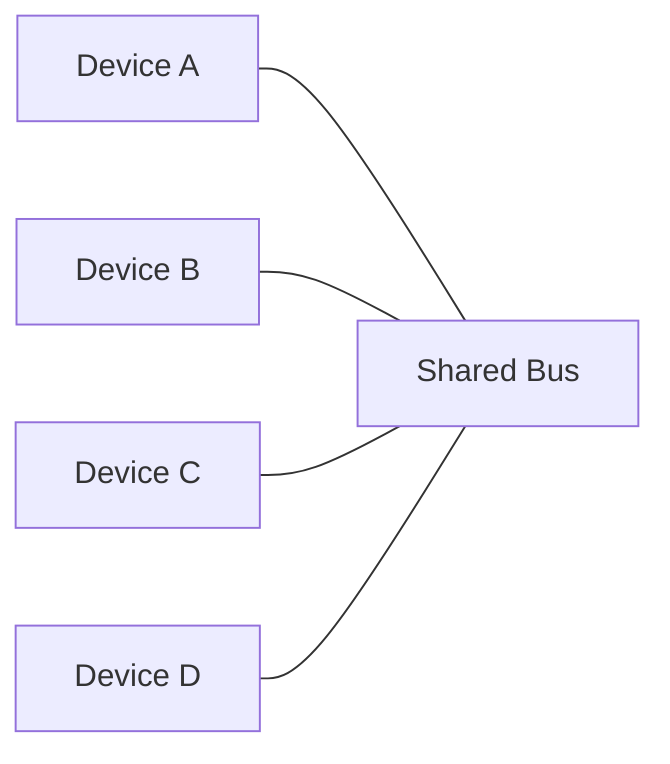
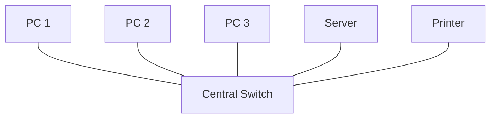
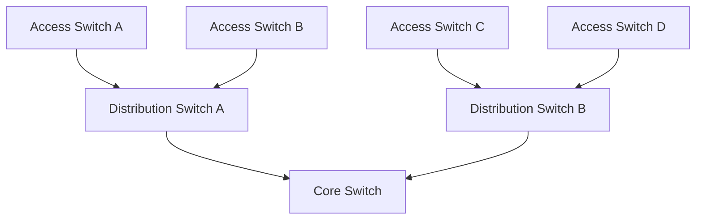
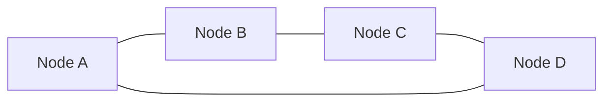
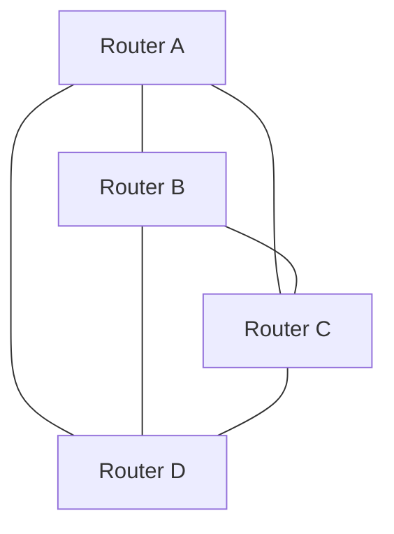

# Network Topologies

A network topology describes how network components and communication links are arranged.

Topology affects connectivity, fault tolerance, scalability, performance, cabling requirements, and operational complexity.

Two important perspectives are:

* **Physical topology:** The physical arrangement of devices, cables, ports, and infrastructure.
* **Logical topology:** How devices communicate and how traffic flows through the network.

A physical layout does not always reveal the logical traffic path.

# 🗁 Point-to-Point Topology

A point-to-point connection directly connects two endpoints over a communication link.

**Advantages**

* Simple to understand and troubleshoot.
* Dedicated link capacity between endpoints.
* Useful for router interconnections and dedicated circuits.

**Disadvantages**

* A link failure interrupts communication across that connection.
* Connecting many devices directly requires many links.

**Examples:** A dedicated router-to-router link or a direct fiber connection between two locations.

# 🗁 Bus Topology

A bus topology connects multiple devices to a shared communication medium.

There is only one main cable (Main Cable or Bus) and all computers and devices are connected to it.

**Advantages**

* Historically required relatively little cabling.
* Simple for small, legacy installations.

**Disadvantages**

* A failure in the main shared medium can affect the entire segment.
* Shared capacity limits simultaneous communication.
* Fault isolation can be difficult.
* Requires appropriate termination in traditional coaxial Ethernet implementations.

Bus topology is primarily of historical interest in modern enterprise Ethernet networks.

# 🗁 Star Topology

A star topology connects each endpoint to a central device.

The most popular topology. There is a central device (such as a switch) and each computer or device is directly connected to that central switch.

**Advantages**

* Easy to add or remove endpoints.
* A single endpoint-link failure usually affects only that endpoint.
* Centralized monitoring and troubleshooting.
* Well suited to switched Ethernet.

**Disadvantages**

* The central switch can become a single point of failure.
* Requires individual links from endpoints to the central device.

Star topology is common in homes, offices, and data-center access networks.

# 🗁 Extended Star or Tree Topology

An extended star connects multiple access switches to distribution or core devices.

This is a larger form of star topology. It is created by connecting multiple access switches to a core (core/distribution) switch.

**Advantages**

* Supports hierarchical network design.
* Scales to many access switches and endpoints.
* Enables separation of access, distribution, and core functions.

**Disadvantages**

* Failure of an upstream device may disconnect an entire downstream branch.
* Design errors can introduce bottlenecks or loops.
* Larger networks require careful redundancy and routing or switching design.

Hierarchical designs are common in campus and enterprise networks.

# 🗁 Ring Topology

A ring connects each device to neighboring devices, forming a closed loop.

Here, each device connects to the two devices next to it, forming a closed ring or circle. Data travels in one direction to its destination.

**Advantages**

* Can provide predictable paths in appropriately designed systems.
* Some ring technologies support protection mechanisms and rapid recovery.

**Disadvantages**

* Without protection, a link or node failure may disrupt the ring.
* Changes and fault isolation can be more complex than in a simple star.

Ring arrangements are used in certain industrial, transport, and carrier networks.

# 🗁 Mesh Topology

A mesh connects devices through multiple paths.

### Full Mesh

Every device has a direct connection to every other device.

The total number of physical cables for $n$ devices is:

$$L = \frac{n(n-1)}{2}$$

Example: For 4 devices, the total connections needed would be $\frac{4 \times 3}{2} = 6$.

A full mesh of four devices requires six links.

**Advantages**

* Multiple alternative paths.
* High potential resilience.
* Useful for critical interconnections.

**Disadvantages**

* Link count grows rapidly.
* More interfaces, cabling, and configuration are required.
* Operational complexity increases with scale.

### Partial Mesh

Only selected/important devices have multiple connections, not all of them.

Partial mesh designs often provide a practical balance between resilience and cost.

# 🗁 Hybrid Topology

When two or more different topologies are combined to create a network, it is called a hybrid topology.

For example, an organization might use star topology within buildings and partial mesh links between core routers.

Hybrid designs are common because real networks must accommodate different physical environments, cost constraints, and availability requirements.

# 🖆 Topology Comparison

| Topology       | Main strength                 | Main limitation                               |
| -------------- | ----------------------------- | --------------------------------------------- |
| Point-to-point | Simplicity                    | Link failure affects that connection          |
| Bus            | Historically economical       | Shared-medium failure and contention          |
| Star           | Easy management and expansion | Central-device dependency                     |
| Tree           | Hierarchical scalability      | Upstream failure can affect branches          |
| Ring           | Structured connectivity       | Requires suitable recovery mechanisms         |
| Full mesh      | Many direct alternative paths | High cost and complexity                      |
| Partial mesh   | Balanced redundancy and cost  | Some paths remain dependent on shared devices |
| Hybrid         | Flexible design               | Requires more planning                        |

# 🖆 Physical Versus Logical Topology

### Physical Topology

Where and how cables and devices are physically connected.

* **In simple terms:** It is the **real or exterior layout** of the network.
* **Definition:** Physical topology describes how cables, devices (such as computers, switches, routers), and ports are physically installed and connected in real life.
* **Example:** If you look around and see all computers connected via cables to a central switch in the middle, it physically forms a **Star Topology**.

### Logical Topology

How data or traffic moves internally.

* **In simple terms:** It is the **path of internal data movement** within the network.
* **Definition:** Logical topology describes how data or traffic actually flows from one device to another inside the network, or how devices share a communication domain.
* **Key Point:** Regardless of how the setup looks physically from the outside, the internal data flow or logical behavior can be completely different.

### Understand with Examples

**Switch and VLAN Example**

* **Physically:** In an office, all 10 computers are connected to a central switch using cables (which visually looks like a **Star Topology**).

* **Logically:** If you configure **VLANs** using software inside the switch, 5 PCs will be isolated into one network while the remaining 5 PCs belong to another network. Even though everyone is physically connected to the same switch, logically they operate in two completely separate broadcast domains or networks.

**Wireless Network Example:**

* **Physically:** All Wi-Fi Access Points are connected to the main switch using physical cables.

* **Logically:** How computers or smartphones communicate and transfer data depends on the Wi-Fi password, SSID, and IP configuration—not on the physical cabling.

# 🖆 Redundancy, Loops, and Fault Tolerance

Redundancy provides alternate devices or links when a component fails.

However, redundant Layer-2 (Ethernet) paths can create switching loops. Ethernet switching networks use mechanisms such as Spanning Tree Protocol (STP) to prevent persistent forwarding loops.

Layer-3 networks can use routing protocols or alternate routes to provide path redundancy.

Redundancy must be designed, configured, and tested; simply adding more cables does not guarantee resilience.

# 🖆 Practical Lab: Network Design for a Small Office

**Scenario:** Need to connect 20 PCs, 2 printers, 2 Wi-Fi access points, 1 server, and 1 router.

 **STEP-1: Suitable Topology:** A Star or Extended Star topology is the most suitable.

* **Core Infrastructure:** A 24-port or 48-port Managed Switch should be used as the central device.

**STEP-2: Wi-Fi:** Access points will be connected to the switch using cables.

* **Single Point of Failure:** If the central switch or router fails, the entire office network may go down.

**STEP-3: Ways to Increase Resilience:** Use 2 switches and maintain redundant (alternative) links between them.

**VLAN Usage:**

* **VLAN 10 (Employees):** For employee PCs and printers.
* **VLAN 20 (Servers):** For server security.
* **VLAN 30 (Guest Wi-Fi):** For guest Wi-Fi, so they cannot access company servers or PCs.

# 🖆 Review Questions and Answers

#### What is the difference between physical and logical topology?

Physical topology refers to how cables and devices are physically arranged. Logical topology refers to how data actually flows internally through the network.

#### Why is star topology so popular in Ethernet LANs?

Because if a single PC or cable fails, the entire network does not go down, and adding new PCs is very easy.

#### How many cables/links are required for a full mesh network of 5 devices?

Formula: $\frac{5 \times (5-1)}{2} = 10$ links.

#### What is the difference between full mesh and partial mesh?

In a full mesh, every device is directly connected to all other devices. In a partial mesh, redundant links exist only between certain key/critical devices.

* **Why do redundant cables or links at Layer 2 cause issues?**
  * Because they can create switching loops that slow down or completely paralyze the entire network.

#### What is the purpose of hierarchical network design?

To divide a large network into 3 layers—Access, Distribution, and Core—making it easier to manage, faster, and simple to scale.
