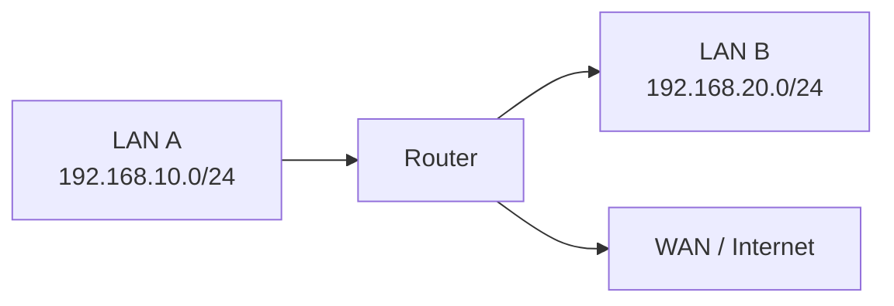

# Networking Devices

Networking devices connect endpoints, forward traffic, extend network access, and enforce communication policies.

Understanding the role of each device is essential for designing networks, troubleshooting connectivity, and configuring infrastructure.

# 🗁 Network Interface Card (NIC)

A Network Interface Card provides a device with network connectivity.

Types include:

* Ethernet NIC.
* Wi-Fi adapter.
* Fiber-optic network interface.
* Virtual network interface.


A NIC transmits and receives signals through its supported medium and implements relevant link-layer functions.

**Important:** A MAC address identifies a link-layer interface address in a particular context; it should not be treated as a permanent, globally unique identifier for a physical computer. Addresses may be changed, randomized, locally administered, or shared through virtualization.

# 🗁 Repeater

A repeater regenerates or retransmits signals to extend the usable reach of a communication medium.

Traditional Ethernet repeaters operate at the physical layer.


They do not make forwarding decisions based on IP addresses or MAC-address tables.

# 🗁 Hub

A hub is a multiport repeater that repeats incoming signals to other ports.

Characteristics:

* Operates at the physical layer.
* Does not learn MAC addresses.
* Shares the medium among connected devices.
* Typically creates one collision domain in traditional half-duplex Ethernet.
* Provides no traffic isolation between ports.

Hubs are largely obsolete in modern Ethernet LANs, where switches are used instead.

# 🗁 Bridge

A bridge connects Layer-2 network segments and forwards Ethernet frames based on MAC addresses.

A bridge learns source MAC addresses and associates them with ports.

Its forwarding behavior commonly includes:

* Forwarding known unicast frames toward the learned destination port.
* Flooding unknown unicast frames within the relevant Layer 2 domain.
* Flooding broadcast frames within the relevant broadcast domain, subject to VLAN and policy boundaries.

A bridge can reduce unnecessary traffic between segments compared with a hub.

# 🗁 Switch

A network switch is commonly a multiport Layer 2 forwarding device.

Its primary functions include:

* Learning source MAC addresses.
* Maintaining a MAC address table.
* Forwarding known unicast frames.
* Flooding broadcast and unknown unicast frames where appropriate.
* Separating traffic into VLANs when supported and configured.

Managed switches may also support:

* VLANs and 802.1Q trunking.
* Spanning Tree Protocol.
* Link aggregation.
* Port security or access-control features.
* Quality of Service (QoS).
* Monitoring and diagnostics.

**Examples:**

Suppose a switch learns these addresses:

| MAC address         | Switch port |
| ------------------- | ----------- |
| `02:00:00:00:00:11` | Port 1      |
| `02:00:00:00:00:22` | Port 2      |
| `02:00:00:00:00:33` | Port 3      |

If a frame enters Port-1 with destination `02:00:00:00:00:22`, the switch can forward it through Port-2 if the entry is valid and the VLAN and forwarding state permit it.

A Layer-2 switch does not normally route traffic between IP subnets unless it also provides Layer-3 functionality.

# 🗁 Router

A router forwards IP packets between networks using routing information.

Its functions can include:

* Selecting routes based on the destination IP address.
* Forwarding packets through an appropriate interface or next hop.
* Decrementing IPv4 TTL or IPv6 Hop Limit during normal forwarding.
* Connecting LANs to WANs.
* Performing NAT when configured.
* Applying firewall rules and traffic policies when supported.

**Example**



A router connects distinct IP networks. The networks may be physically separate or logically separated by VLANs.

# 🗁 Layer 3 Switch

A Layer-3 switch combines Ethernet switching with IP routing capabilities.

Common applications include:

* Routing between VLANs.
* Routing between campus subnets.
* High-speed forwarding within enterprise networks.

The actual features available depend on the hardware, software, and licensing.

# 🗁 Wireless Access Point (AP)

A wireless access point connects Wi-Fi clients to a network infrastructure.

Common functions include:

* Advertising a wireless network name (SSID).
* Associating wireless clients.
* Handling wireless authentication and encryption.
* Bridging client traffic to a wired LAN or another configured network.

An AP is not necessarily a router. Some products combine an AP, router, firewall, and switch in one device.

# 🗁 Modem and Optical Network Terminal (ONT)

### Modem

A modem converts signals or adapts data for transmission over a particular access technology. The exact function depends on the medium and service.

Examples include cable and DSL modems.

### Optical Network Terminal (ONT)

An ONT terminates a fiber access connection at the customer premises, commonly in Passive Optical Network (PON) deployments.

The ONT may provide Ethernet interfaces or other subscriber-facing services.

A modem or ONT does not necessarily perform routing. It may operate in a bridged or routed configuration depending on the service and device.

# 🗁 Firewall

A firewall enforces traffic policies between systems or network zones.

Depending on its design, a firewall may inspect:

* Source and destination IP addresses.
* Protocols and port numbers.
* Connection state.
* Application-level characteristics.
* User or device identity.

Firewalls may be dedicated appliances, software services, or features integrated into routers.

# 🗁 Proxy Server

A proxy acts as an intermediary for requests.

* **Forward proxy:** Represents or mediates requests from clients toward external destinations.
* **Reverse proxy:** Receives client requests on behalf of backend servers.

Proxies can support access control, caching, traffic inspection, application delivery, and load balancing.

# 🗁 Load Balancer

A load balancer distributes traffic across multiple backend servers or services.

Common approaches include:

* Round robin.
* Weighted distribution.
* Least connections.
* Health-check-based server selection.
* Layer 4 or Layer 7 traffic distribution.

Load balancing can improve capacity and availability, but it does not automatically eliminate every single point of failure.

# 🗁 Gateway

The word *gateway* has several meanings.

A **default gateway** in an IP host configuration is the router or Layer-3 next hop used for destinations not reached through more-specific routes.

In broader networking terminology, a gateway can translate between protocols, applications, or systems.

A router may serve as a default gateway, but not every device described as a gateway is simply a router.

# 🖆 Network Devices Compared

| Device         | Primary function                         | Typical layer or role                      |
| -------------- | ---------------------------------------- | ------------------------------------------ |
| NIC            | Connects an endpoint to a network        | Physical and data-link functions           |
| Repeater       | Regenerates signals                      | Layer 1                                    |
| Hub            | Repeats signals to multiple ports        | Layer 1                                    |
| Bridge         | Forwards frames between Layer 2 segments | Layer 2                                    |
| Switch         | Forwards frames using MAC learning       | Primarily Layer 2                          |
| Router         | Forwards IP packets between networks     | Layer 3                                    |
| Layer 3 switch | Switching and IP routing                 | Layers 2 and 3                             |
| Access point   | Provides Wi-Fi access                    | Primarily Layer 2, with wireless functions |
| Modem          | Adapts signals for an access medium      | Depends on technology                      |
| ONT            | Terminates a fiber access link           | Access technology dependent                |
| Firewall       | Enforces traffic policy                  | Varies by implementation                   |
| Proxy          | Mediates requests                        | Often Layer 7                              |
| Load balancer  | Distributes traffic across backends      | Layer 4 or Layer 7                         |
| Gateway        | Connects or translates between systems   | Depends on purpose                         |

The OSI layer descriptions are useful conceptual guides; real devices frequently implement functions across multiple layers.

# 🖆 Practical Lab: Identify Your Network Path

### Objective

Identify the devices between your computer and a remote IP destination.

### Windows

```powershell
ipconfig
tracert 1.1.1.1
```

### Linux

```bash
ip addr
ip route
traceroute 1.1.1.1
```

If `traceroute` is not installed, use an available equivalent such as `tracepath`.

### Tasks

1. Identify your network interface.
2. Record your default gateway.
3. Identify whether the computer uses Ethernet or Wi-Fi.
4. Run a `traceroute` to a destination.
5. Explain the likely role of your local router and upstream routers.

**Traceroute** results depend on how routers handle probe packets and return ICMP messages. Missing hops do not necessarily mean traffic cannot pass through them.

# 🖆 Review Questions and Answers

#### How does a switch differ from a hub?

* **Hub (Layer 1):** Operates at the Physical layer. It is a "dumb" device that broadcasts any incoming data packet to every single port, regardless of the destination, leading to high network congestion and a shared collision domain.

* **Switch (Layer 2):** Operates at the Data Link layer. It uses **MAC addresses** to learn which device is connected to which port and forwards data packets only to the specific destination port, creating separate collision domains and improving efficiency.

#### What information does a router use to forward packets?

A router primarily uses the **destination IP address** contained in the packet header. It cross-references this IP address with its routing table to determine the best path or "next hop" to reach the destination network.

#### How does a Layer 3 switch differ from a traditional Layer 2 switch?

* **Layer 2 Switch:** Operates strictly at the Data Link layer, switching traffic within the same LAN/VLAN using MAC addresses.

* **Layer 3 Switch:** Combines the switching speed of a Layer 2 switch with the routing capabilities of a router. It can route traffic between different VLANs or subnets using IP addresses without needing an external router.

#### What is the difference between a wireless AP and a router?

* **Wireless Access Point (AP):** Acts as a bridge that connects wireless devices to an existing wired network, operating at Layer 2.

* **Router:** Connects distinct networks together (such as a home LAN to the WAN/Internet), routes traffic between them at Layer 3, and often provides additional services like NAT, DHCP, and firewall security. *(Note: Consumer "Wi-Fi routers" combine both devices into one box).*

#### What is the role of an ONT in a fiber network?

An **Optical Network Terminal (ONT)** is used in FTTH (Fiber-to-the-Home) networks to terminate the fiber optic cable. Its primary role is to convert incoming optical signals (light pulses) from the ISP into electrical Ethernet signals that local routers and computers can understand, and vice versa.

#### How do a forward proxy and reverse proxy differ?

* **Forward Proxy:** Sits in front of **clients** (users). It intercepts outbound requests to the internet to hide client IP addresses, filter content, or cache web pages.

* **Reverse Proxy:** Sits in front of **backend servers**. It intercepts incoming requests from the public internet, distributes the load across multiple servers (load balancing), handles SSL encryption, and protects the origin servers from direct exposure.

#### Why is the default gateway important?

The default gateway is the node (usually a router) that serves as the access point or IP router connecting a local network (LAN) to external networks, including the Internet. Without a default gateway, devices on a local subnet would be completely isolated and unable to communicate with anything outside their own local network segment.

#### What is the purpose of a subnet mask in an IP address?

A subnet mask divides an IP address into two parts: the **network portion** and the **host portion**. It tells a device which part of the IP address identifies the local network and which part identifies the specific host device, allowing routers to determine whether a destination IP is on the local network or requires routing.

#### What does a CIDR notation like `/24` mean in an IP address (e.g., `192.168.1.0/24`)?

CIDR (Classless Inter-Domain Routing) notation `/24` represents the **prefix length**, which means the first **24 bits** of the 32-bit IPv4 address are set as the network bits. In a `/24` subnet, this leaves 8 bits for hosts, supporting up to $2^8 - 2 = 254$ usable host addresses.

**For Example:**

The subnet mask for `192.168.31.52/24` is **`255.255.255.0`**.

How it is calculated

* The `/24` notation means that the first 24 bits of the 32-bit IPv4 address are set to '1' (On) and the remaining 8 bits are set to '0' (Off).
* Expressed in binary: `11111111.11111111.11111111.00000000`
* Converting these binary numbers to decimal gives:
* $11111111 = 255$
* $11111111 = 255$
* $11111111 = 255$
* $00000000 = 0$

As a result, the subnet mask is: **`255.255.255.0`**

**Additional information regarding this network:**

* **Network Address:** `192.168.31.0`
* **Broadcast Address:** `192.168.31.255`
* **Usable IP Range:** `192.168.31.1` to `192.168.31.254`
* **Total Usable Hosts (Devices):** 254

#### How do public IP addresses differ from private IP addresses?

* **Public IP Addresses:** Globally unique IP addresses assigned by an ISP that are routable across the public internet.

* **Private IP Addresses:** Non-routable IP addresses (defined in ranges like `10.0.0.0/8`, `172.16.0.0/12`, and `192.168.0.0/16`) used within closed local networks. Devices with private IPs use **NAT (Network Address Translation)** on a router to access the internet.

#### What is the difference between the `ping` and `traceroute` (`tracert`) network troubleshooting commands?

* **`ping`:** Tests basic reachability and round-trip time (latency) between your device and a target destination using ICMP (Internet Control Message Protocol) echo requests.

* **`traceroute` (`tracert`):** Maps the exact path and lists every router hop a packet takes to reach its destination, helping you pinpoint where delays or packet drops occur along the route.

#### What is the function of DHCP (Dynamic Host Configuration Protocol)?

DHCP is a network management protocol used to **automatically assign IP addresses**, subnet masks, default gateways, and DNS server information to devices joining a network. This eliminates the need for manual static IP configuration on every device.
