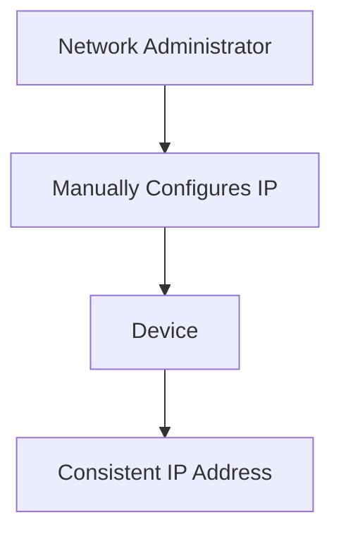
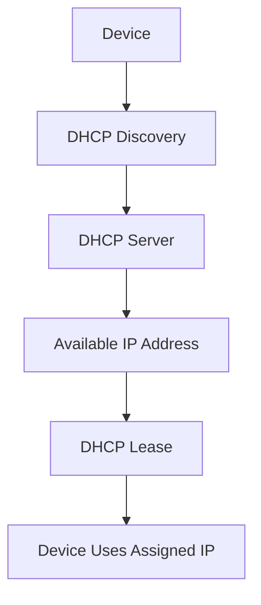
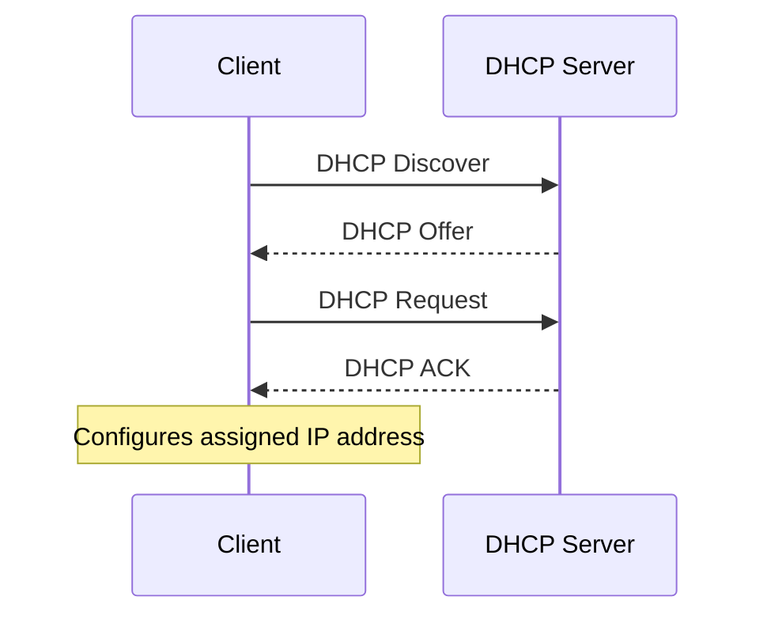
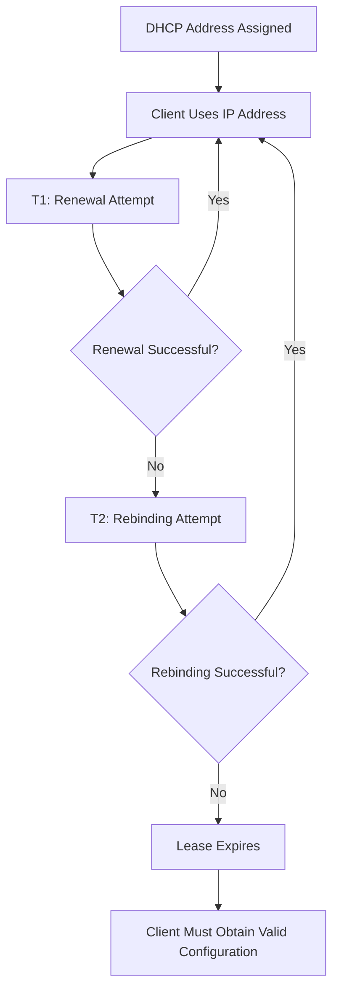

# Static vs Dynamic IP Address

An IP address identifies a device or network interface within an IP network. Depending on how the address is assigned and managed, it can be classified as **static** or **dynamic**.

A **static IP address** is manually configured or assigned through a reservation so that the device consistently uses the same address.

A **dynamic IP address** is automatically assigned by a network service, commonly DHCP, and may change over time.

Understanding these two assignment methods is important for network administration, server configuration, DHCP management, routing, and troubleshooting.

# 🗁 What Is a Static IP Address?

A **static IP address** is an IP address that is intended to remain consistent for a device or network interface.

It is commonly configured manually by a network administrator or assigned through a DHCP reservation.

For example, an internal web server might always use:

```text
IP Address:      192.168.1.100
Subnet Mask:     255.255.255.0
Default Gateway: 192.168.1.1
DNS Server:      1.1.1.1
```

When the server restarts, it continues using the same configured address.

### 🖆 Characteristics of Static IP Addresses

* Remain consistent until an administrator changes the configuration or assignment.
* Can be manually configured on a device.
* Can also be assigned through a DHCP reservation.
* Useful for services that need predictable IP addresses.
* Require careful address management to prevent conflicts.
* Commonly used for servers, routers, switches, printers, and network infrastructure.

### 🖆 Example: Static IP Assignment

Consider an office network:

```text
Network: 192.168.1.0/24
Gateway: 192.168.1.1
```

An administrator assigns fixed addresses to important devices:

| Device | IP Address | Assignment |
| --- | --- | --- |
| Router | `192.168.1.1` | Static |
| Web Server | `192.168.1.10` | Static |
| Database Server | `192.168.1.11` | Static |
| Network Printer | `192.168.1.20` | Static |
| Administrator PC | `192.168.1.30` | Static |

These devices retain their assigned addresses unless their configurations are changed.

# 🗁 What Is a Dynamic IP Address?

A **dynamic IP address** is an IP address assigned automatically to a device by a network service.

In IPv4 networks, the most common mechanism is the **Dynamic Host Configuration Protocol (DHCP)**.

Instead of manually configuring an IP address on every device, a DHCP server manages a pool of available addresses and leases them to clients.

For example:

```text
DHCP Server: 192.168.1.1

Available Address Pool:
192.168.1.100 - 192.168.1.200
```

When a laptop connects to the network, the DHCP server may assign:

```text
IP Address:      192.168.1.100
Subnet Mask:     255.255.255.0
Default Gateway: 192.168.1.1
DNS Server:      192.168.1.1
```

Another device may receive `192.168.1.101`.

The assigned address is leased for a specified period. It may remain the same across multiple connections, but it is not guaranteed to remain unchanged indefinitely.

### 🖆 Characteristics of Dynamic IP Addresses

* Assigned automatically through DHCP.
* Managed using an address pool.
* Usually provided with a lease duration.
* Can change when a lease expires or a different address is assigned.
* Reduce manual configuration.
* Help administrators manage large networks efficiently.

### 🖆 Example: Dynamic IP Assignment

Consider a home network:

```text
Network: 192.168.1.0/24
Gateway: 192.168.1.1
DHCP Pool: 192.168.1.100 - 192.168.1.200
```

Connected devices receive addresses automatically:

| Device | Assigned IP | Assignment |
| --- | --- | --- |
| Laptop | `192.168.1.100` | Dynamic |
| Smartphone | `192.168.1.101` | Dynamic |
| Desktop | `192.168.1.102` | Dynamic |
| Tablet | `192.168.1.103` | Dynamic |
| Smart TV | `192.168.1.104` | Dynamic |

The DHCP server manages these assignments and their lease information.

# 🗁 Static vs Dynamic IP Addresses

Both assignment methods provide IP addresses to network interfaces, but they differ in how those addresses are configured and managed.

### 🖆 Comparison Table

| Feature | Static IP | Dynamic IP |
| --- | --- | --- |
| Assignment | Manual or reserved | Automatically assigned |
| Management | Administrator-controlled | DHCP-controlled |
| Address consistency | Intended to remain fixed | May change |
| Configuration effort | Higher for manual configuration | Lower |
| Address conflicts | Possible with incorrect manual configuration | Reduced through DHCP management |
| Lease duration | No DHCP lease when manually configured | Usually lease-based |
| Scalability | Requires careful manual planning | Suitable for large networks |
| Common usage | Servers and infrastructure | Workstations and mobile devices |

### 🖆 Visual Comparison

Static assignment:



Dynamic assignment:



# 🗁 How DHCP Assigns Dynamic IP Addresses

DHCP is a network protocol used to automatically configure network devices.

A DHCP server can provide several configuration parameters, including:

* IP address.
* Subnet mask or prefix information.
* Default gateway.
* DNS server addresses.
* Lease duration.
* Additional network configuration options.

DHCP for IPv4 is defined by RFC 2131.

### 🖆 DHCP DORA Process

The initial DHCP address allocation process is commonly known as **DORA**:

* Discover
* Offer
* Request
* Acknowledge

Each stage represents a message exchanged between the DHCP client and server.

### 🖆 DHCP Discover

The client broadcasts a DHCP Discover message to find available DHCP servers.

```text
Client → DHCP Server

DHCP Discover
```

A client that does not yet have an IP address typically uses:

```text
Source IP:      0.0.0.0
Destination IP: 255.255.255.255
```

### 🖆 DHCP Offer

The DHCP server responds with a DHCP Offer message containing an available IP address and configuration parameters.

```text
DHCP Server → Client

DHCP Offer

Offered IP: 192.168.1.100
Subnet Mask: 255.255.255.0
Gateway: 192.168.1.1
DNS: 192.168.1.1
```

### 🖆 DHCP Request

The client sends a DHCP Request message indicating which offered address it wants to use.

```text
Client → DHCP Server

DHCP Request

Requested IP: 192.168.1.100
```

During the initial allocation process, this message is typically broadcast so DHCP servers can identify which offer the client selected.

### 🖆 DHCP Acknowledge

The DHCP server sends a DHCP ACK message confirming the address assignment.

```text
DHCP Server → Client

DHCP ACK

Assigned IP: 192.168.1.100
Lease Time: 86400 seconds
```

The client can now configure and use the assigned address.

### 🖆 Complete DHCP DORA Diagram



### 🖆 DHCP Ports

DHCP for IPv4 uses UDP:

| Component | UDP Port |
| --- | ---: |
| DHCP Server | 67 |
| DHCP Client | 68 |

DHCP clients commonly send initial discovery messages using UDP source port 68 and destination port 67.

# 🗁 DHCP Lease and Renewal Process

A DHCP server does not necessarily assign an address permanently. Instead, it provides an address for a specific lease duration.

A **DHCP lease** defines how long a client may use an assigned IP address before renewing its configuration.

### 🖆 Example DHCP Lease

```text
Assigned IP: 192.168.1.100
Lease Duration: 24 Hours
Lease Time: 86400 Seconds
```

The client can use the address during the lease period, subject to the lease and network configuration.

### 🖆 Lease Renewal

DHCP clients generally attempt to renew their leases before expiration.

For the standard DHCPv4 lease process:

| Stage | Time | Description |
| --- | --- | --- |
| T1 | 50% of lease | Client attempts renewal with the original DHCP server. |
| T2 | 87.5% of lease | Client attempts rebinding with any available DHCP server. |
| Expiration | 100% of lease | Lease expires if renewal or rebinding fails. |

For a 24-hour lease:

```text
Lease Duration: 24 Hours

T1: 12 Hours
T2: 21 Hours
Expiration: 24 Hours
```

At T1, the client normally sends a DHCP Request to the server that originally granted the lease.

If renewal fails, the client can enter the rebinding stage at T2 and attempt to renew with any available DHCP server.

If the lease expires without successful renewal, the client must stop using that leased address and obtain valid configuration.

### 🖆 DHCP Lease Lifecycle



# 🗁 DHCP Reservation

A **DHCP reservation** is a configuration on a DHCP server that associates a specific client identifier, commonly a MAC address in Ethernet-based networks, with a predetermined IP address.

The DHCP server continues to manage the assignment, but the client receives the same reserved address when requesting configuration.

### 🖆 Example

Suppose a network printer has this MAC address:

```text
MAC Address: AA:BB:CC:DD:EE:FF
```

An administrator creates a DHCP reservation:

```text
Reserved IP: 192.168.1.50
Client MAC:  AA:BB:CC:DD:EE:FF
```

Whenever the printer requests DHCP configuration, the server assigns the reserved address.

### 🖆 Static Configuration vs DHCP Reservation

| Feature | Manual Static IP | DHCP Reservation |
| --- | --- | --- |
| Configuration location | Device | DHCP server |
| Address assignment | Manually configured | DHCP |
| Consistent address | Yes | Yes, while reservation remains valid |
| Central management | Limited | Centralized |
| DHCP dependency | No | Yes |
| Configuration options | Managed locally | Provided by DHCP |

A DHCP reservation is often easier to manage in networks where centralized IP address administration is important.

# 🗁 Static IP Configuration on Ubuntu

Ubuntu uses Netplan on many installations to manage network configuration.

Netplan supports different network backends, commonly `systemd-networkd` and NetworkManager.

The following example configures a static IPv4 address using Netplan.

### 🖆 Inspect Network Interfaces

```bash
ip link show
```

Example interface name:

```text
enp0s3
```

Interface names vary depending on the system.

### 🖆 Inspect Existing Netplan Configuration

```bash
ls /etc/netplan/
```

Read the existing configuration file:

```bash
sudo cat /etc/netplan/*.yaml
```

### 🖆 Configure a Static IP Address

Open the appropriate Netplan YAML file:

```bash
sudo nano /etc/netplan/01-netcfg.yaml
```

Example configuration:

```yaml
network:
  version: 2
  ethernets:
    enp0s3:
      dhcp4: false
      addresses:
        - 192.168.1.100/24
      routes:
        - to: default
          via: 192.168.1.1
      nameservers:
        addresses:
          - 1.1.1.1
          - 8.8.8.8
```

Replace `enp0s3` with the actual interface name.

Configuration explanation:

| Parameter | Description |
| --- | --- |
| `dhcp4: false` | Disables DHCP for IPv4 on this interface. |
| `addresses` | Defines the static IP address and prefix. |
| `routes` | Defines the default route. |
| `via` | Specifies the default gateway. |
| `nameservers` | Defines DNS server addresses. |

### 🖆 Validate and Apply Configuration

Check the configuration:

```bash
sudo netplan generate
```

Apply it:

```bash
sudo netplan apply
```

For remote systems, `netplan try` can be used to test a configuration with an automatic rollback if it is not confirmed:

```bash
sudo netplan try
```

### 🖆 Verify the Static IP Address

```bash
ip addr show enp0s3
```

Check the routing table:

```bash
ip route
```

Check DNS configuration:

```bash
resolvectl status
```

# 🗁 Checking IP Configuration on Linux

Linux provides several commands for inspecting network configuration.

### 🖆 Display IPv4 Addresses

```bash
ip -4 addr show
```

### 🖆 Display IPv6 Addresses

```bash
ip -6 addr show
```

### 🖆 Display Routing Information

```bash
ip route
```

### 🖆 Display Network Interfaces

```bash
ip link show
```

### 🖆 Check DHCP Client and Lease Information

On systems using NetworkManager:

```bash
nmcli device status
```

Display connection details:

```bash
nmcli connection show
```

Display active device information:

```bash
nmcli device show
```

For systems using `systemd-networkd`:

```bash
networkctl status
```

Depending on the DHCP client and network backend, lease information may also be available in system-specific lease files or logs.

# 🗁 Static and Dynamic Public IP Addresses

Static and dynamic assignment is not limited to private IP addresses. Public IP addresses can also be assigned statically or dynamically.

### 🖆 Static Public IP

A static public IP address is assigned to a customer or organization with the expectation that it will remain consistent.

Example:

```text
Public IPv4: 203.0.113.10
```

Commonly used for:

* Public web servers.
* Business Internet connections.
* VPN endpoints.
* Remote network access.
* Services requiring a stable IP address.

### 🖆 Dynamic Public IP

A dynamic public IP address is assigned by an ISP and may change over time.

Example:

```text
Previous Public IP: 198.51.100.10
New Public IP:      198.51.100.25
```

The address may change because of lease expiration, ISP network changes, reconnecting, or address-management policies.

### 🖆 Comparison

| Feature | Static Public IP | Dynamic Public IP |
| --- | --- | --- |
| Address stability | Consistent | May change |
| ISP assignment | Usually specifically allocated | Usually automatically assigned |
| Remote access | Easier to configure | May require dynamic DNS |
| Hosting services | Convenient | Requires additional address management |
| Cost | May involve additional ISP charges | Often included in standard plans |
| Common usage | Businesses and hosted services | Residential Internet connections |

The actual availability and pricing of static public IP services depend on the ISP.

# 🗁 Advantages and Disadvantages

### 🖆 Static IP Advantages

* Predictable addressing.
* Convenient for hosting network services.
* Easier to configure fixed routing destinations.
* Useful for firewall rules based on known addresses.
* Suitable for infrastructure devices requiring stable management addresses.

### 🖆 Static IP Disadvantages

* Manual configuration can increase administrative effort.
* Incorrect configuration can create duplicate IP addresses.
* Address changes require manual updates when not centrally managed.
* Poor address planning can lead to inefficient utilization.

### 🖆 Dynamic IP Advantages

* Automatic network configuration.
* Centralized address management.
* Reduced manual administration.
* Efficient reuse of available address pools.
* Suitable for networks with many devices.

### 🖆 Dynamic IP Disadvantages

* Addresses may change over time.
* Services depending on fixed addresses may require additional configuration.
* DHCP server availability becomes important for new assignments and renewals.
* DHCP configuration errors can affect multiple clients.

# 🗁 Common Use Cases

### 🖆 When to Use Static IP Addresses

Static addressing is commonly appropriate for:

| Device or Service | Reason |
| --- | --- |
| Routers | Predictable gateway and management addresses. |
| Servers | Stable service addressing. |
| Network switches | Consistent management access. |
| Network printers | Predictable printer addresses. |
| Firewalls | Stable interface and routing configuration. |
| VPN endpoints | Stable connection destinations. |
| Network monitoring systems | Predictable management targets. |

### 🖆 When to Use Dynamic IP Addresses

Dynamic addressing is commonly appropriate for:

| Device or Service | Reason |
| --- | --- |
| Laptops | Automatic configuration when joining networks. |
| Smartphones | Simplified network connectivity. |
| Desktop computers | Centralized address assignment. |
| Tablets | Automatic network configuration. |
| Guest devices | Temporary network access. |
| IoT devices | Centralized address management where supported. |

# 🗁 Best Practices

* Maintain a documented IP addressing plan.
* Use static addresses or DHCP reservations for infrastructure devices that need predictable addresses.
* Use DHCP for ordinary client devices where appropriate.
* Keep manually configured addresses outside the DHCP dynamic pool, or explicitly exclude them from that pool.
* Avoid assigning the same IP address to multiple devices.
* Configure appropriate DHCP lease durations based on network usage.
* Monitor DHCP address-pool utilization.
* Use DHCP reservations when centralized management is preferable to manual configuration.
* Configure DHCP failover or redundancy where network availability requires it.
* Document gateway, subnet, DNS, and address assignment details.
* Review DHCP server logs when investigating address assignment problems.

# 🗁 Common Misconceptions

### 🖆 A Dynamic IP Address Always Changes

A dynamic IP address can remain the same for a long time.

DHCP does not guarantee that a client receives a different address each time it reconnects. The server may renew or reassign the same address.

### 🖆 A Static IP Must Always Be Configured Manually

A DHCP reservation can provide a consistent address without manually configuring the address on the client.

### 🖆 Static IP Addresses Are Automatically More Secure

Static addressing does not provide security by itself.

Network security depends on authentication, firewall policies, access controls, segmentation, monitoring, and other security mechanisms.

### 🖆 DHCP Assigns Only IP Addresses

DHCP can provide multiple network configuration parameters, including subnet masks, gateways, DNS servers, and lease information.

### 🖆 Static and Dynamic Addresses Can Only Be Private

Both public and private IP addresses can be assigned statically or dynamically.

# 🗁 Practical Exercises

### 🖆 Exercise: Identify Static and Dynamic Assignments

Classify the following scenarios:

| Scenario | Assignment Type |
| --- | --- |
| A server manually configured with `192.168.1.10` | ? |
| A laptop receiving `192.168.1.100` from DHCP | ? |
| A printer reserved as `192.168.1.50` in DHCP | ? |
| A router interface configured manually with `10.0.0.1` | ? |
| A smartphone receiving an address automatically | ? |

### 🖆 Exercise: Design a DHCP Address Pool

Consider the following network:

```text
Network: 192.168.10.0/24
Gateway: 192.168.10.1
```

Design an address assignment plan with:

* Static infrastructure addresses from `192.168.10.2` to `192.168.10.49`.
* DHCP reservations from `192.168.10.50` to `192.168.10.79`.
* Dynamic DHCP addresses from `192.168.10.100` to `192.168.10.200`.

Answer these questions:

* Which addresses should be excluded from the dynamic DHCP pool?
* Why should the gateway have a predictable address?
* What happens if a manually configured device uses an address already assigned by DHCP?
* Why might a DHCP reservation be preferable for a network printer?

### 🖆 Exercise: Inspect Ubuntu Network Configuration

Run:

```bash
ip addr show
ip route
nmcli device status
nmcli device show
```

Identify:

* Your active network interface.
* Its IPv4 address and prefix.
* Its IPv6 addresses.
* Its default gateway.
* Whether NetworkManager reports DHCP-related configuration.

If your system uses `systemd-networkd`, inspect:

```bash
networkctl status
```

### 🖆 Exercise: Configure a Static IP

Create a Netplan configuration for the following network:

```text
Interface: enp0s3
IP Address: 192.168.10.50/24
Gateway: 192.168.10.1
DNS: 1.1.1.1
```

Validate and apply the configuration, then verify the resulting address and routing table.

# 🗁 Interview Questions

### 🖆 Basic Questions

* What is a static IP address?
* What is a dynamic IP address?
* What is the difference between static and dynamic IP addressing?
* What is DHCP?
* What is a DHCP lease?
* Which transport protocol and ports does DHCPv4 use?
* What does DORA stand for?

### 🖆 Intermediate Questions

* How does a DHCP server assign an IP address?
* What happens when a DHCP lease expires?
* What is a DHCP reservation?
* What is the difference between manual static configuration and DHCP reservation?
* Why are static addresses commonly used for servers?
* Why are dynamic addresses commonly used for client devices?

### 🖆 Advanced Questions

* Explain the DHCP lease renewal process, including T1 and T2.
* What happens when a DHCP server becomes unavailable?
* How can two DHCP servers coordinate address allocation?
* What is DHCP failover?
* How would you troubleshoot a client that cannot obtain an IPv4 address?
* How would you design DHCP scopes for multiple VLANs?
* What is DHCP relay, and why is it needed when clients and DHCP servers are on different subnets?

# 🗁 Summary

Static and dynamic IP addressing are two methods of assigning network addresses.

* **Static IP:** An address configured manually or assigned consistently through a reservation.
* **Dynamic IP:** An address automatically assigned and managed through DHCP.
* **DHCP:** A protocol that provides IP addresses and other network configuration parameters.
* **DORA:** The Discover, Offer, Request, and Acknowledge process used during initial DHCPv4 address allocation.
* **DHCP Lease:** Defines the period during which a client may use its assigned address.
* **DHCP Reservation:** Associates a client identifier with a predetermined address on the DHCP server.

Static addressing is useful for infrastructure and services that require predictable addresses, while dynamic addressing simplifies configuration and management for ordinary client devices.

# 🗁 References

* [RFC 2131 — Dynamic Host Configuration Protocol](https://datatracker.ietf.org/doc/html/rfc2131)
* [RFC 2132 — DHCP Options and BOOTP Vendor Extensions](https://datatracker.ietf.org/doc/html/rfc2132)
* [RFC 8415 — DHCP for IPv6 (DHCPv6)](https://datatracker.ietf.org/doc/html/rfc8415)
* [Ubuntu Server Documentation — Networking](https://documentation.ubuntu.com/server/explanation/networking/)
* [Netplan Documentation](https://netplan.readthedocs.io/)
* [NetworkManager Documentation](https://networkmanager.dev/docs/)
