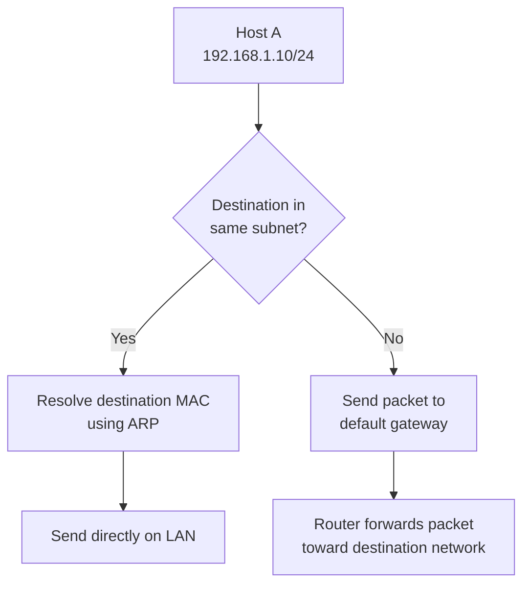

# Subnet Mask

A **subnet mask** is a 32-bit value used in IPv4 networking to identify which bits of an IP address represent the network portion and which bits represent the host portion.

It allows devices and routers to determine whether an IP address belongs to the local network or a different network.

Subnet masks are fundamental to IP addressing, subnetting, routing, network segmentation, and network troubleshooting.

For example:

```text
IP Address:  192.168.1.10
Subnet Mask: 255.255.255.0
```

The subnet mask indicates that the first 24 bits represent the network portion, while the remaining 8 bits represent the host portion.

# 🗁 What Is a Subnet Mask?

A subnet mask is a 32-bit number associated with an IPv4 address.

It identifies two logical parts of an IPv4 address:

* **Network portion:** Identifies the network or subnet.
* **Host portion:** Identifies an individual interface within that subnet.

A subnet mask uses consecutive binary `1` bits for the network portion, followed by consecutive binary `0` bits for the host portion.

### 🖆 Example

```text
IP Address:  192.168.1.10
Subnet Mask: 255.255.255.0
CIDR:        /24
```

Binary representation:

```text
IP Address:
11000000.10101000.00000001.00001010

Subnet Mask:
11111111.11111111.11111111.00000000
```

The subnet mask contains:

* 24 network bits.
* 8 host bits.

Therefore, the network prefix is `/24`.

### 🖆 Visual Representation

```text
IPv4 Address: 192.168.1.10/24

Network Portion             Host Portion
        |                         |
        v                         v
11000000.10101000.00000001.00001010
11111111.11111111.11111111.00000000
<----------- 24 bits -----------><8>
```

# 🗁 Why Do We Need a Subnet Mask?

An IPv4 address alone does not tell a device which bits identify its network and which bits identify its host.

The subnet mask provides this information.

Without the correct subnet mask, a device cannot reliably determine whether a destination IPv4 address belongs to its local subnet.

### 🖆 Example

Consider a computer with:

```text
IP Address:  192.168.1.10
Subnet Mask: 255.255.255.0
```

Its network address is:

```text
192.168.1.0/24
```

Now consider two destination addresses:

```text
Destination A: 192.168.1.20
Destination B: 192.168.2.20
```

The computer determines:

| Destination | Network | Communication |
| --- | --- | --- |
| `192.168.1.20` | `192.168.1.0/24` | Local network |
| `192.168.2.20` | `192.168.2.0/24` | Different network |

For a local destination, the computer sends traffic directly to the destination through the local network.

For a different network, the computer forwards traffic to its configured default gateway.

# 🗁 How a Subnet Mask Works

A subnet mask works through a bitwise AND operation between an IPv4 address and its subnet mask.

The result is the **network address**.

### 🖆 Bitwise AND Operation

The AND operation follows these rules:

| Input A | Input B | Result |
| --- | --- | --- |
| 0 | 0 | 0 |
| 0 | 1 | 0 |
| 1 | 0 | 0 |
| 1 | 1 | 1 |

In simple terms, the result is `1` only when both input bits are `1`.

### 🖆 Example

Given:

```text
IP Address:  192.168.1.10
Subnet Mask: 255.255.255.0
```

Convert both addresses into binary:

```text
IP Address:
11000000.10101000.00000001.00001010

Subnet Mask:
11111111.11111111.11111111.00000000
```

Perform the AND operation:

```text
11000000.10101000.00000001.00001010
AND
11111111.11111111.11111111.00000000
------------------------------------------------
11000000.10101000.00000001.00000000
```

Convert the result into decimal:

```text
Network Address: 192.168.1.0
```

Therefore:

```text
192.168.1.10/24
Network: 192.168.1.0
```

# 🗁 Network Bits and Host Bits

An IPv4 address contains 32 bits.

The subnet mask divides these bits into network and host portions.

### 🖆 Network Bits

Network bits identify the subnet to which an IP address belongs.

In a subnet mask, network bits are represented by binary `1`.

### 🖆 Host Bits

Host bits identify an individual interface within the subnet.

In a subnet mask, host bits are represented by binary `0`.

### 🖆 Example: /24

```text
Subnet Mask: 255.255.255.0

Binary:
11111111.11111111.11111111.00000000

Network Bits: 24
Host Bits:     8
```

The number of host bits determines the number of possible address combinations.

For a conventional IPv4 subnet with network and broadcast addresses reserved:

\[
\text{Usable Hosts} = 2^h - 2
\]

Where:

* \(h\) = number of host bits.
* \(2^h\) = total address combinations.
* Subtract 2 for the network and broadcast addresses.

For `/24`:

\[
2^8 - 2 = 254
\]

Therefore, a conventional `/24` subnet supports 254 usable host addresses.

# 🗁 Subnet Mask in Binary

A subnet mask is represented by 32 bits divided into four 8-bit octets.

Each octet can represent a decimal value from `0` to `255`.

However, valid subnet masks must contain consecutive `1` bits followed by consecutive `0` bits across the complete 32-bit value.

### 🖆 Binary-to-Decimal Conversion

Each bit in an octet represents a power of two:

| Bit Position | Decimal Value |
| --- | ---: |
| 1 | 128 |
| 2 | 64 |
| 3 | 32 |
| 4 | 16 |
| 5 | 8 |
| 6 | 4 |
| 7 | 2 |
| 8 | 1 |

A complete octet containing eight `1` bits equals:

\[
128+64+32+16+8+4+2+1=255
\]

### 🖆 Valid Subnet Mask Octets

The possible decimal values of a subnet mask octet are:

| Binary | Decimal |
| --- | ---: |
| `00000000` | 0 |
| `10000000` | 128 |
| `11000000` | 192 |
| `11100000` | 224 |
| `11110000` | 240 |
| `11111000` | 248 |
| `11111100` | 252 |
| `11111110` | 254 |
| `11111111` | 255 |

These values are valid because they preserve the required sequence of network bits followed by host bits.

### 🖆 Example: /26

A `/26` subnet mask contains 26 network bits and 6 host bits.

```text
Binary:
11111111.11111111.11111111.11000000

Decimal:
255.255.255.192
```

Therefore:

```text
CIDR:       /26
Subnet Mask: 255.255.255.192
Network Bits: 26
Host Bits:     6
```

# 🗁 Common Subnet Masks

The following table shows commonly used IPv4 subnet masks and their corresponding CIDR prefixes.

### 🖆 Subnet Mask Reference Table

| CIDR | Subnet Mask | Network Bits | Host Bits | Usable Hosts* |
| --- | --- | ---: | ---: | ---: |
| `/8` | `255.0.0.0` | 8 | 24 | 16,777,214 |
| `/9` | `255.128.0.0` | 9 | 23 | 8,388,606 |
| `/10` | `255.192.0.0` | 10 | 22 | 4,194,302 |
| `/11` | `255.224.0.0` | 11 | 21 | 2,097,150 |
| `/12` | `255.240.0.0` | 12 | 20 | 1,048,574 |
| `/13` | `255.248.0.0` | 13 | 19 | 524,286 |
| `/14` | `255.252.0.0` | 14 | 18 | 262,142 |
| `/15` | `255.254.0.0` | 15 | 17 | 131,070 |
| `/16` | `255.255.0.0` | 16 | 16 | 65,534 |
| `/17` | `255.255.128.0` | 17 | 15 | 32,766 |
| `/18` | `255.255.192.0` | 18 | 14 | 16,382 |
| `/19` | `255.255.224.0` | 19 | 13 | 8,190 |
| `/20` | `255.255.240.0` | 20 | 12 | 4,094 |
| `/21` | `255.255.248.0` | 21 | 11 | 2,046 |
| `/22` | `255.255.252.0` | 22 | 10 | 1,022 |
| `/23` | `255.255.254.0` | 23 | 9 | 510 |
| `/24` | `255.255.255.0` | 24 | 8 | 254 |
| `/25` | `255.255.255.128` | 25 | 7 | 126 |
| `/26` | `255.255.255.192` | 26 | 6 | 62 |
| `/27` | `255.255.255.224` | 27 | 5 | 30 |
| `/28` | `255.255.255.240` | 28 | 4 | 14 |
| `/29` | `255.255.255.248` | 29 | 3 | 6 |
| `/30` | `255.255.255.252` | 30 | 2 | 2 |
| `/31` | `255.255.255.254` | 31 | 1 | 2* |
| `/32` | `255.255.255.255` | 32 | 0 | 1* |

<text>*Conventional usable-host counts subtract network and broadcast addresses. `/31` point-to-point networks use both addresses as endpoint addresses under RFC 3021. A `/32` identifies one individual IPv4 address and does not represent a conventional multi-host subnet.</text>

### 🖆 Important Observations

* Increasing the CIDR prefix increases the number of network bits.
* Increasing the number of network bits decreases the number of host bits.
* Fewer host bits mean fewer available addresses.
* More host bits mean a larger address block.
* `/32` represents a single IPv4 address.
* `/31` is commonly used for point-to-point IPv4 links.

# 🗁 How to Calculate the Network Address

The network address identifies the subnet to which an IPv4 address belongs.

It is calculated using a bitwise AND operation between the IP address and subnet mask.

### 🖆 Example

Given:

```text
IP Address:  192.168.10.75
Subnet Mask: 255.255.255.192
CIDR:        /26
```

Convert the relevant octet into binary:

```text
IP Address:
192.168.10.75

Last Octet:
75 = 01001011

Subnet Mask:
255.255.255.192

Last Octet:
192 = 11000000
```

Perform the AND operation:

```text
01001011
AND
11000000
--------
01000000
```

Convert the result:

```text
01000000 = 64
```

Therefore:

```text
Network Address: 192.168.10.64
```

The complete network is:

```text
192.168.10.64/26
```

# 🗁 How to Calculate the Broadcast Address

A **broadcast address** is an IPv4 address used to send a packet to all hosts on a particular subnet.

For a conventional subnet, the broadcast address is calculated by setting all host bits to `1`.

### 🖆 Example

Given:

```text
IP Address:  192.168.10.75
Subnet Mask: 255.255.255.192
CIDR:        /26
```

We already calculated:

```text
Network Address: 192.168.10.64
```

The host portion contains 6 bits.

Set all host bits to `1`:

```text
Network Address:
11000000.10101000.00001010.01000000

Broadcast Address:
11000000.10101000.00001010.01111111
```

Convert the last octet:

```text
01111111 = 127
```

Therefore:

```text
Broadcast Address: 192.168.10.127
```

# 🗁 How to Calculate the Usable Host Range

The usable host range represents the addresses that can ordinarily be assigned to individual hosts in a conventional IPv4 subnet.

It excludes:

* Network address.
* Broadcast address.

### 🖆 Example

Given:

```text
Network Address:   192.168.10.64
Broadcast Address: 192.168.10.127
```

The usable host range is:

```text
First Usable IP: 192.168.10.65
Last Usable IP:  192.168.10.126
```

Number of host bits:

\[
h=32-26=6
\]

Total address combinations:

\[
2^6=64
\]

Conventional usable hosts:

\[
2^6-2=62
\]

### 🖆 Complete Subnet Information

| Property | Value |
| --- | --- |
| IP Address | `192.168.10.75` |
| CIDR | `/26` |
| Subnet Mask | `255.255.255.192` |
| Network Address | `192.168.10.64` |
| Broadcast Address | `192.168.10.127` |
| First Usable IP | `192.168.10.65` |
| Last Usable IP | `192.168.10.126` |
| Total Addresses | 64 |
| Usable Hosts | 62 |

# 🗁 Subnet Mask and CIDR Notation

CIDR stands for **Classless Inter-Domain Routing**.

CIDR notation represents the number of consecutive network bits using a slash followed by a prefix length.

For example:

```text
192.168.1.10/24
```

The `/24` indicates that the first 24 bits belong to the network prefix.

The equivalent subnet mask is:

```text
255.255.255.0
```

### 🖆 Conversion Examples

| CIDR | Subnet Mask |
| --- | --- |
| `/8` | `255.0.0.0` |
| `/16` | `255.255.0.0` |
| `/20` | `255.255.240.0` |
| `/24` | `255.255.255.0` |
| `/25` | `255.255.255.128` |
| `/26` | `255.255.255.192` |
| `/27` | `255.255.255.224` |
| `/28` | `255.255.255.240` |
| `/30` | `255.255.255.252` |
| `/32` | `255.255.255.255` |

### 🖆 CIDR vs Subnet Mask

| CIDR Notation | Dotted-Decimal Subnet Mask |
| --- | --- |
| `/24` | `255.255.255.0` |
| `/26` | `255.255.255.192` |
| `/28` | `255.255.255.240` |

Both representations describe the same network prefix.

CIDR is commonly used in routing tables, IP allocation, subnetting, and network configuration.

# 🗁 Subnet Mask vs Default Gateway

A subnet mask and default gateway serve different purposes.

### 🖆 Subnet Mask

The subnet mask identifies the network and host portions of an IPv4 address.

It helps a device determine whether a destination belongs to its local subnet.

### 🖆 Default Gateway

The default gateway is the router or Layer 3 device to which a host forwards traffic when the destination is outside its local subnet and no more specific route is available.

### 🖆 Example

```text
IP Address:      192.168.1.10
Subnet Mask:     255.255.255.0
Default Gateway: 192.168.1.1
```

| Configuration | Purpose |
| --- | --- |
| IP Address | Identifies the host interface. |
| Subnet Mask | Identifies the local subnet. |
| Default Gateway | Provides a next hop for destinations outside the local subnet. |

# 🗁 Subnet Mask in Network Communication

A device uses its IP address and subnet mask to determine whether a destination is local or remote.

### 🖆 Communication Within the Same Subnet

Consider:

```text
Host A: 192.168.1.10/24
Host B: 192.168.1.20/24
```

Both addresses belong to:

```text
192.168.1.0/24
```

Host A can communicate directly with Host B over the local network.

For Ethernet, Host A uses ARP to discover Host B's MAC address if it is not already available in its ARP cache.

### 🖆 Communication With a Different Subnet

Consider:

```text
Host A: 192.168.1.10/24
Host B: 192.168.2.20/24
Gateway: 192.168.1.1
```

The hosts belong to different subnets.

Host A sends the packet to its default gateway, which routes it toward Host B's network.

### 🖆 Communication Diagram



The destination IP address remains the remote host's address during ordinary routing. The Ethernet destination MAC address is the next-hop device's MAC address on the local link.

# 🗁 Subnet Mask in Linux

Linux represents IPv4 subnet information using both dotted-decimal masks and CIDR prefix lengths.

### 🖆 Display IPv4 Address and Prefix

```bash
ip -4 addr show
```

Example:

```text
inet 192.168.1.10/24 brd 192.168.1.255 scope global enp0s3
```

Here:

* `192.168.1.10` is the IPv4 address.
* `/24` is the network prefix length.
* `192.168.1.255` is the broadcast address.

### 🖆 Display Routing Information

```bash
ip route
```

Example:

```text
default via 192.168.1.1 dev enp0s3
192.168.1.0/24 dev enp0s3 proto kernel scope link
```

The routing table shows the directly connected subnet and the default route.

### 🖆 Calculate the Network Address

Install `ipcalc` on Ubuntu:

```bash
sudo apt update
sudo apt install ipcalc
```

Calculate subnet information:

```bash
ipcalc 192.168.10.75/26
```

The output includes information such as:

* Network address.
* Broadcast address.
* Subnet mask.
* Host range.
* Number of addresses.

### 🖆 Calculate the Subnet Mask Using Python

```python
import ipaddress

network = ipaddress.ip_network("192.168.10.75/26", strict=False)

print("Network Address:", network.network_address)
print("Subnet Mask:", network.netmask)
print("Broadcast Address:", network.broadcast_address)
print("Prefix Length:", network.prefixlen)
print("Total Addresses:", network.num_addresses)
print("Usable Hosts:", network.num_addresses - 2)
```

Example output:

```text
Network Address: 192.168.10.64
Subnet Mask: 255.255.255.192
Broadcast Address: 192.168.10.127
Prefix Length: 26
Total Addresses: 64
Usable Hosts: 62
```

The final calculation uses the conventional IPv4 host-count rule for this ordinary subnet. Special cases such as `/31` and `/32` require separate handling.

# 🗁 Common Mistakes

### 🖆 Confusing IP Address and Subnet Mask

An IP address identifies a network interface, while a subnet mask identifies the network prefix associated with that address.

### 🖆 Assuming Every Subnet Uses /24

Networks can use different prefix lengths depending on their addressing requirements.

Examples include:

```text
192.168.1.0/24
192.168.1.0/26
192.168.1.0/28
```

### 🖆 Using an Invalid Subnet Mask

A valid subnet mask must contain consecutive network bits followed by consecutive host bits.

For example:

```text
255.255.255.192
```

is valid, but:

```text
255.255.255.100
```

is not a valid contiguous subnet mask.

### 🖆 Confusing Network and Broadcast Addresses

For a conventional subnet, the network address identifies the subnet, while the broadcast address targets all hosts on that subnet.

Neither is normally assigned to an individual host.

### 🖆 Forgetting the Default Gateway

A correct IP address and subnet mask do not automatically provide connectivity to other networks.

A suitable route, usually a default gateway, is needed for destinations outside the local subnet.

# 🗁 Best Practices

* Plan subnet sizes according to actual host requirements.
* Use CIDR notation when documenting network prefixes.
* Avoid unnecessary oversized subnets.
* Maintain a consistent IP addressing plan.
* Document network addresses, subnet masks, gateways, and broadcast addresses.
* Use subnet calculators to verify complex calculations.
* Check for overlapping address ranges when connecting networks.
* Configure the correct subnet mask on every interface.
* Use `/31` where appropriate for IPv4 point-to-point links.
* Use `/32` for host routes and individual address identification where appropriate.

# 🗁 Practical Exercises

### 🖆 Exercise: Convert CIDR to Subnet Mask

Convert the following prefixes into dotted-decimal subnet masks:

| CIDR | Subnet Mask |
| --- | --- |
| `/8` | ? |
| `/16` | ? |
| `/20` | ? |
| `/24` | ? |
| `/25` | ? |
| `/26` | ? |
| `/27` | ? |
| `/28` | ? |
| `/30` | ? |

### 🖆 Exercise: Identify Network and Host Bits

Given:

```text
IP Address: 192.168.10.75/26
```

Determine:

* Subnet mask.
* Number of network bits.
* Number of host bits.
* Total number of addresses.
* Conventional usable host count.

### 🖆 Exercise: Calculate Network Information

Given:

```text
IP Address: 192.168.20.130
Subnet Mask: 255.255.255.192
```

Calculate:

* CIDR prefix.
* Network address.
* Broadcast address.
* First usable IP address.
* Last usable IP address.
* Total addresses.
* Usable host addresses.

### 🖆 Exercise: Determine Local or Remote Destination

A computer has:

```text
IP Address: 10.10.10.10/24
Gateway: 10.10.10.1
```

Classify each destination as local or remote:

| Destination IP | Classification |
| --- | --- |
| `10.10.10.20` | ? |
| `10.10.10.200` | ? |
| `10.10.11.10` | ? |
| `10.10.9.50` | ? |
| `8.8.8.8` | ? |

### 🖆 Exercise: Linux Subnet Inspection

Run:

```bash
ip -4 addr show
ip route
ipcalc 192.168.10.75/26
```

Identify the subnet mask, network address, broadcast address, and host range for the example network.

# 🗁 Interview Questions

### 🖆 Basic Questions

* What is a subnet mask?
* Why do we need a subnet mask?
* How many bits are in an IPv4 subnet mask?
* What is the difference between network bits and host bits?
* What is the subnet mask for `/24`?
* What is the subnet mask for `/26`?
* What is the purpose of a network address?

### 🖆 Intermediate Questions

* How does a subnet mask determine whether a destination is local or remote?
* How do you calculate a network address?
* How do you calculate a broadcast address?
* How many usable hosts are available in a `/27` subnet?
* What is the relationship between subnet masks and CIDR?
* What is the difference between a subnet mask and a default gateway?

### 🖆 Advanced Questions

* Explain how a bitwise AND operation calculates a network address.
* Why must subnet mask bits be contiguous?
* What happens when a host has an incorrect subnet mask?
* Why are `/31` networks useful for point-to-point links?
* What is a `/32` route?
* How does a router use network prefixes when forwarding packets?
* What problems can overlapping subnets create in a network?

# 🗁 Summary

A subnet mask is a 32-bit value that divides an IPv4 address into network and host portions.

Key concepts:

* A subnet mask identifies the network prefix.
* Binary `1` bits represent the network portion.
* Binary `0` bits represent the host portion.
* A bitwise AND operation calculates the network address.
* The broadcast address is formed by setting all host bits to `1` in a conventional subnet.
* The number of host bits determines the address capacity.
* CIDR notation represents the number of network bits.
* Devices use subnet information to determine whether traffic should be delivered locally or forwarded to a router.

Understanding subnet masks is essential before learning CIDR notation, subnetting, and supernetting.

# 🗁 References

* [RFC 950 — Internet Standard Subnetting Procedure](https://datatracker.ietf.org/doc/html/rfc950)
* [RFC 4632 — Classless Inter-domain Routing (CIDR)](https://datatracker.ietf.org/doc/html/rfc4632)
* [RFC 3021 — Using 31-Bit Prefixes on IPv4 Point-to-Point Links](https://datatracker.ietf.org/doc/html/rfc3021)
* [RFC 1812 — Requirements for IP Version 4 Routers](https://datatracker.ietf.org/doc/html/rfc1812)
* [Linux `ip` Command Manual](https://man7.org/linux/man-pages/man8/ip.8.html)
* [Python `ipaddress` Documentation](https://docs.python.org/3/library/ipaddress.html)
