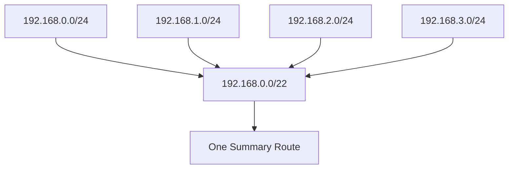

# CIDR Notation

**CIDR (Classless Inter-Domain Routing)** is a method of representing IP network addresses using a prefix length instead of relying on traditional class-based addressing.

CIDR uses a slash (`/`) followed by a number to indicate how many bits belong to the network portion of an IP address.

For example:

```text
192.168.1.10/24
```

Here:

* `192.168.1.10` is the IPv4 address.
* `/24` indicates that the first 24 bits represent the network prefix.
* The remaining 8 bits represent the host portion.

CIDR is essential for subnetting, supernetting, route aggregation, IP address allocation, and modern routing protocols.

# 🗁 What Is CIDR?

CIDR is an IP addressing and routing system that allows networks to be divided and represented using flexible prefix lengths.

Before CIDR, IPv4 networks were commonly allocated using fixed address classes:

* Class A
* Class B
* Class C

These classes provided fixed network boundaries and often resulted in inefficient address allocation.

CIDR replaced the traditional class-based allocation model with variable-length network prefixes.

### 🖆 Example

```text
192.168.1.0/24
```

This represents an IPv4 network with:

```text
Network Prefix: 24 bits
Host Portion:    8 bits
Subnet Mask:     255.255.255.0
Total Addresses: 256
Usable Hosts:    254
```

The `/24` prefix provides the same network boundary as the subnet mask `255.255.255.0`.

### 🖆 CIDR Notation Structure

```text
192.168.1.10/24
            |
            |
            v
      Prefix Length
```

The prefix length specifies how many leading bits are used to identify the network.

# 🗁 Why Was CIDR Introduced?

Traditional classful addressing allocated IPv4 networks in fixed sizes.

For example:

| Class | Default Prefix | Default Subnet Mask |
| --- | --- | --- |
| Class A | `/8` | `255.0.0.0` |
| Class B | `/16` | `255.255.0.0` |
| Class C | `/24` | `255.255.255.0` |

This approach created address-allocation problems.

An organization needing 500 IP addresses could not efficiently use a traditional Class C network with only 254 conventional usable host addresses.

It might receive a much larger Class B allocation, wasting a significant number of addresses.

CIDR solved this problem by allowing networks to use variable-length prefixes.

### 🖆 Example: Flexible Address Allocation

Suppose an organization requires approximately 500 host addresses.

A `/23` network provides:

```text
Network: 192.168.10.0/23
Subnet Mask: 255.255.254.0
Total Addresses: 512
Usable Hosts: 510
```

This is a better fit than allocating a traditional Class B-sized network.

### 🖆 Benefits of CIDR

* More efficient IPv4 address allocation.
* Flexible network sizing.
* Supports Variable Length Subnet Masking (VLSM).
* Enables route aggregation.
* Reduces unnecessary routing table entries.
* Removes dependence on traditional classful network boundaries.

# 🗁 Understanding CIDR Prefix Length

An IPv4 address contains 32 bits.

CIDR uses a prefix length between `/0` and `/32`.

The prefix length determines how many bits represent the network.

### 🖆 Example: /24

```text
IPv4 Address:
192.168.1.10

Binary:
11000000.10101000.00000001.00001010

CIDR Prefix:
/24

Network Bits: 24
Host Bits:     8
```

Visual representation:

```text
11000000.10101000.00000001.00001010
<----------- Network -----------><Host>
              24 bits             8 bits
```

### 🖆 Prefix Length Rules

| Prefix | Network Bits | Host Bits |
| --- | ---: | ---: |
| `/8` | 8 | 24 |
| `/16` | 16 | 16 |
| `/20` | 20 | 12 |
| `/24` | 24 | 8 |
| `/25` | 25 | 7 |
| `/26` | 26 | 6 |
| `/27` | 27 | 5 |
| `/28` | 28 | 4 |
| `/29` | 29 | 3 |
| `/30` | 30 | 2 |
| `/31` | 31 | 1 |
| `/32` | 32 | 0 |

A larger prefix means more network bits and fewer host bits.

A smaller prefix means fewer network bits and more host bits.

# 🗁 CIDR and Subnet Masks

CIDR notation and subnet masks represent the same network boundary in different formats.

CIDR uses a prefix length, while a subnet mask uses dotted-decimal notation.

### 🖆 Conversion Examples

| CIDR | Subnet Mask |
| --- | --- |
| `/8` | `255.0.0.0` |
| `/9` | `255.128.0.0` |
| `/10` | `255.192.0.0` |
| `/11` | `255.224.0.0` |
| `/12` | `255.240.0.0` |
| `/13` | `255.248.0.0` |
| `/14` | `255.252.0.0` |
| `/15` | `255.254.0.0` |
| `/16` | `255.255.0.0` |
| `/17` | `255.255.128.0` |
| `/18` | `255.255.192.0` |
| `/19` | `255.255.224.0` |
| `/20` | `255.255.240.0` |
| `/21` | `255.255.248.0` |
| `/22` | `255.255.252.0` |
| `/23` | `255.255.254.0` |
| `/24` | `255.255.255.0` |
| `/25` | `255.255.255.128` |
| `/26` | `255.255.255.192` |
| `/27` | `255.255.255.224` |
| `/28` | `255.255.255.240` |
| `/29` | `255.255.255.248` |
| `/30` | `255.255.255.252` |
| `/31` | `255.255.255.254` |
| `/32` | `255.255.255.255` |

### 🖆 Example

```text
CIDR:        192.168.1.0/26
Subnet Mask: 255.255.255.192
```

Both describe the same IPv4 network.

# 🗁 Network Bits and Host Bits

CIDR divides an IPv4 address into network and host portions.

The network portion identifies the subnet, while the host portion identifies an address within that subnet.

### 🖆 Example: /26

```text
IPv4 Address: 192.168.1.70/26

Binary:
11000000.10101000.00000001.01000110

Network Bits: 26
Host Bits:     6
```

Visual representation:

```text
11000000.10101000.00000001.01000110
<-------------- 26 bits ----------><6>
             Network              Host
```

The number of host bits determines the total address capacity:

\[
\text{Total Addresses} = 2^h
\]

Where \(h\) represents the number of host bits.

For `/26`:

\[
h = 32 - 26 = 6
\]

\[
2^6 = 64
\]

Therefore, the subnet contains 64 IPv4 addresses.

For a conventional IPv4 subnet:

\[
\text{Usable Hosts} = 2^h - 2
\]

\[
2^6 - 2 = 62
\]

# 🗁 CIDR Address Capacity

The CIDR prefix determines how many IPv4 addresses belong to a network block.

### 🖆 Address Capacity Table

| CIDR | Total Addresses | Conventional Usable Hosts |
| --- | ---: | ---: |
| `/8` | 16,777,216 | 16,777,214 |
| `/9` | 8,388,608 | 8,388,606 |
| `/10` | 4,194,304 | 4,194,302 |
| `/11` | 2,097,152 | 2,097,150 |
| `/12` | 1,048,576 | 1,048,574 |
| `/13` | 524,288 | 524,286 |
| `/14` | 262,144 | 262,142 |
| `/15` | 131,072 | 131,070 |
| `/16` | 65,536 | 65,534 |
| `/17` | 32,768 | 32,766 |
| `/18` | 16,384 | 16,382 |
| `/19` | 8,192 | 8,190 |
| `/20` | 4,096 | 4,094 |
| `/21` | 2,048 | 2,046 |
| `/22` | 1,024 | 1,022 |
| `/23` | 512 | 510 |
| `/24` | 256 | 254 |
| `/25` | 128 | 126 |
| `/26` | 64 | 62 |
| `/27` | 32 | 30 |
| `/28` | 16 | 14 |
| `/29` | 8 | 6 |
| `/30` | 4 | 2 |
| `/31` | 2 | 2* |
| `/32` | 1 | 1* |

<text>*`/31` uses both addresses as endpoint addresses on point-to-point links under RFC 3021. `/32` represents one individual address rather than a conventional multi-host subnet.</text>

### 🖆 Important Formula

For an IPv4 prefix:

\[
h = 32 - p
\]

\[
\text{Total Addresses} = 2^h
\]

Where:

* \(h\) = host bits.
* \(p\) = CIDR prefix length.

For conventional subnets with network and broadcast addresses:

\[
\text{Usable Hosts} = 2^h - 2
\]

Special cases such as `/31` and `/32` must be handled separately.

# 🗁 How to Calculate a Network Address

The network address is calculated using a bitwise AND operation between an IP address and its subnet mask.

### 🖆 Example

Given:

```text
IP Address: 192.168.10.75/26
```

First, identify the subnet mask:

```text
CIDR:        /26
Subnet Mask: 255.255.255.192
```

Convert the final octets into binary:

```text
IP Address:
75 = 01001011

Subnet Mask:
192 = 11000000
```

Perform the AND operation:

```text
01001011
AND
11000000
--------
01000000
```

Convert the result into decimal:

```text
01000000 = 64
```

Therefore:

```text
Network Address: 192.168.10.64
```

The network is:

```text
192.168.10.64/26
```

# 🗁 How to Calculate a Broadcast Address

The broadcast address is the final address in a conventional IPv4 subnet.

It is calculated by setting all host bits to `1`.

### 🖆 Example

Given:

```text
Network: 192.168.10.64/26
```

The prefix length is 26, so:

```text
Network Bits: 26
Host Bits:     6
```

The network address in the final octet is:

```text
01000000
```

Set all six host bits to `1`:

```text
01111111
```

Convert to decimal:

```text
01111111 = 127
```

Therefore:

```text
Broadcast Address: 192.168.10.127
```

# 🗁 CIDR Block Boundaries

CIDR blocks must start at valid network boundaries.

The block size determines where each subnet begins and ends.

### 🖆 Block Size Formula

For a subnet mask with a partially used octet:

\[
\text{Block Size} = 256 - \text{Mask Octet}
\]

For example, a `/26` prefix has this subnet mask:

```text
255.255.255.192
```

Calculate the block size:

\[
256 - 192 = 64
\]

Therefore, the subnet boundaries in the final octet are:

```text
0
64
128
192
```

### 🖆 /26 Network Boundaries

| Network Address | Broadcast Address | Usable Host Range |
| --- | --- | --- |
| `192.168.10.0/26` | `192.168.10.63` | `.1 - .62` |
| `192.168.10.64/26` | `192.168.10.127` | `.65 - .126` |
| `192.168.10.128/26` | `192.168.10.191` | `.129 - .190` |
| `192.168.10.192/26` | `192.168.10.255` | `.193 - .254` |

Each subnet contains 64 addresses.

### 🖆 /27 Network Boundaries

A `/27` subnet has this mask:

```text
255.255.255.224
```

Block size:

\[
256 - 224 = 32
\]

Network boundaries:

```text
0
32
64
96
128
160
192
224
```

Each subnet contains 32 addresses and conventionally supports 30 usable hosts.

# 🗁 CIDR Block Examples

### 🖆 Example: /24

```text
Network: 192.168.1.0/24
Mask:    255.255.255.0
```

| Property | Value |
| --- | --- |
| Network Address | `192.168.1.0` |
| First Usable IP | `192.168.1.1` |
| Last Usable IP | `192.168.1.254` |
| Broadcast Address | `192.168.1.255` |
| Total Addresses | 256 |
| Usable Hosts | 254 |

### 🖆 Example: /25

```text
Network: 192.168.1.0/25
Mask:    255.255.255.128
```

| Property | Value |
| --- | --- |
| Network Address | `192.168.1.0` |
| First Usable IP | `192.168.1.1` |
| Last Usable IP | `192.168.1.126` |
| Broadcast Address | `192.168.1.127` |
| Total Addresses | 128 |
| Usable Hosts | 126 |

### 🖆 Example: /28

```text
Network: 192.168.1.64/28
Mask:    255.255.255.240
```

| Property | Value |
| --- | --- |
| Network Address | `192.168.1.64` |
| First Usable IP | `192.168.1.65` |
| Last Usable IP | `192.168.1.78` |
| Broadcast Address | `192.168.1.79` |
| Total Addresses | 16 |
| Usable Hosts | 14 |

### 🖆 Example: /30

```text
Network: 192.168.1.100/30
Mask:    255.255.255.252
```

| Property | Value |
| --- | --- |
| Network Address | `192.168.1.100` |
| First Usable IP | `192.168.1.101` |
| Last Usable IP | `192.168.1.102` |
| Broadcast Address | `192.168.1.103` |
| Total Addresses | 4 |
| Usable Hosts | 2 |

# 🗁 CIDR and IP Routing

Routers use network prefixes to determine where packets should be forwarded.

A routing table contains destination prefixes and their associated next hops or outgoing interfaces.

CIDR makes it possible to represent networks using different prefix lengths.

### 🖆 Example Routing Table

| Destination Network | Next Hop | Interface |
| --- | --- | --- |
| `192.168.1.0/24` | Directly connected | `eth0` |
| `192.168.2.0/24` | `10.0.0.2` | `eth1` |
| `10.0.0.0/8` | `10.0.0.1` | `eth1` |
| `0.0.0.0/0` | `203.0.113.1` | `eth2` |

The route `0.0.0.0/0` is the default route.

### 🖆 Longest Prefix Match

When multiple routing table entries match a destination address, a router normally selects the matching route with the longest prefix.

This is called **Longest Prefix Match (LPM)**.

For example, consider these routes:

```text
10.0.0.0/8
10.10.0.0/16
10.10.10.0/24
```

A packet destined for:

```text
10.10.10.50
```

matches all three prefixes.

The router selects:

```text
10.10.10.0/24
```

because `/24` is the most specific matching prefix.

This is one of the fundamental mechanisms used in IP routing.

# 🗁 CIDR and Route Aggregation

CIDR allows multiple contiguous network prefixes to be represented by a larger summary prefix when their address ranges align correctly.

This is called **route aggregation** or **route summarization**.

It helps reduce routing table size and simplify routing information.

### 🖆 Example

Consider four consecutive networks:

```text
192.168.0.0/24
192.168.1.0/24
192.168.2.0/24
192.168.3.0/24
```

These networks can be summarized as:

```text
192.168.0.0/22
```

The summary covers:

```text
192.168.0.0 - 192.168.3.255
```

### 🖆 Route Aggregation Diagram



The aggregation is valid because the four `/24` networks are contiguous and aligned on a `/22` boundary.

# 🗁 CIDR in Linux

Linux provides several tools for inspecting and calculating CIDR network information.

### 🖆 Display Network Interfaces

```bash
ip addr show
```

Example:

```text
inet 192.168.1.10/24 brd 192.168.1.255 scope global eth0
```

Here, `/24` represents the network prefix.

### 🖆 Display Routing Table

```bash
ip route
```

Example:

```text
default via 192.168.1.1 dev eth0
192.168.1.0/24 dev eth0 proto kernel scope link
```

### 🖆 Install ipcalc

On Ubuntu:

```bash
sudo apt update
sudo apt install ipcalc
```

### 🖆 Calculate CIDR Information

```bash
ipcalc 192.168.10.75/26
```

This displays the subnet mask, network address, broadcast address, host range, and other subnet information.

### 🖆 Calculate CIDR Information Using Python

Python's built-in `ipaddress` module can calculate network details.

```python
import ipaddress

network = ipaddress.ip_network("192.168.10.75/26", strict=False)

print("Network:", network)
print("Network Address:", network.network_address)
print("Subnet Mask:", network.netmask)
print("Broadcast Address:", network.broadcast_address)
print("Prefix Length:", network.prefixlen)
print("Total Addresses:", network.num_addresses)
print("Host Addresses:", list(network.hosts()))
```

For large networks, avoid converting `network.hosts()` into a list because it can consume substantial memory. Iterate over it instead.

# 🗁 Common Mistakes

### 🖆 Confusing an IP Address With a Network Address

An IP address with a prefix does not necessarily represent the network address.

For example:

```text
192.168.1.75/26
```

The corresponding network address is:

```text
192.168.1.64/26
```

### 🖆 Assuming Every Prefix Uses Full Octets

CIDR prefixes can end at any bit position.

For example:

```text
/25
/26
/27
/28
```

These prefixes divide an octet rather than ending at an octet boundary.

### 🖆 Forgetting Network Boundaries

A valid CIDR network must start at an appropriate address boundary.

For example:

```text
192.168.1.64/26
```

is a valid network boundary, while `192.168.1.75/26` identifies a host address inside that network.

### 🖆 Using the Wrong Host Formula

The conventional formula:

\[
2^h - 2
\]

does not apply universally to every prefix.

`/31` point-to-point networks use both addresses, while `/32` represents a single address.

### 🖆 Confusing CIDR With Subnetting

CIDR is an addressing and routing method.

Subnetting is the process of dividing an address block into smaller networks.

CIDR provides the flexible prefix notation used to represent those networks.

# 🗁 Best Practices

* Use CIDR notation when documenting IPv4 networks.
* Allocate address blocks according to actual network requirements.
* Avoid unnecessary address waste.
* Plan network boundaries before assigning addresses.
* Use route summarization where contiguous, aligned prefixes allow it.
* Avoid overlapping address allocations.
* Use the longest-prefix-match principle when analyzing routing tables.
* Verify calculations using `ipcalc` or Python's `ipaddress` module.
* Document network prefixes, subnet masks, gateways, and broadcast addresses.
* Understand `/31` and `/32` special cases when designing network links and routes.

# 🗁 Practical Exercises

### 🖆 Exercise: Convert CIDR to Subnet Masks

Convert these prefixes into dotted-decimal subnet masks:

| CIDR | Subnet Mask |
| --- | --- |
| `/16` | ? |
| `/20` | ? |
| `/22` | ? |
| `/24` | ? |
| `/25` | ? |
| `/26` | ? |
| `/27` | ? |
| `/28` | ? |
| `/30` | ? |

### 🖆 Exercise: Calculate Network Information

Given:

```text
IP Address: 192.168.50.140/26
```

Calculate:

* Subnet mask.
* Network address.
* Broadcast address.
* First usable IP address.
* Last usable IP address.
* Total addresses.
* Usable host addresses.

### 🖆 Exercise: Calculate Host Capacity

Determine the total address count and conventional usable host count for:

```text
/24
/25
/26
/27
/28
/29
/30
```

### 🖆 Exercise: Identify Network Boundaries

Calculate the network boundaries for:

```text
192.168.20.0/27
```

Identify all network addresses and broadcast addresses within the `192.168.20.0/24` range.

### 🖆 Exercise: Longest Prefix Match

Consider the following routing entries:

```text
10.0.0.0/8
10.10.0.0/16
10.10.10.0/24
```

Determine which route is selected for each destination:

| Destination IP | Selected Route |
| --- | --- |
| `10.20.1.10` | ? |
| `10.10.5.10` | ? |
| `10.10.10.50` | ? |
| `10.10.10.200` | ? |

### 🖆 Exercise: Linux CIDR Practice

Run:

```bash
ipcalc 192.168.50.140/26
ip route
ip -4 addr show
```

Compare the calculated network information with your actual interface configuration.

# 🗁 Interview Questions

### 🖆 Basic Questions

* What does CIDR stand for?
* What is CIDR notation?
* What does `/24` mean?
* What is the relationship between CIDR and subnet masks?
* How many bits are in an IPv4 address?
* How many usable hosts are available in a conventional `/26` subnet?
* What is the difference between a network address and a host address?

### 🖆 Intermediate Questions

* Why was CIDR introduced?
* How does CIDR improve IPv4 address allocation?
* What is Variable Length Subnet Masking?
* How do you calculate a network address from a CIDR prefix?
* How do you calculate the broadcast address?
* What is the difference between `/30` and `/31`?
* What is route aggregation?

### 🖆 Advanced Questions

* Explain how Longest Prefix Match works.
* How does CIDR reduce routing table size?
* What conditions are required to aggregate multiple network prefixes?
* Why must aggregated networks be contiguous and correctly aligned?
* What happens when multiple routes match the same destination?
* How does CIDR support modern routing protocols such as OSPF and BGP?
* What is the difference between CIDR and classful addressing?

# 🗁 Summary

CIDR is a flexible method of representing IPv4 networks using prefix lengths.

Key concepts:

* CIDR stands for Classless Inter-Domain Routing.
* The prefix length identifies the number of network bits.
* IPv4 prefixes range from `/0` to `/32`.
* Subnet masks and CIDR prefixes represent the same network boundary.
* Host capacity depends on the number of host bits.
* Network and broadcast addresses can be calculated using binary operations.
* CIDR enables flexible subnet allocation and route aggregation.
* Routers use Longest Prefix Match to select the most specific matching route.

CIDR is a fundamental concept for understanding subnetting, supernetting, and modern IP routing.

# 🗁 References

* [RFC 4632 — Classless Inter-domain Routing (CIDR)](https://datatracker.ietf.org/doc/html/rfc4632)
* [RFC 1518 — An Architecture for IP Address Allocation with CIDR](https://datatracker.ietf.org/doc/html/rfc1518)
* [RFC 1519 — Classless Inter-Domain Routing (CIDR)](https://datatracker.ietf.org/doc/html/rfc1519)
* [RFC 3021 — Using 31-Bit Prefixes on IPv4 Point-to-Point Links](https://datatracker.ietf.org/doc/html/rfc3021)
* [Python ipaddress Documentation](https://docs.python.org/3/library/ipaddress.html)
* [Linux ip Command Manual](https://man7.org/linux/man-pages/man8/ip.8.html)
