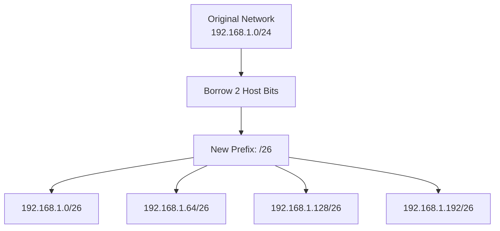
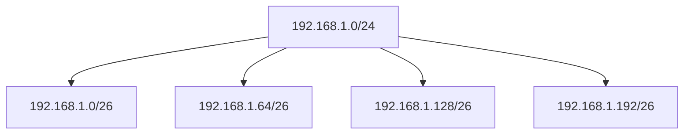
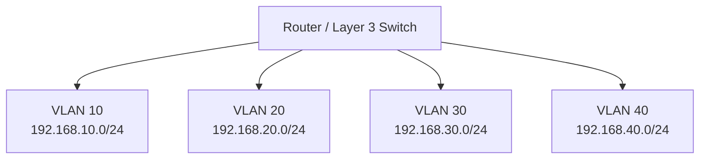

# Subnetting

**Subnetting** is the process of dividing a larger IP network into smaller logical networks called **subnets**.

It allows network administrators to organize IP addresses efficiently, separate network segments, control broadcast domains, and improve network management.

Subnetting works by borrowing bits from the host portion of an IP address and using them to create additional network bits.

For example, a `192.168.1.0/24` network contains 256 IPv4 addresses. It can be divided into four smaller `/26` subnets, each containing 64 addresses.

```text
Original Network:

192.168.1.0/24

          |
          v

Divided into four /26 subnets:

192.168.1.0/26
192.168.1.64/26
192.168.1.128/26
192.168.1.192/26
```

Subnetting is a fundamental networking skill used in LAN design, enterprise networks, data centers, ISP infrastructure, VLAN segmentation, and cloud networking.

# 🗁 What Is Subnetting?

Subnetting divides one IP network into multiple smaller networks.

Each subnet has its own:

* Network address.
* Subnet mask or CIDR prefix.
* Address range.
* Broadcast address for conventional IPv4 subnets.
* Usable host addresses.

Consider the following network:

```text
192.168.1.0/24
```

Its subnet mask is:

```text
255.255.255.0
```

It contains:

* 256 total IPv4 addresses.
* 254 conventional usable host addresses.

If we divide this network into four equal subnets, each subnet receives 64 addresses.

```text
192.168.1.0/26
192.168.1.64/26
192.168.1.128/26
192.168.1.192/26
```

Each `/26` subnet contains:

* 64 total addresses.
* 62 conventional usable host addresses.

### 🖆 Before and After Subnetting

| Property | Original Network | Each Subnet |
| --- | ---: | ---: |
| Network Prefix | `/24` | `/26` |
| Subnet Mask | `255.255.255.0` | `255.255.255.192` |
| Network Bits | 24 | 26 |
| Host Bits | 8 | 6 |
| Total Addresses | 256 | 64 |
| Conventional Usable Hosts | 254 | 62 |
| Number of Subnets | 1 | 4 |

Subnetting increases the number of networks while decreasing the number of addresses available within each network.

# 🗁 Why Do We Need Subnetting?

Subnetting helps organizations divide large networks into smaller, manageable segments.

### 🖆 Efficient IP Address Allocation

Subnetting allows administrators to allocate address ranges according to actual host requirements.

For example:

```text
Development Department: 192.168.10.0/26
Finance Department:     192.168.10.64/26
HR Department:           192.168.10.128/26
IT Department:           192.168.10.192/26
```

Each department receives a separate address range.

### 🖆 Reduce Broadcast Domains

In IPv4 Ethernet networks, broadcast traffic is generally limited to its local Layer 2 broadcast domain.

Separating departments into different VLANs and IP subnets can reduce unnecessary broadcast traffic within each segment.

### 🖆 Improve Network Security

Subnetting allows administrators to apply different firewall rules and access policies to different network segments.

For example:

* Servers can be placed in a dedicated subnet.
* Guest devices can use an isolated subnet.
* Management interfaces can use a restricted subnet.
* Employee devices can be separated from public-facing services.

Subnetting alone does not enforce security. Appropriate routing policies, firewall rules, and Layer 2 controls are also required.

### 🖆 Simplify Network Management

Smaller networks make it easier to:

* Organize devices.
* Troubleshoot connectivity.
* Identify network boundaries.
* Apply DHCP scopes.
* Manage routing policies.
* Document infrastructure.

### 🖆 Support Network Growth

Subnetting makes it possible to reserve separate address ranges for future departments, services, and infrastructure.

# 🗁 How Subnetting Works

Subnetting works by borrowing bits from the host portion of an existing network prefix.

The borrowed bits become additional network bits.

Consider:

```text
Original Network: 192.168.1.0/24
```

The original prefix contains:

```text
Network Bits: 24
Host Bits:     8
```

If we borrow two host bits:

```text
Original Prefix: /24
Borrowed Bits:     2
New Prefix:       /26
```

The new prefix is calculated as:

\[
24 + 2 = 26
\]

The number of subnets created is:

\[
2^2 = 4
\]

The remaining host bits are:

\[
32 - 26 = 6
\]

Each subnet contains:

\[
2^6 = 64
\]

total IPv4 addresses.

### 🖆 Subnetting Diagram



# 🗁 Network Bits and Host Bits

IPv4 addresses contain 32 bits divided into four octets.

Subnetting changes the boundary between network bits and host bits.

### 🖆 Original /24 Network

```text
192.168.1.0/24

Binary:
11000000.10101000.00000001.00000000

Network Bits: 24
Host Bits:     8
```

### 🖆 After Borrowing Two Bits

```text
192.168.1.0/26

Binary:
11000000.10101000.00000001.00|000000
                                     
Network Bits: 26
Host Bits:     6
```

The two borrowed bits are now part of the network prefix.

The remaining six bits identify addresses within each subnet.

### 🖆 Visual Comparison

```text
Original /24:

NNNNNNNN.NNNNNNNN.NNNNNNNN.HHHHHHHH

New /26:

NNNNNNNN.NNNNNNNN.NNNNNNNN.NNHHHHHH

N = Network Bit
H = Host Bit
```

# 🗁 Borrowing Host Bits

The number of borrowed bits determines how many subnets can be created.

### 🖆 Subnet Calculation

\[
\text{Number of Subnets} = 2^s
\]

Where:

* \(s\) = number of borrowed bits.

### 🖆 Host Calculation

\[
\text{Total Addresses per Subnet} = 2^h
\]

Where:

* \(h\) = remaining host bits.

For conventional IPv4 subnets:

\[
\text{Usable Hosts} = 2^h - 2
\]

The network and directed broadcast addresses are excluded.

### 🖆 Borrowing Bits Example

Starting network:

```text
192.168.1.0/24
```

| Borrowed Bits | New Prefix | Number of Subnets | Host Bits | Total Addresses per Subnet | Conventional Usable Hosts |
| ---: | ---: | ---: | ---: | ---: | ---: |
| 1 | `/25` | 2 | 7 | 128 | 126 |
| 2 | `/26` | 4 | 6 | 64 | 62 |
| 3 | `/27` | 8 | 5 | 32 | 30 |
| 4 | `/28` | 16 | 4 | 16 | 14 |
| 5 | `/29` | 32 | 3 | 8 | 6 |
| 6 | `/30` | 64 | 2 | 4 | 2 |

As more host bits are borrowed:

* The number of subnets increases.
* The number of addresses per subnet decreases.
* The number of usable hosts per conventional subnet decreases.

# 🗁 Subnetting Formulas

The following formulas are fundamental to subnetting calculations.

### 🖆 Number of Subnets

\[
\text{Subnets} = 2^s
\]

Where \(s\) is the number of borrowed bits.

### 🖆 Total Addresses

\[
\text{Total Addresses} = 2^h
\]

Where \(h\) is the number of host bits.

### 🖆 Conventional Usable Hosts

\[
\text{Usable Hosts} = 2^h - 2
\]

This formula applies to conventional IPv4 subnets where the network and broadcast addresses are reserved.

### 🖆 New Prefix Length

\[
\text{New Prefix} = \text{Original Prefix} + s
\]

Where \(s\) is the number of borrowed host bits.

### 🖆 Remaining Host Bits

\[
h = 32 - p
\]

Where \(p\) is the new prefix length.

### 🖆 Block Size

For the octet containing the subnet boundary:

\[
\text{Block Size} = 256 - \text{Mask Octet}
\]

For example, a `/26` subnet has the mask:

```text
255.255.255.192
```

Therefore:

\[
256 - 192 = 64
\]

Each subnet contains 64 addresses.

# 🗁 Subnet Mask and Prefix Length

A subnet mask determines which bits belong to the network portion.

When subnetting, the subnet mask changes according to the number of borrowed bits.

### 🖆 Common Subnet Masks

| CIDR | Subnet Mask | Host Bits | Total Addresses | Conventional Usable Hosts |
| --- | --- | ---: | ---: | ---: |
| `/24` | `255.255.255.0` | 8 | 256 | 254 |
| `/25` | `255.255.255.128` | 7 | 128 | 126 |
| `/26` | `255.255.255.192` | 6 | 64 | 62 |
| `/27` | `255.255.255.224` | 5 | 32 | 30 |
| `/28` | `255.255.255.240` | 4 | 16 | 14 |
| `/29` | `255.255.255.248` | 3 | 8 | 6 |
| `/30` | `255.255.255.252` | 2 | 4 | 2 |

### 🖆 Prefix Length and Subnet Mask Binary

| CIDR | Binary in Final Octet | Decimal |
| --- | --- | ---: |
| `/24` | `00000000` | 0 |
| `/25` | `10000000` | 128 |
| `/26` | `11000000` | 192 |
| `/27` | `11100000` | 224 |
| `/28` | `11110000` | 240 |
| `/29` | `11111000` | 248 |
| `/30` | `11111100` | 252 |

# 🗁 Understanding Block Size

Block size determines how many consecutive addresses belong to each subnet.

It is especially useful when subnetting within an octet.

### 🖆 Block Size Formula

\[
\text{Block Size} = 256 - \text{Subnet Mask Octet}
\]

For a `/26` prefix:

```text
Subnet Mask: 255.255.255.192
```

Calculate:

\[
256 - 192 = 64
\]

The subnet boundaries are:

```text
0
64
128
192
```

Each subnet contains 64 addresses.

### 🖆 Block Size Reference

| CIDR | Subnet Mask | Block Size |
| --- | --- | ---: |
| `/25` | `255.255.255.128` | 128 |
| `/26` | `255.255.255.192` | 64 |
| `/27` | `255.255.255.224` | 32 |
| `/28` | `255.255.255.240` | 16 |
| `/29` | `255.255.255.248` | 8 |
| `/30` | `255.255.255.252` | 4 |

# 🗁 Subnetting a /24 Network

Consider the following network:

```text
Network: 192.168.1.0/24
```

Its original properties are:

```text
Subnet Mask: 255.255.255.0
Network Bits: 24
Host Bits: 8
Total Addresses: 256
Usable Hosts: 254
```

Suppose we need four equal subnets.

### 🖆 Calculate Borrowed Bits

We need four subnets.

\[
2^s = 4
\]

\[
s = 2
\]

Borrow two host bits.

### 🖆 Calculate the New Prefix

\[
24 + 2 = 26
\]

The new prefix is `/26`.

### 🖆 Calculate the New Subnet Mask

```text
/26 = 255.255.255.192
```

### 🖆 Calculate the Block Size

\[
256 - 192 = 64
\]

### 🖆 Identify Subnet Boundaries

The last octet increases by 64.

```text
0
64
128
192
```

### 🖆 Complete Subnet Table

| Subnet | Network Address | First Host | Last Host | Broadcast |
| --- | --- | --- | --- | --- |
| 1 | `192.168.1.0/26` | `192.168.1.1` | `192.168.1.62` | `192.168.1.63` |
| 2 | `192.168.1.64/26` | `192.168.1.65` | `192.168.1.126` | `192.168.1.127` |
| 3 | `192.168.1.128/26` | `192.168.1.129` | `192.168.1.190` | `192.168.1.191` |
| 4 | `192.168.1.192/26` | `192.168.1.193` | `192.168.1.254` | `192.168.1.255` |

Each subnet contains 64 total addresses and 62 conventional usable host addresses.

### 🖆 Subnetting Diagram



# 🗁 Subnetting a /16 Network

Subnetting is not limited to `/24` networks.

Consider:

```text
Network: 172.16.0.0/16
```

Suppose we need 16 equal subnets.

### 🖆 Calculate Borrowed Bits

\[
2^s = 16
\]

\[
s = 4
\]

We need to borrow four host bits.

### 🖆 Calculate the New Prefix

\[
16 + 4 = 20
\]

New prefix:

```text
/20
```

Subnet mask:

```text
255.255.240.0
```

### 🖆 Calculate the Block Size

The subnet boundary is in the third octet.

\[
256 - 240 = 16
\]

Therefore, subnet boundaries increase by 16 in the third octet.

### 🖆 Subnet Boundaries

```text
172.16.0.0/20
172.16.16.0/20
172.16.32.0/20
172.16.48.0/20
172.16.64.0/20
172.16.80.0/20
172.16.96.0/20
172.16.112.0/20
172.16.128.0/20
172.16.144.0/20
172.16.160.0/20
172.16.176.0/20
172.16.192.0/20
172.16.208.0/20
172.16.224.0/20
172.16.240.0/20
```

### 🖆 First Subnet Details

```text
Network Address:   172.16.0.0
First Usable IP:   172.16.0.1
Last Usable IP:    172.16.15.254
Broadcast Address: 172.16.15.255
```

### 🖆 Second Subnet Details

```text
Network Address:   172.16.16.0
First Usable IP:   172.16.16.1
Last Usable IP:    172.16.31.254
Broadcast Address: 172.16.31.255
```

Each `/20` subnet contains:

\[
2^{12} = 4096
\]

total addresses.

Conventional usable hosts:

\[
4096 - 2 = 4094
\]

# 🗁 Subnetting a /26 Network

Subnetting can also be performed on an existing subnet.

Consider:

```text
Network: 192.168.10.0/26
```

Suppose we need to divide it into two equal subnets.

### 🖆 Calculate Borrowed Bits

We need two subnets:

\[
2^1 = 2
\]

Borrow one additional host bit.

### 🖆 Calculate the New Prefix

\[
26 + 1 = 27
\]

New prefix:

```text
/27
```

Subnet mask:

```text
255.255.255.224
```

### 🖆 Calculate Block Size

\[
256 - 224 = 32
\]

### 🖆 Resulting Subnets

| Subnet | Network Address | First Host | Last Host | Broadcast |
| --- | --- | --- | --- | --- |
| 1 | `192.168.10.0/27` | `192.168.10.1` | `192.168.10.30` | `192.168.10.31` |
| 2 | `192.168.10.32/27` | `192.168.10.33` | `192.168.10.62` | `192.168.10.63` |

Each subnet contains 32 addresses and 30 conventional usable host addresses.

# 🗁 Subnetting Based on Host Requirements

Sometimes the number of required hosts is known, but the required subnet prefix is not.

In this situation, select the smallest subnet that provides enough usable addresses.

### 🖆 Host Requirement Formula

For a conventional IPv4 subnet, find the smallest number of host bits satisfying:

\[
2^h - 2 \geq \text{Required Hosts}
\]

Then calculate:

\[
p = 32 - h
\]

Where:

* \(h\) = required host bits.
* \(p\) = resulting prefix length.

### 🖆 Example: 50 Hosts

Suppose a department requires 50 host addresses.

Find the smallest suitable host-bit count:

\[
2^5 - 2 = 30
\]

30 is insufficient.

\[
2^6 - 2 = 62
\]

62 is sufficient.

Therefore:

```text
Host Bits: 6
Prefix: /26
Subnet Mask: 255.255.255.192
Total Addresses: 64
Usable Hosts: 62
```

A `/26` subnet is sufficient for 50 hosts.

### 🖆 Host Requirement Reference

| Required Hosts | Suitable Prefix | Usable Hosts |
| ---: | --- | ---: |
| 2 | `/30` | 2 |
| 6 | `/29` | 6 |
| 10 | `/28` | 14 |
| 14 | `/28` | 14 |
| 25 | `/27` | 30 |
| 30 | `/27` | 30 |
| 50 | `/26` | 62 |
| 60 | `/26` | 62 |
| 100 | `/25` | 126 |
| 200 | `/24` | 254 |
| 500 | `/23` | 510 |
| 1,000 | `/22` | 1,022 |

# 🗁 Subnetting Based on Subnet Requirements

Sometimes the required number of subnets is known instead of the number of hosts.

In this situation, determine how many bits must be borrowed.

### 🖆 Subnet Requirement Formula

\[
2^s \geq \text{Required Subnets}
\]

Where \(s\) is the number of borrowed bits.

The new prefix is:

\[
p_{\text{new}} = p_{\text{original}} + s
\]

### 🖆 Example: Eight Subnets

Given:

```text
Original Network: 192.168.1.0/24
Required Subnets: 8
```

Calculate borrowed bits:

\[
2^3 = 8
\]

Borrow three bits.

New prefix:

\[
24 + 3 = 27
\]

Result:

```text
New Prefix: /27
Subnet Mask: 255.255.255.224
Number of Subnets: 8
Addresses per Subnet: 32
Usable Hosts per Subnet: 30
```

# 🗁 Subnetting Across Different Octets

Subnetting can cross octet boundaries.

This is important when working with prefixes such as `/17`, `/19`, `/21`, and `/23`.

### 🖆 Example: /23

Given:

```text
Network: 172.16.0.0/23
```

The subnet mask is:

```text
255.255.254.0
```

The subnet boundary is in the third octet.

Block size:

\[
256 - 254 = 2
\]

Therefore, subnet boundaries increase by two in the third octet.

```text
172.16.0.0/23
172.16.2.0/23
172.16.4.0/23
172.16.6.0/23
172.16.8.0/23
```

Each `/23` subnet contains:

\[
2^9 = 512
\]

total addresses.

Conventional usable hosts:

\[
512 - 2 = 510
\]

### 🖆 Example: /21

Given:

```text
Network: 10.10.0.0/21
```

Subnet mask:

```text
255.255.248.0
```

Block size:

\[
256 - 248 = 8
\]

Subnet boundaries in the third octet:

```text
10.10.0.0/21
10.10.8.0/21
10.10.16.0/21
10.10.24.0/21
10.10.32.0/21
```

Each subnet contains:

\[
2^{11} = 2048
\]

total addresses and 2046 conventional usable host addresses.

# 🗁 VLSM and Subnetting

**VLSM (Variable Length Subnet Masking)** allows a network to be divided into subnets with different prefix lengths.

Instead of creating equal-sized subnets, administrators allocate address blocks according to the number of hosts each network requires.

This reduces address waste.

### 🖆 Example Network Requirements

Suppose an organization has the following requirements:

| Department | Required Hosts |
| --- | ---: |
| Engineering | 100 |
| Administration | 50 |
| Support | 25 |
| Point-to-point Link | 2 |

Available address block:

```text
192.168.10.0/24
```

### 🖆 Allocate the Largest Subnet First

| Department | Required Hosts | Allocated Network | Usable Hosts |
| --- | ---: | --- | ---: |
| Engineering | 100 | `192.168.10.0/25` | 126 |
| Administration | 50 | `192.168.10.128/26` | 62 |
| Support | 25 | `192.168.10.192/27` | 30 |
| Point-to-point | 2 | `192.168.10.224/30` | 2 |

### 🖆 Address Allocation Details

**Engineering — `/25`**

```text
Network:   192.168.10.0
Host Range: 192.168.10.1 - 192.168.10.126
Broadcast: 192.168.10.127
```

**Administration — `/26`**

```text
Network:   192.168.10.128
Host Range: 192.168.10.129 - 192.168.10.190
Broadcast: 192.168.10.191
```

**Support — `/27`**

```text
Network:   192.168.10.192
Host Range: 192.168.10.193 - 192.168.10.222
Broadcast: 192.168.10.223
```

**Point-to-point — `/30`**

```text
Network:   192.168.10.224
Host Range: 192.168.10.225 - 192.168.10.226
Broadcast: 192.168.10.227
```

The remaining address range can be reserved for future requirements.

VLSM is especially useful in enterprise networks, ISP infrastructure, and complex routing environments.

# 🗁 Subnetting and VLANs

Subnetting and VLANs are related but different networking concepts.

A **VLAN** creates a logical Layer 2 broadcast domain.

An **IP subnet** defines a Layer 3 IP address range.

In many network designs, each VLAN is assigned its own IP subnet.

### 🖆 Example Network Design

| VLAN | Department | Subnet |
| --- | --- | --- |
| VLAN 10 | Engineering | `192.168.10.0/24` |
| VLAN 20 | Administration | `192.168.20.0/24` |
| VLAN 30 | Support | `192.168.30.0/24` |
| VLAN 40 | Guest | `192.168.40.0/24` |

Each VLAN represents a separate Layer 2 broadcast domain.

A router or Layer 3 switch provides communication between these subnets when routing and access policies permit it.

### 🖆 Network Diagram



# 🗁 Subnetting in Linux

Linux provides several tools for subnet calculation and network inspection.

### 🖆 Install ipcalc on Ubuntu

```bash
sudo apt update
sudo apt install ipcalc
```

### 🖆 Calculate a Subnet

```bash
ipcalc 192.168.1.0/26
```

The output includes:

* Network address.
* Subnet mask.
* Broadcast address.
* Host address range.
* Number of addresses.

### 🖆 Inspect Network Interfaces

```bash
ip -4 addr show
```

Example:

```text
inet 192.168.1.10/24 brd 192.168.1.255 scope global enp0s3
```

### 🖆 Inspect Routing Table

```bash
ip route
```

Example:

```text
default via 192.168.1.1 dev enp0s3
192.168.1.0/24 dev enp0s3 proto kernel scope link
```

### 🖆 Calculate Subnets Using Python

Python's built-in `ipaddress` module can divide a network into smaller subnets.

```python
import ipaddress

network = ipaddress.ip_network("192.168.1.0/24")

subnets = network.subnets(new_prefix=26)

for subnet in subnets:
    print("Network:", subnet)
    print("Netmask:", subnet.netmask)
    print("Broadcast:", subnet.broadcast_address)
    print("Total Addresses:", subnet.num_addresses)
    print("Usable Hosts:", subnet.num_addresses - 2)
    print()
```

Example output:

```text
Network: 192.168.1.0/26
Netmask: 255.255.255.192
Broadcast: 192.168.1.63
Total Addresses: 64
Usable Hosts: 62

Network: 192.168.1.64/26
Netmask: 255.255.255.192
Broadcast: 192.168.1.127
Total Addresses: 64
Usable Hosts: 62

Network: 192.168.1.128/26
Netmask: 255.255.255.192
Broadcast: 192.168.1.191
Total Addresses: 64
Usable Hosts: 62

Network: 192.168.1.192/26
Netmask: 255.255.255.192
Broadcast: 192.168.1.255
Total Addresses: 64
Usable Hosts: 62
```

For production scripts, handle `/31` and `/32` separately instead of always subtracting two from the address count.

# 🗁 Common Mistakes

### 🖆 Borrowing the Wrong Number of Bits

Borrowed bits determine the number of subnets.

Always calculate:

\[
2^s \geq \text{Required Subnets}
\]

### 🖆 Calculating the Wrong Host Capacity

The number of remaining host bits determines the address capacity.

\[
2^h
\]

For conventional subnets:

\[
2^h - 2
\]

### 🖆 Ignoring Subnet Boundaries

A subnet must begin at a valid address boundary for its prefix.

For example, `/26` networks in a `/24` block begin at:

```text
192.168.1.0
192.168.1.64
192.168.1.128
192.168.1.192
```

### 🖆 Using Overlapping Subnets

Overlapping address ranges can cause routing ambiguity and connectivity problems.

Plan subnet allocations carefully.

### 🖆 Assuming Subnetting Automatically Provides Security

Subnetting creates logical network boundaries, but access control requires appropriate routing, firewall rules, and Layer 2 security mechanisms.

### 🖆 Forgetting Special Prefixes

`/31` and `/32` have special uses and do not follow the conventional usable-host formula.

# 🗁 Best Practices

* Plan the addressing scheme before deploying subnets.
* Calculate host requirements before selecting prefixes.
* Allocate larger subnets before smaller ones when using VLSM.
* Reserve address space for future growth.
* Avoid overlapping network ranges.
* Keep IP addressing documentation updated.
* Use separate subnets for network segments with different security requirements.
* Use DHCP scopes that match their corresponding subnets.
* Configure correct gateway addresses.
* Verify subnet calculations using `ipcalc` or Python.
* Use route summarization where appropriate.
* Remember that VLANs and IP subnets operate at different network layers.

# 🗁 Practical Exercises

### 🖆 Exercise: Divide a /24 Network

Given:

```text
192.168.1.0/24
```

Divide the network into four equal subnets.

Calculate:

* New prefix length.
* New subnet mask.
* Number of borrowed bits.
* Total addresses per subnet.
* Usable hosts per subnet.
* Network address of each subnet.
* Broadcast address of each subnet.
* Usable host range of each subnet.

### 🖆 Exercise: Divide a /24 Into Eight Subnets

Given:

```text
192.168.10.0/24
```

Create eight equal-sized subnets.

Determine all network addresses and their broadcast addresses.

### 🖆 Exercise: Host-Based Subnetting

Select the smallest conventional IPv4 subnet for each requirement:

| Required Hosts | Prefix |
| ---: | --- |
| 12 | ? |
| 28 | ? |
| 45 | ? |
| 90 | ? |
| 180 | ? |
| 400 | ? |
| 900 | ? |

### 🖆 Exercise: Subnet a /16 Network

Given:

```text
172.16.0.0/16
```

Divide it into 16 equal subnets.

Calculate:

* Borrowed bits.
* New prefix.
* Subnet mask.
* Block size.
* First four network addresses.
* Last subnet address.
* Usable host capacity per subnet.

### 🖆 Exercise: VLSM Design

An organization has:

```text
Available Network: 192.168.50.0/24
```

Its requirements are:

| Department | Required Hosts |
| --- | ---: |
| Engineering | 110 |
| Administration | 55 |
| Support | 25 |
| Management | 12 |
| Point-to-point Link | 2 |

Design a VLSM allocation.

For each subnet, calculate:

* Network address.
* Prefix length.
* Subnet mask.
* First usable address.
* Last usable address.
* Broadcast address.

### 🖆 Exercise: Linux Subnetting Practice

Install `ipcalc` and run:

```bash
ipcalc 192.168.1.0/24
ipcalc 192.168.1.0/26
ipcalc 172.16.0.0/20
```

Compare the network boundaries and host capacities.

# 🗁 Interview Questions

### 🖆 Basic Questions

* What is subnetting?
* Why do we need subnetting?
* What is a subnet?
* What is the difference between a network address and a broadcast address?
* What are network bits and host bits?
* What is a subnet mask?
* What does borrowing host bits mean?

### 🖆 Intermediate Questions

* How do you calculate the number of subnets?
* How do you calculate usable host addresses?
* What is the block size method?
* How do you divide a `/24` network into four equal subnets?
* How do you calculate the network address?
* What is the difference between equal-sized subnetting and VLSM?
* How does subnetting help reduce broadcast domains?

### 🖆 Advanced Questions

* How does subnetting work at the binary level?
* How do you subnet a `/16` network into multiple `/20` networks?
* How do you design a subnet allocation for different departments?
* What is the relationship between subnetting and VLANs?
* How does VLSM reduce address waste?
* What problems can overlapping subnets cause?
* How do routers use subnet prefixes when forwarding packets?
* Why are `/31` networks useful for point-to-point links?

# 🗁 Summary

Subnetting divides a larger IP network into smaller logical networks.

Key concepts:

* Subnetting borrows host bits to create additional network bits.
* Borrowed bits determine the number of subnets.
* Remaining host bits determine the address capacity of each subnet.
* CIDR prefixes represent the network boundary.
* Block size helps identify subnet boundaries.
* Network and broadcast addresses define conventional IPv4 subnet ranges.
* VLSM allows different subnet sizes based on actual host requirements.
* VLANs and subnets are commonly used together to segment networks.
* Linux tools such as `ipcalc` and Python's `ipaddress` simplify subnet calculations.

Subnetting is essential for designing scalable, organized, and efficiently managed IP networks.

# 🗁 References

* [RFC 950 — Internet Standard Subnetting Procedure](https://datatracker.ietf.org/doc/html/rfc950)
* [RFC 4632 — Classless Inter-domain Routing (CIDR)](https://datatracker.ietf.org/doc/html/rfc4632)
* [RFC 3021 — Using 31-Bit Prefixes on IPv4 Point-to-Point Links](https://datatracker.ietf.org/doc/html/rfc3021)
* [RFC 1812 — Requirements for IP Version 4 Routers](https://datatracker.ietf.org/doc/html/rfc1812)
* [Python ipaddress Documentation](https://docs.python.org/3/library/ipaddress.html)
* [Linux ip Command Manual](https://man7.org/linux/man-pages/man8/ip.8.html)
