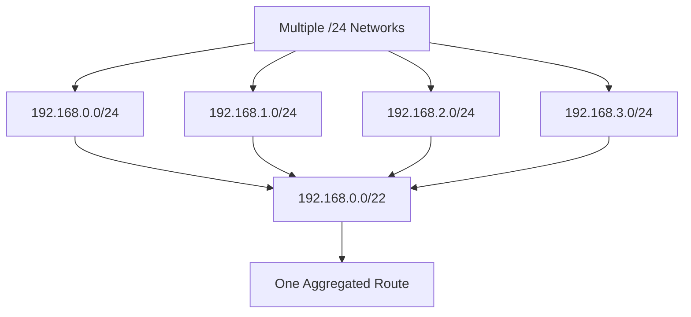
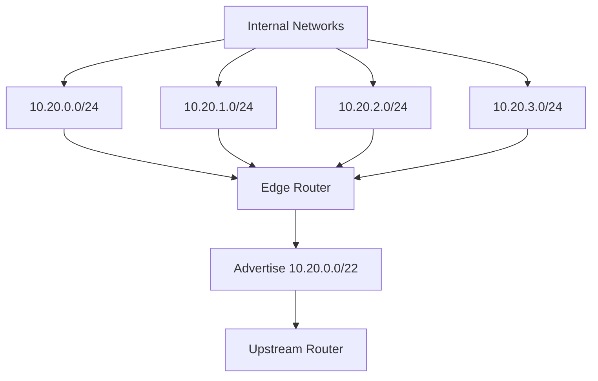

# Supernetting

**Supernetting** is the process of combining multiple smaller, contiguous IP networks into one larger network prefix.

It is also known as **route aggregation** or **route summarization**.

Supernetting reduces the number of routing table entries by representing multiple networks with a single summarized route.

For example, four contiguous `/24` networks can be combined into one `/22` network:

```text
192.168.0.0/24
192.168.1.0/24
192.168.2.0/24
192.168.3.0/24

          |
          v

192.168.0.0/22
```

Instead of advertising four separate routes, a router can advertise one summarized route.

Supernetting is commonly used in enterprise networks, ISP infrastructure, BGP routing, and large IP network designs.

# 🗁 What Is Supernetting?

Supernetting combines multiple smaller networks into a larger address block.

Consider these networks:

```text
192.168.10.0/24
192.168.11.0/24
192.168.12.0/24
192.168.13.0/24
```

Each network contains 256 IPv4 addresses.

Together, they contain:

\[
4 \times 256 = 1024
\]

IPv4 addresses.

These networks can be summarized as:

```text
192.168.8.0/21
```

However, this particular summary also includes the address ranges for `192.168.8.0/24` through `192.168.15.0/24`. It is therefore broader than the four original networks.

The exact summary for the four networks is:

```text
192.168.10.0/23
192.168.12.0/23
```

These two routes cannot be represented by one exact `/22` because the starting network `192.168.10.0` is not correctly aligned for a `/22` boundary.

This demonstrates an important rule: **supernetting requires contiguous networks with correctly aligned address boundaries.**

# 🗁 Why Do We Need Supernetting?

Supernetting helps simplify routing and improve network scalability.

### 🖆 Reduce Routing Table Entries

Without route aggregation, a router may need to maintain many individual network routes.

For example:

```text
10.10.0.0/24
10.10.1.0/24
10.10.2.0/24
10.10.3.0/24
```

With an appropriate summary:

```text
10.10.0.0/22
```

The router can represent four networks with one route.

### 🖆 Improve Routing Efficiency

Smaller routing tables can reduce routing-table complexity and make route management easier.

### 🖆 Simplify Network Administration

Administrators can advertise summarized routes instead of configuring or distributing every individual subnet.

### 🖆 Support ISP Network Aggregation

ISPs often advertise aggregated IP prefixes to upstream providers and Internet peers.

For example, an ISP may own a large address block and allocate smaller subnets to customers while advertising an appropriate aggregate.

### 🖆 Improve Routing Scalability

Route aggregation helps control routing-table growth in large enterprise and service-provider networks.

# 🗁 How Supernetting Works

Supernetting reduces the network prefix length.

For example:

```text
Original Networks:

192.168.0.0/24
192.168.1.0/24
192.168.2.0/24
192.168.3.0/24
```

Each network has a `/24` prefix.

Combining four equally sized, aligned networks requires reducing the prefix by two bits:

\[
24 - 2 = 22
\]

The resulting prefix is `/22`.

```text
192.168.0.0/22
```

The `/22` network covers:

```text
192.168.0.0 - 192.168.3.255
```

### 🖆 Supernetting Diagram



# 🗁 Supernetting and CIDR

**CIDR (Classless Inter-Domain Routing)** allows IP networks to use flexible prefix lengths instead of relying on historical class-based network boundaries.

Supernetting uses CIDR to combine smaller prefixes into larger prefixes.

For example:

```text
192.168.0.0/24
192.168.1.0/24
```

Can be summarized as:

```text
192.168.0.0/23
```

The prefix changes from `/24` to `/23`.

A shorter prefix represents a larger address block.

### 🖆 Prefix Comparison

| Prefix | Subnet Mask | Total IPv4 Addresses |
| --- | --- | ---: |
| `/24` | `255.255.255.0` | 256 |
| `/23` | `255.255.254.0` | 512 |
| `/22` | `255.255.252.0` | 1,024 |
| `/21` | `255.255.248.0` | 2,048 |
| `/20` | `255.255.240.0` | 4,096 |
| `/19` | `255.255.224.0` | 8,192 |
| `/18` | `255.255.192.0` | 16,384 |
| `/17` | `255.255.128.0` | 32,768 |
| `/16` | `255.255.0.0` | 65,536 |

When the prefix length decreases, the number of addresses increases.

# 🗁 Supernetting Formulas

The following formulas help calculate an aggregate prefix.

### 🖆 Number of Networks

When combining equally sized networks:

\[
N = 2^s
\]

Where:

* \(N\) = number of smaller networks.
* \(s\) = number of prefix bits removed.

### 🖆 Aggregate Prefix Length

\[
P_{\text{aggregate}} = P_{\text{original}} - s
\]

Where:

* \(P_{\text{original}}\) = original prefix length.
* \(s\) = number of bits removed.

### 🖆 Total Addresses

\[
\text{Total Addresses} = 2^h
\]

Where:

\[
h = 32 - P_{\text{aggregate}}
\]

### 🖆 Example

Combine four `/24` networks.

Number of networks:

\[
4 = 2^2
\]

Bits removed:

\[
s = 2
\]

Aggregate prefix:

\[
24 - 2 = 22
\]

Total addresses:

\[
2^{32-22} = 2^{10} = 1024
\]

The resulting prefix is `/22`.

# 🗁 Requirements for Supernetting

Not every group of networks can be combined into one exact supernet.

The networks must satisfy important conditions.

### 🖆 Contiguous Networks

The address blocks must be consecutive, without gaps.

Valid example:

```text
192.168.0.0/24
192.168.1.0/24
192.168.2.0/24
192.168.3.0/24
```

Invalid for one exact aggregate:

```text
192.168.0.0/24
192.168.2.0/24
192.168.3.0/24
192.168.5.0/24
```

The second group contains gaps.

### 🖆 Equal Prefix Lengths

For straightforward equal-sized aggregation, all component networks should have the same prefix length.

For example:

```text
192.168.0.0/24
192.168.1.0/24
192.168.2.0/24
192.168.3.0/24
```

### 🖆 Correct Address Alignment

The first network must begin at a valid boundary for the aggregate prefix.

For example, four `/24` networks require a `/22` aggregate.

The third octet must begin at a multiple of four:

```text
0
4
8
12
16
20
...
```

Therefore, this is valid:

```text
192.168.8.0/22
```

But this is not a correctly aligned `/22` network:

```text
192.168.10.0/22
```

### 🖆 Matching Binary Prefixes

The networks must share the required leading network bits.

This can be verified through binary comparison or subnet calculation tools.

# 🗁 Supernetting Example: Four /24 Networks

Given:

```text
192.168.0.0/24
192.168.1.0/24
192.168.2.0/24
192.168.3.0/24
```

We want to combine these networks into one aggregate.

### 🖆 Calculate the Number of Networks

There are four networks.

\[
4 = 2^2
\]

Two bits must be removed from the original prefix.

### 🖆 Calculate the Aggregate Prefix

\[
24 - 2 = 22
\]

The aggregate prefix is:

```text
/22
```

### 🖆 Calculate the Subnet Mask

```text
/22 = 255.255.252.0
```

### 🖆 Verify the Network Boundary

The third octet mask is `252`.

\[
256 - 252 = 4
\]

Valid `/22` boundaries occur in multiples of four.

The first network begins at `192.168.0.0`, which is correctly aligned.

### 🖆 Final Aggregate

```text
192.168.0.0/22
```

Address range:

```text
Network Address:   192.168.0.0
First Usable IP:   192.168.0.1
Last Usable IP:    192.168.3.254
Broadcast Address: 192.168.3.255
```

The aggregate contains:

\[
2^{32-22} = 1024
\]

IPv4 addresses.

# 🗁 Supernetting Example: Eight /24 Networks

Given:

```text
10.10.0.0/24
10.10.1.0/24
10.10.2.0/24
10.10.3.0/24
10.10.4.0/24
10.10.5.0/24
10.10.6.0/24
10.10.7.0/24
```

We want to combine eight networks.

### 🖆 Calculate the Bits to Remove

\[
8 = 2^3
\]

Remove three bits from the original prefix.

### 🖆 Calculate the New Prefix

\[
24 - 3 = 21
\]

The aggregate prefix is `/21`.

### 🖆 Calculate the Subnet Mask

```text
255.255.248.0
```

### 🖆 Verify the Boundary

\[
256 - 248 = 8
\]

The third octet must begin at a multiple of eight.

The starting address `10.10.0.0` is correctly aligned.

### 🖆 Final Aggregate

```text
10.10.0.0/21
```

Address range:

```text
Network Address:   10.10.0.0
First Usable IP:   10.10.0.1
Last Usable IP:    10.10.7.254
Broadcast Address: 10.10.7.255
```

# 🗁 Supernetting Example: Two /24 Networks

Given:

```text
172.16.10.0/24
172.16.11.0/24
```

We want to combine two adjacent networks.

### 🖆 Calculate the Aggregate Prefix

\[
2 = 2^1
\]

Remove one bit:

\[
24 - 1 = 23
\]

The resulting prefix is `/23`.

### 🖆 Calculate the Subnet Mask

```text
255.255.254.0
```

### 🖆 Verify Alignment

The third octet mask is `254`.

\[
256 - 254 = 2
\]

Valid `/23` boundaries occur at even values in the third octet.

The starting network is `172.16.10.0`, which is correctly aligned.

### 🖆 Final Aggregate

```text
172.16.10.0/23
```

Address range:

```text
Network Address:   172.16.10.0
First Usable IP:   172.16.10.1
Last Usable IP:    172.16.11.254
Broadcast Address: 172.16.11.255
```

# 🗁 Binary Calculation of Supernetting

Binary comparison provides a precise way to determine the aggregate prefix.

Consider:

```text
192.168.0.0/24
192.168.1.0/24
192.168.2.0/24
192.168.3.0/24
```

The first three octets in binary are:

| Network | Third Octet in Binary |
| --- | --- |
| `192.168.0.0/24` | `00000000` |
| `192.168.1.0/24` | `00000001` |
| `192.168.2.0/24` | `00000010` |
| `192.168.3.0/24` | `00000011` |

The first six bits of the third octet are identical:

```text
00|000000
00|000001
00|000010
00|000011
```

The first two bits of the third octet are also part of the original `/24` network prefix.

The two remaining bits that distinguish the four networks become part of the host portion of the aggregate.

Therefore:

```text
Original Prefix: /24
Removed Bits:      2
Aggregate Prefix: /22
```

The common network prefix is `/22`.

# 🗁 Supernetting and Route Aggregation

Route aggregation allows a router to advertise one summarized route instead of multiple individual routes.

Consider a router connected to four networks:

```text
10.20.0.0/24
10.20.1.0/24
10.20.2.0/24
10.20.3.0/24
```

It can advertise:

```text
10.20.0.0/22
```

Instead of maintaining four separate routes on neighboring routers, the neighboring routers can use one aggregate route.

### 🖆 Route Aggregation Diagram



Route aggregation is useful because it:

* Reduces routing information exchanged between routers.
* Simplifies routing policies.
* Improves scalability.
* Hides internal subnet details from neighboring networks.

An aggregate must accurately represent reachable destinations. If it includes address ranges that are not actually reachable, traffic sent toward those ranges may be dropped or misrouted.

# 🗁 Supernetting and Subnetting

Subnetting and supernetting are opposite operations in terms of prefix size.

### 🖆 Subnetting

Subnetting divides a larger network into smaller networks.

Example:

```text
192.168.0.0/22
```

Divided into four `/24` networks:

```text
192.168.0.0/24
192.168.1.0/24
192.168.2.0/24
192.168.3.0/24
```

The prefix becomes longer.

### 🖆 Supernetting

Supernetting combines smaller networks into a larger network prefix.

Example:

```text
192.168.0.0/24
192.168.1.0/24
192.168.2.0/24
192.168.3.0/24
```

Combined into:

```text
192.168.0.0/22
```

The prefix becomes shorter.

### 🖆 Comparison Table

| Property | Subnetting | Supernetting |
| --- | --- | --- |
| Operation | Divides networks | Combines networks |
| Prefix Length | Increases | Decreases |
| Network Size | Becomes smaller | Becomes larger |
| Primary Purpose | Network segmentation | Route aggregation |
| Typical Use | VLANs and LANs | Enterprise and ISP routing |
| Address Allocation | Smaller blocks | Larger aggregate blocks |

# 🗁 Supernetting in BGP

**BGP (Border Gateway Protocol)** exchanges routing information between autonomous systems.

Route aggregation is important in BGP because it allows organizations and ISPs to advertise summarized prefixes.

For example, an ISP may manage these networks:

```text
203.0.112.0/24
203.0.113.0/24
203.0.114.0/24
203.0.115.0/24
```

These four networks can be represented by:

```text
203.0.112.0/22
```

The ISP can advertise the aggregate to an upstream provider.

### 🖆 Important BGP Considerations

* The aggregate must be correctly aligned.
* The component networks must be reachable.
* Routing policies must permit the aggregate advertisement.
* More-specific routes may still be advertised when required.
* Aggregation can affect path visibility and traffic engineering.
* An aggregate route should not unintentionally attract traffic for unreachable destinations.

BGP supports aggregation through mechanisms such as aggregate address configuration and route policy.

# 🗁 Supernetting in Linux

Linux provides commands for inspecting and managing IP routes.

### 🖆 Inspect Routing Table

```bash
ip route
```

### 🖆 Add an Aggregate Route

```bash
sudo ip route add 192.168.0.0/22 via 192.168.10.1
```

This installs a route for the aggregate prefix through the specified next-hop address.

The next-hop address must be reachable through an appropriate route.

### 🖆 Inspect the Aggregate Route

```bash
ip route show 192.168.0.0/22
```

### 🖆 Test Route Selection

```bash
ip route get 192.168.1.10
```

Linux uses longest-prefix matching when selecting among matching routes.

For example, if both `/22` and `/24` routes match a destination, the `/24` route is more specific and is preferred, subject to routing policy and route selection.

# 🗁 Supernetting in Python

Python's built-in `ipaddress` module provides methods for summarizing IP networks.

### 🖆 Summarize Multiple Networks

```python
import ipaddress

networks = [
    ipaddress.ip_network("192.168.0.0/24"),
    ipaddress.ip_network("192.168.1.0/24"),
    ipaddress.ip_network("192.168.2.0/24"),
    ipaddress.ip_network("192.168.3.0/24"),
]

summary = list(ipaddress.collapse_addresses(networks))

for network in summary:
    print(network)
```

Output:

```text
192.168.0.0/22
```

### 🖆 Summarize a Range of IP Addresses

```python
import ipaddress

first_ip = ipaddress.ip_address("192.168.0.0")
last_ip = ipaddress.ip_address("192.168.3.255")

networks = ipaddress.summarize_address_range(
    first_ip,
    last_ip
)

for network in networks:
    print(network)
```

Output:

```text
192.168.0.0/22
```

### 🖆 Check Whether a Network Is a Supernet

```python
import ipaddress

network = ipaddress.ip_network("192.168.0.0/22")
subnet = ipaddress.ip_network("192.168.1.0/24")

print(network.supernet_of(subnet))
```

Output:

```text
True
```

The `/22` network contains the `/24` network.

# 🗁 Common Mistakes

### 🖆 Combining Non-Contiguous Networks

Networks with address gaps cannot be represented by one exact aggregate without including additional address space.

### 🖆 Ignoring Address Alignment

Four `/24` networks require a starting third-octet boundary divisible by four for an exact `/22` aggregate.

### 🖆 Confusing Supernetting With Subnetting

Subnetting creates smaller networks by increasing the prefix length.

Supernetting combines smaller networks by decreasing the prefix length.

### 🖆 Assuming Every Aggregate Is Exact

An aggregate may include address ranges that are not part of the original component networks.

Always verify the aggregate's address range.

### 🖆 Ignoring Routing Reachability

Advertising an aggregate does not automatically make every address within it reachable.

Routers must have a valid forwarding path for destinations represented by the aggregate.

### 🖆 Forgetting Longest Prefix Match

A router may have both an aggregate route and more-specific routes.

The most specific matching route is generally preferred.

# 🗁 Best Practices

* Use CIDR prefixes instead of historical class-based assumptions.
* Aggregate only correctly aligned address blocks.
* Verify that component networks are contiguous.
* Confirm that all advertised destinations are reachable.
* Keep routing policies consistent with aggregate advertisements.
* Avoid overly broad summaries that attract unintended traffic.
* Use more-specific routes when individual destinations require separate paths.
* Document aggregate prefixes and their component networks.
* Test route selection using tools such as `ip route get`.
* Use Python's `ipaddress` module to verify complex aggregation calculations.

# 🗁 Practical Exercises

### 🖆 Exercise: Combine Four Networks

Given:

```text
192.168.20.0/24
192.168.21.0/24
192.168.22.0/24
192.168.23.0/24
```

Calculate:

* Number of networks.
* Number of prefix bits removed.
* Aggregate prefix.
* Subnet mask.
* Total IPv4 addresses.
* First usable address.
* Last usable address.
* Broadcast address.

### 🖆 Exercise: Combine Eight Networks

Given:

```text
10.10.8.0/24
10.10.9.0/24
10.10.10.0/24
10.10.11.0/24
10.10.12.0/24
10.10.13.0/24
10.10.14.0/24
10.10.15.0/24
```

Find the exact aggregate prefix and address range.

### 🖆 Exercise: Check Alignment

Determine whether each group can be combined into one exact aggregate.

**Group A**

```text
172.16.0.0/24
172.16.1.0/24
```

**Group B**

```text
172.16.2.0/24
172.16.3.0/24
```

**Group C**

```text
172.16.4.0/24
172.16.6.0/24
```

Explain why each group can or cannot be summarized exactly.

### 🖆 Exercise: Route Aggregation

An ISP owns:

```text
203.0.100.0/24
203.0.101.0/24
203.0.102.0/24
203.0.103.0/24
```

Determine:

* Whether the networks are contiguous.
* Whether they are correctly aligned.
* Their aggregate prefix.
* Their aggregate subnet mask.
* The total address capacity.

### 🖆 Exercise: Python Practice

Use Python's `ipaddress` module to:

* Collapse four consecutive `/24` networks.
* Summarize an IP address range.
* Check whether one network contains another.
* Compare the resulting aggregate with the original networks.

# 🗁 Interview Questions

### 🖆 Basic Questions

* What is supernetting?
* What is route aggregation?
* Why is supernetting used?
* What is the relationship between supernetting and CIDR?
* How does supernetting differ from subnetting?

### 🖆 Intermediate Questions

* How do you combine four `/24` networks?
* How do you calculate an aggregate prefix?
* Why must networks be contiguous?
* What is address alignment?
* How does route aggregation reduce routing table entries?
* What is the difference between an exact aggregate and an overly broad summary?

### 🖆 Advanced Questions

* How does binary comparison determine an aggregate prefix?
* How is route aggregation used by ISPs?
* How does BGP support route aggregation?
* What happens when an aggregate includes unreachable destinations?
* How does longest-prefix matching interact with aggregate routes?
* Why might an organization advertise both aggregate and more-specific routes?

# 🗁 Summary

Supernetting combines multiple smaller, contiguous IP networks into a larger network prefix.

Key concepts:

* Supernetting is also called route aggregation or route summarization.
* It reduces the number of routing entries.
* It uses CIDR addressing.
* Combining networks reduces the prefix length.
* Networks must be contiguous and correctly aligned for an exact aggregate.
* Binary comparison helps determine the common network prefix.
* BGP uses aggregation to simplify inter-domain routing.
* Longest Prefix Match allows routers to prefer more-specific routes over broader aggregates.

Supernetting is an important technique for building scalable enterprise networks and ISP routing infrastructure.

# 🗁 References

* [RFC 4632 — Classless Inter-domain Routing (CIDR)](https://datatracker.ietf.org/doc/html/rfc4632)
* [RFC 4271 — Border Gateway Protocol 4 (BGP-4)](https://datatracker.ietf.org/doc/html/rfc4271)
* [RFC 1812 — Requirements for IP Version 4 Routers](https://datatracker.ietf.org/doc/html/rfc1812)
* [Python ipaddress Documentation](https://docs.python.org/3/library/ipaddress.html)
* [Linux ip Command Manual](https://man7.org/linux/man-pages/man8/ip.8.html)
