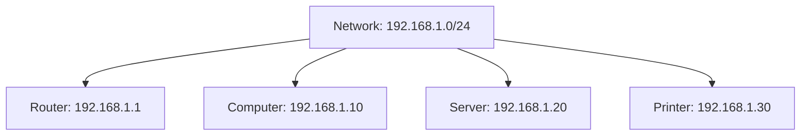
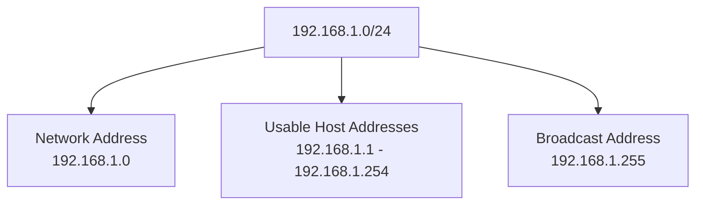

# Network Address vs Host Address

An IPv4 address identifies an interface on an IP network. It contains two logical components:

* **Network portion:** Identifies the network to which the address belongs.
* **Host portion:** Identifies an address within that network.

The subnet mask or CIDR prefix determines where the network portion ends and the host portion begins.

Understanding the difference between network addresses and host addresses is essential for subnetting, routing, IP configuration, and network troubleshooting.

For example:

```text
IP Address: 192.168.1.10/24

Network Address: 192.168.1.0
Host Address:    192.168.1.10
```

The network address identifies the subnet, while `192.168.1.10` identifies a particular interface within that subnet.

# 🗁 What Is a Network Address?

A **network address** identifies an IP subnet.

It is calculated by performing a bitwise AND operation between an IP address and its subnet mask.

In a conventional IPv4 subnet, all host bits in the network address are set to `0`.

Example:

```text
IP Address:  192.168.1.10
Subnet Mask: 255.255.255.0
CIDR:        /24

Network Address: 192.168.1.0
```

The network address represents the entire subnet rather than an individual device.

### 🖆 Characteristics of a Network Address

* Identifies an IPv4 network or subnet.
* Is calculated using the IP address and subnet mask.
* Has all host bits set to `0`.
* Is used in routing tables and network configuration.
* Is not normally assigned to an individual host in a conventional IPv4 subnet.

# 🗁 What Is a Host Address?

A **host address** is an IP address assigned to a network interface.

It identifies an interface within an IP subnet.

Example:

```text
IP Address: 192.168.1.10/24
```

Here:

```text
Network Address: 192.168.1.0
Host Address:    192.168.1.10
```

The address `192.168.1.10` belongs to the subnet `192.168.1.0/24`.

### 🖆 Characteristics of a Host Address

* Identifies an IP interface.
* Belongs to a particular network prefix.
* Must be valid within the subnet's addressing rules.
* Is used for communication between network devices.
* Can be configured statically or assigned dynamically through DHCP.

### 🖆 Example Network



All these interfaces belong to the same IPv4 subnet.

# 🗁 Network Portion and Host Portion

An IPv4 address contains 32 bits.

The subnet mask or CIDR prefix determines which bits identify the network and which bits identify addresses within that network.

Consider:

```text
IP Address: 192.168.1.10/24
```

Binary representation:

```text
11000000.10101000.00000001.00001010
```

The `/24` prefix means:

* First 24 bits: Network portion.
* Remaining 8 bits: Host portion.

### 🖆 Visual Representation

```text
IP Address: 192.168.1.10/24

Network Portion:
11000000.10101000.00000001

Host Portion:
00001010

Combined:
NNNNNNNN.NNNNNNNN.NNNNNNNN.HHHHHHHH

N = Network Bit
H = Host Bit
```

### 🖆 Network and Host Bits

| CIDR Prefix | Network Bits | Host Bits |
| --- | ---: | ---: |
| `/8` | 8 | 24 |
| `/16` | 16 | 16 |
| `/24` | 24 | 8 |
| `/25` | 25 | 7 |
| `/26` | 26 | 6 |
| `/27` | 27 | 5 |
| `/30` | 30 | 2 |

The network portion identifies the subnet, while the host portion provides the remaining address space within it.

# 🗁 How to Calculate a Network Address

The network address is calculated using a bitwise AND operation.

### 🖆 Bitwise AND Rules

| First Bit | Second Bit | Result |
| --- | --- | --- |
| 0 | 0 | 0 |
| 0 | 1 | 0 |
| 1 | 0 | 0 |
| 1 | 1 | 1 |

Only `1 AND 1` produces `1`.

### 🖆 Calculation Example

Given:

```text
IP Address:  192.168.1.10
Subnet Mask: 255.255.255.0
```

Convert both addresses into binary:

```text
IP Address:
11000000.10101000.00000001.00001010

Subnet Mask:
11111111.11111111.11111111.00000000
```

Perform the AND operation:

```text
11000000.10101000.00000001.00001010
11111111.11111111.11111111.00000000
-----------------------------------
11000000.10101000.00000001.00000000
```

Convert the result into decimal:

```text
192.168.1.0
```

Therefore:

```text
Network Address: 192.168.1.0
```

### 🖆 Mathematical Representation

\[
\text{Network Address}
=

\text{IP Address} \land \text{Subnet Mask}
\]

The symbol \(\land\) represents the bitwise AND operation.

# 🗁 How to Calculate a Host Address

A host address is an individual IP address belonging to a subnet.

To identify the host portion, use the inverse of the subnet mask, known as the wildcard mask.

The wildcard mask is calculated by subtracting each subnet mask octet from `255`.

### 🖆 Wildcard Mask Example

Given:

```text
Subnet Mask: 255.255.255.0
```

Wildcard mask:

```text
0.0.0.255
```

Binary representation:

```text
Subnet Mask:
11111111.11111111.11111111.00000000

Wildcard Mask:
00000000.00000000.00000000.11111111
```

The wildcard mask identifies the host-bit positions.

### 🖆 Extracting the Host Portion

Given:

```text
IP Address: 192.168.1.10/24
```

The host portion is:

```text
00001010
```

In decimal:

```text
10
```

The complete interface address remains:

```text
192.168.1.10
```

The host portion alone is not a complete IPv4 address. It must be interpreted within its network prefix.

# 🗁 Network Address and Broadcast Address

In conventional IPv4 subnets, two important addresses are reserved:

* **Network address:** All host bits are `0`.
* **Directed broadcast address:** All host bits are `1`.

Consider:

```text
Network: 192.168.1.0/24
```

The address range is:

```text
192.168.1.0 - 192.168.1.255
```

The network address is:

```text
192.168.1.0
```

The directed broadcast address is:

```text
192.168.1.255
```

The conventional usable host range is:

```text
192.168.1.1 - 192.168.1.254
```

### 🖆 Binary Representation

```text
Network Address:
192.168.1.0
Host Bits: 00000000

Broadcast Address:
192.168.1.255
Host Bits: 11111111
```

### 🖆 Address Structure



# 🗁 Network Address vs Host Address vs Broadcast Address

These three address types have different purposes.

| Address Type | Purpose | Example |
| --- | --- | --- |
| Network Address | Identifies the subnet | `192.168.1.0` |
| Host Address | Identifies an interface | `192.168.1.10` |
| Broadcast Address | Targets all IPv4 hosts on the local subnet | `192.168.1.255` |

### 🖆 Complete Example

Given:

```text
IP Address: 192.168.1.10/24
```

| Property | Value |
| --- | --- |
| Network Address | `192.168.1.0` |
| Subnet Mask | `255.255.255.0` |
| First Usable Address | `192.168.1.1` |
| Assigned Host Address | `192.168.1.10` |
| Last Usable Address | `192.168.1.254` |
| Broadcast Address | `192.168.1.255` |
| Total Addresses | 256 |
| Conventional Usable Hosts | 254 |

# 🗁 Examples With Different Prefix Lengths

The network and host portions change according to the prefix length.

### 🖆 Example: /16

Given:

```text
IP Address: 172.16.10.20/16
Subnet Mask: 255.255.0.0
```

Result:

```text
Network Address:   172.16.0.0
Host Address:      172.16.10.20
Broadcast Address: 172.16.255.255
```

The first two octets identify the network.

### 🖆 Example: /24

Given:

```text
IP Address: 192.168.1.50/24
Subnet Mask: 255.255.255.0
```

Result:

```text
Network Address:   192.168.1.0
Host Address:      192.168.1.50
Broadcast Address: 192.168.1.255
```

The first three octets identify the network.

### 🖆 Example: /26

Given:

```text
IP Address: 192.168.1.70/26
Subnet Mask: 255.255.255.192
```

The block size is:

\[
256 - 192 = 64
\]

The subnet boundaries are:

```text
0
64
128
192
```

The address `192.168.1.70` belongs to the subnet beginning at `192.168.1.64`.

Result:

```text
Network Address:   192.168.1.64
First Usable IP:   192.168.1.65
Host Address:      192.168.1.70
Last Usable IP:    192.168.1.126
Broadcast Address: 192.168.1.127
```

### 🖆 Example: /27

Given:

```text
IP Address: 192.168.1.100/27
Subnet Mask: 255.255.255.224
```

Block size:

\[
256 - 224 = 32
\]

Subnet boundaries:

```text
0
32
64
96
128
160
192
224
```

The address `192.168.1.100` belongs to the subnet beginning at `192.168.1.96`.

Result:

```text
Network Address:   192.168.1.96
First Usable IP:   192.168.1.97
Host Address:      192.168.1.100
Last Usable IP:    192.168.1.126
Broadcast Address: 192.168.1.127
```

# 🗁 Network and Host Address in Binary

Binary representation makes the network and host boundaries easier to understand.

Consider:

```text
IP Address: 192.168.1.70/26
```

Binary IP address:

```text
11000000.10101000.00000001.01000110
```

Subnet mask:

```text
11111111.11111111.11111111.11000000
```

The first 26 bits represent the network portion.

The final six bits represent the host portion.

### 🖆 Network Address Calculation

```text
IP Address:
11000000.10101000.00000001.01000110

Subnet Mask:
11111111.11111111.11111111.11000000

Network Address:
11000000.10101000.00000001.01000000
```

Decimal result:

```text
192.168.1.64
```

### 🖆 Broadcast Address Calculation

Set all host bits to `1`:

```text
11000000.10101000.00000001.01111111
```

Decimal result:

```text
192.168.1.127
```

# 🗁 Special IPv4 Address Cases

The conventional network-address, broadcast-address, and usable-host model has important exceptions.

### 🖆 /31 Prefix

A `/31` prefix contains two IPv4 addresses.

It is commonly used for point-to-point links under RFC 3021.

Example:

```text
192.168.1.0/31
```

Both addresses can be used as endpoint addresses:

```text
192.168.1.0
192.168.1.1
```

The conventional network-and-broadcast reservation rule does not apply to this point-to-point use.

### 🖆 /32 Prefix

A `/32` prefix identifies exactly one IPv4 address.

Example:

```text
192.168.1.10/32
```

It contains one address and is commonly used for:

* Host routes.
* Router loopback interfaces.
* Specific routing entries.
* Identifying an individual IP address.

A `/32` is not a conventional multi-host subnet.

### 🖆 /30 Prefix

A `/30` prefix contains four addresses.

Example:

```text
192.168.1.0/30
```

| Address Type | Address |
| --- | --- |
| Network Address | `192.168.1.0` |
| First Usable Host | `192.168.1.1` |
| Second Usable Host | `192.168.1.2` |
| Broadcast Address | `192.168.1.3` |

This prefix is traditionally used for point-to-point IPv4 links, although `/31` is more address-efficient where supported.

# 🗁 Network and Host Addresses in IPv6

IPv6 addresses also use network prefixes, but their addressing behavior differs from conventional IPv4.

An IPv6 address contains 128 bits.

A prefix such as `/64` identifies the first 64 bits as the network prefix.

Example:

```text
IPv6 Address:
2001:db8:1234:5678:abcd:1234:5678:9abc/64
```

Network prefix:

```text
2001:db8:1234:5678::/64
```

Interface identifier:

```text
abcd:1234:5678:9abc
```

### 🖆 IPv6 Address Structure

```text
2001:0db8:1234:5678:abcd:1234:5678:9abc

|--------- Network Prefix ---------| | Interface Identifier |
                 /64
```

### 🖆 Important IPv6 Differences

* IPv6 has no broadcast addresses.
* IPv6 uses multicast for group communication.
* IPv6 prefixes identify network portions.
* Interface identifiers occupy the remaining address bits according to the prefix length.
* A `/128` prefix identifies one IPv6 address.
* A `/64` prefix is commonly used for IPv6 LAN subnets.

Unlike conventional IPv4 subnetting, IPv6 does not reserve the first and last address of every subnet as network and broadcast addresses.

# 🗁 Network and Host Address in Linux

Linux provides commands for inspecting IP addresses, subnet prefixes, and routing information.

### 🖆 Display IPv4 Addresses

```bash
ip -4 addr show
```

Example:

```text
inet 192.168.1.10/24 brd 192.168.1.255 scope global enp0s3
```

This indicates:

```text
Interface Address: 192.168.1.10
Prefix Length:     /24
Broadcast Address: 192.168.1.255
```

### 🖆 Display Routing Information

```bash
ip route
```

Example:

```text
default via 192.168.1.1 dev enp0s3
192.168.1.0/24 dev enp0s3 proto kernel scope link
```

The route:

```text
192.168.1.0/24
```

identifies the directly connected network.

### 🖆 Calculate the Network Address With ipcalc

Install the utility:

```bash
sudo apt update
sudo apt install ipcalc
```

Run:

```bash
ipcalc 192.168.1.70/26
```

The output provides the network address, subnet mask, broadcast address, and usable host range.

### 🖆 Calculate the Network Address With Python

```python
import ipaddress

interface = ipaddress.ip_interface("192.168.1.70/26")

network = interface.network

print("IP Address:", interface.ip)
print("Network Address:", network.network_address)
print("Subnet Mask:", network.netmask)
print("Broadcast Address:", network.broadcast_address)
print("Prefix Length:", network.prefixlen)
```

Example output:

```text
IP Address: 192.168.1.70
Network Address: 192.168.1.64
Subnet Mask: 255.255.255.192
Broadcast Address: 192.168.1.127
Prefix Length: 26
```

# 🗁 Common Mistakes

### 🖆 Confusing the Network Address With the Host Address

The network address identifies the subnet. A host address identifies an interface within that subnet.

### 🖆 Ignoring the Prefix Length

An IP address alone does not provide enough information to determine its network address.

For example:

```text
192.168.1.10/24
192.168.1.10/26
```

These addresses belong to different network prefixes.

### 🖆 Assuming the First Three Octets Always Identify the Network

The network boundary depends on the CIDR prefix, not simply on octet boundaries.

For example, `/26` uses two bits of the fourth octet as network bits.

### 🖆 Confusing the Network Address With the Default Gateway

The network address identifies the subnet. The default gateway is a router interface address used to reach destinations outside the local subnet.

### 🖆 Applying the Conventional Host Formula to Every Prefix

The formula:

\[
2^h - 2
\]

does not apply universally. `/31` point-to-point links and `/32` host routes have special behavior.

### 🖆 Assuming IPv6 Has a Broadcast Address

IPv6 uses multicast rather than broadcast.

# 🗁 Best Practices

* Always identify the CIDR prefix when analyzing an IP address.
* Use the bitwise AND operation to calculate IPv4 network addresses.
* Verify network boundaries when working with non-octet prefixes.
* Keep network, host, and broadcast addresses clearly documented.
* Avoid assigning conventional IPv4 network and broadcast addresses to ordinary hosts.
* Use `/31` where appropriate for point-to-point IPv4 links.
* Use `/32` for individual IPv4 host routes when required.
* Understand the difference between an IP subnet and a VLAN.
* Use Linux networking commands to inspect real interface configurations.
* Use `ipcalc` or Python to verify manual calculations.

# 🗁 Practical Exercises

### 🖆 Exercise: Identify Network and Host Addresses

Given:

```text
192.168.10.25/24
```

Calculate:

* Subnet mask.
* Network address.
* Host portion.
* Broadcast address.
* First usable host.
* Last usable host.

### 🖆 Exercise: Calculate a /26 Network

Given:

```text
192.168.1.100/26
```

Determine:

* Network address.
* Subnet mask.
* First usable address.
* Last usable address.
* Broadcast address.

### 🖆 Exercise: Calculate a /27 Network

Given:

```text
10.10.10.75/27
```

Determine:

* Network address.
* Host portion.
* Broadcast address.
* Usable host range.

### 🖆 Exercise: Binary Calculation

Given:

```text
IP Address: 172.16.10.20
Subnet Mask: 255.255.255.0
```

Convert both values into binary and calculate the network address using bitwise AND.

### 🖆 Exercise: Compare Prefix Lengths

Given the same IP address:

```text
192.168.1.100
```

Calculate its network address under:

```text
192.168.1.100/24
192.168.1.100/25
192.168.1.100/26
192.168.1.100/27
```

Explain why the resulting network addresses differ.

### 🖆 Exercise: IPv6 Network Prefix

Given:

```text
2001:db8:1234:5678:abcd:1234:5678:9abc/64
```

Identify:

* Network prefix.
* Interface identifier.
* Total IPv6 address bits.
* Number of bits in the prefix.
* Number of bits remaining after the prefix.

# 🗁 Interview Questions

### 🖆 Basic Questions

* What is a network address?
* What is a host address?
* What is the difference between a network address and a host address?
* What is a broadcast address?
* What determines the network and host portions of an IPv4 address?

### 🖆 Intermediate Questions

* How do you calculate a network address?
* What is a bitwise AND operation?
* How does a subnet mask identify network bits?
* Can the same IP address belong to different networks?
* What is the difference between a network address and a default gateway?
* How do you identify the network address of a `/26` subnet?

### 🖆 Advanced Questions

* How does binary AND determine an IPv4 network address?
* What happens when a router receives a packet for another subnet?
* Why are `/31` networks treated differently?
* What is a `/32` host route?
* How does IPv6 identify its network prefix?
* Why does IPv6 not use broadcast addresses?

# 🗁 Summary

An IP address contains a network portion and an address portion within that network.

Key concepts:

* The network address identifies an IP subnet.
* A host address identifies an IP interface within a subnet.
* The CIDR prefix determines the network and host boundaries.
* The IPv4 network address is calculated using bitwise AND.
* Conventional IPv4 subnets reserve network and directed broadcast addresses.
* `/31` and `/32` have special addressing behavior.
* IPv6 uses network prefixes and has no broadcast addresses.
* Linux tools such as `ip`, `ipcalc`, and Python's `ipaddress` module help inspect and calculate addresses.

Understanding network and host addresses is essential for subnetting, routing, and IP network administration.

# 🗁 References

* [RFC 791 — Internet Protocol](https://datatracker.ietf.org/doc/html/rfc791)
* [RFC 4632 — Classless Inter-domain Routing (CIDR)](https://datatracker.ietf.org/doc/html/rfc4632)
* [RFC 3021 — Using 31-Bit Prefixes on IPv4 Point-to-Point Links](https://datatracker.ietf.org/doc/html/rfc3021)
* [RFC 4291 — IP Version 6 Addressing Architecture](https://datatracker.ietf.org/doc/html/rfc4291)
* [Python ipaddress Documentation](https://docs.python.org/3/library/ipaddress.html)
* [Linux ip Command Manual](https://man7.org/linux/man-pages/man8/ip.8.html)
