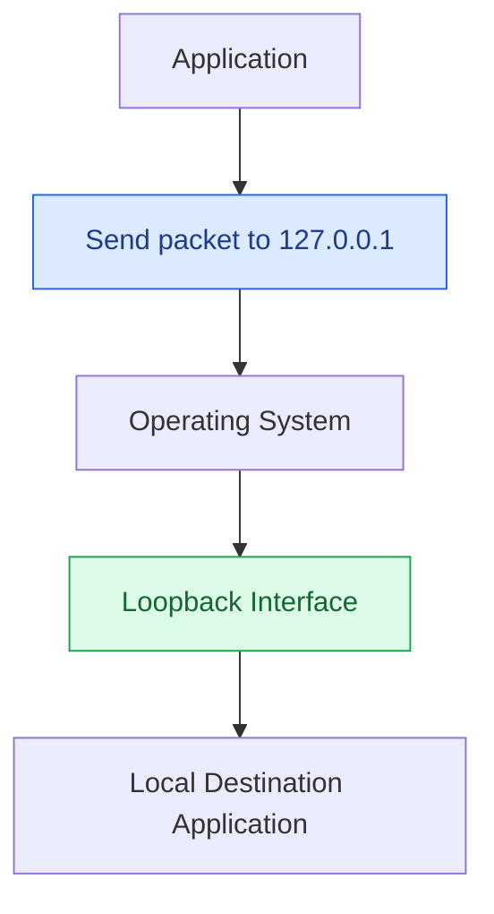
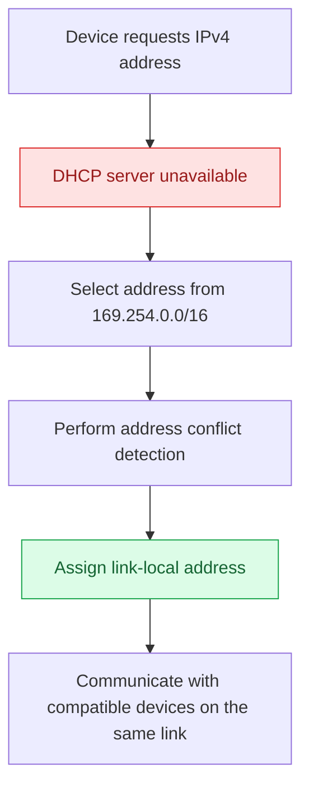
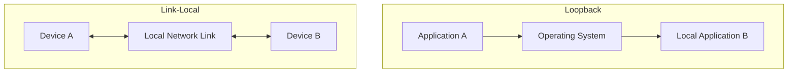

# Loopback and Link-Local IP Addresses

Loopback and link-local addresses are special-purpose IP addresses used for communication within a device or within a local network segment.

They serve different purposes:

* **Loopback addresses** allow a device to communicate with itself.
* **Link-local addresses** allow devices to communicate with other devices on the same network link without requiring a router.

Both IPv4 and IPv6 define loopback and link-local address ranges.

Understanding these addresses is essential for network configuration, troubleshooting, routing, and system administration.

# 🗁 Loopback Addresses

A loopback address is a special IP address that allows a device to send network traffic to itself.

When an application sends data to a loopback address, the operating system processes the traffic internally. It does not need to send the packet through a physical network interface.

Loopback addresses are commonly used for:

* Testing local TCP/IP functionality.
* Running and testing applications locally.
* Accessing services hosted on the same machine.
* Development and debugging.
* Internal communication between local processes.

Common loopback addresses:

| IP Version | Loopback Address | Prefix |
| --- | --- | --- |
| IPv4 | `127.0.0.1` | `127.0.0.0/8` |
| IPv6 | `::1` | `::1/128` |

The hostname `localhost` normally resolves to one or both of these addresses, depending on the system configuration.

# 🗁 IPv4 Loopback

IPv4 reserves the entire range `127.0.0.0/8` for loopback functionality.

```text
127.0.0.0 - 127.255.255.255
```

The most commonly used address is:

```text
127.0.0.1
```

This address is commonly called the IPv4 loopback address.

### 🖆 Example

Suppose a web application runs on port `3000` on your computer.

You can access it through:

```text
http://127.0.0.1:3000
```

You can also access it using:

```text
http://localhost:3000
```

Both addresses can refer to the same local machine.

### 🖆 How IPv4 Loopback Works



The operating system recognizes the loopback destination and handles the communication internally.

The traffic does not need to travel through an external router or physical network.

### 🖆 Important Characteristics

* The entire `127.0.0.0/8` range is reserved for loopback.
* `127.0.0.1` is the most commonly used address.
* Loopback traffic stays within the local host.
* Loopback addresses are not used as ordinary addresses for communication with remote devices.
* A loopback address does not represent another device on the network.

# 🗁 IPv6 Loopback

IPv6 uses a single loopback address:

```text
::1
```

Its full expanded representation is:

```text
0000:0000:0000:0000:0000:0000:0000:0001
```

The prefix is:

```text
::1/128
```

### 🖆 Example

Access a local application using IPv6:

```text
http://[::1]:3000
```

IPv6 addresses in URLs must be enclosed in square brackets to distinguish the address from the port separator.

### 🖆 Important Characteristics

* `::1` is the IPv6 loopback address.
* It represents the local host.
* It cannot be assigned as an ordinary address for external communication.
* IPv6 loopback traffic is processed internally by the operating system.
* IPv6 does not define a loopback range equivalent to the IPv4 `127.0.0.0/8` block.

# 🗁 Link-Local Addresses

A link-local address is an IP address used for communication between devices on the same local network link.

A network link generally represents a directly connected network segment, such as:

* An Ethernet LAN.
* A Wi-Fi network segment.
* A point-to-point connection.

Link-local communication does not require a router to forward packets between different networks.

Link-local addresses are commonly used for:

* Automatic local network communication.
* Neighbor discovery.
* Address configuration.
* Local network service discovery.
* Communication between directly connected devices.

IPv4 and IPv6 use different link-local address ranges and configuration mechanisms.

# 🗁 IPv4 Link-Local

IPv4 reserves the following range for link-local addressing:

```text
169.254.0.0/16
```

The usable range is:

```text
169.254.1.0 - 169.254.254.255
```

IPv4 link-local addressing is commonly associated with **Automatic Private IP Addressing (APIPA)**.

When a device is configured to obtain an IPv4 address automatically but cannot obtain one through DHCP, it may select an address from the link-local range.

### 🖆 Example

A computer is configured to use DHCP:

```text
IP Configuration: Automatic (DHCP)
```

However, the DHCP server is unavailable.

The operating system may automatically assign:

```text
IP Address:       169.254.25.10
Subnet Mask:      255.255.0.0
Default Gateway:  Not configured through APIPA
```

The computer may communicate with other devices on the same link that have compatible link-local addresses.

However, it generally cannot communicate with remote IPv4 networks through this address.

### 🖆 How IPv4 Link-Local Works



### 🖆 Important Characteristics

* IPv4 link-local uses `169.254.0.0/16`.
* It is commonly assigned automatically when DHCP configuration fails.
* It supports communication within the local link.
* It is not intended for communication through routers.
* It does not provide normal internet connectivity.
* It is not part of the RFC 1918 private IPv4 address ranges.

# 🗁 IPv6 Link-Local

IPv6 automatically assigns a link-local address to an interface when IPv6 is enabled.

The IPv6 link-local range is:

```text
fe80::/10
```

Example:

```text
fe80::a00:27ff:fe4e:66a1
```

Unlike IPv4 APIPA, IPv6 link-local addressing is a fundamental part of normal IPv6 operation.

IPv6 devices use link-local addresses for several essential network functions.

### 🖆 Common Uses

* Neighbor Discovery Protocol (NDP).
* Router Advertisements (RA).
* Router Solicitation (RS).
* Duplicate Address Detection (DAD).
* Communication between neighboring IPv6 devices.
* Next-hop addressing in IPv6 routing.

### 🖆 Example

Consider this IPv6 network:

```text
Device A:
fe80::1

Device B:
fe80::2
```

Both devices can communicate using their link-local addresses when they belong to the same network link.

A router may also use its link-local address as the next hop in an IPv6 routing table.

Example:

```text
default via fe80::1 dev eth0
```

Here:

* `default` represents the IPv6 default route.
* `fe80::1` is the next-hop router's link-local address.
* `eth0` identifies the outgoing interface.

### 🖆 Interface Scope

IPv6 link-local addresses have **link-local scope**.

This means they are meaningful only within the local network link.

The same link-local address can exist on multiple interfaces or network segments without creating a global address conflict.

When communicating with a link-local address, the outgoing interface must be identified when the destination is otherwise ambiguous.

For example, on Linux:

```bash
ping -6 fe80::1%eth0
```

The `%eth0` portion identifies the interface through which the destination should be reached.

### 🖆 Important Characteristics

* IPv6 link-local uses `fe80::/10`.
* Each IPv6-enabled interface normally has a link-local address.
* It is automatically configured without requiring DHCPv6.
* It is used by NDP and IPv6 router discovery.
* It is not forwarded by routers.
* It can be used as an IPv6 routing next hop.
* It is not globally routable.

# 🗁 Loopback vs Link-Local

Although both are special-purpose IP addresses, their purposes are different.

| Feature | Loopback | Link-Local |
| --- | --- | --- |
| Purpose | Communication with the same device | Communication within the same network link |
| IPv4 Range | `127.0.0.0/8` | `169.254.0.0/16` |
| IPv4 Example | `127.0.0.1` | `169.254.1.10` |
| IPv6 Address | `::1/128` | `fe80::/10` |
| Communication Scope | Local host | Local network link |
| Router Required | No | No |
| Routable Between Networks | No | No |
| Common Usage | Local application testing | Neighbor discovery and local communication |

### 🖆 Conceptual Comparison



**Key distinction:** Loopback communication stays inside one device, whereas link-local communication can occur between different devices connected to the same network link.

# 🗁 Practical Commands

### 🖆 Linux (Ubuntu)

Display network interfaces and their IP addresses:

```bash
ip address show
```

Display the loopback interface:

```bash
ip address show lo
```

Display IPv4 loopback:

```bash
ip -4 address show dev lo
```

Display IPv6 addresses:

```bash
ip -6 address show
```

Display the routing table:

```bash
ip route
ip -6 route
```

Test IPv4 loopback:

```bash
ping -c 4 127.0.0.1
```

Test IPv6 loopback:

```bash
ping -6 -c 4 ::1
```

Test an IPv6 link-local address:

```bash
ping -6 fe80::1%eth0
```

Check the hostname resolution:

```bash
getent hosts localhost
```

### 🖆 Windows

Display network configuration:

```powershell
ipconfig /all
```

Test IPv4 loopback:

```powershell
ping 127.0.0.1
```

Test IPv6 loopback:

```powershell
ping ::1
```

Display the routing table:

```powershell
route print
```

### 🖆 macOS

Display network interfaces:

```bash
ifconfig
```

Test IPv4 loopback:

```bash
ping -c 4 127.0.0.1
```

Test IPv6 loopback:

```bash
ping6 -c 4 ::1
```

# 🗁 Common Problems

### 🖆 IPv4 Address Starts With 169.254

If a computer receives an address from `169.254.0.0/16`, it commonly indicates that DHCP configuration was unsuccessful.

Possible causes:

* DHCP server is unavailable.
* DHCP server is not reachable.
* Network cable or Wi-Fi connection is disconnected.
* VLAN configuration is incorrect.
* DHCP requests are blocked by a firewall.
* DHCP relay configuration is incorrect.

Useful Linux commands:

```bash
ip address show
ip route
```

For systems using NetworkManager:

```bash
nmcli device status
nmcli connection show
```

### 🖆 Loopback Ping Fails

If a loopback ping fails, investigate:

* Whether the loopback interface is enabled.
* Whether local firewall rules block ICMP.
* Whether the operating system's networking configuration is damaged.
* Whether the correct IP protocol version is being tested.

On Linux:

```bash
ip link show lo
```

The loopback interface should normally be in the `UP` state.

### 🖆 IPv6 Link-Local Communication Fails

Possible causes:

* IPv6 is disabled on an interface.
* The interface is down.
* The wrong network interface is being used.
* Neighbor Discovery is blocked.
* The destination belongs to a different link.

Inspect IPv6 addresses:

```bash
ip -6 address show
```

Inspect IPv6 neighbor entries:

```bash
ip -6 neigh show
```

# 🗁 Best Practices

* Use loopback addresses to test local network-stack functionality and application services.
* Use `localhost` when a service should be accessed through the local host's configured loopback name resolution.
* Do not use loopback addresses as ordinary LAN addresses.
* Investigate DHCP connectivity when an unexpected IPv4 `169.254.x.x` address appears.
* Do not expect IPv4 or IPv6 link-local addresses to provide communication across routers.
* Preserve IPv6 link-local addressing because NDP and router discovery depend on it.
* Specify the correct interface when using an IPv6 link-local address as a destination.
* Distinguish IPv4 APIPA behavior from normal IPv6 link-local autoconfiguration.

# 🗁 Summary

* Loopback addresses allow a device to communicate with itself.
* IPv4 loopback uses `127.0.0.0/8`, commonly `127.0.0.1`.
* IPv6 loopback uses `::1/128`.
* Link-local addresses support communication within the same network link.
* IPv4 link-local uses `169.254.0.0/16`.
* IPv4 link-local addressing is commonly associated with APIPA when DHCP fails.
* IPv6 link-local uses `fe80::/10` and is normally configured automatically.
* IPv6 link-local addresses are essential for Neighbor Discovery and router discovery.
* Neither loopback nor link-local addresses are forwarded between networks by routers.

# 🗁 References

* [RFC 1122 – Requirements for Internet Hosts](https://www.rfc-editor.org/rfc/rfc1122)
* [RFC 3927 – Dynamic Configuration of IPv4 Link-Local Addresses](https://www.rfc-editor.org/rfc/rfc3927)
* [RFC 4291 – IP Version 6 Addressing Architecture](https://www.rfc-editor.org/rfc/rfc4291)
* [RFC 4861 – Neighbor Discovery for IP Version 6 (IPv6)](https://www.rfc-editor.org/rfc/rfc4861)
* [RFC 5735 – Special Use IPv4 Addresses](https://www.rfc-editor.org/rfc/rfc5735)
* [Linux `ip-address` Manual](https://man7.org/linux/man-pages/man8/ip-address.8.html)
