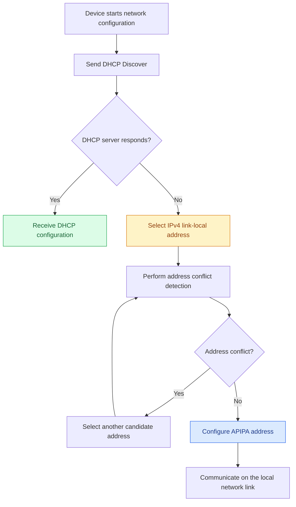
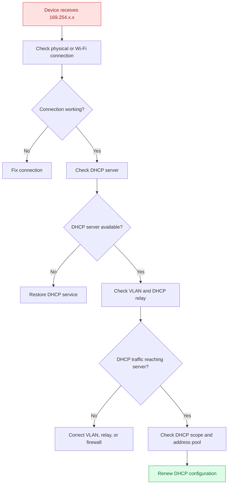

# APIPA (Automatic Private IP Addressing)

**APIPA (Automatic Private IP Addressing)** is a mechanism used by Microsoft Windows and other operating systems to automatically configure an IPv4 link-local address when a DHCP server cannot be reached.

APIPA allows devices to communicate with other compatible devices on the same local network link without requiring manual IP configuration or a DHCP server.

APIPA uses the IPv4 link-local address range:

```text
169.254.0.0/16
```

For example:

```text
IP Address:       169.254.25.10
Subnet Mask:      255.255.0.0
Default Gateway:  Not configured by APIPA
```

APIPA is useful for basic local communication, but it does not provide normal internet connectivity or communication across routed networks.

# 🗁 Understanding APIPA

APIPA provides automatic IPv4 link-local addressing when a device cannot obtain an address through DHCP.

Normally, a DHCP-enabled device follows this process:

```text
Device
  |
  | DHCP Discover
  v
DHCP Server
  |
  | DHCP Offer
  v
Device receives IP configuration
```

However, if the DHCP server is unavailable or unreachable, the device may configure an IPv4 link-local address instead.

Example:

```text
Normal DHCP Configuration:

IP Address:       192.168.1.100
Subnet Mask:      255.255.255.0
Default Gateway:  192.168.1.1
```

If DHCP configuration fails, the device may use:

```text
APIPA Configuration:

IP Address:       169.254.25.10
Subnet Mask:      255.255.0.0
Default Gateway:  Not configured by APIPA
```

This allows local communication with other devices that have compatible link-local addresses.

# 🗁 APIPA Address Range

APIPA uses the IPv4 link-local block:

```text
169.254.0.0/16
```

The subnet mask is:

```text
255.255.0.0
```

The range contains:

| Property | Value |
| --- | --- |
| Network Address | `169.254.0.0` |
| Prefix Length | `/16` |
| Subnet Mask | `255.255.0.0` |
| First Address in Range | `169.254.0.0` |
| Last Address in Range | `169.254.255.255` |
| Commonly Used Host Range | `169.254.1.0` – `169.254.254.255` |
| Broadcast Address | `169.254.255.255` |
| Address Type | IPv4 Link-Local |

The first 256 addresses and the last 256 addresses of the `/16` block are reserved from normal address assignment under the IPv4 link-local specification.

Therefore, the usable range is:

```text
169.254.1.0 - 169.254.254.255
```

The prefix `/16` means that the first 16 bits identify the network portion.

# 🗁 How APIPA Works

APIPA is used when a device cannot obtain an IPv4 configuration through DHCP.

The general process is:

* The device attempts to obtain an IPv4 address through DHCP.
* No usable DHCP configuration is received.
* The operating system selects a candidate address from `169.254.0.0/16`.
* The device checks whether another device is already using that address.
* If no conflict is detected, the address can be configured on the interface.
* The device can communicate with compatible devices on the same network link.

### 🖆 APIPA Workflow



### 🖆 Address Conflict Detection

Before using a selected address, a device must check whether another device is already using it.

For IPv4 link-local addressing, this process uses ARP-based address conflict detection.

If a conflict is detected, the device selects another candidate address and checks again.

This helps prevent two devices on the same network link from using the same IPv4 link-local address.

# 🗁 APIPA and DHCP

APIPA and DHCP serve different purposes.

| Feature | DHCP | APIPA |
| --- | --- | --- |
| Purpose | Automatic network configuration | Automatic link-local addressing |
| Address Source | DHCP server | Locally selected address |
| Common IPv4 Range | Depends on DHCP configuration | `169.254.0.0/16` |
| Default Gateway | Can be provided | Not provided by APIPA |
| DNS Configuration | Can be provided | Not provided by APIPA |
| Internet Connectivity | Possible with valid routing | Not provided by APIPA |
| Router Communication | Supported through valid routes | Not supported using the link-local address |

### 🖆 DHCP Recovery

APIPA does not necessarily mean that DHCP will remain unavailable permanently.

If the DHCP server becomes reachable later, the device can attempt to obtain a normal DHCP configuration.

For example:

```text
Initial Configuration:

IP Address: 169.254.25.10
```

After DHCP becomes available:

```text
Updated Configuration:

IP Address:       192.168.1.100
Subnet Mask:      255.255.255.0
Default Gateway:  192.168.1.1
DNS Server:       192.168.1.1
```

The device can then communicate through the configured gateway and use the supplied DNS server.

# 🗁 Identifying APIPA Addresses

An APIPA address is easy to identify because it belongs to:

```text
169.254.0.0/16
```

For example:

```text
169.254.10.25
169.254.100.50
169.254.200.100
```

These addresses indicate IPv4 link-local addressing.

### 🖆 Windows

Run:

```powershell
ipconfig
```

Example output:

```text
Ethernet adapter Ethernet:

   IPv4 Address. . . . . . . . . . : 169.254.25.10
   Subnet Mask . . . . . . . . . . : 255.255.0.0
   Default Gateway . . . . . . . . :
```

The `169.254.x.x` address indicates that the interface is using an IPv4 link-local address.

To inspect more configuration details:

```powershell
ipconfig /all
```

### 🖆 Linux (Ubuntu)

Display IPv4 addresses:

```bash
ip -4 address show
```

Example:

```text
2: eth0:
    inet 169.254.25.10/16 scope link
```

Display routes:

```bash
ip route
```

Inspect network configuration using NetworkManager:

```bash
nmcli device status
nmcli connection show
```

Linux systems may use IPv4 link-local addressing when configured to do so. It is not necessarily enabled as an automatic fallback on every Linux distribution or network manager.

# 🗁 Troubleshooting APIPA

An APIPA address is often a symptom of a DHCP configuration problem.

The goal is to identify why the device cannot obtain a valid DHCP lease.

### 🖆 Common Causes

| Cause | Description |
| --- | --- |
| DHCP Server Unavailable | The DHCP server is powered off or not responding |
| Network Disconnection | Ethernet cable or Wi-Fi connection is disconnected |
| Incorrect VLAN | The device is connected to the wrong VLAN |
| DHCP Relay Failure | DHCP requests cannot reach a remote DHCP server |
| Firewall Rules | DHCP traffic is blocked |
| DHCP Pool Exhaustion | No available addresses remain in the DHCP pool |
| Incorrect DHCP Configuration | DHCP scope or network settings are incorrect |
| Network Equipment Failure | A switch, router, or access point is malfunctioning |

### 🖆 Troubleshooting Workflow



### 🖆 Check Physical Connectivity

Verify that the network interface is connected.

Linux:

```bash
ip link show
```

NetworkManager:

```bash
nmcli device status
```

Windows:

```powershell
Get-NetAdapter
```

### 🖆 Check DHCP Server Availability

Verify that the DHCP service is running and reachable.

For a Linux DHCP server using ISC DHCP:

```bash
sudo systemctl status isc-dhcp-server
```

For a Windows DHCP server, inspect the DHCP Server service and DHCP scope configuration.

### 🖆 Check VLAN Configuration

If the network uses VLANs, verify:

* The switch port is assigned to the correct access VLAN.
* The VLAN exists on the switch.
* Trunk links carry the required VLAN.
* The DHCP server or DHCP relay is reachable from that VLAN.

### 🖆 Check DHCP Relay Configuration

When the DHCP server is on a different subnet, a DHCP relay agent is generally required to forward client DHCP messages.

Verify the relay configuration on the router or Layer 3 switch.

### 🖆 Renew DHCP Configuration on Windows

Release the current IPv4 configuration:

```powershell
ipconfig /release
```

Request a new DHCP configuration:

```powershell
ipconfig /renew
```

### 🖆 Renew DHCP Configuration on Ubuntu

For a NetworkManager-managed connection, reconnect the active connection:

```bash
nmcli connection show --active
```

Then reconnect using its connection name:

```bash
sudo nmcli connection down "Wired connection 1"
sudo nmcli connection up "Wired connection 1"
```

The connection name may differ depending on the system configuration.

# 🗁 Practical Commands

| Task | Windows | Ubuntu/Linux |
| --- | --- | --- |
| View IP configuration | `ipconfig /all` | `ip address show` |
| View routing table | `route print` | `ip route` |
| Release DHCP lease | `ipconfig /release` | Reconnect or renew using the network manager |
| Renew DHCP lease | `ipconfig /renew` | Reconnect or renew using the network manager |
| Check network interfaces | `Get-NetAdapter` | `ip link show` |
| Check connectivity | `ping 192.168.1.1` | `ping -c 4 192.168.1.1` |

# 🗁 APIPA vs Private IP Addressing

APIPA addresses and RFC 1918 private IPv4 addresses are both non-publicly routable address spaces, but they serve different purposes.

| Feature | APIPA | RFC 1918 Private IP |
| --- | --- | --- |
| Address Range | `169.254.0.0/16` | Three reserved ranges |
| Primary Purpose | Local link communication | Private network communication |
| Router Forwarding | Not forwarded between links | Can be routed within private networks |
| Internet Access | Not provided through APIPA | Commonly provided through NAT |
| Configuration | Automatic link-local configuration | Manual or DHCP |
| Common Example | `169.254.25.10` | `192.168.1.10` |

RFC 1918 private IPv4 ranges:

```text
10.0.0.0/8
172.16.0.0/12
192.168.0.0/16
```

Remember that `169.254.0.0/16` is IPv4 link-local space, not an RFC 1918 private address range.

# 🗁 Best Practices

* Investigate DHCP connectivity whenever an unexpected APIPA address appears.
* Verify physical connectivity before troubleshooting DHCP services.
* Check VLAN assignments and DHCP relay configuration in segmented networks.
* Monitor DHCP scope utilization to prevent address pool exhaustion.
* Use DHCP reservations when devices require predictable IPv4 addresses.
* Avoid treating APIPA as a replacement for normal DHCP configuration.
* Verify that devices receive the correct subnet mask, default gateway, and DNS configuration after DHCP recovery.
* Use packet captures when DHCP communication problems are difficult to diagnose.

# 🗁 Summary

* APIPA stands for Automatic Private IP Addressing.
* It provides automatic IPv4 link-local addressing when DHCP configuration is unsuccessful.
* APIPA uses the `169.254.0.0/16` address range.
* The subnet mask is `255.255.0.0`.
* APIPA supports communication between compatible devices on the same network link.
* APIPA does not provide a default gateway or normal internet connectivity.
* Address conflict detection helps prevent duplicate link-local addresses.
* An APIPA address commonly indicates a DHCP or network connectivity problem.
* Once DHCP becomes available, a device can obtain a normal network configuration.

# 🗁 References

* [RFC 3927 – Dynamic Configuration of IPv4 Link-Local Addresses](https://www.rfc-editor.org/rfc/rfc3927)
* [RFC 2131 – Dynamic Host Configuration Protocol](https://www.rfc-editor.org/rfc/rfc2131)
* [RFC 1918 – Address Allocation for Private Internets](https://www.rfc-editor.org/rfc/rfc1918)
* [Microsoft – ipconfig Documentation](https://learn.microsoft.com/en-us/windows-server/administration/windows-commands/ipconfig)
* [Linux `ip` Command Manual](https://man7.org/linux/man-pages/man8/ip.8.html)
