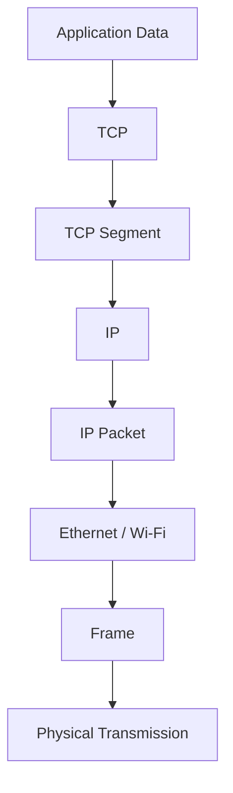
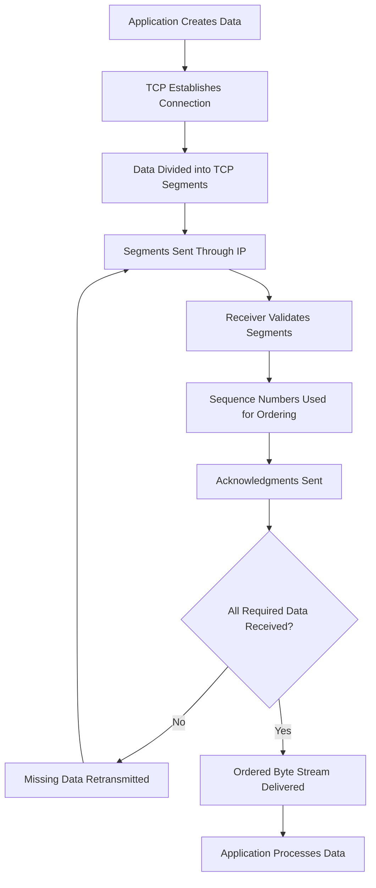
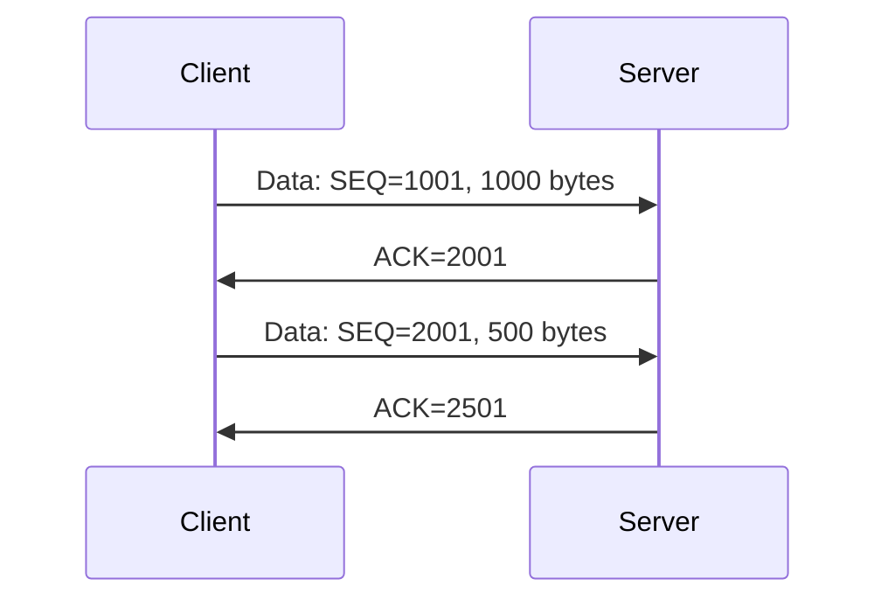
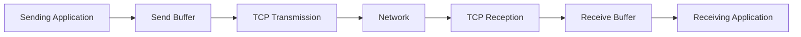
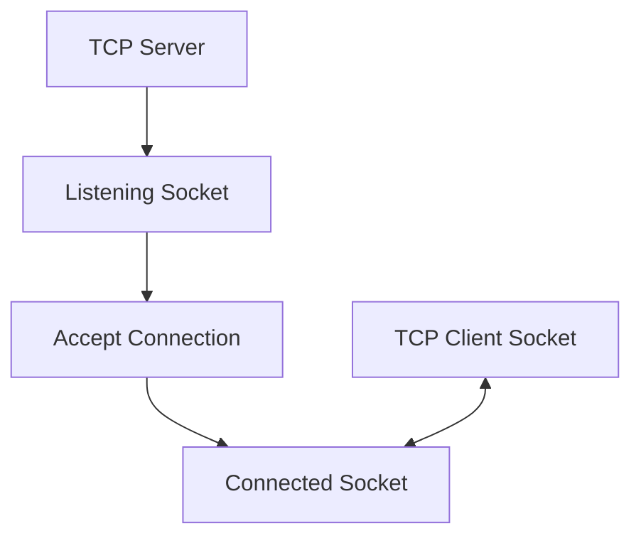
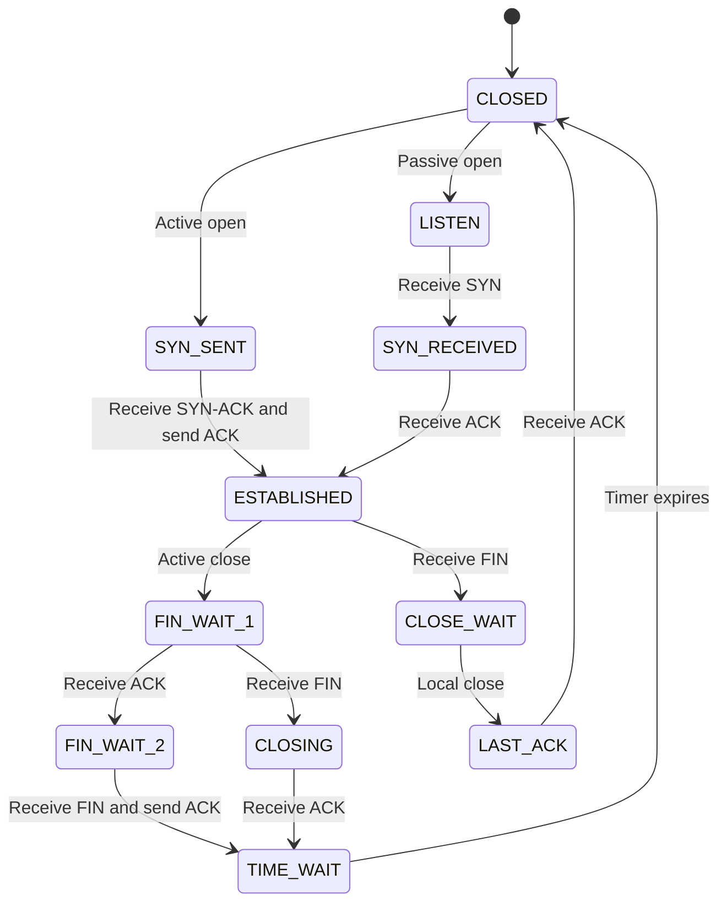

# Transmission Control Protocol (TCP)

Transmission Control Protocol (TCP) is a connection-oriented transport-layer protocol used to provide reliable, ordered, and error-checked data delivery between applications running on different devices across an IP network.

TCP operates on top of IP and provides communication services that IP itself does not guarantee.

IP provides best-effort packet delivery. Packets may be lost, duplicated, delayed, or delivered out of order. TCP handles these conditions through mechanisms such as:

* Connection establishment and termination.
* Sequence numbers and acknowledgments.
* Retransmission of lost data.
* Error detection.
* Flow control.
* Congestion control.
* Ordered byte-stream delivery.

TCP is commonly used by applications that require reliable communication, including HTTP/HTTPS, SSH, FTP, SMTP, and database connections.

# 🗁 TCP Fundamentals

TCP stands for **Transmission Control Protocol**.

It is one of the core protocols of the Internet protocol suite and operates at the transport layer.

TCP provides a reliable communication channel between two application endpoints.

### 🖆 TCP in the Network Model

TCP operates at the transport layer.

| Network Model | Protocol |
| --- | --- |
| Application | HTTP, HTTPS, SSH, SMTP |
| Transport | TCP |
| Internet | IPv4, IPv6 |
| Network Access | Ethernet, Wi-Fi |

The following diagram illustrates how application data travels through the network stack.



Each layer adds its own protocol information through encapsulation.

### 🖆 Why TCP Is Needed

IP is a best-effort delivery protocol. It does not guarantee that packets will reach their destination.

Consider an application sending data through an IP network:

* A packet may be lost.
* Packets may arrive in a different order.
* Duplicate packets may appear.
* Network congestion may delay delivery.
* The receiving application may not be ready to process incoming data.

TCP provides mechanisms to handle these situations and presents applications with a reliable, ordered byte stream.

# 🗁 Key Characteristics

TCP has several important characteristics.

### 🖆 Connection-Oriented

TCP establishes a logical connection between two endpoints before normal data transfer begins.

The connection is established using the TCP three-way handshake.

### 🖆 Reliable Delivery

TCP uses acknowledgments and retransmissions to recover from lost data.

When the sender does not receive the expected acknowledgment, it may retransmit the missing data.

### 🖆 Ordered Delivery

TCP uses sequence numbers to track transmitted bytes.

The receiving side reassembles data in the correct order before delivering it to the application.

### 🖆 Full-Duplex Communication

TCP supports simultaneous communication in both directions.

Both endpoints can send and receive data independently over the same connection.

### 🖆 Byte-Stream Oriented

TCP delivers data as a continuous stream of bytes.

It does not preserve application message boundaries.

For example, an application might send:

```text
Hello
World
```

TCP may transmit these bytes in one or multiple segments. The receiving application could receive them in a single read or several reads.

Applications that need message boundaries must define their own framing mechanism.

### 🖆 Error Detection

TCP includes a checksum to detect corruption in its header and data.

A segment that fails checksum validation is discarded. Recovery may occur through retransmission.

### 🖆 Flow Control

TCP prevents a sender from overwhelming the receiving endpoint by using the receiver's advertised window.

### 🖆 Congestion Control

TCP adjusts its sending behavior according to network congestion to help avoid overwhelming the network.

# 🗁 How TCP Works

TCP communication generally follows this process:



### 🖆 Connection Establishment

Before exchanging application data, TCP normally establishes a connection using a three-way handshake.

The handshake synchronizes the initial sequence numbers of both endpoints.

### 🖆 Data Transmission

After establishing the connection:

* The sending application writes data to its TCP socket.
* TCP assigns sequence numbers to the bytes.
* TCP divides the byte stream into segments as needed.
* IP carries the segments across the network.
* The receiving TCP implementation validates and processes incoming segments.

### 🖆 Acknowledgment

The receiver acknowledges received bytes.

An acknowledgment number generally identifies the next byte expected from the sender.

### 🖆 Connection Termination

When communication is complete, TCP endpoints can close their sending directions using FIN and ACK flags.

A TCP connection may also be terminated using a reset (RST).

# 🗁 TCP Connection

A TCP connection is a logical communication relationship between two TCP endpoints.

It is established through the handshake and maintained through connection state, sequence numbers, acknowledgment numbers, and other control information.

### 🖆 Example TCP Connection

Suppose a client communicates with a web server:

| Property | Client | Server |
| --- | --- | --- |
| IP Address | `192.168.1.10` | `203.0.113.10` |
| Port | `51524` | `443` |
| Protocol | TCP | TCP |

The client uses an ephemeral source port, while the server listens on port `443`.

The connection can be represented as:

```text
192.168.1.10:51524
        |
        | TCP Connection
        |
203.0.113.10:443
```

### 🖆 Connection Identification

A TCP connection is commonly identified by a four-tuple:

* Source IP address.
* Source port.
* Destination IP address.
* Destination port.

The transport protocol and networking context also matter when identifying connections within operating systems and network namespaces.

For example:

```text
TCP
Source:      192.168.1.10:51524
Destination: 203.0.113.10:443
```

Multiple TCP connections can communicate with the same server port as long as their connection identifiers are distinct.

# 🗁 TCP Segment

A TCP segment is the Protocol Data Unit (PDU) used by TCP.

It consists of:

* TCP header.
* TCP payload.

```text
+------------------------------+
|          TCP Header          |
+------------------------------+
|                              |
|          TCP Payload         |
|                              |
+------------------------------+
```

The TCP header contains control information required for communication.

The payload contains application data or a portion of the application's byte stream.

### 🖆 TCP Segment Size

TCP segment size depends on several factors, including:

* Maximum Segment Size (MSS).
* Path MTU.
* TCP and IP header sizes.
* TCP options.
* Additional encapsulation overhead.

MSS defines the maximum TCP payload size that a TCP endpoint is prepared to receive in a segment.

For a typical Ethernet network with an IP MTU of 1500 bytes and standard IPv4 and TCP headers:

```text
Ethernet IP MTU:       1500 bytes
IPv4 Header:             20 bytes
TCP Header:              20 bytes
---------------------------------
TCP MSS:               1460 bytes
```

This example assumes no IP or TCP options.

For IPv6 with its standard 40-byte base header and a 20-byte TCP header:

```text
IPv6 MTU:              1500 bytes
IPv6 Header:             40 bytes
TCP Header:              20 bytes
---------------------------------
TCP MSS:               1440 bytes
```

Actual segment sizes can differ depending on negotiated options and path characteristics.

# 🗁 TCP Header

The TCP header contains information that enables reliable communication between endpoints.

Its minimum size is 20 bytes, and its maximum size is 60 bytes.

### 🖆 TCP Header Structure

```text
  0                   15 16                  31
 +----------------------+----------------------+
 |     Source Port      |   Destination Port   |
 +----------------------+----------------------+
 |                Sequence Number               |
 +---------------------------------------------+
 |             Acknowledgment Number            |
 +----+------+--------+-------------------------+
 |DOFF|Resvd | Flags  |       Window Size       |
 +----------------------+----------------------+
 |       Checksum       |    Urgent Pointer     |
 +----------------------+----------------------+
 |              Options (Optional)              |
 +---------------------------------------------+
 |                   Payload                    |
 +---------------------------------------------+
```

### 🖆 TCP Header Fields

| Field | Description |
| --- | --- |
| Source Port | Identifies the sending application endpoint. |
| Destination Port | Identifies the receiving application endpoint. |
| Sequence Number | Identifies the position of the first data byte in the segment's sequence space, when applicable. |
| Acknowledgment Number | Identifies the next byte expected from the other endpoint when ACK is set. |
| Data Offset | Specifies the TCP header length. |
| Reserved | Reserved bits for protocol use. |
| Flags | Control connection establishment, termination, and other TCP behavior. |
| Window Size | Advertises the receiver's available receive window, subject to window scaling. |
| Checksum | Detects corruption in the TCP header and data. |
| Urgent Pointer | Identifies urgent data boundaries when the URG flag is set. |
| Options | Provides additional features such as MSS, window scaling, timestamps, and SACK. |
| Payload | Contains application data. |

# 🗁 Sequence Numbers and Acknowledgments

Sequence numbers and acknowledgment numbers are fundamental to TCP reliability and ordered delivery.

TCP sequence numbers count bytes, not segments.

### 🖆 Sequence Number

A sequence number identifies the position of data bytes within the TCP byte stream.

Suppose a sender transmits 1000 bytes beginning with sequence number `1001`.

```text
First Byte:       1001
Last Byte:        2000
Next Byte:        2001
```

The next segment containing new data would normally begin with sequence number `2001`.

### 🖆 Acknowledgment Number

An acknowledgment number indicates the next byte the receiver expects.

If the receiver successfully receives bytes `1001` through `2000`, it can acknowledge them with:

```text
ACK = 2001
```

This means all bytes before sequence number `2001` have been received in order.

### 🖆 Example



TCP acknowledgments are generally cumulative. An acknowledgment confirms receipt of all bytes up to, but not including, the acknowledgment number.

Selective Acknowledgment (SACK) can provide additional information about non-contiguous data blocks received beyond a missing segment.

### 🖆 Initial Sequence Number

Each TCP endpoint selects an Initial Sequence Number (ISN) when establishing a connection.

The ISN helps synchronize the byte streams and makes it harder for old or unrelated segments to be mistaken for current connection data.

SYN and FIN each consume one sequence number, even though they do not carry application data.

# 🗁 Reliability and Retransmission

TCP provides reliable delivery using acknowledgments, timers, sequence numbers, and retransmission mechanisms.

### 🖆 Acknowledgment-Based Reliability

When a receiver receives data successfully, it acknowledges the received bytes.

If the sender does not receive the expected acknowledgment, it may retransmit the unacknowledged data.

### 🖆 Retransmission

Retransmission is the process of sending data again when TCP determines that previously transmitted data may have been lost.

TCP uses mechanisms such as:

* Retransmission timeout (RTO).
* Duplicate acknowledgment processing.
* Fast retransmit.
* Selective Acknowledgment (SACK), when negotiated.

### 🖆 Retransmission Timeout

TCP maintains a retransmission timer.

If the expected acknowledgment does not arrive before the retransmission timeout expires, TCP retransmits the relevant data.

The timeout is dynamically calculated using measured round-trip times and related algorithms.

### 🖆 Duplicate Acknowledgments

A receiver may send repeated acknowledgments for the same next expected byte when later data arrives but an earlier portion is missing.

For example:

```text
Sender sends: 1001-2000
Sender sends: 2001-3000
Sender sends: 3001-4000

Receiver misses: 1001-2000

Receiver sends:
ACK=1001
ACK=1001
ACK=1001
```

The repeated acknowledgment can indicate a missing segment.

TCP implementations commonly use duplicate acknowledgments as part of fast retransmit and recovery mechanisms.

# 🗁 TCP Buffering

TCP uses buffers to temporarily store data during communication.

Both sending and receiving endpoints maintain buffers.

### 🖆 Send Buffer

The send buffer stores data written by the application before and during transmission.

It may contain:

* Data waiting to be transmitted.
* Data already transmitted but not yet acknowledged.
* Data that may need retransmission.

The application can continue writing data while TCP manages transmission, subject to available buffer space and flow-control constraints.

### 🖆 Receive Buffer

The receive buffer stores incoming TCP data before delivering it to the receiving application.

TCP uses sequence numbers to organize the byte stream.

The receiving application reads data from this buffer through its socket.

### 🖆 Buffer Communication



# 🗁 TCP Ports

TCP uses port numbers to identify application endpoints on a host.

A port number is a 16-bit unsigned value.

Therefore, TCP supports port numbers from:

```text
0 - 65535
```

### 🖆 Port Number Categories

| Range | Category |
| --- | --- |
| 0–1023 | Well-known ports |
| 1024–49151 | Registered ports |
| 49152–65535 | Dynamic/private ports |

These ranges follow the IANA port-number assignment model.

### 🖆 Source and Destination Ports

A TCP segment contains both source and destination port numbers.

Example:

```text
Source IP:       192.168.1.10
Source Port:     51524

Destination IP:  203.0.113.10
Destination Port: 443
```

Here:

* `51524` is an ephemeral client-side port.
* `443` is the server's HTTPS port.

# 🗁 TCP Socket Pair

A socket is a communication endpoint exposed by an operating system to applications.

For TCP, a socket provides an interface for sending and receiving data through a connection-oriented byte stream.

A TCP server typically creates a listening socket and accepts incoming connections.

Each accepted connection is represented by a separate connected socket.

### 🖆 Server and Client Communication



A listening socket can accept multiple connections, subject to system and application resource limits.

### 🖆 Example

A web server may listen on:

```text
0.0.0.0:443
```

A client may connect from:

```text
192.168.1.10:51524
```

The operating system distinguishes the resulting TCP connections using their connection identifiers.

# 🗁 TCP States

TCP maintains connection states to manage the lifecycle of a connection.

Common TCP states include:

| State | Description |
| --- | --- |
| CLOSED | No active connection exists. |
| LISTEN | Waiting for incoming connection requests. |
| SYN-SENT | A connection request has been sent. |
| SYN-RECEIVED | A connection request has been received and is being acknowledged. |
| ESTABLISHED | Connection is active and data can be exchanged. |
| FIN-WAIT-1 | Local endpoint has initiated connection termination. |
| FIN-WAIT-2 | Local FIN has been acknowledged; waiting for the peer's FIN. |
| CLOSE-WAIT | Remote endpoint has initiated termination; local application has not fully closed. |
| CLOSING | Both endpoints have sent FIN and are waiting for acknowledgment. |
| LAST-ACK | Waiting for acknowledgment of the local FIN. |
| TIME-WAIT | Waiting to ensure old segments expire and the final acknowledgment can be retransmitted if needed. |

### 🖆 Simplified TCP State Lifecycle



The diagram shows a simplified lifecycle. Actual TCP state transitions also depend on simultaneous opens, simultaneous closes, resets, and other protocol events.

# 🗁 TCP Flags

TCP flags control important connection and data-transfer operations.

| Flag | Name | Purpose |
| --- | --- | --- |
| SYN | Synchronize | Establishes a connection and synchronizes sequence numbers. |
| ACK | Acknowledgment | Indicates that the acknowledgment field is valid. |
| FIN | Finish | Indicates that the sender has finished sending data. |
| RST | Reset | Resets or aborts a connection. |
| PSH | Push | Requests prompt delivery of received data to the application. |
| URG | Urgent | Indicates that the urgent pointer field is significant. |
| ECE | ECN-Echo | Participates in Explicit Congestion Notification signaling. |
| CWR | Congestion Window Reduced | Indicates that the sender has reacted to congestion notification. |
| NS | Nonce Sum | An older ECN-related flag with limited practical use. |

### 🖆 Common TCP Flag Combinations

| Combination | Common Usage |
| --- | --- |
| SYN | Connection initiation |
| SYN + ACK | Connection request acknowledgment |
| ACK | Acknowledgment |
| FIN + ACK | Connection termination |
| RST | Connection reset |
| PSH + ACK | Data transmission with push indication |

Flags can appear in different combinations depending on the TCP operation.

# 🗁 Advantages and Limitations

### 🖆 Advantages

* Reliable and ordered byte-stream delivery.
* Automatic retransmission of lost data.
* Error detection through checksums.
* Receiver flow control.
* Network congestion control.
* Full-duplex communication.
* Widely supported across operating systems and network devices.

### 🖆 Limitations

* Connection establishment introduces overhead.
* Acknowledgments and retransmissions can increase latency.
* Connection state requires memory and processing resources.
* Head-of-line blocking can occur within a TCP byte stream when earlier data is missing.
* TCP does not preserve application message boundaries.
* TCP is not inherently encrypted; security protocols such as TLS provide encryption and authentication.

# 🗁 Common TCP Applications

TCP is used by many application-layer protocols.

| Protocol | Default TCP Port | Purpose |
| --- | ---: | --- |
| HTTP | 80 | Web communication |
| HTTPS | 443 | Secure web communication |
| SSH | 22 | Secure remote access |
| FTP | 20, 21 | File transfer |
| SMTP | 25 | Email transfer |
| SMTP Submission | 587 | Email submission |
| SMTPS | 465 | Email submission over implicit TLS |
| POP3 | 110 | Email retrieval |
| POP3S | 995 | Secure email retrieval |
| IMAP | 143 | Email access |
| IMAPS | 993 | Secure email access |
| DNS | 53 | DNS queries over TCP |
| MySQL | 3306 | Database communication |
| PostgreSQL | 5432 | Database communication |
| RDP | 3389 | Remote desktop |

Some application protocols support both TCP and UDP, and some use additional transport mechanisms. The table lists common TCP port assignments.

# 🗁 Inspecting TCP on Linux

Linux provides several command-line tools for inspecting TCP connections and network activity.

### 🖆 Display Listening TCP Ports

Use `ss` to display listening TCP sockets:

```bash
ss -ltn
```

Options:

| Option | Meaning |
| --- | --- |
| `-l` | Display listening sockets. |
| `-t` | Display TCP sockets. |
| `-n` | Display numeric addresses and ports. |

### 🖆 Display All TCP Connections

```bash
ss -tan
```

This displays TCP sockets in different states, including established and listening sockets.

### 🖆 Display TCP Connections with Process Information

```bash
sudo ss -tpn
```

This can show the processes associated with TCP sockets.

### 🖆 Display TCP Statistics

```bash
ss -s
```

This displays a summary of socket statistics.

### 🖆 Capture TCP Packets

Use `tcpdump` to capture TCP traffic:

```bash
sudo tcpdump -i any tcp
```

Capture traffic involving port 443:

```bash
sudo tcpdump -i any 'tcp port 443'
```

Capture packets involving a particular host:

```bash
sudo tcpdump -i any 'tcp host 192.168.1.10'
```

### 🖆 Inspect TCP Connection States

```bash
ss -tan
```

Example output:

```text
State       Recv-Q  Send-Q  Local Address:Port  Peer Address:Port
LISTEN      0       4096    0.0.0.0:22          0.0.0.0:*
ESTAB       0       0       192.168.1.10:51524  203.0.113.10:443
TIME-WAIT   0       0       192.168.1.10:51530  203.0.113.10:443
```

The example illustrates listening, established, and TIME-WAIT sockets.

# 🗁 Best Practices

* Use TLS when application data requires confidentiality and authentication.
* Configure appropriate connection and application timeouts.
* Handle connection failures and retransmission-related delays.
* Read and write TCP streams using proper application-level framing.
* Monitor connection states and socket resource usage.
* Avoid assuming that one application write corresponds to one TCP segment or one application read.
* Use connection pooling where appropriate for applications with frequent repeated connections.
* Monitor retransmissions, latency, and connection failures when troubleshooting network performance.

# 🗁 Common Mistakes

### 🖆 Assuming TCP Preserves Message Boundaries

TCP is a byte-stream protocol. It does not preserve individual application write boundaries.

Applications must implement framing, such as length prefixes or delimiters, when message boundaries matter.

### 🖆 Assuming TCP Guarantees Immediate Delivery

TCP provides reliable delivery under normal operating conditions, but retransmissions and network failures can introduce delays or cause a connection to fail.

### 🖆 Confusing Flow Control with Congestion Control

Flow control protects the receiver.

Congestion control protects the network.

They solve different problems.

### 🖆 Assuming TCP Is Encrypted

TCP provides transport reliability, not encryption.

TLS is commonly used above TCP to provide encrypted and authenticated communication.

### 🖆 Treating Every TCP Connection as One Port

A server can accept many simultaneous connections on the same destination port.

Each connection is distinguished by its connection identifiers.

# 🗁 Interview Questions

### 🖆 What is TCP?

TCP is a connection-oriented transport-layer protocol that provides reliable, ordered, and error-checked byte-stream communication between application endpoints.

### 🖆 Why is TCP called connection-oriented?

Because TCP normally establishes a logical connection using a three-way handshake before exchanging application data.

### 🖆 What is a TCP segment?

A TCP segment is the transport-layer PDU containing a TCP header and an optional payload.

### 🖆 What is the difference between a sequence number and an acknowledgment number?

A sequence number identifies the position of data bytes in the TCP stream. An acknowledgment number indicates the next byte expected from the other endpoint.

### 🖆 Does TCP preserve message boundaries?

No. TCP provides a continuous byte stream. Applications must implement their own message-framing mechanism.

### 🖆 What is retransmission?

Retransmission is the process of sending data again when TCP determines that previously transmitted data may have been lost.

### 🖆 What is TCP flow control?

Flow control prevents a sender from overwhelming the receiver by using the receiver's advertised window.

### 🖆 What is TCP congestion control?

Congestion control adjusts the sender's transmission behavior to reduce network congestion.

### 🖆 What is the TCP MSS?

Maximum Segment Size (MSS) is the maximum amount of TCP payload that an endpoint is prepared to receive in a single TCP segment.

### 🖆 Is TCP encrypted?

No. TCP does not provide encryption. Protocols such as TLS provide encryption and authentication above TCP.

### 🖆 Can multiple clients connect to the same TCP server port?

Yes. Each connection is distinguished by its source and destination IP addresses and port numbers, along with the transport protocol and networking context.

# 🗁 Summary

TCP is a fundamental transport-layer protocol that provides reliable, ordered, connection-oriented communication between applications.

Its important features include:

* Connection establishment and termination.
* Sequence numbers and acknowledgments.
* Retransmission and error detection.
* Flow control and congestion control.
* Full-duplex byte-stream communication.
* TCP ports and socket-based communication.
* Connection state management.

TCP is widely used by web applications, remote administration tools, email systems, and database services.

Understanding TCP is essential for learning network communication, application protocols, network troubleshooting, and server-side programming.

# 🗁 References

* [RFC 9293 — Transmission Control Protocol (TCP)](https://www.rfc-editor.org/rfc/rfc9293)
* [RFC 5681 — TCP Congestion Control](https://www.rfc-editor.org/rfc/rfc5681)
* [RFC 7323 — TCP Extensions for High Performance](https://www.rfc-editor.org/rfc/rfc7323)
* [RFC 2018 — TCP Selective Acknowledgment Options](https://www.rfc-editor.org/rfc/rfc2018)
* [IANA — Service Name and Transport Protocol Port Number Registry](https://www.iana.org/assignments/service-names-port-numbers/service-names-port-numbers.xhtml)
* [Linux Manual — ss](https://man7.org/linux/man-pages/man8/ss.8.html)
* [Linux Manual — tcpdump](https://man7.org/linux/man-pages/man8/tcpdump.8.html)
