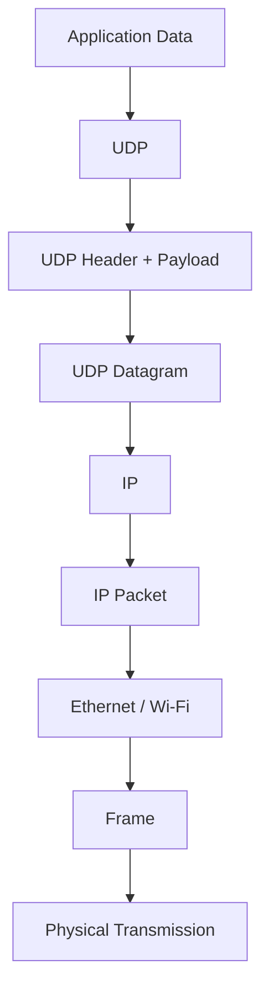
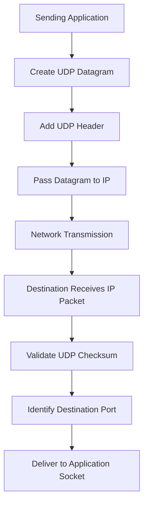
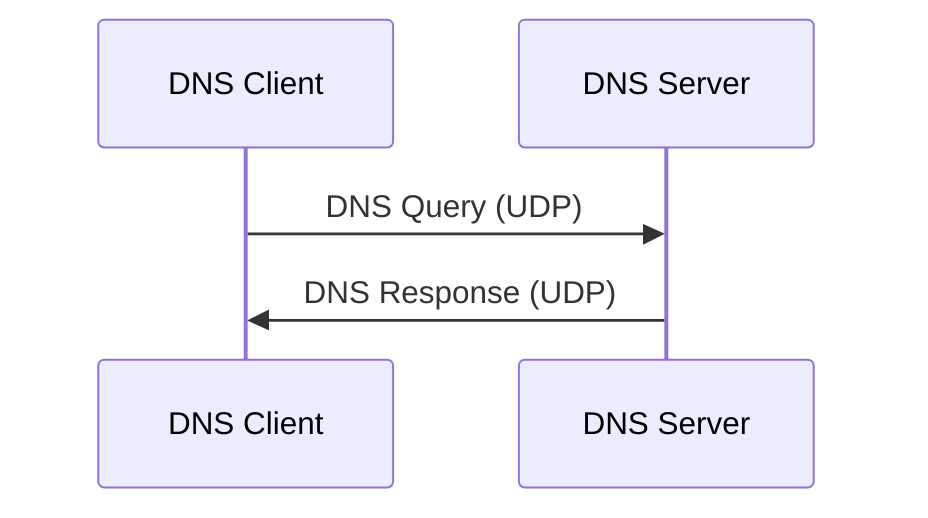
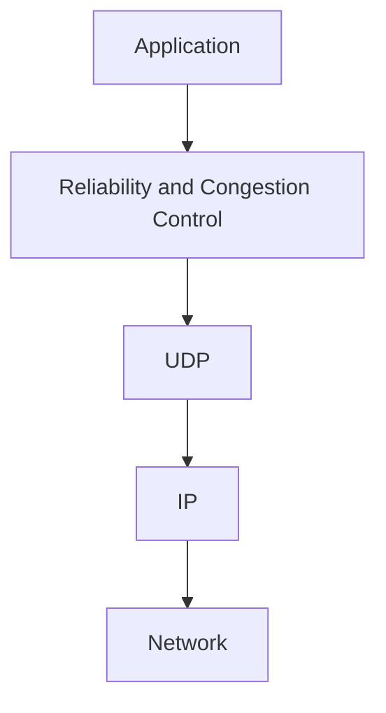
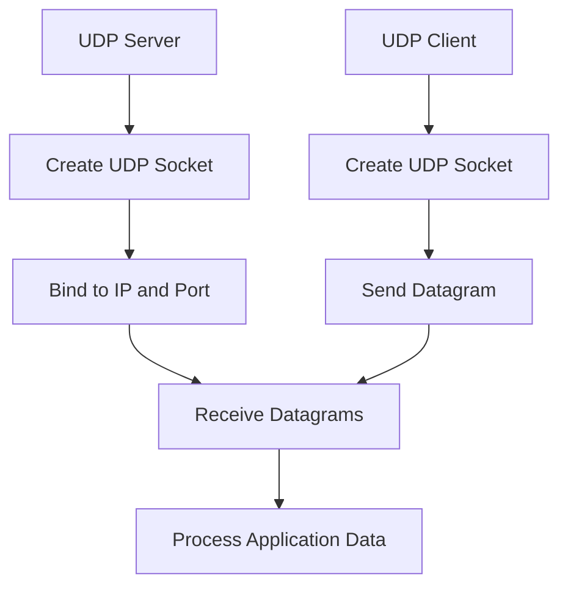

# User Datagram Protocol (UDP)

User Datagram Protocol (UDP) is a connectionless transport-layer protocol used to send data between applications over IP networks.

Unlike TCP, UDP does not establish a connection before transmitting data. It sends independent datagrams without providing built-in guarantees of delivery, ordering, retransmission, or duplicate protection.

UDP is designed for applications that benefit from low communication overhead, reduced latency, or direct control over transmission behavior.

Common UDP applications include:

* DNS queries.
* DHCP communication.
* Voice over IP (VoIP).
* Video streaming.
* Online gaming.
* Network time synchronization.
* Network monitoring.
* QUIC-based HTTP/3 communication.

# 🗁 UDP Fundamentals

UDP stands for **User Datagram Protocol**.

It operates at the transport layer of the TCP/IP model and provides a simple communication mechanism between applications.

UDP takes data from an application, adds a small transport-layer header, and passes the resulting datagram to IP for delivery.

Unlike TCP, UDP does not maintain a connection state between communicating endpoints.

### 🖆 UDP in the Network Model

| Network Model | Protocol |
| --- | --- |
| Application | DNS, DHCP, NTP, VoIP |
| Transport | UDP |
| Internet | IPv4, IPv6 |
| Network Access | Ethernet, Wi-Fi |

The following diagram illustrates UDP encapsulation:



### 🖆 Why UDP Exists

Not every application requires TCP's reliability mechanisms.

Some applications prioritize:

* Low latency.
* Minimal protocol overhead.
* Fast transmission.
* Independent message delivery.
* Application-controlled reliability.
* Multicast or broadcast communication where supported by the underlying network.

UDP provides a lightweight transport mechanism for these requirements.

# 🗁 Key Characteristics

### 🖆 Connectionless Communication

UDP does not establish a connection before sending data.

An application can send a UDP datagram to a destination without performing a TCP-style handshake.

### 🖆 Datagram-Oriented

UDP preserves message boundaries.

Each UDP send operation normally creates an independent datagram. The receiver obtains datagrams as individual messages rather than as one continuous byte stream.

### 🖆 Best-Effort Delivery

UDP does not guarantee that a datagram will reach its destination.

A datagram may be:

* Lost.
* Duplicated.
* Delayed.
* Delivered out of order.

### 🖆 No Built-in Retransmission

UDP does not automatically retransmit lost datagrams.

If an application requires retransmission, it must implement that behavior itself or use a higher-level protocol that provides it.

### 🖆 Low Header Overhead

The UDP header is only 8 bytes long.

This makes UDP simpler and introduces less transport-layer overhead than TCP's minimum 20-byte header.

### 🖆 No Built-in Flow Control

UDP does not provide TCP-style receiver flow control.

An application must manage its sending rate if it needs to avoid overwhelming the receiving application or system.

### 🖆 No Built-in Congestion Control

UDP does not automatically implement TCP-style congestion control.

UDP-based applications operating across the Internet should use appropriate congestion-control mechanisms at the application or transport-protocol level.

### 🖆 Supports Broadcast and Multicast

UDP can be used with IPv4 broadcast and IP multicast where the underlying network and application support them.

TCP does not provide native broadcast or multicast communication.

# 🗁 How UDP Works

UDP communication is straightforward.

The sending application creates a datagram and provides the destination information.

UDP adds its header and passes the datagram to IP.

The receiving system uses the destination port to deliver the datagram to the appropriate application socket.



### 🖆 Example

Suppose a client sends a DNS query to a DNS server.

| Property | Client | DNS Server |
| --- | --- | --- |
| IP Address | `192.168.1.10` | `8.8.8.8` |
| Port | `53000` | `53` |
| Protocol | UDP | UDP |

The client sends a datagram:

```text
Source IP:       192.168.1.10
Source Port:     53000

Destination IP:  8.8.8.8
Destination Port: 53

Protocol:        UDP
```

The DNS server processes the query and may send a response to the client's source IP address and source port.

# 🗁 UDP Datagram

A UDP datagram is the Protocol Data Unit (PDU) used by UDP.

It consists of:

* UDP header.
* UDP payload.

```text
+------------------------------+
|          UDP Header          |
+------------------------------+
|                              |
|         UDP Payload          |
|                              |
+------------------------------+
```

The header contains the information required for basic transport-layer delivery.

The payload contains application data.

### 🖆 UDP Datagram Size

The UDP Length field is 16 bits and represents the complete UDP datagram, including its header.

The minimum UDP length is 8 bytes because the header itself is 8 bytes.

The theoretical maximum UDP datagram length is 65,535 bytes.

However, the practical maximum depends on the IP version, IP header size, path MTU, and network constraints.

For a typical Ethernet network with an IP MTU of 1500 bytes:

**IPv4 without IP options:**

```text
IP MTU:              1500 bytes
IPv4 Header:           20 bytes
UDP Header:             8 bytes
--------------------------------
Maximum UDP Payload: 1472 bytes
```

**IPv6 without extension headers:**

```text
IP MTU:              1500 bytes
IPv6 Header:           40 bytes
UDP Header:             8 bytes
--------------------------------
Maximum UDP Payload: 1452 bytes
```

These examples assume the IP packet fits within a 1500-byte MTU without fragmentation.

Applications should consider path MTU and fragmentation behavior when selecting datagram sizes.

# 🗁 UDP Header

The UDP header contains four fields.

Its total size is exactly 8 bytes.

### 🖆 UDP Header Structure

```text
  0                   15 16                  31
 +----------------------+----------------------+
 |     Source Port      |   Destination Port   |
 +----------------------+----------------------+
 |        Length        |       Checksum       |
 +----------------------+----------------------+
 |                  Payload                     |
 +---------------------------------------------+
```

### 🖆 UDP Header Fields

| Field | Size | Description |
| --- | ---: | --- |
| Source Port | 16 bits | Identifies the sending application endpoint. |
| Destination Port | 16 bits | Identifies the receiving application endpoint. |
| Length | 16 bits | Specifies the length of the UDP header and payload in bytes. |
| Checksum | 16 bits | Detects corruption in the UDP header and payload, using an IP pseudo-header as part of the calculation. |

### 🖆 Source Port

The source port identifies the sending application endpoint.

For example:

```text
Source Port: 53000
```

A client may use an ephemeral source port when sending a DNS query.

The source port can be zero when no reply is expected or the application does not use a source port.

### 🖆 Destination Port

The destination port identifies the receiving application endpoint.

For example:

```text
Destination Port: 53
```

Port `53` is commonly used by DNS servers.

### 🖆 Length

The UDP Length field specifies the total UDP datagram size, including the header.

For example:

```text
UDP Header:   8 bytes
UDP Payload:  100 bytes
-----------------------
UDP Length:   108 bytes
```

### 🖆 Checksum

The checksum detects errors in the UDP header and payload.

It also includes information from an IP pseudo-header to help protect against misdelivery.

Its behavior differs between IPv4 and IPv6, as explained later.

# 🗁 UDP Ports

UDP uses 16-bit port numbers to identify application endpoints.

The valid port-number range is:

```text
0 - 65535
```

### 🖆 Port Number Categories

| Range | Category |
| --- | --- |
| 0–1023 | Well-known ports |
| 1024–49151 | Registered ports |
| 49152–65535 | Dynamic/private ports |

These ranges follow the IANA port-number assignment model.

### 🖆 Source and Destination Ports

Consider a client sending a DNS query:

```text
Source IP:       192.168.1.10
Source Port:     53000

Destination IP:  8.8.8.8
Destination Port: 53
```

Here:

* `53000` is the client's source port.
* `53` is the DNS server's destination port.

The response normally uses source port `53` and destination port `53000`.

# 🗁 UDP Checksum

UDP uses a checksum to detect corruption during transmission.

The checksum is calculated using:

* UDP header.
* UDP payload.
* IP pseudo-header.

The pseudo-header contains selected IP-layer information, including source and destination IP addresses, the transport protocol number, and UDP length.

This helps detect certain addressing and protocol-related errors.

### 🖆 UDP Checksum in IPv4

In IPv4, the UDP checksum is optional.

If the sender does not calculate a checksum, the checksum field is set to zero.

A calculated checksum that produces a zero result is represented as all ones (`0xFFFF`) to distinguish it from an omitted checksum.

### 🖆 UDP Checksum in IPv6

In IPv6, UDP checksums are mandatory by default.

There are limited exceptions for specific tunnel protocols under defined conditions, but ordinary UDP applications must use a checksum.

### 🖆 Checksum Example

```text
UDP Header
    |
    +-- Source Port
    +-- Destination Port
    +-- Length
    +-- Checksum
             |
             v
       Error Detection
```

If a datagram fails checksum validation, the receiving system discards it.

UDP does not automatically request retransmission.

# 🗁 UDP Communication

UDP supports communication between application endpoints without establishing a connection.

### 🖆 Request and Response

A common UDP communication pattern is request-response.

For example, DNS:



The client sends a query, and the server sends a response.

This exchange does not require a TCP-style handshake.

### 🖆 One-Way Communication

UDP can also support one-way communication.

For example, an application may send telemetry or periodic updates without requiring an immediate response.

### 🖆 Broadcast Communication

IPv4 broadcast allows an application to send a datagram to all eligible hosts on a local broadcast domain.

For example, DHCP clients use broadcast communication during parts of the address-discovery process.

IPv6 does not use broadcast. It uses multicast instead.

### 🖆 Multicast Communication

UDP can carry multicast traffic addressed to a multicast group.

Multiple receivers can join the group and receive the same transmitted datagrams.

This is useful for certain streaming, discovery, and distribution applications.

# 🗁 UDP and Reliability

UDP itself does not provide reliable delivery.

However, applications can implement reliability mechanisms on top of UDP.

### 🖆 What UDP Does Not Guarantee

UDP does not guarantee:

* Successful delivery.
* Delivery ordering.
* Duplicate prevention.
* Automatic retransmission.
* Receiver flow control.
* Network congestion control.

### 🖆 Application-Level Reliability

An application using UDP can implement its own reliability mechanisms.

These may include:

* Sequence numbers.
* Acknowledgments.
* Retransmission timers.
* Duplicate detection.
* Message ordering.
* Flow control.
* Congestion control.

For example, QUIC uses UDP as its underlying transport while implementing reliability, congestion control, encryption, and stream management at a higher protocol layer.



This demonstrates that UDP does not prevent reliable communication. It simply does not provide those guarantees itself.

# 🗁 UDP Buffering

Operating systems maintain buffers for UDP sockets.

These buffers temporarily store datagrams during communication.

### 🖆 Send Buffer

The send buffer holds outgoing datagrams while the operating system processes and transmits them.

### 🖆 Receive Buffer

The receive buffer stores incoming datagrams until the application reads them.

Unlike TCP, UDP does not reconstruct a continuous byte stream.

Each received datagram remains a separate message.

### 🖆 UDP Buffer Behavior


If the receiving application cannot process datagrams quickly enough, its receive buffer may fill up.

New incoming datagrams may then be dropped.

# 🗁 UDP Socket Communication

A UDP socket provides an application interface for sending and receiving datagrams.

Unlike TCP, UDP does not require a listening connection or a connection-establishment handshake.

A UDP server commonly creates a socket and binds it to a local IP address and port.

A client sends datagrams to the server's address and port.

### 🖆 UDP Server and Client



### 🖆 UDP Socket Example

A DNS server commonly receives requests on:

```text
0.0.0.0:53
```

A client might send a request from:

```text
192.168.1.10:53000
```

A UDP socket can also be associated with a specific peer address by an application or operating system. This can simplify sending and receiving, but it does not create a TCP-style connection or handshake.

# 🗁 UDP Applications

UDP is used by many application-layer protocols and services.

| Protocol | Default UDP Port | Purpose |
| --- | ---: | --- |
| DNS | 53 | Domain name resolution |
| DHCP Server | 67 | IPv4 address assignment |
| DHCP Client | 68 | IPv4 address assignment |
| TFTP | 69 | Simple file transfer |
| NTP | 123 | Network time synchronization |
| SNMP | 161 | Network management queries |
| SNMP Trap | 162 | Network management notifications |
| RIP | 520 | Routing information exchange |
| Syslog | 514 | Traditional syslog transport |
| RADIUS Authentication | 1812 | Authentication |
| RADIUS Accounting | 1813 | Accounting |
| QUIC | 443 | Modern transport used by HTTP/3 |

Some protocols also support other transports or ports. For example, DNS uses both UDP and TCP, while modern Syslog can use different transport mechanisms.

# 🗁 UDP vs TCP

TCP and UDP are both transport-layer protocols, but they provide different communication models.

### 🖆 Comparison Table

| Feature | TCP | UDP |
| --- | --- | --- |
| Communication | Connection-oriented | Connectionless |
| Reliability | Built-in reliable delivery | Best-effort delivery |
| Ordering | Ordered byte stream | No delivery-order guarantee |
| Data Model | Byte stream | Datagrams |
| Message Boundaries | Not preserved | Preserved |
| Header Size | Minimum 20 bytes | 8 bytes |
| Acknowledgments | Yes | No built-in acknowledgments |
| Retransmission | Built-in | No built-in retransmission |
| Flow Control | Built-in | No built-in flow control |
| Congestion Control | Built-in | No built-in congestion control |
| Handshake | Three-way handshake | No handshake |
| Broadcast | No native broadcast | Supports IPv4 broadcast |
| Multicast | No native multicast | Supports multicast |
| Typical Usage | Web, SSH, email, databases | DNS, DHCP, VoIP, gaming |

### 🖆 When to Use TCP

TCP is suitable when an application requires reliable and ordered delivery.

Examples:

* File transfers.
* Web communication over HTTP/1.1 or HTTP/2.
* SSH sessions.
* Email delivery.
* Database connections.

### 🖆 When to Use UDP

UDP is suitable when an application benefits from datagram-based communication and can tolerate loss or manage reliability itself.

Examples:

* DNS queries.
* DHCP.
* Real-time voice communication.
* Online gaming.
* Network discovery.
* QUIC-based HTTP/3.

### 🖆 Important Performance Consideration

UDP is not automatically faster than TCP in every situation.

It has lower protocol overhead and avoids TCP's connection-establishment process, but actual performance depends on application behavior, network conditions, congestion control, packet size, and implementation.

A poorly designed UDP application can perform worse than a well-designed TCP application.

# 🗁 Inspecting UDP on Linux

Linux provides several utilities for inspecting UDP sockets and capturing UDP traffic.

### 🖆 Display Listening UDP Ports

Use `ss`:

```bash
ss -lun
```

Options:

| Option | Meaning |
| --- | --- |
| `-l` | Display listening sockets. |
| `-u` | Display UDP sockets. |
| `-n` | Display numeric addresses and ports. |

### 🖆 Display All UDP Sockets

```bash
ss -uan
```

### 🖆 Display UDP Sockets with Process Information

```bash
sudo ss -upn
```

### 🖆 Capture UDP Packets

Use `tcpdump`:

```bash
sudo tcpdump -i any udp
```

Capture DNS traffic:

```bash
sudo tcpdump -i any 'udp port 53'
```

Capture DHCP traffic:

```bash
sudo tcpdump -i any 'udp port 67 or udp port 68'
```

Capture traffic from a specific host:

```bash
sudo tcpdump -i any 'udp host 192.168.1.10'
```

### 🖆 Display UDP Statistics

```bash
ss -s
```

This provides a summary of socket statistics, including UDP socket information.

# 🗁 Advantages and Limitations

### 🖆 Advantages

* Small header size.
* No connection-establishment handshake.
* Low protocol overhead.
* Preserves datagram boundaries.
* Supports multicast and IPv4 broadcast.
* Suitable for latency-sensitive applications.
* Allows applications to implement custom reliability mechanisms.

### 🖆 Limitations

* No built-in delivery guarantee.
* No built-in retransmission.
* No built-in ordering guarantee.
* No built-in duplicate protection.
* No built-in flow control.
* No built-in congestion control.
* Datagrams can be lost when receive buffers are full.
* Large datagrams may encounter fragmentation and path MTU problems.

# 🗁 Best Practices

* Choose UDP when its datagram-oriented communication model fits the application.
* Keep datagrams appropriately sized to avoid IP fragmentation.
* Implement application-level reliability when delivery guarantees are required.
* Use sequence numbers when message ordering or duplicate detection matters.
* Implement suitable congestion-control behavior for Internet-facing UDP applications.
* Handle socket errors and receive-buffer overflow.
* Use checksums appropriately and understand IPv4 and IPv6 differences.
* Avoid assuming that sending a datagram guarantees its delivery.
* Monitor packet loss, latency, jitter, and buffer usage.
* Consider QUIC when building modern applications that need reliable encrypted communication over UDP.

# 🗁 Common Mistakes

### 🖆 Assuming UDP Is Always Faster

UDP has less protocol overhead than TCP, but application design and network conditions determine actual performance.

### 🖆 Assuming UDP Guarantees Delivery

UDP does not guarantee successful delivery.

Applications must implement additional mechanisms when reliability is necessary.

### 🖆 Confusing UDP with a Byte Stream

UDP preserves datagram boundaries. TCP provides a continuous byte stream.

### 🖆 Assuming UDP Has No Error Detection

UDP includes a checksum field. Its use is optional in IPv4 but mandatory by default in IPv6.

### 🖆 Assuming UDP Cannot Be Reliable

UDP itself does not provide reliability, but applications and higher-level protocols can implement reliable communication on top of it.

### 🖆 Assuming Every DNS Query Uses UDP

DNS commonly uses UDP for ordinary queries, but TCP is also used, including for zone transfers and responses that require TCP.

# 🗁 Interview Questions

### 🖆 What is UDP?

UDP is a connectionless transport-layer protocol that provides datagram-based communication with minimal protocol overhead.

### 🖆 Why is UDP called connectionless?

Because UDP does not establish or maintain a TCP-style connection before sending datagrams.

### 🖆 What is a UDP datagram?

A UDP datagram is the transport-layer PDU containing an 8-byte UDP header and application payload.

### 🖆 What is the UDP header size?

The UDP header is exactly 8 bytes.

### 🖆 Does UDP guarantee data delivery?

No. UDP provides best-effort delivery without built-in acknowledgments or retransmissions.

### 🖆 Does UDP preserve message boundaries?

Yes. Each UDP datagram is delivered as a separate message to the receiving application, subject to successful reception and buffer availability.

### 🖆 Is UDP faster than TCP?

UDP has lower protocol overhead, but it is not universally faster. Performance depends on the application and network conditions.

### 🖆 What is the UDP checksum?

It is a 16-bit field used to detect corruption in the UDP header and payload, with an IP pseudo-header included in the checksum calculation.

### 🖆 Is the UDP checksum mandatory?

It is optional in IPv4 but mandatory by default in IPv6, subject to limited protocol-specific exceptions.

### 🖆 Can UDP support multicast?

Yes. UDP can carry multicast traffic when supported by the IP network and receiving applications.

### 🖆 Can UDP provide reliable communication?

UDP itself does not provide reliability, but applications can implement acknowledgments, retransmissions, sequencing, and other reliability mechanisms.

### 🖆 Why does DNS use UDP?

UDP provides a lightweight request-response mechanism suitable for many DNS queries. DNS also supports TCP when required.

# 🗁 Summary

UDP is a lightweight, connectionless transport-layer protocol that provides datagram-based communication between applications.

Its important characteristics include:

* Connectionless communication.
* An 8-byte header.
* Datagram-oriented data delivery.
* No built-in retransmission or ordering.
* No built-in flow or congestion control.
* Optional checksum in IPv4 and mandatory checksum by default in IPv6.
* Support for multicast and IPv4 broadcast.
* Application-controlled reliability and communication behavior.

UDP is widely used in DNS, DHCP, VoIP, online gaming, network monitoring, and modern protocols such as QUIC.

Understanding UDP alongside TCP is essential for understanding how applications communicate across IP networks.

# 🗁 References

* [RFC 768 — User Datagram Protocol](https://www.rfc-editor.org/rfc/rfc768)
* [RFC 1122 — Requirements for Internet Hosts: Communication Layers](https://www.rfc-editor.org/rfc/rfc1122)
* [RFC 8085 — UDP Usage Guidelines](https://www.rfc-editor.org/rfc/rfc8085)
* [RFC 8200 — Internet Protocol, Version 6 (IPv6) Specification](https://www.rfc-editor.org/rfc/rfc8200)
* [RFC 9000 — QUIC: A UDP-Based Multiplexed and Secure Transport](https://www.rfc-editor.org/rfc/rfc9000)
* [IANA — Service Name and Transport Protocol Port Number Registry](https://www.iana.org/assignments/service-names-port-numbers/service-names-port-numbers.xhtml)
* [Linux Manual — ss](https://man7.org/linux/man-pages/man8/ss.8.html)
* [Linux Manual — tcpdump](https://man7.org/linux/man-pages/man8/tcpdump.8.html)
