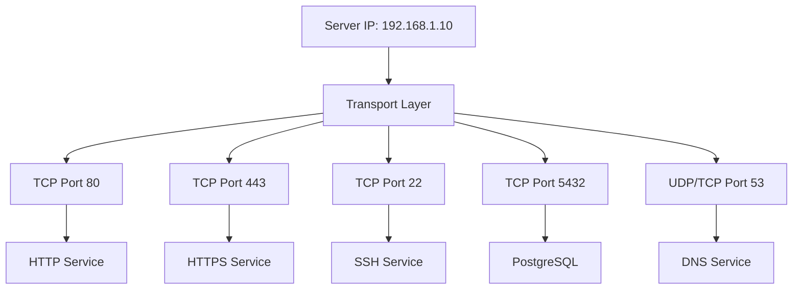
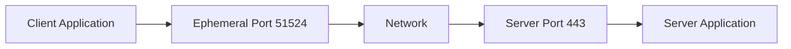
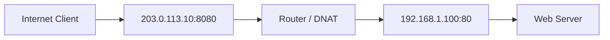

# Network Ports

A network port is a logical communication endpoint used by transport-layer protocols to identify applications and services running on a device.

Ports allow multiple applications to communicate over the same network interface and IP address without interfering with one another.

For example, a web server, SSH server, and DNS server can operate on the same machine using different port numbers.

| Service | Protocol | Port |
| --- | --- | ---: |
| HTTP | TCP | 80 |
| HTTPS | TCP | 443 |
| SSH | TCP | 22 |
| DNS | UDP/TCP | 53 |

Both TCP and UDP use 16-bit port numbers, allowing values from `0` to `65535`.

# 🗁 Port Fundamentals

A port is a 16-bit number used by transport-layer protocols to identify communication endpoints.

TCP and UDP independently define their own port-number spaces.

For example:

```text
TCP Port: 443
UDP Port: 443
```

These are separate transport-layer endpoints, even though they use the same numeric port.

### 🖆 Port vs IP Address

An IP address identifies a network-layer destination.

A port number identifies a transport-layer endpoint associated with an application or service.

Consider:

```text
192.168.1.10:443
```

* `192.168.1.10` identifies the destination IP address.
* `443` identifies the destination TCP or UDP port, depending on the transport protocol.

An IP address helps identify the destination host or network interface, while the port helps identify the intended application endpoint.

### 🖆 Port in the Network Model

| Network Layer | Addressing or Identification |
| --- | --- |
| Application | Application-specific identifiers |
| Transport | TCP/UDP port numbers |
| Internet | IPv4/IPv6 addresses |
| Network Access | MAC addresses |

Ports operate at the transport layer, not the network layer.

# 🗁 Why Network Ports Are Needed

A device can run many network services simultaneously.

Without port numbers, the operating system would have difficulty determining which application should receive incoming transport-layer data.

Consider a Linux server running:

* Nginx for web traffic.
* OpenSSH for remote administration.
* A DNS service.
* A PostgreSQL database.

Each service can use a different port.



The operating system uses transport-layer information to deliver incoming data to the appropriate socket.

# 🗁 Port Number Structure

TCP and UDP use 16-bit unsigned port numbers.

A 16-bit field can represent:

\[
2^{16} = 65,536
\]

Therefore, the available numeric range is:

```text
0 - 65535
```

### 🖆 Port Number Calculation

The maximum port number is:

\[
2^{16} - 1 = 65,535
\]

The total number of possible port values is:

\[
65,536
\]

Port `0` is reserved and has special usage. It is not normally assigned to a listening application service.

### 🖆 Port Representation

A network endpoint is commonly written using an IP address and port.

IPv4 example:

```text
192.168.1.10:443
```

IPv6 example:

```text
[2001:db8::10]:443
```

Square brackets around IPv6 addresses distinguish the address from the port number.

# 🗁 Port Number Ranges

IANA divides port numbers into three main categories.

| Range | Category |
| --- | --- |
| 0–1023 | System Ports (Well-Known Ports) |
| 1024–49151 | User Ports (Registered Ports) |
| 49152–65535 | Dynamic and/or Private Ports |

These categories are defined by the IANA Service Name and Transport Protocol Port Number Registry.

### 🖆 System Ports

System ports range from `0` to `1023`.

They are commonly associated with widely used network services and protocols.

Examples:

| Port | Service |
| ---: | --- |
| 20 | FTP Data |
| 21 | FTP Control |
| 22 | SSH |
| 23 | Telnet |
| 25 | SMTP |
| 53 | DNS |
| 80 | HTTP |
| 110 | POP3 |
| 123 | NTP |
| 143 | IMAP |
| 443 | HTTPS |

On many Unix-like systems, binding to ports below `1024` traditionally requires elevated privileges or an appropriate capability.

### 🖆 User Ports

Registered ports range from `1024` to `49151`.

They are assigned by IANA to specific applications and services.

Examples:

| Port | Service |
| ---: | --- |
| 1433 | Microsoft SQL Server |
| 1521 | Oracle Database |
| 3306 | MySQL |
| 3389 | Remote Desktop Protocol |
| 5432 | PostgreSQL |
| 5900 | VNC |
| 8080 | Common Alternative HTTP Port |
| 8443 | Common Alternative HTTPS Port |

A registered port does not force an application to use it. Applications can be configured to use other available ports.

### 🖆 Dynamic and Private Ports

Dynamic/private ports range from `49152` to `65535`.

They are commonly used as temporary source ports for client-side connections.

For example:

```text
Client: 192.168.1.10:51524
Server: 203.0.113.10:443
```

Here, `51524` is an ephemeral source port selected for the client connection.

Operating systems may configure different ephemeral port ranges. The IANA range is the standard allocation category, not a guarantee that every operating system uses only that range.

# 🗁 Source and Destination Ports

Every TCP and UDP header contains two port fields:

* Source Port.
* Destination Port.

### 🖆 Source Port

The source port identifies the sending application endpoint.

For outgoing client connections, the operating system commonly selects an ephemeral source port.

Example:

```text
Source Port: 51524
```

### 🖆 Destination Port

The destination port identifies the intended receiving application endpoint.

For example, an HTTPS server commonly listens on:

```text
Destination Port: 443
```

### 🖆 Communication Example

A client accesses a web server:

```text
Client
IP:   192.168.1.10
Port: 51524
        |
        | TCP
        |
Server
IP:   203.0.113.10
Port: 443
```

The TCP connection is identified by:

```text
Protocol:        TCP
Source IP:       192.168.1.10
Source Port:     51524
Destination IP:  203.0.113.10
Destination Port: 443
```

The server's response reverses the source and destination endpoints.

```text
Source:      203.0.113.10:443
Destination: 192.168.1.10:51524
```

# 🗁 Well-Known Ports

Well-known ports are commonly assigned to widely used network services.

These assignments help clients and servers agree on standard service endpoints.

### 🖆 Common Well-Known Ports

| Port | Protocol | Service |
| ---: | --- | --- |
| 20 | TCP | FTP Data |
| 21 | TCP | FTP Control |
| 22 | TCP | SSH |
| 23 | TCP | Telnet |
| 25 | TCP | SMTP |
| 53 | UDP/TCP | DNS |
| 67 | UDP | DHCP Server |
| 68 | UDP | DHCP Client |
| 69 | UDP | TFTP |
| 80 | TCP | HTTP |
| 110 | TCP | POP3 |
| 123 | UDP | NTP |
| 143 | TCP | IMAP |
| 161 | UDP | SNMP |
| 162 | UDP | SNMP Trap |
| 179 | TCP | BGP |
| 443 | TCP | HTTPS |
| 465 | TCP | SMTP Submission over Implicit TLS |
| 587 | TCP | SMTP Submission |
| 993 | TCP | IMAPS |
| 995 | TCP | POP3S |

A port assignment identifies a conventional service endpoint. It does not prove that a particular service is actually running on that port.

# 🗁 Registered Ports

Registered ports are assigned to specific services or applications by IANA.

Examples include:

| Port | Protocol | Service |
| ---: | --- | --- |
| 1433 | TCP | Microsoft SQL Server |
| 1521 | TCP | Oracle Database |
| 1812 | UDP | RADIUS Authentication |
| 1813 | UDP | RADIUS Accounting |
| 3306 | TCP | MySQL |
| 3389 | TCP/UDP | Remote Desktop Protocol |
| 5432 | TCP | PostgreSQL |
| 5900 | TCP | VNC |
| 8080 | TCP | Common Alternative HTTP |
| 8443 | TCP | Common Alternative HTTPS |

Some applications support multiple transports, and the official registry should be consulted for exact assignments.

# 🗁 Dynamic and Ephemeral Ports

An ephemeral port is a temporary local port selected for a communication endpoint.

When a client establishes an outgoing connection, its operating system typically chooses an available ephemeral port.

### 🖆 Example

A browser opens an HTTPS connection:

```text
Client:
192.168.1.10:51524

Server:
203.0.113.10:443
```

The browser uses:

* Source port: `51524`.
* Destination port: `443`.

When the connection closes, the local port can eventually be reused.

### 🖆 Why Ephemeral Ports Are Needed

A client may create multiple simultaneous connections to the same server.

Each connection needs a distinguishable communication endpoint.

For example:

```text
192.168.1.10:51524 -> 203.0.113.10:443
192.168.1.10:51525 -> 203.0.113.10:443
192.168.1.10:51526 -> 203.0.113.10:443
```

The different source ports allow these connections to be distinguished.

# 🗁 TCP and UDP Ports

TCP and UDP maintain separate port-number spaces.

A TCP service and a UDP service can use the same numeric port on the same IP address without conflicting at the transport-protocol level.

### 🖆 Example

```text
TCP 53 -> DNS over TCP
UDP 53 -> DNS over UDP
```

These are separate transport endpoints.

The protocol field in the IP packet identifies whether the payload contains TCP or UDP.

| Transport | IPv4 Protocol Number | IPv6 Next Header Value |
| --- | ---: | ---: |
| TCP | 6 | 6 |
| UDP | 17 | 17 |

### 🖆 Why This Matters

Consider a DNS server supporting both UDP and TCP:

```text
DNS Server
    |
    +-- UDP Port 53
    |
    +-- TCP Port 53
```

The same numeric port can be used because TCP and UDP are separate transport protocols.

# 🗁 Listening and Ephemeral Ports

Ports are commonly encountered in two important roles: listening ports and ephemeral ports.

### 🖆 Listening Port

A listening port is associated with a server-side socket waiting for incoming communication.

For example:

```text
0.0.0.0:22
```

This indicates an SSH service listening on all IPv4 interfaces.

A listening socket is not the same as an established connection.

### 🖆 Ephemeral Port

An ephemeral port is commonly used by a client for outgoing communication.

Example:

```text
192.168.1.10:51524
```

The operating system generally selects this port automatically.

### 🖆 Communication Flow



# 🗁 Port-Based Communication

When a packet arrives at a host, the operating system examines its transport-layer information to determine which socket should receive the data.

### 🖆 TCP Delivery

For TCP, the operating system uses connection information to distinguish connections.

A TCP connection is commonly identified by:

```text
Source IP
Source Port
Destination IP
Destination Port
```

The protocol and networking context are also relevant.

### 🖆 UDP Delivery

For UDP, the destination port is an important part of socket delivery.

The operating system also considers the local address, socket binding, connected-peer restrictions, and other socket options where applicable.

### 🖆 Multiple Connections to One Server Port

A server can accept many TCP connections on the same destination port.

For example:

```text
Client A: 192.168.1.10:51524
Client B: 192.168.1.11:51525
Client C: 192.168.1.12:51526

              |
              v

       Server: 192.168.1.100:443
```

The server's listening port remains `443`, while each established connection has its own connection identity.

# 🗁 Port Binding

Port binding is the process of associating a socket with a local IP address and port number.

A server normally binds its socket before accepting incoming communication.

### 🖆 Example

An application can bind to:

```text
127.0.0.1:8080
```

This makes the service available through the loopback interface.

Alternatively:

```text
0.0.0.0:8080
```

This typically binds the service to all available IPv4 interfaces.

For IPv6:

```text
[::]:8080
```

This represents the IPv6 wildcard address. Whether it also accepts IPv4-mapped connections depends on the operating system and socket configuration.

### 🖆 Common Binding Addresses

| Address | Meaning |
| --- | --- |
| `127.0.0.1` | IPv4 loopback |
| `0.0.0.0` | All local IPv4 interfaces |
| `::1` | IPv6 loopback |
| `::` | IPv6 unspecified/wildcard address |

Binding to a specific address limits which local interface address receives traffic for that socket.

# 🗁 Port Forwarding

Port forwarding is a network configuration that directs incoming traffic received on a particular address and port to another destination address and port.

It is commonly implemented through destination NAT (DNAT) on routers and firewalls.

### 🖆 Example

Suppose a web server is located inside a private network:

```text
Public IP: 203.0.113.10
Private IP: 192.168.1.100
Service: TCP 80
```

A router forwards incoming TCP traffic on public port `8080` to the internal server's port `80`.



Example mapping:

```text
Public Endpoint:
203.0.113.10:8080

Forward To:
192.168.1.100:80
```

Port forwarding is commonly used for hosting services behind NAT routers.

# 🗁 Port Scanning

Port scanning is the process of checking network ports on a host to identify which services may be reachable.

It is commonly used for:

* Network inventory.
* Security assessments.
* Service discovery.
* Troubleshooting.
* Firewall verification.

### 🖆 Common Port States

| State | Description |
| --- | --- |
| Open | A service is accepting connections or responding on the port. |
| Closed | The host is reachable, but no service is listening on the port. |
| Filtered | A firewall or network device prevents determining whether the port is open or closed. |
| Open\|Filtered | The scan cannot distinguish an open port from one blocked by filtering. |
| Closed\|Filtered | The scan cannot reliably distinguish a closed port from a filtered one. |

Exact state labels depend on the scanning technique and tool.

### 🖆 Inspecting a Specific Port with Nmap

Check whether TCP port `443` is reachable:

```bash
nmap -p 443 192.168.1.100
```

Scan common TCP ports:

```bash
nmap 192.168.1.100
```

Scan selected UDP ports:

```bash
sudo nmap -sU -p 53,123,161 192.168.1.100
```

UDP scanning can be less conclusive because many UDP services do not respond to unexpected or empty probes.

# 🗁 Common Port Numbers

The following table provides a practical reference for frequently encountered network services.

| Port | Protocol | Service | Description |
| ---: | --- | --- | --- |
| 20 | TCP | FTP Data | Traditional FTP data channel |
| 21 | TCP | FTP Control | FTP command channel |
| 22 | TCP | SSH | Secure remote administration |
| 23 | TCP | Telnet | Unencrypted remote terminal |
| 25 | TCP | SMTP | Email transfer |
| 53 | UDP/TCP | DNS | Domain name resolution |
| 67 | UDP | DHCP Server | DHCP server communication |
| 68 | UDP | DHCP Client | DHCP client communication |
| 69 | UDP | TFTP | Trivial File Transfer Protocol |
| 80 | TCP | HTTP | Web communication |
| 110 | TCP | POP3 | Email retrieval |
| 123 | UDP | NTP | Network time synchronization |
| 143 | TCP | IMAP | Email access |
| 161 | UDP | SNMP | Network management |
| 162 | UDP | SNMP Trap | Network notifications |
| 179 | TCP | BGP | Border Gateway Protocol |
| 389 | TCP/UDP | LDAP | Directory services |
| 443 | TCP | HTTPS | Secure web communication |
| 445 | TCP | SMB | Windows file sharing |
| 465 | TCP | SMTPS | SMTP submission over implicit TLS |
| 514 | UDP | Syslog | Traditional syslog transport |
| 587 | TCP | SMTP Submission | Email submission |
| 636 | TCP | LDAPS | LDAP over TLS |
| 993 | TCP | IMAPS | IMAP over TLS |
| 995 | TCP | POP3S | POP3 over TLS |
| 1433 | TCP | MS SQL Server | Microsoft database service |
| 1521 | TCP | Oracle Database | Oracle database listener |
| 1701 | UDP | L2TP | Layer 2 Tunneling Protocol |
| 1812 | UDP | RADIUS Authentication | Network authentication |
| 1813 | UDP | RADIUS Accounting | Network accounting |
| 3306 | TCP | MySQL | MySQL database |
| 3389 | TCP/UDP | RDP | Remote Desktop Protocol |
| 4500 | UDP | IPsec NAT-T | IPsec NAT traversal |
| 500 | UDP | IKE | IPsec key exchange |
| 5060 | UDP/TCP | SIP | Session Initiation Protocol |
| 5061 | TCP | SIP-TLS | SIP over TLS |
| 5432 | TCP | PostgreSQL | PostgreSQL database |
| 5900 | TCP | VNC | Remote desktop |
| 6379 | TCP | Redis | Redis database |
| 8080 | TCP | HTTP Alternative | Common alternative web port |
| 8443 | TCP | HTTPS Alternative | Common alternative secure web port |
| 27017 | TCP | MongoDB | MongoDB database |

Port assignments and transport support should be verified against the official IANA registry and the relevant application documentation.

# 🗁 Inspecting Ports on Linux

Linux provides several tools for checking listening ports, established connections, and network services.

### 🖆 Display Listening TCP Ports

```bash
ss -ltn
```

Options:

| Option | Description |
| --- | --- |
| `-l` | Listening sockets |
| `-t` | TCP sockets |
| `-n` | Numeric addresses and ports |

### 🖆 Display Listening UDP Ports

```bash
ss -lun
```

### 🖆 Display All TCP and UDP Sockets

```bash
ss -tuan
```

### 🖆 Display Process Information

```bash
sudo ss -tulpn
```

This command displays listening TCP and UDP sockets with associated process information when available.

### 🖆 Find a Specific Port

Check which process is using TCP port `8080`:

```bash
sudo ss -ltnp 'sport = :8080'
```

Check UDP port `53`:

```bash
sudo ss -lunp 'sport = :53'
```

### 🖆 Using lsof

Display network connections:

```bash
sudo lsof -i -n -P
```

Check TCP port `443`:

```bash
sudo lsof -iTCP:443 -sTCP:LISTEN
```

### 🖆 Test a TCP Connection

Use Netcat:

```bash
nc -vz example.com 443
```

This attempts to establish a TCP connection to the destination port.

### 🖆 Test a UDP Port

Send a UDP probe:

```bash
nc -vzu 192.168.1.100 53
```

A successful local send does not prove that the remote application received or processed the datagram. UDP has no built-in connection handshake.

# 🗁 Troubleshooting Network Ports

Port-related connectivity problems can occur at the application, operating system, firewall, or network level.

### 🖆 Service Is Not Listening

Check whether the application has opened its expected port:

```bash
sudo ss -tulpn
```

If the service is not listening, investigate its configuration and logs.

### 🖆 Port Is Already in Use

An application may fail to bind because another process is already using the same local address, port, and transport protocol combination.

Inspect the port:

```bash
sudo ss -tulpn | grep ':8080'
```

### 🖆 Firewall Blocks the Port

Inspect UFW status:

```bash
sudo ufw status verbose
```

Allow incoming TCP port `8080`:

```bash
sudo ufw allow 8080/tcp
```

Allow incoming UDP port `53`:

```bash
sudo ufw allow 53/udp
```

### 🖆 Service Is Bound to Loopback Only

A service listening on:

```text
127.0.0.1:8080
```

is normally accessible only through the local loopback interface.

It will not accept connections through the machine's external IPv4 interface using that socket.

### 🖆 Routing or NAT Problems

A port may be open locally but unreachable from another network.

Investigate:

* Default gateway.
* Routing table.
* Firewall rules.
* NAT configuration.
* Port forwarding.
* Upstream filtering.
* Server-side listening address.

### 🖆 Capture Port Traffic

Use `tcpdump` to inspect traffic involving TCP port `443`:

```bash
sudo tcpdump -i any 'tcp port 443'
```

Inspect DNS traffic:

```bash
sudo tcpdump -i any 'port 53'
```

Packet captures can help determine whether traffic reaches the host and whether responses are transmitted.

# 🗁 Security Best Practices

* Expose only the ports required by your applications.
* Disable unused network services.
* Restrict administrative ports such as SSH to trusted networks where possible.
* Use firewall rules to control inbound and outbound traffic.
* Avoid exposing database ports directly to the public Internet.
* Use encrypted protocols instead of plaintext alternatives.
* Monitor listening sockets and unexpected network services.
* Apply authentication and access controls to exposed services.
* Review port-forwarding rules regularly.
* Use network segmentation to limit access between services.
* Remember that changing a service's default port does not replace authentication, firewalling, or other security controls.

# 🗁 Common Mistakes

### 🖆 Assuming a Port Identifies a Service with Certainty

A port number indicates a conventional service assignment, not proof of the actual application running there.

A service can listen on a non-standard port.

### 🖆 Confusing TCP and UDP Ports

TCP port `53` and UDP port `53` are separate transport endpoints.

The numeric port alone does not identify the transport protocol.

### 🖆 Assuming an Open Port Is Always Accessible

A service may be listening locally but blocked by a firewall, router, NAT rule, or upstream network.

### 🖆 Confusing Listening Ports with Established Connections

A listening socket waits for incoming connections or datagrams. An established TCP socket represents an active connection.

### 🖆 Assuming Every Client Uses the Same Source Port

Operating systems commonly select ephemeral ports dynamically.

Different connections can use different source ports.

### 🖆 Assuming Port Forwarding Opens a Service Automatically

Port forwarding only directs traffic to a destination. The destination application must still be running and listening, and applicable firewall rules must permit the traffic.

# 🗁 Interview Questions

### 🖆 What is a network port?

A network port is a 16-bit transport-layer number used to identify an application communication endpoint.

### 🖆 How many port numbers are available?

TCP and UDP each have 65,536 possible numeric port values, ranging from `0` to `65535`.

### 🖆 What are the three port-number categories?

* System ports: `0–1023`.
* User or registered ports: `1024–49151`.
* Dynamic/private ports: `49152–65535`.

### 🖆 What is an ephemeral port?

An ephemeral port is a temporary port commonly selected by the operating system for client-side communication.

### 🖆 What is the difference between a source port and destination port?

The source port identifies the sending endpoint, while the destination port identifies the intended receiving endpoint.

### 🖆 Can TCP and UDP use the same port number?

Yes. TCP and UDP maintain separate port-number spaces, so both can use the same numeric port on the same IP address.

### 🖆 What is a listening port?

A listening port is associated with a server-side socket waiting for incoming communication.

### 🖆 What is port forwarding?

Port forwarding directs incoming traffic received on a particular address and port to another destination, commonly using destination NAT.

### 🖆 What is port scanning?

Port scanning checks network ports to determine which services may be reachable and how ports respond to probes.

### 🖆 What is the difference between an open and filtered port?

An open port responds in a way indicating that a service is accepting communication. A filtered port cannot be reliably classified because filtering prevents a definitive response.

### 🖆 Can multiple clients connect to the same server port?

Yes. A server can accept multiple connections on the same destination port. Each TCP connection has a distinct connection identity.

# 🗁 Summary

Network ports provide transport-layer identification for applications and services.

Important concepts include:

* TCP and UDP use 16-bit port numbers.
* The valid numeric range is `0–65535`.
* IANA defines system, registered, and dynamic/private port categories.
* Source ports identify sending endpoints.
* Destination ports identify receiving endpoints.
* Listening ports are commonly used by servers.
* Ephemeral ports are commonly used by clients.
* TCP and UDP maintain separate port spaces.
* Port forwarding redirects traffic through network address translation.
* Port scanning helps identify reachable services.
* Linux tools such as `ss`, `lsof`, `nc`, `nmap`, and `tcpdump` help inspect and troubleshoot ports.

Understanding network ports is essential for configuring servers, firewalls, NAT, application services, and network security.

# 🗁 References

* [IANA — Service Name and Transport Protocol Port Number Registry](https://www.iana.org/assignments/service-names-port-numbers/service-names-port-numbers.xhtml)
* [RFC 6335 — Internet Assigned Numbers Authority (IANA) Procedures for the Management of the Service Name and Transport Protocol Port Number Registry](https://www.rfc-editor.org/rfc/rfc6335)
* [RFC 9293 — Transmission Control Protocol (TCP)](https://www.rfc-editor.org/rfc/rfc9293)
* [RFC 768 — User Datagram Protocol (UDP)](https://www.rfc-editor.org/rfc/rfc768)
* [Linux Manual — ss](https://man7.org/linux/man-pages/man8/ss.8.html)
* [Linux Manual — lsof](https://man7.org/linux/man-pages/man8/lsof.8.html)
* [Nmap Reference Guide](https://nmap.org/book/man.html)
* [Netcat Manual](https://manpages.ubuntu.com/manpages/noble/en/man1/nc.openbsd.1.html)
