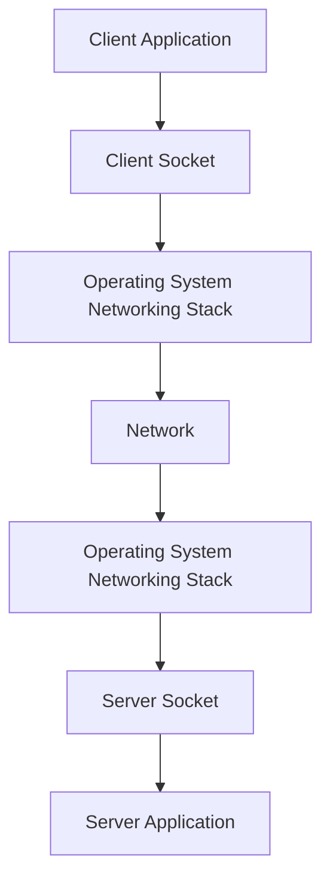
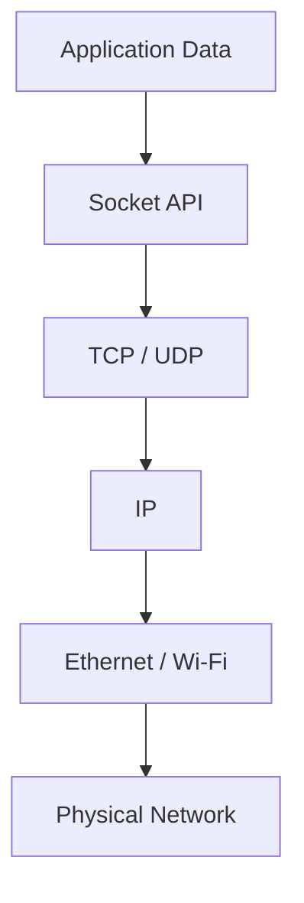
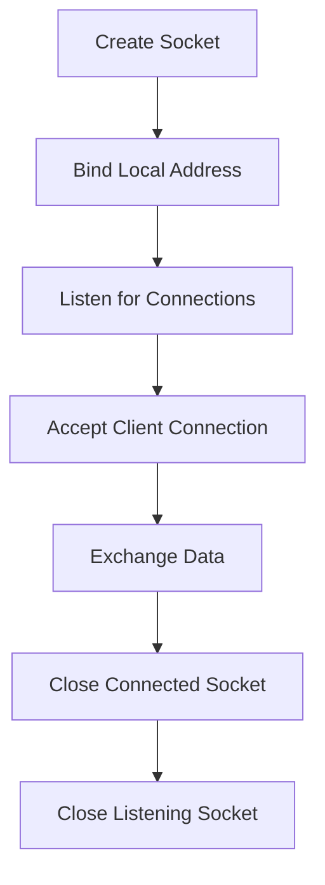
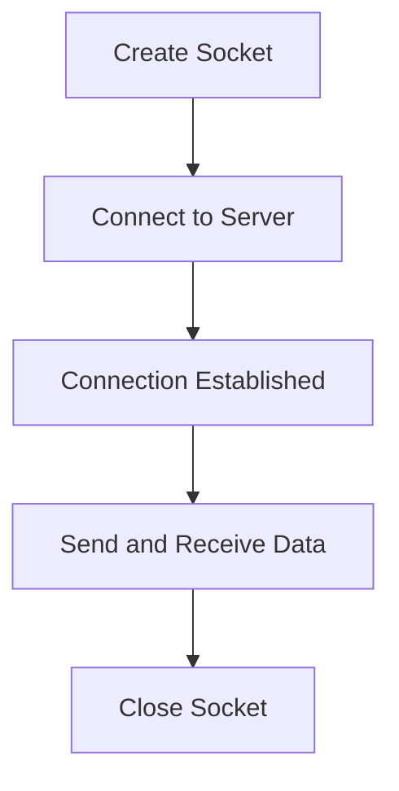
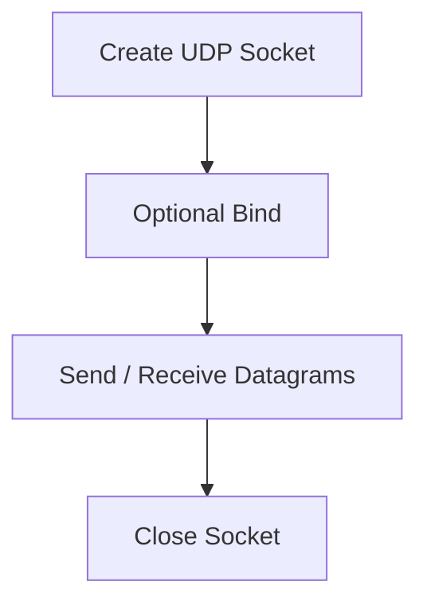
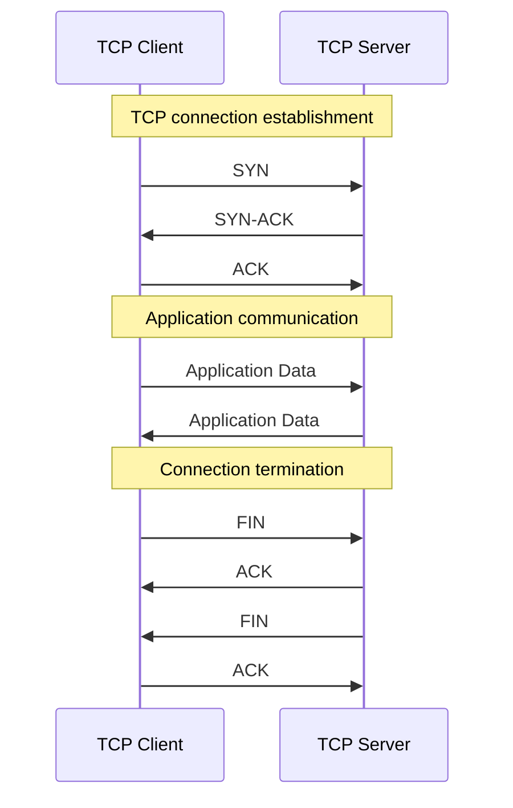
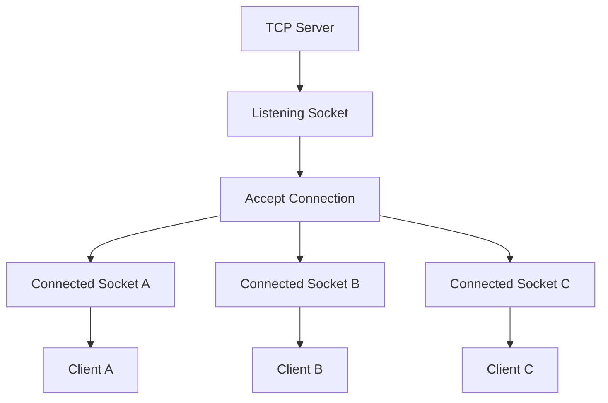
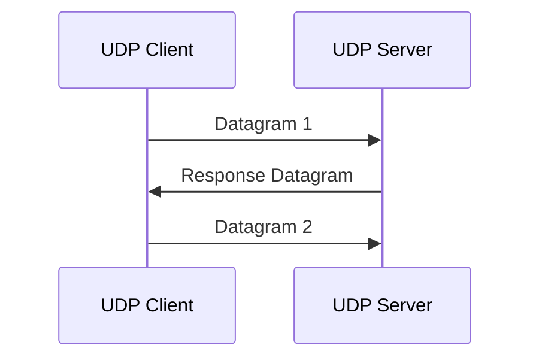
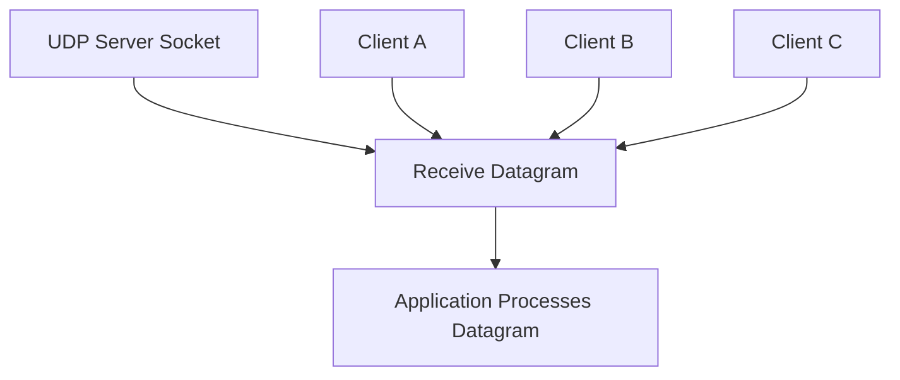
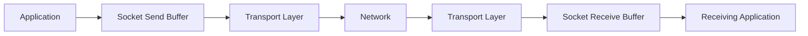

# Network Sockets

A network socket is a communication endpoint that allows an application to send and receive data over a network.

Sockets provide an interface between application software and the operating system's networking stack.

Applications use sockets to communicate through transport-layer protocols such as TCP and UDP.

For example:

* A web browser uses sockets to communicate with web servers.
* An SSH client uses a TCP socket to establish a remote connection.
* A DNS resolver uses UDP or TCP sockets to exchange DNS messages.
* A database application uses sockets to communicate with a database server.

Sockets are fundamental to network programming, client-server architecture, and distributed systems.

# 🗁 Socket Fundamentals

A socket is an endpoint for communication between processes.

The operating system provides socket interfaces that applications use to access network communication functionality.

A socket can be associated with:

* An address family, such as IPv4 or IPv6.
* A socket type, such as stream or datagram.
* A transport protocol, such as TCP or UDP.
* A local address and port.
* A remote address and port, depending on its state and usage.

### 🖆 Simple Example

Suppose a browser connects to a web server.

```text
Client:
192.168.1.10:51524

Server:
203.0.113.10:443

Protocol:
TCP
```

The browser uses a socket to communicate with the server.

The operating system handles the underlying transport and network operations.

### 🖆 Socket as a Communication Endpoint



The socket API allows applications to communicate without directly implementing Ethernet, IP, TCP, or UDP packet processing.

# 🗁 Why Sockets Are Needed

Applications need a consistent interface for network communication.

Without sockets, application developers would need to handle many low-level networking details themselves.

Sockets provide common operations for:

* Creating communication endpoints.
* Binding local addresses and ports.
* Listening for incoming connections.
* Accepting client connections.
* Establishing outgoing connections.
* Sending and receiving data.
* Closing communication endpoints.

### 🖆 Example: Web Communication

When a user opens a website:

```text
Browser
   |
   | Creates TCP Socket
   |
   v
Connects to Web Server
   |
   | Sends HTTP Request
   |
   v
Receives HTTP Response
   |
   v
Displays Website
```

The browser uses socket operations to exchange data with the server.

# 🗁 Socket and Network Layers

Sockets provide an application programming interface to the networking stack.

The application interacts with the socket, while the operating system handles lower-level networking operations.

| Layer | Responsibility |
| --- | --- |
| Application | Generates and processes application data |
| Socket API | Provides communication operations |
| Transport | TCP or UDP communication |
| Internet | IP addressing and routing |
| Network Access | Ethernet, Wi-Fi, and physical transmission |

### 🖆 Encapsulation Through a Socket



A socket does not replace TCP or UDP. It provides an interface through which applications use those protocols.

# 🗁 Socket Address

A socket address identifies a communication endpoint.

For an IP-based socket, it commonly includes:

* IP address.
* Port number.
* Address family.

### 🖆 IPv4 Socket Address

Example:

```text
192.168.1.10:8080
```

Components:

| Component | Value |
| --- | --- |
| Address Family | IPv4 |
| IP Address | `192.168.1.10` |
| Port | `8080` |

### 🖆 IPv6 Socket Address

Example:

```text
[2001:db8::10]:8080
```

The square brackets separate the IPv6 address from the port number.

### 🖆 Local and Remote Addresses

A connected TCP socket has local and peer endpoints.

Example:

```text
Local Endpoint:
192.168.1.10:51524

Remote Endpoint:
203.0.113.10:443
```

The local endpoint represents the socket on the current host.

The remote endpoint represents the other side of the connection.

# 🗁 Socket Types

Socket APIs support different communication models.

The most commonly used network socket types are:

* Stream sockets.
* Datagram sockets.
* Raw sockets.

### 🖆 Stream Socket

A stream socket provides reliable, ordered, connection-oriented communication.

It is commonly associated with TCP.

```text
SOCK_STREAM
```

Characteristics:

* Connection-oriented communication.
* Reliable byte-stream delivery when using TCP.
* Ordered data delivery.
* No preservation of application message boundaries.

Common applications include HTTP/1.1, HTTP/2, SSH, and database connections.

### 🖆 Datagram Socket

A datagram socket provides message-oriented communication without requiring a connection.

It is commonly associated with UDP.

```text
SOCK_DGRAM
```

Characteristics:

* Connectionless communication model.
* Preserves datagram boundaries.
* No built-in delivery guarantee.
* No built-in retransmission or ordering.

Common applications include DNS, DHCP, NTP, and real-time communication.

### 🖆 Raw Socket

A raw socket provides access to lower-level network protocols and packet information.

```text
SOCK_RAW
```

It is commonly used for:

* Network diagnostics.
* Packet analysis.
* Custom protocol development.
* Network testing.
* Specialized network utilities.

Raw socket capabilities and permissions depend on the operating system and protocol.

### 🖆 Socket Type Comparison

| Feature | Stream Socket | Datagram Socket | Raw Socket |
| --- | --- | --- | --- |
| Common Protocol | TCP | UDP | IP-level protocols |
| Communication | Connection-oriented | Datagram-oriented | Protocol-dependent |
| Reliability | Provided by TCP | Not built in | Not built in |
| Message Boundaries | Not preserved | Preserved | Protocol-dependent |
| Typical Usage | Web, SSH, databases | DNS, DHCP, VoIP | Diagnostics, packet tools |

# 🗁 TCP Sockets

TCP sockets provide reliable, ordered, full-duplex byte-stream communication.

A TCP server normally creates a listening socket and waits for client connection requests.

When a client connects, the server accepts the connection and receives a separate connected socket.

### 🖆 TCP Server Socket

A typical TCP server follows these operations:

```text
socket()
   |
   v
bind()
   |
   v
listen()
   |
   v
accept()
   |
   v
send() / recv()
   |
   v
close()
```

| Operation | Purpose |
| --- | --- |
| `socket()` | Creates a socket. |
| `bind()` | Associates the socket with a local address and port. |
| `listen()` | Marks a TCP socket as passive and ready to accept connections. |
| `accept()` | Accepts an incoming connection and returns a new connected socket. |
| `send()` | Sends data through a connected socket. |
| `recv()` | Receives data from a connected socket. |
| `close()` | Closes the socket descriptor. |

### 🖆 TCP Client Socket

A typical TCP client follows:

```text
socket()
   |
   v
connect()
   |
   v
send() / recv()
   |
   v
close()
```

The `connect()` operation initiates a TCP connection to the remote endpoint.

The operating system normally performs the TCP three-way handshake as part of establishing the connection.

# 🗁 UDP Sockets

UDP sockets provide datagram-based communication.

A UDP application can send or receive datagrams without establishing a TCP-style connection.

### 🖆 UDP Server Socket

A typical UDP server follows:

```text
socket()
   |
   v
bind()
   |
   v
recvfrom()
   |
   v
sendto()
   |
   v
close()
```

| Operation | Purpose |
| --- | --- |
| `socket()` | Creates a UDP socket. |
| `bind()` | Associates the socket with a local address and port. |
| `recvfrom()` | Receives a datagram and its sender address. |
| `sendto()` | Sends a datagram to a specified destination. |
| `close()` | Closes the socket descriptor. |

### 🖆 UDP Client Socket

A UDP client commonly follows:

```text
socket()
   |
   v
sendto()
   |
   v
recvfrom()
   |
   v
close()
```

A UDP socket can also be associated with a specific peer using `connect()`. This does not perform a TCP handshake; it configures the socket's peer association and affects how datagrams are sent and received.

# 🗁 Socket Lifecycle

The socket lifecycle describes how an application creates, uses, and closes a socket.

### 🖆 TCP Socket Lifecycle



The bind and listen operations are typically performed by the server.

The accept operation creates a separate connected socket for each accepted connection.

### 🖆 TCP Client Lifecycle



### 🖆 UDP Socket Lifecycle



UDP does not require connection establishment, although an application may configure a peer association with `connect()`.

# 🗁 TCP Socket Communication

TCP uses a client-server communication model in many applications.

The server waits for connections, while the client initiates a connection.

### 🖆 TCP Communication Diagram



The diagram illustrates a common connection lifecycle. Actual TCP communication can include additional data exchanges, retransmissions, and different termination sequences.

### 🖆 TCP Server and Multiple Clients

A TCP server can handle multiple clients simultaneously.



The listening socket remains available to accept additional connections while existing connected sockets exchange data.

# 🗁 UDP Socket Communication

UDP communication uses independent datagrams.

The sender provides destination information, and the receiver obtains incoming datagrams through its socket.

### 🖆 UDP Communication Diagram



There is no required handshake before these datagrams are exchanged.

### 🖆 UDP Server with Multiple Clients

A UDP server can receive datagrams from multiple clients through a single bound socket.



The server can identify each datagram's sender using the source address information returned by the receiving socket operation.

# 🗁 Socket Identification

A socket and a connection are related concepts, but they are not identical.

A socket is a communication endpoint.

A TCP connection is a logical relationship between two TCP endpoints.

### 🖆 TCP Connection Identification

A TCP connection is commonly identified by a four-tuple:

```text
Source IP Address
Source Port
Destination IP Address
Destination Port
```

Example:

```text
Protocol: TCP

Source:
192.168.1.10:51524

Destination:
203.0.113.10:443
```

The protocol and networking context are also relevant to connection identification.

### 🖆 Multiple Connections to One Server

Consider a server listening on TCP port `443`.

```text
Client A:
192.168.1.10:51524

Client B:
192.168.1.11:51525

Client C:
192.168.1.12:51526

Server:
192.168.1.100:443
```

Each client connection has a distinct connection identity, even though all clients connect to the same server port.

### 🖆 Socket vs Port vs Connection

| Concept | Meaning |
| --- | --- |
| Socket | Application communication endpoint. |
| Port | Transport-layer number identifying an endpoint. |
| TCP Connection | Logical communication relationship between two TCP endpoints. |
| Socket Pair | The local and remote socket endpoints participating in communication. |

# 🗁 Socket States

Socket state depends on the socket type and underlying protocol.

### 🖆 TCP Socket States

Common TCP states include:

| State | Description |
| --- | --- |
| LISTEN | Waiting for incoming TCP connections. |
| SYN-SENT | Connection request has been sent. |
| SYN-RECEIVED | Connection request received; acknowledgment pending. |
| ESTABLISHED | Connection is active. |
| FIN-WAIT-1 | Local endpoint has initiated termination. |
| FIN-WAIT-2 | Local FIN has been acknowledged. |
| CLOSE-WAIT | Remote endpoint has sent FIN. |
| CLOSING | Both endpoints have initiated termination. |
| LAST-ACK | Waiting for acknowledgment of local FIN. |
| TIME-WAIT | Waiting for old segments to expire and allowing final ACK retransmission. |
| CLOSED | No active connection. |

### 🖆 UDP Socket State

UDP does not have TCP-style connection states.

A UDP socket can be bound to a local address and port or associated with a peer, but UDP does not establish a reliable transport connection.

# 🗁 Blocking and Non-Blocking Sockets

Socket operations can behave in blocking or non-blocking mode.

This affects how applications handle network I/O.

### 🖆 Blocking Sockets

A blocking socket operation waits until the requested operation can proceed or completes.

For example, a blocking `recv()` call may wait until data becomes available.

Advantages:

* Simpler programming model.
* Easier sequential control flow.
* Suitable for straightforward applications.

Limitations:

* A thread can remain blocked while waiting for network activity.
* Large numbers of concurrent connections may require additional threads or processes.

### 🖆 Non-Blocking Sockets

A non-blocking socket operation returns immediately when the operation cannot proceed.

Instead of waiting, the operating system may return an error such as `EAGAIN` or `EWOULDBLOCK`.

Advantages:

* Supports highly concurrent applications.
* Avoids blocking a thread for every network operation.
* Works well with event-driven I/O.

Limitations:

* Requires more careful state management.
* Applications must handle partial reads and writes.
* Event-loop and readiness handling can add complexity.

### 🖆 Event-Driven Socket I/O

Linux provides mechanisms such as:

* `select()`
* `poll()`
* `epoll()`

These mechanisms help applications monitor multiple file descriptors and respond when sockets become ready for reading or writing.

# 🗁 Socket Buffering

Operating systems use socket buffers to manage incoming and outgoing data.

### 🖆 Send Buffer

The send buffer stores data waiting to be transmitted or processed by the networking stack.

For TCP, it can also contain transmitted data that has not yet been acknowledged.

### 🖆 Receive Buffer

The receive buffer stores incoming data until the application reads it.

For TCP, the received bytes are organized into an ordered byte stream.

For UDP, received datagrams remain separate messages.

### 🖆 Socket Buffer Flow



### 🖆 Buffer Size

Socket buffer sizes affect how much data can be queued before applications process it.

Linux provides commands to inspect certain system networking settings:

```bash
sysctl net.core.rmem_max
sysctl net.core.wmem_max
```

These values represent system-level limits for receive and send socket buffers, respectively.

# 🗁 Unix Domain Sockets

Unix Domain Sockets (UDS) provide communication between processes on the same operating system.

Unlike IP sockets, they do not require communication through an IP network.

They are commonly used for local inter-process communication (IPC).

### 🖆 Unix Domain Socket Types

| Type | Description |
| --- | --- |
| `SOCK_STREAM` | Reliable stream communication. |
| `SOCK_DGRAM` | Datagram-oriented communication. |
| `SOCK_SEQPACKET` | Connection-oriented communication that preserves message boundaries. |

### 🖆 Unix Domain Socket Paths

A Unix domain socket commonly uses a filesystem path.

Example:

```text
/run/docker.sock
```

Other examples include:

```text
/run/postgresql/.s.PGSQL.5432
/run/mysqld/mysqld.sock
```

Applications can use these sockets to communicate locally without opening a TCP or UDP network port.

### 🖆 Unix Domain Sockets vs IP Sockets

| Feature | Unix Domain Socket | IP Socket |
| --- | --- | --- |
| Communication | Local processes | Networked endpoints |
| Address | Filesystem path or abstract address | IP address and port |
| Network Routing | Not required | Required for remote communication |
| Common Usage | Local IPC | Client-server networking |
| Example | `/run/docker.sock` | `192.168.1.10:8080` |

# 🗁 Socket Programming

Socket programming allows developers to build network applications using operating-system socket APIs.

Python provides the `socket` module for this purpose.

### 🖆 TCP Server Example

The following Python example creates a simple TCP server that listens on port `5000`.

```python
import socket

HOST = "127.0.0.1"
PORT = 5000

server = socket.socket(socket.AF_INET, socket.SOCK_STREAM)

server.bind((HOST, PORT))
server.listen()

print(f"Server listening on {HOST}:{PORT}")

while True:
    client, address = server.accept()

    print(f"Connected by {address}")

    with client:
        while True:
            data = client.recv(1024)

            if not data:
                break

            client.sendall(data)
```

This server receives data and sends the same data back to the client.

It is a basic sequential example: it handles one accepted client at a time.

### 🖆 TCP Client Example

```python
import socket

HOST = "127.0.0.1"
PORT = 5000

client = socket.socket(socket.AF_INET, socket.SOCK_STREAM)

client.connect((HOST, PORT))

client.sendall(b"Hello from TCP client")

response = client.recv(1024)

print("Server response:", response.decode())

client.close()
```

The client connects to the server, sends a message, receives the response, and closes the socket.

### 🖆 UDP Server Example

```python
import socket

HOST = "127.0.0.1"
PORT = 5001

server = socket.socket(socket.AF_INET, socket.SOCK_DGRAM)

server.bind((HOST, PORT))

print(f"UDP server listening on {HOST}:{PORT}")

while True:
    data, address = server.recvfrom(1024)

    print(f"Received from {address}: {data.decode()}")

    server.sendto(data, address)
```

This UDP server receives datagrams and sends them back to their senders.

### 🖆 UDP Client Example

```python
import socket

HOST = "127.0.0.1"
PORT = 5001

client = socket.socket(socket.AF_INET, socket.SOCK_DGRAM)

message = b"Hello from UDP client"

client.sendto(message, (HOST, PORT))

response, address = client.recvfrom(1024)

print("Server response:", response.decode())

client.close()
```

Unlike the TCP example, the UDP client does not establish a connection before sending its datagram.

# 🗁 Inspecting Sockets on Linux

Linux provides several utilities for inspecting sockets and network connections.

### 🖆 Display All Socket Connections

```bash
ss -a
```

### 🖆 Display Listening TCP Sockets

```bash
ss -ltn
```

### 🖆 Display Listening UDP Sockets

```bash
ss -lun
```

### 🖆 Display TCP Connections

```bash
ss -tan
```

### 🖆 Display Socket Process Information

```bash
sudo ss -tulpn
```

### 🖆 Display Detailed Socket Statistics

```bash
ss -s
```

### 🖆 Inspect Unix Domain Sockets

```bash
ss -x -a
```

### 🖆 Inspect a Specific Port

```bash
sudo ss -ltnp 'sport = :5000'
```

### 🖆 Inspect Socket Files

```bash
ls -l /run/*.sock
```

Not every Unix domain socket is stored directly under `/run`; applications may use other filesystem locations or abstract socket addresses.

# 🗁 Common Socket Errors

Socket applications can encounter errors during creation, binding, connection, and data transfer.

| Error | Meaning | Common Cause |
| --- | --- | --- |
| `EADDRINUSE` | Address already in use | Another socket is using the address and port combination. |
| `EADDRNOTAVAIL` | Address not available | Attempting to bind to an unavailable local address. |
| `ECONNREFUSED` | Connection refused | No service is accepting the connection, or a device actively rejects it. |
| `ETIMEDOUT` | Connection timed out | Expected communication did not complete within the timeout. |
| `ENETUNREACH` | Network unreachable | No usable route to the destination network. |
| `EHOSTUNREACH` | Host unreachable | The destination host cannot be reached. |
| `EAGAIN` | Resource temporarily unavailable | A non-blocking operation cannot proceed immediately. |
| `EWOULDBLOCK` | Operation would block | A non-blocking socket operation cannot proceed immediately. |
| `ECONNRESET` | Connection reset | The connection was reset by the peer or network stack. |
| `EPIPE` | Broken pipe | Attempting to write to a connection that is no longer available. |

### 🖆 Troubleshooting Example

If an application cannot bind to TCP port `5000`, inspect the existing sockets:

```bash
sudo ss -ltnp 'sport = :5000'
```

If another process is already using the port, identify that process and determine whether the application should use a different port or whether the existing service should be reconfigured.

# 🗁 Best Practices

* Use TCP sockets when reliable, ordered byte-stream communication is required.
* Use UDP sockets when datagram-oriented communication fits the application.
* Handle partial reads and writes correctly.
* Implement appropriate timeouts for network operations.
* Close sockets when they are no longer needed.
* Handle socket errors explicitly.
* Use non-blocking I/O or event-driven mechanisms for highly concurrent applications.
* Validate incoming data before processing it.
* Configure appropriate socket buffer sizes when necessary.
* Use TLS or another secure protocol when communication requires encryption and authentication.
* Restrict access to Unix domain socket files through appropriate filesystem permissions.
* Avoid assuming that a successful send operation guarantees remote application delivery.

# 🗁 Common Mistakes

### 🖆 Confusing a Socket with a Port

A port is a transport-layer number. A socket is an application communication endpoint that may be associated with an address and port.

### 🖆 Assuming Every Socket Uses TCP

Sockets can use TCP, UDP, raw protocols, Unix domain communication, and other supported address families and types.

### 🖆 Assuming UDP `connect()` Performs a Handshake

Calling `connect()` on a UDP socket does not establish a TCP-style connection. It associates the socket with a peer.

### 🖆 Assuming One TCP Read Returns One Complete Message

TCP provides a byte stream. An application must implement message framing and handle partial reads.

### 🖆 Forgetting to Close Sockets

Sockets consume operating-system resources. Applications should close them when communication is complete.

### 🖆 Confusing Listening and Connected Sockets

A TCP listening socket accepts incoming connections. Each successful `accept()` operation returns a separate connected socket.

# 🗁 Interview Questions

### 🖆 What is a network socket?

A network socket is a communication endpoint that allows an application to send and receive data through the operating system's networking stack.

### 🖆 What is the difference between a socket and a port?

A port is a transport-layer number used to identify an application endpoint. A socket is an operating-system communication endpoint that may be associated with a local address and port.

### 🖆 What is a TCP socket?

A TCP socket provides reliable, ordered, connection-oriented byte-stream communication.

### 🖆 What is a UDP socket?

A UDP socket provides datagram-oriented communication without built-in connection establishment or reliable delivery.

### 🖆 What is the difference between `SOCK_STREAM` and `SOCK_DGRAM`?

`SOCK_STREAM` provides stream-oriented communication, commonly through TCP. `SOCK_DGRAM` provides datagram-oriented communication, commonly through UDP.

### 🖆 What does the `bind()` function do?

It associates a socket with a local address and port.

### 🖆 What does the `listen()` function do?

It marks a TCP socket as a passive socket that can accept incoming connection requests.

### 🖆 What does the `accept()` function do?

It accepts an incoming TCP connection and returns a new connected socket for communicating with that client.

### 🖆 What is the difference between `send()` and `sendto()`?

`send()` is commonly used with connected sockets. `sendto()` allows an application to specify the destination address when sending a datagram.

### 🖆 What is a Unix domain socket?

A Unix domain socket is a local inter-process communication endpoint that allows processes on the same operating system to exchange data without using IP networking.

### 🖆 What is a non-blocking socket?

A non-blocking socket returns immediately when an operation cannot proceed instead of waiting for the operation to complete.

### 🖆 Can one TCP listening socket handle multiple clients?

Yes. A listening socket can accept multiple client connections, with each accepted connection represented by a separate connected socket.

# 🗁 Summary

A network socket is an application communication endpoint provided by the operating system.

Important concepts include:

* Sockets provide an interface to the networking stack.
* TCP commonly uses stream sockets.
* UDP commonly uses datagram sockets.
* Raw sockets provide lower-level protocol access.
* Socket addresses identify communication endpoints.
* TCP servers use `bind()`, `listen()`, and `accept()`.
* TCP clients use `connect()`.
* UDP applications commonly use `sendto()` and `recvfrom()`.
* Blocking and non-blocking sockets provide different I/O behaviors.
* Unix domain sockets support local inter-process communication.
* Linux tools such as `ss` and `lsof` help inspect sockets.

Understanding sockets is essential for network programming, backend development, distributed systems, and application-level network troubleshooting.

# 🗁 References

* [Linux Manual — socket(2)](https://man7.org/linux/man-pages/man2/socket.2.html)
* [Linux Manual — bind(2)](https://man7.org/linux/man-pages/man2/bind.2.html)
* [Linux Manual — listen(2)](https://man7.org/linux/man-pages/man2/listen.2.html)
* [Linux Manual — accept(2)](https://man7.org/linux/man-pages/man2/accept.2.html)
* [Linux Manual — connect(2)](https://man7.org/linux/man-pages/man2/connect.2.html)
* [Linux Manual — send(2)](https://man7.org/linux/man-pages/man2/send.2.html)
* [Linux Manual — recv(2)](https://man7.org/linux/man-pages/man2/recv.2.html)
* [Linux Manual — unix(7)](https://man7.org/linux/man-pages/man7/unix.7.html)
* [Python Documentation — socket](https://docs.python.org/3/library/socket.html)
* [Linux Manual — ss](https://man7.org/linux/man-pages/man8/ss.8.html)
