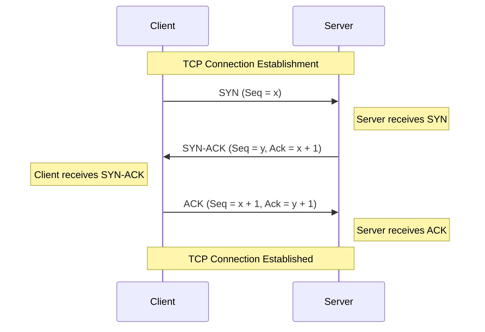
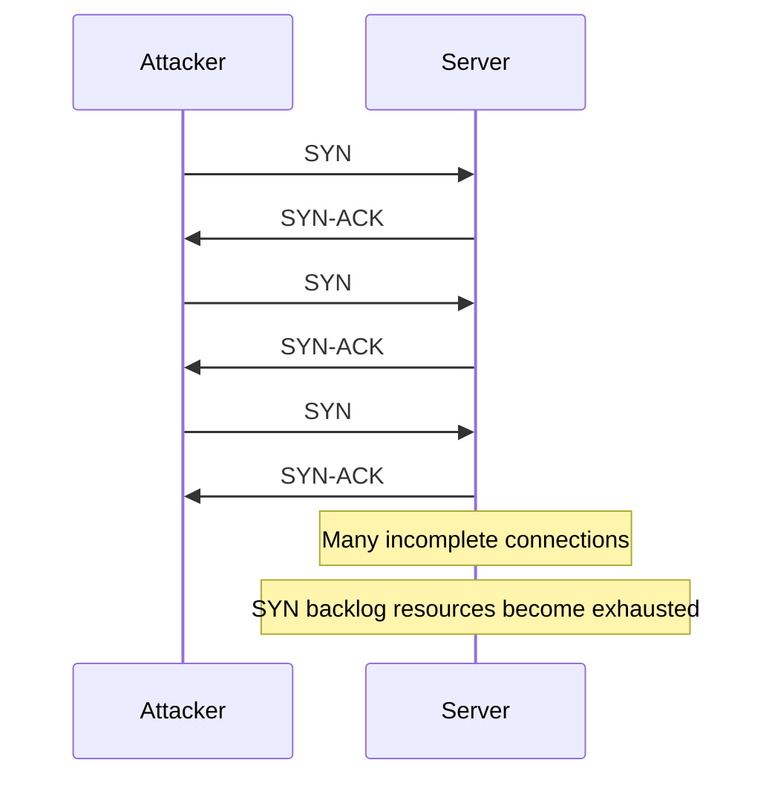

# TCP Three-Way Handshake

The **TCP three-way handshake** is the connection-establishment process used by the Transmission Control Protocol (TCP) before two endpoints can exchange data through a normal TCP connection.

It allows the client and server to:

* Establish a TCP connection.
* Synchronize their initial sequence numbers.
* Acknowledge each other's sequence numbers.
* Confirm that both endpoints can send and receive TCP segments.
* Negotiate TCP connection parameters, such as the Maximum Segment Size (MSS), window scaling, and SACK support.

The handshake consists of three TCP segments:

* `SYN`
* `SYN-ACK`
* `ACK`

# 🗁 TCP Connection Establishment

TCP is a connection-oriented transport-layer protocol.

Before exchanging application data, TCP endpoints normally establish a logical connection through a three-way handshake.

Consider a client connecting to a web server:

| Parameter | Client | Server |
| --- | --- | --- |
| IP address | `192.168.1.10` | `203.0.113.10` |
| Port | `51520` | `443` |
| Role | Initiates connection | Accepts connection |

The client initiates the connection, and the server responds to the request.

The handshake establishes the initial sequence-number state required for reliable, ordered byte-stream communication.

# 🗁 Understanding the Three-Way Handshake

### 🖆 Handshake Diagram



### 🖆 First Step: SYN

The client sends a TCP segment with the `SYN` flag enabled.

Example:

```text
Source IP:       192.168.1.10
Destination IP:  203.0.113.10

Source Port:      51520
Destination Port: 443

Flags: SYN
Sequence Number: 1000
```

The client is requesting a TCP connection.

The sequence number represents the client's Initial Sequence Number (ISN).

For this example:

```text
Client ISN = 1000
```

The SYN flag consumes one unit of sequence-number space.

Therefore, the next expected sequence number from the client is:

```text
1000 + 1 = 1001
```

### 🖆 Second Step: SYN-ACK

The server receives the client's SYN segment and responds with a TCP segment containing both `SYN` and `ACK` flags.

Example:

```text
Source IP:       203.0.113.10
Destination IP:  192.168.1.10

Source Port:      443
Destination Port: 51520

Flags: SYN, ACK

Sequence Number: 5000
Acknowledgment:  1001
```

The server performs two operations:

* Acknowledges the client's SYN by setting the acknowledgment number to `1001`.
* Sends its own SYN containing its Initial Sequence Number, `5000`.

The server's SYN also consumes one unit of sequence-number space.

Therefore:

```text
Server ISN = 5000

Next expected sequence number = 5001
```

### 🖆 Third Step: ACK

The client receives the server's SYN-ACK and sends an acknowledgment segment.

Example:

```text
Source IP:       192.168.1.10
Destination IP:  203.0.113.10

Source Port:      51520
Destination Port: 443

Flags: ACK

Sequence Number: 1001
Acknowledgment:  5001
```

The client acknowledges the server's SYN.

The acknowledgment number is:

```text
5000 + 1 = 5001
```

After the server receives this acknowledgment, the handshake is complete.

Both endpoints can now exchange application data.

# 🗁 Sequence and Acknowledgment Numbers

Sequence and acknowledgment numbers are fundamental to TCP reliability.

### 🖆 Sequence Number

A TCP sequence number identifies the position of a byte in the TCP byte stream.

It does not identify a TCP segment number.

For example:

```text
Initial Sequence Number = 1000
```

If the client sends 500 bytes of application data, the next sequence number becomes:

```text
1000 + 1 + 500 = 1501
```

The additional `1` accounts for the SYN flag.

### 🖆 Acknowledgment Number

The acknowledgment number indicates the next sequence number the receiver expects.

For example:

```text
Received sequence number = 1000
Received SYN = 1 byte

Acknowledgment number = 1001
```

TCP generally uses cumulative acknowledgments, meaning an acknowledgment confirms receipt of all bytes up to, but not including, the acknowledged sequence number.

### 🖆 Handshake Calculation

Assume:

```text
Client ISN = 1000
Server ISN = 5000
```

The handshake values are:

| Step | Direction | Sequence Number | Acknowledgment Number |
| --- | --- | ---: | ---: |
| SYN | Client → Server | 1000 | — |
| SYN-ACK | Server → Client | 5000 | 1001 |
| ACK | Client → Server | 1001 | 5001 |

The resulting sequence-number state is:

```text
Client next sequence number = 1001
Server next sequence number = 5001
```

# 🗁 TCP Flags Used During the Handshake

TCP flags are control bits in the TCP header.

| Flag | Full Name | Purpose |
| --- | --- | --- |
| SYN | Synchronize | Initiates a connection and synchronizes sequence numbers |
| ACK | Acknowledgment | Indicates that the acknowledgment field is valid |
| FIN | Finish | Initiates an orderly connection shutdown |
| RST | Reset | Resets or aborts a connection |
| PSH | Push | Requests prompt delivery of received data to the application |
| URG | Urgent | Indicates that the urgent pointer field is significant |

The three-way handshake primarily uses:

```text
SYN
SYN-ACK
ACK
```

A SYN-ACK segment has both SYN and ACK flags enabled.

# 🗁 TCP Options Negotiation

TCP can negotiate additional connection parameters during the handshake.

These options allow endpoints to optimize communication.

### 🖆 Maximum Segment Size (MSS)

MSS specifies the maximum amount of TCP payload an endpoint is willing to receive in a single TCP segment.

Example:

```text
Client MSS = 1460 bytes
Server MSS = 1460 bytes
```

For standard Ethernet with an IP MTU of 1500 bytes and IPv4/TCP headers without options:

```text
Ethernet IP MTU = 1500 bytes
IPv4 Header     = 20 bytes
TCP Header      = 20 bytes

MSS = 1500 - 20 - 20
MSS = 1460 bytes
```

MSS describes TCP data size, not the complete Ethernet frame size.

### 🖆 Window Scaling

TCP window scaling allows the advertised receive window to exceed the original 65,535-byte TCP window limit.

It is especially useful for high-bandwidth, high-latency connections.

### 🖆 Selective Acknowledgment (SACK)

SACK allows a receiver to report specific blocks of data that have arrived successfully.

This helps the sender retransmit missing data more efficiently instead of retransmitting all data beyond the first missing segment.

### 🖆 Timestamps

TCP timestamps can help with round-trip-time measurement and protection against certain sequence-number ambiguity problems.

### 🖆 Negotiation Example

A simplified SYN segment might contain:

```text
Flags: SYN

Options:
    MSS: 1460
    Window Scale: 7
    SACK Permitted: Yes
    Timestamps: Enabled
```

The SYN-ACK may advertise the server's supported options.

Some options are negotiated during connection establishment and cannot simply be enabled later for an existing connection.

# 🗁 TCP Connection States

TCP maintains connection states to track the progress of connection establishment and termination.

The following states are relevant to the three-way handshake.

| State | Description |
| --- | --- |
| CLOSED | No active connection exists |
| LISTEN | Server is waiting for incoming connection requests |
| SYN-SENT | Client has sent SYN and is waiting for a response |
| SYN-RECEIVED | Server has received SYN and sent SYN-ACK |
| ESTABLISHED | Connection is successfully established |

### 🖆 Client State Transition

```text
CLOSED
  |
  | connect()
  v
SYN-SENT
  |
  | Receive SYN-ACK
  | Send ACK
  v
ESTABLISHED
```

### 🖆 Server State Transition

```text
CLOSED
  |
  | socket()
  | bind()
  | listen()
  v
LISTEN
  |
  | Receive SYN
  | Send SYN-ACK
  v
SYN-RECEIVED
  |
  | Receive ACK
  v
ESTABLISHED
```

The server's listening socket remains available to accept additional connections. An established connection is represented by a separate connected socket.

# 🗁 Client and Server Responsibilities

The client and server perform different operations during connection establishment.

| Operation | Client | Server |
| --- | --- | --- |
| Initiates connection | Yes | No |
| Sends initial SYN | Yes | No |
| Receives initial SYN | No | Yes |
| Sends SYN-ACK | No | Yes |
| Sends final ACK | Yes | No |
| Enters ESTABLISHED | After receiving SYN-ACK and sending ACK | After receiving final ACK |

### 🖆 Client-Side System Calls

A typical server application uses:

```c
socket()
connect()
```

The operating system performs the TCP handshake as part of the connection process.

### 🖆 Server-Side System Calls

A typical TCP server follows this sequence:

```c
socket()
bind()
listen()
accept()
```

These operations have different responsibilities:

* `socket()` creates a socket endpoint.
* `bind()` associates the socket with a local address and port.
* `listen()` marks the socket as a passive listening endpoint.
* `accept()` retrieves an established connection for application communication.

The application does not normally construct the three handshake segments manually.

# 🗁 TCP Handshake in Linux

Linux provides several commands for examining TCP connections and their states.

### 🖆 Display Listening TCP Ports

```bash
ss -ltn
```

Options:

| Option | Meaning |
| --- | --- |
| `-l` | Show listening sockets |
| `-t` | Show TCP sockets |
| `-n` | Display numeric addresses and ports |

Example:

```text
State   Recv-Q  Send-Q  Local Address:Port
LISTEN  0       4096    0.0.0.0:80
LISTEN  0       4096    0.0.0.0:443
```

### 🖆 Display Established TCP Connections

```bash
ss -tn state established
```

### 🖆 Display TCP Connection States

```bash
ss -tan
```

This displays TCP sockets across different states, including:

* LISTEN
* SYN-SENT
* SYN-RECV
* ESTAB
* TIME-WAIT

### 🖆 Display TCP Statistics

```bash
ss -s
```

This provides a summary of socket and TCP statistics.

# 🗁 Capturing a TCP Handshake

`tcpdump` can capture TCP packets and help inspect the three-way handshake.

### 🖆 Capture TCP Traffic

```bash
sudo tcpdump -i any -nn 'tcp port 443'
```

This captures TCP traffic associated with port `443` across available interfaces.

### 🖆 Capture Only SYN and SYN-ACK Packets

```bash
sudo tcpdump -i any -nn 'tcp port 443 and (tcp[tcpflags] & (tcp-syn) != 0)'
```

This filter matches TCP packets with the SYN flag set, including SYN-ACK packets.

### 🖆 Capture a Specific Connection

```bash
sudo tcpdump -i any -nn \
'host 203.0.113.10 and tcp port 443'
```

### 🖆 Example Packet Capture

```text
192.168.1.10.51520 > 203.0.113.10.443: Flags [S], seq 1000

203.0.113.10.443 > 192.168.1.10.51520: Flags [S.], seq 5000, ack 1001

192.168.1.10.51520 > 203.0.113.10.443: Flags [.], seq 1001, ack 5001
```

Flag notation:

| tcpdump Flag | Meaning |
| --- | --- |
| `[S]` | SYN |
| `[S.]` | SYN and ACK |
| `[.]` | ACK |
| `[F.]` | FIN and ACK |
| `[R]` | RST |

The sequence numbers shown here are illustrative. Actual captures may use different values, and packet-analysis tools may display relative sequence numbers.

# 🗁 Connection Establishment Failures

A TCP connection may fail before reaching the ESTABLISHED state.

Understanding the symptoms helps identify network and application problems.

### 🖆 Server Port Is Not Listening

If no application is listening on the destination port, the server's TCP stack commonly responds with a TCP RST.

Example:

```text
Client → Server: SYN
Server → Client: RST, ACK
```

The connection attempt is rejected.

### 🖆 Firewall Drops SYN Packets

If a firewall silently drops incoming SYN packets:

```text
Client → Server: SYN
Client → Server: SYN Retransmission
Client → Server: SYN Retransmission
```

The client eventually gives up after retransmission attempts and reports a connection timeout.

### 🖆 Server Does Not Respond

Possible causes include:

* Server is unavailable.
* Routing failure.
* Firewall filtering.
* Network congestion.
* Packet loss.
* Incorrect destination address.

### 🖆 SYN-ACK Is Lost

If the server sends SYN-ACK but the client never receives it, the client may retransmit its original SYN.

The server may retransmit its SYN-ACK while waiting for the final ACK.

### 🖆 Common Error Differences

| Error | Typical Meaning |
| --- | --- |
| Connection refused | A TCP RST was received or the local stack rejected the attempt |
| Connection timed out | No successful response arrived before the timeout |
| No route to host | The system cannot find a usable route or receives an applicable unreachable indication |
| Network is unreachable | No usable network route exists |

# 🗁 SYN Flood Attacks

A SYN flood is a denial-of-service attack that exploits TCP connection establishment.

An attacker sends a large number of SYN packets without completing the handshake.

### 🖆 How a SYN Flood Works



The server keeps track of incomplete connection requests in its SYN backlog.

If the backlog becomes exhausted, legitimate clients may have difficulty establishing connections.

### 🖆 SYN Flood Protection

Common defensive techniques include:

* SYN cookies.
* Connection rate limiting.
* Firewall filtering.
* Reverse proxy protection.
* Load balancing.
* DDoS mitigation services.
* Appropriate SYN backlog configuration.

### 🖆 SYN Cookies

SYN cookies allow a server to encode connection state into its SYN-ACK sequence number rather than immediately allocating all normal connection-tracking resources.

When the client returns the final ACK, the server validates the cookie and reconstructs the necessary connection state.

This reduces resource consumption from incomplete handshakes.

# 🗁 TCP Fast Open

TCP Fast Open (TFO) is an extension that can reduce connection latency by allowing data to be exchanged during connection establishment under supported conditions.

With ordinary TCP:

```text
SYN
SYN-ACK
ACK
Application Data
```

With TCP Fast Open, a client may include application data in its SYN:

```text
SYN + Application Data
SYN-ACK
ACK
```

TFO uses a server-issued cookie to validate eligible clients.

Important points:

* Both endpoints and the operating system must support the relevant TFO behavior.
* Initial connections may require cookie acquisition.
* Data sent in a SYN can be subject to retransmission and replay considerations.
* Applications must account for the possibility of data being delivered more than once.

TCP Fast Open is an advanced optimization, not the normal three-way handshake behavior.

# 🗁 Best Practices

* Use packet captures to verify connection-establishment behavior.
* Monitor SYN-RECV connections and TCP backlog pressure.
* Configure firewall rules carefully to avoid unintended connection drops.
* Use SYN cookies where appropriate for SYN flood resilience.
* Monitor connection timeouts and retransmissions.
* Ensure server applications listen on the intended IP address and port.
* Use appropriate TCP backlog and system resource settings.
* Consider MSS and path MTU when diagnosing connectivity problems.
* Avoid assuming that a successful TCP handshake means an application is healthy; application-level communication must also be tested.

# 🗁 Common Mistakes

| Mistake | Correct Understanding |
| --- | --- |
| TCP uses a two-way handshake | Normal TCP connection establishment uses three segments |
| SYN does not consume sequence space | SYN consumes one sequence-number unit |
| Sequence numbers count packets | TCP sequence numbers count bytes |
| ACK confirms only one packet | TCP acknowledgments generally indicate the next expected byte |
| The server becomes ESTABLISHED immediately after sending SYN-ACK | The server normally enters ESTABLISHED after receiving the final ACK |
| The handshake transfers application data by default | Ordinary handshakes establish sequence-number state; application data follows |
| Every connection failure means the server is offline | Firewalls, routing, packet loss, and application configuration can also cause failures |
| SYN-ACK means the connection is fully established | The final ACK is still required |

# 🗁 Practical Exercises

### 🖆 Exercise: Understand the Handshake

Assume:

```text
Client ISN = 2000
Server ISN = 7000
```

Determine:

* Client's SYN sequence number.
* Server's SYN-ACK sequence number.
* Server's SYN-ACK acknowledgment number.
* Client's final ACK sequence number.
* Client's final ACK acknowledgment number.

Expected values:

| Segment | Sequence Number | Acknowledgment Number |
| --- | ---: | ---: |
| Client SYN | 2000 | — |
| Server SYN-ACK | 7000 | 2001 |
| Client ACK | 2001 | 7001 |

### 🖆 Exercise: Inspect TCP Connections

Run:

```bash
ss -ltn
ss -tan
ss -s
```

Identify:

* Listening TCP ports.
* Established TCP connections.
* Connections in SYN-SENT state.
* Connections in SYN-RECV state.

### 🖆 Exercise: Capture a Handshake

Start a packet capture:

```bash
sudo tcpdump -i any -nn 'tcp port 80'
```

In another terminal, initiate a connection:

```bash
curl -I http://example.com
```

Inspect the capture and identify:

* SYN.
* SYN-ACK.
* ACK.
* Subsequent application data.

### 🖆 Exercise: Inspect a Connection in Wireshark

Use this display filter:

```text
tcp.flags.syn == 1 || tcp.flags.ack == 1
```

Inspect the TCP handshake and examine:

* Sequence numbers.
* Acknowledgment numbers.
* TCP flags.
* MSS.
* Window scaling.
* SACK negotiation.

# 🗁 Interview Questions

### 🖆 Basic Questions

**What is the TCP three-way handshake?**

It is the connection-establishment process in which two TCP endpoints exchange SYN, SYN-ACK, and ACK segments to synchronize sequence numbers and establish a connection.

**Why does TCP use three steps instead of two?**

The exchange allows both endpoints to communicate their initial sequence numbers and acknowledge the peer's sequence number, helping establish synchronized bidirectional communication.

**What is an Initial Sequence Number (ISN)?**

It is the starting sequence number selected by a TCP endpoint when initiating a connection.

**Why does SYN consume one sequence number?**

SYN occupies one position in TCP sequence-number space, even though it does not carry an application data byte.

### 🖆 Intermediate Questions

**What happens if the final ACK is lost?**

The server remains in SYN-RECEIVED and may retransmit SYN-ACK. The client, having sent the final ACK, may already consider its side established. Subsequent TCP traffic can cause the server to complete connection establishment.

**What is the difference between SYN-SENT and SYN-RECEIVED?**

* SYN-SENT: An endpoint has sent SYN and is waiting for a response.
* SYN-RECEIVED: An endpoint has received SYN and sent SYN-ACK, waiting for the final ACK.

**What is a SYN flood?**

It is a denial-of-service attack that creates many incomplete TCP connection attempts, potentially exhausting server resources.

**What are SYN cookies?**

They are a defense mechanism that encodes connection information into the server's SYN-ACK sequence number, reducing resource allocation for incomplete connection requests.

**What is TCP Fast Open?**

It is a TCP extension that can allow application data to be sent during connection establishment, reducing latency under supported conditions.

# 🗁 Summary

The TCP three-way handshake establishes a reliable TCP connection before normal application communication.

The three steps are:

| Step | Segment | Purpose |
| --- | --- | --- |
| First | SYN | Client initiates connection and sends its ISN |
| Second | SYN-ACK | Server acknowledges the client and sends its own ISN |
| Third | ACK | Client acknowledges the server's ISN |

Key concepts:

* TCP uses sequence and acknowledgment numbers to track its byte stream.
* SYN consumes one unit of sequence-number space.
* Both endpoints synchronize their initial sequence numbers.
* TCP options can be negotiated during connection establishment.
* The server normally enters ESTABLISHED after receiving the final ACK.
* SYN cookies help protect against SYN flood attacks.
* TCP Fast Open can reduce connection latency under supported conditions.

# 🗁 References

* [RFC 9293 — Transmission Control Protocol (TCP)](https://www.rfc-editor.org/rfc/rfc9293)
* [RFC 7413 — TCP Fast Open](https://www.rfc-editor.org/rfc/rfc7413)
* [RFC 7323 — TCP Extensions for High Performance](https://www.rfc-editor.org/rfc/rfc7323)
* [RFC 2018 — TCP Selective Acknowledgment Options](https://www.rfc-editor.org/rfc/rfc2018)
* [Linux `ss` Manual](https://man7.org/linux/man-pages/man8/ss.8.html)
* [Linux `tcpdump` Manual](https://man7.org/linux/man-pages/man8/tcpdump.8.html)
