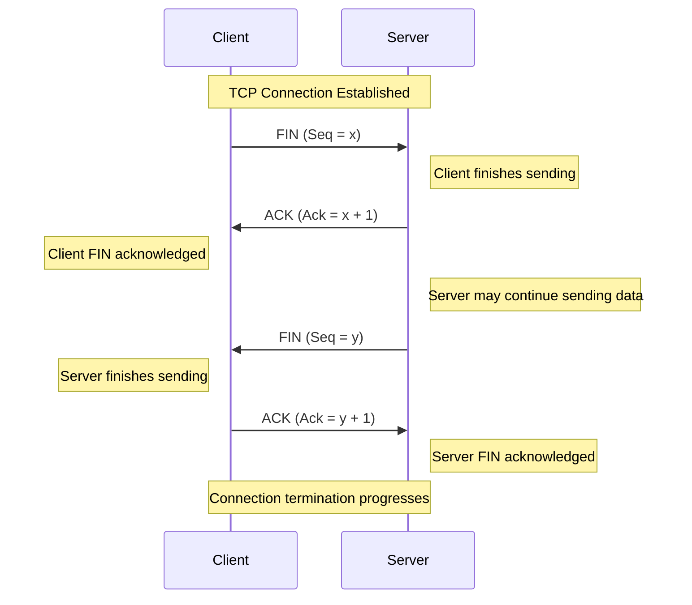

# TCP Connection Termination

TCP connection termination is the process of gracefully closing an established TCP connection between two endpoints.

Unlike connection establishment, which normally uses a three-way handshake, **TCP connection termination typically uses a four-way handshake**.

This process allows both endpoints to independently finish sending data before closing their respective directions of the connection.

TCP supports full-duplex communication, meaning both endpoints can send and receive data simultaneously. Therefore, each direction must be closed independently.

The four main steps are:

* First `FIN`
* First `ACK`
* Second `FIN`
* Second `ACK`

# 🗁 TCP Connection Termination Fundamentals

TCP provides reliable, full-duplex communication.

A full-duplex connection has two independent data streams:

```text
Client  ────────────────>  Server
Client  <────────────────  Server
```

Each endpoint can transmit and receive data independently.

When an application finishes sending data, it can close its sending direction without necessarily closing its receiving direction.

This is why TCP connection termination requires coordination between both endpoints.

### 🖆 Why Does TCP Use Four Steps?

Consider a client and server communicating:

* The client finishes sending its data.
* The server acknowledges the client's FIN.
* The server finishes sending its remaining data.
* The client acknowledges the server's FIN.

Each endpoint must communicate that it has finished transmitting.

A typical termination therefore uses four TCP segments.

# 🗁 Understanding the Four-Way Handshake

### 🖆 Four-Way Handshake Diagram



### 🖆 First Step: Client Sends FIN

The client sends a TCP segment with the `FIN` flag enabled.

Example:

```text
Source IP:       192.168.1.10
Destination IP:  203.0.113.10

Source Port:      51520
Destination Port: 443

Flags: FIN, ACK

Sequence Number: 1500
Acknowledgment:  8000
```

The FIN flag indicates that the client has finished sending application data.

It does not mean that the client can no longer receive data.

After sending FIN, the client transitions from `ESTABLISHED` to `FIN-WAIT-1`.

### 🖆 Second Step: Server Sends ACK

The server receives the client's FIN and acknowledges it.

Example:

```text
Flags: ACK

Sequence Number: 8000
Acknowledgment:  1501
```

The acknowledgment number is incremented by one because FIN consumes one unit of sequence-number space.

The server transitions from `ESTABLISHED` to `CLOSE-WAIT`.

The client receives the acknowledgment and transitions from `FIN-WAIT-1` to `FIN-WAIT-2`.

At this point:

* The client has finished sending.
* The server has acknowledged the client's FIN.
* The server can still send data to the client.

### 🖆 Third Step: Server Sends FIN

When the server finishes sending its remaining data, it sends its own FIN segment.

Example:

```text
Flags: FIN, ACK

Sequence Number: 8000
Acknowledgment:  1501
```

The server indicates that it has finished sending application data.

After sending FIN, the server transitions from `CLOSE-WAIT` to `LAST-ACK`.

### 🖆 Fourth Step: Client Sends ACK

The client receives the server's FIN and sends an acknowledgment.

Example:

```text
Flags: ACK

Sequence Number: 1501
Acknowledgment:  8001
```

The client acknowledges the server's FIN.

The client enters the `TIME-WAIT` state.

After receiving the final ACK, the server transitions from `LAST-ACK` to `CLOSED`.

The client eventually transitions from `TIME-WAIT` to `CLOSED` after the TIME-WAIT period expires.

# 🗁 TCP FIN and ACK Flags

TCP uses control flags to manage connection termination.

| Flag | Full Name | Purpose |
| --- | --- | --- |
| FIN | Finish | Indicates that the sender has finished transmitting data |
| ACK | Acknowledgment | Indicates that the acknowledgment field is valid |
| RST | Reset | Aborts or resets a connection |

### 🖆 FIN Flag

The FIN flag performs an orderly shutdown of one direction of a TCP connection.

Important properties:

* FIN indicates the end of the sender's byte stream.
* FIN consumes one sequence-number unit.
* The receiver acknowledges FIN.
* The receiving direction can remain operational.

### 🖆 ACK Flag

The ACK flag indicates that the acknowledgment field contains a valid acknowledgment number.

During connection termination, ACK confirms receipt of the peer's FIN.

### 🖆 FIN,ACK Combination

In many packet captures, FIN and ACK appear together.

For example:

```text
Flags [F.]
```

This means both FIN and ACK flags are enabled.

It is normal for a FIN segment to carry an acknowledgment for data received in the opposite direction.

# 🗁 Sequence and Acknowledgment Numbers During Termination

TCP sequence numbers count bytes in the TCP byte stream.

FIN consumes one unit of sequence-number space, even though it does not contain an application data byte.

### 🖆 Example

Assume:

```text
Client next sequence number = 1500
Server next sequence number = 8000
```

The client initiates termination.

| Step | Direction | Sequence Number | Acknowledgment Number |
| --- | --- | ---: | ---: |
| FIN | Client → Server | 1500 | 8000 |
| ACK | Server → Client | 8000 | 1501 |
| FIN | Server → Client | 8000 | 1501 |
| ACK | Client → Server | 1501 | 8001 |

The sequence-number calculations are:

```text
Client FIN:
1500 + 1 = 1501

Server FIN:
8000 + 1 = 8001
```

The acknowledgment numbers indicate the next expected sequence numbers.

### 🖆 What If FIN Contains Data?

A FIN segment can also carry application data.

For example:

```text
Sequence Number = 1500
Data Length     = 100 bytes
FIN              = 1
```

The next expected sequence number becomes:

```text
1500 + 100 + 1 = 1601
```

The additional `1` accounts for FIN.

# 🗁 TCP Connection Termination States

TCP uses several states during connection termination.

| State | Description |
| --- | --- |
| ESTABLISHED | Connection is active |
| FIN-WAIT-1 | Local endpoint has sent FIN and is waiting for acknowledgment or simultaneous close |
| FIN-WAIT-2 | Local FIN has been acknowledged; waiting for the peer's FIN |
| CLOSE-WAIT | Remote endpoint has sent FIN; local application has not completed its close |
| CLOSING | Both endpoints sent FIN before receiving acknowledgment of their own FIN |
| LAST-ACK | Local endpoint sent FIN and is waiting for its acknowledgment |
| TIME-WAIT | Waiting before final closure to handle delayed segments and retransmissions |
| CLOSED | Connection no longer exists |

### 🖆 Client State Transition

When the client actively closes the connection:

```text
ESTABLISHED
    |
    | Send FIN
    v
FIN-WAIT-1
    |
    | Receive ACK
    v
FIN-WAIT-2
    |
    | Receive FIN
    | Send ACK
    v
TIME-WAIT
    |
    | TIME-WAIT expires
    v
CLOSED
```

### 🖆 Server State Transition

When the server passively closes the connection:

```text
ESTABLISHED
    |
    | Receive FIN
    | Send ACK
    v
CLOSE-WAIT
    |
    | Application closes sending direction
    | Send FIN
    v
LAST-ACK
    |
    | Receive ACK
    v
CLOSED
```

# 🗁 Active and Passive Close

TCP connection termination distinguishes between the endpoint initiating the close and the endpoint responding to it.

### 🖆 Active Close

The endpoint that sends the first FIN performs an active close.

Example:

```text
Client → Server: FIN
```

The client normally passes through:

```text
FIN-WAIT-1
FIN-WAIT-2
TIME-WAIT
CLOSED
```

The active closer normally enters TIME-WAIT.

### 🖆 Passive Close

The endpoint that receives the first FIN performs a passive close.

Example:

```text
Server receives FIN
Server → Client: ACK
```

The server normally passes through:

```text
CLOSE-WAIT
LAST-ACK
CLOSED
```

The passive closer does not normally enter TIME-WAIT.

### 🖆 Simultaneous Close

Both endpoints can initiate termination at approximately the same time.

In this situation:

* Both endpoints send FIN.
* Both acknowledge the peer's FIN.
* Both may enter the `CLOSING` state.
* Both eventually enter `TIME-WAIT` after acknowledging the peer's FIN.

Simultaneous close is valid TCP behavior, although less common than ordinary active and passive close.

# 🗁 Half-Close Connections

A TCP half-close occurs when one endpoint closes its sending direction while keeping its receiving direction open.

This is possible because TCP is full-duplex.

### 🖆 Example

Consider a client sending a request to a server.

```text
Client → Server: Request Data
Client → Server: FIN
```

The client indicates that it will send no more data.

However, it can still receive the server's response.

```text
Server → Client: Response Data
Server → Client: FIN
```

The server eventually finishes its response and closes its sending direction.

The client acknowledges the server's FIN.

### 🖆 Why Half-Close Is Useful

Half-close can be useful when:

* A client sends a complete request and then signals the end of input.
* A server needs to detect the end of a request before producing a response.
* An application uses TCP as a streaming transport.
* Both directions need independent shutdown behavior.

### 🖆 Linux Socket API

The `shutdown()` system call supports half-close behavior.

```c
shutdown(sockfd, SHUT_WR);
```

This disables further sending through the socket while allowing receiving to continue.

The available shutdown modes are:

| Mode | Meaning |
| --- | --- |
| `SHUT_RD` | Disable receiving |
| `SHUT_WR` | Disable sending |
| `SHUT_RDWR` | Disable both directions |

`shutdown()` and `close()` have different purposes. Closing a file descriptor releases that descriptor, while shutdown changes the communication directions of the underlying socket.

# 🗁 TIME-WAIT State

TIME-WAIT is a TCP state maintained by the endpoint that actively closes a connection under normal termination.

Its purpose is to protect TCP communication from delayed or duplicated segments belonging to an earlier connection.

### 🖆 Why TIME-WAIT Exists

TIME-WAIT serves two important purposes.

**Ensure the final ACK can be retransmitted**

The final ACK sent by the active closer might be lost.

If the peer retransmits its FIN, the endpoint in TIME-WAIT can send the acknowledgment again.

**Prevent delayed segments from affecting a new connection**

Old TCP segments may remain in the network after a connection closes.

TIME-WAIT helps ensure that these delayed segments expire before the same connection identifiers are reused in a way that could cause confusion.

### 🖆 TIME-WAIT Duration

The traditional TCP TIME-WAIT duration is:

```text
2 × MSL
```

Where MSL means Maximum Segment Lifetime.

MSL represents the maximum time a TCP segment is expected to remain alive in the network.

The actual TIME-WAIT duration is implementation-dependent.

On Linux, the commonly configured TIME-WAIT duration is approximately 60 seconds.

### 🖆 Inspect TIME-WAIT Connections

```bash
ss -tan state time-wait
```

Example:

```text
State      Recv-Q  Send-Q  Local Address:Port
TIME-WAIT  0       0       192.168.1.10:51520
```

### 🖆 Is TIME-WAIT a Problem?

A large number of TIME-WAIT connections is not automatically a problem.

It can be normal for applications that frequently establish short-lived TCP connections.

Investigate when TIME-WAIT connections contribute to:

* Local ephemeral-port exhaustion.
* Excessive connection churn.
* Resource pressure.
* Poor application connection-management patterns.

Connection pooling and persistent connections can reduce unnecessary connection creation.

# 🗁 TCP RST and Abrupt Termination

TCP supports both graceful termination and abrupt termination.

A graceful termination uses FIN and ACK.

An abrupt termination commonly uses the RST flag.

### 🖆 What Is RST?

RST stands for Reset.

It indicates that a TCP connection should be reset rather than closed through the normal FIN exchange.

Example:

```text
Client → Server: RST
```

The receiving endpoint treats the connection as aborted.

### 🖆 FIN vs RST

| Feature | FIN | RST |
| --- | --- | --- |
| Meaning | Graceful shutdown | Connection reset |
| Purpose | Finish sending data | Abort or reject communication |
| Normal four-way termination | Yes | No |
| Remaining data | Can be delivered before shutdown completes | Outstanding data may be discarded |
| Connection behavior | Orderly | Abrupt |

### 🖆 Common Reasons for RST

A TCP RST can occur when:

* A client connects to a port without a listening service.
* An application aborts a connection.
* A system receives a segment that does not belong to a valid connection.
* A firewall or middlebox actively rejects a connection.
* An application closes a socket with unread received data under applicable socket behavior.

A RST does not always indicate an attack or network failure. Its meaning depends on the connection state and surrounding packet sequence.

# 🗁 TCP FIN Retransmission

TCP provides reliable delivery for control information such as FIN.

If a FIN segment is not acknowledged, TCP can retransmit it.

### 🖆 Example

```text
Client → Server: FIN
Server → Client: ACK (lost)
```

The client does not receive the acknowledgment.

It may retransmit FIN:

```text
Client → Server: FIN (Retransmission)
```

The server can acknowledge the FIN again.

TCP uses retransmission timers and retry behavior to handle lost segments.

### 🖆 Why Retransmission Matters

Without retransmission:

* A lost FIN could prevent orderly connection termination.
* The peer might continue waiting for connection shutdown.
* Resources could remain allocated longer than expected.

TCP retransmission helps ensure that connection-control information can be delivered despite packet loss.

# 🗁 TCP Connection Termination in Linux

Linux provides commands for inspecting TCP connection states and diagnosing connection termination.

### 🖆 Display All TCP Connections

```bash
ss -tan
```

This displays TCP sockets, including connections in different states.

### 🖆 Display FIN-WAIT-1 Connections

```bash
ss -tan state fin-wait-1
```

### 🖆 Display FIN-WAIT-2 Connections

```bash
ss -tan state fin-wait-2
```

### 🖆 Display CLOSE-WAIT Connections

```bash
ss -tan state close-wait
```

### 🖆 Display TIME-WAIT Connections

```bash
ss -tan state time-wait
```

### 🖆 Display CLOSE-WAIT Connections by Process

```bash
sudo ss -tanp state close-wait
```

This helps identify processes associated with sockets in CLOSE-WAIT.

### 🖆 Display TCP Statistics

```bash
ss -s
```

This provides an overview of TCP socket states and connection statistics.

# 🗁 Capturing TCP Connection Termination

`tcpdump` can capture FIN and RST packets to help analyze TCP connection shutdown.

### 🖆 Capture FIN Packets

```bash
sudo tcpdump -i any -nn 'tcp[tcpflags] & tcp-fin != 0'
```

### 🖆 Capture RST Packets

```bash
sudo tcpdump -i any -nn 'tcp[tcpflags] & tcp-rst != 0'
```

### 🖆 Capture FIN and RST Packets

```bash
sudo tcpdump -i any -nn \
'tcp[tcpflags] & (tcp-fin|tcp-rst) != 0'
```

### 🖆 Capture a Specific Connection

```bash
sudo tcpdump -i any -nn \
'host 203.0.113.10 and tcp port 443'
```

### 🖆 Example Packet Capture

```text
192.168.1.10.51520 > 203.0.113.10.443: Flags [F.], seq 1500, ack 8000

203.0.113.10.443 > 192.168.1.10.51520: Flags [.], seq 8000, ack 1501

203.0.113.10.443 > 192.168.1.10.51520: Flags [F.], seq 8000, ack 1501

192.168.1.10.51520 > 203.0.113.10.443: Flags [.], seq 1501, ack 8001
```

Flag notation:

| tcpdump Flag | Meaning |
| --- | --- |
| `[F]` | FIN |
| `[.]` | ACK |
| `[F.]` | FIN and ACK |
| `[R]` | RST |
| `[R.]` | RST and ACK |

# 🗁 Common TCP Termination Problems

### 🖆 Too Many CLOSE-WAIT Connections

CLOSE-WAIT means the remote endpoint has sent FIN, but the local application has not completed its own shutdown.

A large number of persistent CLOSE-WAIT connections may indicate:

* Application code is not closing sockets.
* Resource cleanup is incomplete.
* Connection-handling logic has a bug.
* The application is waiting indefinitely before closing.

Useful command:

```bash
sudo ss -tanp state close-wait
```

### 🖆 Too Many TIME-WAIT Connections

TIME-WAIT is a normal TCP state.

A large number can occur when applications create many short-lived connections.

Possible improvements include:

* Reusing HTTP connections.
* Implementing connection pooling.
* Using keep-alive appropriately.
* Reducing unnecessary connection churn.

### 🖆 Connections Stuck in FIN-WAIT-2

FIN-WAIT-2 means the local FIN has been acknowledged, but the peer has not sent its own FIN.

Possible causes include:

* The peer application has not closed its sending direction.
* The peer is still transmitting data.
* The peer application is malfunctioning.
* The remote endpoint has disappeared.

Linux has a `tcp_fin_timeout` setting that controls how long orphaned FIN-WAIT-2 connections are retained. It is not a universal timeout for every FIN-WAIT-2 socket.

Inspect the setting:

```bash
sysctl net.ipv4.tcp_fin_timeout
```

### 🖆 Unexpected RST Packets

Unexpected resets can result from:

* Application aborts.
* Firewall behavior.
* Connection tracking problems.
* Stale connection state.
* Incorrect packet routing.
* Middlebox interference.

Inspect packet captures to determine which endpoint sent the RST and what happened immediately before it.

# 🗁 Best Practices

* Use graceful TCP shutdown when possible.
* Read pending application data before completing connection closure.
* Handle socket errors and peer disconnects correctly.
* Use half-close when an application protocol requires independent sending and receiving shutdown.
* Investigate persistent CLOSE-WAIT connections.
* Do not treat TIME-WAIT as an error by default.
* Use connection pooling and persistent connections where appropriate.
* Capture FIN and RST packets when diagnosing unexpected disconnects.
* Avoid indiscriminately reducing TIME-WAIT or retransmission-related kernel settings.
* Ensure applications release socket resources properly.

# 🗁 Common Mistakes

| Mistake | Correct Understanding |
| --- | --- |
| TCP always closes with a three-way handshake | Normal graceful termination typically uses four segments |
| FIN closes both communication directions | FIN closes only the sender's direction |
| The first FIN immediately closes the connection | The receiving direction can remain operational |
| FIN does not consume sequence space | FIN consumes one sequence-number unit |
| TIME-WAIT means a connection is broken | TIME-WAIT is a normal TCP state |
| CLOSE-WAIT is the same as TIME-WAIT | CLOSE-WAIT indicates the local application has not completed its close |
| RST and FIN have the same behavior | FIN performs orderly shutdown; RST aborts the connection |
| Every endpoint enters TIME-WAIT | Normally, the active closer enters TIME-WAIT |
| A large TIME-WAIT count always indicates a leak | It can be normal under high connection churn |

# 🗁 Practical Exercises

### 🖆 Exercise: Understand the Four-Way Handshake

Assume:

```text
Client next sequence number = 3000
Server next sequence number = 9000
```

Determine the sequence and acknowledgment numbers for each termination segment.

Expected values:

| Segment | Sequence Number | Acknowledgment Number |
| --- | ---: | ---: |
| Client FIN | 3000 | 9000 |
| Server ACK | 9000 | 3001 |
| Server FIN | 9000 | 3001 |
| Client ACK | 3001 | 9001 |

### 🖆 Exercise: Inspect TCP States

Run:

```bash
ss -tan
```

Identify connections in:

* ESTABLISHED
* FIN-WAIT-1
* FIN-WAIT-2
* CLOSE-WAIT
* TIME-WAIT

### 🖆 Exercise: Monitor TIME-WAIT

Run:

```bash
watch -n 1 'ss -tan state time-wait'
```

Observe how TIME-WAIT connections appear and disappear.

Press `Ctrl+C` to stop monitoring.

### 🖆 Exercise: Capture Connection Termination

Start:

```bash
sudo tcpdump -i any -nn 'tcp port 80'
```

In another terminal, make a request:

```bash
curl -I --http1.1 http://example.com
```

Inspect the captured packets and identify:

* FIN packets.
* ACK packets.
* Connection shutdown sequence.
* Whether the connection uses graceful termination.

The exact termination behavior depends on connection reuse, HTTP version, and the application.

# 🗁 Interview Questions

### 🖆 Basic Questions

**What is TCP connection termination?**

It is the process of closing an established TCP connection between two endpoints.

**Why does TCP normally use a four-way handshake to terminate a connection?**

Because TCP is full-duplex, each endpoint must independently indicate that it has finished sending data.

**What is a FIN packet?**

A TCP segment with the FIN flag set indicates that the sender has finished transmitting data in that direction.

**What is the difference between FIN and RST?**

FIN performs an orderly shutdown, while RST aborts or resets a TCP connection.

### 🖆 Intermediate Questions

**What is the TIME-WAIT state?**

It is a TCP state that allows delayed segments to expire and provides an opportunity to retransmit the final acknowledgment if the peer retransmits FIN.

**Why does the active closer normally enter TIME-WAIT?**

The active closer sends the final ACK and must remain available to acknowledge a retransmitted FIN if that ACK is lost.

**What is CLOSE-WAIT?**

It is the state entered after receiving the peer's FIN while the local application has not yet completed its own close.

**What is a half-close?**

It is a condition in which one direction of a TCP connection is closed while the other direction remains available.

**What causes many CLOSE-WAIT connections?**

Common causes include application code that fails to close sockets after receiving a peer's FIN.

**What causes many TIME-WAIT connections?**

Frequent creation and termination of short-lived TCP connections can produce many TIME-WAIT sockets.

**Can both endpoints enter TIME-WAIT?**

Yes. During simultaneous close, both endpoints can enter TIME-WAIT.

# 🗁 Summary

TCP connection termination gracefully closes an established connection.

The normal four-way handshake consists of:

| Step | Segment | Purpose |
| --- | --- | --- |
| First | FIN | First endpoint finishes sending |
| Second | ACK | Peer acknowledges the first FIN |
| Third | FIN | Second endpoint finishes sending |
| Fourth | ACK | First endpoint acknowledges the second FIN |

Important concepts:

* TCP is full-duplex, so both directions close independently.
* FIN consumes one unit of sequence-number space.
* The active closer normally enters TIME-WAIT.
* CLOSE-WAIT indicates that the local application has not completed its close.
* TIME-WAIT helps handle delayed segments and retransmitted FIN packets.
* RST performs an abrupt reset rather than graceful termination.
* Linux `ss` and `tcpdump` are useful tools for investigating TCP connection states and termination behavior.

# 🗁 References

* [RFC 9293 — Transmission Control Protocol (TCP)](https://www.rfc-editor.org/rfc/rfc9293)
* [RFC 1337 — TIME-WAIT Assassination Hazards in TCP](https://www.rfc-editor.org/rfc/rfc1337)
* [RFC 793 — Transmission Control Protocol (Historical Specification)](https://www.rfc-editor.org/rfc/rfc793)
* [Linux `ss` Manual](https://man7.org/linux/man-pages/man8/ss.8.html)
* [Linux `shutdown()` Manual](https://man7.org/linux/man-pages/man2/shutdown.2.html)
* [Linux `tcpdump` Manual](https://man7.org/linux/man-pages/man8/tcpdump.8.html)
