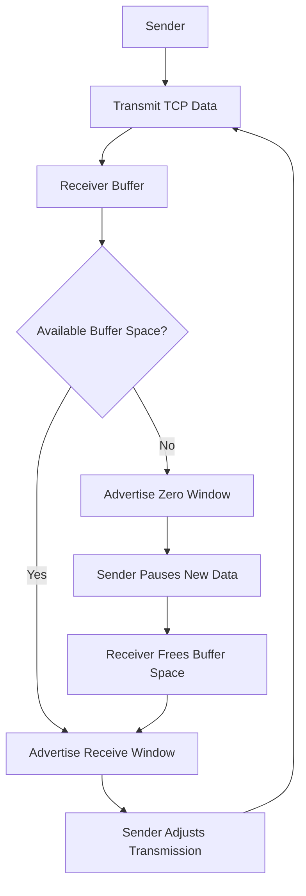
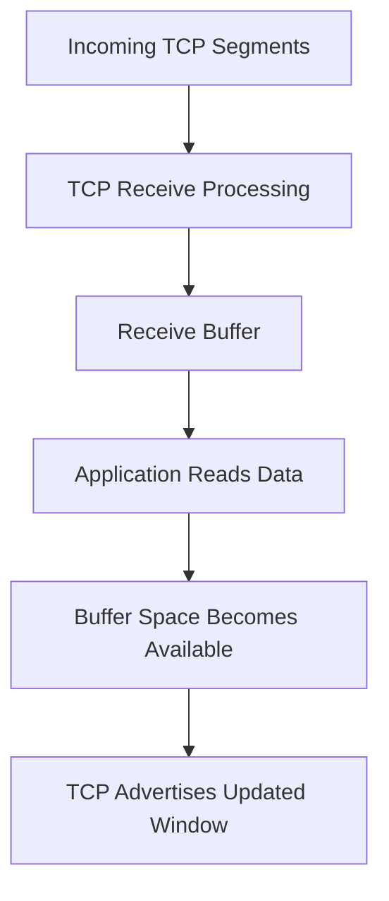
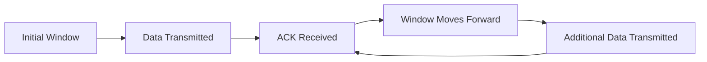
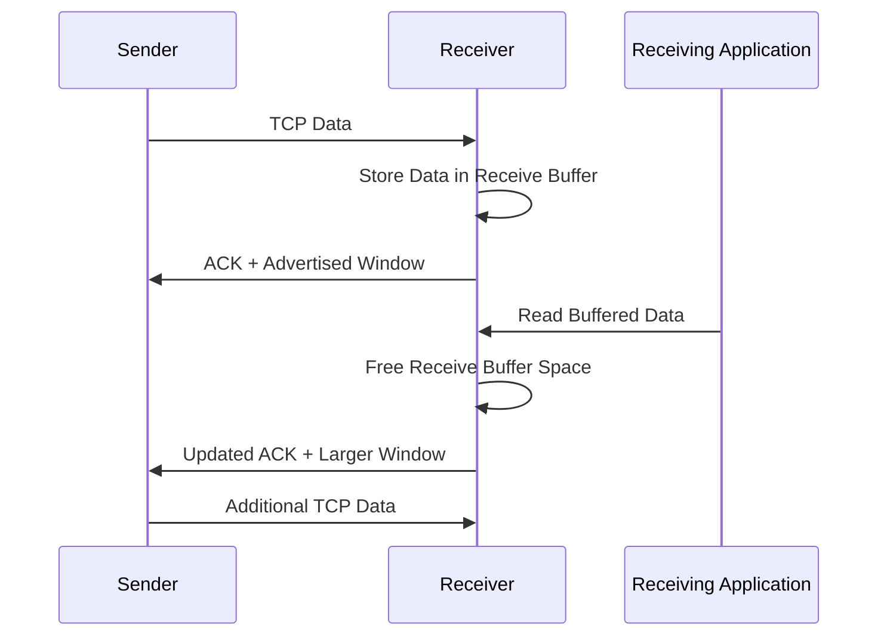
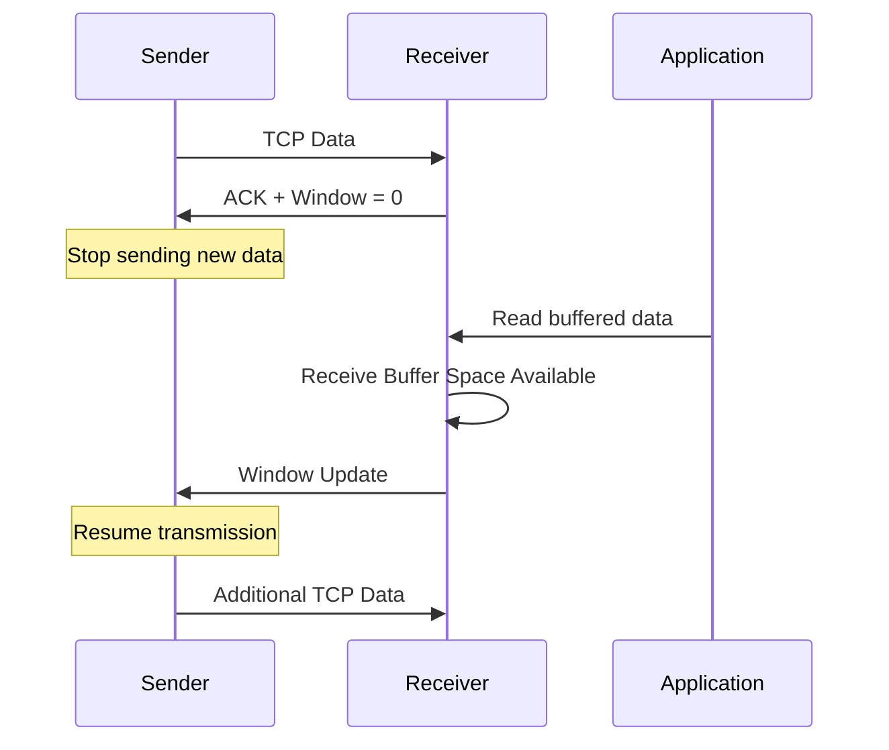

# TCP Flow Control

**TCP Flow Control** is a mechanism that prevents a sender from transmitting more data than the receiver can currently handle.

It protects the receiving endpoint from being overwhelmed by incoming data.

TCP uses a **sliding window mechanism** and a receiver-advertised window, commonly called the **Receive Window (RWND)**, to control how much unacknowledged data a sender may have in flight.

The receiver continuously communicates its available buffer capacity through the TCP Window field.

Flow control ensures that:

* The sender respects the receiver's available buffer space.
* The receiver can process incoming data at an appropriate rate.
* Data can be transmitted efficiently without overwhelming the receiver.
* Communication can continue as the receiver's available buffer capacity changes.

# 🗁 Understanding TCP Flow Control

TCP provides reliable, ordered, full-duplex byte-stream communication.

During communication, a sender may transmit data faster than the receiver can process it.

For example:

```text
Sender transmission rate:   100 MB/s
Receiver processing rate:    20 MB/s
```

The sender produces data faster than the receiver can consume it.

Without flow control, the receiver's buffer could become full, resulting in dropped data and inefficient retransmission.

TCP solves this problem by allowing the receiver to advertise how much additional data it can accept.

### 🖆 Basic Flow Control Diagram



The sender must respect the receiver's advertised window when transmitting new data.

# 🗁 Why TCP Flow Control Is Needed

Network endpoints have different processing capabilities.

A high-performance server may transmit data faster than a small client device can process it.

For example:

| Component | Capability |
| --- | --- |
| Server | High-speed CPU and large memory |
| Network | High bandwidth |
| Client | Limited memory and slower processing |

The network may deliver data faster than the client application can consume it.

TCP flow control prevents the sender from continuously transmitting beyond the receiver's available capacity.

### 🖆 Without Flow Control

```text
Sender
  |
  | Large amount of data
  v
Receiver Buffer
  |
  | Buffer becomes full
  v
Incoming data cannot be accepted
```

### 🖆 With Flow Control

```text
Sender
  |
  | Transmit within advertised window
  v
Receiver Buffer
  |
  | Application processes data
  v
Available buffer space increases
  |
  | Updated window advertisement
  v
Sender can transmit more data
```

# 🗁 TCP Receive Buffer

A TCP receive buffer is memory maintained by the operating system to hold incoming TCP data before it is consumed by the receiving application.

The TCP stack receives network data and places it into the receive buffer.

The application reads data from this buffer when it is ready.

### 🖆 Receive Buffer Operation



### 🖆 Example

Assume:

```text
Receive Buffer Capacity = 64 KB
Currently Occupied       = 40 KB
```

Available space:

```text
64 KB - 40 KB = 24 KB
```

The receiver can advertise approximately 24 KB of available receive-window space, subject to TCP implementation and window-advertisement rules.

If the application reads 16 KB:

```text
Previously Occupied = 40 KB
Application Reads   = 16 KB

New Occupancy       = 24 KB
Available Space     = 40 KB
```

The receiver may advertise a larger window in a subsequent TCP acknowledgment.

# 🗁 Receiver Advertised Window

The **Receiver Advertised Window (RWND)** represents how much additional TCP data the receiver is currently willing to accept.

It is carried in the 16-bit Window field of the TCP header.

The advertised window is a byte count representing the acceptable receive sequence space beyond the acknowledgment number.

### 🖆 TCP Window Field

A TCP header contains:

```text
Source Port
Destination Port
Sequence Number
Acknowledgment Number
Data Offset
Flags
Window
Checksum
Urgent Pointer
Options
```

The Window field communicates the receiver's advertised capacity.

### 🖆 Example

Assume the receiver advertises:

```text
Acknowledgment Number = 5000
Advertised Window     = 10000 bytes
```

The sender may transmit new data within the advertised sequence range:

```text
5000 to 14999
```

The upper boundary is exclusive:

```text
5000 + 10000 = 15000
```

Therefore, the sender can send up to 10,000 bytes beginning at sequence number 5000, provided other TCP constraints also permit transmission.

### 🖆 Important Distinction

The advertised window is not:

* The total amount of data sent by the sender.
* The maximum size of one TCP segment.
* The maximum amount of data the application can ever transmit.

It represents the receiver's currently advertised capacity for additional data.

# 🗁 TCP Sliding Window

The TCP sliding window mechanism allows a sender to transmit multiple bytes of data without waiting for an acknowledgment after every segment.

As acknowledgments arrive, the transmission window moves forward.

This improves network utilization and throughput.

### 🖆 Sliding Window Diagram

```text
TCP Sequence Number Space

| Acknowledged | Unacknowledged Data | Allowed New Data | Not Yet Allowed |
|---------------|---------------------|------------------|-----------------|
                ^                     ^
                |                     |
          Send Window Start      Send Window End
```

The window slides forward as the receiver acknowledges data and advertises additional capacity.

### 🖆 Example

Assume:

```text
Receiver Advertised Window = 5000 bytes
Sender's Next Sequence     = 1000
```

The sender can transmit data within:

```text
1000 to 5999
```

Suppose the receiver acknowledges the first 2000 bytes:

```text
ACK = 3000
```

The sender's transmission range moves forward:

```text
New Window Start = 3000
New Window End   = 8000
```

The sender can now transmit additional data within the updated range.

### 🖆 Window Movement



A sliding window allows continuous transmission while keeping the amount of unacknowledged data within the permitted limit.

# 🗁 How TCP Flow Control Works

TCP flow control involves continuous communication between the sender and receiver.

### 🖆 Initial Window Advertisement

During the TCP handshake, the receiver can advertise its initial receive-window size.

Example:

```text
Client → Server: SYN
Server → Client: SYN-ACK

Advertised Window = 65535
```

The exact effective window depends on negotiated window scaling, if enabled.

### 🖆 Sender Transmits Data

The sender begins transmitting TCP data within the receiver's advertised window.

Example:

```text
Advertised Window = 10000 bytes

Sender transmits:
Segment 1 = 1460 bytes
Segment 2 = 1460 bytes
Segment 3 = 1460 bytes
```

The sender must also respect congestion-control and other TCP transmission constraints.

### 🖆 Receiver Processes Data

The receiver stores incoming data in its receive buffer.

The application reads data from the buffer.

As data is consumed, buffer space becomes available.

### 🖆 Receiver Advertises an Updated Window

The receiver communicates its available capacity through subsequent TCP segments, often ACK segments.

Example:

```text
Previous Advertised Window = 4000 bytes
New Advertised Window      = 8000 bytes
```

The sender can use the updated window to transmit additional data.

### 🖆 Complete Flow



# 🗁 TCP Window Size Calculation

The TCP Window field is 16 bits wide.

Its original maximum representable value is:

\[
2^{16}-1=65,535
\]

Therefore, without window scaling, the maximum advertised window is:

```text
65,535 bytes
```

### 🖆 Effective Window

When TCP window scaling is negotiated, the effective advertised window is calculated as:

\[
\text{Effective Window}
=

\text{Window Field} \times 2^{\text{Scale Factor}}
\]

Example:

```text
TCP Window Field = 65535
Window Scale     = 7
```

Calculation:

\[
65,535 \times 2^7
\]

\[
65,535 \times 128
\]

\[
= 8,388,480 \text{ bytes}
\]

The effective window is approximately 8 MB.

The scale factor is negotiated during the TCP handshake and is directional: each endpoint advertises the scaling factor that applies to the window it sends.

# 🗁 Zero Window and Window Probing

A zero window occurs when the receiver has no available receive-buffer space to accept additional data.

The receiver advertises:

```text
Window = 0
```

The sender must stop transmitting new data until the receiver advertises a usable window.

However, TCP must also handle the possibility that a window-update advertisement is lost.

### 🖆 Zero Window Scenario

Assume:

```text
Receive Buffer Capacity = 64 KB
Buffer Occupancy        = 64 KB
Available Space         = 0 KB
```

The receiver sends:

```text
ACK + Window = 0
```

The sender stops sending new data.

### 🖆 Window Update

The receiving application eventually reads data from the buffer.

Example:

```text
Previous Occupancy = 64 KB
Application Reads  = 32 KB

New Available Space = 32 KB
```

The receiver can advertise a nonzero window.

The sender can resume transmission.

### 🖆 Zero Window Probing

The sender periodically probes a zero-window receiver to determine whether its receive window has reopened.

These probes help recover from lost window updates.

TCP implementations use persist behavior and a persist timer for this purpose.

### 🖆 Zero Window Diagram



### 🖆 Zero Window vs Connection Failure

A zero window does not automatically mean the TCP connection has failed.

It means the receiver currently cannot accept more data.

The connection can remain established while waiting for available buffer space.

# 🗁 TCP Window Scaling

TCP window scaling is an extension that allows receive windows larger than the original 65,535-byte limit.

It is defined in RFC 7323.

Window scaling is particularly useful for high-bandwidth, high-latency networks.

### 🖆 Why Window Scaling Is Needed

Consider a network with:

```text
Bandwidth = 1 Gbps
RTT       = 100 ms
```

The Bandwidth-Delay Product is:

\[
BDP = Bandwidth \times RTT
\]

Convert bandwidth:

\[
1\text{ Gbps}=125,000,000\text{ bytes/s}
\]

Calculate:

\[
BDP=125,000,000 \times 0.1
\]

\[
BDP=12,500,000\text{ bytes}
\]

Approximately 12.5 MB of data must be in flight to fully utilize this link under ideal conditions.

The original TCP window limit of 65,535 bytes is far too small for this example.

Window scaling allows a much larger receive window.

### 🖆 Window Scale Negotiation

The Window Scale option is exchanged during the SYN and SYN-ACK segments.

Example:

```text
Client SYN:
Window Scale = 7

Server SYN-ACK:
Window Scale = 8
```

Each endpoint advertises its own receive-window scaling factor.

The scaling factor is used when interpreting that endpoint's subsequent Window fields.

Window scaling cannot be negotiated after the initial handshake.

# 🗁 Flow Control vs Congestion Control

TCP flow control and congestion control both limit the amount of outstanding data, but they solve different problems.

### 🖆 Flow Control

Flow control protects the receiver.

It prevents a sender from transmitting more data than the receiving endpoint can buffer.

The receiver advertises its capacity through the receive window.

### 🖆 Congestion Control

Congestion control protects the network.

It prevents a sender from injecting excessive traffic into the network and overwhelming routers, links, or queues.

TCP uses a congestion window, commonly called `CWND`, to regulate outstanding data.

### 🖆 Comparison

| Feature | Flow Control | Congestion Control |
| --- | --- | --- |
| Primary purpose | Protect receiver | Protect network |
| Main mechanism | Receive window | Congestion window |
| Controlled by | Receiver feedback | Sender's congestion-control algorithm |
| Important variable | RWND | CWND |
| Main concern | Receiver buffer capacity | Network congestion |
| Typical signals | Advertised window updates | Packet loss, ECN, RTT and algorithm-specific signals |

### 🖆 Combined TCP Transmission Limit

A sender must respect both the receiver's advertised window and its congestion window.

A simplified representation is:

\[
\text{Send Window}=\min(RWND,CWND)
\]

Where:

* `RWND` is the receiver-advertised window.
* `CWND` is the sender's congestion window.

Example:

```text
RWND = 64 KB
CWND = 32 KB

Effective Limit = 32 KB
```

The sender is limited by congestion control.

Another example:

```text
RWND = 16 KB
CWND = 64 KB

Effective Limit = 16 KB
```

The sender is limited by receiver flow control.

This expression describes the amount of outstanding data permitted by these two windows; actual transmission also depends on sequence-space state, acknowledgments, and other TCP rules.

# 🗁 TCP Flow Control in Linux

Linux provides several system interfaces for inspecting and configuring TCP socket buffer behavior.

### 🖆 Display TCP Memory Information

```bash
cat /proc/net/sockstat
```

This displays socket memory and socket usage statistics.

### 🖆 Display TCP Memory Configuration

```bash
sysctl net.ipv4.tcp_mem
```

This displays the system-level TCP memory thresholds.

### 🖆 Display Receive Buffer Limits

```bash
sysctl net.ipv4.tcp_rmem
```

Example:

```text
net.ipv4.tcp_rmem = 4096 131072 6291456
```

The three values represent:

| Position | Meaning |
| --- | --- |
| First | Minimum receive buffer size |
| Second | Default receive buffer size |
| Third | Maximum receive buffer size |

These values are expressed in bytes.

### 🖆 Display Send Buffer Limits

```bash
sysctl net.ipv4.tcp_wmem
```

Example:

```text
net.ipv4.tcp_wmem = 4096 16384 4194304
```

The values represent:

| Position | Meaning |
| --- | --- |
| First | Minimum send buffer size |
| Second | Default send buffer size |
| Third | Maximum send buffer size |

### 🖆 Display TCP Window Scaling Setting

```bash
sysctl net.ipv4.tcp_window_scaling
```

A value of `1` indicates that TCP window scaling is enabled.

### 🖆 Inspect Socket Information

```bash
ss -tin
```

This can display TCP connection information, including congestion-control and window-related details depending on the kernel and available diagnostic information.

# 🗁 Monitoring TCP Window Behavior

Packet-analysis tools can help inspect advertised receive windows.

### 🖆 Using tcpdump

Capture TCP traffic:

```bash
sudo tcpdump -i any -nn -vv 'tcp port 443'
```

The verbose output can include TCP window values and negotiated options.

### 🖆 Using Wireshark

Useful Wireshark display filters:

```text
tcp.window_size_value
```

Display packets with a zero advertised window:

```text
tcp.window_size_value == 0
```

Display window-update packets:

```text
tcp.analysis.window_update
```

Display zero-window probes:

```text
tcp.analysis.zero_window_probe
```

Display packets associated with a full receive window:

```text
tcp.analysis.window_full
```

### 🖆 Important Wireshark Fields

| Field | Description |
| --- | --- |
| Window Size Value | Raw TCP Window field |
| Calculated Window Size | Effective window after scaling |
| Window Scale | Negotiated scaling factor |
| Zero Window | Receiver advertises no available space |
| Window Update | Receiver advertises a changed window |

The raw Window field and the effective scaled window are not always the same.

# 🗁 Common Flow Control Problems

### 🖆 Zero Window Condition

**Symptom:** The receiver repeatedly advertises a zero window.

Possible causes:

* Receiving application is slow.
* Application is not reading from its socket.
* Receive buffer is full.
* Receiver is under CPU or memory pressure.
* Application processing is blocked.

Investigation:

```bash
ss -tin
```

Inspect the receiving application's behavior and socket statistics.

### 🖆 Slow Receiver

**Symptom:** The sender frequently waits for window updates.

Possible causes:

* Slow application processing.
* Insufficient receiver resources.
* Small receive buffer.
* Excessive application-level backpressure.

Potential improvements:

* Optimize application data processing.
* Read incoming data efficiently.
* Use appropriate socket-buffer settings.
* Apply backpressure intentionally at the application layer.

### 🖆 Small Receive Window

**Symptom:** The sender cannot maintain enough outstanding data to utilize available network bandwidth.

Possible causes:

* Small receive-buffer configuration.
* Window scaling not negotiated.
* High network latency.
* Receiver application consuming data slowly.

Potential improvements:

* Verify window scaling.
* Evaluate receive-buffer settings.
* Measure RTT and bandwidth.
* Calculate the Bandwidth-Delay Product.

### 🖆 High Latency and Low Throughput

A connection may have sufficient bandwidth but still achieve poor throughput if the effective TCP window is too small relative to the network's Bandwidth-Delay Product.

Investigate:

* RTT.
* Receive window.
* Congestion window.
* Packet loss.
* Window scaling.
* Application read speed.

# 🗁 Best Practices

* Monitor receive-window advertisements when diagnosing slow TCP connections.
* Ensure receiving applications read socket data efficiently.
* Use appropriate socket-buffer sizes.
* Enable TCP window scaling where supported.
* Consider the Bandwidth-Delay Product when tuning high-speed networks.
* Distinguish receiver-side flow-control limitations from network congestion.
* Investigate persistent zero-window conditions.
* Use packet captures to inspect advertised windows.
* Avoid blindly increasing socket-buffer limits without measuring actual requirements.
* Apply application-level backpressure when processing capacity is limited.

# 🗁 Common Mistakes

| Mistake | Correct Understanding |
| --- | --- |
| Flow control prevents network congestion | Flow control protects the receiver; congestion control protects the network |
| RWND and CWND are the same | RWND is advertised by the receiver; CWND is maintained by the sender |
| TCP sends only one segment before receiving an ACK | TCP can transmit multiple segments within its permitted window |
| A zero window means the connection is closed | A zero window means the receiver cannot currently accept more data |
| Window scaling changes the TCP header field size | The TCP Window field remains 16 bits; scaling changes its effective interpretation |
| Window scaling can be enabled at any time | It must be negotiated during connection establishment |
| TCP window size is the same as MSS | Window size controls outstanding data; MSS controls TCP payload size per segment |
| A larger receive window always improves throughput | Performance also depends on congestion control, RTT, loss, and application processing |

# 🗁 Practical Exercises

### 🖆 Exercise: Calculate the Available Receive Window

Assume:

```text
Receive Buffer Capacity = 128 KB
Current Buffer Usage    = 80 KB
```

Calculate the available receive-buffer space.

Expected calculation:

```text
128 KB - 80 KB = 48 KB
```

The receiver can advertise approximately 48 KB, subject to its TCP implementation.

### 🖆 Exercise: Calculate an Effective Window

Assume:

```text
TCP Window Field = 32768
Window Scale     = 5
```

Calculate:

\[
32768 \times 2^5
\]

Expected result:

```text
1,048,576 bytes
```

### 🖆 Exercise: Calculate the Effective Transmission Limit

Assume:

```text
RWND = 128 KB
CWND = 64 KB
```

Calculate:

\[
\min(128,64)=64\text{ KB}
\]

The congestion window is the limiting factor.

### 🖆 Exercise: Calculate Bandwidth-Delay Product

Assume:

```text
Bandwidth = 500 Mbps
RTT       = 40 ms
```

Convert:

```text
500 Mbps = 62.5 MB/s
40 ms    = 0.04 seconds
```

Calculate:

\[
BDP=62.5 \times 0.04
\]

Expected result:

```text
2.5 MB
```

Approximately 2.5 MB of data must be in flight to fully utilize the link under ideal conditions.

### 🖆 Exercise: Inspect Linux TCP Settings

Run:

```bash
sysctl net.ipv4.tcp_rmem
sysctl net.ipv4.tcp_wmem
sysctl net.ipv4.tcp_window_scaling
```

Record the values and explain the purpose of each setting.

### 🖆 Exercise: Inspect Advertised Windows

Capture traffic:

```bash
sudo tcpdump -i any -nn -vv 'tcp port 443'
```

Use Wireshark to inspect:

* Advertised receive window.
* Window scaling.
* Zero-window advertisements.
* Window updates.

# 🗁 Interview Questions

### 🖆 Basic Questions

**What is TCP flow control?**

TCP flow control prevents a sender from overwhelming the receiver by regulating the amount of outstanding data based on the receiver's advertised window.

**What is the receive window?**

It is the amount of additional TCP data the receiver is currently willing to accept.

**What is a sliding window?**

It is a mechanism that allows TCP to transmit multiple bytes of data without waiting for an acknowledgment after every segment.

**What is a zero window?**

It is a condition in which the receiver advertises that it currently has no available receive-buffer capacity.

### 🖆 Intermediate Questions

**What is the difference between RWND and CWND?**

RWND represents the receiver's available capacity, while CWND represents the sender's congestion-control limit.

**Why is TCP window scaling necessary?**

It allows TCP to advertise receive windows larger than the original 65,535-byte limit, improving throughput on high-bandwidth, high-latency networks.

**What happens when a receiver advertises a zero window?**

The sender stops transmitting new data and uses TCP persist behavior to detect when the receiver becomes ready again.

**What is the Bandwidth-Delay Product?**

It is the amount of data that can be in flight across a network path, calculated by multiplying bandwidth by round-trip time.

**Can TCP flow control prevent congestion?**

No. Flow control protects the receiver, while congestion control manages the amount of traffic injected into the network.

**What happens if the receiving application does not read incoming data?**

The receive buffer can fill, causing the receiver to advertise a smaller window or eventually a zero window.

# 🗁 Summary

TCP flow control prevents a sender from overwhelming a receiver.

Its primary mechanisms are:

* Receive buffers.
* Receiver-advertised windows.
* Sliding windows.
* Zero-window handling.
* TCP window scaling.

Important concepts:

* RWND represents the receiver's advertised capacity.
* CWND represents the sender's congestion-control limit.
* The sender's outstanding data is constrained by both windows.
* Window scaling supports receive windows larger than 65,535 bytes.
* Zero-window probing helps recover when a receiver temporarily cannot accept data.
* Flow control protects the receiver, while congestion control protects the network.

# 🗁 References

* [RFC 9293 — Transmission Control Protocol (TCP)](https://www.rfc-editor.org/rfc/rfc9293)
* [RFC 7323 — TCP Extensions for High Performance](https://www.rfc-editor.org/rfc/rfc7323)
* [RFC 1122 — Requirements for Internet Hosts: Communication Layers](https://www.rfc-editor.org/rfc/rfc1122)
* [RFC 5681 — TCP Congestion Control](https://www.rfc-editor.org/rfc/rfc5681)
* [Linux `tcp(7)` Manual](https://man7.org/linux/man-pages/man7/tcp.7.html)
* [Linux `ss` Manual](https://man7.org/linux/man-pages/man8/ss.8.html)
