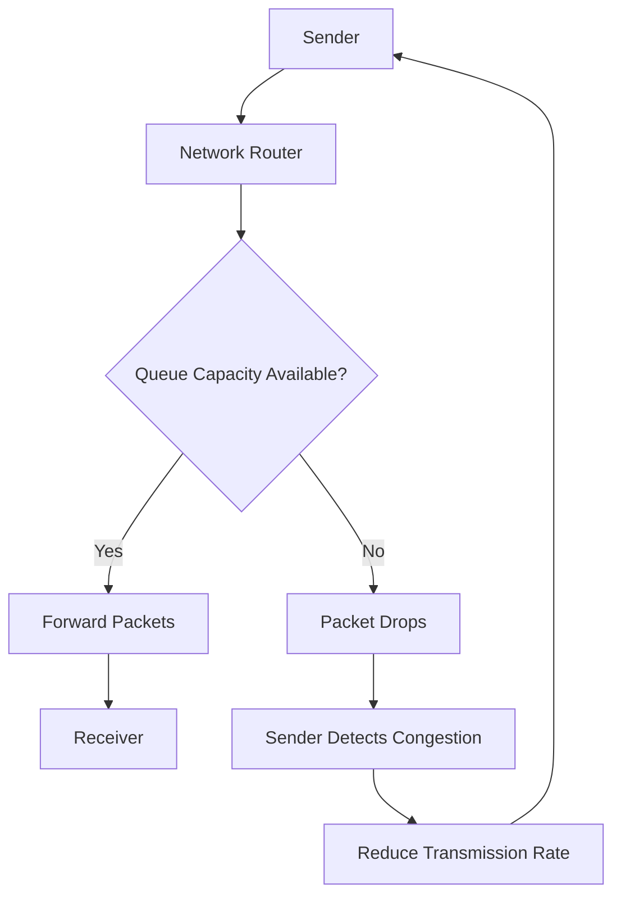
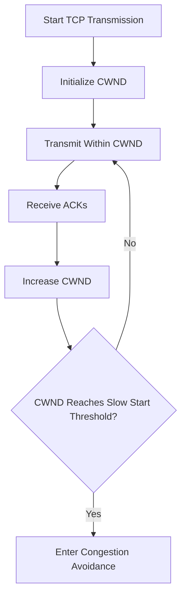
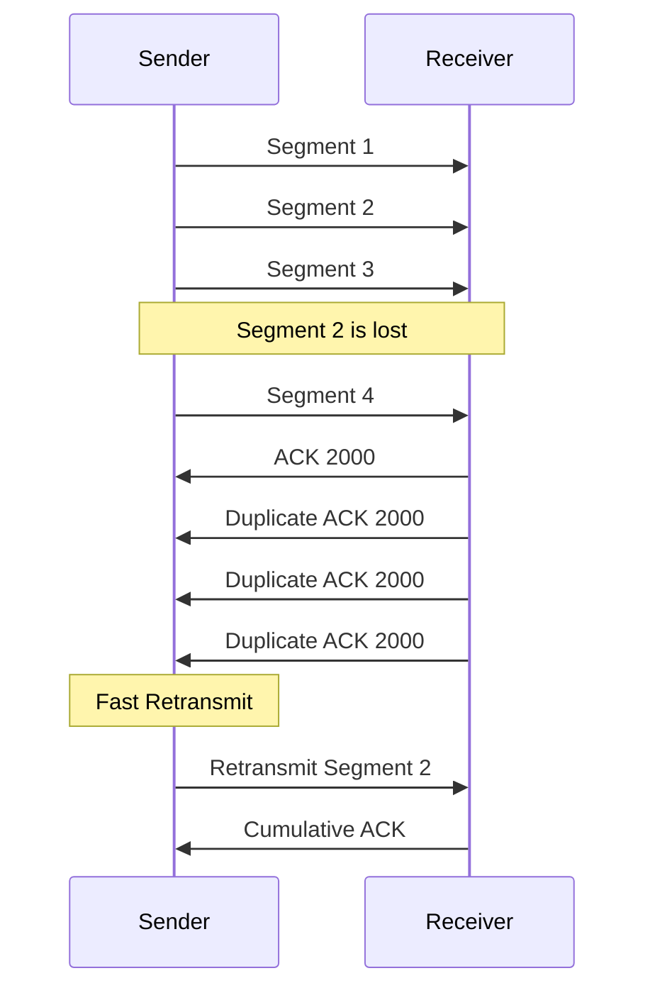
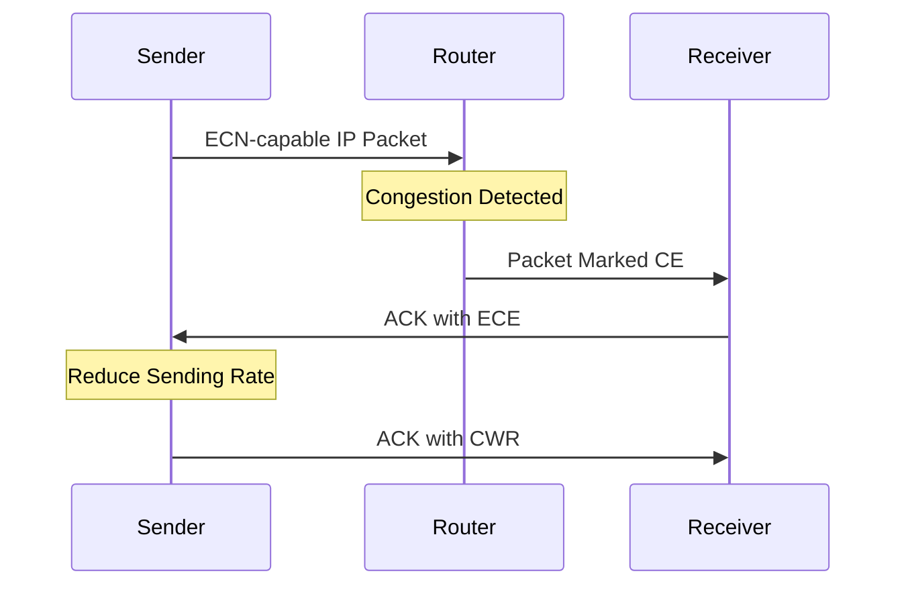

# TCP Congestion Control

**TCP Congestion Control** is a mechanism that regulates how much data a TCP sender injects into the network to prevent network congestion.

Network congestion occurs when the amount of traffic entering a network exceeds the available capacity of its links, routers, or queues.

When congestion develops, packets may experience:

* Increased latency.
* Packet loss.
* Queue overflow.
* Retransmissions.
* Reduced throughput.
* Unstable network performance.

TCP uses congestion-control algorithms to adjust its transmission rate according to network conditions.

The primary mechanisms include:

* Congestion Window (CWND).
* Slow Start.
* Congestion Avoidance.
* Fast Retransmit.
* Fast Recovery.
* Retransmission Timeout (RTO).
* Explicit Congestion Notification (ECN).

# 🗁 Understanding Network Congestion

Network congestion occurs when traffic demand exceeds the capacity available along a network path.

Consider a network connection:

```text
Sender
   |
   | 1 Gbps
   v
Router
   |
   | 100 Mbps
   v
Receiver
```

The sender can transmit data at 1 Gbps, but the outgoing link supports only 100 Mbps.

The router may temporarily buffer incoming packets. If packets arrive faster than they can be forwarded, the queue grows.

When the queue becomes full, the router may drop additional packets.

This condition is called network congestion.

### 🖆 Congestion Diagram



TCP congestion control helps senders adapt their transmission behavior to available network capacity.

# 🗁 Why TCP Congestion Control Is Needed

Without congestion control, multiple TCP senders could continuously transmit at high rates regardless of network capacity.

This could cause:

* Persistent queue buildup.
* Packet drops.
* Excessive retransmissions.
* Increased round-trip time.
* Reduced network throughput.
* Congestion collapse under severe conditions.

Congestion collapse occurs when increasing network traffic results in less useful data being delivered.

TCP congestion control attempts to maintain efficient network utilization while avoiding excessive congestion.

# 🗁 Congestion Window

The **Congestion Window (CWND)** is a sender-side TCP variable that limits the amount of outstanding data allowed in the network.

Unlike the receive window, CWND is maintained by the sender's congestion-control algorithm.

The sender must respect both:

* Receiver Advertised Window (RWND).
* Congestion Window (CWND).

A simplified representation is:

\[
\text{Effective Send Window}=\min(RWND,CWND)
\]

Where:

* `RWND` protects the receiver.
* `CWND` protects the network.

### 🖆 Example

Assume:

```text
Receiver Window (RWND) = 64 KB
Congestion Window (CWND) = 32 KB
```

Calculation:

\[
\min(64,32)=32\text{ KB}
\]

The sender can have approximately 32 KB of outstanding data, subject to TCP sequence-space and transmission rules.

Another example:

```text
RWND = 16 KB
CWND = 64 KB
```

The effective limit becomes:

```text
16 KB
```

In this case, receiver flow control is the limiting factor.

### 🖆 Congestion Window vs Receive Window

| Feature | CWND | RWND |
| --- | --- | --- |
| Full Name | Congestion Window | Receive Window |
| Maintained by | Sender | Advertised by receiver |
| Main purpose | Control network traffic | Protect receiver buffer |
| Controlled by | Congestion-control algorithm | Receiver's available capacity |
| Typical unit | Bytes | Bytes |

# 🗁 Slow Start

Slow Start is a TCP congestion-control algorithm used to increase the congestion window when communication begins or after certain congestion events.

Despite its name, Slow Start can increase the transmission rate rapidly.

The sender begins with an initial congestion window and increases it as acknowledgments arrive.

### 🖆 How Slow Start Works

In classic TCP descriptions, CWND increases by approximately one MSS for each newly acknowledged segment during Slow Start.

When one full window of data is acknowledged, CWND can approximately double.

Example:

Assume:

```text
MSS = 1460 bytes
Initial CWND = 1 MSS
```

A simplified progression is:

| Round-Trip Time | Congestion Window |
| --- | ---: |
| Initial | 1 MSS |
| After 1 RTT | 2 MSS |
| After 2 RTTs | 4 MSS |
| After 3 RTTs | 8 MSS |
| After 4 RTTs | 16 MSS |

The growth is approximately exponential.

### 🖆 Slow Start Diagram



### 🖆 Slow Start Threshold

The **Slow Start Threshold (SSTHRESH)** determines when TCP transitions from Slow Start to Congestion Avoidance.

When CWND reaches or exceeds SSTHRESH, TCP generally enters Congestion Avoidance.

Modern TCP implementations may also apply congestion-control-specific rules that influence this transition.

# 🗁 Congestion Avoidance

Congestion Avoidance is the phase in which TCP increases its congestion window more cautiously.

Instead of exponential growth, classic TCP congestion avoidance uses approximately linear growth.

The goal is to increase throughput without aggressively overwhelming the network.

### 🖆 How Congestion Avoidance Works

A simplified model increases CWND by approximately one MSS per RTT.

Example:

```text
MSS = 1460 bytes
CWND = 10 MSS
```

Approximate progression:

| Round-Trip Time | Congestion Window |
| --- | ---: |
| Initial | 10 MSS |
| After 1 RTT | 11 MSS |
| After 2 RTTs | 12 MSS |
| After 3 RTTs | 13 MSS |
| After 4 RTTs | 14 MSS |

This represents additive increase.

### 🖆 Additive Increase

TCP cautiously increases its sending capacity when acknowledgments indicate successful delivery.

The simplified additive-increase behavior can be expressed as:

\[
CWND_{new}=CWND_{old}+MSS
\]

This formula represents approximate growth per RTT, not an update performed once for every individual ACK.

### 🖆 Multiplicative Decrease

When TCP detects congestion, it reduces its sending capacity.

A classic congestion-control strategy reduces the congestion window by a multiplicative factor, commonly around one-half.

For example:

```text
Previous CWND = 20 MSS
New CWND      = 10 MSS
```

This approach is commonly called **Additive Increase Multiplicative Decrease (AIMD)**.

# 🗁 Packet Loss Detection

TCP uses different signals to detect possible congestion.

The main signals include:

* Retransmission timeout.
* Duplicate acknowledgments.
* Explicit Congestion Notification.

### 🖆 Duplicate ACKs

A duplicate ACK occurs when the receiver repeatedly acknowledges the same sequence number because it is still waiting for missing data.

Example:

```text
Sender transmits:
Segment 1
Segment 2
Segment 3
Segment 4
```

Suppose Segment 2 is lost.

The receiver may receive Segment 1, Segment 3, and Segment 4.

Because Segment 2 is missing, the receiver continues acknowledging the next expected sequence number.

Example:

```text
ACK 2000
ACK 2000
ACK 2000
```

These duplicate acknowledgments can indicate packet loss.

### 🖆 Retransmission Timeout

If an acknowledgment does not arrive within the retransmission timeout, TCP retransmits the missing data.

A timeout is generally treated as a stronger congestion signal than duplicate ACKs.

### 🖆 Explicit Congestion Notification

ECN allows network devices to signal congestion without necessarily dropping packets.

It requires support from the endpoints and network devices along the path.

# 🗁 Fast Retransmit

Fast Retransmit allows TCP to retransmit a missing segment before the retransmission timeout expires.

In classic TCP Reno behavior, receiving three duplicate ACKs triggers Fast Retransmit.

### 🖆 Example

Assume:

```text
Segment 1: Received
Segment 2: Lost
Segment 3: Received
Segment 4: Received
Segment 5: Received
```

The receiver repeatedly acknowledges the next expected sequence number.

```text
ACK 2000
ACK 2000
ACK 2000
```

After receiving three duplicate ACKs, the sender retransmits the missing segment.

### 🖆 Fast Retransmit Diagram



The exact duplicate-ACK threshold and loss-recovery behavior can vary with the TCP implementation and congestion-control algorithm.

# 🗁 Fast Recovery

Fast Recovery is a mechanism used by classic TCP Reno to recover from packet loss detected through duplicate acknowledgments without returning to the initial Slow Start behavior.

### 🖆 How Fast Recovery Works

In classic Reno:

* Three duplicate ACKs indicate likely packet loss.
* The sender performs Fast Retransmit.
* SSTHRESH is reduced.
* CWND is reduced according to the Reno recovery algorithm.
* The sender continues transmission using Fast Recovery.
* After recovery completes, congestion avoidance resumes.

### 🖆 Example

Assume:

```text
Previous CWND = 20 MSS
```

After detecting congestion through duplicate ACKs:

```text
SSTHRESH = 10 MSS
```

Classic Reno temporarily inflates CWND during Fast Recovery as additional duplicate ACKs arrive.

When the acknowledgment covering the retransmitted data arrives, CWND is set to the recovery threshold and congestion avoidance continues.

Modern TCP algorithms use different recovery mechanisms, so this classic Reno description should not be treated as the behavior of every TCP implementation.

# 🗁 Retransmission Timeout

The **Retransmission Timeout (RTO)** is the timer TCP uses to determine when transmitted data has remained unacknowledged for too long.

If the timer expires, TCP retransmits the earliest unacknowledged data.

### 🖆 Why RTO Is Needed

Packet loss can occur without generating enough duplicate ACKs to trigger Fast Retransmit.

For example:

* The final segment in a transmission burst is lost.
* No later segments arrive to generate duplicate ACKs.
* The sender receives no useful acknowledgment progress.

The RTO provides a recovery mechanism for such situations.

### 🖆 RTO Behavior

When an RTO expires:

* TCP retransmits unacknowledged data.
* The congestion-control algorithm reacts to the timeout.
* The congestion window is generally reduced substantially.
* The retransmission timer is backed off.

Classic TCP congestion-control behavior typically sets:

\[
SSTHRESH=\max\left(\frac{FlightSize}{2},2\times MSS\right)
\]

The congestion window is then reduced to the loss-recovery starting point, commonly one MSS in the classic algorithm.

The exact recovery behavior depends on the congestion-control and loss-recovery implementation.

### 🖆 Exponential Backoff

TCP generally increases the RTO after consecutive retransmission timeouts.

For example:

```text
Initial RTO = 1 second

First timeout  = 1 second
Second timeout = 2 seconds
Third timeout  = 4 seconds
Fourth timeout = 8 seconds
```

This is called exponential backoff.

Actual RTO values are calculated dynamically and subject to implementation-specific limits.

# 🗁 TCP Congestion Control Algorithms

Different congestion-control algorithms use different strategies to estimate and respond to network conditions.

Common examples include:

| Algorithm | General Approach |
| --- | --- |
| TCP Tahoe | Slow Start, Congestion Avoidance, Fast Retransmit |
| TCP Reno | Adds Fast Recovery to classic Tahoe behavior |
| TCP NewReno | Improves recovery from multiple packet losses |
| TCP CUBIC | Uses a cubic window-growth function |
| TCP BBR | Uses bandwidth and RTT estimates to model the network path |

Algorithm availability depends on the operating system and kernel configuration.

# 🗁 TCP Reno and CUBIC

### 🖆 TCP Reno

TCP Reno is a classic congestion-control algorithm.

It uses:

* Slow Start.
* Congestion Avoidance.
* Fast Retransmit.
* Fast Recovery.

Its congestion response follows the AIMD principle.

Reno reduces CWND when congestion is detected and increases it gradually when the network appears healthy.

### 🖆 TCP CUBIC

TCP CUBIC is a congestion-control algorithm designed for high-bandwidth networks.

It uses a cubic function to control congestion-window growth.

Unlike traditional Reno's linear congestion avoidance, CUBIC adjusts its growth according to the time elapsed since the previous congestion event.

Its growth behavior is commonly represented as:

\[
W(t)=C(t-K)^3+W_{max}
\]

Where:

* \(W(t)\) is the congestion window at time \(t\).
* \(C\) is a scaling constant.
* \(K\) is the time required to return to the previous maximum window.
* \(W_{max}\) is the congestion window before the previous congestion event.

CUBIC grows more cautiously near the previous maximum and more aggressively farther away from it.

### 🖆 CUBIC vs Reno

| Feature | TCP Reno | TCP CUBIC |
| --- | --- | --- |
| Growth strategy | AIMD | Cubic function |
| Congestion avoidance | Approximately linear | Time-based cubic growth |
| High-bandwidth networks | Less efficient on some paths | Designed for high-bandwidth environments |
| Previous maximum window | Not central to its growth function | Important reference point |
| Linux availability | Depends on kernel configuration | Common Linux default |

# 🗁 BBR Congestion Control

BBR stands for **Bottleneck Bandwidth and Round-trip propagation time**.

It is a congestion-control algorithm developed by Google.

BBR estimates two important network properties:

* Bottleneck bandwidth: the maximum delivery rate of the network path.
* Minimum RTT: the propagation delay when queues are relatively empty.

It uses these estimates to determine an appropriate sending rate and amount of data in flight.

### 🖆 How BBR Works

BBR attempts to model the network path rather than relying exclusively on packet loss as its congestion signal.

Its model includes:

```text
Bottleneck Bandwidth
        +
Minimum RTT
        |
        v
Bandwidth-Delay Product
        |
        v
Estimate Appropriate Data in Flight
        |
        v
Control Sending Rate
```

### 🖆 BBR and CUBIC

| Feature | BBR | CUBIC |
| --- | --- | --- |
| Primary model | Bandwidth and RTT | Congestion-window growth |
| Main signals | Delivery rate and RTT | Primarily loss-based congestion signals |
| Design objective | Efficient delivery with controlled queues | Efficient utilization through cubic growth |
| Queue behavior | Attempts to avoid persistent queue buildup | Can build queues before reacting to loss |
| Linux availability | Kernel-dependent | Common Linux default |

BBR versions have evolved, and their congestion response and queue-management behavior differ. BBR should not be understood as completely ignoring packet loss or network congestion.

# 🗁 Explicit Congestion Notification

**Explicit Congestion Notification (ECN)** allows network devices to indicate congestion without dropping packets solely to signal that congestion.

ECN is defined in RFC 3168, with later extensions.

### 🖆 How ECN Works

When ECN is negotiated, TCP endpoints can use IP ECN markings to indicate that the network supports congestion notification.

A congestion-aware router can mark an eligible IP packet with Congestion Experienced (CE) when it detects congestion.

The receiver informs the sender through TCP acknowledgment signaling.

The sender then reduces its transmission rate according to its congestion-control algorithm.

### 🖆 ECN Diagram



TCP ECN uses these flags:

| Flag | Meaning |
| --- | --- |
| ECE | ECN-Echo: communicates congestion information |
| CWR | Congestion Window Reduced: indicates the sender reacted to congestion |

ECN can reduce unnecessary packet loss by providing an explicit congestion signal.

# 🗁 Flow Control vs Congestion Control

Both mechanisms limit TCP transmission, but their responsibilities are different.

| Feature | Flow Control | Congestion Control |
| --- | --- | --- |
| Purpose | Protect receiver | Protect network |
| Main variable | RWND | CWND |
| Controlled by | Receiver advertisement | Sender algorithm |
| Main concern | Receive-buffer capacity | Network capacity |
| Typical signal | Advertised window | Loss, RTT, ECN and delivery-rate feedback |

### 🖆 Combined Transmission Limit

The sender must respect both limits:

\[
\text{Effective Send Window}=\min(RWND,CWND)
\]

Example:

```text
RWND = 128 KB
CWND = 64 KB

Effective Limit = 64 KB
```

In this case, congestion control limits the sender.

Another example:

```text
RWND = 32 KB
CWND = 128 KB

Effective Limit = 32 KB
```

In this case, flow control limits the sender.

# 🗁 TCP Congestion Control in Linux

Linux supports multiple TCP congestion-control algorithms.

### 🖆 Display Available Algorithms

```bash
sysctl net.ipv4.tcp_available_congestion_control
```

Example:

```text
net.ipv4.tcp_available_congestion_control = reno cubic
```

Available algorithms depend on the kernel and loaded modules.

### 🖆 Display Current Default Algorithm

```bash
sysctl net.ipv4.tcp_congestion_control
```

Example:

```text
net.ipv4.tcp_congestion_control = cubic
```

### 🖆 Change the Congestion-Control Algorithm

For example, to select CUBIC:

```bash
sudo sysctl -w net.ipv4.tcp_congestion_control=cubic
```

To select Reno:

```bash
sudo sysctl -w net.ipv4.tcp_congestion_control=reno
```

These commands change the system default for newly created TCP connections that use the default congestion-control setting. Existing connections generally retain their selected algorithm.

### 🖆 Configure Persistently

Create a configuration file:

```bash
sudo nano /etc/sysctl.d/99-tcp-congestion.conf
```

Add:

```text
net.ipv4.tcp_congestion_control=cubic
```

Apply the configuration:

```bash
sudo sysctl --system
```

### 🖆 Display TCP Connection Details

```bash
ss -tin
```

Depending on kernel support and connection state, the output may include:

* Congestion-control algorithm.
* Congestion window.
* RTT.
* Retransmissions.
* Delivery rate.
* Pacing rate.
* Unacknowledged data.

# 🗁 Monitoring TCP Congestion

Monitoring helps identify congestion, packet loss, retransmissions, and throughput limitations.

### 🖆 Using ss

```bash
ss -tin
```

Example output fields:

```text
cubic
rtt:12.5/2.1
cwnd:20
retrans:0/3
delivery_rate:850Mbps
```

The values are illustrative.

| Field | Meaning |
| --- | --- |
| `cubic` | Congestion-control algorithm |
| `rtt` | Round-trip time estimate |
| `cwnd` | Congestion window, commonly shown in segments |
| `retrans` | Retransmission information |
| `delivery_rate` | Estimated data delivery rate |

### 🖆 Using tcpdump

Capture TCP traffic:

```bash
sudo tcpdump -i any -nn 'tcp'
```

Inspect:

* Retransmissions.
* Duplicate ACKs.
* Out-of-order segments.
* Packet loss indicators.
* ECN markings.

### 🖆 Using Wireshark

Useful display filters:

```text
tcp.analysis.retransmission
```

```text
tcp.analysis.fast_retransmission
```

```text
tcp.analysis.duplicate_ack
```

```text
tcp.analysis.lost_segment
```

```text
tcp.analysis.out_of_order
```

```text
tcp.flags.ece == 1
```

These filters help identify TCP behavior, but packet-analysis indicators are inferences from observed traffic and do not always prove that a specific network device caused the condition.

# 🗁 Common Congestion Problems

### 🖆 High Packet Loss

**Symptoms:**

* Frequent TCP retransmissions.
* Reduced throughput.
* Increasing latency.
* Repeated congestion-window reductions.

Possible causes:

* Congested network links.
* Wireless interference.
* Faulty network equipment.
* Physical-layer errors.
* Poor traffic engineering.

### 🖆 High RTT

**Symptoms:**

* Slow application response.
* Increased acknowledgment delay.
* Reduced throughput on paths with limited windows.

Possible causes:

* Long physical distance.
* Queue buildup.
* Congested routers.
* Excessive buffering.

### 🖆 Bufferbloat

Bufferbloat occurs when network devices maintain excessively large queues, causing high latency under load.

A connection may show:

* High throughput.
* Very high RTT during transfers.
* Increased interactive application latency.

Possible improvements include:

* Active Queue Management (AQM).
* Fair Queueing.
* Proper traffic shaping.
* Modern queue-management algorithms such as FQ-CoDel or CAKE.

### 🖆 Low Throughput Despite High Bandwidth

Possible causes:

* High packet loss.
* Small congestion window.
* Small receive window.
* High RTT.
* Insufficient application processing.
* CPU limitations.
* Poor congestion-control behavior.

Investigate the complete path rather than assuming the physical link bandwidth is the only limiting factor.

# 🗁 Best Practices

* Monitor TCP retransmissions and RTT.
* Understand the difference between receiver limitations and network congestion.
* Select congestion-control algorithms based on workload and environment.
* Use packet captures to identify retransmissions and duplicate ACKs.
* Consider ECN where the network supports it.
* Evaluate bufferbloat on heavily loaded links.
* Use appropriate queue management and traffic shaping.
* Measure throughput under realistic network conditions.
* Avoid changing congestion-control settings without benchmarking.
* Monitor both network-level and application-level performance.

# 🗁 Common Mistakes

| Mistake | Correct Understanding |
| --- | --- |
| Congestion control protects the receiver | It primarily protects the network |
| RWND and CWND are interchangeable | RWND is receiver-advertised; CWND is sender-maintained |
| Slow Start means very slow transmission | It can increase CWND exponentially |
| Packet loss always means a physical link is faulty | Loss can result from congestion, errors, filtering, or other causes |
| Three duplicate ACKs are required for every retransmission | TCP can also retransmit after an RTO, and modern recovery algorithms use additional signals |
| TCP Reno and CUBIC use identical growth strategies | Reno uses AIMD; CUBIC uses a cubic growth function |
| BBR is simply a loss-based algorithm | BBR primarily models bottleneck bandwidth and propagation RTT |
| ECN eliminates all packet loss | ECN provides congestion signaling but does not guarantee loss-free delivery |
| Increasing bandwidth always fixes congestion | Bottlenecks can exist elsewhere along the path |

# 🗁 Practical Exercises

### 🖆 Exercise: Calculate the Effective Send Window

Assume:

```text
RWND = 128 KB
CWND = 48 KB
```

Calculate:

\[
\min(128,48)=48\text{ KB}
\]

The congestion window is the limiting factor.

### 🖆 Exercise: Understand Slow Start

Assume:

```text
Initial CWND = 2 MSS
```

Calculate the approximate CWND after four RTTs of classic Slow Start.

Expected progression:

| RTT | CWND |
| --- | ---: |
| Initial | 2 MSS |
| After 1 RTT | 4 MSS |
| After 2 RTTs | 8 MSS |
| After 3 RTTs | 16 MSS |
| After 4 RTTs | 32 MSS |

This assumes no congestion event and no earlier transition at SSTHRESH.

### 🖆 Exercise: Calculate Congestion Avoidance Growth

Assume:

```text
Initial CWND = 10 MSS
```

Calculate the approximate CWND after four RTTs of classic Congestion Avoidance.

Expected progression:

```text
10 MSS
11 MSS
12 MSS
13 MSS
14 MSS
```

### 🖆 Exercise: Calculate the Bandwidth-Delay Product

Assume:

```text
Bandwidth = 1 Gbps
RTT       = 50 ms
```

Convert bandwidth:

```text
1 Gbps = 125 MB/s
```

Calculate:

\[
BDP=125 \times 0.05
\]

Expected result:

```text
6.25 MB
```

### 🖆 Exercise: Inspect Linux Congestion Control

Run:

```bash
sysctl net.ipv4.tcp_available_congestion_control
sysctl net.ipv4.tcp_congestion_control
```

Identify:

* Available congestion-control algorithms.
* The currently configured default algorithm.

### 🖆 Exercise: Monitor TCP Connections

Run:

```bash
ss -tin
```

Inspect:

* Congestion-control algorithm.
* Congestion window.
* RTT.
* Retransmissions.
* Delivery rate.

### 🖆 Exercise: Analyze Packet Loss

Capture traffic:

```bash
sudo tcpdump -i any -nn 'tcp'
```

Open the capture in Wireshark and investigate:

* Duplicate ACKs.
* Retransmissions.
* Out-of-order packets.
* Fast retransmissions.

# 🗁 Interview Questions

### 🖆 Basic Questions

**What is TCP congestion control?**

It is a mechanism that regulates TCP transmission to prevent network congestion and maintain efficient data delivery.

**What is the congestion window?**

CWND is a sender-maintained variable that limits the amount of outstanding TCP data in the network.

**What is Slow Start?**

It is a congestion-control phase that increases CWND rapidly, approximately exponentially, until a threshold or congestion event changes the behavior.

**What is Congestion Avoidance?**

It is a phase in which TCP increases its congestion window more cautiously, typically using approximately linear growth in classic TCP algorithms.

### 🖆 Intermediate Questions

**What is AIMD?**

Additive Increase Multiplicative Decrease is a congestion-control strategy that gradually increases the sending window and reduces it multiplicatively when congestion is detected.

**What is Fast Retransmit?**

It is a mechanism that retransmits missing TCP data after detecting sufficient duplicate acknowledgments, without waiting for the RTO.

**What is Fast Recovery?**

It is a recovery mechanism that allows classic TCP Reno to recover from certain packet losses without restarting Slow Start.

**What is RTO?**

Retransmission Timeout is the timer that determines when unacknowledged TCP data should be retransmitted.

**What is the difference between TCP Reno and CUBIC?**

Reno uses classic AIMD congestion avoidance, while CUBIC uses a time-based cubic function to control congestion-window growth.

**What is BBR?**

BBR is a congestion-control algorithm that estimates bottleneck bandwidth and minimum RTT to regulate its sending rate and amount of data in flight.

**What is ECN?**

Explicit Congestion Notification allows network devices to signal congestion through packet markings instead of relying exclusively on packet drops.

**What is bufferbloat?**

Bufferbloat is excessive queue buildup that causes high latency and jitter, especially under network load.

# 🗁 Summary

TCP congestion control regulates how much data a sender transmits into the network.

Its primary mechanisms include:

* Congestion Window (CWND).
* Slow Start.
* Congestion Avoidance.
* Fast Retransmit.
* Fast Recovery.
* Retransmission Timeout.
* Explicit Congestion Notification.

Important concepts:

* CWND protects the network from excessive traffic.
* RWND protects the receiver from excessive incoming data.
* The sender must respect both windows.
* Slow Start increases the congestion window rapidly.
* Congestion Avoidance increases the window more cautiously.
* Packet loss, RTT, and ECN can provide congestion signals.
* Reno, CUBIC, and BBR use different congestion-control strategies.
* Linux provides commands for inspecting and configuring congestion-control behavior.

# 🗁 References

* [RFC 5681 — TCP Congestion Control](https://www.rfc-editor.org/rfc/rfc5681)
* [RFC 6298 — Computing TCP's Retransmission Timer](https://www.rfc-editor.org/rfc/rfc6298)
* [RFC 3168 — The Addition of Explicit Congestion Notification (ECN) to IP](https://www.rfc-editor.org/rfc/rfc3168)
* [RFC 9438 — CUBIC for Fast and Long-Distance Networks](https://www.rfc-editor.org/rfc/rfc9438)
* [RFC 9331 — BBR Congestion Control](https://www.rfc-editor.org/rfc/rfc9331)
* [Linux TCP Documentation](https://docs.kernel.org/networking/ip-sysctl.html)
* [Linux `ss` Manual](https://man7.org/linux/man-pages/man8/ss.8.html)
