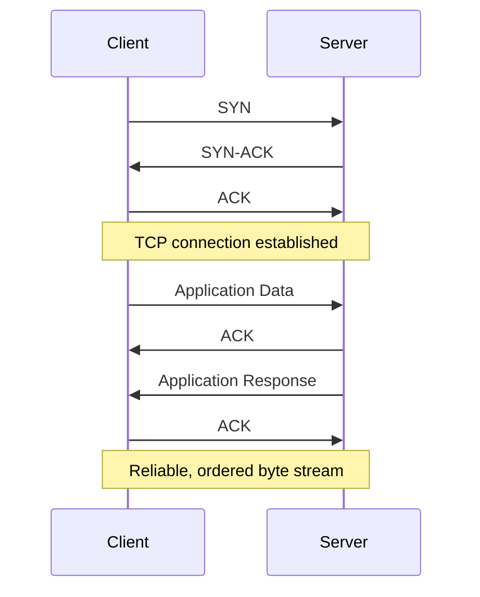
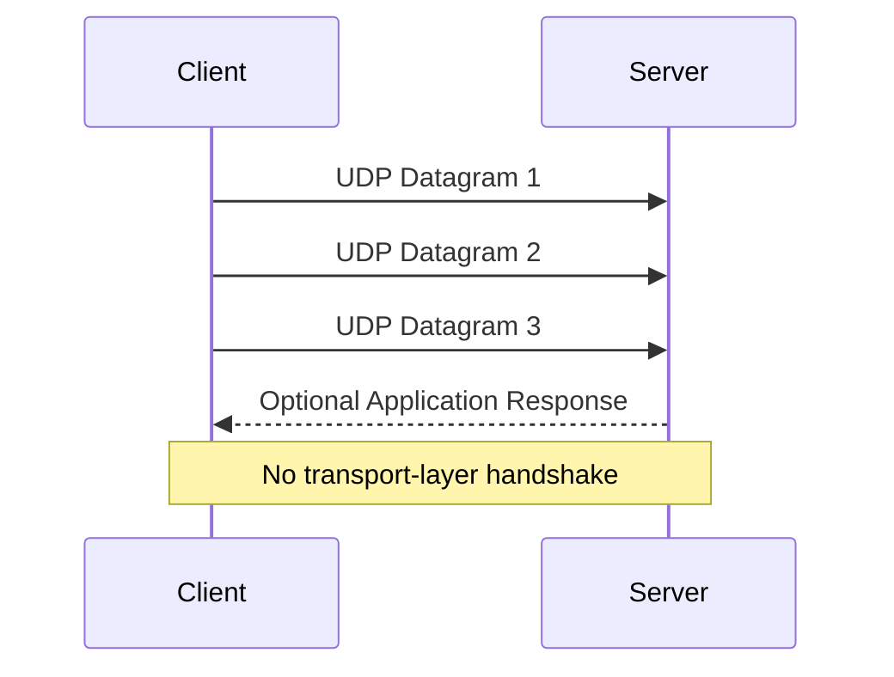
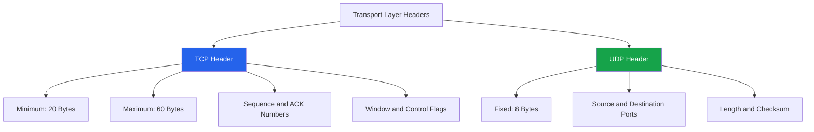
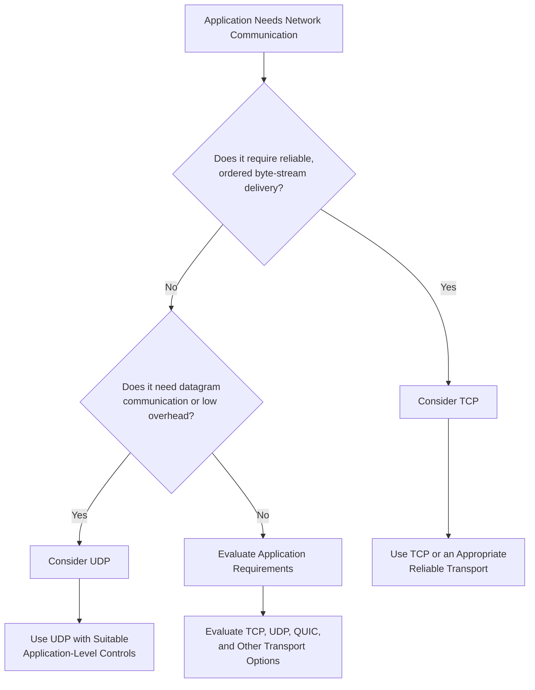

# TCP vs UDP

TCP (Transmission Control Protocol) and UDP (User Datagram Protocol) are the two primary transport-layer protocols used by applications communicating over IP networks.

Both protocols provide process-to-process communication using port numbers, but they differ significantly in how they deliver data.

* **TCP** provides reliable, connection-oriented, ordered byte-stream communication.
* **UDP** provides connectionless, datagram-oriented communication with minimal protocol overhead.

Choosing between TCP and UDP depends on application requirements, including reliability, latency, ordering, congestion control, and data-delivery behavior.

# 🗁 Transport Layer Overview

The transport layer enables communication between applications running on different devices.

It operates above the Internet Protocol (IP) and provides transport services using port numbers.

The two major transport protocols are:

| Feature | TCP | UDP |
| --- | --- | --- |
| Full name | Transmission Control Protocol | User Datagram Protocol |
| Protocol number | 6 | 17 |
| Communication | Connection-oriented | Connectionless |
| Data model | Byte stream | Datagrams |
| Reliability | Built-in | No built-in delivery guarantee |
| Ordering | Preserves byte order | No ordering guarantee |
| Retransmission | Supported | Not provided by UDP itself |
| Flow control | Supported | Not provided by UDP itself |
| Congestion control | Built-in mechanisms | Not provided by UDP itself |
| Header size | Minimum 20 bytes | 8 bytes |
| Handshake | Three-way handshake | No handshake |
| Data boundaries | Not preserved | Preserved |
| Typical overhead | Higher | Lower |

# 🗁 TCP Overview

TCP is a connection-oriented transport protocol that provides reliable, ordered communication between applications.

Before exchanging application data, TCP normally establishes a connection through a three-way handshake.

### 🖆 Key Characteristics

* Connection-oriented communication.
* Reliable, ordered byte-stream delivery.
* Sequence numbers and acknowledgment numbers.
* Retransmission of lost data.
* Flow control using the receiver window.
* Congestion control using the congestion window.
* Error detection using a checksum.
* Full-duplex communication.

### 🖆 TCP Communication Process



### 🖆 TCP Header

A TCP header has a minimum size of 20 bytes and can grow to 60 bytes when options are included.

Important fields include:

| Field | Purpose |
| --- | --- |
| Source Port | Identifies the sending application endpoint |
| Destination Port | Identifies the receiving application endpoint |
| Sequence Number | Identifies the position of data in the byte stream |
| Acknowledgment Number | Indicates the next expected byte |
| Data Offset | Specifies the TCP header length |
| Flags | Control connection and data-transfer behavior |
| Window Size | Advertises the receiver's available window |
| Checksum | Detects corruption in the TCP segment |
| Urgent Pointer | Supports the TCP urgent-data mechanism |
| Options | Supports features such as window scaling and timestamps |

### 🖆 TCP Example

Common applications and protocols that use TCP include:

* HTTP/1.1 and HTTP/2.
* HTTPS over TCP.
* SSH.
* FTP.
* SMTP.
* IMAP.
* POP3.

Note: HTTP/3 uses QUIC over UDP rather than TCP.

# 🗁 UDP Overview

UDP is a connectionless transport protocol that sends independent datagrams between applications.

It does not establish a connection before transmitting data and does not provide built-in retransmission, ordering, or flow control.

### 🖆 Key Characteristics

* Connectionless communication.
* Datagram-oriented data delivery.
* Preserves individual datagram boundaries.
* No built-in delivery guarantee.
* No built-in retransmission.
* No built-in ordering guarantee.
* No built-in flow control.
* No built-in congestion control.
* Small header size.
* Low protocol overhead.

### 🖆 UDP Communication Process



UDP does not require the receiver to acknowledge each datagram.

An application can implement its own acknowledgments, retransmissions, sequencing, or congestion-control mechanisms when required.

### 🖆 UDP Header

A UDP header is only 8 bytes long.

| Field | Purpose |
| --- | --- |
| Source Port | Identifies the sending application endpoint |
| Destination Port | Identifies the receiving application endpoint |
| Length | Specifies the UDP header and payload length |
| Checksum | Detects corruption in the UDP datagram |

### 🖆 UDP Example

Common applications and protocols that use UDP include:

* DNS queries, commonly over UDP.
* DHCP.
* NTP.
* SNMP.
* Real-time voice and video applications.
* Online multiplayer games.
* QUIC and HTTP/3.
* Some VPN and tunneling protocols.

Some of these protocols can also use TCP or other transport mechanisms in particular circumstances.

# 🗁 TCP vs UDP Comparison

### 🖆 Detailed Comparison

| Feature | TCP | UDP |
| --- | --- | --- |
| Connection setup | Required in normal operation | Not required |
| Reliability | Built-in | Application-dependent |
| Data ordering | Guaranteed byte order | Not guaranteed |
| Data boundaries | Stream-based; boundaries are not preserved | Datagram boundaries are preserved |
| Lost data | Retransmitted when necessary | Not retransmitted by UDP |
| Duplicate handling | TCP suppresses duplicate bytes in the delivered stream | Application must handle duplicates if necessary |
| Flow control | Yes | No |
| Congestion control | Yes | No |
| Header size | 20–60 bytes | 8 bytes |
| Communication model | Full-duplex byte stream | Independent datagrams |
| Multicast | Not supported by TCP | Supports IP multicast |
| Broadcast | Not supported by TCP | Can be used with IP broadcast where supported |
| Typical latency overhead | Connection and reliability mechanisms add overhead | Lower transport overhead |
| Typical applications | Web connections, SSH, email | DNS, streaming, gaming, real-time communication |

### 🖆 TCP Header vs UDP Header



# 🗁 Connection Behavior

### 🖆 TCP Connection

TCP establishes a logical connection between two endpoints before normal data transfer.

The connection is established through:

```text
Client                  Server
  |                        |
  |-------- SYN ---------->|
  |<----- SYN-ACK ---------|
  |-------- ACK ---------->|
  |                        |
  |   Connection Ready     |
```

The connection maintains state, including sequence numbers, acknowledgment numbers, and flow-control information.

### 🖆 UDP Communication

UDP does not establish a transport-layer connection.

An application can send a datagram without performing a handshake.

```text
Client                  Server
  |                        |
  |------ Datagram 1 ----->|
  |------ Datagram 2 ----->|
  |------ Datagram 3 ----->|
  |                        |
```

Although UDP is connectionless, operating systems can associate a UDP socket with a particular remote endpoint using `connect()`. This does not create a TCP-style connection or introduce a UDP handshake.

# 🗁 Data Delivery and Reliability

### 🖆 TCP Reliability

TCP uses several mechanisms to provide reliable byte-stream delivery:

* Sequence numbers track transmitted bytes.
* Acknowledgments confirm received data.
* Retransmissions recover lost data.
* Checksums detect corrupted segments.
* Duplicate data is handled by the receiving TCP implementation.
* Flow control prevents overwhelming the receiver.
* Congestion control helps regulate traffic in the network.

Example:

```text
Sender                  Receiver
  |                        |
  |------ Data A --------->|
  |<--------- ACK ---------|
  |                        |
  |------ Data B ----X     |
  |                        |
  |------ Retransmit B --->|
  |<--------- ACK ---------|
```

The receiver's TCP implementation delivers the byte stream in order, even if segments arrive out of order.

### 🖆 UDP Delivery

UDP sends independent datagrams without guaranteeing their delivery.

A datagram may be:

* Delivered successfully.
* Lost during transmission.
* Delivered out of order.
* Duplicated by the network or application path.
* Received after an application has stopped needing it.

Example:

```text
Sender                  Receiver
  |                        |
  |------ Data A --------->|
  |                        |
  |------ Data B ----X     |
  |                        |
  |------ Data C --------->|
  |                        |
  |   Data B is missing    |
```

UDP itself does not recover the missing datagram.

An application can implement reliability when necessary, but that functionality is outside the UDP transport protocol.

# 🗁 Performance and Latency

### 🖆 Why UDP Can Have Lower Overhead

UDP has a smaller header and does not require a connection handshake.

This reduces transport-layer overhead and can be useful for applications that need to send frequent, time-sensitive messages.

However, UDP is not automatically faster in every situation.

Performance also depends on:

* Network congestion.
* Packet loss.
* Application design.
* Packet size.
* Operating-system implementation.
* Network hardware.
* Retransmission and recovery requirements.

### 🖆 TCP Performance Characteristics

TCP provides reliability and congestion control, but these mechanisms can introduce additional latency.

For example:

* A new TCP connection normally requires a three-way handshake.
* Lost segments may need retransmission.
* Ordered delivery can delay application data when earlier bytes are missing.
* Congestion control may reduce the sending rate when congestion is detected.

Modern TCP implementations include optimizations such as connection reuse, TCP Fast Open, and improved congestion-control algorithms.

### 🖆 UDP Performance Characteristics

UDP avoids TCP's transport-level handshake and ordered byte-stream behavior.

This makes it useful when applications prefer timely delivery over guaranteed delivery.

For example, in a live voice call, receiving a slightly delayed audio packet may be less useful than continuing with newer audio.

Nevertheless, UDP applications must still account for network congestion. Applications that send traffic without appropriate congestion control can negatively affect other network users.

# 🗁 Common Use Cases

### 🖆 When TCP Is Used

TCP is suitable when complete and ordered data delivery is important.

| Application | Why TCP Is Used |
| --- | --- |
| SSH | Reliable interactive remote access |
| Email protocols | Reliable transfer of messages |
| File transfer | Complete and ordered file delivery |
| HTTP/1.1 | Reliable web communication |
| HTTP/2 | Multiplexed HTTP streams over TCP |
| Database connections | Reliable communication with database servers |

### 🖆 When UDP Is Used

UDP is suitable when applications need lightweight datagram communication or implement their own transport behavior.

| Application | Why UDP Is Used |
| --- | --- |
| DNS | Lightweight request-response communication |
| DHCP | Client discovery and address configuration |
| NTP | Time synchronization |
| VoIP | Low-latency real-time communication |
| Online gaming | Time-sensitive game-state updates |
| QUIC | Modern secure transport over UDP |
| HTTP/3 | HTTP communication using QUIC |

### 🖆 TCP and UDP in DNS

DNS commonly uses UDP port `53` for ordinary queries and responses.

TCP port `53` is also important for DNS operations, including zone transfers and responses that require TCP fallback.

### 🖆 TCP and UDP in HTTP

| HTTP Version | Transport |
| --- | --- |
| HTTP/1.1 | TCP |
| HTTP/2 | TCP |
| HTTP/3 | QUIC over UDP |

HTTP/3 uses QUIC, which implements reliability, encryption, congestion control, and multiplexed streams above UDP.

This demonstrates an important distinction: UDP does not provide built-in reliability, but an application-layer transport protocol such as QUIC can implement reliability and congestion control over UDP.

# 🗁 Choosing Between TCP and UDP

### 🖆 Use TCP When

* Data must arrive reliably.
* Data must be delivered in order.
* The application needs a continuous byte stream.
* Missing data must be retransmitted.
* The application benefits from TCP's built-in flow and congestion control.

Examples:

* File transfers.
* Remote administration.
* Traditional web communication.
* Email delivery.
* Database connections.

### 🖆 Use UDP When

* The application communicates using independent datagrams.
* Low transport overhead is desirable.
* The application can tolerate some packet loss.
* Timely delivery is more important than retransmitting old data.
* The application needs multicast or broadcast communication.

Examples:

* Real-time voice and video.
* Online multiplayer games.
* DNS queries.
* Network discovery.
* Time synchronization.

### 🖆 Decision Flowchart



# 🗁 Practical Examples

### 🖆 Inspect TCP and UDP Connections

Linux provides the `ss` command to inspect network sockets.

List TCP sockets:

```bash
ss -t
```

List UDP sockets:

```bash
ss -u
```

Show listening TCP sockets:

```bash
ss -tln
```

Show listening UDP sockets:

```bash
ss -uln
```

Show all TCP and UDP sockets:

```bash
ss -tuln
```

Display process information:

```bash
sudo ss -tulpn
```

### 🖆 Capture TCP Traffic

Use `tcpdump` to capture TCP traffic:

```bash
sudo tcpdump -i any tcp
```

Capture traffic on TCP port `443`:

```bash
sudo tcpdump -i any 'tcp port 443'
```

### 🖆 Capture UDP Traffic

Capture UDP traffic:

```bash
sudo tcpdump -i any udp
```

Capture traffic on UDP port `53`:

```bash
sudo tcpdump -i any 'udp port 53'
```

### 🖆 Capture Both TCP and UDP

Capture traffic using either transport protocol:

```bash
sudo tcpdump -i any 'tcp or udp'
```

### 🖆 Wireshark Filters

Useful display filters:

| Filter | Purpose |
| --- | --- |
| `tcp` | Display TCP packets |
| `udp` | Display UDP packets |
| `tcp.port == 443` | Display TCP traffic using port 443 |
| `udp.port == 53` | Display UDP traffic using port 53 |
| `tcp.flags.syn == 1` | Display TCP packets with SYN set |
| `tcp.analysis.retransmission` | Identify TCP retransmissions |
| `udp.length > 100` | Display UDP datagrams longer than 100 bytes |

# 🗁 Common Misconceptions

### 🖆 UDP Is Always Faster Than TCP

Not necessarily.

UDP has lower transport-layer overhead, but actual application performance depends on network conditions and implementation.

### 🖆 UDP Is Unreliable in Every Application

UDP itself does not guarantee reliable delivery.

However, applications can implement acknowledgments, retransmissions, sequencing, and other reliability mechanisms.

QUIC is an important example.

### 🖆 TCP Guarantees Successful Application Processing

TCP confirms transport-layer receipt of bytes by the remote TCP implementation.

It does not guarantee that the receiving application successfully processed or stored the data.

Applications may need their own acknowledgments and transaction mechanisms.

### 🖆 TCP Preserves Application Message Boundaries

TCP provides a byte stream, not individual messages.

If an application sends two separate writes, the receiving application may read their bytes together or in smaller portions.

Applications must implement their own message framing.

### 🖆 UDP Does Not Support Congestion Control

UDP has no built-in congestion-control mechanism.

However, applications using UDP should implement suitable congestion-control behavior when their traffic requires it.

QUIC, for example, provides congestion control above UDP.

### 🖆 UDP Cannot Be Used for Secure Communication

UDP does not provide encryption by itself.

Protocols such as QUIC and DTLS provide security mechanisms over UDP.

# 🗁 Best Practices

* Select a transport protocol based on application requirements rather than assuming one is universally better.
* Use TCP when reliable, ordered byte-stream delivery is required.
* Use UDP when datagram-based communication is appropriate.
* Implement application-level reliability when UDP applications require it.
* Apply congestion control to high-volume UDP applications.
* Avoid unnecessarily large UDP datagrams that may cause IP fragmentation.
* Use QUIC when its multiplexing, security, and transport characteristics fit the application.
* Monitor packet loss, latency, retransmissions, and congestion.
* Use packet-capture tools to understand actual transport behavior.
* Remember that TCP reliability does not replace application-level transaction validation.

# 🗁 Interview Questions

### 🖆 Basic Questions

**What is the main difference between TCP and UDP?**

TCP provides reliable, ordered byte-stream communication, whereas UDP provides connectionless datagram communication without built-in delivery guarantees.

**Which protocol has a smaller header?**

UDP has a fixed 8-byte header. TCP has a minimum 20-byte header.

**Which protocol is connection-oriented?**

TCP is connection-oriented.

**Which protocol is connectionless?**

UDP is connectionless.

**Does UDP guarantee packet delivery?**

No. UDP does not guarantee delivery, ordering, or retransmission.

### 🖆 Intermediate Questions

**Why is TCP used for file transfers?**

File transfers generally require complete and ordered data delivery. TCP provides retransmission, acknowledgments, and ordered byte-stream delivery.

**Why is UDP commonly used for real-time communication?**

Real-time applications often prioritize timely delivery over retransmitting delayed data.

**Can UDP provide reliable communication?**

Yes. An application or higher-level protocol can implement reliability mechanisms over UDP. QUIC is an example.

**Can TCP use multicast or broadcast?**

TCP does not support IP multicast or broadcast communication. UDP can be used with both where the network and application support them.

**Does TCP preserve message boundaries?**

No. TCP is a byte-stream protocol. Applications must implement their own message framing.

### 🖆 Advanced Questions

**Why does HTTP/3 use UDP instead of TCP?**

HTTP/3 uses QUIC over UDP. QUIC provides secure, reliable, multiplexed streams and avoids TCP-level head-of-line blocking between independent streams.

**What happens when a UDP datagram is lost?**

UDP itself does not retransmit it. The application may ignore the loss or implement its own recovery mechanism.

**What is the difference between TCP flow control and congestion control?**

Flow control protects the receiver from being overwhelmed. Congestion control protects the network from excessive traffic.

**Can TCP and UDP use the same port number?**

Yes. TCP and UDP have separate port namespaces, so both can use the same numeric port simultaneously.

# 🗁 Summary

TCP and UDP are fundamental transport-layer protocols used for communication between applications over IP networks.

**TCP:**

* Connection-oriented.
* Reliable and ordered byte-stream delivery.
* Uses acknowledgments and retransmissions.
* Provides flow control and congestion control.
* Has a minimum 20-byte header.

**UDP:**

* Connectionless.
* Datagram-oriented communication.
* No built-in delivery or ordering guarantees.
* No built-in retransmission, flow control, or congestion control.
* Has a fixed 8-byte header.

The correct choice depends on application requirements. TCP is appropriate when reliable ordered delivery is essential, while UDP is useful for lightweight datagram communication and applications that need control over their own transport behavior.

# 🗁 References

* [RFC 9293 — Transmission Control Protocol (TCP)](https://www.rfc-editor.org/rfc/rfc9293)
* [RFC 768 — User Datagram Protocol (UDP)](https://www.rfc-editor.org/rfc/rfc768)
* [RFC 9000 — QUIC: A UDP-Based Multiplexed and Secure Transport](https://www.rfc-editor.org/rfc/rfc9000)
* [RFC 9114 — HTTP/3](https://www.rfc-editor.org/rfc/rfc9114)
* [RFC 8085 — UDP Usage Guidelines](https://www.rfc-editor.org/rfc/rfc8085)
* [Linux `ss` Manual](https://man7.org/linux/man-pages/man8/ss.8.html)
* [TCP — Wireshark Documentation](https://wiki.wireshark.org/TCP)
* [UDP — Wireshark Documentation](https://wiki.wireshark.org/UDP)
