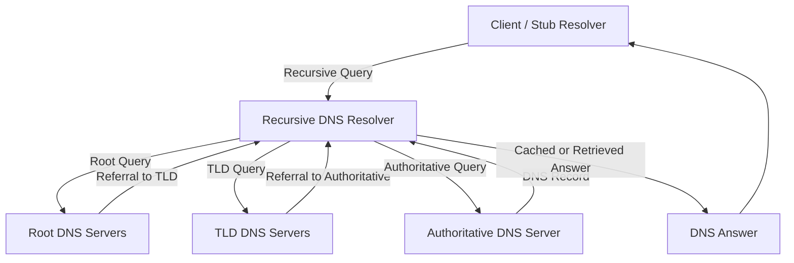
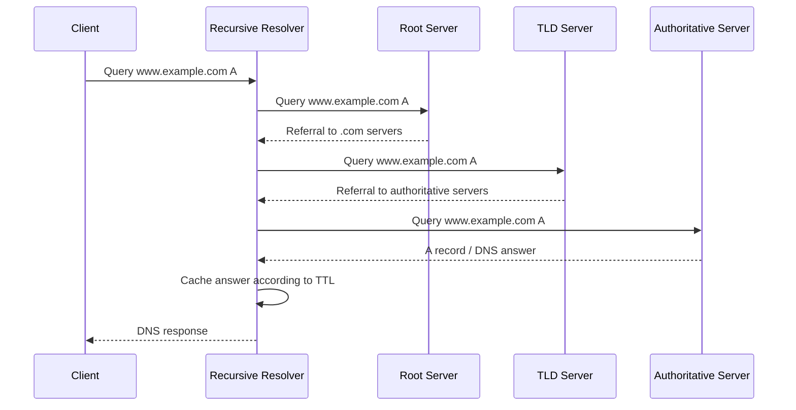
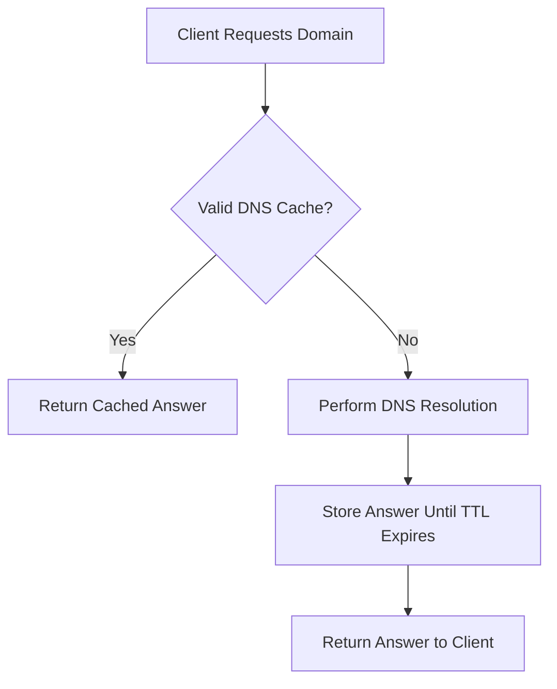
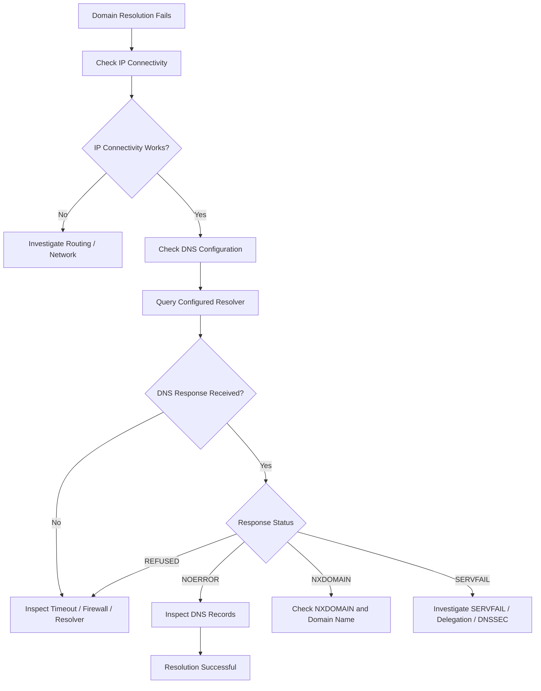

# Domain Name System (DNS)

DNS (Domain Name System) is a distributed, hierarchical naming system that translates human-readable domain names into IP addresses.

Computers communicate across IP networks using IP addresses, but humans generally prefer memorable domain names.

For example:

```text
Domain Name: example.com
IPv4 Address: 93.184.216.34
```

Instead of remembering an IP address, users can access a service using its domain name.

DNS makes this possible by providing a system for storing, querying, and distributing domain-related information.

DNS is an essential component of the internet and is used by web browsers, email systems, applications, and network infrastructure.

# 🗁 What Is DNS?

DNS stands for Domain Name System.

It is a distributed database that stores information associated with domain names.

Its most familiar function is resolving domain names into IP addresses.

Example:

```text
www.example.com
       |
       | DNS Query
       v
DNS Resolver
       |
       | DNS Response
       v
93.184.216.34
```

When a browser accesses `www.example.com`, it needs an IP address to establish communication with the destination server.

DNS provides the necessary address information.

### 🖆 DNS Is More Than Name-to-IP Translation

DNS can store several types of information, including:

* IPv4 addresses.
* IPv6 addresses.
* Mail server information.
* Name server information.
* Domain aliases.
* Service discovery information.
* Domain ownership verification data.
* Cryptographic information for DNSSEC.

### 🖆 DNS Terminology

| Term | Description |
| --- | --- |
| Domain Name | A human-readable name in the DNS namespace |
| DNS Resolver | Software that obtains DNS answers for clients |
| Recursive Resolver | A resolver that performs resolution on behalf of a client |
| Authoritative DNS Server | A server that provides authoritative information for a DNS zone |
| DNS Query | A request for DNS information |
| DNS Response | A reply containing DNS information or an error |
| Resource Record | An individual DNS data entry |
| DNS Zone | An administratively managed portion of the DNS namespace |
| TTL | Time To Live; controls how long a DNS record may be cached |
| FQDN | Fully Qualified Domain Name |

# 🗁 Why DNS Is Needed

IP addresses are necessary for network communication, but they are difficult for humans to remember and manage.

Imagine accessing websites using IP addresses:

```text
https://93.184.216.34
https://142.250.190.14
https://151.101.1.69
```

Remembering addresses for every service would be inconvenient.

DNS provides a naming system:

```text
example.com
google.com
github.com
```

### 🖆 Benefits of DNS

* Human-readable domain names.
* Flexible server address management.
* Support for multiple records and services.
* Distributed and hierarchical administration.
* Caching to reduce repeated queries.
* Support for redundancy and load distribution.
* Service discovery through specialized records.

### 🖆 DNS and Web Browsing

A simplified web browsing process:

```text
Browser
   |
   | User enters example.com
   v
DNS Resolution
   |
   | Returns an IP address
   v
TCP / QUIC Connection
   |
   v
TLS Security (when applicable)
   |
   v
HTTP Communication
   |
   v
Webpage
```

DNS resolution normally happens before the client can establish a connection to the destination IP address.

However, browsers and operating systems may reuse cached DNS results, and modern connection mechanisms can change the exact sequence.

# 🗁 DNS Architecture

DNS uses a distributed hierarchical architecture.

No single DNS server contains every DNS record on the internet.

Instead, responsibility is distributed across different levels of the DNS hierarchy.

### 🖆 Main DNS Components

**DNS Client / Stub Resolver**

The DNS client component runs on a user's device or application.

It sends DNS queries to a configured recursive resolver.

**Recursive DNS Resolver**

A recursive resolver obtains DNS answers on behalf of clients.

It may retrieve information from its cache or contact other DNS servers.

**Root DNS Server**

Root servers provide referrals to the appropriate top-level domain servers.

**Top-Level Domain Server**

A TLD server provides referrals to authoritative name servers responsible for domains under a particular top-level domain.

**Authoritative DNS Server**

An authoritative server stores DNS records for a zone and provides authoritative answers for that zone.

### 🖆 DNS Architecture Diagram



# 🗁 DNS Hierarchy

DNS follows a hierarchical namespace structure.

The hierarchy starts at the root and extends through top-level domains, second-level domains, and subdomains.

Example:

```text
www.example.com.
```

Its hierarchy is:

```text
.                   Root
|
+-- com             Top-Level Domain
    |
    +-- example     Second-Level Domain
        |
        +-- www     Subdomain / Host Name
```

### 🖆 Root Domain

The root domain is represented by a dot (`.`).

It is the highest level of the DNS hierarchy.

Root DNS servers direct resolvers toward the appropriate TLD name servers.

### 🖆 Top-Level Domain (TLD)

A TLD is the domain immediately below the DNS root.

Examples:

| TLD | Description |
| --- | --- |
| `.com` | Commercial and general-purpose domain |
| `.org` | Originally intended for organizations |
| `.net` | Originally intended for network-related entities |
| `.edu` | Educational institutions, primarily in the United States |
| `.gov` | United States government entities |
| `.bd` | Bangladesh country-code TLD |
| `.uk` | United Kingdom country-code TLD |
| `.io` | Country-code TLD commonly used by technology companies |

TLDs can be generic, country-code, or other categories managed under the DNS root.

### 🖆 Second-Level Domain

A second-level domain is directly below a TLD.

Example:

```text
example.com
```

Here:

* `com` is the TLD.
* `example` is the second-level domain.

### 🖆 Subdomain

A subdomain is a domain located below another domain.

Examples:

```text
www.example.com
api.example.com
mail.example.com
blog.example.com
```

Subdomains can be used to organize different applications and services.

### 🖆 Fully Qualified Domain Name (FQDN)

An FQDN identifies a complete name within the DNS hierarchy.

Example:

```text
www.example.com.
```

The final dot represents the DNS root.

In everyday usage, the trailing dot is commonly omitted:

```text
www.example.com
```

# 🗁 DNS Resolution Process

DNS resolution is the process of obtaining DNS information for a domain name.

Consider a user accessing:

```text
www.example.com
```

Assume the required DNS answer is not already cached.

### 🖆 Step-by-Step Resolution

**Client Requests DNS Resolution**

The browser or operating system needs the IP address associated with the domain.

**Local DNS Cache Check**

The system checks whether a valid DNS answer is already available in its cache.

**Stub Resolver Sends Query**

If no suitable cached answer exists, the stub resolver sends a query to its configured recursive resolver.

**Recursive Resolver Checks Cache**

The recursive resolver checks its own cache.

If a valid answer exists, it can immediately return the result.

**Root Server Lookup**

If further resolution is required, the recursive resolver queries a root DNS server.

The root server responds with a referral to the appropriate TLD name servers.

**TLD Server Lookup**

The resolver queries a TLD server.

The TLD server provides a referral to the authoritative name servers for the requested domain.

**Authoritative Server Lookup**

The resolver queries an authoritative DNS server for the requested record.

**DNS Response**

The authoritative server returns the requested record or an appropriate DNS response.

**Recursive Resolver Returns Answer**

The recursive resolver caches the result according to its TTL and sends the answer to the client.

**Client Uses the IP Address**

The application can now attempt to communicate with the destination server.

### 🖆 Complete DNS Resolution Diagram



### 🖆 Important Notes

* A recursive resolver does not necessarily contact every DNS hierarchy level for every query.
* Cached answers can eliminate the need for additional DNS lookups.
* A resolver can use cached referrals and other DNS information.
* Authoritative servers can return multiple records.
* DNS resolution can return an error instead of an IP address.
* A domain can resolve to multiple IP addresses.

# 🗁 Recursive and Iterative Queries

DNS supports different query behaviors.

Understanding the difference between recursive and iterative queries is important for understanding DNS resolution.

### 🖆 Recursive Query

In a recursive query, the client asks a DNS resolver to obtain a final answer or an error response.

The resolver takes responsibility for finding the answer.

Example:

```text
Client
   |
   | Recursive Query
   v
Recursive Resolver
   |
   | Finds DNS Information
   v
Client Receives Final Answer
```

A typical client sends a recursive query to its configured DNS resolver.

### 🖆 Iterative Query

In an iterative query, a DNS server can return the best information it currently has, commonly a referral to another DNS server.

The querying resolver follows the referral and continues the resolution process.

Example:

```text
Recursive Resolver
       |
       | Query Root Server
       v
Root Server
       |
       | Referral to TLD
       v
Recursive Resolver
       |
       | Query TLD Server
       v
TLD Server
       |
       | Referral to Authoritative Server
       v
Recursive Resolver
       |
       | Query Authoritative Server
       v
Authoritative DNS Server
```

### 🖆 Comparison

| Feature | Recursive Query | Iterative Query |
| --- | --- | --- |
| Responsibility | Resolver obtains the answer | Querying resolver follows referrals |
| Typical requester | Client / stub resolver | Recursive resolver |
| Response | Final answer or error | Answer, referral, or other response |
| Query process | Resolver performs resolution | Requester continues with referred servers |

# 🗁 DNS Record Types

DNS stores information using Resource Records (RRs).

Each record has a name, type, class, TTL, and associated record data.

The most common DNS record types are A, AAAA, CNAME, MX, NS, PTR, SOA, TXT, SRV, and CAA.

### 🖆 A Record

An A record maps a domain name to an IPv4 address.

Example:

```dns
example.com.    IN    A    93.184.216.34
```

Purpose:

* IPv4 address resolution.
* Directing clients to IPv4-enabled services.

### 🖆 AAAA Record

An AAAA record maps a domain name to an IPv6 address.

Example:

```dns
example.com.    IN    AAAA    2606:2800:220:1:248:1893:25c8:1946
```

Purpose:

* IPv6 address resolution.
* Supporting IPv6-enabled applications and services.

### 🖆 CNAME Record

A CNAME record creates an alias from one DNS name to another canonical DNS name.

Example:

```dns
www.example.com.    IN    CNAME    example.com.
```

This means `www.example.com` is an alias of `example.com`.

Important considerations:

* A CNAME points to another domain name, not directly to an IP address.
* A CNAME owner name cannot coexist with other ordinary data records at the same name.
* A CNAME is generally not allowed at a zone apex where records such as SOA and NS must exist.

### 🖆 MX Record

An MX record identifies mail servers responsible for receiving email for a domain.

Example:

```dns
example.com.    IN    MX    10 mail.example.com.
```

The number `10` represents the mail exchanger preference.

Lower preference values are preferred.

A domain can publish multiple MX records for redundancy or mail-routing preference.

### 🖆 NS Record

An NS record identifies authoritative name servers for a DNS zone.

Example:

```dns
example.com.    IN    NS    ns1.example.net.
example.com.    IN    NS    ns2.example.net.
```

These records identify name servers responsible for the domain's DNS zone.

### 🖆 PTR Record

A PTR record maps an IP address to a domain name.

It is commonly used for reverse DNS lookup.

Example:

```dns
34.216.184.93.in-addr.arpa.    IN    PTR    example.com.
```

### 🖆 SOA Record

SOA stands for Start of Authority.

It contains important administrative information about a DNS zone.

Example:

```dns
example.com. IN SOA ns1.example.com. admin.example.com. (
    2026110901
    3600
    1800
    1209600
    300
)
```

Important fields:

| Field | Description |
| --- | --- |
| Primary Name Server | Primary authoritative server listed in the SOA record |
| Responsible Person | Administrative contact represented using DNS name syntax |
| Serial | Zone version identifier |
| Refresh | Secondary server refresh interval |
| Retry | Retry interval after a failed refresh |
| Expire | Time after which a secondary server should stop serving the zone if it cannot refresh it |
| Minimum | Historically the minimum TTL; commonly used as the negative caching TTL |

The SOA serial is commonly incremented whenever a zone is updated.

### 🖆 TXT Record

TXT records store text associated with a domain.

Example:

```dns
example.com.    IN    TXT    "v=spf1 include:_spf.example.net -all"
```

Common uses:

* SPF email authentication policies.
* Domain ownership verification.
* DKIM-related public key publication.
* DMARC policies.
* Service configuration and verification.

Some email authentication records use specialized DNS names and TXT record conventions.

### 🖆 SRV Record

An SRV record identifies the host and port of a service.

Example:

```dns
_service._tcp.example.com. IN SRV 10 5 5060 sip.example.com.
```

Fields:

| Field | Value | Description |
| --- | ---: | --- |
| Priority | 10 | Lower values are preferred |
| Weight | 5 | Relative selection weight among records with equal priority |
| Port | 5060 | Service port |
| Target | sip.example.com | Host providing the service |

### 🖆 CAA Record

A CAA record specifies which certificate authorities are authorized to issue certificates for a domain.

Example:

```dns
example.com. IN CAA 0 issue "letsencrypt.org"
```

CAA records help domain owners express certificate issuance policies.

### 🖆 Common DNS Record Summary

| Record | Purpose | Example Data |
| --- | --- | --- |
| A | IPv4 address | `93.184.216.34` |
| AAAA | IPv6 address | `2606:2800:220:1:248:1893:25c8:1946` |
| CNAME | Alias | `example.com.` |
| MX | Mail server | `10 mail.example.com.` |
| NS | Name server | `ns1.example.net.` |
| PTR | Reverse lookup | `example.com.` |
| SOA | Zone authority information | Serial and timing values |
| TXT | Text information | SPF or verification data |
| SRV | Service discovery | Priority, weight, port, target |
| CAA | Certificate authority policy | `issue "letsencrypt.org"` |

# 🗁 DNS Zones and Zone Files

A DNS zone is an administratively managed portion of the DNS namespace.

An authoritative DNS server stores and serves DNS records for one or more zones.

For example:

```text
example.com
    |
    +-- example.com
    +-- www.example.com
    +-- mail.example.com
    +-- api.example.com
```

A zone does not necessarily contain every possible subdomain beneath its domain name. A delegated subdomain can be managed as a separate zone.

### 🖆 Zone File

A zone file is a text-based representation of DNS records used by authoritative DNS software.

Example:

```dns
$TTL 3600

@   IN  SOA ns1.example.com. admin.example.com. (
        2026110901
        3600
        1800
        1209600
        300
)

@       IN  NS      ns1.example.com.
@       IN  NS      ns2.example.com.

@       IN  A       93.184.216.34
www     IN  CNAME   example.com.
mail    IN  A       192.0.2.10

@       IN  MX 10   mail.example.com.
```

In this example:

* `$TTL` defines the default TTL for records without an explicitly specified TTL.
* `@` represents the current zone origin.
* `SOA` defines the zone's authority information.
* `NS` identifies authoritative name servers.
* `A` maps names to IPv4 addresses.
* `CNAME` creates an alias.
* `MX` identifies the mail exchanger.

### 🖆 Primary and Secondary DNS Servers

A zone can be served by multiple authoritative DNS servers.

**Primary Server**

The primary server maintains the authoritative writable version of the zone in a traditional primary-secondary setup.

**Secondary Server**

A secondary server obtains zone data from the primary through zone transfer mechanisms.

Common DNS zone transfer types:

* AXFR — Full zone transfer.
* IXFR — Incremental zone transfer.

Secondary servers improve availability and distribute authoritative DNS service across multiple systems.

# 🗁 DNS Caching and TTL

DNS caching stores DNS responses temporarily to reduce repeated queries.

Instead of querying authoritative DNS servers for every request, a resolver can reuse a previously obtained answer while it remains valid.

### 🖆 What Is TTL?

TTL stands for Time To Live.

It specifies how long a DNS record may be cached.

TTL is expressed in seconds.

Example:

```dns
example.com.    3600    IN    A    93.184.216.34
```

Here:

```text
TTL = 3600 seconds
    = 60 minutes
    = 1 hour
```

After the TTL expires, a caching resolver must obtain fresh information before continuing to use that cached record.

### 🖆 DNS Caching Process



### 🖆 Benefits of DNS Caching

* Reduces DNS query traffic.
* Improves response time.
* Reduces load on authoritative servers.
* Improves overall resolution efficiency.

### 🖆 Negative Caching

DNS can also cache certain negative responses.

For example, if a queried domain name does not exist, a resolver may temporarily cache the NXDOMAIN response.

The negative caching behavior is controlled by DNS standards and relevant SOA information.

### 🖆 DNS Cache Inspection and Flushing on Ubuntu

Ubuntu systems using `systemd-resolved` can inspect DNS cache statistics:

```bash
resolvectl statistics
```

Flush the local DNS cache:

```bash
sudo resolvectl flush-caches
```

Check resolver status:

```bash
resolvectl status
```

These commands apply when `systemd-resolved` is managing DNS resolution.

# 🗁 Forward and Reverse DNS

DNS supports both forward and reverse lookup operations.

### 🖆 Forward DNS Lookup

A forward lookup resolves a domain name into an IP address.

Example:

```text
example.com
     |
     v
93.184.216.34
```

Common record types:

* A — IPv4 address.
* AAAA — IPv6 address.

Command:

```bash
dig example.com A
```

IPv6 lookup:

```bash
dig example.com AAAA
```

### 🖆 Reverse DNS Lookup

A reverse lookup resolves an IP address into a domain name using a PTR record.

For IPv4, reverse DNS uses the special `in-addr.arpa` namespace.

For IPv6, reverse DNS uses the `ip6.arpa` namespace.

Example:

```text
93.184.216.34
       |
       v
34.216.184.93.in-addr.arpa
       |
       v
PTR Record
       |
       v
example.com
```

Command:

```bash
dig -x 93.184.216.34
```

Reverse lookup for IPv6:

```bash
dig -x 2606:2800:220:1:248:1893:25c8:1946
```

### 🖆 Forward-Confirmed Reverse DNS

A successful reverse lookup does not automatically prove that the returned domain name actually resolves back to the original IP address.

Forward-confirmed reverse DNS checks both directions:

* Reverse lookup: IP address to domain name.
* Forward lookup: domain name back to the original IP address.

This is particularly relevant to mail-server configuration and diagnostics.

# 🗁 DNS Transport Protocols and Ports

DNS primarily uses UDP and TCP on port `53`.

### 🖆 DNS over UDP

UDP is commonly used for ordinary DNS queries and responses.

Advantages:

* Low transport overhead.
* No connection handshake.
* Suitable for short request-response exchanges.

A DNS message over UDP traditionally has a maximum size of 512 bytes unless extensions such as EDNS(0) are used.

### 🖆 DNS over TCP

TCP is also an essential DNS transport.

It is commonly used for:

* Zone transfers.
* Responses requiring TCP fallback.
* DNS implementations and operations that use TCP for other supported cases.

DNS over TCP uses port `53`.

### 🖆 EDNS(0)

EDNS(0) extends DNS capabilities without changing the original DNS message header format.

It allows DNS implementations to advertise larger UDP message sizes and supports additional DNS features.

It is especially important for DNSSEC responses.

### 🖆 DNS over TLS (DoT)

DNS over TLS encrypts DNS communication using TLS.

The standard port is:

```text
TCP 853
```

It protects DNS queries from being read or modified by parties observing the connection.

### 🖆 DNS over HTTPS (DoH)

DNS over HTTPS carries DNS messages over HTTPS.

The standard service uses:

```text
TCP 443
```

It can also operate over HTTP/3 using QUIC over UDP.

DoH integrates DNS queries into encrypted HTTPS communication.

### 🖆 DNS Transport Comparison

| DNS Transport | Default Port | Description |
| --- | ---: | --- |
| DNS over UDP | 53 | Traditional DNS queries |
| DNS over TCP | 53 | DNS over a reliable TCP connection |
| DNS over TLS | 853 | DNS encrypted using TLS |
| DNS over HTTPS | 443 | DNS messages carried over HTTPS |

# 🗁 DNS Configuration on Ubuntu

Ubuntu commonly uses `systemd-resolved` to manage local DNS resolution.

### 🖆 Check DNS Configuration

```bash
resolvectl status
```

This displays information such as:

* Configured DNS servers.
* DNS search domains.
* Per-interface DNS settings.
* DNS routing domains.

### 🖆 Inspect resolv.conf

```bash
cat /etc/resolv.conf
```

On many Ubuntu installations, this file is a symbolic link managed by `systemd-resolved`.

Check the link:

```bash
ls -l /etc/resolv.conf
```

### 🖆 Configure DNS Using Netplan

Netplan is commonly used to configure network settings on Ubuntu servers.

Example configuration:

```yaml
network:
  version: 2
  ethernets:
    enp0s3:
      dhcp4: true
      nameservers:
        addresses:
          - 1.1.1.1
          - 8.8.8.8
```

Apply the configuration:

```bash
sudo netplan try
```

If the configuration is correct, apply it permanently:

```bash
sudo netplan apply
```

Replace `enp0s3` with the actual interface name on your system.

When DHCP provides DNS configuration, Netplan and the active network-management configuration determine whether those DNS settings are accepted or overridden.

### 🖆 Common Public DNS Resolvers

| Provider | IPv4 Address | IPv6 Address |
| --- | --- | --- |
| Google Public DNS | `8.8.8.8`, `8.8.4.4` | `2001:4860:4860::8888`, `2001:4860:4860::8844` |
| Cloudflare DNS | `1.1.1.1`, `1.0.0.1` | `2606:4700:4700::1111`, `2606:4700:4700::1001` |
| Quad9 | `9.9.9.9`, `149.112.112.112` | `2620:fe::fe`, `2620:fe::9` |

These are public recursive DNS resolver services.

# 🗁 DNS Commands on Linux

Linux provides several tools for DNS testing and troubleshooting.

### 🖆 dig

`dig` is a command-line DNS lookup utility.

Install it on Ubuntu:

```bash
sudo apt update
sudo apt install dnsutils
```

Basic DNS lookup:

```bash
dig example.com
```

Query an A record:

```bash
dig example.com A
```

Query an AAAA record:

```bash
dig example.com AAAA
```

Query an MX record:

```bash
dig example.com MX
```

Query an NS record:

```bash
dig example.com NS
```

Query a TXT record:

```bash
dig example.com TXT
```

Query a specific DNS resolver:

```bash
dig @1.1.1.1 example.com
```

Perform a reverse lookup:

```bash
dig -x 8.8.8.8
```

Display a concise answer:

```bash
dig +short example.com
```

Trace DNS resolution through the hierarchy:

```bash
dig +trace example.com
```

### 🖆 nslookup

`nslookup` is another DNS lookup utility.

Basic lookup:

```bash
nslookup example.com
```

Query a specific DNS server:

```bash
nslookup example.com 8.8.8.8
```

Query an MX record:

```bash
nslookup -type=MX example.com
```

### 🖆 host

The `host` command provides straightforward DNS lookup functionality.

```bash
host example.com
```

Query MX records:

```bash
host -t MX example.com
```

Reverse lookup:

```bash
host 8.8.8.8
```

### 🖆 getent

`getent` queries the system's configured name-service resolution mechanism.

```bash
getent hosts example.com
```

Unlike `dig`, it follows the system's configured Name Service Switch behavior, which can include sources such as `/etc/hosts` and DNS.

### 🖆 tcpdump

Capture DNS traffic:

```bash
sudo tcpdump -i any port 53
```

Capture only UDP DNS traffic:

```bash
sudo tcpdump -i any udp port 53
```

Capture TCP DNS traffic:

```bash
sudo tcpdump -i any tcp port 53
```

# 🗁 DNS Troubleshooting

DNS problems can prevent applications from reaching services even when the underlying network connection is working.

### 🖆 Common DNS Problems

| Problem | Possible Cause |
| --- | --- |
| Domain does not resolve | Missing or incorrect DNS records |
| NXDOMAIN | Requested domain name does not exist |
| SERVFAIL | Resolver or authoritative DNS processing failure |
| DNS timeout | Resolver unreachable or DNS traffic filtered |
| Incorrect IP returned | Stale cache or incorrect DNS configuration |
| Intermittent resolution | Unstable resolver or inconsistent authoritative responses |
| Reverse lookup failure | Missing or incorrect PTR record |
| DNS works on one device only | Different DNS configuration or local cache |

### 🖆 Step-by-Step Troubleshooting

**Check Basic Connectivity**

```bash
ping -c 4 1.1.1.1
```

This tests basic IP connectivity to the destination.

**Check Local DNS Configuration**

```bash
resolvectl status
```

Verify that the correct DNS servers are configured.

**Test DNS Resolution**

```bash
dig example.com
```

**Query a Different Resolver**

```bash
dig @1.1.1.1 example.com
```

**Check the Answer Status**

Look at the DNS response status:

* `NOERROR`: The DNS query completed successfully.
* `NXDOMAIN`: The requested domain name does not exist.
* `SERVFAIL`: The server could not successfully process the query.
* `REFUSED`: The server refused to answer the query.

**Inspect DNS Traffic**

```bash
sudo tcpdump -i any port 53
```

This helps determine whether DNS requests and responses are visible on the local network interface.

**Check Local DNS Cache**

```bash
resolvectl statistics
```

Flush the cache if necessary:

```bash
sudo resolvectl flush-caches
```

### 🖆 DNS Troubleshooting Decision Flow



# 🗁 DNS Security

DNS is a critical internet infrastructure service, so its security is important.

Traditional DNS does not inherently provide confidentiality or cryptographic authentication of DNS responses.

### 🖆 DNS Spoofing

DNS spoofing occurs when an attacker causes a client or resolver to receive false DNS information.

Example:

```text
User Requests:
    bank.example

Expected IP:
    203.0.113.10

Forged DNS Response:
    198.51.100.20
```

The user may be directed to an unintended destination.

### 🖆 DNS Cache Poisoning

DNS cache poisoning occurs when false DNS information is inserted into a resolver's cache.

Other clients using that resolver may receive the incorrect information until the cached entry expires or is removed.

### 🖆 DNS Amplification Attack

DNS amplification is a type of distributed denial-of-service attack.

Attackers send small DNS queries using a spoofed victim source IP address.

DNS servers then send larger responses to the victim.

This can amplify the volume of traffic directed at the target.

### 🖆 DNSSEC

DNSSEC stands for Domain Name System Security Extensions.

It provides cryptographic authentication of DNS data using digital signatures.

DNSSEC helps resolvers verify that DNS data is authentic and has not been modified.

Important DNSSEC record types include:

| Record | Purpose |
| --- | --- |
| DNSKEY | Publishes DNSSEC public keys |
| RRSIG | Contains digital signatures for DNS record sets |
| DS | Establishes a delegation chain of trust |
| NSEC | Provides authenticated proof of nonexistence |
| NSEC3 | Provides hashed authenticated denial of existence |

DNSSEC provides data-origin authentication and integrity protection, but it does not encrypt DNS queries.

### 🖆 DNS over TLS and DNS over HTTPS

DoT and DoH encrypt DNS communication between the client and its configured resolver.

They help prevent intermediaries from directly observing or modifying DNS messages in transit.

However, encrypted DNS transport and DNSSEC solve different security problems:

| Technology | Primary Purpose |
| --- | --- |
| DNSSEC | Authenticity and integrity of DNS data |
| DNS over TLS | Encryption of DNS transport |
| DNS over HTTPS | Encryption of DNS transport using HTTPS |

### 🖆 DNS Security Best Practices

* Use trusted recursive DNS resolvers.
* Keep DNS server software updated.
* Restrict recursive DNS service to authorized clients where appropriate.
* Use DNSSEC validation.
* Protect authoritative DNS infrastructure.
* Restrict and authenticate zone transfers.
* Use encrypted DNS transport where appropriate.
* Monitor unusual DNS traffic and query patterns.
* Implement response-rate limiting on authoritative servers.
* Protect domain registrar and DNS management accounts with strong authentication.

# 🗁 Practical Exercises

### 🖆 Exercise: Basic DNS Lookup

Use `dig` to find the IPv4 address of:

```text
example.com
```

Command:

```bash
dig example.com A
```

Identify:

* The DNS server queried.
* The response status.
* The answer section.
* The returned IP address.
* The TTL value.

### 🖆 Exercise: Query Different Record Types

Run these commands:

```bash
dig example.com A
dig example.com AAAA
dig example.com MX
dig example.com NS
dig example.com TXT
```

Compare the returned records.

### 🖆 Exercise: Use a Public Resolver

Query Google Public DNS:

```bash
dig @8.8.8.8 example.com
```

Query Cloudflare DNS:

```bash
dig @1.1.1.1 example.com
```

Compare the results and response times.

### 🖆 Exercise: Trace DNS Resolution

```bash
dig +trace example.com
```

Identify:

* Root DNS servers.
* TLD DNS servers.
* Authoritative DNS servers.

### 🖆 Exercise: Reverse DNS Lookup

```bash
dig -x 8.8.8.8
```

Identify the returned PTR record, if one exists.

### 🖆 Exercise: Inspect DNS Traffic

Start a packet capture:

```bash
sudo tcpdump -i any -n port 53
```

In another terminal, run:

```bash
dig example.com
```

Observe the DNS query and response packets.

### 🖆 Exercise: Investigate DNS Caching

Check resolver statistics:

```bash
resolvectl statistics
```

Perform a DNS query:

```bash
dig example.com
```

Run the query again and compare the results.

Remember that `dig` normally sends a new query to its configured server; caching behavior is generally observed at the recursive resolver, not necessarily through the local application cache.

# 🗁 Interview Questions

### 🖆 Basic Questions

**What is DNS?**

DNS is a distributed hierarchical naming system that translates domain names into DNS records, commonly including IP addresses.

**Why is DNS important?**

It allows users and applications to access network services using domain names instead of memorizing IP addresses.

**What port does DNS use?**

DNS primarily uses UDP and TCP port `53`.

**What is an A record?**

An A record maps a domain name to an IPv4 address.

**What is an AAAA record?**

An AAAA record maps a domain name to an IPv6 address.

**What is a CNAME record?**

A CNAME record creates an alias from one DNS name to another canonical DNS name.

**What is an MX record?**

An MX record identifies the mail servers responsible for receiving email for a domain.

### 🖆 Intermediate Questions

**What is the difference between recursive and authoritative DNS servers?**

A recursive resolver obtains DNS answers on behalf of clients, while an authoritative server provides DNS information for zones it serves.

**What is DNS TTL?**

TTL specifies how long a DNS record may be cached.

**What is the difference between forward and reverse DNS lookup?**

Forward lookup resolves a domain name into DNS address records. Reverse lookup resolves an IP address into a domain name using a PTR record.

**Why does DNS use both UDP and TCP?**

UDP is commonly used for ordinary queries, while TCP is used for zone transfers, fallback, and other DNS operations requiring TCP.

**What is a DNS zone?**

A DNS zone is an administratively managed portion of the DNS namespace.

**What is the difference between a primary and secondary DNS server?**

In a traditional primary-secondary arrangement, the primary maintains the writable zone data, while secondary servers obtain zone copies through zone transfers.

### 🖆 Advanced Questions

**What happens when a recursive DNS resolver already has a cached answer?**

It can return the cached answer without querying root, TLD, or authoritative DNS servers, provided the cached information remains valid.

**What is DNSSEC?**

DNSSEC is a set of DNS extensions that uses cryptographic signatures to authenticate DNS data and protect its integrity.

**Does DNSSEC encrypt DNS traffic?**

No. DNSSEC authenticates DNS data but does not provide transport encryption.

**What is the difference between DoT and DoH?**

DoT carries DNS messages over TLS, commonly using TCP port `853`. DoH carries DNS messages over HTTPS, commonly using port `443`.

**What is DNS cache poisoning?**

It is an attack in which false DNS information is inserted into a resolver's cache, potentially causing clients to receive incorrect DNS answers.

**What is the purpose of an SOA record?**

It provides administrative and operational information about a DNS zone, including its serial number and timing parameters.

# 🗁 Summary

DNS is a distributed hierarchical system that provides name resolution and other domain-related information.

Key concepts:

* DNS translates domain names into DNS records, including IP addresses.
* The DNS hierarchy consists of the root, TLDs, and domains.
* Recursive resolvers obtain answers for clients.
* Authoritative servers provide records for their zones.
* DNS uses records such as A, AAAA, CNAME, MX, NS, PTR, SOA, TXT, SRV, and CAA.
* DNS caching improves resolution performance.
* TTL controls DNS record caching duration.
* Forward lookup resolves names to addresses.
* Reverse lookup resolves addresses to names.
* DNS commonly uses UDP and TCP port `53`.
* DoT and DoH encrypt DNS transport.
* DNSSEC authenticates DNS data and protects its integrity.
* Linux tools such as `dig`, `host`, `nslookup`, `resolvectl`, and `tcpdump` help troubleshoot DNS.

DNS is one of the fundamental services that makes modern internet communication practical and scalable.

# 🗁 References

* [RFC 1034 — Domain Names: Concepts and Facilities](https://www.rfc-editor.org/rfc/rfc1034)
* [RFC 1035 — Domain Names: Implementation and Specification](https://www.rfc-editor.org/rfc/rfc1035)
* [RFC 2181 — Clarifications to the DNS Specification](https://www.rfc-editor.org/rfc/rfc2181)
* [RFC 2308 — Negative Caching of DNS Queries](https://www.rfc-editor.org/rfc/rfc2308)
* [RFC 3596 — DNS Extensions to Support IP Version 6](https://www.rfc-editor.org/rfc/rfc3596)
* [RFC 4033 — DNS Security Introduction and Requirements](https://www.rfc-editor.org/rfc/rfc4033)
* [RFC 7766 — DNS Transport over TCP](https://www.rfc-editor.org/rfc/rfc7766)
* [RFC 7858 — Specification for DNS over TLS](https://www.rfc-editor.org/rfc/rfc7858)
* [RFC 8484 — DNS Queries over HTTPS](https://www.rfc-editor.org/rfc/rfc8484)
* [RFC 6891 — Extension Mechanisms for DNS (EDNS(0))](https://www.rfc-editor.org/rfc/rfc6891)
* [ICANN — DNS Basics](https://www.icann.org/resources/pages/dns-2012-02-25-en)
* [IANA — DNS Parameters](https://www.iana.org/assignments/dns-parameters/dns-parameters.xhtml)
* [Ubuntu Server Documentation](https://documentation.ubuntu.com/server/)
