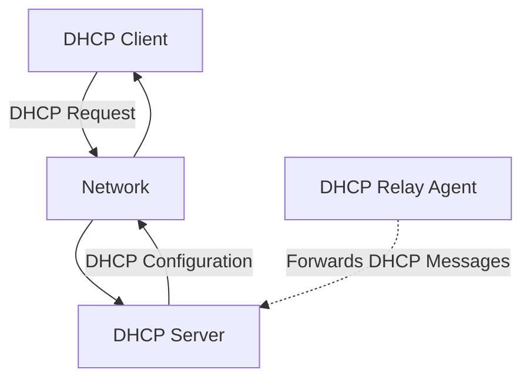
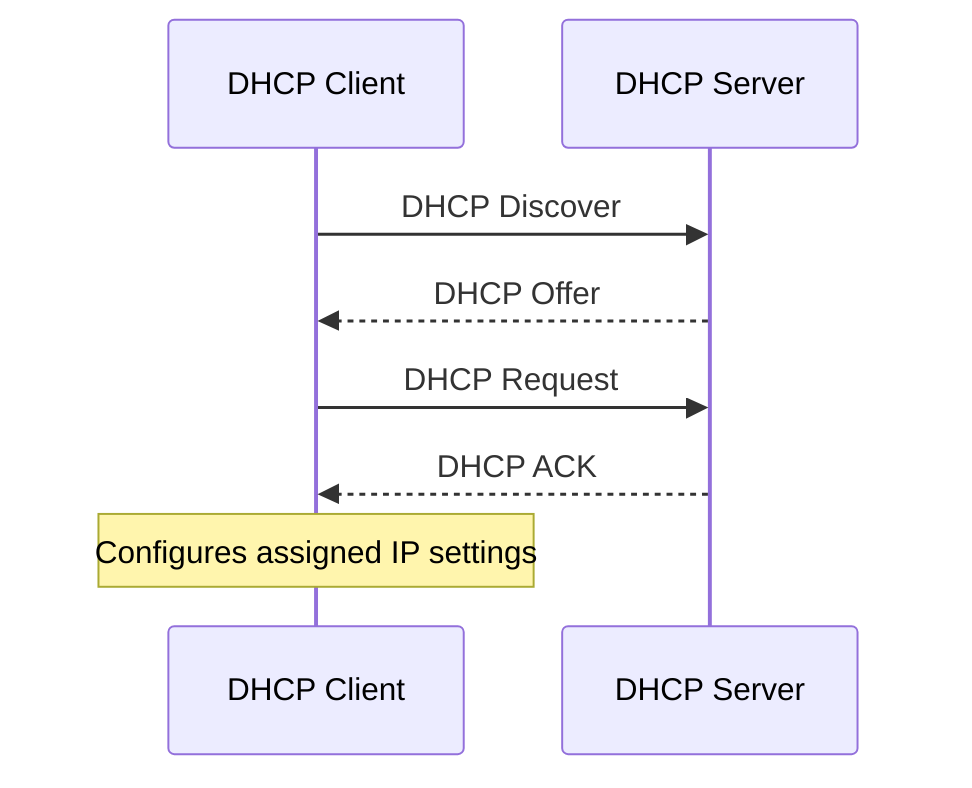
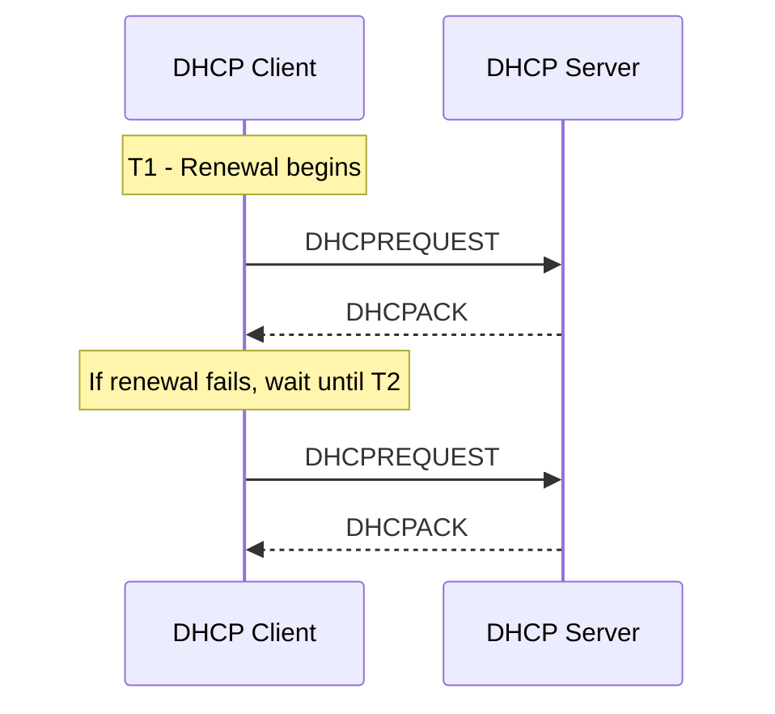

# DHCP (Dynamic Host Configuration Protocol)

**Dynamic Host Configuration Protocol (DHCP)** is a network management protocol that automatically assigns IP configuration parameters to devices on an IP network.

Instead of manually configuring every device, a DHCP client obtains its network configuration from a DHCP server.

A DHCP server can provide:

* IP address
* Subnet mask
* Default gateway
* DNS server addresses
* Lease duration
* Domain name
* Additional network configuration options

DHCP simplifies network administration, reduces configuration errors, and helps prevent IP address conflicts.

DHCP operates at the application layer and uses UDP for communication.

| Component | Protocol |
| --- | --- |
| Application layer | DHCP |
| Transport layer | UDP |
| Server port | 67 |
| Client port | 68 |
| DHCPv4 addressing | IPv4 |
| DHCPv6 addressing | IPv6 |

# 🗁 DHCP Fundamentals

DHCP allows devices to obtain network configuration automatically when they connect to a network.

Consider a network containing:

* A DHCP server.
* A laptop acting as a DHCP client.
* A router providing the default gateway.
* A DNS resolver.

When the laptop connects to the network, it requests configuration from the DHCP server.

The server assigns an available IP address and provides the other required network settings.

### 🖆 Example Network Configuration

Suppose a network uses the following configuration:

| Parameter | Value |
| --- | --- |
| Network | `192.168.1.0/24` |
| DHCP server | `192.168.1.2` |
| Default gateway | `192.168.1.1` |
| DNS server | `192.168.1.2` |
| DHCP pool | `192.168.1.100 - 192.168.1.200` |
| Lease duration | 24 hours |

A newly connected device might receive:

```text
IP Address:      192.168.1.100
Subnet Mask:     255.255.255.0
Default Gateway: 192.168.1.1
DNS Server:      192.168.1.2
Lease Duration:  24 hours
```

The device can now communicate with other devices on its local network and access external networks through its default gateway.

# 🗁 Why DHCP Is Needed

Without DHCP, administrators would need to configure network settings manually on every device.

For a small network, manual configuration might be manageable. For a large network containing hundreds or thousands of devices, it becomes difficult to maintain.

### 🖆 Manual Configuration Problems

* IP addresses must be assigned individually.
* Incorrect subnet masks can prevent communication.
* Duplicate IP addresses can cause conflicts.
* DNS and gateway settings must be maintained manually.
* Network changes require updating individual devices.

### 🖆 DHCP Advantages

| Advantage | Explanation |
| --- | --- |
| Automatic configuration | Devices receive network settings automatically. |
| Centralized management | Administrators manage configuration from a server. |
| Address management | IP addresses are allocated from configured pools. |
| Reduced conflicts | The server tracks allocated addresses and leases. |
| Flexibility | Configuration can be changed centrally. |
| Scalability | Supports networks containing many clients. |
| Lease management | Addresses can be reused after leases expire or are released. |

# 🗁 DHCP Architecture

DHCP uses a client-server architecture.

### 🖆 DHCP Components

**DHCP Client**

A device that requests network configuration.

Examples:

* Desktop computers
* Laptops
* Smartphones
* Network printers
* Servers

**DHCP Server**

A service responsible for allocating IP addresses and providing configuration parameters.

Examples:

* Linux DHCP server
* Windows Server DHCP
* RouterOS DHCP Server
* Home router DHCP service

**DHCP Relay Agent**

A network device that forwards DHCP messages between clients and servers located on different IP subnets.

**DHCP Lease Database**

A record of allocated addresses and their associated clients, lease information, and allocation state.

### 🖆 DHCP Communication Ports

DHCPv4 uses UDP.

| Direction | Source Port | Destination Port |
| --- | ---: | ---: |
| Client to server | 68 | 67 |
| Server to client | 67 | 68 |

The client initially does not have an assigned IPv4 address. Consequently, its initial DHCP messages commonly use broadcast addressing.

### 🖆 DHCP Communication Diagram



# 🗁 DHCP DORA Process

DORA represents the four main messages used by DHCPv4 when a client obtains a new lease:

* Discover
* Offer
* Request
* Acknowledgment

This process allows a client to discover a DHCP server, receive an address offer, request that address, and obtain confirmation.

### 🖆 DHCP Discover

The client broadcasts a DHCP Discover message to find available DHCP servers.

Because the client does not yet have an IPv4 address, it commonly sends the packet using:

```text
Source IP:      0.0.0.0
Destination IP: 255.255.255.255

Source Port:      68
Destination Port: 67
```

The client is effectively asking:

```text
Is there any DHCP server available on this network?
```

### 🖆 DHCP Offer

A DHCP server receives the Discover message and selects an available IP address from its configured pool.

It responds with a DHCP Offer containing the proposed address and configuration parameters.

Example:

```text
Offered IP:      192.168.1.100
Subnet Mask:     255.255.255.0
Default Gateway: 192.168.1.1
DNS Server:      192.168.1.2
Lease Time:      86400 seconds
```

The client may receive offers from multiple DHCP servers.

### 🖆 DHCP Request

The client selects an offer and broadcasts a DHCP Request message indicating which server and address it has chosen.

This broadcast also allows other DHCP servers that made offers to recognize that their offers were not selected.

### 🖆 DHCP Acknowledgment

The selected DHCP server responds with a DHCP ACK message confirming the lease.

The client can then configure its network interface using the assigned parameters.

### 🖆 Complete DORA Diagram



### 🖆 DORA Message Summary

| Message | Direction | Purpose |
| --- | --- | --- |
| Discover | Client → Server | Find DHCP servers |
| Offer | Server → Client | Offer an IP configuration |
| Request | Client → Server | Request the selected offer |
| ACK | Server → Client | Confirm the lease |

DORA describes the typical initial IPv4 lease acquisition process. Renewals, rebindings, and some other DHCP operations use different message sequences.

# 🗁 DHCP Message Types

DHCPv4 defines several message types beyond the four messages in DORA.

| Message | Purpose |
| --- | --- |
| DHCPDISCOVER | Discover available DHCP servers |
| DHCPOFFER | Offer an IP address and configuration |
| DHCPREQUEST | Request an offered or previously assigned address |
| DHCPDECLINE | Inform the server that an offered address appears to be in use |
| DHCPACK | Acknowledge a successful configuration |
| DHCPNAK | Reject a client's request |
| DHCPRELEASE | Release an assigned address |
| DHCPINFORM | Request additional configuration parameters when the client already has an IP address |

### 🖆 DHCPDECLINE

A client can send DHCPDECLINE if it discovers that the offered IP address is already in use.

For example, a client might perform an address-conflict detection check before configuring the address.

The server can then mark the address as unavailable and investigate the conflict according to its implementation.

### 🖆 DHCPNAK

A DHCPNAK indicates that the server cannot accept the client's requested configuration.

Possible reasons include:

* The requested address is invalid for the current subnet.
* The client's lease is no longer valid.
* The client is requesting an address that the server cannot allocate.

### 🖆 DHCPRELEASE

A client can send DHCPRELEASE when it no longer needs its assigned address.

The server can then make that address available for allocation, subject to its lease-management implementation.

### 🖆 DHCPINFORM

A device that already has an IP address configured manually can send DHCPINFORM to obtain additional parameters, such as DNS server addresses.

# 🗁 DHCP Lease Mechanism

A DHCP lease is a temporary allocation of an IP address to a client.

The server assigns an address for a specific period rather than permanently allocating it.

For example:

```text
IP Address: 192.168.1.100
Lease Time: 24 Hours
```

After the lease is granted, the client can use the address during the lease period.

### 🖆 Lease Renewal

DHCP clients generally attempt to renew their leases before expiration.

The DHCPv4 lease process defines two important timers:

* T1: Renewal time.
* T2: Rebinding time.

By default, these are commonly calculated as:

| Timer | Default Time | Purpose |
| --- | --- | --- |
| T1 | 50% of lease duration | Contact the original DHCP server |
| T2 | 87.5% of lease duration | Attempt renewal with any available DHCP server |

These are default values; DHCP servers can provide different values.

### 🖆 Example: 24-Hour Lease

```text
Lease Duration: 24 Hours

T1 = 12 Hours
T2 = 21 Hours
Expiration = 24 Hours
```

### 🖆 Lease Renewal Process



At T1, the client normally sends a unicast DHCPREQUEST to the server that originally granted the lease.

If renewal is unsuccessful, the client enters the rebinding phase at T2 and can broadcast DHCPREQUEST messages to reach any available DHCP server.

If the lease expires without successful renewal, the client must stop using the leased IPv4 address.

# 🗁 DHCP Packet Structure

DHCPv4 uses the BOOTP message format and extends it with DHCP-specific options.

A DHCP packet contains several fields used to identify clients, track transactions, and communicate configuration information.

### 🖆 Important DHCP Fields

| Field | Description |
| --- | --- |
| `op` | Message operation: request or reply |
| `htype` | Hardware address type |
| `hlen` | Hardware address length |
| `hops` | Number of relay-agent hops |
| `xid` | Transaction identifier |
| `secs` | Seconds elapsed since the client began acquisition or renewal |
| `flags` | Includes the broadcast flag |
| `ciaddr` | Client IP address |
| `yiaddr` | Your IP address offered to the client |
| `siaddr` | Next server address |
| `giaddr` | Relay-agent IP address |
| `chaddr` | Client hardware address field |
| `sname` | Optional server hostname |
| `file` | Optional boot file name |
| `options` | DHCP options and configuration parameters |

### 🖆 Important Address Fields

**ciaddr**

The client's current IP address, when applicable.

**yiaddr**

The IP address being offered or assigned to the client.

**giaddr**

The relay agent's address, used by the server to identify the client's subnet and determine the appropriate address pool.

**chaddr**

The client hardware address field, commonly containing the client's MAC address in Ethernet networks.

### 🖆 Transaction ID

The `xid` field identifies a DHCP transaction.

It helps a client associate replies with its original requests, particularly when multiple DHCP transactions are occurring.

# 🗁 DHCP Options

DHCP options carry configuration parameters beyond the basic packet fields.

They allow DHCP servers to provide additional network information to clients.

### 🖆 Common DHCP Options

| Option | Name | Purpose |
| ---: | --- | --- |
| 1 | Subnet Mask | Provides the IPv4 subnet mask |
| 3 | Router | Provides default gateway addresses |
| 6 | DNS Servers | Provides DNS resolver addresses |
| 12 | Host Name | Provides or identifies a hostname |
| 15 | Domain Name | Provides the client's domain name |
| 42 | NTP Servers | Provides time server addresses |
| 51 | IP Address Lease Time | Defines the lease duration |
| 53 | DHCP Message Type | Identifies the DHCP message type |
| 54 | Server Identifier | Identifies the DHCP server |
| 55 | Parameter Request List | Lists options requested by the client |
| 58 | Renewal Time Value | Defines T1 |
| 59 | Rebinding Time Value | Defines T2 |
| 66 | TFTP Server Name | Provides a TFTP server name |
| 67 | Bootfile Name | Provides a boot file name |
| 82 | Relay Agent Information | Carries relay-agent information |

### 🖆 Example DHCP Configuration

A DHCP server might provide:

```text
IP Address:       192.168.1.100
Subnet Mask:      255.255.255.0
Default Gateway:  192.168.1.1
DNS Server:       192.168.1.2
Domain Name:      example.local
NTP Server:       192.168.1.10
Lease Time:       86400 seconds
```

These values are communicated through DHCP options.

# 🗁 DHCP Address Allocation Methods

DHCP supports different address allocation approaches.

### 🖆 Dynamic Allocation

The server automatically assigns an available IP address from a configured pool for a limited lease period.

Example:

```text
DHCP Pool:
192.168.1.100 - 192.168.1.200
```

A client might receive:

```text
192.168.1.100
```

After the lease expires or the address is released, it may become available for another client.

### 🖆 Automatic Allocation

The server automatically assigns an IP address to a client and generally retains that allocation for the client.

The address is not necessarily permanent in every implementation, but the allocation model is intended to provide a persistent assignment.

### 🖆 Manual Allocation

The administrator configures a specific IP address for a particular client.

The DHCP server delivers that predefined address when the client requests configuration.

This is commonly implemented through a DHCP reservation or static mapping.

### 🖆 Comparison

| Allocation Method | Assignment | Address Behavior |
| --- | --- | --- |
| Dynamic | Automatic | Temporary lease |
| Automatic | Automatic | Intended to be permanent |
| Manual | Administrator-defined | Predetermined address |

# 🗁 DHCP Relay Agent

A DHCP relay agent forwards DHCP messages between clients and DHCP servers located on different IP subnets.

DHCPv4 clients initially use local broadcast messages to discover servers.

Routers normally do not forward IPv4 broadcasts between networks.

Consequently, a DHCP server located on another subnet cannot receive the client's initial broadcast without a relay agent.

### 🖆 Example Network

```text
Client Network: 192.168.10.0/24
DHCP Server:    192.168.100.10

        Client
           |
           |
    192.168.10.1
       Router
    DHCP Relay
           |
           |
    192.168.100.0/24
           |
           |
      DHCP Server
    192.168.100.10
```

### 🖆 How DHCP Relay Works

* The client broadcasts DHCPDISCOVER on its local network.
* The relay agent receives the broadcast.
* The relay agent forwards the request to the configured DHCP server.
* The relay agent sets the `giaddr` field to identify the client-facing subnet.
* The DHCP server selects an appropriate address pool based on the relay information.
* The server sends its response back through the relay agent.
* The relay agent delivers the response to the client.

### 🖆 Benefits of DHCP Relay

* Centralized DHCP server management.
* Supports multiple network segments.
* Reduces the need to deploy a DHCP server on every subnet.
* Simplifies large enterprise and ISP network administration.

### 🖆 Important Consideration

A DHCP relay agent does not simply forward Ethernet broadcasts across routers. It receives DHCP messages and relays them according to DHCP relay behavior.

# 🗁 DHCP Reservations

A DHCP reservation associates a specific client identifier with a predetermined IP address.

For Ethernet clients, the reservation is commonly based on the client's MAC address.

### 🖆 Example

Suppose a network contains:

| Device | MAC Address | Reserved IP |
| --- | --- | --- |
| Office Printer | `00:11:22:33:44:55` | `192.168.1.20` |
| File Server | `00:11:22:33:44:66` | `192.168.1.21` |
| Network Camera | `00:11:22:33:44:77` | `192.168.1.22` |

Whenever these devices request DHCP configuration, the server assigns their reserved addresses.

### 🖆 Why Use Reservations?

* Printers need predictable addresses.
* Servers may require stable IP configuration.
* Network devices are easier to monitor.
* Firewall and access-control rules can reference known addresses.
* Administrators can manage addressing centrally.

### 🖆 Reservation vs Static IP

| DHCP Reservation | Static IP |
| --- | --- |
| Configured on the DHCP server | Configured directly on the device |
| Client obtains configuration through DHCP | Client uses manually configured settings |
| Centralized management | Distributed configuration |
| Can include DNS and gateway options | Other settings must be configured separately |

A reservation is often preferable for managed network devices because it centralizes address assignment.

# 🗁 DHCP Scope and Address Pool

A DHCP scope defines the network and configuration parameters from which a DHCP server allocates addresses.

An address pool is the range of addresses available for assignment.

### 🖆 Example Scope

```text
Network:          192.168.1.0/24
Subnet Mask:      255.255.255.0
Default Gateway:  192.168.1.1
DNS Server:       192.168.1.2

DHCP Pool:
192.168.1.100 - 192.168.1.200
```

The scope belongs to the `192.168.1.0/24` network.

The server allocates addresses from the configured pool while excluding addresses that are reserved, unavailable, or otherwise excluded by its configuration.

### 🖆 Address Planning

A typical network might organize addresses like this:

| Address Range | Purpose |
| --- | --- |
| `192.168.1.1` | Router |
| `192.168.1.2 - 192.168.1.19` | Network infrastructure |
| `192.168.1.20 - 192.168.1.49` | Servers and reservations |
| `192.168.1.50 - 192.168.1.99` | Additional static assignments |
| `192.168.1.100 - 192.168.1.200` | DHCP dynamic pool |
| `192.168.1.201 - 192.168.1.254` | Future use |

The exact ranges depend on network requirements.

# 🗁 DHCPv4 vs DHCPv6

DHCPv4 and DHCPv6 provide automatic network configuration, but they use different addressing mechanisms and transport details.

### 🖆 DHCPv4

DHCPv4 provides IPv4 configuration.

| Property | DHCPv4 |
| --- | --- |
| Addressing | IPv4 |
| Transport | UDP |
| Server port | 67 |
| Client port | 68 |
| Initial discovery | IPv4 broadcast |
| Address allocation | IPv4 address |
| Common message process | Discover, Offer, Request, ACK |

### 🖆 DHCPv6

DHCPv6 provides configuration for IPv6 networks.

| Property | DHCPv6 |
| --- | --- |
| Addressing | IPv6 |
| Transport | UDP |
| Server port | 547 |
| Client port | 546 |
| Initial discovery | IPv6 multicast |
| Address allocation | IPv6 address or configuration parameters |
| Common message process | Solicit, Advertise, Request, Reply |

### 🖆 DHCPv6 Multicast Addresses

DHCPv6 uses IPv6 multicast rather than broadcast.

Common multicast addresses include:

```text
ff02::1:2
```

All DHCPv6 servers and relay agents on the local link.

```text
ff05::1:3
```

All DHCPv6 servers on the site.

### 🖆 DHCPv6 Address Assignment Modes

**Stateful DHCPv6**

The DHCPv6 server assigns IPv6 addresses and maintains lease information.

**Stateless DHCPv6**

The client obtains its IPv6 address through another mechanism, commonly SLAAC, and uses DHCPv6 to obtain additional configuration such as DNS information.

### 🖆 SLAAC and DHCPv6

IPv6 clients can configure addresses using Stateless Address Autoconfiguration (SLAAC).

Routers advertise network prefixes and other information through ICMPv6 Router Advertisement messages.

Router Advertisement flags influence whether clients should use DHCPv6 for additional configuration.

| Mechanism | Purpose |
| --- | --- |
| SLAAC | Automatically configures IPv6 addresses |
| Stateful DHCPv6 | Assigns IPv6 addresses and maintains leases |
| Stateless DHCPv6 | Provides additional configuration without assigning the IPv6 address |

DHCPv6 does not normally provide the IPv6 default gateway. IPv6 default-router information is learned through Router Advertisements.

# 🗁 DHCP Security

DHCP is an important network service, but its unauthenticated operation can introduce security risks.

### 🖆 Rogue DHCP Server

A rogue DHCP server is an unauthorized server that responds to DHCP requests.

It may provide malicious configuration such as:

```text
IP Address:      192.168.1.100
Default Gateway: Attacker Device
DNS Server:      Malicious DNS Server
```

Clients accepting this configuration may send traffic through an unauthorized gateway or use a malicious DNS resolver.

### 🖆 DHCP Starvation Attack

An attacker sends a large number of DHCP requests using different client identifiers or spoofed MAC addresses.

The goal is to consume the available address pool.

Legitimate clients may then be unable to obtain IP addresses.

### 🖆 DHCP Spoofing

An attacker impersonates a DHCP server and sends unauthorized DHCP responses.

This can redirect client traffic or manipulate DNS configuration.

### 🖆 DHCP Snooping

DHCP Snooping is a Layer 2 switch security feature designed to control DHCP server messages.

It classifies switch ports as:

* Trusted ports: Ports allowed to receive legitimate DHCP server messages.
* Untrusted ports: Ports where unauthorized DHCP server messages are blocked.

### 🖆 DHCP Snooping Example

```text
              DHCP Server
                   |
             Trusted Port
                   |
                Switch
              /       \
             /         \
       Untrusted    Untrusted
          Port         Port
           |             |
         Client        Client
```

DHCP server messages arriving from untrusted ports can be dropped.

DHCP Snooping can also build a binding table containing information such as:

* Client MAC address.
* Assigned IP address.
* VLAN.
* Interface.
* Lease information.

This information can support other security features, including Dynamic ARP Inspection and IP Source Guard.

### 🖆 Security Best Practices

* Enable DHCP Snooping on supported switches.
* Mark only legitimate DHCP server paths as trusted.
* Restrict unauthorized access to network infrastructure.
* Monitor DHCP lease activity.
* Use appropriate address-pool limits.
* Separate guest, server, and management networks.
* Protect DHCP servers and relay agents.
* Monitor for unusual DHCP traffic and starvation attempts.

# 🗁 DHCP Configuration on Ubuntu

Ubuntu systems commonly use NetworkManager or Netplan to manage network configuration.

A DHCP client requests an address from a DHCP server when its network interface is configured for automatic IPv4 addressing.

### 🖆 Check Network Interfaces

```bash
ip link show
```

Display IPv4 addresses:

```bash
ip -4 address show
```

Display routing information:

```bash
ip route
```

Display DNS configuration:

```bash
resolvectl status
```

### 🖆 Configure DHCP Using Netplan

Open the Netplan configuration file:

```bash
sudo nano /etc/netplan/01-netcfg.yaml
```

Example DHCP configuration:

```yaml
network:
  version: 2
  ethernets:
    enp0s3:
      dhcp4: true
```

Replace `enp0s3` with your actual network interface name.

Apply the configuration:

```bash
sudo netplan apply
```

Validate the configuration before applying it:

```bash
sudo netplan generate
```

### 🖆 Configure Static IPv4 Instead

For comparison, a static IPv4 configuration can be defined through Netplan:

```yaml
network:
  version: 2
  ethernets:
    enp0s3:
      dhcp4: false
      addresses:
        - 192.168.1.50/24
      routes:
        - to: default
          via: 192.168.1.1
      nameservers:
        addresses:
          - 192.168.1.2
          - 1.1.1.1
```

Apply the configuration:

```bash
sudo netplan apply
```

### 🖆 Request a DHCP Lease with dhclient

On systems where `dhclient` is installed and used by the network configuration stack:

Request or renew a lease:

```bash
sudo dhclient -v enp0s3
```

Release a lease:

```bash
sudo dhclient -r enp0s3
```

The DHCP client implementation and network manager determine which commands are appropriate for a particular Ubuntu installation. Avoid running multiple DHCP clients against the same interface simultaneously.

# 🗁 DHCP Troubleshooting

DHCP problems can prevent devices from obtaining valid network configuration.

A systematic troubleshooting process helps identify the source of the problem.

### 🖆 Common DHCP Problems

| Problem | Possible Cause |
| --- | --- |
| No IP address | DHCP server unavailable |
| `169.254.x.x` address | IPv4 DHCP configuration failed and link-local addressing was used |
| Duplicate IP address | Address conflict or incorrect server configuration |
| Incorrect gateway | Incorrect DHCP option 3 |
| Incorrect DNS server | Incorrect DHCP option 6 |
| DHCP timeout | Server unreachable, filtering, relay failure, or pool exhaustion |
| Intermittent connectivity | Lease renewal failure or network instability |
| Some clients cannot connect | DHCP pool exhaustion or VLAN configuration issue |

### 🖆 Check IP Configuration

```bash
ip address show
```

Look for:

* Assigned IPv4 address.
* Correct subnet prefix.
* Interface state.
* Unexpected link-local address.

### 🖆 Check Default Gateway

```bash
ip route
```

A typical default route looks like:

```text
default via 192.168.1.1 dev enp0s3
```

### 🖆 Check DNS Configuration

```bash
resolvectl status
```

Confirm that the expected DNS servers are configured.

### 🖆 Inspect DHCP Traffic

Use `tcpdump` to capture DHCPv4 traffic:

```bash
sudo tcpdump -ni enp0s3 'udp port 67 or udp port 68'
```

A typical successful initial exchange contains:

```text
DHCP Discover
DHCP Offer
DHCP Request
DHCP ACK
```

If the client repeatedly sends DHCP Discover messages but receives no Offer, investigate:

* DHCP server availability.
* VLAN membership.
* DHCP relay configuration.
* Firewall rules.
* DHCP pool exhaustion.

### 🖆 Check NetworkManager

On systems using NetworkManager:

```bash
systemctl status NetworkManager
```

View connection details:

```bash
nmcli connection show
```

Show device status:

```bash
nmcli device status
```

Inspect NetworkManager logs:

```bash
journalctl -u NetworkManager
```

### 🖆 Check DHCP Server Logs

For a Linux DHCP server using Kea:

```bash
journalctl -u kea-dhcp4-server
```

For a system using ISC DHCP Server:

```bash
journalctl -u isc-dhcp-server
```

The actual service name and logging configuration depend on the installed DHCP server implementation.

# 🗁 Common DHCP Commands

### 🖆 Linux Network Commands

| Command | Purpose |
| --- | --- |
| `ip address show` | Display IP addresses |
| `ip route` | Display routing table |
| `ip link show` | Display network interfaces |
| `resolvectl status` | Display DNS configuration |
| `nmcli device status` | Display NetworkManager device status |
| `nmcli connection show` | Display network connections |
| `journalctl -u NetworkManager` | Inspect NetworkManager logs |
| `tcpdump -ni enp0s3 'udp port 67 or udp port 68'` | Capture DHCPv4 traffic |

### 🖆 DHCP Packet Capture with Wireshark

Useful display filters:

```text
dhcp
```

Display DHCPv4 packets.

```text
bootp
```

Display BOOTP and commonly decoded DHCPv4 traffic in Wireshark.

```text
udp.port == 67 || udp.port == 68
```

Display traffic using DHCPv4 UDP ports.

```text
dhcp.option.dhcp == 1
```

Display DHCP Discover messages in Wireshark versions supporting this field.

# 🗁 Best Practices

* Use centralized DHCP management for larger networks.
* Define clear address pools for each subnet.
* Reserve addresses for important infrastructure devices.
* Exclude statically assigned addresses from dynamic pools.
* Configure correct subnet masks, gateways, and DNS servers.
* Use DHCP relay agents when servers are centralized across multiple subnets.
* Monitor lease utilization and pool exhaustion.
* Configure appropriate lease durations for different network types.
* Enable DHCP Snooping where supported.
* Keep DHCP servers and network devices updated.
* Maintain documentation of scopes, reservations, VLANs, and relay configurations.
* Use separate DHCP scopes for separate IP subnets.

# 🗁 Common Mistakes

### 🖆 Confusing DHCP with DNS

DHCP automatically provides network configuration.

DNS translates domain names into IP addresses and provides other DNS record information.

They are different protocols with different responsibilities.

### 🖆 Confusing DHCP Server and DHCP Client Ports

For DHCPv4:

```text
Server: UDP 67
Client: UDP 68
```

These ports are not interchangeable.

### 🖆 Assuming DHCP Works Across Routers Automatically

Initial DHCPv4 discovery uses local broadcast communication.

A DHCP relay agent is normally required when the DHCP server is located on another subnet.

### 🖆 Assigning Static Addresses Inside a Dynamic Pool

If an administrator manually assigns an address that the DHCP server can also allocate, an IP address conflict may occur.

Use exclusions or reservations to manage addresses correctly.

### 🖆 Assuming DHCP Assigns the Default Gateway Automatically

The DHCP server provides the gateway through DHCP option 3 for DHCPv4.

The gateway must be configured correctly in the server's scope.

### 🖆 Confusing Lease Expiration with Immediate Disconnection

A client does not lose its address merely because it reaches T1 or T2.

These timers initiate renewal and rebinding attempts. The client must stop using the leased address if the lease expires without successful renewal.

# 🗁 Practical Exercises

### 🖆 Understand the DHCP Process

Draw the complete DORA exchange.

Include:

* DHCP Discover
* DHCP Offer
* DHCP Request
* DHCP ACK

Identify the source and destination UDP ports for each direction.

### 🖆 Inspect Your Ubuntu DHCP Configuration

Run:

```bash
ip -4 address show
ip route
resolvectl status
```

Identify:

* Your IPv4 address.
* Your subnet prefix.
* Your default gateway.
* Your DNS servers.

Determine whether your interface is configured for DHCP.

### 🖆 Capture DHCP Traffic

Start a packet capture:

```bash
sudo tcpdump -ni enp0s3 'udp port 67 or udp port 68'
```

Then reconnect the interface or request a DHCP lease using the DHCP client configured on your system.

Identify the DHCP message types in the capture.

### 🖆 Design a DHCP Scope

Design a DHCP scope for the following network:

```text
Network: 10.10.10.0/24
Gateway: 10.10.10.1
DNS:     10.10.10.2
```

Requirements:

* Reserve addresses for network infrastructure.
* Allocate a dynamic pool for clients.
* Define a 12-hour lease.
* Reserve addresses for two printers.

### 🖆 Configure a DHCP Relay Scenario

Create a lab with:

```text
Client LAN:     192.168.10.0/24
Server LAN:     192.168.100.0/24
DHCP Server:    192.168.100.10
Client Gateway: 192.168.10.1
```

Configure the router as a DHCP relay agent.

Verify that clients in the first subnet receive addresses from the DHCP server in the second subnet.

# 🗁 Interview Questions

### 🖆 What is DHCP?

DHCP is a network protocol that automatically assigns IP addresses and other network configuration parameters to clients.

### 🖆 What does DORA stand for?

Discover, Offer, Request, and Acknowledgment.

These are the four main messages in the typical initial DHCPv4 lease acquisition process.

### 🖆 Which transport protocol does DHCP use?

DHCP uses UDP.

### 🖆 Which ports does DHCPv4 use?

The DHCPv4 server uses UDP port 67, and the client uses UDP port 68.

### 🖆 What is a DHCP lease?

A DHCP lease is a temporary allocation of an IP address to a client for a defined period.

### 🖆 What happens when a DHCP lease reaches T1?

The client normally attempts to renew its lease with the original DHCP server using a unicast DHCPREQUEST.

### 🖆 What happens at T2?

If renewal has not succeeded, the client enters the rebinding phase and attempts to renew with any available DHCP server.

### 🖆 What is a DHCP relay agent?

A DHCP relay agent forwards DHCP messages between clients and servers located on different IP subnets.

### 🖆 What is a DHCP reservation?

A DHCP reservation maps a client identifier, commonly a MAC address, to a predetermined IP address.

### 🖆 What is a rogue DHCP server?

An unauthorized DHCP server that provides network configuration to clients, potentially redirecting their traffic or supplying malicious settings.

### 🖆 What is DHCP Snooping?

DHCP Snooping is a Layer 2 security feature that restricts DHCP server messages to trusted network ports and can maintain DHCP binding information.

### 🖆 What is the difference between DHCPv4 and DHCPv6?

DHCPv4 configures IPv4 networks and uses broadcast-based discovery, while DHCPv6 configures IPv6 networks and uses multicast-based communication.

### 🖆 Does DHCPv6 provide the default gateway?

Normally, no. IPv6 default-router information is learned through ICMPv6 Router Advertisement messages.

### 🖆 What is the difference between DHCP and static IP configuration?

DHCP obtains network configuration automatically from a server, whereas static configuration is entered directly on the device.

# 🗁 Summary

DHCP automates IP address assignment and network configuration through a client-server architecture.

Key concepts:

* DHCP automatically assigns IP configuration to network clients.
* DHCPv4 uses UDP ports 67 and 68.
* DORA describes the typical initial DHCPv4 lease acquisition process.
* DHCP leases allow addresses to be reused.
* T1 and T2 control lease renewal and rebinding.
* DHCP options provide gateway, DNS, subnet mask, and other parameters.
* DHCP relay agents support communication across different subnets.
* Reservations provide predictable IP assignments.
* DHCPv6 uses IPv6 multicast and supports stateful and stateless configuration.
* DHCP Snooping helps protect networks against unauthorized DHCP servers.

DHCP is essential for managing IP addressing in home networks, enterprise environments, data centers, and ISP infrastructures.

# 🗁 References

* [RFC 2131 — Dynamic Host Configuration Protocol](https://datatracker.ietf.org/doc/html/rfc2131)
* [RFC 2132 — DHCP Options and BOOTP Vendor Extensions](https://datatracker.ietf.org/doc/html/rfc2132)
* [RFC 3046 — DHCP Relay Agent Information Option](https://datatracker.ietf.org/doc/html/rfc3046)
* [RFC 8415 — Dynamic Host Configuration Protocol for IPv6 (DHCPv6)](https://datatracker.ietf.org/doc/html/rfc8415)
* [RFC 4861 — Neighbor Discovery for IPv6](https://datatracker.ietf.org/doc/html/rfc4861)
* [Ubuntu Server Documentation](https://documentation.ubuntu.com/server/)
* [Netplan Documentation](https://netplan.readthedocs.io/)
* [Wireshark DHCP Display Filter Reference](https://www.wireshark.org/docs/dfref/d/dhcp.html)
