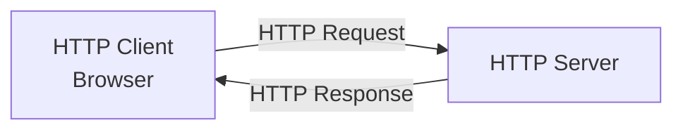
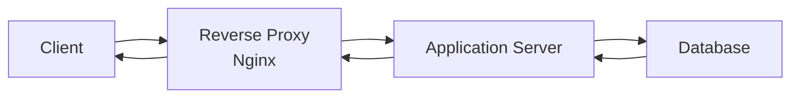
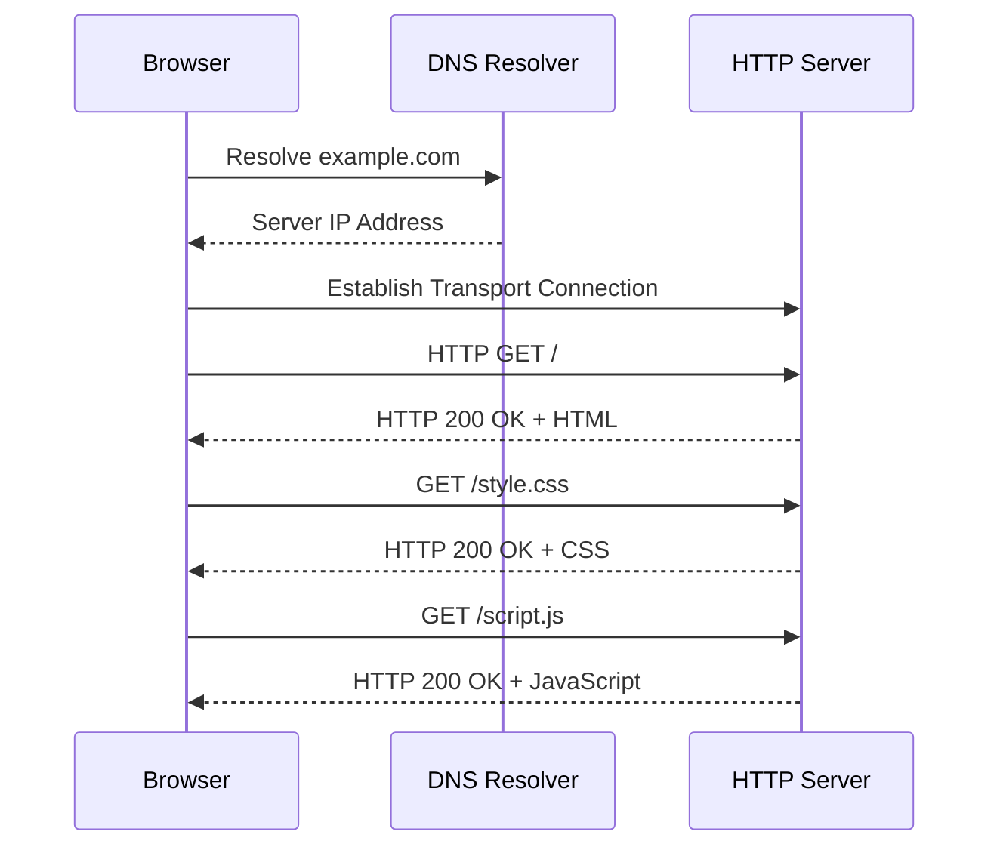

# HTTP (Hypertext Transfer Protocol)

**Hypertext Transfer Protocol (HTTP)** is an application-layer protocol used for communication between clients and servers across a network.

It defines how clients request resources and how servers respond to those requests.

HTTP is the foundation of communication on the World Wide Web and is commonly used by:

* Web browsers
* Web servers
* REST APIs
* Web applications
* Mobile applications
* Microservices
* Reverse proxies
* Content delivery networks (CDNs)

HTTP follows a request-response communication model.

A client sends an HTTP request to a server. The server processes the request and returns an HTTP response.

For example, when a browser opens:

```text
http://example.com
```

It sends an HTTP request to the web server hosting that domain.

The server responds with an HTTP status code, response headers, and possibly a response body containing HTML.

### 🖆 HTTP at Different Network Layers

| Layer | Protocol or Technology |
| --- | --- |
| Application | HTTP |
| Transport | TCP (HTTP/1.1 and HTTP/2) |
| Transport | QUIC over UDP (HTTP/3) |
| Network | IPv4 or IPv6 |
| Data Link | Ethernet, Wi-Fi, etc. |

HTTP/1.1 and HTTP/2 typically operate over TCP. HTTP/3 uses QUIC, which runs over UDP.

# 🗁 HTTP Fundamentals

HTTP defines the rules for exchanging messages between HTTP clients and HTTP servers.

It specifies:

* How a client identifies a resource.
* How a client requests a resource.
* How a server communicates the result.
* How metadata is exchanged through headers.
* How request and response bodies are transferred.
* How caching and connection management work.

### 🖆 HTTP Client

An HTTP client initiates requests to HTTP servers.

Examples:

* Google Chrome
* Mozilla Firefox
* curl
* Postman
* Mobile applications
* Backend services

### 🖆 HTTP Server

An HTTP server receives HTTP requests and returns HTTP responses.

Examples:

* Nginx
* Apache HTTP Server
* Caddy
* Node.js HTTP server
* Microsoft IIS

### 🖆 HTTP Resource

A resource is anything that can be identified and accessed through a URI.

Examples:

```text
https://example.com/
https://example.com/about
https://example.com/images/logo.png
https://api.example.com/users
https://api.example.com/products/25
```

Resources may represent HTML documents, images, videos, JSON data, files, or application-specific information.

# 🗁 Why HTTP Is Needed

Before HTTP, systems needed different mechanisms for accessing and exchanging information.

HTTP provides a standardized communication model that allows different clients and servers to exchange resources.

### 🖆 HTTP Advantages

| Advantage | Explanation |
| --- | --- |
| Standardization | Defines common communication rules. |
| Interoperability | Different clients and servers can communicate. |
| Extensibility | Headers and methods support additional functionality. |
| Scalability | Supports distributed web applications. |
| Caching | Reduces unnecessary network requests. |
| Content negotiation | Allows clients and servers to select suitable representations. |
| API support | Provides a standardized foundation for web APIs. |
| Proxy support | Works with intermediaries such as reverse proxies and CDNs. |

# 🗁 HTTP Architecture

HTTP uses a client-server architecture with optional intermediary components.

### 🖆 Basic Architecture



### 🖆 Architecture with a Reverse Proxy



The reverse proxy receives incoming HTTP requests and forwards them to an application server.

It can also provide:

* TLS termination.
* Load balancing.
* Caching.
* Request filtering.
* Compression.
* Access logging.

### 🖆 HTTP Intermediaries

HTTP communication can involve several intermediaries.

| Component | Responsibility |
| --- | --- |
| Forward Proxy | Represents clients when accessing external servers |
| Reverse Proxy | Represents backend servers to clients |
| Gateway | Connects different systems or protocols |
| Tunnel | Relays data between endpoints |
| CDN | Distributes content through geographically distributed infrastructure |
| Load Balancer | Distributes requests across multiple backend servers |

# 🗁 How HTTP Works

Consider opening:

```text
http://example.com
```

A simplified HTTP communication process involves the following operations.

### 🖆 DNS Resolution

The client resolves the hostname:

```text
example.com
```

into an IP address.

For example:

```text
93.184.216.34
```

DNS resolution is separate from HTTP itself, but it is commonly required before the client can connect to the server.

### 🖆 Establishing a Connection

For HTTP/1.1 and HTTP/2 over TCP, the client establishes a TCP connection to the server.

The standard HTTP port is:

```text
TCP 80
```

For HTTP/3, the client uses QUIC over UDP, commonly on port 443 when operating with HTTPS.

### 🖆 Sending an HTTP Request

The client sends an HTTP request containing information such as:

* Request method.
* Request target.
* HTTP version.
* Request headers.
* Optional request body.

Example:

```http
GET / HTTP/1.1
Host: example.com
User-Agent: Mozilla/5.0
Accept: text/html
```

### 🖆 Server Processing

The server receives and processes the request.

Depending on the application, it may:

* Return a static file.
* Execute application code.
* Query a database.
* Forward the request to another service.
* Reject the request.

### 🖆 Receiving an HTTP Response

The server sends an HTTP response.

Example:

```http
HTTP/1.1 200 OK
Content-Type: text/html
Content-Length: 1256

<!DOCTYPE html>
<html>
<head>
    <title>Example</title>
</head>
<body>
    <h1>Hello World</h1>
</body>
</html>
```

### 🖆 Rendering the Resource

The browser interprets the HTML and may request additional resources such as:

* CSS files.
* JavaScript files.
* Images.
* Fonts.
* API data.

A single webpage can therefore require many HTTP requests.

### 🖆 Complete Communication Diagram



# 🗁 HTTP Request and Response

HTTP communication consists of requests and responses.

### 🖆 HTTP Request

An HTTP request is a message sent by a client to a server to perform an operation on a resource.

Example:

```http
GET /users/10 HTTP/1.1
Host: api.example.com
Accept: application/json
Authorization: Bearer example-token
```

The request asks the server to retrieve the resource associated with `/users/10`.

### 🖆 HTTP Response

An HTTP response is a message sent by a server after processing a request.

Example:

```http
HTTP/1.1 200 OK
Content-Type: application/json
Cache-Control: no-cache

{
    "id": 10,
    "name": "Muhammad"
}
```

The response communicates the result of the operation.

### 🖆 Request vs Response

| Feature | Request | Response |
| --- | --- | --- |
| Direction | Client to server | Server to client |
| Start line | Request line | Status line |
| Method | Contains method | Does not contain method |
| Status code | Does not contain response status | Contains status code |
| Headers | Request headers | Response headers |
| Body | Optional | Optional |

# 🗁 HTTP Versions

HTTP has evolved to improve performance, connection management, and network efficiency.

### 🖆 HTTP/0.9

HTTP/0.9 was the earliest version of HTTP.

Characteristics:

* Supported simple GET requests.
* Had no HTTP headers.
* Returned HTML documents.
* Did not define modern status codes.
* Used a simple request-response model.

### 🖆 HTTP/1.0

HTTP/1.0 introduced a more structured message format.

Characteristics:

* Request and response headers.
* Status codes.
* Different content types.
* Basic metadata.
* Commonly used separate TCP connections for separate requests.

Persistent connections were not the default behavior in HTTP/1.0, although extensions could support them.

### 🖆 HTTP/1.1

HTTP/1.1 introduced persistent connections as the default behavior.

Important features:

* Persistent connections.
* Host header requirement.
* Chunked transfer coding.
* Improved caching.
* Content negotiation.
* Range requests.
* Better connection management.

Example:

```http
GET /products HTTP/1.1
Host: example.com
Connection: keep-alive
```

HTTP/1.1 allows multiple requests to reuse the same TCP connection.

However, its typical response handling can suffer from application-layer head-of-line blocking when responses must be delivered in order on a connection.

### 🖆 HTTP/2

HTTP/2 introduced binary framing and multiplexing.

Important features:

* Binary protocol framing.
* Multiplexed streams.
* Header compression using HPACK.
* Stream prioritization mechanisms.
* Reduced application-layer request serialization.

Multiple HTTP streams can share a single TCP connection.

HTTP/2 removes HTTP/1.1's response-ordering limitation between separate requests, but packet loss at the TCP layer can still block delivery of data for all streams on that connection.

### 🖆 HTTP/3

HTTP/3 uses QUIC instead of TCP.

Important features:

* QUIC transport over UDP.
* Independent stream delivery.
* Reduced transport-level head-of-line blocking between streams.
* Integrated TLS 1.3 handshake.
* Connection migration support.
* Improved connection establishment in suitable conditions.

HTTP/3 does not use TCP.

### 🖆 HTTP Version Comparison

| Feature | HTTP/1.0 | HTTP/1.1 | HTTP/2 | HTTP/3 |
| --- | --- | --- | --- | --- |
| Message format | Text-based | Text-based | Binary framing | Binary framing |
| Transport | TCP | TCP | TCP | QUIC over UDP |
| Multiplexing | No | No | Yes | Yes |
| Persistent connections | Limited extensions | Yes | Yes | Yes |
| Header compression | No standard mechanism | No standard mechanism | HPACK | QPACK |
| TLS requirement | Optional | Optional | HTTPS deployments required | Required |
| Independent stream delivery | No | No | Limited by TCP loss | Yes, between QUIC streams |

### 🖆 HTTP Version Selection

Modern browsers and web servers negotiate supported HTTP versions.

For HTTPS connections, ALPN (Application-Layer Protocol Negotiation) is commonly used during the TLS handshake to negotiate protocols such as:

```text
h2
http/1.1
```

HTTP/3 uses QUIC and its application protocol negotiation mechanisms.

# 🗁 HTTP Connection Management

HTTP connection management determines how clients and servers establish, reuse, and terminate connections.

### 🖆 Non-Persistent Connections

A non-persistent connection is closed after a request-response exchange.

Simplified process:

```text
Client → Server: Request
Server → Client: Response
Connection: Closed
```

A new connection is required for subsequent requests.

This was common in HTTP/1.0.

### 🖆 Persistent Connections

Persistent connections allow multiple HTTP requests and responses to use the same connection.

HTTP/1.1 uses persistent connections by default unless the connection is closed.

Example:

```http
GET /index.html HTTP/1.1
Host: example.com
```

The client and server can reuse the TCP connection for additional requests.

### 🖆 HTTP Keep-Alive

HTTP/1.1 supports persistent connections without requiring the `Connection: keep-alive` header.

The header may still appear for compatibility or explicit connection management.

Example:

```http
Connection: keep-alive
```

### 🖆 Connection Closure

A client or server can request that an HTTP/1.1 connection be closed after the current response.

Example:

```http
Connection: close
```

HTTP/2 and HTTP/3 use their own stream and connection management mechanisms. The HTTP/1.1 `Connection` header is not used for connection-specific control in those versions.

# 🗁 HTTP Message Structure

HTTP messages have a defined structure.

An HTTP/1.1 message generally contains:

* Start line.
* Header fields.
* Empty line separating headers from the body.
* Optional message body.

### 🖆 HTTP Request Structure

```http
METHOD /path HTTP/VERSION
Header-Name: Header-Value
Header-Name: Header-Value

Optional Request Body
```

Example:

```http
POST /api/users HTTP/1.1
Host: api.example.com
Content-Type: application/json
Accept: application/json

{
    "name": "Muhammad",
    "email": "user@example.com"
}
```

### 🖆 HTTP Response Structure

```http
HTTP/VERSION STATUS-CODE REASON-PHRASE
Header-Name: Header-Value
Header-Name: Header-Value

Optional Response Body
```

Example:

```http
HTTP/1.1 201 Created
Content-Type: application/json
Location: /api/users/25

{
    "id": 25,
    "name": "Muhammad"
}
```

### 🖆 Start Line

The request start line contains:

```text
METHOD REQUEST-TARGET HTTP-VERSION
```

The response status line contains:

```text
HTTP-VERSION STATUS-CODE REASON-PHRASE
```

### 🖆 Headers

Headers provide metadata about requests and responses.

Examples:

```http
Host: example.com
Content-Type: application/json
Accept: application/json
Cache-Control: no-cache
```

### 🖆 Body

The body contains the actual representation or submitted data.

Common body formats include:

* HTML.
* JSON.
* XML.
* Plain text.
* Form data.
* Binary files.
* Images.

# 🗁 HTTP URLs and URIs

HTTP resources are identified through URIs.

A URL is a type of URI that identifies a resource and describes how to access it.

### 🖆 URL Structure

Consider:

```text
https://api.example.com:443/users/25?active=true#profile
```

Its components are:

| Component | Value | Description |
| --- | --- | --- |
| Scheme | `https` | Protocol scheme |
| Host | `api.example.com` | Server hostname |
| Port | `443` | Server port |
| Path | `/users/25` | Resource path |
| Query | `active=true` | Query parameter |
| Fragment | `profile` | Client-side resource fragment |

### 🖆 Scheme

The scheme identifies the access protocol.

Examples:

```text
http
https
```

### 🖆 Host

The host identifies the destination server.

It can be a domain name or an IP address.

### 🖆 Port

The port identifies the destination service.

Common HTTP ports:

| Protocol | Default Port |
| --- | ---: |
| HTTP | 80 |
| HTTPS | 443 |

### 🖆 Path

The path identifies a resource or application route.

Example:

```text
/products/25
```

### 🖆 Query Parameters

Query parameters provide additional information to the server.

Example:

```text
/products?category=networking&page=2
```

The query contains:

```text
category=networking
page=2
```

### 🖆 Fragment

A fragment identifies a section or location within a resource.

Example:

```text
https://example.com/document#installation
```

The fragment is generally processed by the client and is not included in the HTTP request target sent to the server.

# 🗁 HTTP Headers

HTTP headers communicate metadata about requests and responses.

Headers influence how messages are processed, interpreted, cached, authenticated, and transferred.

### 🖆 General Header Syntax

```http
Header-Name: Header-Value
```

Example:

```http
Content-Type: application/json
```

HTTP field names are case-insensitive.

### 🖆 Request Headers

Request headers provide information about the client and its requirements.

Common examples:

| Header | Purpose |
| --- | --- |
| `Host` | Identifies the target host in HTTP/1.1 |
| `User-Agent` | Identifies the client software |
| `Accept` | Lists acceptable response media types |
| `Accept-Language` | Indicates preferred languages |
| `Accept-Encoding` | Indicates supported content codings |
| `Authorization` | Provides authentication credentials |
| `Cookie` | Sends stored cookies |
| `Origin` | Identifies the origin of a request |
| `Referer` | Identifies the referring resource |
| `If-None-Match` | Supports conditional requests using entity tags |

### 🖆 Response Headers

Response headers provide information about the server's response.

Common examples:

| Header | Purpose |
| --- | --- |
| `Server` | Identifies server software when provided |
| `Date` | Indicates response generation time |
| `Content-Type` | Defines the response media type |
| `Content-Length` | Indicates the message body length when applicable |
| `Cache-Control` | Defines caching directives |
| `ETag` | Provides a representation validator |
| `Location` | Identifies a redirect or newly created resource |
| `Set-Cookie` | Sends cookies to the client |
| `Last-Modified` | Indicates the last modification time |

### 🖆 Content Negotiation Headers

Content negotiation allows a client and server to select a suitable representation.

Example:

```http
Accept: application/json
Accept-Language: en
Accept-Encoding: gzip, br
```

The server can use these preferences when selecting the response representation.

### 🖆 Security Headers

Common HTTP security-related response headers include:

```http
Strict-Transport-Security: max-age=31536000
X-Content-Type-Options: nosniff
X-Frame-Options: DENY
Content-Security-Policy: default-src 'self'
Referrer-Policy: strict-origin-when-cross-origin
```

These headers influence browser security behavior.

# 🗁 HTTP Status Codes

HTTP status codes indicate the result of processing a request.

They are divided into five classes.

| Class | Range | Meaning |
| --- | --- | --- |
| 1xx | 100–199 | Informational |
| 2xx | 200–299 | Successful |
| 3xx | 300–399 | Redirection |
| 4xx | 400–499 | Client error |
| 5xx | 500–599 | Server error |

### 🖆 1xx Informational

These responses indicate that the request has been received and that processing is continuing or that another protocol step is required.

| Code | Name | Meaning |
| ---: | --- | --- |
| 100 | Continue | Client can continue sending the request |
| 101 | Switching Protocols | Server agrees to switch protocols |
| 103 | Early Hints | Sends preliminary response headers |

### 🖆 2xx Successful

These responses indicate successful processing.

| Code | Name | Meaning |
| ---: | --- | --- |
| 200 | OK | Request succeeded |
| 201 | Created | A resource was created |
| 202 | Accepted | Request accepted for processing |
| 204 | No Content | Request succeeded without response content |
| 206 | Partial Content | Server returned part of a representation |

### 🖆 3xx Redirection

These responses indicate that additional action may be required to complete the request.

| Code | Name | Meaning |
| ---: | --- | --- |
| 301 | Moved Permanently | Resource has a permanent new URI |
| 302 | Found | Temporary redirection |
| 303 | See Other | Redirects to another resource, commonly using GET |
| 304 | Not Modified | Cached representation can be reused |
| 307 | Temporary Redirect | Temporary redirect preserving the method |
| 308 | Permanent Redirect | Permanent redirect preserving the method |

### 🖆 4xx Client Errors

These responses indicate a problem with the request.

| Code | Name | Meaning |
| ---: | --- | --- |
| 400 | Bad Request | Invalid or malformed request |
| 401 | Unauthorized | Authentication is required or failed |
| 403 | Forbidden | Server refuses the request |
| 404 | Not Found | Resource not found |
| 405 | Method Not Allowed | Method is not supported for the resource |
| 408 | Request Timeout | Server did not receive the request in time |
| 409 | Conflict | Request conflicts with the resource state |
| 410 | Gone | Resource is no longer available |
| 413 | Content Too Large | Request content exceeds the accepted limit |
| 415 | Unsupported Media Type | Request media type is unsupported |
| 422 | Unprocessable Content | Request content cannot be processed |
| 429 | Too Many Requests | Client exceeded a rate limit |

### 🖆 5xx Server Errors

These responses indicate that the server failed to fulfill a valid request.

| Code | Name | Meaning |
| ---: | --- | --- |
| 500 | Internal Server Error | Unexpected server failure |
| 501 | Not Implemented | Server does not support the required functionality |
| 502 | Bad Gateway | Gateway received an invalid upstream response |
| 503 | Service Unavailable | Server is temporarily unavailable |
| 504 | Gateway Timeout | Gateway did not receive a timely upstream response |

### 🖆 Important Status Code Differences

**401 vs 403**

* `401 Unauthorized`: Authentication is required or the supplied credentials are invalid.
* `403 Forbidden`: The server refuses to fulfill the request, even if the client is authenticated.

**502 vs 504**

* `502 Bad Gateway`: An intermediary received an invalid response from an upstream server.
* `504 Gateway Timeout`: An intermediary did not receive a timely upstream response.

**301 vs 302**

* `301`: Permanent redirection.
* `302`: Temporary redirection.

For method-preserving redirects, use `307` or `308`.

# 🗁 HTTP Statelessness

HTTP is fundamentally a stateless protocol.

Statelessness means that each request is treated as an independent request from the perspective of the protocol.

The server does not inherently maintain application state between separate HTTP requests.

### 🖆 Example

A client sends:

```http
GET /products HTTP/1.1
Host: example.com
```

Then it sends:

```http
GET /profile HTTP/1.1
Host: example.com
```

HTTP does not automatically guarantee that the second request belongs to the same authenticated user or application session.

Applications implement state management using mechanisms such as:

* Cookies.
* Session identifiers.
* Authentication tokens.
* Server-side session storage.
* Client-side application state.

### 🖆 Why Statelessness Matters

* Simplifies server architecture.
* Supports horizontal scaling.
* Makes request handling more independent.
* Allows requests to be distributed across multiple servers.
* Requires explicit mechanisms for maintaining user sessions.

HTTP can operate over persistent connections while remaining stateless at the application-protocol level. Connection reuse does not automatically create an application session.

# 🗁 HTTP Methods

HTTP methods define the intended operation a client wants to perform on a resource.

Common methods include:

| Method | Purpose |
| --- | --- |
| GET | Retrieve a resource |
| HEAD | Retrieve response headers without the response content |
| POST | Submit data for processing |
| PUT | Create or replace a resource at a known target URI |
| PATCH | Apply a partial modification |
| DELETE | Delete a resource |
| CONNECT | Establish a tunnel |
| OPTIONS | Discover communication options |
| TRACE | Perform a diagnostic loop-back request |

### 🖆 Safe Methods

A safe method is intended to retrieve information without requesting a change to the server's application state.

Common safe methods:

* GET
* HEAD
* OPTIONS
* TRACE

### 🖆 Idempotent Methods

An idempotent method produces the same intended effect when the same request is performed multiple times.

Common idempotent methods:

* GET
* HEAD
* PUT
* DELETE
* OPTIONS
* TRACE

POST is not inherently idempotent.

PATCH is not inherently idempotent, although an individual PATCH operation can be designed to be idempotent.

### 🖆 Safe vs Idempotent

| Method | Safe | Idempotent |
| --- | --- | --- |
| GET | Yes | Yes |
| HEAD | Yes | Yes |
| POST | No | No, generally |
| PUT | No | Yes |
| PATCH | No | Not guaranteed |
| DELETE | No | Yes |
| OPTIONS | Yes | Yes |
| TRACE | Yes | Yes |
| CONNECT | No | No |

### 🖆 GET Example

```http
GET /api/users/10 HTTP/1.1
Host: api.example.com
Accept: application/json
```

Used to retrieve information.

### 🖆 POST Example

```http
POST /api/users HTTP/1.1
Host: api.example.com
Content-Type: application/json

{
    "name": "Muhammad",
    "email": "user@example.com"
}
```

Used to submit data, commonly to create a resource or trigger processing.

### 🖆 PUT Example

```http
PUT /api/users/10 HTTP/1.1
Host: api.example.com
Content-Type: application/json

{
    "name": "Muhammad",
    "email": "updated@example.com"
}
```

Used to create or replace the target resource's state.

### 🖆 PATCH Example

```http
PATCH /api/users/10 HTTP/1.1
Host: api.example.com
Content-Type: application/json

{
    "email": "new@example.com"
}
```

Used to apply a partial modification.

### 🖆 DELETE Example

```http
DELETE /api/users/10 HTTP/1.1
Host: api.example.com
```

Used to request deletion of a resource.

# 🗁 HTTP Content Types

The `Content-Type` header identifies the media type of the message body.

It helps the recipient interpret the content correctly.

### 🖆 Common Media Types

| Content-Type | Description |
| --- | --- |
| `text/html` | HTML documents |
| `text/plain` | Plain text |
| `text/css` | CSS stylesheets |
| `text/javascript` | JavaScript |
| `application/json` | JSON data |
| `application/xml` | XML data |
| `application/pdf` | PDF documents |
| `application/octet-stream` | Arbitrary binary data |
| `application/x-www-form-urlencoded` | URL-encoded form data |
| `multipart/form-data` | Multipart form submissions, commonly including files |
| `image/png` | PNG images |
| `image/jpeg` | JPEG images |

### 🖆 JSON Example

```http
POST /api/users HTTP/1.1
Host: api.example.com
Content-Type: application/json

{
    "name": "Muhammad"
}
```

### 🖆 Form URL-Encoded Example

```http
POST /login HTTP/1.1
Host: example.com
Content-Type: application/x-www-form-urlencoded

username=muhammad&password=example
```

### 🖆 Multipart Form Data

Multipart form data is commonly used when submitting files and form fields together.

Example:

```http
POST /upload HTTP/1.1
Host: example.com
Content-Type: multipart/form-data; boundary=----FormBoundary123
```

The body contains multiple parts separated by the specified boundary.

# 🗁 HTTP Caching

HTTP caching stores copies of responses to reduce unnecessary requests and improve performance.

A cached response may be reused when its caching rules permit.

### 🖆 Types of HTTP Caches

| Cache | Description |
| --- | --- |
| Browser Cache | Stores resources in the client's browser |
| Shared Cache | Stores responses for reuse by multiple clients |
| Proxy Cache | Caches responses through an intermediary |
| CDN Cache | Stores resources at geographically distributed edge servers |

### 🖆 Cache-Control

The `Cache-Control` header defines caching behavior.

Example:

```http
Cache-Control: public, max-age=3600
```

This allows shared caches to store the response and indicates a freshness lifetime of 3600 seconds.

Common directives:

| Directive | Purpose |
| --- | --- |
| `public` | Response may be stored by shared caches |
| `private` | Response is intended for a private cache |
| `no-cache` | Response must be validated before reuse |
| `no-store` | Response must not be stored |
| `max-age` | Maximum freshness lifetime in seconds |
| `s-maxage` | Freshness lifetime for shared caches |
| `must-revalidate` | Stale response must be validated before reuse |

### 🖆 Conditional Requests

Conditional requests allow clients to check whether a cached representation is still valid.

Two common validators are:

* ETag.
* Last-Modified.

Example response:

```http
HTTP/1.1 200 OK
ETag: "abc123"
Cache-Control: max-age=0, must-revalidate
```

The client can later send:

```http
GET /index.html HTTP/1.1
Host: example.com
If-None-Match: "abc123"
```

If the representation has not changed, the server can respond:

```http
HTTP/1.1 304 Not Modified
ETag: "abc123"
```

The client can reuse its cached representation.

### 🖆 ETag vs Last-Modified

| Validator | Description |
| --- | --- |
| ETag | Entity tag representing a version of a resource |
| Last-Modified | Timestamp indicating when a resource was last modified |

ETags are generally more precise than modification timestamps for identifying representation changes.

# 🗁 HTTP Compression

HTTP supports content compression to reduce the amount of data transferred over the network.

A client indicates supported compression formats through `Accept-Encoding`.

Example request:

```http
GET /style.css HTTP/1.1
Host: example.com
Accept-Encoding: gzip, br
```

The server may return compressed content:

```http
HTTP/1.1 200 OK
Content-Type: text/css
Content-Encoding: gzip
```

### 🖆 Common Compression Algorithms

| Algorithm | Description |
| --- | --- |
| gzip | Widely supported compression format |
| deflate | DEFLATE compression format |
| br | Brotli compression |
| zstd | Zstandard compression |

Compression can reduce bandwidth consumption and improve response transfer times.

However, compression requires processing resources, and its effectiveness depends on the content type and data characteristics.

# 🗁 HTTP Proxies

A proxy is an intermediary that handles HTTP communication between clients and servers.

### 🖆 Forward Proxy

A forward proxy acts on behalf of clients.

```text
Client → Forward Proxy → Internet Server
```

Common purposes:

* Access control.
* Content filtering.
* Traffic monitoring.
* Caching.
* Network policy enforcement.

### 🖆 Reverse Proxy

A reverse proxy acts on behalf of backend servers.

```text
Internet Client → Reverse Proxy → Backend Server
```

Common purposes:

* Load balancing.
* TLS termination.
* Request routing.
* Caching.
* Security filtering.
* Backend abstraction.

### 🖆 Forward Proxy vs Reverse Proxy

| Feature | Forward Proxy | Reverse Proxy |
| --- | --- | --- |
| Represents | Clients | Servers |
| Placement | Client side | Server side |
| Main purpose | Controls outbound access | Manages incoming requests |
| Common use | Corporate internet access | Web application infrastructure |

# 🗁 HTTP Cookies and Sessions

HTTP is stateless, so applications commonly use cookies and sessions to maintain user-specific state.

### 🖆 Cookies

A cookie is a small piece of data stored by a client, usually a web browser.

A server sends a cookie using the `Set-Cookie` response header.

Example:

```http
HTTP/1.1 200 OK
Set-Cookie: session_id=abc123; HttpOnly; Secure; SameSite=Lax
```

The browser may send the cookie in subsequent requests:

```http
GET /profile HTTP/1.1
Host: example.com
Cookie: session_id=abc123
```

### 🖆 Sessions

A session is a mechanism for maintaining application state across multiple requests.

A common implementation stores session information on the server and gives the client a session identifier through a cookie.

```text
Browser
   |
   | Cookie: session_id=abc123
   |
Web Server
   |
   | Lookup session_id
   |
Session Storage
   |
   | User Session Data
```

### 🖆 Cookie vs Session

| Feature | Cookie | Session |
| --- | --- | --- |
| Storage | Usually client-side | Commonly server-side |
| Identifier | Cookie value | Session identifier |
| Purpose | Store client state or identifiers | Maintain application state |
| Lifetime | Controlled through cookie attributes | Controlled by application/session policy |

Cookies and sessions are related but are not the same thing.

# 🗁 HTTP and REST APIs

HTTP is widely used as the communication foundation for RESTful APIs.

REST (Representational State Transfer) is an architectural style for distributed systems.

A RESTful API commonly exposes resources through HTTP endpoints and uses HTTP methods to perform operations.

### 🖆 Example API Endpoints

| Method | Endpoint | Operation |
| --- | --- | --- |
| GET | `/api/users` | Retrieve users |
| GET | `/api/users/10` | Retrieve one user |
| POST | `/api/users` | Create a user |
| PUT | `/api/users/10` | Replace a user |
| PATCH | `/api/users/10` | Update part of a user |
| DELETE | `/api/users/10` | Delete a user |

### 🖆 Example JSON Response

```http
HTTP/1.1 200 OK
Content-Type: application/json

{
    "id": 10,
    "name": "Muhammad",
    "role": "developer"
}
```

### 🖆 HTTP in Microservices

Microservices frequently use HTTP APIs for communication.

Example:

```text
API Gateway
    |
    | HTTP Request
    |
User Service
    |
    | HTTP Request
    |
Authentication Service
```

HTTP provides a standardized communication interface between independently deployed services.

# 🗁 HTTP Performance

HTTP performance depends on several factors.

Important considerations include:

* DNS lookup time.
* Connection establishment.
* TLS handshake.
* Network latency.
* Request and response sizes.
* Server processing time.
* Database response time.
* Content compression.
* Caching.
* Connection reuse.
* Protocol version.

### 🖆 Latency

Latency is the time required for data to travel between endpoints.

High latency can increase the time required to complete HTTP operations.

### 🖆 Connection Reuse

Persistent connections reduce the overhead of establishing new TCP connections for repeated requests.

### 🖆 Multiplexing

HTTP/2 and HTTP/3 support multiple concurrent streams over a single connection.

This reduces the need to establish many independent connections for related resources.

### 🖆 Caching

Caching reduces repeated requests to origin servers.

### 🖆 Compression

Compression reduces transferred data size, particularly for text-based resources.

### 🖆 CDN

A Content Delivery Network distributes content across multiple geographically distributed servers.

Clients can retrieve resources from nearby edge locations instead of always contacting the origin server.

# 🗁 HTTP Security

HTTP without transport encryption sends application messages without providing confidentiality or integrity protection.

HTTPS combines HTTP with TLS to protect communication.

### 🖆 HTTP vs HTTPS

| Feature | HTTP | HTTPS |
| --- | --- | --- |
| Standard port | 80 | 443 |
| Transport | TCP for HTTP/1.1 and HTTP/2 | TLS over TCP for HTTP/1.1 and HTTP/2 |
| HTTP/3 | Not defined as ordinary cleartext HTTP/3 | HTTP/3 over QUIC |
| Encryption | No transport encryption | Provides TLS or QUIC transport security |
| Integrity protection | Not provided by HTTP itself | Provided by the secure transport |
| Server authentication | No TLS certificate authentication | Commonly uses TLS certificates |

### 🖆 Important Security Concepts

**TLS**

Transport Layer Security protects communication through encryption, authentication, and integrity mechanisms.

**HSTS**

HTTP Strict Transport Security instructs browsers to access a domain using HTTPS for the configured policy duration.

**CORS**

Cross-Origin Resource Sharing defines how browsers control cross-origin requests based on server-provided response headers.

**CSP**

Content Security Policy helps control which resources a browser may load or execute.

**Authentication**

HTTP applications commonly use credentials, tokens, or cookies to identify users.

**Authorization**

Authorization determines which resources or operations an authenticated user can access.

### 🖆 Common HTTP Security Risks

* Cross-site scripting (XSS).
* Cross-site request forgery (CSRF).
* Request smuggling.
* Cache poisoning.
* Insecure direct object references.
* Weak authentication.
* Sensitive information exposure.
* Incorrect CORS configuration.

# 🗁 HTTP Configuration on Ubuntu

Ubuntu can host HTTP services using web servers such as Nginx and Apache.

### 🖆 Install Nginx

Update package information:

```bash
sudo apt update
```

Install Nginx:

```bash
sudo apt install nginx
```

Check service status:

```bash
systemctl status nginx
```

Start Nginx:

```bash
sudo systemctl start nginx
```

Enable automatic startup:

```bash
sudo systemctl enable nginx
```

### 🖆 Check Listening Ports

```bash
sudo ss -tulnp
```

Look for an HTTP listener on TCP port 80.

### 🖆 Create a Basic Website

Create a website directory:

```bash
sudo mkdir -p /var/www/example
```

Create an HTML file:

```bash
sudo nano /var/www/example/index.html
```

Example content:

```html
<!DOCTYPE html>
<html lang="en">
<head>
    <meta charset="UTF-8">
    <title>HTTP Test</title>
</head>
<body>
    <h1>HTTP Server Working</h1>
</body>
</html>
```

### 🖆 Configure an Nginx Server Block

Create a configuration file:

```bash
sudo nano /etc/nginx/sites-available/example
```

Configuration:

```nginx
server {
    listen 80;
    listen [::]:80;

    server_name example.local;

    root /var/www/example;
    index index.html;

    location / {
        try_files $uri $uri/ =404;
    }
}
```

Enable the configuration:

```bash
sudo ln -s /etc/nginx/sites-available/example /etc/nginx/sites-enabled/
```

Validate the configuration:

```bash
sudo nginx -t
```

Reload Nginx:

```bash
sudo systemctl reload nginx
```

Add `example.local` to the client's hosts file or configure an appropriate DNS record pointing to the server.

### 🖆 Test the HTTP Server

```bash
curl -i http://127.0.0.1/
```

The response should include an HTTP status line and the HTML content.

# 🗁 HTTP Testing and Troubleshooting

HTTP troubleshooting involves checking DNS resolution, connectivity, server availability, request formatting, and response status codes.

### 🖆 Check DNS Resolution

```bash
dig example.com
```

Or:

```bash
getent hosts example.com
```

### 🖆 Check HTTP Response Headers

```bash
curl -I http://example.com
```

This sends a HEAD request and displays response headers.

### 🖆 Display Complete HTTP Exchange Details

```bash
curl -v http://example.com
```

Verbose output helps inspect connection establishment, request headers, and response headers.

### 🖆 Display Response Headers and Body

```bash
curl -i http://example.com
```

### 🖆 Check Server Connectivity

```bash
nc -vz example.com 80
```

This tests whether a TCP connection can be established to port 80.

For HTTPS:

```bash
nc -vz example.com 443
```

### 🖆 Inspect HTTP Traffic

```bash
sudo tcpdump -ni any 'tcp port 80'
```

This captures cleartext HTTP traffic on TCP port 80.

For encrypted HTTPS, packet capture can reveal connection metadata but cannot normally display the protected HTTP message contents without appropriate decryption information.

### 🖆 Common HTTP Problems

| Problem | Possible Cause |
| --- | --- |
| 400 Bad Request | Invalid request syntax or malformed input |
| 401 Unauthorized | Missing or invalid authentication |
| 403 Forbidden | Access-control restrictions |
| 404 Not Found | Incorrect URL or missing resource |
| 405 Method Not Allowed | Unsupported method |
| 429 Too Many Requests | Rate limiting |
| 500 Internal Server Error | Application or server failure |
| 502 Bad Gateway | Invalid upstream response |
| 503 Service Unavailable | Server unavailable or overloaded |
| 504 Gateway Timeout | Upstream response timeout |

### 🖆 Troubleshooting Checklist

* Verify DNS resolution.
* Verify that the destination IP is correct.
* Check TCP connectivity.
* Confirm that the web server is running.
* Verify that the expected port is listening.
* Inspect the HTTP request method and path.
* Check request and response headers.
* Inspect the HTTP status code.
* Review web server logs.
* Review application logs.
* Verify reverse proxy and upstream configuration.
* Check firewall and network filtering rules.

# 🗁 Common HTTP Commands

### 🖆 curl

Send a GET request:

```bash
curl http://example.com
```

Display response headers:

```bash
curl -I http://example.com
```

Display request and response details:

```bash
curl -v http://example.com
```

Send a POST request with JSON:

```bash
curl -X POST http://localhost:3000/api/users \
  -H "Content-Type: application/json" \
  -d '{"name":"Muhammad","email":"user@example.com"}'
```

Send a custom request header:

```bash
curl http://example.com \
  -H "Accept: application/json"
```

Follow redirects:

```bash
curl -L http://example.com
```

Display only the HTTP response code:

```bash
curl -s -o /dev/null -w "%{http_code}\n" http://example.com
```

### 🖆 wget

Download a resource:

```bash
wget http://example.com/file.zip
```

Download a resource to a specific filename:

```bash
wget -O document.zip http://example.com/file.zip
```

### 🖆 ss

Display listening TCP and UDP sockets:

```bash
sudo ss -tulnp
```

### 🖆 tcpdump

Capture HTTP traffic:

```bash
sudo tcpdump -ni any 'tcp port 80'
```

# 🗁 Best Practices

* Prefer HTTPS for production websites and APIs.
* Use appropriate HTTP methods for resource operations.
* Return accurate HTTP status codes.
* Set correct `Content-Type` headers.
* Configure caching according to resource behavior.
* Enable compression where beneficial.
* Use persistent connections.
* Use HTTP/2 or HTTP/3 where supported.
* Implement appropriate authentication and authorization.
* Configure security headers.
* Avoid exposing sensitive information in URLs.
* Validate user input on the server.
* Apply request-size and rate limits.
* Monitor response times and server errors.
* Use reverse proxies and CDNs where appropriate.
* Keep web server software and dependencies updated.

# 🗁 Common Mistakes

### 🖆 Confusing HTTP and HTTPS

HTTP is the application protocol.

HTTPS is HTTP protected by TLS or, in HTTP/3, by QUIC's integrated security mechanisms.

### 🖆 Assuming HTTP Uses Only TCP

HTTP/1.1 and HTTP/2 normally use TCP.

HTTP/3 uses QUIC over UDP.

### 🖆 Confusing 401 and 403

A `401` response indicates that authentication is required or has failed.

A `403` response indicates that the server refuses the request.

### 🖆 Assuming HTTP Is Stateful

HTTP is stateless at the protocol level.

Applications use cookies, sessions, tokens, and other mechanisms to maintain state.

### 🖆 Assuming POST Is Idempotent

POST is not inherently idempotent.

Repeating a POST request may create multiple resources or trigger an operation multiple times.

### 🖆 Confusing Content-Type and Accept

* `Content-Type` identifies the media type of the message body.
* `Accept` indicates which response media types the client can process.

### 🖆 Assuming HTTP/2 Eliminates All Head-of-Line Blocking

HTTP/2 multiplexes streams, but TCP packet loss can delay delivery of data across the connection.

HTTP/3 uses QUIC to avoid this transport-level cross-stream blocking.

# 🗁 Practical Exercises

### 🖆 Inspect an HTTP Request

Run:

```bash
curl -v http://example.com
```

Identify:

* HTTP method.
* Request path.
* HTTP version.
* Request headers.
* Response status code.
* Response headers.

### 🖆 Test Different HTTP Methods

Use curl to send requests with:

```text
GET
HEAD
POST
PUT
PATCH
DELETE
OPTIONS
```

Observe how the server responds to each method.

### 🖆 Explore HTTP Status Codes

Test the following endpoints:

```text
https://httpbin.org/status/200
https://httpbin.org/status/301
https://httpbin.org/status/404
https://httpbin.org/status/500
```

Compare their response status codes.

### 🖆 Inspect HTTP Headers

Run:

```bash
curl -I https://example.com
```

Identify:

* Content-Type.
* Cache-Control.
* Server.
* Date.
* Content-Length, if present.
* Other response headers.

### 🖆 Configure a Local HTTP Server

Install Nginx on Ubuntu.

Create a basic HTML website.

Configure an Nginx server block.

Verify that the website is accessible through:

```text
http://localhost
```

### 🖆 Inspect HTTP Caching

Use:

```bash
curl -I https://example.com
```

Inspect caching-related headers.

Compare responses when the server provides:

* `Cache-Control`
* `ETag`
* `Last-Modified`

### 🖆 Compare HTTP Versions

If your curl installation supports HTTP/2 and HTTP/3, inspect supported protocols:

```bash
curl -V
```

Test HTTP/2:

```bash
curl -I --http2 https://example.com
```

Test HTTP/3 where supported:

```bash
curl -I --http3 https://example.com
```

# 🗁 Interview Questions

### 🖆 What is HTTP?

HTTP is an application-layer protocol used for communication between clients and servers.

### 🖆 What is the HTTP request-response model?

A client sends an HTTP request to a server, and the server returns an HTTP response.

### 🖆 Which OSI layer does HTTP operate at?

HTTP operates at the application layer.

### 🖆 What is the default HTTP port?

TCP port 80 is the standard port for HTTP/1.1 and HTTP/2 cleartext communication.

### 🖆 What is the default HTTPS port?

TCP port 443 is the standard HTTPS port. HTTP/3 commonly uses UDP port 443.

### 🖆 What is the difference between HTTP and HTTPS?

HTTPS protects HTTP communication using TLS or QUIC security mechanisms, providing encryption, integrity protection, and server authentication.

### 🖆 What is the difference between HTTP/1.1 and HTTP/2?

HTTP/1.1 uses textual message syntax and typically handles multiple requests through persistent connections. HTTP/2 uses binary framing and multiplexes multiple streams over a single TCP connection.

### 🖆 What is the difference between HTTP/2 and HTTP/3?

HTTP/2 typically runs over TCP, while HTTP/3 runs over QUIC, which uses UDP as its underlying transport.

### 🖆 Why is HTTP called stateless?

Because HTTP does not inherently maintain application state between separate requests.

### 🖆 What is a persistent connection?

A persistent connection allows multiple HTTP exchanges to reuse the same underlying connection.

### 🖆 What is the difference between GET and POST?

GET is intended to retrieve a resource, while POST submits data for processing.

### 🖆 What is the difference between PUT and PATCH?

PUT generally creates or replaces the target resource's state, while PATCH applies a partial modification.

### 🖆 What is an idempotent method?

An idempotent method has the same intended effect when the same request is repeated multiple times.

### 🖆 What is the difference between 401 and 403?

401 indicates that authentication is required or invalid. 403 indicates that the server refuses the request.

### 🖆 What is the difference between 502 and 504?

502 indicates an invalid upstream response. 504 indicates that an upstream response was not received within the required time.

### 🖆 What is an HTTP header?

An HTTP header is a metadata field used to communicate information about a request or response.

### 🖆 What is Content-Type?

Content-Type identifies the media type of the message body.

### 🖆 What is HTTP caching?

HTTP caching stores response representations so they can be reused when permitted by caching rules.

### 🖆 What is a reverse proxy?

A reverse proxy receives requests on behalf of backend servers and forwards them to the appropriate upstream service.

### 🖆 What is the purpose of the Host header?

In HTTP/1.1, the Host header identifies the target host and supports virtual hosting, allowing multiple domain names to share an IP address.

### 🖆 What is the difference between a cookie and a session?

A cookie is client-side data, while a session is an application mechanism for maintaining state across requests, commonly using server-side storage and a client-held session identifier.

# 🗁 Summary

HTTP is the foundation of web communication and API-based application architecture.

Key concepts:

* HTTP is an application-layer protocol.
* HTTP follows a request-response communication model.
* HTTP/1.1 and HTTP/2 normally use TCP.
* HTTP/3 uses QUIC over UDP.
* HTTP messages contain start lines, headers, and optional bodies.
* HTTP methods define intended operations on resources.
* HTTP status codes communicate request outcomes.
* HTTP is stateless at the protocol level.
* Cookies and sessions help applications maintain state.
* HTTP caching reduces unnecessary network requests.
* Proxies and CDNs improve scalability and performance.
* HTTPS protects HTTP communication using secure transport mechanisms.

Understanding HTTP is essential for web development, API design, backend engineering, reverse proxy configuration, and network troubleshooting.

# 🗁 References

* [RFC 9110 — HTTP Semantics](https://datatracker.ietf.org/doc/html/rfc9110)
* [RFC 9111 — HTTP Caching](https://datatracker.ietf.org/doc/html/rfc9111)
* [RFC 9112 — HTTP/1.1](https://datatracker.ietf.org/doc/html/rfc9112)
* [RFC 9113 — HTTP/2](https://datatracker.ietf.org/doc/html/rfc9113)
* [RFC 9114 — HTTP/3](https://datatracker.ietf.org/doc/html/rfc9114)
* [RFC 9000 — QUIC: A UDP-Based Multiplexed and Secure Transport](https://datatracker.ietf.org/doc/html/rfc9000)
* [MDN — HTTP](https://developer.mozilla.org/en-US/docs/Web/HTTP)
* [MDN — HTTP Request Methods](https://developer.mozilla.org/en-US/docs/Web/HTTP/Reference/Methods)
* [MDN — HTTP Response Status Codes](https://developer.mozilla.org/en-US/docs/Web/HTTP/Reference/Status)
* [Nginx Documentation](https://nginx.org/en/docs/)
* [curl Documentation](https://curl.se/docs/)
