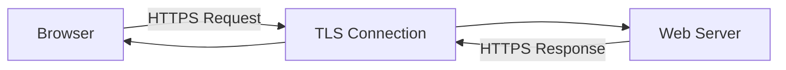
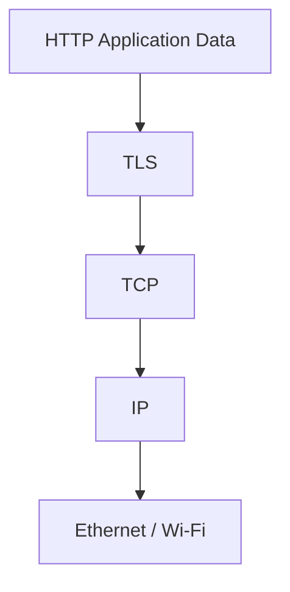
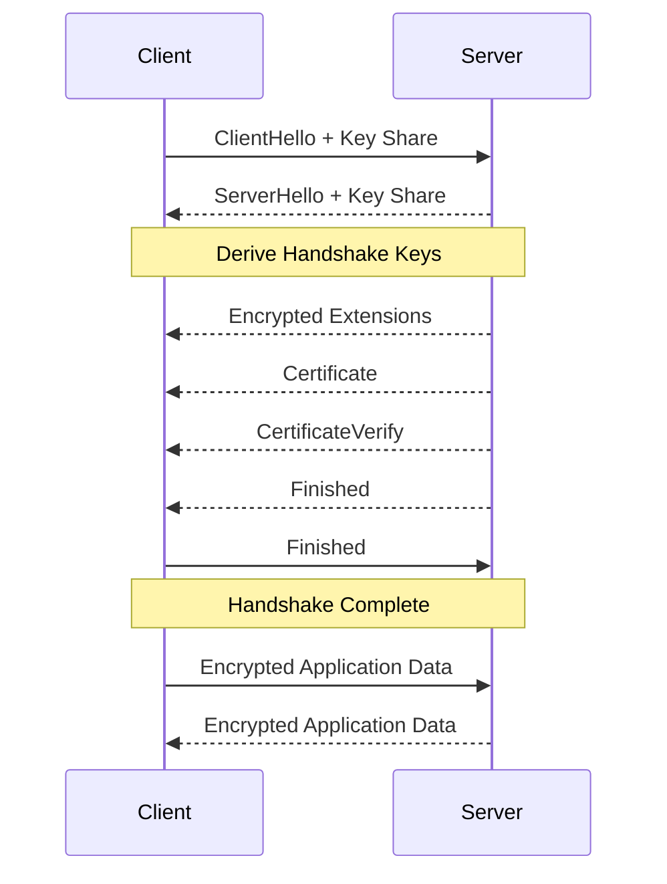
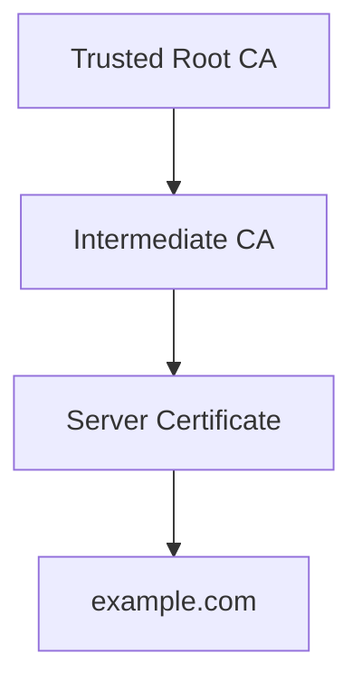
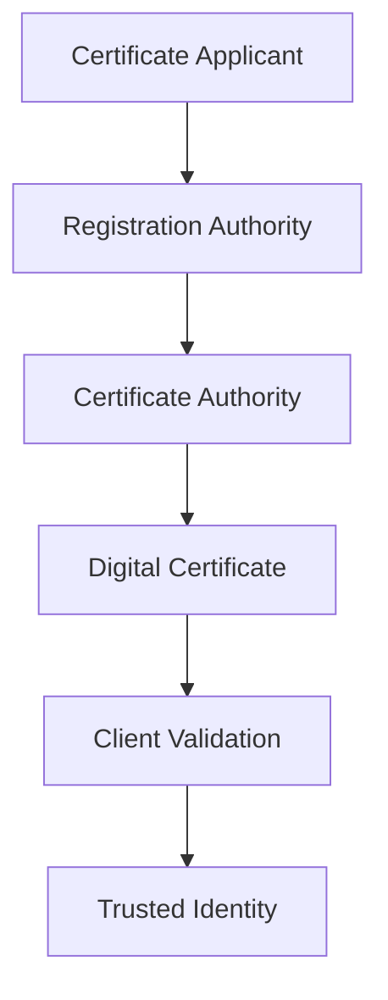
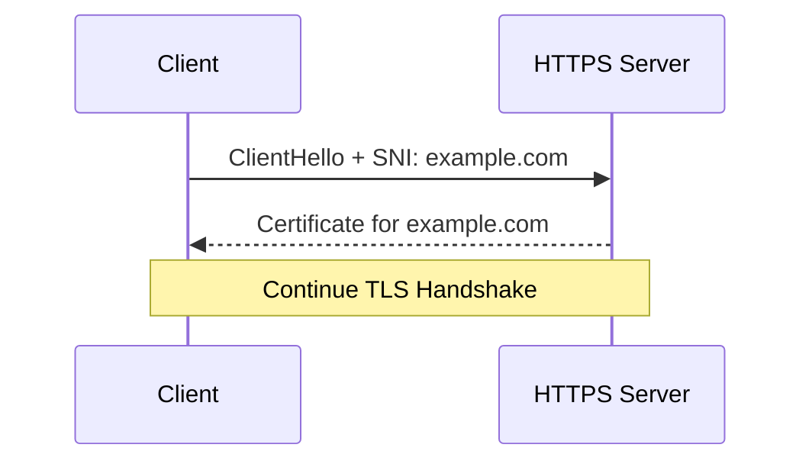
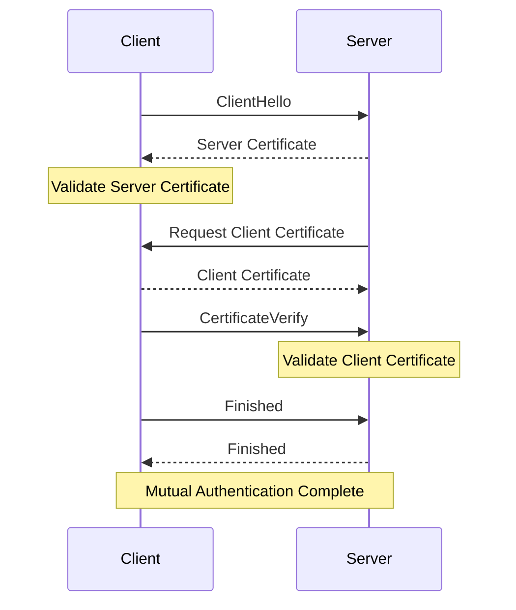

# HTTPS and TLS (Hypertext Transfer Protocol Secure)

**HTTPS (Hypertext Transfer Protocol Secure)** is the secure version of HTTP. It protects communication between clients and servers using Transport Layer Security (TLS).

HTTPS provides three important security properties:

* **Confidentiality:** Prevents unauthorized parties from reading transmitted data.
* **Integrity:** Helps detect unauthorized modification of transmitted data.
* **Authentication:** Allows clients to verify the identity of servers through digital certificates.

HTTPS is widely used for websites, REST APIs, authentication systems, online banking, e-commerce, and other applications that exchange sensitive information.

### 🖆 HTTPS Communication

When a browser accesses:

```text
https://example.com
```

It establishes a secure connection with the server before exchanging protected HTTP messages.

The default HTTPS port is:

```text
TCP 443
```

HTTP/1.1 and HTTP/2 commonly use TLS over TCP. HTTP/3 uses QUIC over UDP, with TLS 1.3 integrated into the QUIC handshake.

### 🖆 HTTPS at Different Network Layers

| Layer | Protocol or Technology |
| --- | --- |
| Application | HTTP |
| Security | TLS |
| Transport | TCP for HTTP/1.1 and HTTP/2 |
| Transport | QUIC over UDP for HTTP/3 |
| Network | IPv4 or IPv6 |
| Data Link | Ethernet, Wi-Fi, etc. |

# 🗁 HTTPS Fundamentals

HTTPS is HTTP communication protected by TLS.

Without HTTPS, HTTP messages can be transmitted without transport encryption. Network intermediaries may be able to inspect or modify the application data.

With HTTPS, TLS protects the communication between the client and the server.

### 🖆 Basic HTTPS Architecture



### 🖆 Example

Suppose a user submits login credentials.

Without HTTPS:

```http
POST /login HTTP/1.1
Host: example.com
Content-Type: application/json

{
    "username": "user",
    "password": "secret"
}
```

The HTTP request is not protected by TLS.

With HTTPS, the HTTP request is transmitted inside an encrypted TLS connection. A network observer can generally see connection metadata, but cannot directly read the protected HTTP content.

# 🗁 Why HTTPS Is Needed

HTTPS protects web communication against several network-based threats.

### 🖆 Confidentiality

TLS encrypts application data so unauthorized network observers cannot read its contents.

For example, login credentials, API tokens, and personal information are protected while traveling across the network.

### 🖆 Integrity

TLS uses authenticated encryption to detect unauthorized modifications to protected records.

An attacker cannot silently modify protected application data without causing authentication failure.

### 🖆 Authentication

TLS commonly authenticates the server through a digital certificate.

The browser verifies that the certificate is valid for the requested hostname and chains to a trusted certificate authority.

### 🖆 Protection Against Network Attacks

HTTPS helps protect against:

* Passive traffic interception.
* Man-in-the-middle attacks.
* Unauthorized modification of transmitted data.
* Credential exposure during network transmission.
* Session data interception.

### 🖆 Why Websites Use HTTPS

* Secure login and registration.
* Protect payment information.
* Protect API communication.
* Improve user privacy.
* Support modern browser security features.
* Enable secure cookies and other security mechanisms.

# 🗁 HTTP vs HTTPS

HTTP and HTTPS use the same application-level HTTP semantics, but HTTPS adds a secure transport layer.

| Feature | HTTP | HTTPS |
| --- | --- | --- |
| Full name | Hypertext Transfer Protocol | Hypertext Transfer Protocol Secure |
| Default port | 80 | 443 |
| Encryption | No TLS protection | TLS protection |
| Integrity protection | Not provided by HTTP itself | Provided by TLS |
| Server authentication | No TLS certificate authentication | Commonly uses certificates |
| Network visibility | HTTP content is readable in transit | HTTP content is encrypted |
| URL scheme | `http://` | `https://` |

### 🖆 HTTP Communication

```text
Client
   |
   | HTTP Request
   |
Network
   |
   | HTTP Response
   |
Server
```

### 🖆 HTTPS Communication

```text
Client
   |
   | Encrypted HTTPS Data
   |
TLS Connection
   |
   | Encrypted HTTPS Data
   |
Server
```

HTTPS does not hide all communication metadata. IP addresses, ports, traffic timing, and data volume may remain observable. Depending on the connection and network configuration, the hostname may also be visible through mechanisms such as DNS queries or TLS handshake metadata.

# 🗁 What Is TLS

**Transport Layer Security (TLS)** is a cryptographic protocol designed to provide secure communication over a network.

TLS is used by HTTPS and many other network protocols.

Examples include:

* HTTPS.
* Secure SMTP.
* IMAPS.
* POP3S.
* Secure LDAP.
* Some VPN and application protocols.

### 🖆 TLS Versions

| Version | Status |
| --- | --- |
| SSL 2.0 | Obsolete and insecure |
| SSL 3.0 | Obsolete and insecure |
| TLS 1.0 | Deprecated |
| TLS 1.1 | Deprecated |
| TLS 1.2 | Widely deployed and secure when properly configured |
| TLS 1.3 | Modern TLS version |

TLS 1.3 simplifies the handshake, removes several outdated cryptographic mechanisms, and improves connection establishment.

### 🖆 TLS Responsibilities

TLS provides:

* Secure key establishment.
* Server authentication.
* Optional client authentication.
* Encrypted application data.
* Integrity and authenticity protection.
* Session resumption mechanisms.

# 🗁 SSL vs TLS

**Secure Sockets Layer (SSL)** was the predecessor to TLS.

SSL was developed to secure network communication before TLS replaced it.

Although people sometimes use the term SSL informally, modern secure connections should use TLS.

### 🖆 SSL and TLS Comparison

| Feature | SSL | TLS |
| --- | --- | --- |
| Full name | Secure Sockets Layer | Transport Layer Security |
| Status | Obsolete | Current protocol family |
| Security | Insecure | Modern secure versions available |
| Key establishment | Older mechanisms | Modern cryptographic mechanisms |
| Recommended usage | None | TLS 1.2 or TLS 1.3 |

### 🖆 Important Note

SSL 2.0, SSL 3.0, TLS 1.0, and TLS 1.1 should not be enabled in modern production configurations.

Use TLS 1.2 and TLS 1.3, with TLS 1.3 preferred where compatibility permits.

# 🗁 TLS Security Properties

TLS provides multiple security properties through cryptographic mechanisms.

### 🖆 Confidentiality

Application data is encrypted using symmetric encryption after the TLS handshake establishes traffic keys.

### 🖆 Integrity and Authenticity

Authenticated encryption protects application records against unauthorized modification and forgery.

### 🖆 Authentication

The server presents a certificate that the client validates.

The certificate binds a public key to an identity, such as a DNS hostname.

### 🖆 Forward Secrecy

Modern ephemeral key-exchange mechanisms can protect previously established sessions even if the server's long-term private key is compromised later.

### 🖆 Authentication Limitations

A valid TLS certificate establishes that the certificate is trusted for the requested identity under the client's validation rules.

It does not prove that:

* The website is honest.
* The application is free from vulnerabilities.
* The server has no malware.
* The organization is trustworthy.
* The requested operation is safe.

TLS protects communication, not the complete application.

# 🗁 TLS Architecture

TLS sits between application protocols and the underlying transport mechanism.

For HTTPS over TCP, HTTP data is protected by TLS before being transmitted through TCP.

### 🖆 HTTPS over TCP



### 🖆 TLS Communication

```text
HTTP Application
       |
       v
TLS Encryption
       |
       v
TCP Transport
       |
       v
IP Network
       |
       v
Physical Network
```

### 🖆 TLS over TCP vs TLS in QUIC

HTTP/1.1 and HTTP/2 commonly use TLS over TCP.

HTTP/3 uses QUIC, which integrates TLS 1.3 handshake and security mechanisms into its transport protocol.

TLS 1.3 is therefore used by both conventional TLS-over-TCP applications and QUIC-based HTTP/3, but the record and transport integration differ.

# 🗁 TLS Handshake

The TLS handshake establishes the cryptographic parameters and keys required to protect communication.

During the handshake, the client and server negotiate security settings, authenticate the server, and establish shared traffic secrets.

### 🖆 TLS 1.3 Handshake

A simplified TLS 1.3 handshake follows this process:

**ClientHello**

The client sends its initial handshake message containing information such as:

* Supported TLS versions.
* Supported cipher suites.
* Key-share information.
* Supported extensions.
* Server Name Indication, when used.

Example conceptual information:

```text
ClientHello
    Supported Versions: TLS 1.3, TLS 1.2
    Cipher Suites: TLS_AES_128_GCM_SHA256
    Server Name: example.com
    Key Share: Client Ephemeral Public Key
```

**ServerHello**

The server selects the TLS version, cipher suite, and key-exchange parameters.

It sends its own key-share information.

Both sides can now derive shared handshake secrets.

**Encrypted Extensions**

The server sends additional negotiated extension information protected by the newly established handshake keys.

**Certificate**

The server sends its certificate chain to identify itself.

**CertificateVerify**

The server proves possession of the private key corresponding to its certificate by signing handshake information.

**Finished**

The server sends a Finished message containing a cryptographic verification value derived from the handshake transcript.

The client validates the message and sends its own Finished message.

**Application Data**

After the handshake completes, both parties can exchange encrypted application data.

### 🖆 TLS 1.3 Handshake Diagram



### 🖆 What Happens During Key Exchange?

The client and server exchange ephemeral public key material.

Using a supported key-exchange mechanism, both sides independently derive the same shared secret.

The shared secret is then used by the TLS key schedule to derive encryption keys.

The shared secret itself is not transmitted over the network.

### 🖆 Why Is the Certificate Important?

The key exchange establishes shared secrets, but the certificate allows the client to authenticate the server's identity.

Without authentication, an attacker could potentially establish separate encrypted connections with the client and server and perform a man-in-the-middle attack.

# 🗁 TLS 1.2 vs TLS 1.3

TLS 1.2 and TLS 1.3 are widely recognized TLS versions.

TLS 1.3 simplifies the handshake and removes several outdated cryptographic mechanisms.

### 🖆 Comparison

| Feature | TLS 1.2 | TLS 1.3 |
| --- | --- | --- |
| Handshake | Typically two round trips for a full handshake | Typically one round trip |
| Key exchange | Supports older and modern mechanisms | Uses ephemeral key exchange |
| Static RSA key exchange | Supported by older configurations | Removed |
| Cipher suites | More configurable combinations | Simplified AEAD-based suites |
| Forward secrecy | Depends on key-exchange configuration | Standard handshake uses ephemeral key exchange |
| 0-RTT | Not supported | Supported with limitations |
| Legacy cryptography | Some older mechanisms existed | Several obsolete mechanisms removed |

### 🖆 TLS 1.2 Handshake

A typical TLS 1.2 full handshake requires additional message exchanges compared with TLS 1.3.

The exact sequence depends on the cipher suite and whether session resumption is used.

### 🖆 TLS 1.3 Handshake

TLS 1.3 typically completes a full handshake in one round trip after the initial ClientHello.

This can reduce connection-establishment latency.

### 🖆 0-RTT Data

TLS 1.3 supports early data in certain resumed sessions.

The client can send application data with its initial connection flight.

However, 0-RTT data has replay-related limitations and should generally be restricted to operations designed to be replay-safe.

# 🗁 TLS Record Protocol

The TLS record layer protects application data and certain TLS protocol messages.

In TLS 1.2 and earlier, the record protocol handles encryption and integrity protection using the negotiated record protection mechanism.

TLS 1.3 uses an authenticated encryption mechanism for protected records.

### 🖆 Simplified TLS Record Processing

```text
Application Data
       |
       v
TLS Record Processing
       |
       v
Authenticated Encryption
       |
       v
Protected TLS Record
       |
       v
Transport Layer
```

### 🖆 TLS 1.3 Record Protection

TLS 1.3 commonly uses AEAD algorithms.

AEAD means Authenticated Encryption with Associated Data.

AEAD provides:

* Confidentiality.
* Integrity.
* Authentication of protected record data.

Examples of supported TLS 1.3 cipher suites include:

* AES-128-GCM.
* AES-256-GCM.
* ChaCha20-Poly1305.

TLS record protection is separate from the HTTP message format.

# 🗁 Cryptography Used in TLS

TLS uses multiple cryptographic mechanisms together.

Each mechanism has a different responsibility.

### 🖆 Symmetric Encryption

Symmetric encryption uses the same secret key for encryption and decryption.

It is used to protect application data efficiently.

Examples:

* AES-GCM.
* ChaCha20-Poly1305.

### 🖆 Asymmetric Cryptography

Asymmetric cryptography uses a public key and a private key.

TLS certificates commonly use public-key cryptography for authentication.

Common public-key algorithms include:

* RSA.
* ECDSA.
* EdDSA.

### 🖆 Key Exchange

Key-exchange mechanisms allow both parties to establish shared secrets over an untrusted network.

Modern TLS commonly uses ephemeral Diffie-Hellman key exchange.

Examples:

* ECDHE.
* DHE.

### 🖆 Hash Functions

Hash functions produce fixed-length digests from input data.

TLS uses hash functions in:

* Certificate signatures.
* Handshake transcript processing.
* Key derivation.
* Message authentication mechanisms.

Examples include:

* SHA-256.
* SHA-384.

### 🖆 Cryptographic Responsibilities

| Mechanism | Responsibility |
| --- | --- |
| AES-GCM | Symmetric authenticated encryption |
| ChaCha20-Poly1305 | Symmetric authenticated encryption |
| RSA | Public-key operations and certificate signatures |
| ECDSA | Digital signatures |
| ECDHE | Ephemeral elliptic-curve key exchange |
| SHA-256 | Cryptographic hashing |
| HKDF | Key derivation |

# 🗁 Symmetric vs Asymmetric Encryption

TLS uses both symmetric and asymmetric cryptographic mechanisms because they solve different problems.

### 🖆 Symmetric Encryption

Symmetric encryption uses one shared secret key.

```text
Plaintext
    |
    v
Encryption + Secret Key
    |
    v
Ciphertext
    |
    v
Decryption + Same Secret Key
    |
    v
Plaintext
```

Advantages:

* Fast encryption and decryption.
* Efficient for large amounts of data.
* Lower computational overhead.

Disadvantage:

* Both parties must securely establish the shared secret.

### 🖆 Asymmetric Encryption

Asymmetric cryptography uses a key pair.

```text
Public Key
    |
    v
Cryptographic Operation
    |
    v
Private Key
```

Public and private keys have different roles depending on the cryptographic operation.

For digital signatures:

* The private key creates a signature.
* The public key verifies the signature.

For encryption systems that support public-key encryption:

* The public key encrypts.
* The corresponding private key decrypts.

Modern TLS 1.3 does not use RSA key transport for establishing session secrets. It uses ephemeral key exchange and certificate-based authentication.

### 🖆 Why TLS Uses Both

Asymmetric cryptography helps authenticate the server and establish shared secrets.

Symmetric cryptography then protects application data efficiently.

This combination provides strong security without requiring expensive public-key operations for every transmitted data block.

# 🗁 Digital Certificates

A digital certificate is an electronic document that binds an identity to a public key.

TLS servers commonly present X.509 certificates during the handshake.

### 🖆 Certificate Information

A certificate may contain:

| Field | Description |
| --- | --- |
| Subject | Entity identified by the certificate |
| Subject Alternative Name | Hostnames or identities covered by the certificate |
| Issuer | Certificate authority that issued the certificate |
| Public Key | Subject's public key |
| Serial Number | Unique certificate identifier assigned by the issuer |
| Validity | Not Before and Not After timestamps |
| Signature Algorithm | Algorithm used by the issuer to sign the certificate |
| Signature | Issuer's digital signature |

### 🖆 Example Certificate Information

```text
Subject:
    CN = example.com

Issuer:
    Example Certificate Authority

Subject Alternative Name:
    DNS:example.com
    DNS:www.example.com

Validity:
    Not Before: 2026-01-01
    Not After: 2027-01-01

Public Key:
    RSA 2048-bit
```

The example is illustrative. Modern hostname verification uses Subject Alternative Name rather than relying on the Common Name field.

### 🖆 Certificate Chain

A server commonly sends:

* Its own certificate.
* One or more intermediate CA certificates.

The client builds and validates a certificate chain to a trusted root certificate.



The root certificate is commonly stored in the client's trusted certificate store and does not normally need to be transmitted by the server.

# 🗁 Public Key Infrastructure

**Public Key Infrastructure (PKI)** is a system of policies, cryptographic keys, certificates, and trusted authorities used to establish and manage digital identities.

PKI supports secure communication by providing a framework for issuing, validating, renewing, and revoking certificates.

### 🖆 PKI Components

**Certificate Authority (CA)**

An entity that issues and digitally signs certificates.

**Registration Authority (RA)**

An entity responsible for verifying certificate applicants or identities on behalf of a CA.

**Digital Certificate**

A signed document containing an identity and its public key.

**Public and Private Keys**

A cryptographic key pair associated with an identity.

**Certificate Revocation List (CRL)**

A published list of certificates revoked by a CA.

**Online Certificate Status Protocol (OCSP)**

A protocol used to obtain certificate status information.

### 🖆 PKI Architecture



### 🖆 PKI Uses

* HTTPS certificates.
* Client authentication.
* Email security.
* Code signing.
* Enterprise device authentication.
* VPN authentication.
* Network access control.

# 🗁 Certificate Authorities

A Certificate Authority is a trusted entity responsible for issuing and signing digital certificates.

Browsers and operating systems maintain trusted root CA certificates.

When a browser receives a server certificate, it checks whether the certificate chains to a trusted root and satisfies the applicable validation requirements.

### 🖆 Public Certificate Authorities

Public CAs issue certificates trusted by commonly used browsers and operating systems.

Examples:

* Let's Encrypt.
* DigiCert.
* GlobalSign.
* Sectigo.

### 🖆 Private Certificate Authorities

Organizations can operate their own private CA infrastructure.

Private CAs are commonly used for:

* Internal applications.
* Enterprise services.
* Private APIs.
* Internal VPN infrastructure.
* Device authentication.

Clients must trust the private CA certificate to validate certificates issued by it.

### 🖆 Public CA vs Private CA

| Feature | Public CA | Private CA |
| --- | --- | --- |
| Trust scope | Public browser and OS trust stores | Configured organizational trust stores |
| Typical usage | Public websites | Internal infrastructure |
| Validation | CA-defined public validation process | Organization-defined policy |
| Management | External provider or CA | Organization |

# 🗁 Certificate Validation

When a browser connects to an HTTPS server, it validates the server certificate.

Certificate validation involves several checks.

### 🖆 Certificate Chain Validation

The client verifies that the certificate chains to a trusted root CA.

### 🖆 Hostname Validation

The requested hostname must match a DNS name listed in the certificate's Subject Alternative Name extension.

For example:

```text
Requested Hostname:
example.com

Certificate SAN:
DNS:example.com
DNS:www.example.com
```

The certificate covers the requested hostname.

### 🖆 Validity Period

The certificate must be within its validity period.

The client checks:

```text
Not Before
Not After
```

### 🖆 Digital Signature Validation

The client verifies the certificate signatures in the chain using the corresponding issuer public keys.

### 🖆 Basic Constraints and Key Usage

The client checks certificate extensions such as:

* Basic Constraints.
* Key Usage.
* Extended Key Usage.

These determine how a certificate may be used.

### 🖆 Revocation Status

The client or application may check certificate revocation information using CRLs, OCSP, or other mechanisms.

The exact revocation-checking behavior depends on the client implementation and policy.

### 🖆 Certificate Validation Summary

| Validation | Purpose |
| --- | --- |
| Chain validation | Establish trust in the issuer |
| Hostname validation | Verify the requested server identity |
| Validity period | Ensure the certificate is currently valid |
| Signature verification | Verify certificate authenticity |
| Key usage | Confirm permitted certificate usage |
| Revocation checking | Determine whether the certificate was revoked |

# 🗁 Certificate Types

TLS certificates can be categorized by validation level and intended usage.

### 🖆 Domain Validation (DV)

A DV certificate verifies control over a domain name.

It is commonly used for public websites and APIs.

### 🖆 Organization Validation (OV)

An OV certificate includes additional organization identity validation by the CA.

### 🖆 Extended Validation (EV)

An EV certificate requires a more extensive organization validation process.

Modern browsers generally no longer display a special prominent EV identity indicator in the address bar as they historically did.

### 🖆 Wildcard Certificate

A wildcard certificate covers a domain and matching subdomains at a particular DNS label level.

Example:

```text
*.example.com
```

This can cover:

```text
www.example.com
api.example.com
mail.example.com
```

It does not automatically cover:

```text
example.com
sub.api.example.com
```

### 🖆 SAN Certificate

A Subject Alternative Name certificate can cover multiple DNS names.

Example:

```text
example.com
www.example.com
api.example.com
```

### 🖆 Certificate Type Comparison

| Type | Main Purpose |
| --- | --- |
| DV | Validate domain control |
| OV | Validate domain and organization information |
| EV | Perform extended organization validation |
| Wildcard | Cover matching subdomains |
| SAN | Cover multiple specified identities |

# 🗁 Server Name Indication

**Server Name Indication (SNI)** is a TLS extension that allows a client to indicate the hostname it wants to connect to during the TLS handshake.

SNI is important when multiple HTTPS websites share the same IP address.

### 🖆 Why SNI Is Needed

Consider a server hosting:

```text
example.com
api.example.com
shop.example.com
```

All three websites use:

```text
203.0.113.10
```

The server needs to determine which hostname the client wants before selecting the appropriate certificate.

SNI provides the requested hostname during the TLS handshake.

### 🖆 SNI Communication



### 🖆 Important Consideration

Traditional SNI is visible in the TLS ClientHello.

Encrypted ClientHello (ECH) is designed to protect sensitive ClientHello information, including the server name, when supported and properly deployed.

# 🗁 ALPN

**Application-Layer Protocol Negotiation (ALPN)** is a TLS extension used to negotiate the application protocol over a secure connection.

For HTTPS, ALPN commonly helps select the HTTP version.

### 🖆 Common ALPN Identifiers

| Identifier | Protocol |
| --- | --- |
| `http/1.1` | HTTP/1.1 |
| `h2` | HTTP/2 |
| `h3` | HTTP/3 |

### 🖆 ALPN Example

A client might advertise:

```text
Supported Protocols:
    h2
    http/1.1
```

The server selects a mutually supported protocol.

For HTTP/3, protocol negotiation is integrated with QUIC rather than using the conventional TLS-over-TCP ALPN exchange.

# 🗁 Perfect Forward Secrecy

**Perfect Forward Secrecy (PFS)** is a security property that protects previously established communication sessions if a long-term private key is compromised later.

### 🖆 Without Forward Secrecy

Suppose a server uses static RSA key exchange.

An attacker records encrypted traffic and later obtains the server's private key.

Depending on the historical key-exchange mechanism, the attacker may be able to recover previously established session secrets from recorded traffic.

### 🖆 With Forward Secrecy

Ephemeral key-exchange mechanisms create temporary session-specific secrets.

For example:

```text
Client Ephemeral Key
          +
Server Ephemeral Key
          |
          v
    Shared Secret
          |
          v
   Session Traffic Keys
```

Compromising the server's long-term certificate private key does not, by itself, reveal previously established ephemeral session secrets.

### 🖆 ECDHE

Elliptic Curve Diffie-Hellman Ephemeral (ECDHE) is a common key-exchange mechanism used to establish shared secrets.

TLS 1.3 uses ephemeral key exchange for its standard full handshake.

# 🗁 TLS Session Resumption

TLS session resumption allows a client and server to establish a subsequent secure connection with less handshake overhead.

It can reduce latency and computational cost.

### 🖆 TLS 1.2 Session Resumption

TLS 1.2 supports session identifiers and session tickets.

These allow clients and servers to resume previously established sessions.

### 🖆 TLS 1.3 Session Resumption

TLS 1.3 uses session tickets and pre-shared keys (PSKs).

A client can use a previously established session's resumption information to resume a connection.

### 🖆 0-RTT Early Data

TLS 1.3 can allow a client to send early application data when resuming a session.

However, early data can be replayed under certain conditions.

Applications should restrict 0-RTT to operations that are safe to replay or otherwise protected against replay effects.

# 🗁 Mutual TLS

**Mutual TLS (mTLS)** is a TLS authentication model in which both the client and server authenticate each other using certificates.

Traditional HTTPS generally authenticates the server to the client.

With mTLS, the server also requests and validates a client certificate.

### 🖆 Traditional TLS vs Mutual TLS

| Feature | Traditional HTTPS | Mutual TLS |
| --- | --- | --- |
| Server certificate | Required | Required |
| Client certificate | Usually not required | Required by server policy |
| Server authentication | Yes | Yes |
| Client certificate authentication | No | Yes |
| Common use | Public websites | APIs, microservices, enterprise systems |

### 🖆 mTLS Architecture



### 🖆 Common mTLS Use Cases

* Service-to-service authentication.
* Internal APIs.
* Financial systems.
* Zero-trust architectures.
* Enterprise device authentication.
* Private network services.

# 🗁 HTTPS and HTTP Versions

HTTPS can operate with different HTTP versions, but their transport integration differs.

### 🖆 HTTP/1.1 over TLS

```text
HTTP/1.1
    |
   TLS
    |
   TCP
    |
    IP
```

### 🖆 HTTP/2 over TLS

```text
HTTP/2
    |
   TLS
    |
   TCP
    |
    IP
```

HTTP/2 commonly uses ALPN to negotiate `h2`.

### 🖆 HTTP/3 over QUIC

```text
HTTP/3
    |
   QUIC + TLS 1.3
    |
   UDP
    |
    IP
```

QUIC integrates TLS 1.3 handshake and encryption mechanisms.

### 🖆 Protocol Comparison

| HTTP Version | Security Mechanism | Transport |
| --- | --- | --- |
| HTTP/1.1 | TLS for HTTPS | TCP |
| HTTP/2 | TLS for common browser deployments | TCP |
| HTTP/3 | Integrated TLS 1.3 through QUIC | UDP |

# 🗁 HTTPS Configuration on Ubuntu

Nginx can serve HTTPS websites by using a certificate and its corresponding private key.

### 🖆 Install Nginx

```bash
sudo apt update
sudo apt install nginx
```

Check the service:

```bash
sudo systemctl status nginx
```

### 🖆 Create a Self-Signed Certificate

A self-signed certificate is useful for local development and laboratory testing.

Create a directory:

```bash
sudo mkdir -p /etc/nginx/ssl
```

Generate a private key and self-signed certificate:

```bash
sudo openssl req -x509 -nodes -days 365 \
  -newkey rsa:2048 \
  -keyout /etc/nginx/ssl/example.key \
  -out /etc/nginx/ssl/example.crt
```

The command creates:

```text
example.key
example.crt
```

The private key must be protected and should not be distributed publicly.

### 🖆 Configure Nginx for HTTPS

Create a server block:

```bash
sudo nano /etc/nginx/sites-available/example
```

Example configuration:

```nginx
server {
    listen 443 ssl;
    listen [::]:443 ssl;

    server_name example.local;

    root /var/www/example;
    index index.html;

    ssl_certificate /etc/nginx/ssl/example.crt;
    ssl_certificate_key /etc/nginx/ssl/example.key;

    location / {
        try_files $uri $uri/ =404;
    }
}
```

Enable the configuration:

```bash
sudo ln -s /etc/nginx/sites-available/example /etc/nginx/sites-enabled/
```

Validate the configuration:

```bash
sudo nginx -t
```

Reload Nginx:

```bash
sudo systemctl reload nginx
```

### 🖆 Configure HTTP to HTTPS Redirection

Add a separate HTTP server block:

```nginx
server {
    listen 80;
    listen [::]:80;

    server_name example.local;

    return 301 https://$host$request_uri;
}
```

This redirects HTTP requests to HTTPS.

### 🖆 Test the HTTPS Server

```bash
curl -k -I https://localhost
```

The `-k` option disables certificate verification for this test. It is useful with self-signed certificates in a controlled lab environment.

For normal certificate validation, use:

```bash
curl -I https://example.local
```

The hostname must resolve to the server, and the certificate must be trusted and valid for that hostname.

# 🗁 Let's Encrypt and Certbot

Let's Encrypt is a public certificate authority that provides free domain-validated TLS certificates.

Certbot is a client that automates certificate issuance and installation.

### 🖆 Requirements

* A publicly registered domain name.
* DNS records pointing to the server.
* A publicly reachable server.
* Appropriate firewall access for the selected ACME validation method.

### 🖆 Install Certbot

On Ubuntu, one supported installation method is through Snap.

Install Snap support if necessary:

```bash
sudo apt update
sudo apt install snapd
```

Install Certbot:

```bash
sudo snap install --classic certbot
```

Create the command link:

```bash
sudo ln -s /snap/bin/certbot /usr/local/bin/certbot
```

### 🖆 Obtain a Certificate for Nginx

```bash
sudo certbot --nginx -d example.com -d www.example.com
```

Certbot can obtain the certificate and configure Nginx for HTTPS.

### 🖆 Test Automatic Renewal

```bash
sudo certbot renew --dry-run
```

### 🖆 Check Certificate Information

```bash
sudo certbot certificates
```

### 🖆 Important Certificate Files

Certbot commonly stores certificates under:

```text
/etc/letsencrypt/live/example.com/
```

Common files:

| File | Purpose |
| --- | --- |
| `fullchain.pem` | Server certificate and intermediate certificates |
| `privkey.pem` | Server private key |
| `cert.pem` | Server certificate |
| `chain.pem` | Intermediate certificate chain |

Nginx commonly uses:

```nginx
ssl_certificate /etc/letsencrypt/live/example.com/fullchain.pem;
ssl_certificate_key /etc/letsencrypt/live/example.com/privkey.pem;
```

# 🗁 TLS Testing and Troubleshooting

TLS troubleshooting requires checking certificate validity, hostname matching, supported protocol versions, handshake negotiation, and server configuration.

### 🖆 Check TLS Certificate Details

```bash
openssl s_client -connect example.com:443 -servername example.com
```

This connects to the server and displays certificate and handshake information.

### 🖆 Display Certificate Information

```bash
openssl s_client -connect example.com:443 \
  -servername example.com </dev/null
```

### 🖆 Inspect a Certificate File

```bash
openssl x509 -in certificate.crt -text -noout
```

Display only the validity period:

```bash
openssl x509 -in certificate.crt -dates -noout
```

Display the Subject Alternative Names:

```bash
openssl x509 -in certificate.crt -ext subjectAltName -noout
```

### 🖆 Verify a Certificate Chain

```bash
openssl verify -CAfile ca-bundle.crt certificate.crt
```

The CA bundle must contain the appropriate trusted issuer certificates.

### 🖆 Test TLS 1.2

```bash
openssl s_client -connect example.com:443 \
  -servername example.com -tls1_2
```

### 🖆 Test TLS 1.3

```bash
openssl s_client -connect example.com:443 \
  -servername example.com -tls1_3
```

### 🖆 Inspect HTTPS Response

```bash
curl -Iv https://example.com
```

This displays verbose connection and TLS information.

### 🖆 Common TLS Errors

| Error | Possible Cause |
| --- | --- |
| Certificate expired | Certificate validity period ended |
| Hostname mismatch | Requested hostname is not covered by the certificate |
| Unknown CA | Issuer is not trusted by the client |
| Self-signed certificate | Certificate is not chained to a trusted CA |
| Handshake failure | No compatible TLS parameters or another handshake error |
| Protocol version error | Client and server cannot negotiate a supported TLS version |
| Certificate revoked | Certificate has been revoked |
| Private key mismatch | Certificate and configured private key do not correspond |
| Incomplete certificate chain | Required intermediate certificate is missing |

### 🖆 Troubleshooting Checklist

* Verify DNS resolution.
* Confirm the server is listening on port 443.
* Check firewall rules.
* Verify certificate validity dates.
* Confirm the hostname matches the certificate SAN.
* Verify the certificate chain.
* Check that the private key matches the certificate.
* Confirm supported TLS versions.
* Inspect cipher suite compatibility.
* Check SNI configuration.
* Inspect web server logs.
* Test with OpenSSL and curl.

# 🗁 Common TLS Commands

### 🖆 OpenSSL

Display OpenSSL version:

```bash
openssl version
```

Generate a private RSA key:

```bash
openssl genrsa -out private.key 2048
```

Generate a certificate signing request:

```bash
openssl req -new \
  -key private.key \
  -out request.csr
```

Inspect a certificate:

```bash
openssl x509 -in certificate.crt -text -noout
```

Calculate a certificate fingerprint:

```bash
openssl x509 -in certificate.crt \
  -fingerprint -sha256 -noout
```

Inspect a TLS connection:

```bash
openssl s_client -connect example.com:443 \
  -servername example.com
```

### 🖆 curl

Test HTTPS:

```bash
curl -I https://example.com
```

Display TLS and connection details:

```bash
curl -v https://example.com
```

Specify TLS 1.2:

```bash
curl --tlsv1.2 --tls-max 1.2 -I https://example.com
```

Specify TLS 1.3:

```bash
curl --tlsv1.3 -I https://example.com
```

### 🖆 Nginx

Validate configuration:

```bash
sudo nginx -t
```

Reload configuration:

```bash
sudo systemctl reload nginx
```

Check service status:

```bash
systemctl status nginx
```

### 🖆 Certificate Renewal

List Certbot certificates:

```bash
sudo certbot certificates
```

Test renewal:

```bash
sudo certbot renew --dry-run
```

# 🗁 HTTPS Security Best Practices

* Use TLS 1.3 where possible.
* Support TLS 1.2 when compatibility requires it.
* Disable SSL, TLS 1.0, and TLS 1.1.
* Use trusted certificates from recognized certificate authorities.
* Protect private keys with appropriate filesystem permissions.
* Monitor certificate expiration dates.
* Automate certificate renewal.
* Configure correct certificate chains.
* Use strong, modern cipher suites.
* Prefer ephemeral key exchange mechanisms.
* Enable HTTP Strict Transport Security where appropriate.
* Use secure cookies for sensitive sessions.
* Avoid transmitting sensitive information over HTTP.
* Configure correct SNI and hostname validation.
* Monitor TLS handshake failures.
* Consider mutual TLS for internal service authentication.
* Keep TLS libraries and web server software updated.

### 🖆 HSTS Configuration

HSTS instructs browsers to access a domain through HTTPS for a specified duration.

Example Nginx response header:

```nginx
add_header Strict-Transport-Security "max-age=31536000" always;
```

Only enable HSTS after HTTPS is correctly configured for the domain and its intended subdomains.

The `includeSubDomains` directive and preload mechanisms require additional planning because they affect subdomains and future browser access behavior.

# 🗁 Common Mistakes

### 🖆 Confusing SSL and TLS

SSL is obsolete.

TLS is the modern protocol family used to secure HTTPS connections.

### 🖆 Assuming HTTPS Uses a Separate Application Protocol

HTTPS uses HTTP semantics with a secure transport mechanism.

It does not replace HTTP methods, status codes, headers, or message formats.

### 🖆 Assuming Encryption Means Authentication

Encryption alone does not establish the identity of the server.

TLS certificate validation is essential for authenticated HTTPS communication.

### 🖆 Sharing Private Keys

The private key must remain confidential.

Only the corresponding public key is distributed through the certificate.

### 🖆 Ignoring Certificate Hostname Validation

A certificate may be valid and trusted but still not match the requested hostname.

Always verify Subject Alternative Name entries.

### 🖆 Forgetting Intermediate Certificates

A server should provide the required intermediate certificate chain so clients can build a valid trust path.

### 🖆 Assuming HTTPS Hides Everything

HTTPS protects application data, but network metadata such as destination IP addresses, ports, connection timing, and traffic volume can remain visible.

### 🖆 Disabling Certificate Verification in Production

Options such as `curl -k` bypass certificate validation.

They are useful for controlled testing, not normal production communication.

### 🖆 Assuming TLS 1.3 Uses TCP

TLS 1.3 can protect applications over TCP and is integrated into QUIC for HTTP/3 over UDP.

# 🗁 Practical Exercises

### 🖆 Inspect a Public HTTPS Certificate

Run:

```bash
openssl s_client -connect example.com:443 \
  -servername example.com
```

Identify:

* Server certificate.
* Certificate issuer.
* Certificate validity period.
* Negotiated TLS version.
* Negotiated cipher suite.
* Certificate verification result.

### 🖆 Inspect Certificate Fields

Run:

```bash
openssl s_client -connect example.com:443 \
  -servername example.com </dev/null 2>/dev/null |
openssl x509 -noout -subject -issuer -dates
```

Record:

* Subject.
* Issuer.
* Not Before.
* Not After.

### 🖆 Generate a Self-Signed Certificate

Create a private key and certificate:

```bash
openssl req -x509 -nodes -days 365 \
  -newkey rsa:2048 \
  -keyout server.key \
  -out server.crt
```

Inspect the certificate:

```bash
openssl x509 -in server.crt -text -noout
```

### 🖆 Configure Nginx HTTPS

* Install Nginx.
* Generate a self-signed certificate.
* Configure a TLS-enabled server block.
* Enable the site.
* Validate the Nginx configuration.
* Reload Nginx.
* Test the HTTPS connection.

### 🖆 Test TLS Versions

Use OpenSSL to test:

```bash
openssl s_client -connect example.com:443 \
  -servername example.com -tls1_2
```

```bash
openssl s_client -connect example.com:443 \
  -servername example.com -tls1_3
```

Compare the negotiated protocol versions.

### 🖆 Investigate a Certificate Error

Use a test environment to examine:

* An expired certificate.
* A self-signed certificate.
* A hostname mismatch.
* An incomplete certificate chain.

Determine which validation step fails in each case.

### 🖆 Configure Let's Encrypt

On a publicly accessible test domain:

* Install Nginx.
* Configure DNS.
* Obtain a certificate using Certbot.
* Verify the HTTPS connection.
* Test certificate renewal.

# 🗁 Interview Questions

### 🖆 What is HTTPS?

HTTPS is HTTP communication protected by TLS to provide confidentiality, integrity, and authentication.

### 🖆 What is TLS?

TLS is a cryptographic protocol used to secure communication over networks.

### 🖆 What is the difference between HTTP and HTTPS?

HTTP does not provide TLS transport protection, while HTTPS protects HTTP communication using TLS or QUIC security mechanisms.

### 🖆 What is the default HTTPS port?

TCP port 443 is the standard HTTPS port. HTTP/3 commonly uses UDP port 443.

### 🖆 What is the difference between SSL and TLS?

SSL is the obsolete predecessor of TLS. TLS is the modern protocol family used for secure communication.

### 🖆 What happens during a TLS handshake?

The client and server negotiate cryptographic parameters, establish shared secrets, authenticate identities, and derive traffic keys.

### 🖆 What is a digital certificate?

A digital certificate is a signed electronic document that binds an identity to a public key.

### 🖆 What is a Certificate Authority?

A Certificate Authority is a trusted entity that issues and signs digital certificates.

### 🖆 What is PKI?

Public Key Infrastructure is a framework of cryptographic keys, certificates, trusted authorities, and policies used to manage digital identities.

### 🖆 What is SNI?

Server Name Indication is a TLS extension that allows the client to indicate the requested hostname during connection establishment.

### 🖆 What is ALPN?

Application-Layer Protocol Negotiation is a mechanism used to negotiate the application protocol over a secure connection.

### 🖆 What is Perfect Forward Secrecy?

Perfect Forward Secrecy protects previously established session secrets from compromise of the server's long-term private key.

### 🖆 What is ECDHE?

Elliptic Curve Diffie-Hellman Ephemeral is a key-exchange mechanism used to establish shared secrets and provide forward secrecy.

### 🖆 What is mutual TLS?

Mutual TLS authenticates both the server and client using digital certificates.

### 🖆 What is a self-signed certificate?

A self-signed certificate is signed by its own private key rather than by a trusted external CA.

### 🖆 What is the difference between TLS 1.2 and TLS 1.3?

TLS 1.3 simplifies the handshake, removes outdated cryptographic mechanisms, and generally reduces full-handshake latency.

### 🖆 What is a certificate chain?

A certificate chain is a sequence of certificates linking a server certificate through intermediate certificates to a trusted root CA.

### 🖆 What is certificate validation?

Certificate validation checks trust, hostname identity, validity dates, signatures, and applicable certificate constraints.

### 🖆 What is HSTS?

HTTP Strict Transport Security is a response-header mechanism that instructs browsers to use HTTPS for a domain according to a defined policy.

### 🖆 Does HTTPS encrypt DNS queries?

Traditional HTTPS does not automatically encrypt DNS queries. DNS encryption requires separate mechanisms such as DNS over HTTPS or DNS over TLS.

# 🗁 Summary

HTTPS protects HTTP communication through TLS.

Key concepts:

* HTTPS provides confidentiality, integrity, and authentication.
* TLS is the modern security protocol used by HTTPS.
* SSL is obsolete and should not be used.
* TLS handshakes negotiate cryptographic parameters and establish shared secrets.
* Symmetric encryption protects application data efficiently.
* Asymmetric cryptography supports authentication and key establishment.
* Digital certificates bind identities to public keys.
* Certificate Authorities issue trusted certificates.
* PKI provides the infrastructure for managing digital identities.
* SNI supports multiple HTTPS hostnames on a shared IP address.
* ALPN negotiates application protocols.
* ECDHE provides ephemeral key exchange and forward secrecy.
* Mutual TLS authenticates both communication endpoints.
* TLS 1.3 is preferred for modern secure deployments.
* HTTP/3 integrates TLS 1.3 security through QUIC.

Understanding HTTPS and TLS is essential for secure web development, API infrastructure, reverse proxy configuration, and network security.

# 🗁 References

* [RFC 8446 — The Transport Layer Security (TLS) Protocol Version 1.3](https://datatracker.ietf.org/doc/html/rfc8446)
* [RFC 5246 — The Transport Layer Security (TLS) Protocol Version 1.2](https://datatracker.ietf.org/doc/html/rfc5246)
* [RFC 5280 — Internet X.509 Public Key Infrastructure Certificate and CRL Profile](https://datatracker.ietf.org/doc/html/rfc5280)
* [RFC 6066 — TLS Extensions](https://datatracker.ietf.org/doc/html/rfc6066)
* [RFC 7301 — Application-Layer Protocol Negotiation Extension](https://datatracker.ietf.org/doc/html/rfc7301)
* [RFC 6797 — HTTP Strict Transport Security](https://datatracker.ietf.org/doc/html/rfc6797)
* [RFC 9001 — Using TLS to Secure QUIC](https://datatracker.ietf.org/doc/html/rfc9001)
* [RFC 9525 — Service Identity in TLS](https://datatracker.ietf.org/doc/html/rfc9525)
* [Let's Encrypt Documentation](https://letsencrypt.org/docs/)
* [Certbot Documentation](https://eff-certbot.readthedocs.io/)
* [OpenSSL Documentation](https://docs.openssl.org/)
* [Mozilla SSL Configuration Generator](https://ssl-config.mozilla.org/)
