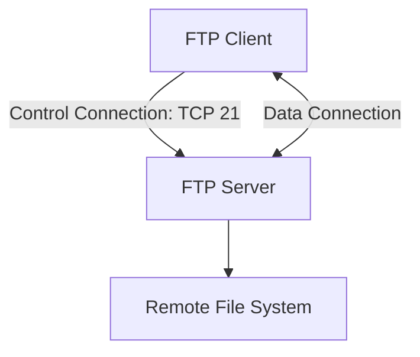
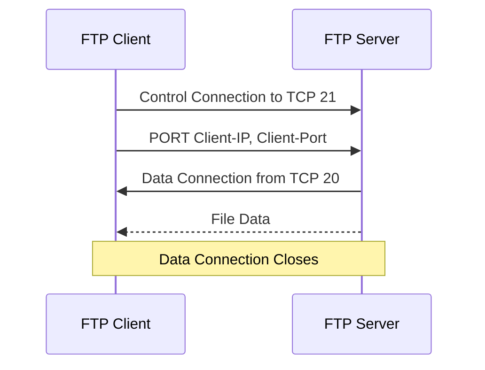
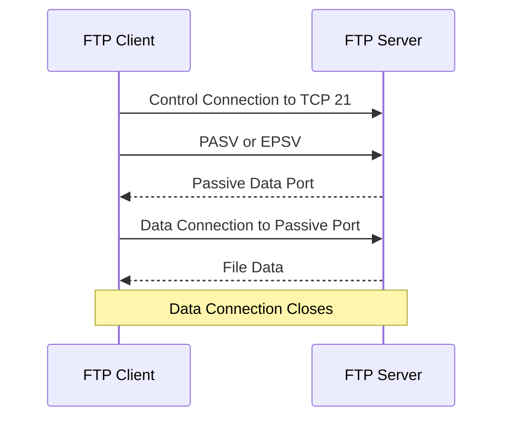
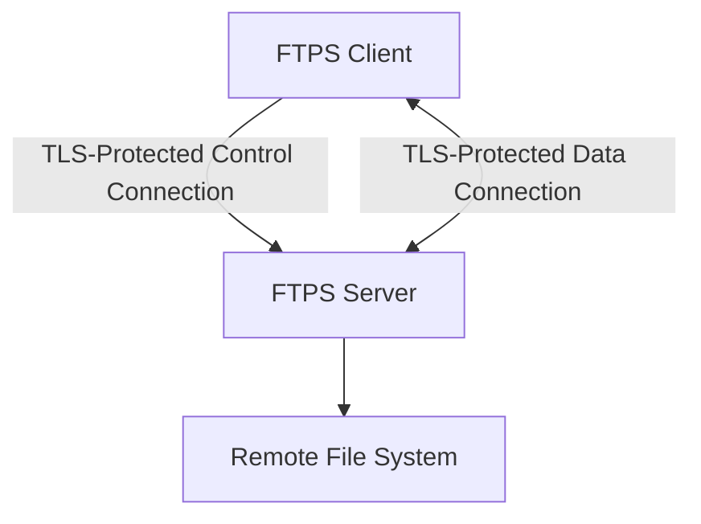
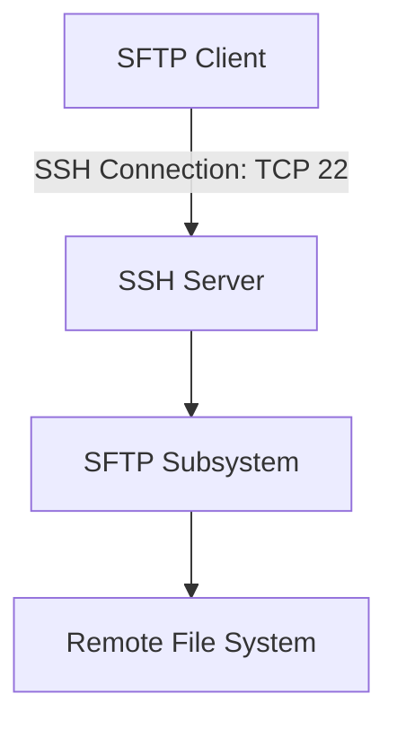
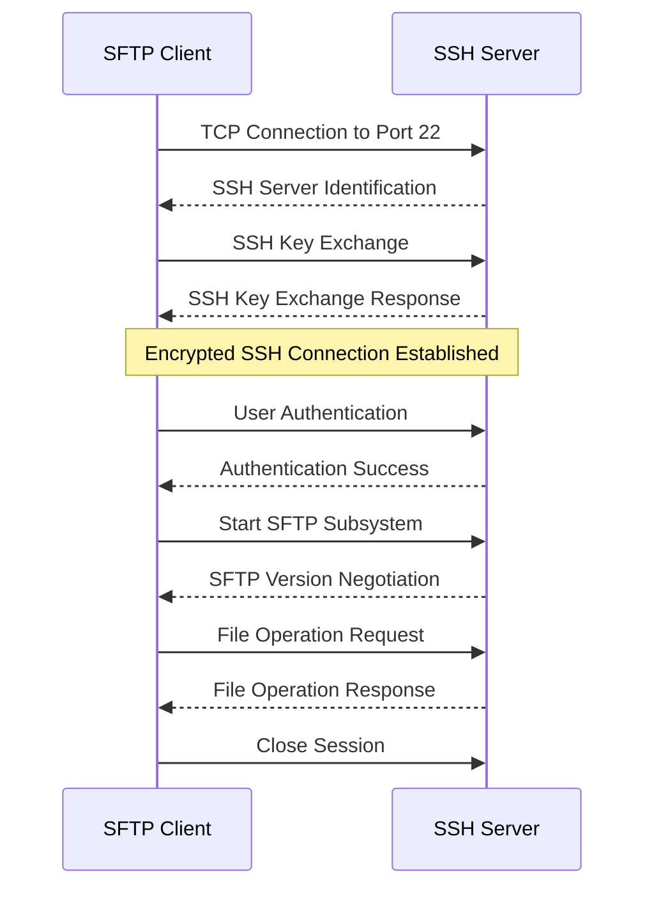

# FTP and SFTP (File Transfer Protocol and SSH File Transfer Protocol)

**FTP (File Transfer Protocol)** and **SFTP (SSH File Transfer Protocol)** are network protocols used to transfer files between computers.

Both protocols support file operations such as uploading, downloading, listing directories, and managing remote files. However, they use different architectures and security mechanisms.

* **FTP** transfers files using a separate control connection and data connections. Traditional FTP does not encrypt credentials or file contents.
* **SFTP** transfers files over an SSH connection. It provides encryption, authentication, and integrity protection through SSH.

FTP is an older application-layer protocol, while SFTP is commonly used for secure file transfers in modern environments.

### 🖆 FTP and SFTP at a Glance

| Feature | FTP | SFTP |
| --- | --- | --- |
| Full name | File Transfer Protocol | SSH File Transfer Protocol |
| Security | No encryption by default | Encrypted through SSH |
| Default port | TCP 21 for control | TCP 22 |
| Authentication | Username/password or anonymous access | SSH keys or password |
| Data connection | Separate data connections | Same SSH connection |
| Firewall configuration | Can require multiple ports | Usually one TCP port |
| File encryption | No | Yes |
| Common usage | Legacy file transfer | Secure file transfer |

# 🗁 What Is FTP

**File Transfer Protocol (FTP)** is an application-layer protocol designed to transfer files between a client and a server over a TCP/IP network.

FTP allows users to:

* Upload files to a remote server.
* Download files from a remote server.
* List remote directories.
* Create and remove directories.
* Rename files.
* Delete remote files.
* Authenticate using usernames and passwords.

FTP follows a client-server architecture.

### 🖆 FTP Communication

```text
FTP Client
    |
    | FTP Connection
    |
    v
FTP Server
    |
    v
Remote Files and Directories
```

### 🖆 Example

A developer wants to upload website files to a remote hosting server.

The FTP client connects to the FTP server, authenticates, and transfers the files.

```text
Local Computer
    |
    | Upload index.html
    |
    v
FTP Server
    |
    v
/var/www/html/index.html
```

Traditional FTP does not encrypt the transferred data or login credentials.

# 🗁 FTP Architecture

FTP uses two logically separate types of connections:

* **Control connection:** Carries commands and server responses.
* **Data connection:** Transfers file contents and directory listings.

This separation is one of the defining characteristics of FTP.

### 🖆 FTP Architecture Diagram



### 🖆 Control Connection

The control connection is used for communication between the FTP client and server.

It carries commands such as:

```text
USER
PASS
LIST
RETR
STOR
QUIT
```

The server sends response codes to indicate the result of each command.

For traditional FTP, the control connection normally uses TCP port 21.

### 🖆 Data Connection

The data connection carries actual file contents and directory listings.

Depending on the FTP mode, the data connection may be initiated by the server or the client.

Unlike SFTP, traditional FTP does not transfer all information through a single connection.

# 🗁 FTP Control and Data Connections

FTP uses different connections for commands and data.

### 🖆 Control Connection Example

```text
Client                         Server
  |                               |
  |------ TCP Connection -------->|
  |          Port 21              |
  |                               |
  |---------- USER -------------->|
  |<--------- 331 ----------------|
  |---------- PASS -------------->|
  |<--------- 230 ----------------|
  |---------- LIST -------------->|
  |<--------- 150 ----------------|
```

The control connection remains open while the client performs FTP operations.

### 🖆 Data Connection Example

When the client requests a directory listing or file transfer, FTP establishes a separate data connection.

```text
FTP Client
    |
    | Control Connection
    | TCP 21
    |
    v
FTP Server
    |
    | Data Connection
    | Separate TCP Connection
    |
    v
File Transfer
```

### 🖆 Why Two Connections?

FTP was designed to separate command communication from file transfer.

This allows the client and server to exchange commands and responses while handling file data through another connection.

However, this architecture introduces additional firewall and NAT considerations.

# 🗁 FTP Active Mode

**Active FTP** is a connection mode in which the client establishes the control connection to the server, but the server initiates the data connection toward the client.

### 🖆 How Active FTP Works

* The client connects to the server's TCP port 21.
* The client sends a `PORT` command to identify the address and port where it will receive data.
* The server initiates a data connection from its TCP port 20 to the client's specified endpoint.
* File contents or directory listings are transferred through that data connection.

### 🖆 Active FTP Diagram



### 🖆 Active FTP Example

```text
FTP Client
    |
    | Control Connection
    | Client -> Server: TCP 21
    |
    | PORT command
    |
    v
FTP Server
    |
    | Data Connection
    | Server TCP 20 -> Client Port
    |
    v
FTP Client
```

### 🖆 Active FTP Challenges

Active FTP can cause problems when the client is behind:

* NAT.
* A restrictive firewall.
* A router that blocks unsolicited inbound connections.

The server may be unable to establish the data connection to the client.

# 🗁 FTP Passive Mode

**Passive FTP** is a connection mode in which the client initiates both the control and data connections.

The server provides an IP address and port for the data connection through a `PASV` or `EPSV` response.

### 🖆 How Passive FTP Works

* The client connects to the server's TCP port 21.
* The client sends a `PASV` or `EPSV` command.
* The server opens a listening data port and informs the client.
* The client initiates a separate TCP connection to that port.
* File contents or directory listings are transferred.

### 🖆 Passive FTP Diagram



### 🖆 Passive FTP Example

```text
FTP Client
    |
    | Control Connection
    | Client -> Server: TCP 21
    |
    | PASV command
    |
    v
FTP Server
    |
    | Returns Passive Data Port
    |
    v
FTP Client
    |
    | Data Connection
    | Client -> Server: Passive Port
    |
    v
FTP Server
```

### 🖆 Why Passive Mode Is Commonly Used

Passive FTP is generally easier to use when clients are behind NAT or firewalls because the client initiates both connections.

However, the server must still allow inbound connections to its configured passive port range.

### 🖆 Active vs Passive FTP

| Feature | Active FTP | Passive FTP |
| --- | --- | --- |
| Control connection | Client initiates | Client initiates |
| Data connection | Server initiates | Client initiates |
| Server data endpoint | Usually TCP 20 | Server-selected port |
| Client firewall compatibility | Can be difficult | Generally easier |
| Server firewall configuration | Allows outbound data connections | Allows configured passive ports |

# 🗁 FTP Commands

FTP defines commands that allow clients to interact with remote servers.

### 🖆 Authentication Commands

| Command | Purpose |
| --- | --- |
| `USER` | Specifies username |
| `PASS` | Specifies password |
| `ACCT` | Supplies account information when required |

### 🖆 File and Directory Commands

| Command | Purpose |
| --- | --- |
| `LIST` | Lists directory contents |
| `NLST` | Returns a list of names |
| `PWD` | Displays current working directory |
| `CWD` | Changes working directory |
| `CDUP` | Moves to parent directory |
| `MKD` | Creates a directory |
| `RMD` | Removes a directory |
| `DELE` | Deletes a file |
| `RNFR` | Specifies a file to rename |
| `RNTO` | Specifies the new filename |

### 🖆 File Transfer Commands

| Command | Purpose |
| --- | --- |
| `RETR` | Downloads a file from the server |
| `STOR` | Uploads a file to the server |
| `STOU` | Uploads a file using a unique name |
| `APPE` | Appends data to a remote file |
| `REST` | Specifies a restart position for a transfer |

### 🖆 Connection and Transfer Commands

| Command | Purpose |
| --- | --- |
| `PORT` | Specifies the active-mode data endpoint |
| `PASV` | Requests passive mode |
| `EPSV` | Requests extended passive mode |
| `TYPE` | Sets the transfer representation type |
| `SYST` | Requests server operating-system information |
| `FEAT` | Requests supported server features |
| `QUIT` | Ends the FTP session |

### 🖆 Example FTP Session

```text
ftp ftp.example.com

Name: username
Password: ********

ftp> pwd
ftp> ls
ftp> cd uploads
ftp> put index.html
ftp> get report.pdf
ftp> quit
```

The exact commands available depend on the FTP client and server.

# 🗁 FTP Response Codes

FTP servers use three-digit response codes to communicate command results.

The first digit indicates the general response category.

| First Digit | Meaning |
| --- | --- |
| 1xx | Positive preliminary response |
| 2xx | Positive completion response |
| 3xx | Positive intermediate response |
| 4xx | Transient negative completion |
| 5xx | Permanent negative completion |

### 🖆 Common FTP Response Codes

| Code | Meaning |
| --- | --- |
| `125` | Data connection already open; transfer starting |
| `150` | File status okay; opening data connection |
| `200` | Command okay |
| `220` | Service ready |
| `221` | Service closing control connection |
| `226` | Closing data connection; requested action successful |
| `230` | User logged in |
| `250` | Requested file action completed |
| `331` | Username okay; password required |
| `425` | Cannot open data connection |
| `426` | Connection closed; transfer aborted |
| `530` | Not logged in |
| `550` | Requested action unavailable |

### 🖆 Example

```text
220 FTP Server Ready

USER username
331 Password required

PASS password
230 Login successful

LIST
150 Opening data connection

226 Transfer complete
```

These responses help administrators identify authentication, permission, and connection problems.

# 🗁 FTP Authentication

FTP supports several authentication approaches.

### 🖆 Username and Password

A client authenticates using a username and password.

Example:

```text
USER username
PASS password
```

Traditional FTP sends these credentials without encryption.

### 🖆 Anonymous FTP

Some FTP servers allow access without a personal account.

A typical login might use:

```text
Username: anonymous
Password: email@example.com
```

Anonymous FTP is commonly used for public file distribution.

### 🖆 FTP Authentication Limitations

Traditional FTP does not protect credentials from network interception.

For secure authentication, use FTPS or SFTP instead.

# 🗁 FTP Data Transfer Types

FTP supports different transfer representation types.

### 🖆 ASCII Mode

ASCII mode is intended for text data.

It can perform line-ending conversions between different operating-system conventions.

Command:

```text
TYPE A
```

### 🖆 Binary Mode

Binary mode transfers file data without text-oriented transformations.

It is appropriate for:

* Images.
* Videos.
* Archives.
* Executables.
* PDFs.
* Compressed files.
* Database backups.

Command:

```text
TYPE I
```

### 🖆 Why Binary Mode Matters

Transferring binary files using an inappropriate text conversion mode can corrupt file contents.

Modern FTP clients commonly use binary mode by default, but the active transfer mode should still be checked when troubleshooting file corruption.

# 🗁 FTP Security Limitations

Traditional FTP was designed before modern transport encryption became standard.

Its main security limitations include:

### 🖆 Unencrypted Credentials

Usernames and passwords are transmitted without encryption.

A network observer may capture them.

### 🖆 Unencrypted File Contents

Transferred files can be read by anyone able to capture the traffic.

### 🖆 Unprotected Commands

Control commands and responses are also transmitted without encryption.

An attacker may inspect or modify communication.

### 🖆 Man-in-the-Middle Attacks

Without cryptographic authentication and integrity protection, FTP communication is vulnerable to interception and manipulation.

### 🖆 Firewall Complexity

Separate control and data connections make firewall and NAT configuration more complicated.

### 🖆 Security Recommendation

Avoid traditional FTP for transferring sensitive information over untrusted networks.

Use SFTP or properly configured FTPS when encrypted file transfer is required.

# 🗁 What Is FTPS

**FTPS (FTP Secure)** is FTP protected using TLS.

It adds TLS encryption and authentication to the traditional FTP architecture.

FTPS retains FTP's separate control and data connections.

### 🖆 FTPS Architecture



### 🖆 FTPS Security Features

* Encrypted control connection.
* Encrypted data connections when protection is negotiated.
* Certificate-based server authentication.
* Optional client certificate authentication.
* Protection against passive network interception.

### 🖆 FTPS Still Uses FTP Architecture

FTPS does not replace FTP's control and data connection model.

Therefore, active/passive modes and data-port firewall configuration remain relevant.

# 🗁 Explicit FTPS vs Implicit FTPS

FTPS has two commonly discussed connection approaches.

### 🖆 Explicit FTPS

Explicit FTPS begins with a normal FTP control connection, usually on TCP port 21.

The client then requests TLS protection using the `AUTH TLS` command.

After the TLS handshake, the FTP session continues inside the protected control connection.

Typical process:

```text
Client
  |
  | TCP Connection to Port 21
  |
  v
FTP Server
  |
  | AUTH TLS
  |
  v
TLS Handshake
  |
  v
Encrypted FTP Session
```

Explicit FTPS is commonly deployed on TCP port 21.

### 🖆 Implicit FTPS

Implicit FTPS expects TLS protection immediately when the client connects.

The TLS handshake begins as soon as the TCP connection is established.

Its traditional default port is TCP 990.

### 🖆 Comparison

| Feature | Explicit FTPS | Implicit FTPS |
| --- | --- | --- |
| Default control port | TCP 21 | TCP 990 |
| TLS initiation | Client requests TLS | TLS begins immediately |
| Initial connection | FTP control connection | TLS connection |
| FTP architecture | Separate control/data connections | Separate control/data connections |
| Usage | Common FTPS deployment | Legacy or specific deployments |

# 🗁 What Is SFTP

**SFTP (SSH File Transfer Protocol)** is a secure file-transfer protocol that operates over the SSH protocol.

It provides file-transfer functionality through an encrypted SSH connection.

SFTP is not simply FTP with encryption. It is a separate protocol with its own request and response messages.

### 🖆 SFTP Features

* Encrypted communication.
* Secure authentication through SSH.
* File upload and download.
* Directory listing.
* File creation and deletion.
* Directory creation and removal.
* File permissions management.
* File renaming.
* Remote file access.

### 🖆 SFTP Architecture



### 🖆 Default Port

SFTP commonly uses:

```text
TCP 22
```

This is the default SSH port.

Unlike traditional FTP, SFTP normally uses a single SSH transport connection for authentication, commands, and file data.

# 🗁 SFTP Architecture

SFTP operates as a subsystem of SSH.

The client first establishes an SSH connection and authenticates with the server.

After authentication, the client starts the SFTP subsystem.

### 🖆 SFTP Communication Layers

| Layer | Protocol |
| --- | --- |
| Application | SFTP |
| Secure transport | SSH |
| Transport | TCP |
| Network | IPv4 or IPv6 |
| Data Link | Ethernet, Wi-Fi, etc. |

### 🖆 SFTP Connection Diagram

```text
SFTP Client
    |
    | TCP Connection
    | Port 22
    |
    v
SSH Server
    |
    | SSH Authentication
    |
    v
SFTP Subsystem
    |
    v
Remote File System
```

### 🖆 Why SFTP Is Easier to Configure

SFTP uses the SSH connection for both control operations and file transfer.

It does not require separate FTP data connections or a passive port range.

This makes SFTP generally easier to operate through NAT and firewall environments.

# 🗁 How SFTP Works

SFTP communication follows a sequence of operations.

### 🖆 Establish TCP Connection

The client establishes a TCP connection to the SSH server.

```text
Client -> Server: TCP SYN
Server -> Client: TCP SYN-ACK
Client -> Server: TCP ACK
```

The connection normally targets TCP port 22.

### 🖆 Establish SSH Connection

The client and server negotiate SSH protocol parameters and establish encrypted communication.

The SSH transport layer provides confidentiality, integrity, and server authentication through host keys.

### 🖆 Authenticate the User

The client authenticates using an allowed SSH authentication method.

Common methods include:

* Password authentication.
* Public-key authentication.

### 🖆 Start SFTP Subsystem

After authentication, the client requests the SFTP subsystem.

### 🖆 Exchange SFTP Requests

The client sends requests to perform file operations.

Examples include:

* Open a remote file.
* Read file contents.
* Write file contents.
* List a directory.
* Rename a file.
* Remove a file.

### 🖆 Close the Session

When file operations are complete, the client closes the SFTP session and disconnects from SSH.

### 🖆 SFTP Workflow Diagram



# 🗁 SFTP Authentication

SFTP uses SSH authentication mechanisms.

### 🖆 Password Authentication

The client provides a username and password.

Example:

```bash
sftp username@server.example.com
```

The SSH server prompts for the password if password authentication is enabled.

### 🖆 SSH Public-Key Authentication

Public-key authentication uses a private key on the client and a corresponding public key configured on the server.

Generate an Ed25519 key pair:

```bash
ssh-keygen -t ed25519 -C "user@example.com"
```

The generated files are commonly:

```text
~/.ssh/id_ed25519
~/.ssh/id_ed25519.pub
```

Copy the public key to the server:

```bash
ssh-copy-id username@server.example.com
```

Connect using SFTP:

```bash
sftp username@server.example.com
```

The SSH client uses the configured private key to authenticate.

### 🖆 Public-Key Authentication Architecture

```text
Client
  |
  | Private Key
  |
  v
SSH Authentication
  |
  v
Server
  |
  | Authorized Public Key
  |
  v
Authentication Verification
```

The private key must remain on the client. Only the public key should be installed on the server.

# 🗁 FTP vs FTPS vs SFTP

These three protocols provide file-transfer functionality, but their security and connection architectures differ.

### 🖆 Comparison Table

| Feature | FTP | FTPS | SFTP |
| --- | --- | --- | --- |
| Full name | File Transfer Protocol | FTP Secure | SSH File Transfer Protocol |
| Security mechanism | None by default | TLS | SSH |
| Default control port | TCP 21 | TCP 21 explicit / TCP 990 implicit | TCP 22 |
| Separate data connection | Yes | Yes | No |
| Encryption | No | Yes, when negotiated for control and data | Yes |
| Authentication | FTP authentication | FTP authentication protected by TLS | SSH authentication |
| Active/passive modes | Yes | Yes | Not applicable |
| Firewall complexity | Higher | Higher | Usually lower |
| Common usage | Legacy systems | Secure FTP-compatible environments | Secure file transfer |

### 🖆 Which Protocol Should You Use?

**Use SFTP when:**

* You need secure file transfers.
* Your infrastructure already uses SSH.
* You want simple firewall configuration.
* You need SSH key-based authentication.

**Use FTPS when:**

* You must integrate with existing FTP infrastructure.
* An application specifically requires FTP with TLS.
* You need compatibility with an FTP-based hosting or enterprise platform.

**Use traditional FTP when:**

* Working with an isolated legacy system.
* Performing controlled laboratory exercises.
* Security is handled by a separate trusted network layer and the limitations are explicitly accepted.

For most new deployments, SFTP is a practical default.

# 🗁 FTP and SFTP Ports

Understanding the ports is important for network administration and firewall configuration.

### 🖆 Common Ports

| Protocol | Port | Transport | Purpose |
| --- | ---: | --- | --- |
| FTP | 21 | TCP | Control connection |
| FTP Active Mode | 20 | TCP | Common server-side data source port |
| Explicit FTPS | 21 | TCP | FTP control connection upgraded to TLS |
| Implicit FTPS | 990 | TCP | TLS-protected control connection |
| FTPS Passive Mode | Configurable range | TCP | Data connections |
| SFTP | 22 | TCP | SSH and SFTP connection |

### 🖆 FTP Firewall Considerations

Traditional FTP and FTPS may require:

* Control port access.
* Active-mode data connection support or passive-mode port access.
* NAT-aware configuration.
* FTP connection tracking or application-layer gateway support in some environments.

### 🖆 SFTP Firewall Considerations

For a standard SFTP server, allow:

```text
TCP 22
```

If SSH uses a custom port, allow the configured port instead.

# 🗁 FTP Server on Ubuntu

Ubuntu can host an FTP server using software such as vsftpd.

**vsftpd** stands for Very Secure FTP Daemon.

It is a commonly used FTP server implementation.

### 🖆 Install vsftpd

Update package information:

```bash
sudo apt update
```

Install the FTP server:

```bash
sudo apt install vsftpd
```

Check its status:

```bash
sudo systemctl status vsftpd
```

Start the service:

```bash
sudo systemctl start vsftpd
```

Enable automatic startup:

```bash
sudo systemctl enable vsftpd
```

### 🖆 Configure vsftpd

Open the configuration file:

```bash
sudo nano /etc/vsftpd.conf
```

Some relevant configuration options:

```ini
listen=YES

anonymous_enable=NO

local_enable=YES

write_enable=YES

local_umask=022
```

These settings:

| Setting | Purpose |
| --- | --- |
| `listen=YES` | Enables standalone IPv4 listening mode |
| `anonymous_enable=NO` | Disables anonymous FTP access |
| `local_enable=YES` | Allows local system users to log in |
| `write_enable=YES` | Enables FTP write operations |
| `local_umask=022` | Sets the default permission mask for created files |

The configuration must be adapted to the server's IPv4/IPv6 requirements and security policy. In particular, standalone IPv6 listening may require a different configuration.

Restart the service:

```bash
sudo systemctl restart vsftpd
```

### 🖆 Check FTP Listening Port

```bash
sudo ss -lntp | grep ':21'
```

### 🖆 Create an FTP User

```bash
sudo adduser ftpuser
```

Create a directory for file transfers:

```bash
sudo mkdir -p /srv/ftp/ftpuser
```

Set ownership:

```bash
sudo chown ftpuser:ftpuser /srv/ftp/ftpuser
```

The user should be given access only to the directories required by the intended FTP workflow.

### 🖆 Configure Firewall

If UFW is enabled:

```bash
sudo ufw allow 21/tcp
```

For passive FTP, configure a dedicated passive port range in the server configuration and allow that range through the firewall.

Example:

```ini
pasv_enable=YES
pasv_min_port=40000
pasv_max_port=40100
```

Allow the configured range:

```bash
sudo ufw allow 40000:40100/tcp
```

NAT and external address configuration may also be required when the server is behind a router.

### 🖆 Test the FTP Server

Install the command-line FTP client:

```bash
sudo apt install ftp
```

Connect:

```bash
ftp server.example.com
```

For a local test:

```bash
ftp 127.0.0.1
```

# 🗁 SFTP Server on Ubuntu

Ubuntu commonly provides SFTP through OpenSSH.

The OpenSSH server package includes an SFTP subsystem.

### 🖆 Install OpenSSH Server

```bash
sudo apt update
sudo apt install openssh-server
```

Check the service:

```bash
sudo systemctl status ssh
```

Enable SSH at startup:

```bash
sudo systemctl enable ssh
```

Start the service:

```bash
sudo systemctl start ssh
```

### 🖆 Verify SSH Port

```bash
sudo ss -lntp | grep ':22'
```

### 🖆 Check SFTP Subsystem Configuration

Open the SSH server configuration:

```bash
sudo nano /etc/ssh/sshd_config
```

Find the SFTP subsystem configuration.

A common configuration is:

```text
Subsystem sftp /usr/lib/openssh/sftp-server
```

Another supported configuration uses the internal SFTP implementation:

```text
Subsystem sftp internal-sftp
```

The exact configuration depends on the Ubuntu OpenSSH package and existing server configuration.

### 🖆 Create an SFTP User

```bash
sudo adduser sftpuser
```

Create a directory structure:

```bash
sudo mkdir -p /srv/sftp/sftpuser/upload
```

Set the ownership and permissions:

```bash
sudo chown root:root /srv/sftp/sftpuser
sudo chmod 755 /srv/sftp/sftpuser

sudo chown sftpuser:sftpuser /srv/sftp/sftpuser/upload
```

The directory used as a chroot root must be owned by root and must not be writable by the restricted user.

### 🖆 Configure an SFTP-Only User

Edit the SSH server configuration:

```bash
sudo nano /etc/ssh/sshd_config
```

Add:

```text
Match User sftpuser
    ChrootDirectory /srv/sftp/sftpuser
    ForceCommand internal-sftp
    DisableForwarding yes
    PermitTTY no
```

This configuration:

| Directive | Purpose |
| --- | --- |
| `Match User sftpuser` | Applies settings to the specified user |
| `ChrootDirectory` | Restricts the user's filesystem view |
| `ForceCommand internal-sftp` | Forces SFTP instead of an interactive shell |
| `DisableForwarding` | Disables SSH forwarding features |
| `PermitTTY no` | Prevents terminal allocation |

The user can write inside the `upload` directory but cannot modify the root of the chroot environment.

### 🖆 Validate SSH Configuration

Before restarting SSH, validate the configuration:

```bash
sudo sshd -t
```

If validation succeeds, reload the service:

```bash
sudo systemctl reload ssh
```

### 🖆 Connect to the SFTP Server

```bash
sftp sftpuser@server.example.com
```

The user should be restricted to the configured SFTP environment.

# 🗁 SFTP Client Commands

The Linux `sftp` command provides an interactive client for remote file operations.

### 🖆 Connect to a Server

```bash
sftp username@server.example.com
```

Connect using a custom port:

```bash
sftp -P 2222 username@server.example.com
```

Use a specific private key:

```bash
sftp -i ~/.ssh/id_ed25519 username@server.example.com
```

### 🖆 Display Current Directories

Display the local directory:

```text
lpwd
```

Display the remote directory:

```text
pwd
```

### 🖆 List Files

List local files:

```text
lls
```

List remote files:

```text
ls
```

### 🖆 Change Directories

Change the local directory:

```text
lcd /home/user/Documents
```

Change the remote directory:

```text
cd /var/www/html
```

### 🖆 Upload Files

Upload one file:

```text
put index.html
```

Upload a file to a specific remote location:

```text
put index.html /upload/index.html
```

Upload multiple files:

```text
mput *.txt
```

### 🖆 Download Files

Download one file:

```text
get report.pdf
```

Download a file to a specific local path:

```text
get /upload/report.pdf ./report.pdf
```

Download multiple files:

```text
mget *.pdf
```

### 🖆 Directory Operations

Create a remote directory:

```text
mkdir backups
```

Remove an empty remote directory:

```text
rmdir old-directory
```

List remote directory contents:

```text
ls -la
```

### 🖆 File Operations

Rename a remote file:

```text
rename old.txt new.txt
```

Delete a remote file:

```text
rm unwanted.txt
```

Remove a local file:

```text
rm local-file.txt
```

### 🖆 Transfer Directories

Upload a directory recursively:

```text
put -r ./website /upload/website
```

Download a directory recursively:

```text
get -r /upload/website ./website
```

### 🖆 Exit the SFTP Session

```text
exit
```

or:

```text
quit
```

### 🖆 Useful SFTP Command Reference

| Command | Purpose |
| --- | --- |
| `pwd` | Show remote working directory |
| `lpwd` | Show local working directory |
| `ls` | List remote files |
| `lls` | List local files |
| `cd` | Change remote directory |
| `lcd` | Change local directory |
| `put` | Upload file |
| `get` | Download file |
| `mput` | Upload multiple files |
| `mget` | Download multiple files |
| `mkdir` | Create remote directory |
| `rmdir` | Remove remote directory |
| `rm` | Remove remote file |
| `rename` | Rename remote file |
| `chmod` | Change remote file permissions |
| `chown` | Change remote file ownership when permitted |
| `help` | Display available commands |
| `exit` | Close the session |

# 🗁 File Transfer with SCP

**SCP (Secure Copy Protocol)** is a file-copying mechanism commonly used through SSH.

It allows users to transfer files between local and remote systems.

Modern OpenSSH versions implement the `scp` command using SFTP by default. The legacy SCP protocol can still be selected with the `-O` option.

### 🖆 Upload a File

```bash
scp index.html username@server.example.com:/var/www/html/
```

### 🖆 Download a File

```bash
scp username@server.example.com:/var/www/html/index.html .
```

### 🖆 Copy a Directory

```bash
scp -r ./website username@server.example.com:/var/www/html/
```

### 🖆 Use a Custom SSH Port

```bash
scp -P 2222 index.html username@server.example.com:/upload/
```

### 🖆 Use a Specific SSH Key

```bash
scp -i ~/.ssh/id_ed25519 index.html username@server.example.com:/upload/
```

### 🖆 SFTP vs SCP

| Feature | SFTP | SCP |
| --- | --- | --- |
| Main purpose | Interactive and programmatic file transfer | File copying |
| Connection | SSH | SSH |
| Default port | TCP 22 | TCP 22 |
| Directory listing | Supported | Not a primary feature |
| Remote file management | Supported | Limited |
| Interactive session | Yes | No |
| Modern OpenSSH implementation | SFTP protocol | Uses SFTP by default |

# 🗁 Troubleshooting FTP and SFTP

File-transfer problems can originate from DNS, routing, firewalls, authentication, permissions, or server configuration.

### 🖆 FTP Troubleshooting

Check whether the server is listening:

```bash
sudo ss -lntp | grep ':21'
```

Test connectivity:

```bash
nc -vz server.example.com 21
```

Check the FTP service:

```bash
sudo systemctl status vsftpd
```

Inspect logs:

```bash
sudo journalctl -u vsftpd
```

Common FTP problems:

| Problem | Possible Cause |
| --- | --- |
| Connection refused | FTP service is stopped or port is closed |
| Login incorrect | Invalid credentials or authentication policy |
| Directory listing fails | Data connection cannot be established |
| Active mode fails | Server cannot connect to client |
| Passive mode fails | Passive port range is blocked |
| File upload fails | Insufficient permissions or write access disabled |
| Transfer hangs | Firewall, NAT, or data connection problem |

### 🖆 SFTP Troubleshooting

Check the SSH service:

```bash
sudo systemctl status ssh
```

Check the listening port:

```bash
sudo ss -lntp | grep ':22'
```

Test connectivity:

```bash
nc -vz server.example.com 22
```

Connect with verbose debugging:

```bash
sftp -vvv username@server.example.com
```

Check SSH authentication:

```bash
ssh -v username@server.example.com
```

Inspect server logs:

```bash
sudo journalctl -u ssh
```

Common SFTP problems:

| Problem | Possible Cause |
| --- | --- |
| Connection refused | SSH server is stopped or port is closed |
| Permission denied | Incorrect password, key, or account permissions |
| Host key verification failed | Server host key changed or does not match known_hosts |
| Subsystem request failed | SFTP subsystem is missing or misconfigured |
| Chroot directory error | Chroot directory ownership or permissions are incorrect |
| Permission denied during upload | User lacks write permission |
| Connection timed out | Routing or firewall issue |

### 🖆 Network Troubleshooting Checklist

* Verify hostname resolution.
* Check IP connectivity.
* Verify the server's listening port.
* Inspect firewall rules.
* Check NAT and port-forwarding configuration.
* Verify authentication credentials.
* Check SSH host-key verification.
* Inspect file and directory permissions.
* Check server logs.
* Test using verbose client output.

# 🗁 Common Mistakes

### 🖆 Confusing FTP and SFTP

SFTP is not FTP running through SSH encryption.

They are different protocols with different architectures and command formats.

### 🖆 Assuming FTP Uses Only Port 21

TCP port 21 is used for the traditional FTP control connection.

File transfers and directory listings use separate data connections.

### 🖆 Confusing FTP Active and Passive Modes

Active FTP has the server initiate the data connection.

Passive FTP has the client initiate the data connection.

### 🖆 Assuming FTPS and SFTP Are the Same

FTPS uses FTP with TLS.

SFTP uses SSH and its own file-transfer protocol.

### 🖆 Opening Only Port 21 for Passive FTP

Passive FTP requires the configured data-port range to be accessible through the server firewall and any relevant NAT device.

### 🖆 Using FTP for Sensitive Data

Traditional FTP does not encrypt credentials or transferred files.

Use SFTP or properly configured FTPS for secure communication.

### 🖆 Giving SFTP Users Excessive Filesystem Access

SFTP users should receive only the filesystem access required for their tasks.

Use restricted accounts and properly configured chroot environments where appropriate.

### 🖆 Incorrect Chroot Permissions

An SSH chroot directory must be owned by root and must not be writable by the restricted user.

Create a separate writable subdirectory for uploads.

### 🖆 Exposing SSH to Unnecessary Users

SFTP access should be limited through account permissions, authentication policies, firewall rules, and SSH configuration.

# 🗁 Security Best Practices

* Prefer SFTP or FTPS over traditional FTP.
* Use SSH public-key authentication where appropriate.
* Protect private SSH keys with suitable filesystem permissions and passphrases.
* Verify SSH server host keys.
* Disable anonymous FTP unless explicitly required.
* Restrict user access to necessary directories.
* Use chroot or another appropriate filesystem isolation mechanism for restricted SFTP accounts.
* Avoid granting unnecessary write permissions.
* Use strong authentication policies.
* Keep OpenSSH and FTP server software updated.
* Monitor authentication attempts.
* Review server logs regularly.
* Use firewall rules to restrict access to trusted networks where possible.
* Use encrypted protocols for credentials and file contents.
* Configure passive FTP port ranges carefully when FTPS is required.
* Monitor certificate validity for FTPS deployments.

# 🗁 Practical Exercises

### 🖆 Exercise: Understand FTP Connections

Study the difference between control and data connections.

Identify:

* Control connection port.
* Data connection purpose.
* Active FTP behavior.
* Passive FTP behavior.

Draw a network diagram showing both connection modes.

### 🖆 Exercise: Install an FTP Server

On an Ubuntu virtual machine:

* Install vsftpd.
* Start and enable the service.
* Create a local FTP user.
* Configure local authentication.
* Connect using an FTP client.
* Upload and download a test file.

### 🖆 Exercise: Configure Passive FTP

* Configure a passive port range.
* Allow the range through UFW.
* Connect using passive mode.
* Upload a file.
* Verify the transfer.
* Inspect the active network connections.

### 🖆 Exercise: Install an SFTP Server

On an Ubuntu virtual machine:

* Install OpenSSH Server.
* Verify SSH is listening on TCP port 22.
* Create an SFTP user.
* Connect using the `sftp` command.
* List remote directories.
* Upload and download files.

### 🖆 Exercise: Configure SSH Key Authentication

Generate an Ed25519 SSH key pair:

```bash
ssh-keygen -t ed25519 -C "sftp-lab@example.com"
```

Copy the public key to the server:

```bash
ssh-copy-id username@server.example.com
```

Connect using:

```bash
sftp username@server.example.com
```

Verify that authentication works with the configured key.

### 🖆 Exercise: Restrict an SFTP User

* Create a dedicated SFTP user.
* Configure a chroot directory.
* Set correct directory ownership.
* Create a writable upload directory.
* Force the SFTP subsystem.
* Disable unnecessary SSH forwarding.
* Verify that the user cannot access files outside the restricted environment.

### 🖆 Exercise: Compare FTP, FTPS, and SFTP

Create a comparison table covering:

* Authentication.
* Encryption.
* Default ports.
* Control and data connections.
* Firewall requirements.
* Typical use cases.

Explain which protocol you would choose for a new production file-transfer service and why.

# 🗁 Interview Questions

### 🖆 What is FTP?

FTP is an application-layer protocol used to transfer files between a client and server over TCP.

### 🖆 What are the default FTP ports?

TCP port 21 is used for the control connection. TCP port 20 is commonly used as the server-side source port for active-mode data connections.

### 🖆 Why does FTP use two connections?

FTP separates command communication from file-data transfer using control and data connections.

### 🖆 What is the difference between active and passive FTP?

In active mode, the server initiates the data connection. In passive mode, the client initiates the data connection.

### 🖆 Why is passive FTP commonly used?

Passive FTP works more naturally with clients behind NAT and restrictive firewalls because the client initiates both connections.

### 🖆 What is SFTP?

SFTP is the SSH File Transfer Protocol, which provides secure file-transfer operations over an SSH connection.

### 🖆 What port does SFTP use?

SFTP commonly uses TCP port 22, the default SSH port.

### 🖆 Does SFTP use separate control and data connections?

No. SFTP normally uses the same SSH transport connection for requests, responses, and file data.

### 🖆 What is FTPS?

FTPS is FTP protected by TLS encryption and authentication.

### 🖆 What is the difference between FTPS and SFTP?

FTPS extends FTP with TLS and retains FTP's separate control and data connections. SFTP is a separate file-transfer protocol that operates over SSH.

### 🖆 What is explicit FTPS?

Explicit FTPS starts with an FTP control connection and upgrades it to TLS using the `AUTH TLS` command.

### 🖆 What is implicit FTPS?

Implicit FTPS starts TLS immediately when the client connects, traditionally using TCP port 990.

### 🖆 What is the FTP `PORT` command?

`PORT` tells the FTP server which client address and port to use for an active-mode data connection.

### 🖆 What is the FTP `PASV` command?

`PASV` requests passive mode and causes the server to provide an endpoint for the client-initiated data connection.

### 🖆 What is the difference between ASCII and binary FTP transfer modes?

ASCII mode is intended for text data and may perform line-ending conversions. Binary mode transfers file contents without text-oriented transformations.

### 🖆 What is the purpose of vsftpd?

vsftpd is an FTP server implementation commonly available on Linux systems.

### 🖆 How does SFTP authenticate users?

SFTP uses SSH authentication mechanisms, commonly passwords or public-key authentication.

### 🖆 What is an SSH chroot environment?

A chroot environment restricts a user's filesystem view to a designated directory tree.

### 🖆 What is the difference between SFTP and SCP?

SFTP supports interactive remote file operations. SCP primarily provides file-copy operations over SSH.

### 🖆 How can you troubleshoot an SFTP connection?

Check SSH service status, TCP connectivity, authentication, server logs, SFTP subsystem configuration, and filesystem permissions.

# 🗁 Summary

FTP and SFTP are application-layer file-transfer solutions with different architectures and security models.

Key concepts:

* FTP transfers files using separate control and data connections.
* FTP control communication commonly uses TCP port 21.
* Active FTP has the server initiate the data connection.
* Passive FTP has the client initiate the data connection.
* FTP supports commands such as `LIST`, `RETR`, and `STOR`.
* Traditional FTP does not encrypt credentials or file contents.
* FTPS protects FTP communication using TLS.
* Explicit FTPS commonly uses TCP port 21.
* Implicit FTPS traditionally uses TCP port 990.
* SFTP is a separate protocol operating over SSH.
* SFTP commonly uses TCP port 22.
* SFTP uses one SSH transport connection for file operations and data.
* SSH supports password and public-key authentication.
* Ubuntu commonly provides SFTP through OpenSSH.
* vsftpd is a common Ubuntu FTP server implementation.
* SCP provides file-copy operations through SSH.

For most new secure file-transfer deployments, SFTP is a practical choice because it provides encryption, SSH authentication, and straightforward firewall configuration.

# 🗁 References

* [RFC 959 — File Transfer Protocol (FTP)](https://datatracker.ietf.org/doc/html/rfc959)
* [RFC 1579 — Firewall-Friendly FTP](https://datatracker.ietf.org/doc/html/rfc1579)
* [RFC 2428 — FTP Extensions for IPv6 and NATs](https://datatracker.ietf.org/doc/html/rfc2428)
* [RFC 4217 — Securing FTP with TLS](https://datatracker.ietf.org/doc/html/rfc4217)
* [RFC 4251 — The Secure Shell (SSH) Protocol Architecture](https://datatracker.ietf.org/doc/html/rfc4251)
* [RFC 4252 — The Secure Shell (SSH) Authentication Protocol](https://datatracker.ietf.org/doc/html/rfc4252)
* [OpenSSH Manual Pages](https://man.openbsd.org/)
* [OpenSSH SFTP Manual](https://man.openbsd.org/sftp)
* [Ubuntu OpenSSH Server Documentation](https://documentation.ubuntu.com/server/how-to/security/openssh-server/)
* [vsftpd Documentation](https://security.appspot.com/vsftpd.html)
* [SSH File Transfer Protocol Specification](https://datatracker.ietf.org/doc/draft-ietf-secsh-filexfer/)
