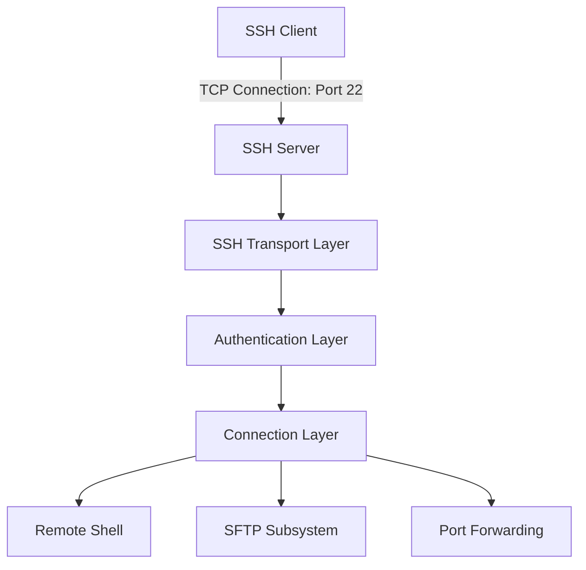
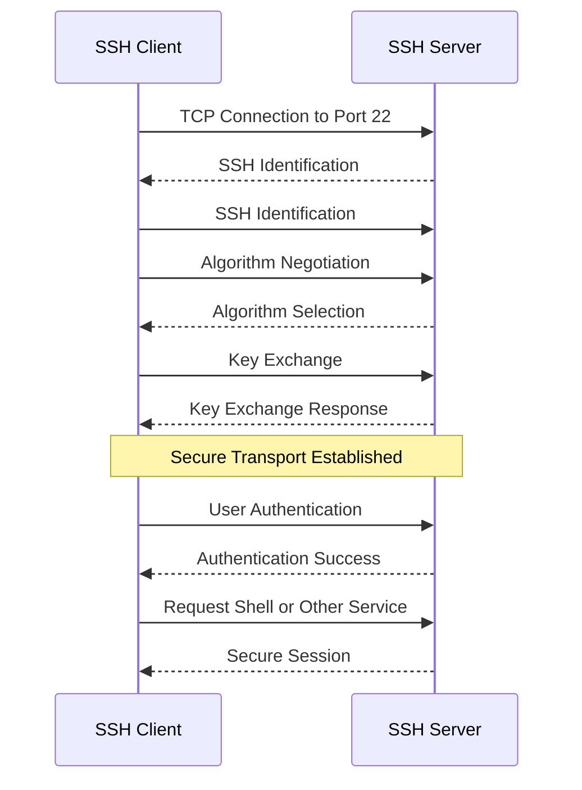
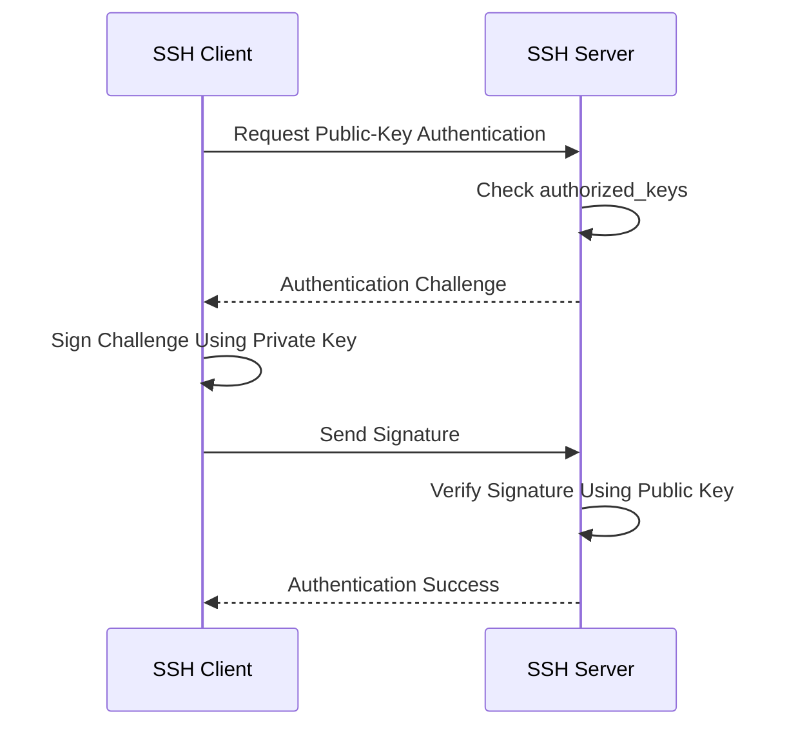

# SSH (Secure Shell)

**SSH (Secure Shell)** is a cryptographic network protocol used to securely access and manage remote computers over an unsecured network.

SSH provides an encrypted communication channel between an SSH client and an SSH server. It protects transmitted data against eavesdropping and tampering while supporting secure authentication.

SSH is commonly used by system administrators, software engineers, and network engineers to manage Linux servers, deploy applications, execute remote commands, transfer files, and create secure tunnels.

### 🖆 Common SSH Use Cases

* Remote Linux server administration.
* Secure command execution.
* Git authentication and repository access.
* Secure file transfer using SFTP or SCP.
* SSH port forwarding and tunneling.
* Remote database access.
* Network device administration.
* Automated deployment and infrastructure management.

### 🖆 SSH at a Glance

| Feature | Description |
| --- | --- |
| Full name | Secure Shell |
| OSI model | Application-layer protocol |
| Transport protocol | TCP |
| Default port | TCP 22 |
| Encryption | Yes |
| Authentication | Password, public key, and other supported methods |
| Integrity protection | Yes |
| Primary purpose | Secure remote access and communication |
| Common implementation | OpenSSH |

# 🗁 What Is SSH

SSH is a protocol that provides secure communication between two networked systems.

It was designed as a secure replacement for older remote-access protocols such as Telnet and the Berkeley Remote Shell (`rsh`).

SSH operates over TCP and commonly listens on port 22.

### 🖆 Basic SSH Communication

```text
Local Computer                         Remote Server
     |                                      |
     |                                      |
     |--------- TCP Connection ------------>|
     |              Port 22                 |
     |                                      |
     |--------- SSH Negotiation ----------->|
     |                                      |
     |--------- Authentication ------------>|
     |                                      |
     |<-------- Secure Session ------------>|
     |                                      |
     |       Remote Command Execution       |
```

After establishing the secure session, the client can execute commands on the remote server.

### 🖆 Example

Connect to a remote Ubuntu server:

```bash
ssh username@192.168.1.100
```

The SSH client connects to the server using:

| Parameter | Value |
| --- | --- |
| Username | `username` |
| Remote IP | `192.168.1.100` |
| Default port | `22` |
| Protocol | SSH over TCP |

If authentication succeeds, the user receives a remote shell.

# 🗁 Why SSH Is Important

Before SSH became widely adopted, administrators often used protocols such as Telnet and FTP for remote access and file transfers.

These protocols traditionally transmitted sensitive information without encryption.

SSH addresses these security problems.

### 🖆 SSH Security Benefits

| Feature | Purpose |
| --- | --- |
| Confidentiality | Encrypts transmitted information |
| Integrity | Detects unauthorized modification of data |
| Authentication | Verifies server and user identities |
| Secure remote access | Provides encrypted command-line access |
| Secure file transfer | Supports SFTP and SSH-based file-copy operations |
| Port forwarding | Creates encrypted communication tunnels |

### 🖆 SSH vs Telnet

| Feature | SSH | Telnet |
| --- | --- | --- |
| Default port | TCP 22 | TCP 23 |
| Encryption | Yes | No |
| Authentication protection | Yes | No encryption by default |
| Integrity protection | Yes | No cryptographic protection |
| Secure remote administration | Yes | No |
| Recommended for production | Yes | No |

SSH should be preferred for remote administration over untrusted networks.

# 🗁 SSH Architecture

SSH follows a client-server architecture.

The client initiates a connection to the server. The server negotiates cryptographic parameters, authenticates the client, and provides the requested SSH service.

### 🖆 SSH Architecture Diagram



### 🖆 SSH Protocol Layers

SSH is commonly described using three protocol components.

| Component | Responsibility |
| --- | --- |
| SSH Transport Layer Protocol | Server authentication, key exchange, encryption, integrity, and compression negotiation |
| SSH Authentication Protocol | Authenticates the client user |
| SSH Connection Protocol | Manages multiple logical channels over one encrypted connection |

These components work together to provide secure remote communication.

# 🗁 SSH Client and Server

### 🖆 SSH Client

An SSH client is software that initiates an SSH connection to a remote server.

Examples:

* OpenSSH client.
* PuTTY.
* Windows OpenSSH client.
* Termius.

On Ubuntu, the OpenSSH client can be installed using:

```bash
sudo apt install openssh-client
```

Check its version:

```bash
ssh -V
```

### 🖆 SSH Server

An SSH server accepts incoming SSH connections and provides remote-access services.

OpenSSH Server is commonly used on Linux systems.

Install it on Ubuntu:

```bash
sudo apt install openssh-server
```

Check its service status:

```bash
sudo systemctl status ssh
```

### 🖆 Client and Server Communication

```text
SSH Client
    |
    | Initiates Connection
    |
    v
SSH Server
    |
    | Authenticates User
    |
    v
Remote Shell / SFTP / SSH Channels
```

# 🗁 How SSH Works

SSH establishes a secure connection through several stages.

### 🖆 TCP Connection

The client first establishes a TCP connection to the SSH server.

The default destination port is TCP 22.

The TCP three-way handshake establishes reliable transport.

```text
Client                         Server
   |                              |
   |---------- SYN -------------->|
   |<--------- SYN-ACK -----------|
   |---------- ACK -------------->|
   |                              |
   |      TCP Connection          |
```

### 🖆 SSH Version Exchange

After the TCP connection is established, both systems exchange SSH identification strings.

An example:

```text
SSH-2.0-OpenSSH_9.6
```

This identifies the SSH protocol version and implementation information.

### 🖆 Algorithm Negotiation

The client and server negotiate compatible cryptographic algorithms.

These include:

* Key exchange algorithms.
* Server host-key algorithms.
* Encryption algorithms.
* Message authentication or integrity algorithms.
* Compression algorithms.

### 🖆 Key Exchange

The client and server perform a key exchange to establish shared session secrets.

The exchange creates cryptographic material used to protect subsequent communication.

### 🖆 Server Authentication

The server proves its identity using its host key.

The client verifies the server's host key against its trusted host-key records or another trusted verification mechanism.

### 🖆 User Authentication

The client authenticates the requested user account.

Common methods include password and public-key authentication.

### 🖆 Secure Communication

After authentication, the client can request SSH services.

Examples include:

* Remote shell.
* Remote command execution.
* SFTP.
* Port forwarding.

### 🖆 SSH Connection Workflow



# 🗁 SSH Connection Establishment

SSH uses a sequence of protocol operations to establish a secure session.

### 🖆 SSH Identification

Both parties send identification strings.

For example:

```text
SSH-2.0-OpenSSH_9.6
```

SSH protocol version 2 is the modern version used by current OpenSSH deployments.

### 🖆 Algorithm Negotiation

The client and server advertise supported algorithms.

The negotiation determines compatible choices for the connection.

For example:

| Category | Example |
| --- | --- |
| Key exchange | Curve25519 |
| Server host key | Ed25519 |
| Encryption | AES-256-GCM |
| Integrity | HMAC-SHA2-256 |
| Compression | None |

These are illustrative choices. Actual algorithms depend on the installed SSH implementations and their configuration.

### 🖆 New Keys Exchange

After successful key exchange, both sides install the negotiated encryption and integrity keys.

The `NEWKEYS` messages indicate that the negotiated protection is ready for subsequent SSH packets.

### 🖆 User Authentication

The client attempts to authenticate the requested account.

The server accepts or rejects each authentication attempt according to its configuration and authentication policy.

# 🗁 SSH Key Exchange

Key exchange establishes shared secret material between the client and server.

The shared secret is used to derive cryptographic session keys.

### 🖆 Purpose of Key Exchange

Key exchange helps provide:

* Secure session-key establishment.
* Protection of transmitted data.
* Forward secrecy when an appropriate ephemeral key-exchange method is used.
* Cryptographic separation between independent sessions.

### 🖆 Diffie-Hellman Key Exchange

Diffie-Hellman is a cryptographic method that allows two parties to establish a shared secret over an insecure communication channel.

The secret itself is not transmitted directly.

### 🖆 Simplified Example

Suppose two parties agree on public parameters:

```text
Prime number: p
Generator: g
```

The client selects a private value:

```text
a
```

The server selects another private value:

```text
b
```

They calculate public values:

```text
Client public value = g^a mod p

Server public value = g^b mod p
```

They exchange the public values and independently calculate:

```text
Client shared secret = (g^b)^a mod p

Server shared secret = (g^a)^b mod p
```

Both sides obtain the same shared secret:

```text
g^(ab) mod p
```

An observer can see the exchanged public values but cannot practically derive the shared secret when secure parameters and algorithms are used.

### 🖆 Modern SSH Key Exchange

Modern OpenSSH deployments commonly support Curve25519-based key exchange.

For example:

```text
curve25519-sha256
```

The negotiated key-exchange algorithm establishes shared secret material, while the server host key authenticates the server's identity.

These are related but separate cryptographic responsibilities.

# 🗁 SSH Encryption

SSH encrypts communication after the key exchange establishes the required session keys.

### 🖆 Encryption Purpose

Encryption provides confidentiality.

It prevents unauthorized network observers from reading protected SSH traffic.

### 🖆 Common Encryption Algorithms

| Algorithm | Description |
| --- | --- |
| AES-128-GCM | Authenticated encryption |
| AES-256-GCM | Authenticated encryption with a larger key |
| ChaCha20-Poly1305 | Authenticated encryption |
| AES-128-CTR | Encryption mode requiring separate integrity protection |
| AES-256-CTR | Encryption mode requiring separate integrity protection |

Modern SSH configurations generally prefer authenticated encryption algorithms such as AES-GCM and ChaCha20-Poly1305.

### 🖆 Integrity Protection

Encryption alone does not necessarily guarantee that transmitted information has not been modified.

SSH uses authenticated encryption or separate integrity mechanisms to protect packet integrity.

Examples include:

* HMAC-SHA2-256.
* HMAC-SHA2-512.
* Poly1305 when used with ChaCha20-Poly1305.

### 🖆 Confidentiality vs Integrity

| Property | Purpose |
| --- | --- |
| Confidentiality | Prevents unauthorized reading |
| Integrity | Detects unauthorized modification |
| Authentication | Establishes identity |

SSH combines these security properties to protect communication.

# 🗁 SSH Authentication

SSH authentication verifies the identity of the user requesting access to the server.

Authentication occurs after the SSH transport connection has been established.

### 🖆 Common Authentication Methods

| Method | Description |
| --- | --- |
| Password | Uses the account password |
| Public key | Uses an SSH key pair |
| Host-based | Uses trusted host identity and related configuration |
| Keyboard-interactive | Uses interactive authentication challenges |
| Multi-factor authentication | Combines multiple authentication factors through supported mechanisms |

Public-key authentication is widely used for server administration and automation.

# 🗁 Password Authentication

Password authentication allows a user to log in using an account password.

### 🖆 Example

```bash
ssh username@192.168.1.100
```

The server prompts for the account password if password authentication is enabled.

```text
username@192.168.1.100's password:
```

If authentication succeeds, the server grants access according to the account's permissions.

### 🖆 Advantages

* Easy to understand.
* Requires no manually generated SSH key pair.
* Suitable for initial access and controlled environments.

### 🖆 Limitations

* Vulnerable to password guessing if poorly configured.
* Password reuse increases risk.
* Requires secure password management.
* Less convenient for automation.

# 🗁 Public-Key Authentication

Public-key authentication uses asymmetric cryptography.

The client holds a private key, while the server stores the corresponding public key in the user's authorized keys file.

### 🖆 Key Pair Structure

```text
SSH Key Pair
    |
    |-- Private Key
    |      |
    |      | Stored on Client
    |      | Kept Secret
    |
    |-- Public Key
           |
           | Installed on Server
           | ~/.ssh/authorized_keys
```

### 🖆 How Public-Key Authentication Works

* The client connects to the SSH server.
* The server identifies the requested account.
* The client indicates which public key it wants to use.
* The server checks whether the public key is authorized.
* The server sends an authentication challenge.
* The client proves possession of the corresponding private key by signing the required data.
* The server verifies the signature using the stored public key.
* Authentication succeeds if verification and policy checks pass.

The private key is not sent to the server.

### 🖆 Public-Key Authentication Diagram



# 🗁 SSH Key Types

SSH supports different public-key algorithms.

### 🖆 Ed25519

Ed25519 is a modern elliptic-curve signature algorithm commonly recommended for new SSH key pairs.

Generate an Ed25519 key:

```bash
ssh-keygen -t ed25519 -C "user@example.com"
```

### 🖆 RSA

RSA is an established public-key algorithm.

Generate an RSA key:

```bash
ssh-keygen -t rsa -b 4096 -C "user@example.com"
```

RSA remains supported by OpenSSH, but modern deployments should use an appropriate RSA signature algorithm such as RSA-SHA2 rather than relying on obsolete SHA-1-based signatures.

### 🖆 ECDSA

ECDSA is another elliptic-curve signature algorithm supported by SSH.

Example:

```bash
ssh-keygen -t ecdsa -b 256 -C "user@example.com"
```

### 🖆 Key Type Comparison

| Key Type | Characteristics |
| --- | --- |
| Ed25519 | Modern, compact, efficient |
| RSA | Widely compatible and configurable |
| ECDSA | Elliptic-curve-based signatures |

For new deployments, Ed25519 is a practical default when client and server compatibility permits it.

# 🗁 SSH Key Generation

The `ssh-keygen` utility creates SSH key pairs.

### 🖆 Check Existing SSH Keys

List the SSH directory:

```bash
ls -la ~/.ssh
```

Common SSH key files include:

```text
id_ed25519
id_ed25519.pub

id_rsa
id_rsa.pub
```

The files without `.pub` are private keys.

The files ending in `.pub` are public keys.

### 🖆 Generate an Ed25519 Key Pair

```bash
ssh-keygen -t ed25519 -C "user@example.com"
```

The command asks where to save the key.

Example:

```text
Enter file in which to save the key:
/home/username/.ssh/id_ed25519
```

Press Enter to accept the default path.

### 🖆 Configure a Passphrase

The utility asks for an optional passphrase.

```text
Enter passphrase:
Enter same passphrase again:
```

A passphrase protects the private key at rest.

It is separate from the remote server's account password.

### 🖆 Generated Files

```text
~/.ssh/
    |
    |-- id_ed25519
    |-- id_ed25519.pub
```

| File | Purpose |
| --- | --- |
| `id_ed25519` | Private key |
| `id_ed25519.pub` | Public key |

### 🖆 View the Public Key

```bash
cat ~/.ssh/id_ed25519.pub
```

The public key can be installed on remote servers and Git hosting services.

Never share the private key.

# 🗁 SSH Key Installation

To use public-key authentication, install the public key on the remote server.

### 🖆 Using ssh-copy-id

The simplest method on Ubuntu is:

```bash
ssh-copy-id username@server.example.com
```

This command:

* Connects to the remote server.
* Authenticates using an available method.
* Adds the public key to the remote user's `authorized_keys` file.
* Sets appropriate permissions where possible.

### 🖆 Specify a Public Key

```bash
ssh-copy-id -i ~/.ssh/id_ed25519.pub username@server.example.com
```

### 🖆 Manual Installation

Display the public key:

```bash
cat ~/.ssh/id_ed25519.pub
```

Log in to the remote server:

```bash
ssh username@server.example.com
```

Create the SSH directory:

```bash
mkdir -p ~/.ssh
chmod 700 ~/.ssh
```

Add the public key:

```bash
nano ~/.ssh/authorized_keys
```

Paste the complete public-key line into the file.

Set permissions:

```bash
chmod 600 ~/.ssh/authorized_keys
```

Disconnect and test:

```bash
exit
```

```bash
ssh username@server.example.com
```

# 🗁 SSH Host Keys

An SSH host key identifies the SSH server.

Host keys allow clients to verify that they are connecting to the expected server rather than an impersonating system.

### 🖆 User Keys vs Host Keys

These keys serve different purposes.

| Key Type | Purpose | Location |
| --- | --- | --- |
| User private key | Proves user identity | Client |
| User public key | Authorizes user authentication | Server |
| Server private host key | Proves server identity | Server |
| Server public host key | Allows client to verify server identity | Client's known-hosts records |

### 🖆 Host Key Files on Ubuntu

Common server host-key files include:

```text
/etc/ssh/ssh_host_ed25519_key
/etc/ssh/ssh_host_ed25519_key.pub

/etc/ssh/ssh_host_rsa_key
/etc/ssh/ssh_host_rsa_key.pub
```

Private host keys must remain protected on the server.

### 🖆 Display Server Host-Key Fingerprints

On the server:

```bash
sudo ssh-keygen -lf /etc/ssh/ssh_host_ed25519_key.pub
```

Example output:

```text
256 SHA256:example-fingerprint server-host (ED25519)
```

A trusted administrator can communicate this fingerprint to users through a separate trusted channel.

# 🗁 Known Hosts

SSH clients maintain records of previously trusted server host keys.

On Ubuntu, the user's known-hosts file is commonly:

```text
~/.ssh/known_hosts
```

When connecting to a server for the first time, the SSH client may display a message similar to:

```text
The authenticity of host 'server.example.com' can't be established.

ED25519 key fingerprint is SHA256:example-fingerprint.

Are you sure you want to continue connecting?
```

The user should verify the fingerprint before trusting the server.

### 🖆 Why Known Hosts Matter

Known-hosts records help detect unexpected changes to server identity.

If a server's host key changes, SSH may display:

```text
WARNING: REMOTE HOST IDENTIFICATION HAS CHANGED!
```

Possible explanations include:

* The server was reinstalled.
* The server's host keys were legitimately regenerated.
* DNS or routing now points to another server.
* An unauthorized system is impersonating the server.

Verify the new fingerprint through a trusted channel before updating the known-hosts entry.

### 🖆 Remove a Known-Hosts Entry

To remove an entry for a hostname:

```bash
ssh-keygen -R server.example.com
```

For a custom port:

```bash
ssh-keygen -R '[server.example.com]:2222'
```

This removes the matching record. It does not independently verify the replacement key.

# 🗁 SSH Configuration

SSH configuration controls client and server behavior.

There are two main configuration locations.

### 🖆 Client Configuration

User-specific configuration:

```text
~/.ssh/config
```

System-wide client configuration:

```text
/etc/ssh/ssh_config
```

### 🖆 Server Configuration

OpenSSH server configuration:

```text
/etc/ssh/sshd_config
```

Additional server configuration files may be included through the `Include` directive, commonly from:

```text
/etc/ssh/sshd_config.d/
```

### 🖆 Client vs Server Configuration

| Configuration | Purpose |
| --- | --- |
| `ssh_config` | Controls SSH client behavior |
| `sshd_config` | Controls SSH server behavior |

The distinction between `ssh` and `sshd` is important:

* `ssh` is the client program.
* `sshd` is the SSH server daemon.

# 🗁 SSH Client Configuration

The SSH client configuration file allows users to define reusable connection settings.

Open the configuration file:

```bash
nano ~/.ssh/config
```

### 🖆 Example Configuration

```sshconfig
Host production
    HostName 192.168.1.100
    User deploy
    Port 22
    IdentityFile ~/.ssh/id_ed25519
```

Connect using the alias:

```bash
ssh production
```

The SSH client reads the configuration and applies the specified settings.

### 🖆 Multiple Server Configurations

```sshconfig
Host production
    HostName 203.0.113.10
    User deploy
    IdentityFile ~/.ssh/production_key

Host staging
    HostName 198.51.100.20
    User ubuntu
    Port 2222
    IdentityFile ~/.ssh/staging_key

Host github.com
    User git
    IdentityFile ~/.ssh/id_ed25519
```

Connect to production:

```bash
ssh production
```

Connect to staging:

```bash
ssh staging
```

### 🖆 Common Client Configuration Options

| Option | Purpose |
| --- | --- |
| `Host` | Defines a connection alias or pattern |
| `HostName` | Specifies the actual hostname or IP |
| `User` | Specifies the remote username |
| `Port` | Specifies the SSH server port |
| `IdentityFile` | Specifies a private key |
| `ForwardAgent` | Controls SSH agent forwarding |
| `ServerAliveInterval` | Configures server-alive messages |
| `ServerAliveCountMax` | Sets the number of unanswered server-alive messages |
| `StrictHostKeyChecking` | Controls host-key verification behavior |

Set restrictive permissions:

```bash
chmod 600 ~/.ssh/config
```

# 🗁 SSH Server Configuration

The OpenSSH server configuration file controls incoming connections and authentication policies.

On Ubuntu:

```bash
sudo nano /etc/ssh/sshd_config
```

### 🖆 Common Configuration Options

```text
Port 22

PermitRootLogin no

PubkeyAuthentication yes

PasswordAuthentication yes

MaxAuthTries 3
```

These settings illustrate common configuration options. Actual values should match the server's access requirements and authentication policy.

| Option | Purpose |
| --- | --- |
| `Port` | Defines the SSH listening port |
| `PermitRootLogin` | Controls direct root login |
| `PubkeyAuthentication` | Enables or disables public-key authentication |
| `PasswordAuthentication` | Enables or disables password authentication |
| `MaxAuthTries` | Limits authentication attempts per connection |
| `AllowUsers` | Restricts which users may log in |
| `AllowGroups` | Restricts access to specified groups |
| `PermitEmptyPasswords` | Controls empty-password authentication |
| `X11Forwarding` | Controls X11 forwarding |
| `AllowTcpForwarding` | Controls TCP forwarding |

### 🖆 Restrict SSH Access to Specific Users

```text
AllowUsers deploy administrator
```

This allows only the specified users to authenticate through SSH.

### 🖆 Disable Password Authentication

After confirming that public-key authentication works for the required accounts:

```text
PasswordAuthentication no
PubkeyAuthentication yes
```

Before applying authentication changes, maintain an existing administrative session and test a separate connection to avoid losing remote access.

### 🖆 Validate Server Configuration

```bash
sudo sshd -t
```

No output generally indicates that the configuration passes the syntax check.

### 🖆 Reload SSH

```bash
sudo systemctl reload ssh
```

### 🖆 Check Effective SSH Configuration

```bash
sudo sshd -T
```

To inspect settings for a particular user and connection context:

```bash
sudo sshd -T -C user=deploy,host=server.example.com,addr=192.168.1.50
```

# 🗁 Remote Command Execution

SSH can execute a command on a remote system without opening an interactive shell.

### 🖆 Basic Syntax

```bash
ssh username@server.example.com command
```

### 🖆 Example

Display the remote system's hostname:

```bash
ssh username@server.example.com hostname
```

Check disk usage:

```bash
ssh username@server.example.com df -h
```

Check memory usage:

```bash
ssh username@server.example.com free -h
```

Update Ubuntu package information:

```bash
ssh username@server.example.com 'sudo apt update'
```

The remote command runs under the authenticated user's permissions.

### 🖆 Execute Multiple Commands

```bash
ssh username@server.example.com 'hostname && uptime && df -h'
```

The shell on the remote system interprets the command string.

# 🗁 SSH File Transfer

SSH provides secure file-transfer capabilities through related protocols and utilities.

### 🖆 SFTP

SFTP is a dedicated file-transfer protocol operating over SSH.

Connect:

```bash
sftp username@server.example.com
```

Upload a file:

```text
put index.html
```

Download a file:

```text
get report.pdf
```

### 🖆 SCP

SCP provides file-copy operations through SSH.

Upload:

```bash
scp index.html username@server.example.com:/var/www/html/
```

Download:

```bash
scp username@server.example.com:/var/www/html/index.html .
```

Copy a directory:

```bash
scp -r ./website username@server.example.com:/var/www/html/
```

Modern OpenSSH `scp` uses SFTP by default. The legacy SCP protocol can be requested using `-O`.

# 🗁 SSH Port Forwarding

SSH port forwarding creates encrypted tunnels between local and remote network endpoints.

It allows applications to communicate through an SSH connection.

There are three commonly used forwarding modes:

* Local port forwarding.
* Remote port forwarding.
* Dynamic port forwarding.

### 🖆 Local Port Forwarding

Local forwarding exposes a local TCP port that forwards traffic through SSH to a destination reachable from the SSH server.

Example:

```bash
ssh -L 8080:localhost:80 username@server.example.com
```

This command means:

* Listen on local TCP port `8080`.
* Forward incoming connections through the SSH connection.
* Connect from the remote server to `localhost:80`.

Access the service locally:

```text
http://localhost:8080
```

### 🖆 Local Port Forwarding Diagram


### 🖆 Remote Port Forwarding

Remote forwarding exposes a port on the SSH server side and forwards connections through the SSH connection to a destination reachable from the client side.

Example:

```bash
ssh -R 9090:localhost:3000 username@server.example.com
```

This command requests:

* A listening port `9090` on the SSH server side.
* Forwarding through the SSH connection.
* Delivery to `localhost:3000` from the SSH client's side.

Whether remote listeners are accessible beyond the SSH server depends on server configuration and the requested bind address.

### 🖆 Remote Port Forwarding Diagram


### 🖆 Dynamic Port Forwarding

Dynamic forwarding creates a local SOCKS proxy.

Example:

```bash
ssh -D 1080 username@server.example.com
```

Applications configured to use the SOCKS proxy can send supported traffic through the SSH connection.

Typical local proxy endpoint:

```text
127.0.0.1:1080
```

### 🖆 Port Forwarding Comparison

| Type | SSH Option | Listening Side | Main Purpose |
| --- | --- | --- | --- |
| Local | `-L` | Client side | Access remote services locally |
| Remote | `-R` | Server side | Expose a client-side service remotely |
| Dynamic | `-D` | Client side | Create a SOCKS proxy |

# 🗁 SSH Tunneling

An SSH tunnel is an encrypted path through which application traffic travels.

Port forwarding is the mechanism used to create common SSH tunnels.

### 🖆 Example: Access a Remote Database

Suppose a database server is accessible only from the SSH server.

Database endpoint from the SSH server:

```text
127.0.0.1:5432
```

Create a local tunnel:

```bash
ssh -L 5432:127.0.0.1:5432 username@server.example.com
```

Connect your local database client to:

```text
127.0.0.1:5432
```

The traffic travels through the encrypted SSH connection and reaches the database from the remote server.

### 🖆 SSH Tunnel Architecture

```text
Local Database Client
        |
        | localhost:5432
        |
        v
SSH Local Forwarding
        |
        | Encrypted SSH Connection
        |
        v
Remote SSH Server
        |
        | 127.0.0.1:5432
        |
        v
Remote Database
```

### 🖆 Important Tunnel Behavior

SSH port forwarding does not automatically make the remote application accessible to every network interface.

The listener's bind address determines where clients can connect.

For example, binding to `127.0.0.1` limits access to the local loopback interface.

# 🗁 SSH Agent

SSH Agent is a program that manages private-key authentication operations on behalf of SSH clients.

It allows users to unlock a private key once and reuse it for subsequent SSH authentication requests during the agent's lifetime.

The private key does not need to be repeatedly entered for every connection.

### 🖆 Start SSH Agent

```bash
eval "$(ssh-agent -s)"
```

### 🖆 Add a Private Key

```bash
ssh-add ~/.ssh/id_ed25519
```

### 🖆 List Loaded Keys

```bash
ssh-add -l
```

### 🖆 Remove All Loaded Keys

```bash
ssh-add -D
```

### 🖆 SSH Agent Architecture

```text
SSH Client
    |
    | Authentication Request
    |
    v
SSH Agent
    |
    | Uses Loaded Private Key
    |
    v
Authentication Signature
    |
    v
SSH Server
```

The agent performs signing operations without exposing the private-key material directly to the SSH server.

### 🖆 SSH Agent Forwarding

Agent forwarding allows a remote SSH session to access the local SSH agent through a forwarded connection.

Example:

```bash
ssh -A username@server.example.com
```

Agent forwarding should be enabled only when necessary and only to trusted systems. A compromised remote host may use the forwarded agent to request authentication signatures while the forwarding session remains active.

# 🗁 SSH Multiplexing

SSH multiplexing allows multiple SSH sessions to share one underlying TCP connection.

This reduces repeated connection-establishment overhead.

### 🖆 Basic Configuration

Add to:

```text
~/.ssh/config
```

Configuration:

```sshconfig
Host production
    HostName server.example.com
    User deploy
    ControlMaster auto
    ControlPath ~/.ssh/cm-%r@%h:%p
    ControlPersist 10m
```

### 🖆 Configuration Options

| Option | Purpose |
| --- | --- |
| `ControlMaster` | Enables connection sharing |
| `ControlPath` | Specifies the control socket path |
| `ControlPersist` | Keeps the master connection available after sessions close |

### 🖆 Usage

Open the first connection:

```bash
ssh production
```

Open another terminal and connect again:

```bash
ssh production
```

The additional session may reuse the existing master connection.

Multiplexing can improve efficiency for repeated SSH operations.

# 🗁 SSH on Ubuntu

Ubuntu uses OpenSSH as its standard SSH implementation.

### 🖆 Install SSH Client

```bash
sudo apt update
sudo apt install openssh-client
```

### 🖆 Install SSH Server

```bash
sudo apt install openssh-server
```

### 🖆 Start SSH Service

```bash
sudo systemctl start ssh
```

### 🖆 Enable SSH at Boot

```bash
sudo systemctl enable ssh
```

### 🖆 Check Service Status

```bash
sudo systemctl status ssh
```

### 🖆 Restart SSH

```bash
sudo systemctl restart ssh
```

### 🖆 Reload SSH Configuration

```bash
sudo systemctl reload ssh
```

### 🖆 Check Listening Port

```bash
sudo ss -lntp | grep ssh
```

### 🖆 Display SSH Version

Client version:

```bash
ssh -V
```

Server version:

```bash
/usr/sbin/sshd -V
```

### 🖆 Configure UFW

Allow the default SSH service profile:

```bash
sudo ufw allow OpenSSH
```

Alternatively:

```bash
sudo ufw allow 22/tcp
```

Check firewall status:

```bash
sudo ufw status
```

# 🗁 SSH Troubleshooting

SSH problems can occur at the network, transport, cryptographic, authentication, or application layers.

### 🖆 Connection Refused

Example:

```text
ssh: connect to host server.example.com port 22: Connection refused
```

Possible causes:

* SSH server is not running.
* SSH is listening on another port.
* Firewall actively rejects the connection.
* The destination address is incorrect.

Check the service:

```bash
sudo systemctl status ssh
```

Check the listening port:

```bash
sudo ss -lntp | grep ssh
```

### 🖆 Connection Timed Out

Example:

```text
ssh: connect to host server.example.com port 22: Connection timed out
```

Possible causes:

* Firewall silently drops packets.
* Routing is incorrect.
* Server is unreachable.
* Network ACL blocks TCP port 22.

Test connectivity:

```bash
nc -vz server.example.com 22
```

Check the route:

```bash
ip route get 192.168.1.100
```

### 🖆 Permission Denied

Example:

```text
Permission denied (publickey,password).
```

Possible causes:

* Incorrect username.
* Invalid password.
* Public key is not authorized.
* Incorrect private-key permissions.
* Server authentication policy rejects the method.
* Account restrictions prevent login.

Check private-key permissions:

```bash
chmod 600 ~/.ssh/id_ed25519
```

Check remote authorized-key permissions:

```bash
chmod 700 ~/.ssh
chmod 600 ~/.ssh/authorized_keys
```

### 🖆 Host Key Verification Failed

Example:

```text
Host key verification failed.
```

Possible causes:

* The server host key changed.
* The hostname now resolves to a different server.
* The known-hosts entry is incorrect.

Inspect the entry:

```bash
ssh-keygen -F server.example.com
```

Verify the server's current fingerprint through a trusted channel before removing or replacing a stored entry.

### 🖆 Debug SSH Connections

Use verbose mode:

```bash
ssh -v username@server.example.com
```

Use more detailed output:

```bash
ssh -vvv username@server.example.com
```

Verbose output helps identify:

* Configuration loading.
* Hostname resolution.
* TCP connection establishment.
* Algorithm negotiation.
* Host-key verification.
* Authentication attempts.
* Session establishment.

### 🖆 Inspect Server Logs

On Ubuntu:

```bash
sudo journalctl -u ssh
```

Follow logs in real time:

```bash
sudo journalctl -u ssh -f
```

### 🖆 Capture SSH Traffic

Use tcpdump:

```bash
sudo tcpdump -i any 'tcp port 22'
```

SSH payloads are encrypted after the secure transport is established, so packet captures generally reveal connection metadata and traffic patterns rather than application commands and file contents.

# 🗁 SSH Security Best Practices

* Use SSH protocol version 2.
* Prefer Ed25519 or other currently approved cryptographic algorithms.
* Use public-key authentication where appropriate.
* Protect private keys with strong passphrases.
* Keep private-key permissions restrictive.
* Verify server host-key fingerprints.
* Disable direct root login when not required.
* Disable password authentication when key-based access is properly configured and operationally suitable.
* Restrict SSH access using `AllowUsers` or `AllowGroups`.
* Limit network access to trusted source addresses where practical.
* Keep OpenSSH updated.
* Monitor failed authentication attempts.
* Use appropriate rate-limiting and intrusion-prevention controls.
* Disable unused SSH forwarding features.
* Avoid unnecessary agent forwarding.
* Use dedicated accounts for deployment automation.
* Review `authorized_keys` periodically.
* Remove obsolete or compromised keys.
* Use a separate SSH key for different trust boundaries when appropriate.
* Validate SSH configuration before reloading or restarting the service.

# 🗁 Common SSH Mistakes

### 🖆 Confusing SSH Client and SSH Server

`ssh` initiates connections.

`sshd` accepts incoming connections.

### 🖆 Sharing Private Keys

A private key must remain under the control of its owner.

Only the public key should be installed on the server.

### 🖆 Ignoring Host-Key Verification

Accepting an unknown or changed host key without verification can expose users to server impersonation.

### 🖆 Incorrect File Permissions

SSH may reject private keys or authorized-key files when permissions are too permissive.

Typical permissions:

```bash
chmod 700 ~/.ssh
chmod 600 ~/.ssh/id_ed25519
chmod 644 ~/.ssh/id_ed25519.pub
chmod 600 ~/.ssh/authorized_keys
```

### 🖆 Changing the SSH Port Without Updating Firewall Rules

If the server listens on a custom port, the firewall and client configuration must use that port.

### 🖆 Disabling Password Authentication Too Early

Public-key authentication should be tested successfully before disabling password authentication for accounts that depend on SSH access.

### 🖆 Confusing SFTP and FTP

SFTP uses SSH.

FTPS uses FTP with TLS.

They are separate protocols.

### 🖆 Assuming SSH Encryption Replaces Access Control

SSH encrypts communication, but the server must still enforce user permissions, authentication policies, and filesystem restrictions.

# 🗁 Practical Exercises

### 🖆 Exercise: Install OpenSSH Server

On an Ubuntu virtual machine:

* Install `openssh-server`.
* Start and enable the SSH service.
* Verify the service status.
* Check whether TCP port 22 is listening.
* Connect from another machine.

### 🖆 Exercise: Connect to a Remote Server

Connect using:

```bash
ssh username@server-ip
```

Execute these commands remotely:

```bash
hostname
whoami
uptime
ip address
```

### 🖆 Exercise: Generate an SSH Key Pair

Generate an Ed25519 key:

```bash
ssh-keygen -t ed25519 -C "lab@example.com"
```

Inspect the generated files:

```bash
ls -la ~/.ssh
```

Display the public key:

```bash
cat ~/.ssh/id_ed25519.pub
```

### 🖆 Exercise: Configure Public-Key Authentication

* Copy the public key to an Ubuntu server.
* Verify the `authorized_keys` file.
* Connect using SSH.
* Confirm that key-based authentication works.
* Inspect authentication logs.

### 🖆 Exercise: Configure SSH Client Aliases

Create:

```text
~/.ssh/config
```

Configure a host alias and connect using:

```bash
ssh production
```

### 🖆 Exercise: Configure a Custom SSH Port

* Change the SSH server listening port.
* Update firewall rules.
* Validate the SSH configuration.
* Reload the service.
* Connect using the custom port.

### 🖆 Exercise: Create a Local Port Forward

Start a web server on a remote machine and create a local SSH tunnel:

```bash
ssh -L 8080:localhost:80 username@server.example.com
```

Open:

```text
http://localhost:8080
```

Verify that the remote web service is accessible through the tunnel.

### 🖆 Exercise: Troubleshoot SSH

Intentionally investigate these situations:

* SSH service stopped.
* Incorrect username.
* Invalid private key.
* Missing public key.
* Incorrect file permissions.
* Blocked TCP port.
* Incorrect server host key.

Use verbose SSH output and server logs to identify the cause.

# 🗁 Interview Questions

### 🖆 What is SSH?

SSH is a cryptographic protocol used for secure remote access and communication between networked systems.

### 🖆 Which transport protocol does SSH use?

SSH commonly operates over TCP.

### 🖆 What is the default SSH port?

TCP port 22.

### 🖆 What are the main SSH protocol components?

The SSH Transport Layer Protocol, SSH Authentication Protocol, and SSH Connection Protocol.

### 🖆 What is the purpose of SSH key exchange?

It establishes shared secret material used to derive cryptographic session keys.

### 🖆 What is the purpose of an SSH host key?

It allows the client to authenticate the SSH server's identity.

### 🖆 What is the difference between an SSH host key and a user key?

A host key identifies the server. A user key is used to authenticate a user to the server.

### 🖆 What is public-key authentication?

It is an authentication method in which the client proves possession of a private key corresponding to a public key authorized by the server.

### 🖆 Is the private key sent to the SSH server?

No. The client uses its private key to produce a signature that the server verifies using the corresponding public key.

### 🖆 What is the `authorized_keys` file?

It contains public keys authorized to authenticate as a particular user.

### 🖆 What is the `known_hosts` file?

It stores trusted SSH server host-key records used by the client.

### 🖆 What is the difference between `ssh` and `sshd`?

`ssh` is the client program. `sshd` is the server daemon.

### 🖆 What is SSH Agent?

SSH Agent manages private-key authentication operations so users do not need to repeatedly unlock their keys.

### 🖆 What is SSH agent forwarding?

It allows a remote SSH session to access the local SSH agent through a forwarded connection.

### 🖆 What is SSH port forwarding?

It forwards TCP connections through an encrypted SSH connection.

### 🖆 What is the difference between local and remote port forwarding?

Local forwarding creates a listener on the client side. Remote forwarding creates a listener on the server side.

### 🖆 What is dynamic port forwarding?

It creates a local SOCKS proxy that forwards supported application traffic through SSH.

### 🖆 What is SSH multiplexing?

It allows multiple SSH sessions to reuse one underlying TCP connection.

### 🖆 What is the difference between SFTP and SCP?

SFTP provides interactive file-transfer operations. SCP primarily provides file-copy operations. Modern OpenSSH `scp` uses SFTP by default.

### 🖆 How can you troubleshoot SSH connection failures?

Check DNS, routing, TCP connectivity, server status, firewall rules, host-key verification, authentication configuration, filesystem permissions, and SSH logs.

# 🗁 Summary

SSH is a cryptographic protocol that provides secure remote access and communication over TCP.

Key concepts:

* SSH commonly uses TCP port 22.
* OpenSSH is a widely used SSH implementation.
* SSH follows a client-server architecture.
* The transport layer establishes secure communication.
* Key exchange establishes shared secret material.
* Host keys authenticate the SSH server.
* User authentication verifies the client user.
* Public-key authentication uses private and public key pairs.
* `authorized_keys` stores authorized user public keys.
* `known_hosts` stores trusted server host keys.
* `ssh_config` controls client behavior.
* `sshd_config` controls server behavior.
* SFTP provides secure file-transfer operations over SSH.
* SCP provides file-copy operations over SSH.
* Port forwarding creates encrypted tunnels.
* SSH Agent manages private-key authentication operations.
* SSH multiplexing allows sessions to share a connection.

SSH is a fundamental protocol for Linux administration, application deployment, network engineering, and secure infrastructure management.

# 🗁 References

* [RFC 4251 — The Secure Shell (SSH) Protocol Architecture](https://datatracker.ietf.org/doc/html/rfc4251)
* [RFC 4252 — The Secure Shell (SSH) Authentication Protocol](https://datatracker.ietf.org/doc/html/rfc4252)
* [RFC 4253 — The Secure Shell (SSH) Transport Layer Protocol](https://datatracker.ietf.org/doc/html/rfc4253)
* [RFC 4254 — The Secure Shell (SSH) Connection Protocol](https://datatracker.ietf.org/doc/html/rfc4254)
* [RFC 8308 — Extension Negotiation in SSH](https://datatracker.ietf.org/doc/html/rfc8308)
* [RFC 8731 — Curve25519 and Curve448 for SSH](https://datatracker.ietf.org/doc/html/rfc8731)
* [OpenSSH Manual Pages](https://man.openbsd.org/)
* [OpenSSH Client Manual](https://man.openbsd.org/ssh)
* [OpenSSH Server Configuration Manual](https://man.openbsd.org/sshd_config)
* [OpenSSH Key Generation Manual](https://man.openbsd.org/ssh-keygen)
* [Ubuntu OpenSSH Server Documentation](https://documentation.ubuntu.com/server/how-to/security/openssh-server/)
