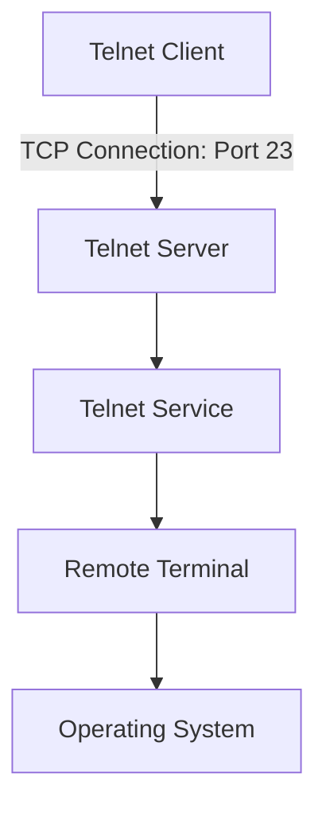
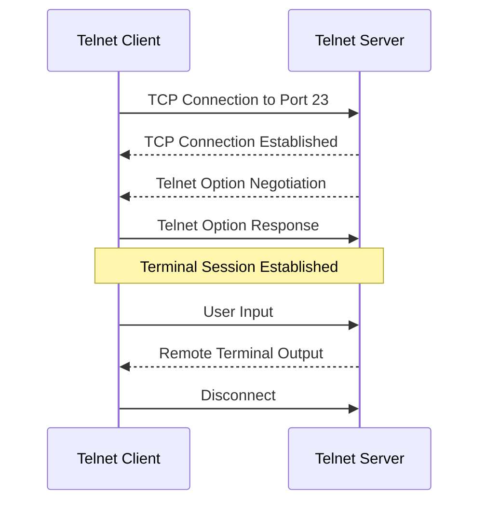
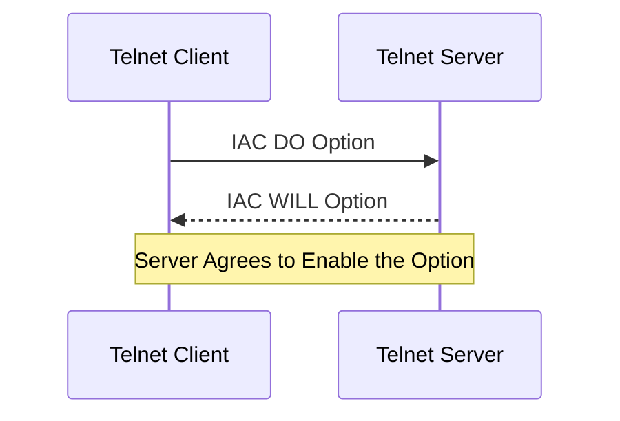

# Telnet (Teletype Network Protocol)

**Telnet (Teletype Network Protocol)** is an application-layer protocol used to provide interactive, text-based communication between a client and a remote server over a TCP/IP network.

Telnet allows users to connect to remote systems and execute commands through a virtual terminal.

It was widely used for remote administration before SSH became the preferred secure alternative.

Telnet transmits data, including login credentials, without encryption. Consequently, it is unsuitable for secure remote administration over untrusted networks.

Despite its security limitations, Telnet remains useful for understanding network communication, testing TCP connectivity, and accessing certain legacy network services.

### 🖆 Telnet at a Glance

| Feature | Description |
| --- | --- |
| Full name | Teletype Network Protocol |
| OSI model | Application layer |
| Transport protocol | TCP |
| Default port | TCP 23 |
| Communication | Text-based, interactive |
| Encryption | None by default |
| Authentication | Application-dependent |
| Primary purpose | Remote terminal access |
| Secure alternative | SSH |

# 🗁 What Is Telnet

Telnet is a protocol that provides bidirectional, interactive, text-oriented communication between two networked systems.

It allows a user to access a remote terminal through a Telnet client.

The client establishes a TCP connection to a Telnet server, typically using TCP port 23.

After the connection is established, the client and server exchange application data and terminal-control information.

### 🖆 Basic Telnet Communication

```text
Local Computer                         Remote Computer
     |                                      |
     |                                      |
     |--------- TCP Connection ------------>|
     |              Port 23                 |
     |                                      |
     |--------- Terminal Data ------------->|
     |                                      |
     |<-------- Remote Output ---------------|
     |                                      |
```

### 🖆 Example

A user connects to a remote server:

```bash
telnet 192.168.1.100
```

If a Telnet service is listening on the destination port, the client establishes a connection.

The user may then receive a login prompt or another application-specific response.

# 🗁 Why Telnet Was Developed

Early computer systems often required users to access remote machines through terminal-based interfaces.

Telnet provided a standardized way to connect different systems across a network.

Its design introduced the concept of a **Network Virtual Terminal (NVT)**, allowing different terminal implementations to communicate using a common representation.

### 🖆 Historical Importance

Telnet helped establish several important networking concepts:

* Remote terminal access.
* Client-server communication.
* Interactive network sessions.
* Terminal emulation.
* Negotiation of communication options.

### 🖆 Why Telnet Is Rarely Used for Administration Today

Telnet does not provide cryptographic protection.

An attacker who can capture network traffic may read transmitted information, including usernames, passwords, and commands.

SSH provides similar remote-access functionality with encryption, integrity protection, and cryptographic authentication.

# 🗁 Telnet Architecture

Telnet follows a client-server architecture.

The client initiates a TCP connection to the server.

The server accepts the connection and provides a virtual terminal session or another configured Telnet service.

### 🖆 Telnet Architecture Diagram



### 🖆 Communication Components

| Component | Responsibility |
| --- | --- |
| Telnet Client | Initiates the remote connection |
| TCP | Provides reliable, ordered byte-stream delivery |
| Telnet Protocol | Defines terminal communication and option negotiation |
| Telnet Server | Accepts and manages Telnet connections |
| Remote Terminal | Provides the interactive interface |

Telnet itself does not define a complete operating-system login or authorization system. Those functions depend on the server implementation and the underlying operating system.

# 🗁 Telnet Client and Server

### 🖆 Telnet Client

A Telnet client is software used to initiate a Telnet connection.

Examples include:

* Linux `telnet` command.
* PuTTY.
* Windows Telnet Client.
* Other terminal-emulation applications.

On Ubuntu, the Telnet client can be installed using:

```bash
sudo apt update
sudo apt install telnet
```

Check the available command:

```bash
telnet
```

### 🖆 Telnet Server

A Telnet server listens for incoming Telnet connections.

It commonly listens on TCP port 23.

On Ubuntu, a Telnet server can be installed for an isolated laboratory environment using a Telnet daemon package.

However, SSH is the preferred service for real remote administration.

### 🖆 Client and Server Communication

```text
Telnet Client
      |
      | TCP Connection
      | Destination Port 23
      |
      v
Telnet Server
      |
      | Terminal Session
      |
      v
Remote Operating System
```

# 🗁 How Telnet Works

Telnet communication begins with a TCP connection.

After establishing the connection, the client and server exchange Telnet protocol information and terminal data.

### 🖆 TCP Connection

The client initiates a TCP connection to the server's Telnet port.

The TCP three-way handshake establishes the transport connection.

```text
Client                         Server
   |                              |
   |---------- SYN -------------->|
   |<--------- SYN-ACK -----------|
   |---------- ACK -------------->|
   |                              |
   |      TCP Connection          |
```

### 🖆 Telnet Option Negotiation

The client and server may negotiate supported terminal features.

Examples include:

* Echo behavior.
* Terminal type.
* Window size.
* Suppression of go-ahead.
* Binary transmission.

The negotiation uses special Telnet control bytes.

### 🖆 Terminal Communication

After negotiation, the client and server exchange application data.

For example:

```text
Client                         Server
   |                              |
   |-------- Username ---------->|
   |<------- Password Prompt -----|
   |-------- Password ---------->|
   |<------- Login Result --------|
   |                              |
   |-------- Command ------------>|
   |<------- Command Output -------|
```

The actual login sequence depends on the Telnet server and the remote operating system.

### 🖆 Telnet Communication Workflow



# 🗁 Telnet Connection Establishment

Telnet operates over TCP, so the transport connection must be established before Telnet communication can begin.

### 🖆 TCP Three-Way Handshake

The client sends a SYN packet.

The server responds with SYN-ACK.

The client sends ACK.

After this exchange, the TCP connection is established.

### 🖆 Telnet Protocol Initialization

The client and server exchange Telnet control information.

This may include requests to enable or disable specific protocol options.

### 🖆 Terminal Session

Once the required options are negotiated, the client exchanges terminal input and output with the server.

### 🖆 Connection Diagram

```text
Telnet Client
     |
     | TCP SYN
     v
Telnet Server
     |
     | TCP SYN-ACK
     v
Telnet Client
     |
     | TCP ACK
     v
TCP Connection Established
     |
     | Telnet Negotiation
     v
Interactive Terminal Session
```

# 🗁 Telnet Protocol Components

Telnet defines mechanisms for transporting terminal data and negotiating communication behavior.

Its protocol includes several important concepts.

### 🖆 Network Virtual Terminal

The Network Virtual Terminal provides a common representation of terminal communication.

### 🖆 Telnet Commands

Special control bytes allow clients and servers to negotiate options and manage protocol behavior.

### 🖆 Telnet Options

Options extend the basic protocol with additional capabilities.

### 🖆 TCP Transport

TCP provides reliable, ordered delivery of Telnet data.

### 🖆 Protocol Structure

| Component | Purpose |
| --- | --- |
| NVT | Defines a common terminal representation |
| IAC | Introduces Telnet commands |
| DO / DON'T | Requests or rejects option enablement |
| WILL / WON'T | Offers or rejects local option enablement |
| SB / SE | Delimits option-specific subnegotiation |
| TCP | Provides reliable transport |

# 🗁 Telnet Network Virtual Terminal

**Network Virtual Terminal (NVT)** is a standardized terminal representation defined by Telnet.

Different systems may use different terminal types, character representations, and control conventions.

NVT provides a common format that allows them to communicate.

### 🖆 Why NVT Is Needed

Consider two systems:

```text
Computer A
Terminal Type: System A
Character Format: System A
```

```text
Computer B
Terminal Type: System B
Character Format: System B
```

Without a common representation, terminal communication may be incompatible.

NVT provides an intermediate representation:

```text
Computer A
    |
    v
NVT Representation
    |
    v
Computer B
```

### 🖆 NVT Data Representation

NVT defines conventions for character transmission and terminal control.

For example:

* CR represents carriage return.
* LF represents line feed.
* CR LF represents a new line.
* CR NUL represents a carriage return without a line feed.

These conventions help different terminal implementations interpret transmitted data consistently.

# 🗁 Telnet Commands and Options

Telnet uses special control bytes to negotiate protocol behavior.

The main control mechanism begins with **IAC (Interpret As Command)**.

### 🖆 Important Telnet Commands

| Command | Decimal Value | Hexadecimal | Purpose |
| --- | ---: | --- | --- |
| SE | 240 | `F0` | Ends subnegotiation |
| NOP | 241 | `F1` | No operation |
| Data Mark | 242 | `F2` | Marks a synchronization point |
| Break | 243 | `F3` | Requests a break condition |
| Interrupt Process | 244 | `F4` | Interrupts a process |
| Abort Output | 245 | `F5` | Aborts output |
| Are You There | 246 | `F6` | Requests a response |
| Erase Character | 247 | `F7` | Erases a character |
| Erase Line | 248 | `F8` | Erases a line |
| Go Ahead | 249 | `F9` | Indicates permission to transmit |
| SB | 250 | `FA` | Begins subnegotiation |
| WILL | 251 | `FB` | Offers to enable an option |
| WON'T | 252 | `FC` | Refuses or disables an option |
| DO | 253 | `FD` | Requests the other side to enable an option |
| DON'T | 254 | `FE` | Requests the other side not to enable an option |
| IAC | 255 | `FF` | Introduces a Telnet command |

### 🖆 IAC

IAC means **Interpret As Command**.

It introduces a Telnet command sequence.

Its decimal value is:

```text
255
```

Its hexadecimal representation is:

```text
FF
```

### 🖆 WILL

`WILL` indicates that the sender is willing to enable a particular option.

### 🖆 WON'T

`WON'T` indicates that the sender refuses or disables an option.

### 🖆 DO

`DO` requests the other side to enable a particular option.

### 🖆 DON'T

`DON'T` requests the other side not to enable a particular option.

# 🗁 Telnet Negotiation

Telnet uses option negotiation to determine which features the client and server support.

Negotiation is performed using the `IAC` command mechanism.

### 🖆 Basic Negotiation Example

Suppose the client wants the server to enable an option.

The client sends:

```text
IAC DO option
```

The server can accept:

```text
IAC WILL option
```

Or reject:

```text
IAC WON'T option
```

### 🖆 Negotiation Diagram



The meaning depends on which side is being asked to perform the option.

### 🖆 Common Telnet Options

| Option | Code | Purpose |
| --- | ---: | --- |
| Binary Transmission | 0 | Supports binary data transmission |
| Echo | 1 | Controls character echo behavior |
| Suppress Go Ahead | 3 | Suppresses the Go Ahead signal |
| Status | 5 | Exchanges option status |
| Timing Mark | 6 | Supports synchronization |
| Terminal Type | 24 | Identifies terminal type |
| Window Size | 31 | Communicates terminal dimensions |
| Terminal Speed | 32 | Communicates terminal speed |
| Remote Flow Control | 33 | Controls flow-control behavior |

Options are negotiated independently, and both sides must agree where the protocol requires mutual support.

# 🗁 Telnet Data Communication

Telnet carries terminal data through the established TCP connection.

TCP provides a reliable, ordered byte stream.

Telnet defines how terminal data and special control sequences are represented within that stream.

### 🖆 Example Terminal Session

```text
Client                         Server
   |                              |
   |-------- ls ---------------->|
   |                              |
   |<------- file1.txt -----------|
   |<------- file2.txt -----------|
   |<------- directory1/ ---------|
```

The client sends user input, and the remote system returns terminal output.

### 🖆 Telnet Data Characteristics

* Data is transmitted over TCP.
* TCP provides ordered byte-stream delivery.
* Telnet supports interactive terminal communication.
* Special control sequences are used for protocol negotiation.
* Traditional Telnet does not encrypt application data.

# 🗁 Telnet Ports

Telnet uses a well-known TCP port.

### 🖆 Default Telnet Port

| Protocol | Port | Transport | Purpose |
|---|---:|---|---|
| Telnet | 23 | TCP | Remote terminal communication |

### 🖆 Connection Example

```bash
telnet 192.168.1.100 23
```

The command attempts to connect to TCP port 23 on the destination.

Telnet can also connect to other TCP ports when used as a basic connectivity-testing client.

For example:

```bash
telnet example.com 80
```

This attempts a TCP connection to port 80. It does not automatically establish an HTTP session; the user must send valid HTTP data if application-level interaction is required.

# 🗁 Telnet Authentication

Telnet itself does not define a secure user-authentication system.

Authentication is generally handled by the remote service or operating system.

### 🖆 Username and Password

A traditional Telnet login session may request:

```text
login: username
Password: ********
```

The server validates the credentials using its configured authentication system.

### 🖆 Authentication Security

Traditional Telnet sends application data without encryption.

This includes credentials entered during an interactive login session.

A network observer with access to the traffic may capture these values.

### 🖆 Authentication Diagram

```text
Telnet Client
     |
     | Username and Password
     | Plaintext Application Data
     |
     v
Telnet Server
     |
     | Authentication Check
     |
     v
Remote Account
```

# 🗁 Telnet Security Limitations

Telnet was designed in an era when network security requirements were different from those of modern infrastructure.

Its lack of cryptographic protection creates significant security limitations.

### 🖆 No Encryption

Telnet does not encrypt transmitted application data.

Commands, terminal output, usernames, and passwords may be readable in captured traffic.

### 🖆 No Cryptographic Server Authentication

Traditional Telnet does not provide SSH-style cryptographic verification of server identity.

A client may connect to an impersonating system without receiving a cryptographically authenticated server identity.

### 🖆 No Cryptographic Integrity Protection

Telnet does not provide cryptographic integrity protection for its application data.

An attacker able to manipulate network traffic may alter communication.

### 🖆 Credential Exposure

Login credentials may be transmitted in readable form.

A packet capture can reveal sensitive information.

### 🖆 Man-in-the-Middle Attacks

Without cryptographic protection, an attacker positioned between the client and server may intercept or manipulate communication.

### 🖆 Telnet Security Summary

| Security Property | Traditional Telnet |
| --- | --- |
| Confidentiality | Not provided |
| Cryptographic integrity | Not provided |
| Cryptographic server authentication | Not provided |
| Secure credential transmission | Not provided |
| Encrypted remote administration | Not provided |

# 🗁 Telnet vs SSH

SSH was developed to provide secure remote access and address the weaknesses of older remote-terminal protocols.

Both protocols support interactive terminal communication, but their security models differ significantly.

### 🖆 Comparison Table

| Feature | Telnet | SSH |
| --- | --- | --- |
| Full name | Teletype Network Protocol | Secure Shell |
| OSI layer | Application | Application |
| Transport | TCP | TCP |
| Default port | 23 | 22 |
| Encryption | No | Yes |
| Integrity protection | No cryptographic protection | Yes |
| Server authentication | No cryptographic host-key verification | Yes |
| User authentication | Server-dependent | Password, public key, and other methods |
| Remote command execution | Yes, through remote terminal service | Yes |
| Secure file transfer | No built-in secure transfer | SFTP and SCP |
| Port forwarding | No built-in SSH-style tunneling | Yes |
| Production remote administration | Not recommended | Commonly used |

### 🖆 Telnet Communication

```text
Client
   |
   | Plaintext TCP Communication
   |
   v
Server
```

### 🖆 SSH Communication

```text
Client
   |
   | Encrypted SSH Communication
   |
   v
Server
```

### 🖆 When Should Telnet Be Used?

Telnet may still be encountered in:

* Legacy systems.
* Isolated laboratory environments.
* Historical networking exercises.
* Basic TCP connectivity testing.
* Certain specialized network appliances.

For remote administration, use SSH instead.

# 🗁 Telnet on Ubuntu

Ubuntu does not necessarily include the Telnet client by default.

You can install it through the package manager.

### 🖆 Install Telnet Client

Update package information:

```bash
sudo apt update
```

Install the client:

```bash
sudo apt install telnet
```

Verify installation:

```bash
telnet
```

### 🖆 Connect to a Telnet Server

```bash
telnet 192.168.1.100
```

Specify a port:

```bash
telnet 192.168.1.100 23
```

### 🖆 Exit a Telnet Session

Press:

```text
Ctrl + ]
```

The Telnet client enters its command prompt.

Type:

```text
quit
```

### 🖆 Useful Telnet Client Commands

| Command | Purpose |
| --- | --- |
| `open host port` | Connects to a host and port |
| `close` | Closes the current connection |
| `quit` | Exits the Telnet client |
| `status` | Displays connection status |
| `display` | Displays operating parameters |
| `set` | Changes client operating parameters |
| `unset` | Resets client parameters |

The available commands can vary between Telnet client implementations.

# 🗁 Using Telnet for TCP Connectivity Testing

Although Telnet is not suitable for secure remote administration, it can be used as a basic TCP connectivity-testing tool.

It attempts to establish a TCP connection to a destination address and port.

### 🖆 Test HTTP Port

```bash
telnet example.com 80
```

If the connection succeeds, the destination accepts the TCP connection.

To interact with an HTTP service, send a valid HTTP request:

```http
GET / HTTP/1.1
Host: example.com
Connection: close
```

After entering the request, press Enter twice to terminate the HTTP headers.

### 🖆 Test SMTP Port

```bash
telnet mail.example.com 25
```

If an SMTP service accepts the connection, it may return a greeting such as:

```text
220 mail.example.com ESMTP
```

### 🖆 Test a Custom TCP Port

```bash
telnet 192.168.1.100 8080
```

### 🖆 Interpret the Results

| Result | Possible Meaning |
| --- | --- |
| Connected | TCP connection established |
| Connection refused | Destination rejected the connection or no service is listening |
| Connection timed out | Packets may be dropped by a firewall or network path |
| Unknown host | Hostname resolution failed |
| No response after connection | TCP connected, but the application may not have sent data |

A successful Telnet connection confirms TCP connectivity to the specified endpoint at that moment. It does not prove that the application protocol is functioning correctly.

### 🖆 Alternative: Netcat

Netcat is generally more convenient for TCP connectivity testing.

Install it:

```bash
sudo apt install netcat-openbsd
```

Test a TCP port:

```bash
nc -vz example.com 80
```

Test another service:

```bash
nc -vz 192.168.1.100 22
```

Netcat provides more direct connectivity-testing options than an interactive Telnet session.

# 🗁 Telnet for Network Device Administration

Some legacy network devices and isolated laboratory environments provide Telnet-based management interfaces.

For example, a device may accept a Telnet connection on its management IP address.

```bash
telnet 192.168.88.1
```

The device may present a login prompt or a command-line interface.

### 🖆 Typical Network Device Use Cases

* Accessing legacy routers.
* Managing older switches.
* Testing management connectivity.
* Practicing terminal-based network administration.

### 🖆 Modern Network Device Management

For production environments, prefer:

* SSH for encrypted command-line access.
* HTTPS for secure web-based management.
* SNMPv3 for authenticated and encrypted network monitoring where appropriate.

Disable Telnet management when it is not required.

# 🗁 Telnet Troubleshooting

Telnet connection problems can originate from DNS, routing, TCP connectivity, firewall rules, or service configuration.

### 🖆 Connection Refused

Example:

```text
telnet: Unable to connect to remote host: Connection refused
```

Possible causes:

* Telnet server is not running.
* The destination port is incorrect.
* A firewall actively rejects the connection.
* No service is listening on the target port.

Check listening ports on the server:

```bash
sudo ss -lntp
```

### 🖆 Connection Timed Out

Example:

```text
Connection timed out
```

Possible causes:

* Firewall silently drops packets.
* Routing is incorrect.
* The server is unreachable.
* Network ACL blocks the destination port.

Check the route:

```bash
ip route get 192.168.1.100
```

Test connectivity:

```bash
nc -vz 192.168.1.100 23
```

### 🖆 Unknown Host

Example:

```text
Unknown host
```

Possible causes:

* Incorrect hostname.
* DNS resolution failure.
* Missing DNS configuration.
* Network connectivity problems affecting DNS.

Check name resolution:

```bash
getent hosts example.com
```

### 🖆 Connection Established but No Application Response

Possible causes:

* The destination port is open but the application expects a different protocol.
* The application waits for client input.
* The service does not send an initial greeting.
* The connection was established to the wrong service.

A TCP connection alone does not establish that the expected application protocol is available.

### 🖆 Capture Telnet Traffic

Use tcpdump:

```bash
sudo tcpdump -i any 'tcp port 23'
```

Telnet uses unencrypted application data, so packet captures may expose terminal commands and login credentials.

# 🗁 Common Mistakes

### 🖆 Confusing Telnet with SSH

Both protocols support remote terminal access, but SSH provides cryptographic security while traditional Telnet does not.

### 🖆 Assuming Telnet Uses UDP

Traditional Telnet uses TCP, not UDP.

### 🖆 Assuming Port 23 Is Required for Every Telnet Client Connection

TCP port 23 is the standard Telnet service port.

However, a Telnet client can connect to another TCP port for connectivity testing or interaction with a different service.

### 🖆 Assuming a Successful TCP Connection Means the Service Works

A successful connection only confirms that the TCP handshake completed.

Application-level communication must still be tested.

### 🖆 Using Telnet for Production Server Administration

Traditional Telnet exposes credentials and application data.

Use SSH for secure remote administration.

### 🖆 Confusing Telnet Negotiation with Authentication

Telnet option negotiation determines terminal communication features.

It is separate from the authentication process performed by the remote service.

### 🖆 Assuming Telnet Provides Encryption

Traditional Telnet does not provide cryptographic encryption or integrity protection.

# 🗁 Security Best Practices

* Use SSH instead of Telnet for remote administration.
* Avoid transmitting passwords through Telnet.
* Disable Telnet services when they are unnecessary.
* Restrict legacy Telnet access to isolated laboratory networks.
* Apply network segmentation to legacy systems.
* Restrict management access through firewall rules.
* Prefer encrypted management protocols.
* Monitor network traffic involving TCP port 23.
* Remove unnecessary Telnet client and server packages from production systems.
* Use Netcat or other diagnostic tools for basic TCP connectivity testing.

# 🗁 Practical Exercises

### 🖆 Exercise: Install Telnet Client

On Ubuntu:

* Update package information.
* Install the Telnet client.
* Verify that the command is available.
* Display the client help or command prompt.

### 🖆 Exercise: Test TCP Connectivity

Test common TCP services:

```bash
telnet example.com 80
telnet example.com 443
telnet example.com 22
```

Observe the difference between successful connections and failed connections.

### 🖆 Exercise: Test an HTTP Service

Connect to an HTTP server:

```bash
telnet example.com 80
```

Send:

```http
GET / HTTP/1.1
Host: example.com
Connection: close
```

Observe the HTTP response.

### 🖆 Exercise: Compare Telnet and Netcat

Run:

```bash
telnet example.com 80
```

Then:

```bash
nc -vz example.com 80
```

Compare their output and identify which tool is more convenient for simple TCP connectivity testing.

### 🖆 Exercise: Analyze Telnet Traffic

Capture traffic in a controlled laboratory environment:

```bash
sudo tcpdump -i any -A 'tcp port 23'
```

Observe how Telnet application data is represented in the capture.

Use only non-sensitive test credentials and data in this exercise.

### 🖆 Exercise: Compare Telnet and SSH

Create a comparison covering:

* TCP ports.
* Authentication.
* Encryption.
* Integrity protection.
* Remote terminal access.
* Typical use cases.

Explain why SSH replaced Telnet for secure remote administration.

# 🗁 Interview Questions

### 🖆 What is Telnet?

Telnet is an application-layer protocol that provides interactive, text-based communication with a remote system over TCP.

### 🖆 What is the default Telnet port?

TCP port 23.

### 🖆 Which transport protocol does Telnet use?

TCP.

### 🖆 What is the Network Virtual Terminal?

NVT is a standardized terminal representation that allows different terminal implementations to communicate through Telnet.

### 🖆 Why was Telnet developed?

It was developed to provide standardized remote terminal communication between different computer systems.

### 🖆 What is IAC in Telnet?

IAC means Interpret As Command. It introduces Telnet control commands.

### 🖆 What is Telnet option negotiation?

It is the mechanism through which the client and server negotiate supported terminal features.

### 🖆 What is the difference between DO and WILL?

`DO` requests the other side to enable an option. `WILL` indicates that the sender agrees to enable an option.

### 🖆 What is the difference between Telnet and SSH?

Telnet provides traditional unencrypted remote terminal communication. SSH provides encrypted communication, cryptographic authentication, and integrity protection.

### 🖆 Why is Telnet considered insecure?

It does not provide encryption or cryptographic integrity protection, so credentials and application data can be exposed or manipulated.

### 🖆 Can Telnet be used to test TCP connectivity?

Yes. A Telnet client can attempt to establish a TCP connection to a specified destination address and port.

### 🖆 Does a successful Telnet connection prove that an application works?

No. It only confirms that the TCP connection was established. Application-level communication must be tested separately.

### 🖆 What is the difference between Telnet and Netcat?

Telnet is a terminal communication protocol and client. Netcat is a general-purpose network utility used for TCP/UDP connections, listening, and data transfer.

### 🖆 Is Telnet still used today?

It may be found in legacy systems, isolated laboratories, and specialized environments, but SSH is preferred for secure remote administration.

# 🗁 Summary

Telnet is an application-layer protocol that provides interactive remote terminal communication over TCP.

Key concepts:

* Telnet stands for Teletype Network Protocol.
* It commonly uses TCP port 23.
* It follows a client-server architecture.
* It provides terminal communication through a Network Virtual Terminal.
* It uses special commands for option negotiation.
* `IAC` introduces Telnet control commands.
* `DO`, `DON'T`, `WILL`, and `WON'T` control option negotiation.
* Telnet does not encrypt credentials or application data.
* It does not provide SSH-style cryptographic server authentication or integrity protection.
* SSH is the preferred replacement for secure remote administration.
* Telnet clients can also be used for basic TCP connectivity testing.
* Netcat is generally more convenient for dedicated TCP connectivity checks.

Understanding Telnet is useful for learning the history of remote terminal communication, application-layer protocols, TCP connections, and network troubleshooting.

# 🗁 References

* [RFC 854 — Telnet Protocol Specification](https://datatracker.ietf.org/doc/html/rfc854)
* [RFC 855 — Telnet Option Specifications](https://datatracker.ietf.org/doc/html/rfc855)
* [RFC 856 — Telnet Binary Transmission](https://datatracker.ietf.org/doc/html/rfc856)
* [RFC 857 — Telnet Echo Option](https://datatracker.ietf.org/doc/html/rfc857)
* [RFC 858 — Telnet Suppress Go Ahead Option](https://datatracker.ietf.org/doc/html/rfc858)
* [RFC 859 — Telnet Status Option](https://datatracker.ietf.org/doc/html/rfc859)
* [RFC 860 — Telnet Timing Mark Option](https://datatracker.ietf.org/doc/html/rfc860)
* [RFC 1091 — Telnet Terminal-Type Option](https://datatracker.ietf.org/doc/html/rfc1091)
* [RFC 1073 — Telnet Window Size Option](https://datatracker.ietf.org/doc/html/rfc1073)
* [OpenBSD Telnet Manual](https://man.openbsd.org/telnet)
* [Ubuntu Documentation](https://documentation.ubuntu.com/)
