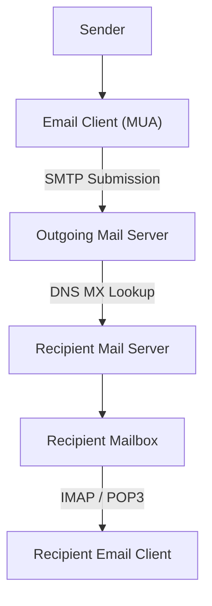
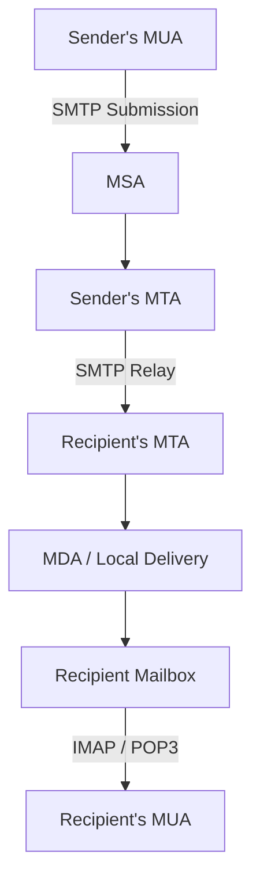
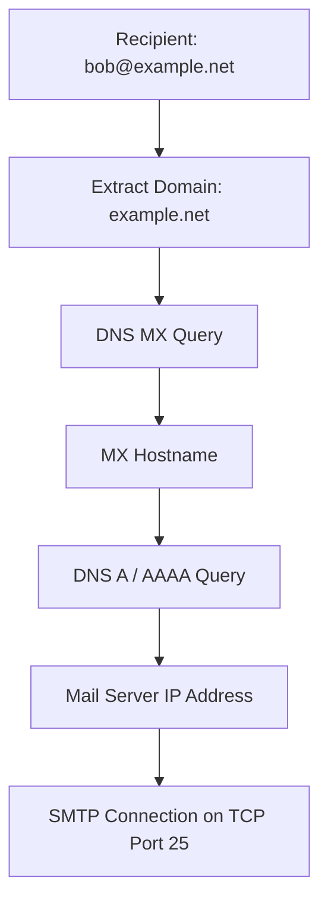
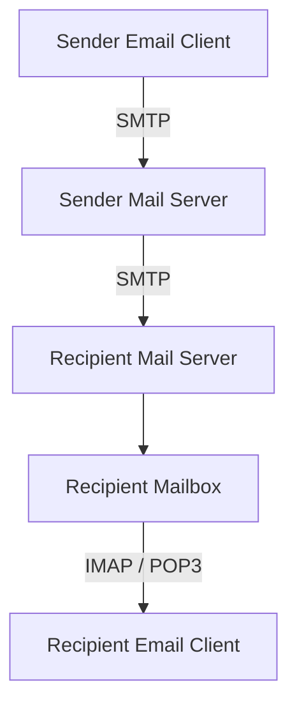

# SMTP (Simple Mail Transfer Protocol)

SMTP (Simple Mail Transfer Protocol) is an application-layer protocol used to send and relay email messages across networks.

It defines how email clients and mail servers communicate when submitting outgoing messages and transferring messages between mail servers.

SMTP is primarily responsible for **sending email**, not retrieving or reading received messages. Email retrieval and mailbox access are typically handled by POP3 or IMAP.

SMTP commonly uses TCP to provide reliable, connection-oriented communication.

### 🖆 Key Characteristics

* **Protocol name:** Simple Mail Transfer Protocol
* **OSI layer:** Application Layer
* **Transport protocol:** TCP
* **Primary purpose:** Email submission and message transfer
* **Communication model:** Client-server
* **Message delivery model:** Store-and-forward
* **Common ports:** 25, 465, and 587
* **Standard:** RFC 5321

# 🗁 How SMTP Works

SMTP allows email messages to travel from a sender's email client to the recipient's mail server.

It uses a store-and-forward mechanism. Mail servers can temporarily store messages in queues and retry delivery when the destination server is unavailable.

### 🖆 Basic SMTP Workflow



### 🖆 Example

Suppose Alice sends an email to:

```text
alice@example.com
```

The recipient is:

```text
bob@example.net
```

The process generally works as follows:

* Alice writes an email using an email client.
* The email client submits the message to Alice's outgoing mail server.
* The outgoing server identifies the recipient's mail domain.
* It queries DNS for the recipient domain's MX records.
* It connects to the destination mail server using SMTP.
* The destination server accepts and stores the message.
* Bob retrieves the message using IMAP or POP3.

SMTP handles the submission and transfer stages. IMAP or POP3 handles mailbox access.

# 🗁 SMTP Architecture

SMTP communication involves several components that perform different responsibilities.

### 🖆 Mail User Agent (MUA)

A Mail User Agent is an email application used to compose, send, receive, and manage email messages.

Examples:

* Thunderbird
* Microsoft Outlook
* Apple Mail
* Gmail web interface

The MUA creates the message and submits outgoing email to a mail server.

### 🖆 Mail Submission Agent (MSA)

A Mail Submission Agent receives outgoing messages from email clients.

Its responsibilities commonly include:

* Authenticating users.
* Applying submission policies.
* Checking message formatting.
* Enforcing sending limits.
* Passing accepted messages to a Mail Transfer Agent.

Client submission commonly uses TCP port 587 or 465.

### 🖆 Mail Transfer Agent (MTA)

A Mail Transfer Agent transfers email messages between mail servers.

Its responsibilities include:

* Routing messages.
* Looking up recipient mail servers.
* Managing outgoing queues.
* Retrying temporary delivery failures.
* Reporting permanent delivery failures.

Examples:

* Postfix
* Exim
* Sendmail

### 🖆 Mail Delivery Agent (MDA)

A Mail Delivery Agent delivers accepted messages into the recipient's mailbox.

It may apply local delivery rules, filtering, and mailbox storage operations.

### 🖆 Complete Architecture



# 🗁 SMTP Ports

SMTP uses different TCP ports depending on the communication purpose and TLS configuration.

| Port | Purpose | Security |
| --- | --- | --- |
| 25 | Mail server-to-server relay | Commonly opportunistic STARTTLS |
| 587 | Email message submission | STARTTLS commonly supported |
| 465 | Email message submission | Implicit TLS |
| 2525 | Alternative submission port offered by some providers | Provider-dependent |

### 🖆 Port 25 — SMTP Relay

Port 25 is primarily used for communication between mail servers.

Example:

```text
Sender MTA
    |
    | TCP Port 25
    |
Recipient MTA
```

It is generally not intended for ordinary end-user email submission.

### 🖆 Port 587 — Message Submission

Port 587 is the standard message submission port.

Email clients typically:

* Connect to the submission server.
* Establish a connection.
* Upgrade the connection using STARTTLS.
* Authenticate using SMTP AUTH.
* Submit the email.

### 🖆 Port 465 — Submission over Implicit TLS

Port 465 provides SMTP submission with implicit TLS.

Unlike STARTTLS, TLS negotiation begins immediately after the TCP connection is established.

It is standardized for message submission with implicit TLS.

### 🖆 Port 2525 — Alternative Submission

Some email service providers offer port 2525 as an alternative when standard submission ports are blocked by a network.

It is provider-specific rather than a standard SMTP port assignment.

# 🗁 SMTP Communication Process

SMTP uses a command-and-response communication model.

The client sends commands, and the server responds with status codes.

### 🖆 Basic Communication Sequence

```text
S: 220 mail.example.com ESMTP Postfix

C: EHLO client.example.com
S: 250-mail.example.com
S: 250-STARTTLS
S: 250-AUTH PLAIN LOGIN
S: 250 SIZE 52428800

C: MAIL FROM:<alice@example.com>
S: 250 2.1.0 Ok

C: RCPT TO:<bob@example.net>
S: 250 2.1.5 Ok

C: DATA
S: 354 End data with <CRLF>.<CRLF>

C: From: Alice <alice@example.com>
C: To: Bob <bob@example.net>
C: Subject: SMTP Example
C:
C: Hello Bob!
C: This is an example email.
C: .
S: 250 2.0.0 Message accepted

C: QUIT
S: 221 2.0.0 Bye
```

In this example:

* `S` represents the SMTP server.
* `C` represents the SMTP client.
* The server announces that it is ready.
* The client identifies itself using `EHLO`.
* The sender and recipient are specified.
* The message is transferred using `DATA`.
* The server accepts the message for further processing.

The example demonstrates SMTP command structure. Real submission sessions commonly establish TLS and authenticate before sending a message.

### 🖆 SMTP Message Termination

The `DATA` command tells the server that the client is about to transmit the message content.

The message ends with:

```text
<CRLF>.<CRLF>
```

This means a line containing only a period signals the end of the message data.

SMTP uses **dot-stuffing** to avoid confusing message content with this terminator.

If a message line begins with a period, the sending client adds another period at the beginning. The receiving server removes the extra period during processing.

# 🗁 SMTP Commands

SMTP defines commands that control communication between clients and servers.

| Command | Description |
| --- | --- |
| `HELO` | Identifies the client to the server using basic SMTP |
| `EHLO` | Identifies the client and requests supported extensions |
| `MAIL FROM` | Specifies the envelope sender |
| `RCPT TO` | Specifies an envelope recipient |
| `DATA` | Begins transmission of the email message |
| `RSET` | Resets the current mail transaction |
| `NOOP` | Requests a basic server response |
| `QUIT` | Ends the SMTP session |
| `VRFY` | Requests verification of a mailbox or user |
| `EXPN` | Requests expansion of a mailing list |
| `STARTTLS` | Requests an upgrade to TLS |
| `AUTH` | Initiates an authentication mechanism |

### 🖆 HELO and EHLO

`HELO` introduces the client to the SMTP server.

```text
HELO client.example.com
```

`EHLO` performs the extended SMTP greeting and allows the server to advertise supported extensions.

```text
EHLO client.example.com
```

Modern SMTP clients generally use `EHLO`.

### 🖆 MAIL FROM

Specifies the envelope sender.

```text
MAIL FROM:<alice@example.com>
```

This address is used by SMTP for message transport and delivery-status handling.

### 🖆 RCPT TO

Specifies a recipient.

```text
RCPT TO:<bob@example.net>
```

An SMTP transaction can include multiple `RCPT TO` commands to deliver one message to multiple recipients.

### 🖆 DATA

Begins the transmission of message headers and body.

```text
DATA
```

The server normally responds with:

```text
354 Start mail input
```

The client then transmits the message and terminates it with a line containing a single period.

### 🖆 RSET

Resets the current SMTP transaction without closing the connection.

```text
RSET
```

### 🖆 STARTTLS

Requests that the current connection be upgraded to TLS.

```text
STARTTLS
```

After a successful TLS handshake, SMTP communication continues inside the encrypted connection.

### 🖆 AUTH

Initiates an SMTP authentication mechanism.

```text
AUTH
```

The actual authentication exchange depends on the mechanism advertised by the server.

Authentication should be performed over a properly protected TLS connection.

# 🗁 SMTP Response Codes

SMTP servers respond to commands using three-digit status codes.

The first digit indicates the general result.

| Code Class | Meaning |
| --- | --- |
| 2xx | Successful operation |
| 3xx | Additional information or action required |
| 4xx | Temporary failure |
| 5xx | Permanent failure |

### 🖆 Common SMTP Response Codes

| Code | Meaning |
| --- | --- |
| `220` | Service ready |
| `221` | Service closing transmission channel |
| `250` | Requested action completed successfully |
| `251` | User not local; will forward |
| `354` | Start mail input |
| `421` | Service unavailable; closing connection |
| `450` | Mailbox unavailable temporarily |
| `451` | Local processing error |
| `452` | Insufficient system storage |
| `550` | Requested action not taken; mailbox unavailable or access denied |
| `551` | User not local |
| `552` | Storage allocation exceeded |
| `553` | Mailbox name not allowed |
| `554` | Transaction failed |

### 🖆 Temporary Failure — 4xx

A 4xx response indicates a temporary problem.

The sending MTA may keep the message in its queue and retry later.

Examples:

* Destination server temporarily unavailable.
* Mailbox temporarily unavailable.
* Temporary rate limiting.
* Temporary resource shortage.

### 🖆 Permanent Failure — 5xx

A 5xx response indicates that the requested operation cannot currently be completed and is generally treated as a permanent failure.

Examples:

* Invalid recipient address.
* Relay denied.
* Message rejected by policy.
* Recipient mailbox does not exist.

The sending system may generate a bounce or delivery-status notification.

# 🗁 Email Message Structure

An email message contains headers and a body.

SMTP transports the message, while the Internet Message Format defines its general structure.

### 🖆 Basic Email Structure

```text
From: Alice <alice@example.com>
To: Bob <bob@example.net>
Subject: Welcome
Date: Mon, 09 Nov 2026 10:00:00 +0600
Message-ID: <example123@example.com>
MIME-Version: 1.0
Content-Type: text/plain; charset=UTF-8

Hello Bob,

Welcome to our networking course.

Regards,
Alice
```

### 🖆 Email Headers

Headers contain metadata describing the message.

| Header | Purpose |
| --- | --- |
| `From` | Visible sender address |
| `To` | Visible recipient address |
| `Cc` | Visible carbon-copy recipients |
| `Bcc` | Blind carbon-copy recipients, normally omitted from delivered message headers |
| `Subject` | Message subject |
| `Date` | Message creation date |
| `Message-ID` | Unique message identifier |
| `Reply-To` | Suggested reply address |
| `Content-Type` | Message content type |
| `MIME-Version` | MIME version information |

### 🖆 Envelope vs Message Headers

SMTP uses an envelope to control message delivery.

The message itself contains headers that describe the email to its recipient.

These are different concepts.

| SMTP Envelope | Message Header |
| --- | --- |
| `MAIL FROM` | `From:` |
| `RCPT TO` | `To:` |
| Additional `RCPT TO` | `Cc:` or `Bcc:` recipients, depending on the message |

For example:

```text
MAIL FROM:<bounce@example.com>
RCPT TO:<bob@example.net>
```

The message headers might contain:

```text
From: Alice <alice@example.com>
To: Bob <bob@example.net>
Subject: Hello
```

The envelope sender does not have to match the visible `From:` header.

This distinction is important for email forwarding, mailing lists, bounce handling, and email authentication.

### 🖆 MIME

MIME (Multipurpose Internet Mail Extensions) extends email formatting capabilities.

It supports:

* File attachments.
* HTML email.
* Multiple content types.
* Non-ASCII text.
* Images and other binary content.

Example:

```text
MIME-Version: 1.0
Content-Type: text/html; charset=UTF-8
Content-Transfer-Encoding: quoted-printable

<html>
  <body>
    <h1>Hello Bob!</h1>
    <p>Welcome to SMTP.</p>
  </body>
</html>
```

MIME allows an email to contain different content formats and attachments.

Modern SMTP extensions can also support capabilities such as `8BITMIME`, `SMTPUTF8`, and `CHUNKING`, depending on server support.

# 🗁 SMTP Extensions

Extended SMTP (ESMTP) adds capabilities beyond the original SMTP command set.

Clients discover supported extensions through the `EHLO` response.

### 🖆 Common SMTP Extensions

| Extension | Purpose |
| --- | --- |
| `STARTTLS` | Upgrade an SMTP connection to TLS |
| `AUTH` | Authenticate the SMTP client |
| `SIZE` | Advertise or enforce message-size limits |
| `8BITMIME` | Support message bodies containing 8-bit MIME content |
| `SMTPUTF8` | Support internationalized email addresses and UTF-8 message headers |
| `PIPELINING` | Allow multiple commands to be sent without waiting for each response |
| `CHUNKING` | Transfer message data in chunks using `BDAT` |

### 🖆 Example EHLO Response

```text
EHLO client.example.com

250-mail.example.com
250-STARTTLS
250-AUTH PLAIN LOGIN
250-SIZE 52428800
250-8BITMIME
250-PIPELINING
250 SMTPUTF8
```

The response indicates which extensions the server supports.

Clients should not assume that every SMTP server supports every extension.

# 🗁 SMTP and TLS

SMTP can use TLS to protect communication between clients and mail servers.

TLS provides encryption, integrity protection, and server authentication when certificate validation is correctly performed.

### 🖆 STARTTLS

STARTTLS upgrades an existing SMTP connection to TLS.

Typical message submission flow:

```text
Client
   |
   | TCP Connection to Port 587
   |
SMTP Server
   |
   | EHLO
   |
   | STARTTLS
   |
TLS Handshake
   |
Encrypted SMTP Communication
   |
AUTH and Message Submission
```

Before TLS is established, the connection may be unencrypted. After a successful TLS handshake, subsequent SMTP communication is encrypted.

### 🖆 Implicit TLS

Port 465 uses implicit TLS.

The TLS handshake starts immediately after the TCP connection is established.

```text
Client
   |
   | TCP Connection to Port 465
   |
TLS Handshake
   |
Encrypted SMTP Communication
   |
SMTP Commands and Authentication
```

### 🖆 STARTTLS vs Implicit TLS

| Feature | STARTTLS | Implicit TLS |
| --- | --- | --- |
| Common submission port | 587 | 465 |
| Initial connection | SMTP first | TLS immediately |
| TLS activation | Explicit upgrade | Automatic at connection start |
| Encryption | After successful upgrade | From the beginning |

### 🖆 Server-to-Server TLS

Mail servers commonly support opportunistic STARTTLS on port 25.

This means they attempt to encrypt communication when the destination server supports it.

However, opportunistic TLS does not guarantee that every server-to-server transfer is encrypted.

Mechanisms such as MTA-STS and DANE can strengthen SMTP transport security.

# 🗁 DNS and SMTP

SMTP relies on DNS to identify the destination mail server for a recipient domain.

The most important DNS record for email routing is the MX record.

### 🖆 MX Record

An MX record specifies which mail server receives email for a domain.

Example:

```bash
dig MX example.com
```

Possible output:

```text
example.com.  3600  IN  MX  10 mail1.example.com.
example.com.  3600  IN  MX  20 mail2.example.com.
```

This indicates:

* `mail1.example.com` has preference 10.
* `mail2.example.com` has preference 20.

Lower preference values indicate higher priority.

If the preferred server is unavailable, the sending MTA may try another eligible MX server.

### 🖆 Resolving the Mail Server Address

After obtaining the MX hostname, the sending server resolves its IP address using A or AAAA records.

Example:

```bash
dig A mail1.example.com
dig AAAA mail1.example.com
```

The SMTP connection is then established with the resolved destination address, usually on TCP port 25.

An MX target must not be a CNAME alias. It should identify a hostname with address records.

### 🖆 SMTP DNS Lookup Flow



### 🖆 MX Record Priority

Example:

```text
example.net.  MX  10 mail1.example.net.
example.net.  MX  20 mail2.example.net.
```

The sending MTA normally prefers the server with the lowest preference value.

Multiple MX records provide alternative delivery destinations, but they do not automatically guarantee high availability. The servers must be configured to accept and process mail for the domain.

# 🗁 Email Authentication

Email authentication mechanisms help receiving mail servers evaluate whether a message is legitimate.

The three commonly used mechanisms are SPF, DKIM, and DMARC.

### 🖆 SPF

SPF (Sender Policy Framework) allows a domain owner to publish which hosts are authorized to send email using that domain.

It is published as a DNS TXT record.

Example:

```text
example.com. TXT "v=spf1 ip4:203.0.113.10 -all"
```

This example authorizes the specified IPv4 address and declares other sources unauthorized under the policy.

SPF primarily evaluates the SMTP envelope sender domain, commonly represented by the Return-Path in delivered messages.

### 🖆 DKIM

DKIM (DomainKeys Identified Mail) uses cryptographic signatures to help verify that selected message headers and the message body have not been modified in ways that invalidate the signature.

The sending mail server signs the message using a private key.

The receiving server retrieves the corresponding public key from DNS.

Example DNS record:

```text
selector1._domainkey.example.com
```

A DKIM signature is commonly included in the message using the `DKIM-Signature` header.

### 🖆 DMARC

DMARC (Domain-based Message Authentication, Reporting, and Conformance) builds on SPF and DKIM.

It defines how receiving servers should handle messages that fail authentication and alignment checks.

Example:

```text
_dmarc.example.com. TXT "v=DMARC1; p=quarantine; rua=mailto:dmarc@example.com"
```

Common DMARC policies:

| Policy | Meaning |
| --- | --- |
| `none` | Monitor authentication results |
| `quarantine` | Treat failing messages as suspicious |
| `reject` | Reject failing messages |

DMARC checks whether authenticated SPF or DKIM results align with the domain in the visible `From:` header.

### 🖆 SPF vs DKIM vs DMARC

| Mechanism | Main Purpose |
| --- | --- |
| SPF | Authorizes sending hosts for a domain |
| DKIM | Verifies a cryptographic message signature |
| DMARC | Applies domain alignment and policy using SPF and DKIM |

These mechanisms improve email authenticity and reduce spoofing. They do not encrypt SMTP connections.

# 🗁 SMTP Security

SMTP environments face several security threats.

### 🖆 Open Relay

An open relay is a mail server that accepts and forwards email from unauthorized sources to arbitrary external recipients.

It can be abused to distribute spam and malicious messages.

Preventive measures:

* Require authentication for message submission.
* Restrict relay permissions.
* Configure trusted networks carefully.
* Apply anti-abuse and rate-limiting policies.

### 🖆 Email Spoofing

Email spoofing occurs when an attacker forges sender information to make a message appear to come from another address or domain.

SPF, DKIM, and DMARC help receiving systems evaluate message authenticity.

### 🖆 Credential Theft

SMTP credentials can be exposed if authentication takes place over an unencrypted connection.

Use TLS-protected submission and strong authentication mechanisms.

### 🖆 Spam and Abuse

Attackers may use compromised accounts or mail servers to send large volumes of unwanted messages.

Protection mechanisms include:

* Rate limiting.
* Authentication.
* Spam filtering.
* Reputation checks.
* IP and domain reputation management.
* Abuse monitoring.

### 🖆 TLS Downgrade and Interception

Opportunistic STARTTLS can be vulnerable to downgrade or interception attacks when encryption is not enforced or authenticated through stronger policies.

MTA-STS and DANE can improve server-to-server TLS security.

### 🖆 End-to-End Encryption

TLS protects a connection between two communicating systems.

It does not automatically encrypt an email from the sender's device all the way to the recipient's device.

For end-to-end message encryption, technologies such as OpenPGP and S/MIME are used.

# 🗁 SMTP vs POP3 vs IMAP

SMTP, POP3, and IMAP are all associated with email, but they have different responsibilities.

| Feature | SMTP | POP3 | IMAP |
| --- | --- | --- | --- |
| Main purpose | Send and relay email | Retrieve email | Access and synchronize mailboxes |
| Typical direction | Outgoing | Incoming | Incoming and mailbox management |
| Common ports | 25, 465, 587 | 110, 995 | 143, 993 |
| Server-side mailbox synchronization | Not its purpose | Limited | Yes |
| Primary role | Message transport | Message retrieval | Mailbox access |

### 🖆 SMTP

Used for sending messages from clients to submission servers and transferring messages between mail servers.

### 🖆 POP3

Used by email clients to retrieve messages from a mailbox.

Traditional POP3 workflows may download messages to a local device.

### 🖆 IMAP

Used to access and synchronize messages and mailbox state across multiple devices.

### 🖆 Combined Email Workflow



# 🗁 SMTP on Ubuntu/Linux

Ubuntu provides several command-line tools for testing SMTP connectivity and working with mail servers.

### 🖆 Install SMTP Testing Tools

Install `swaks`, a command-line SMTP testing utility.

```bash
sudo apt update
sudo apt install swaks
```

Install OpenSSL if it is not already available.

```bash
sudo apt install openssl
```

### 🖆 Check SMTP Port Connectivity

Use Netcat to test whether a remote SMTP port is reachable.

```bash
nc -vz mail.example.com 587
```

For server-to-server SMTP:

```bash
nc -vz mail.example.com 25
```

A successful TCP connection confirms that the port is reachable. It does not prove that authentication, TLS, or message delivery will work.

### 🖆 Inspect SMTP Server Capabilities

Connect to a submission server using STARTTLS:

```bash
openssl s_client \
  -starttls smtp \
  -connect mail.example.com:587 \
  -crlf
```

For implicit TLS on port 465:

```bash
openssl s_client \
  -connect mail.example.com:465 \
  -crlf
```

Once connected, inspect the certificate and TLS negotiation details.

### 🖆 Test SMTP with Swaks

A basic SMTP connectivity test:

```bash
swaks \
  --server mail.example.com \
  --port 587 \
  --tls \
  --from test@example.com \
  --to recipient@example.net
```

For authenticated submission, use an appropriate credential mechanism supported by the server. Avoid putting passwords directly in shell commands because they may be exposed through shell history or process listings.

### 🖆 Inspect DNS MX Records

```bash
dig MX example.com
```

Inspect the address of an MX hostname:

```bash
dig A mail.example.com
dig AAAA mail.example.com
```

# 🗁 Testing SMTP Connections

SMTP testing helps identify connectivity, TLS, authentication, and message-delivery problems.

### 🖆 Test Port 25

```bash
nc -vz mail.example.com 25
```

### 🖆 Test Port 587 with STARTTLS

```bash
openssl s_client \
  -starttls smtp \
  -connect mail.example.com:587 \
  -servername mail.example.com \
  -crlf
```

### 🖆 Test Port 465 with Implicit TLS

```bash
openssl s_client \
  -connect mail.example.com:465 \
  -servername mail.example.com \
  -crlf
```

### 🖆 Inspect SMTP Traffic

Use `tcpdump` to capture SMTP traffic.

```bash
sudo tcpdump -i any -nn 'tcp port 25 or tcp port 465 or tcp port 587'
```

For packet-level inspection, Wireshark can be used with this display filter:

```text
smtp || tcp.port == 465 || tcp.port == 587
```

Encrypted SMTP payloads are not normally readable without appropriate decryption material and capture conditions.

# 🗁 SMTP Troubleshooting

SMTP problems can occur at the DNS, network, TLS, authentication, or message-delivery layers.

### 🖆 Connection Refused

Possible causes:

* SMTP service is not running.
* The destination port is closed.
* A firewall rejects the connection.
* The server is listening on a different interface or port.

Useful commands:

```bash
nc -vz mail.example.com 587
```

On a server:

```bash
sudo ss -tlnp
```

### 🖆 Connection Timeout

Possible causes:

* Network routing problems.
* Firewall silently dropping packets.
* Provider restrictions on outbound SMTP.
* Remote server unavailable.

Check:

```bash
ip route
```

```bash
ping mail.example.com
```

```bash
traceroute mail.example.com
```

A failed ping does not necessarily mean SMTP is unavailable because ICMP may be filtered.

### 🖆 DNS MX Lookup Failure

Possible causes:

* Missing MX records.
* Incorrect DNS configuration.
* DNS resolution failure.
* Invalid MX target configuration.

Check:

```bash
dig MX example.com
```

### 🖆 TLS Handshake Failure

Possible causes:

* Invalid or expired certificate.
* Certificate hostname mismatch.
* Unsupported TLS configuration.
* Incorrect STARTTLS or implicit TLS mode.
* Middlebox interference.

Test:

```bash
openssl s_client \
  -starttls smtp \
  -connect mail.example.com:587 \
  -servername mail.example.com
```

### 🖆 Authentication Failure

Possible causes:

* Incorrect username or password.
* Authentication mechanism not supported.
* SMTP AUTH disabled.
* Authentication attempted before TLS.
* Account restrictions or provider security policies.

Check the server's advertised capabilities after `EHLO`.

### 🖆 Relay Access Denied

Possible causes:

* Client is not authenticated.
* Client IP is not trusted.
* Relay restrictions are configured incorrectly.
* The server does not permit the requested sender or recipient combination.

Check SMTP server policy and authentication configuration.

### 🖆 Message Rejected

Possible causes:

* Invalid recipient.
* Sender domain authentication failure.
* Spam or reputation filtering.
* Message size exceeded.
* Content policy violations.
* Recipient domain policy restrictions.

Inspect the SMTP response code and mail server logs to identify the actual rejection reason.

### 🖆 Message Delayed

A temporary 4xx response may cause the sending MTA to queue the message and retry later.

Check:

* Outgoing mail queue.
* Destination server availability.
* DNS resolution.
* SMTP logs.
* Retry schedules.

A message being accepted by the sending server does not necessarily mean it has reached the recipient's mailbox.

# 🗁 Best Practices

* Use TCP port 587 or 465 for authenticated email submission.
* Use TLS to protect SMTP credentials and message transport.
* Configure server-to-server TLS policies appropriately.
* Require authentication for authorized message submission.
* Prevent unauthorized open relay behavior.
* Configure SPF, DKIM, and DMARC for sending domains.
* Maintain correct MX and address records.
* Monitor mail queues and delivery failures.
* Apply rate limits and anti-spam controls.
* Keep SMTP software updated.
* Configure appropriate message-size limits.
* Protect mail server credentials and private keys.
* Monitor server logs and abuse reports.
* Use reliable DNS and mail server redundancy.
* Do not assume TLS on one SMTP connection provides end-to-end email encryption.

# 🗁 Practical Exercises

### 🖆 Exercise: Inspect MX Records

Find the MX records of a domain.

```bash
dig MX gmail.com
```

Identify:

* The MX hostnames.
* Their preference values.
* The IP addresses of the MX hosts.

### 🖆 Exercise: Test SMTP Connectivity

Check whether a submission server is reachable.

```bash
nc -vz mail.example.com 587
```

Repeat the test for ports 25 and 465 where appropriate.

### 🖆 Exercise: Inspect TLS

Connect to an SMTP server using STARTTLS.

```bash
openssl s_client \
  -starttls smtp \
  -connect mail.example.com:587 \
  -servername mail.example.com
```

Identify:

* TLS version.
* Certificate subject and SAN.
* Certificate issuer.
* Certificate validity period.

### 🖆 Exercise: Inspect SMTP Capabilities

Connect to an SMTP server and issue:

```text
EHLO client.example.com
```

Identify which extensions are advertised.

### 🖆 Exercise: Understand SMTP Response Codes

Classify the following responses:

```text
220 Service ready
250 Requested action completed
354 Start mail input
421 Service unavailable
450 Mailbox unavailable
550 Mailbox unavailable
554 Transaction failed
```

Determine which responses indicate success, additional action, temporary failure, and permanent failure.

### 🖆 Exercise: Understand Email Authentication

Research the SPF, DKIM, and DMARC records of a domain.

Identify:

* The SPF policy.
* The DKIM selector and public key, if discoverable.
* The DMARC policy.
* Whether the domain publishes reporting destinations.

# 🗁 Interview Questions

### 🖆 Basic Questions

**What is SMTP?**

SMTP is an application-layer protocol used to submit, send, and relay email messages.

**Which transport protocol does SMTP use?**

SMTP commonly uses TCP.

**Which port is used for SMTP?**

Port 25 is commonly used for server-to-server relay, 587 for message submission with STARTTLS, and 465 for submission over implicit TLS.

**Does SMTP retrieve email?**

No. SMTP handles message submission and transfer. POP3 and IMAP are commonly used for mailbox retrieval and access.

**What is an MTA?**

A Mail Transfer Agent transfers email messages between mail servers.

### 🖆 Intermediate Questions

**What is the difference between port 587 and port 465?**

Port 587 commonly uses STARTTLS to upgrade an SMTP connection to TLS. Port 465 starts TLS immediately using implicit TLS.

**What is the difference between `HELO` and `EHLO`?**

`HELO` provides the basic SMTP greeting. `EHLO` supports Extended SMTP and allows the server to advertise extensions.

**What is the purpose of an MX record?**

An MX record identifies the mail server responsible for receiving email for a domain.

**What is an open relay?**

An open relay is a mail server that forwards email for unauthorized senders to arbitrary destinations.

**What is the difference between `MAIL FROM` and `From:`?**

`MAIL FROM` specifies the SMTP envelope sender, while `From:` identifies the visible sender in the email message.

**What is the difference between a 4xx and a 5xx SMTP response?**

A 4xx response indicates a temporary failure, while a 5xx response indicates a permanent failure under the current conditions.

### 🖆 Advanced Questions

**How does SMTP store-and-forward delivery work?**

Mail servers accept messages, place them in queues, and attempt delivery to the next mail server. Temporary failures can trigger retries.

**What is STARTTLS?**

STARTTLS is an SMTP extension that upgrades an existing connection to TLS encryption.

**Does SMTP AUTH encrypt credentials?**

No. SMTP AUTH provides authentication, not encryption. TLS should protect the authentication exchange.

**What are SPF, DKIM, and DMARC?**

They are email authentication mechanisms that help validate sending authorization, message signatures, and domain alignment policies.

**Does SMTP TLS provide end-to-end encryption?**

No. TLS protects individual transport connections between communicating systems. It does not automatically provide end-to-end message encryption.

**Why does an SMTP server use DNS MX records?**

The sending mail server uses MX records to discover which mail servers receive email for the recipient's domain.

# 🗁 Summary

SMTP is the standard application-layer protocol used for email submission and transfer.

Important concepts:

* SMTP sends and relays email messages.
* TCP provides reliable transport for SMTP.
* Port 25 is primarily used for server-to-server relay.
* Port 587 is commonly used for message submission with STARTTLS.
* Port 465 is used for submission with implicit TLS.
* SMTP uses commands such as `EHLO`, `MAIL FROM`, `RCPT TO`, and `DATA`.
* SMTP response codes indicate success, temporary failure, or permanent failure.
* MIME supports attachments, HTML, and different content formats.
* DNS MX records identify destination mail servers.
* SPF, DKIM, and DMARC help authenticate email.
* TLS protects SMTP connections but does not automatically provide end-to-end encryption.
* POP3 and IMAP are used for mailbox retrieval and access.

Understanding SMTP is essential for configuring mail servers, troubleshooting email delivery, and securing email infrastructure.

# 🗁 References

### 🖆 Official Standards and RFCs

* [RFC 5321 — Simple Mail Transfer Protocol](https://www.rfc-editor.org/rfc/rfc5321)
* [RFC 6409 — Message Submission for Mail](https://www.rfc-editor.org/rfc/rfc6409)
* [RFC 8314 — Cleartext Considered Obsolete: Use of TLS for Email Submission and Access](https://www.rfc-editor.org/rfc/rfc8314)
* [RFC 3207 — SMTP Service Extension for Secure SMTP over TLS](https://www.rfc-editor.org/rfc/rfc3207)
* [RFC 4954 — SMTP Service Extension for Authentication](https://www.rfc-editor.org/rfc/rfc4954)
* [RFC 5322 — Internet Message Format](https://www.rfc-editor.org/rfc/rfc5322)
* [RFC 2045–2049 — MIME Standards](https://www.rfc-editor.org/rfc/rfc2045)
* [RFC 7208 — Sender Policy Framework (SPF)](https://www.rfc-editor.org/rfc/rfc7208)
* [RFC 6376 — DomainKeys Identified Mail (DKIM)](https://www.rfc-editor.org/rfc/rfc6376)
* [RFC 7489 — Domain-based Message Authentication, Reporting, and Conformance (DMARC)](https://www.rfc-editor.org/rfc/rfc7489)
* [RFC 8461 — SMTP MTA Strict Transport Security (MTA-STS)](https://www.rfc-editor.org/rfc/rfc8461)
* [RFC 8460 — SMTP TLS Reporting](https://www.rfc-editor.org/rfc/rfc8460)
* [RFC 7672 — DANE for SMTP](https://www.rfc-editor.org/rfc/rfc7672)
* [RFC 6531 — SMTP Extension for Internationalized Email](https://www.rfc-editor.org/rfc/rfc6531)

### 🖆 Official Documentation

* [Postfix Documentation](https://www.postfix.org/documentation.html)
* [OpenSSL Documentation](https://docs.openssl.org/)
* [Swaks — Swiss Army Knife for SMTP](https://www.jetmore.org/john/code/swaks/)
