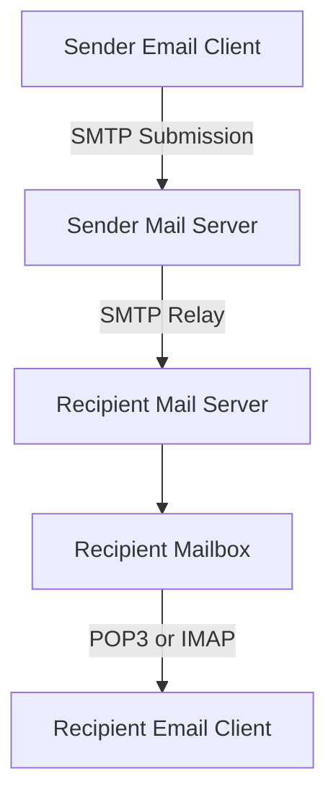
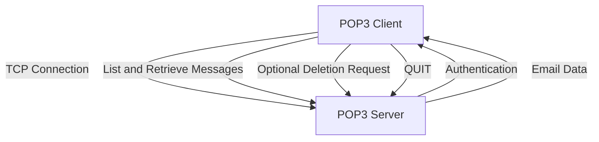
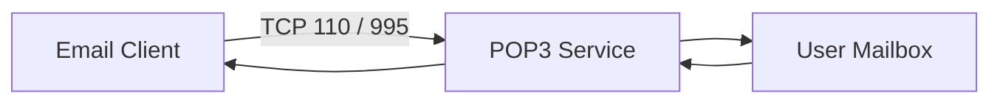
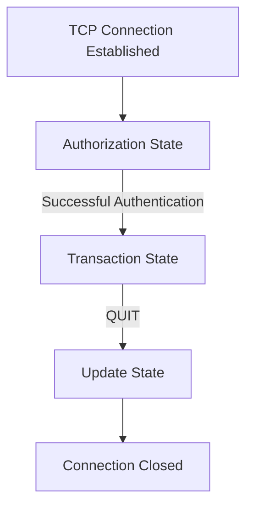
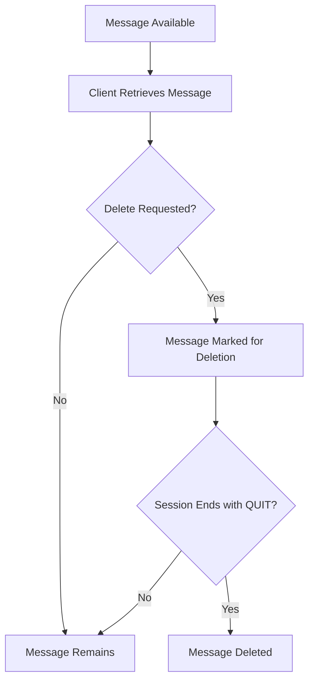
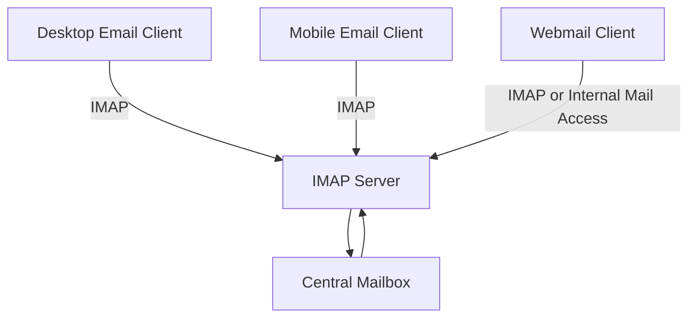
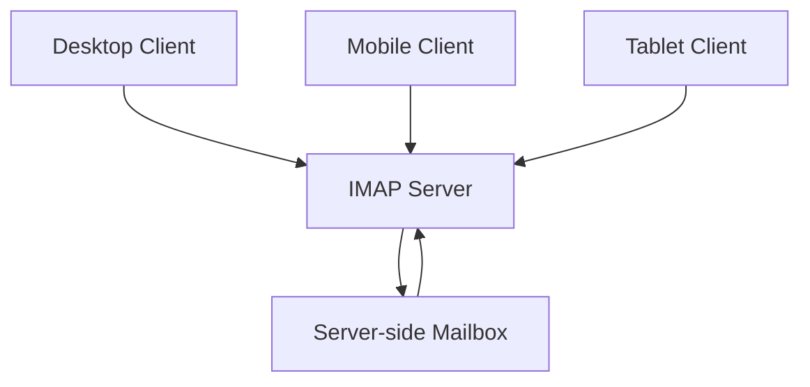
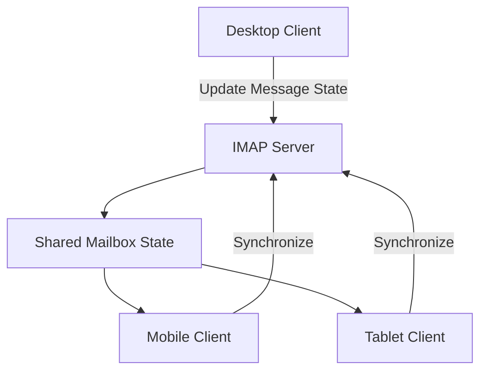

# POP3 and IMAP

POP3 (Post Office Protocol version 3) and IMAP (Internet Message Access Protocol) are application-layer protocols used by email clients to retrieve and access messages stored on mail servers.

Both protocols allow users to receive email, but they use different mailbox access models.

* **POP3** is primarily designed to download messages from a mail server to an email client.
* **IMAP** is designed to access and synchronize messages while keeping mailbox data on the server.

SMTP handles outgoing email submission and transfer, while POP3 and IMAP handle incoming email access.

### 🖆 Key Characteristics

| Feature | POP3 | IMAP |
| --- | --- | --- |
| Full name | Post Office Protocol v3 | Internet Message Access Protocol |
| OSI layer | Application | Application |
| Transport | TCP | TCP |
| Primary purpose | Retrieve email | Access and synchronize email |
| Default port | 110 | 143 |
| Secure port | 995 | 993 |
| Server-side synchronization | Limited | Supported |
| Folder support | Limited | Supported |
| Multi-device access | Less suitable | Well suited |

# 🗁 How Email Retrieval Works

Email retrieval is the process of accessing messages that have already been delivered to a recipient's mailbox.

A typical email workflow involves three major protocols:

* SMTP sends and transfers messages.
* POP3 downloads messages from a mailbox.
* IMAP accesses and synchronizes messages stored on a server.

### 🖆 Complete Email Workflow



### 🖆 Example

Suppose Alice sends an email to Bob.

```text
Sender: alice@example.com
Recipient: bob@example.net
```

The workflow:

* Alice composes an email using her email client.
* Her email client submits the message using SMTP.
* Mail servers transfer the message to the recipient's mail server.
* The recipient server stores the message in Bob's mailbox.
* Bob's email client accesses the mailbox using POP3 or IMAP.

The difference is how Bob's email client retrieves and manages the messages.

# 🗁 POP3 Overview

POP3 stands for Post Office Protocol version 3.

It is an application-layer protocol designed to retrieve email messages from a remote mail server.

POP3 traditionally follows a download-oriented model. The client connects to the server, authenticates, retrieves messages, and may request their deletion from the server.

### 🖆 Key Characteristics

* Uses TCP for reliable communication.
* Uses a simple command-response protocol.
* Supports message listing and retrieval.
* Supports downloading individual messages.
* Supports marking messages for deletion.
* Does not provide IMAP-style mailbox synchronization.
* Is generally suitable for simple, single-device email workflows.

### 🖆 POP3 Workflow



### 🖆 Download-and-Delete Behavior

Traditional POP3 workflows often download messages and delete them from the server after successful retrieval.

However, deletion is not mandatory.

A POP3 client can retrieve messages while leaving copies on the server, depending on its configuration and the commands it uses.

Keeping server copies can help users access messages from multiple devices, but POP3 does not provide the comprehensive synchronization model offered by IMAP.

# 🗁 POP3 Ports

POP3 commonly uses two TCP ports.

| Port | Name | Security |
| --- | --- | --- |
| 110 | POP3 | Plaintext initially; STARTTLS may upgrade the connection |
| 995 | POP3S | Implicit TLS |

### 🖆 Port 110 — POP3

Port 110 is the standard POP3 port.

A client connects to the server and can optionally upgrade the connection using the `STLS` command when supported.

Without TLS, authentication credentials and email content may travel without encryption.

### 🖆 Port 995 — POP3S

Port 995 is used for POP3 over implicit TLS.

The TLS handshake begins immediately after the TCP connection is established.

This protects the authentication exchange and email data transmitted through the connection.

# 🗁 POP3 Architecture

POP3 uses a client-server architecture.

The email client initiates a TCP connection to the POP3 server.

### 🖆 Main Components

**POP3 Client**

The application that connects to the mail server to retrieve messages.

Examples:

* Thunderbird
* Microsoft Outlook
* Apple Mail

**POP3 Server**

The service that provides access to a user's mailbox through POP3.

Examples of mail server software that can provide POP3 access include:

* Dovecot
* Courier

### 🖆 Architecture Diagram



The POP3 service authenticates the user and provides access to the messages available in the mailbox.

# 🗁 POP3 Commands

POP3 uses a relatively small set of commands.

Commands are generally sent as text lines, and the server responds with status indicators and optional data.

### 🖆 Common POP3 Commands

| Command | Description |
| --- | --- |
| `USER` | Specifies the username |
| `PASS` | Supplies the password |
| `STAT` | Returns mailbox message count and total size |
| `LIST` | Lists message numbers and sizes |
| `RETR` | Retrieves a complete message |
| `DELE` | Marks a message for deletion |
| `NOOP` | Requests a basic server response |
| `RSET` | Resets deletion marks in the current session |
| `TOP` | Retrieves message headers and a specified number of body lines |
| `UIDL` | Returns unique identifiers for messages |
| `QUIT` | Ends the POP3 session |

### 🖆 USER and PASS

These commands authenticate a POP3 user.

```text
USER bob
PASS example-password
```

The password example is illustrative only. In real environments, authentication should take place over TLS.

### 🖆 STAT

Returns the number of messages and their total size.

```text
STAT
```

Example response:

```text
+OK 3 42000
```

This indicates three messages with a combined size of 42,000 octets.

### 🖆 LIST

Lists available messages.

```text
LIST
```

Example response:

```text
+OK 3 messages
1 12000
2 15000
3 15000
.
```

### 🖆 RETR

Retrieves a message by its message number.

```text
RETR 1
```

The server returns the message content.

### 🖆 DELE

Marks a message for deletion.

```text
DELE 1
```

The message is not normally removed immediately. The deletion is committed when the session ends successfully through `QUIT`.

### 🖆 RSET

Resets the current session's deletion marks.

```text
RSET
```

Messages marked for deletion during the current session are restored to their non-deleted state.

### 🖆 UIDL

Returns unique identifiers for messages.

```text
UIDL
```

UIDLs help clients identify messages across sessions without relying exclusively on message numbers, which can change as the mailbox changes.

### 🖆 QUIT

Ends the POP3 session.

```text
QUIT
```

If the update state completes successfully, messages marked for deletion are removed from the mailbox.

# 🗁 POP3 Communication Process

POP3 communication is organized into three states:

* Authorization
* Transaction
* Update

### 🖆 POP3 Session Diagram



### 🖆 Authorization State

The client identifies and authenticates the user.

Common commands:

```text
USER bob
PASS password
```

The server validates the credentials.

### 🖆 Transaction State

After successful authentication, the client can access the mailbox.

Common operations include:

```text
STAT
LIST
RETR 1
UIDL
DELE 1
```

### 🖆 Update State

The update state begins when the client issues `QUIT` from the transaction state.

The server processes messages marked for deletion and closes the connection.

If the connection terminates unexpectedly before the update phase, deletion marks are generally not committed.

# 🗁 POP3 Message States

POP3 distinguishes between messages available in a mailbox and messages marked for deletion during a session.

### 🖆 Message Lifecycle



### 🖆 Important Behavior

* `RETR` retrieves a message but does not automatically delete it.
* `DELE` marks a message for deletion.
* `RSET` clears deletion marks in the current session.
* `QUIT` commits pending deletions when the update state completes successfully.

This behavior is important when troubleshooting missing or duplicated messages.

# 🗁 IMAP Overview

IMAP stands for Internet Message Access Protocol.

It allows email clients to access and manage messages stored on a remote mail server.

Unlike traditional POP3 workflows, IMAP is designed around server-side mailbox management and synchronization.

The server remains the primary location for messages and mailbox state.

### 🖆 Key Characteristics

* Uses TCP for reliable communication.
* Supports multiple mail folders.
* Supports message flags and mailbox state.
* Allows clients to retrieve message headers or selected message parts.
* Supports synchronization across multiple devices.
* Supports server-side search.
* Supports partial message retrieval.
* Supports concurrent access to mailboxes.

### 🖆 IMAP Workflow



For example, when a user reads a message on a desktop client, the read status can be synchronized to a mobile client through IMAP.

# 🗁 IMAP Ports

IMAP commonly uses two TCP ports.

| Port | Name | Security |
| --- | --- | --- |
| 143 | IMAP | Plaintext initially; STARTTLS may upgrade the connection |
| 993 | IMAPS | Implicit TLS |

### 🖆 Port 143 — IMAP

Port 143 is the standard IMAP port.

Clients can connect using IMAP and upgrade the connection through the `STARTTLS` command when supported.

### 🖆 Port 993 — IMAPS

Port 993 provides IMAP over implicit TLS.

TLS negotiation begins immediately after the TCP connection is established.

It is commonly preferred for secure IMAP access.

# 🗁 IMAP Architecture

IMAP uses a client-server architecture where multiple clients can access the same mailbox.

The server maintains mailbox data and exposes operations for searching, reading, organizing, and synchronizing messages.

### 🖆 Main Components

**IMAP Client**

The application that connects to the IMAP server.

Examples:

* Thunderbird
* Microsoft Outlook
* Apple Mail

**IMAP Server**

The service that manages mailbox access and synchronization.

Examples:

* Dovecot
* Cyrus IMAP
* Courier

**Mailbox Storage**

The server-side storage containing messages, folders, and associated mailbox information.

### 🖆 Architecture Diagram



Each client can access the same mailbox and synchronize supported changes through the server.

# 🗁 IMAP Commands

IMAP provides commands for mailbox management, message retrieval, searching, and synchronization.

Unlike POP3, IMAP commands use client-generated tags to associate requests with responses.

### 🖆 Common IMAP Commands

| Command | Description |
| --- | --- |
| `CAPABILITY` | Lists supported server capabilities |
| `LOGIN` | Authenticates a user |
| `AUTHENTICATE` | Starts an authentication mechanism |
| `SELECT` | Opens a mailbox for read-write access |
| `EXAMINE` | Opens a mailbox in read-only mode |
| `LIST` | Lists available mailboxes |
| `STATUS` | Retrieves mailbox status information |
| `FETCH` | Retrieves message data |
| `STORE` | Changes message flags |
| `SEARCH` | Searches messages |
| `UID` | Executes an operation using unique message identifiers |
| `COPY` | Copies messages to another mailbox |
| `MOVE` | Moves messages to another mailbox when supported |
| `EXPUNGE` | Permanently removes messages marked as deleted |
| `CLOSE` | Closes the selected mailbox and performs an expunge |
| `LOGOUT` | Ends the session |

### 🖆 CAPABILITY

Requests supported IMAP capabilities.

```text
A001 CAPABILITY
```

Example response:

```text
* CAPABILITY IMAP4rev1 STARTTLS AUTH=PLAIN IDLE
A001 OK Capability completed
```

The actual capabilities depend on the server and its configuration.

### 🖆 LOGIN

Authenticates a user.

```text
A002 LOGIN bob example-password
```

This example illustrates command syntax. Credentials should be transmitted only over a protected connection.

### 🖆 SELECT

Opens a mailbox for read-write access.

```text
A003 SELECT INBOX
```

### 🖆 EXAMINE

Opens a mailbox in read-only mode.

```text
A004 EXAMINE INBOX
```

### 🖆 LIST

Lists available mailboxes.

```text
A005 LIST "" "*"
```

### 🖆 FETCH

Retrieves message information or content.

```text
A006 FETCH 1 BODY[]
```

This requests the complete body and associated message content for message sequence number 1.

To retrieve only headers:

```text
A007 FETCH 1 BODY[HEADER]
```

### 🖆 SEARCH

Searches messages using specified criteria.

```text
A008 SEARCH UNSEEN
```

This searches for messages that do not have the `\Seen` flag.

Other search criteria include:

```text
A009 SEARCH FROM "alice@example.com"
A010 SEARCH SUBJECT "networking"
A011 SEARCH SINCE 01-Nov-2026
```

### 🖆 STORE

Changes message flags.

```text
A012 STORE 1 +FLAGS (\Seen)
```

This marks message 1 as read.

### 🖆 COPY

Copies a message to another mailbox.

```text
A013 COPY 1 Archive
```

### 🖆 EXPUNGE

Permanently removes messages marked with the `\Deleted` flag from the selected mailbox.

```text
A014 EXPUNGE
```

### 🖆 LOGOUT

Ends the IMAP session.

```text
A015 LOGOUT
```

# 🗁 IMAP Mailbox Structure

IMAP supports multiple mailboxes and folders.

A mailbox is a server-side collection of messages.

Common mailbox names include:

| Mailbox | Purpose |
| --- | --- |
| `INBOX` | Received messages |
| `Sent` | Sent messages |
| `Drafts` | Unfinished messages |
| `Trash` | Deleted or discarded messages |
| `Junk` | Spam messages |
| `Archive` | Stored messages |

Mailbox names and special-use behavior can vary by server and client configuration.

### 🖆 Folder Structure

```text
Mailbox
├── INBOX
├── Sent
├── Drafts
├── Trash
├── Junk
└── Archive
```

### 🖆 Folder Synchronization

When a client creates, renames, or deletes a mailbox, the server can make that change available to other connected clients.

The exact behavior depends on mailbox permissions and server capabilities.

# 🗁 IMAP Message Flags

IMAP uses flags to represent message state.

These flags are stored and managed by the server.

### 🖆 Common System Flags

| Flag | Meaning |
| --- | --- |
| `\Seen` | Message has been read |
| `\Answered` | Message has been answered |
| `\Flagged` | Message is marked for special attention |
| `\Deleted` | Message is marked for deletion |
| `\Draft` | Message is a draft |
| `\Recent` | Message has recently arrived, subject to server handling |

### 🖆 Example: Mark a Message as Read

```text
A001 STORE 1 +FLAGS (\Seen)
```

### 🖆 Example: Mark a Message as Deleted

```text
A002 STORE 1 +FLAGS (\Deleted)
```

The message is marked for deletion but is not necessarily removed immediately.

### 🖆 Example: Remove Deleted Messages

```text
A003 EXPUNGE
```

This permanently removes messages marked with `\Deleted` from the selected mailbox.

# 🗁 IMAP Synchronization

One of IMAP's major advantages is synchronization across multiple devices.

The server maintains mailbox state, allowing clients to reflect changes made by other clients.

### 🖆 Example

Suppose a user accesses the same mailbox from three devices:

* Desktop computer.
* Smartphone.
* Tablet.

The user reads a message on the desktop.

The desktop client updates the message's `\Seen` flag on the server.

The smartphone and tablet can then synchronize and display that message as read.

### 🖆 Synchronization Workflow



### 🖆 IDLE Extension

The IMAP `IDLE` extension allows a client to remain connected and receive notifications about certain mailbox changes.

Instead of repeatedly polling the server, a client can wait for updates.

Example:

```text
A001 IDLE
```

The server may send unsolicited responses when mailbox changes occur.

The client eventually exits IDLE mode using the protocol's continuation mechanism and sends further commands.

### 🖆 UID and Message Sequence Numbers

IMAP identifies messages using message sequence numbers and unique identifiers.

**Message Sequence Number**

* Represents a message's current position in the selected mailbox.
* Can change when messages are removed or mailbox state changes.
* Should not be treated as a permanent identifier.

**UID**

* Represents a message identifier within a mailbox's UID validity context.
* Is more stable than a sequence number.
* Helps clients track messages across sessions.

Clients commonly use UIDs to maintain reliable synchronization.

### 🖆 UIDVALIDITY and UIDNEXT

IMAP provides mailbox metadata that helps clients maintain synchronization.

| Value | Purpose |
| --- | --- |
| `UIDVALIDITY` | Identifies the current UID namespace for a mailbox |
| `UIDNEXT` | Predicts the next UID that will be assigned |
| `UID` | Identifies a message within the mailbox's UID namespace |

If `UIDVALIDITY` changes, a client may need to rebuild its local message mapping.

# 🗁 POP3 vs IMAP

Both protocols retrieve email, but their design goals are different.

### 🖆 Main Differences

| Feature | POP3 | IMAP |
| --- | --- | --- |
| Main model | Download-oriented | Server-based mailbox access |
| Mail storage | Often downloaded locally | Primarily maintained on server |
| Synchronization | Limited | Extensive |
| Multiple devices | Less convenient | Designed for it |
| Folders | Limited | Supported |
| Server-side search | Not a standard core feature | Supported |
| Partial retrieval | Limited | Supported |
| Message flags | Limited | Supported |
| Offline access | Downloaded messages | Depends on client caching |
| Complexity | Simpler | More feature-rich |

### 🖆 When to Use POP3

POP3 may be suitable when:

* A simple download-oriented workflow is required.
* Email is primarily accessed from one device.
* Local message storage is preferred.
* Server mailbox storage needs to be minimized.

### 🖆 When to Use IMAP

IMAP is generally more suitable when:

* Email is accessed from multiple devices.
* Messages and folders must remain synchronized.
* Server-side mailbox management is required.
* Users need consistent read, unread, and flag states.

### 🖆 Important Consideration

IMAP does not mean that messages can never be stored locally. Most modern email clients cache messages for performance and offline access.

Similarly, POP3 does not always delete messages from the server. The client can be configured to retain server copies.

# 🗁 POP3 and IMAP Security

Email retrieval protocols can expose sensitive information if configured incorrectly.

### 🖆 Plaintext Authentication

Without TLS, usernames and passwords may be transmitted without encryption.

An attacker capable of observing the network traffic could potentially capture these credentials.

### 🖆 TLS Encryption

POP3 and IMAP support TLS to protect authentication and mailbox communication.

Common secure configurations:

| Protocol | Secure Port | TLS Mode |
| --- | --- | --- |
| POP3 | 995 | Implicit TLS |
| POP3 | 110 | STARTTLS using `STLS` |
| IMAP | 993 | Implicit TLS |
| IMAP | 143 | STARTTLS |

### 🖆 Certificate Validation

Email clients should validate server certificates.

Important checks include:

* Certificate validity period.
* Certificate hostname matching.
* Trusted certificate authority.
* Certificate chain validity.

### 🖆 Authentication Security

Use secure authentication mechanisms supported by the server.

Avoid sending passwords over unencrypted connections.

Where available, use modern authentication methods such as OAuth 2.0-based authorization.

### 🖆 Security Best Practices

* Prefer implicit TLS on ports 993 and 995.
* Use STARTTLS only when correctly configured and required by the service.
* Validate TLS certificates.
* Disable obsolete TLS versions.
* Require strong authentication.
* Restrict access to mail services.
* Monitor authentication failures.
* Apply account lockout or rate-limiting policies where appropriate.
* Keep mail server software updated.

# 🗁 POP3 and IMAP on Ubuntu/Linux

Ubuntu provides tools for testing TCP connectivity, inspecting TLS certificates, and interacting with mail services.

### 🖆 Install Required Tools

```bash
sudo apt update
sudo apt install openssl netcat-openbsd
```

### 🖆 Check POP3 Connectivity

Test the standard POP3 port:

```bash
nc -vz mail.example.com 110
```

Test POP3 over implicit TLS:

```bash
nc -vz mail.example.com 995
```

### 🖆 Check IMAP Connectivity

Test the standard IMAP port:

```bash
nc -vz mail.example.com 143
```

Test IMAP over implicit TLS:

```bash
nc -vz mail.example.com 993
```

### 🖆 Inspect Running Mail Services

On a Linux mail server:

```bash
sudo ss -tlnp
```

Filter for common POP3 and IMAP ports:

```bash
sudo ss -tlnp | grep -E ':(110|143|993|995)\b'
```

### 🖆 Check Mail Server Processes

For systems using Dovecot:

```bash
sudo systemctl status dovecot
```

Restart the service if required:

```bash
sudo systemctl restart dovecot
```

View recent logs:

```bash
sudo journalctl -u dovecot -n 100
```

Follow logs in real time:

```bash
sudo journalctl -u dovecot -f
```

Dovecot is commonly used to provide IMAP and POP3 services. It is not an email transfer agent responsible for SMTP relay.

# 🗁 Testing POP3 and IMAP Connections

OpenSSL can be used to inspect secure POP3 and IMAP connections.

### 🖆 Test POP3 over Implicit TLS

```bash
openssl s_client \
  -connect mail.example.com:995 \
  -servername mail.example.com \
  -crlf
```

A successful connection should show TLS negotiation details and the server's certificate information.

### 🖆 Test IMAP over Implicit TLS

```bash
openssl s_client \
  -connect mail.example.com:993 \
  -servername mail.example.com \
  -crlf
```

An IMAP server may return a greeting similar to:

```text
* OK IMAP server ready
```

### 🖆 Test IMAP with STARTTLS

```bash
openssl s_client \
  -starttls imap \
  -connect mail.example.com:143 \
  -servername mail.example.com \
  -crlf
```

### 🖆 Test POP3 with STARTTLS

```bash
openssl s_client \
  -starttls pop3 \
  -connect mail.example.com:110 \
  -servername mail.example.com \
  -crlf
```

### 🖆 Inspect Network Traffic

Capture POP3 and IMAP traffic:

```bash
sudo tcpdump -i any -nn \
  'tcp port 110 or tcp port 995 or tcp port 143 or tcp port 993'
```

Wireshark display filter:

```text
pop || imap || tcp.port == 995 || tcp.port == 993
```

Encrypted application payloads are not normally readable without suitable decryption information.

# 🗁 Troubleshooting

POP3 and IMAP problems can originate from network connectivity, server configuration, TLS, authentication, or mailbox storage.

### 🖆 Connection Refused

Possible causes:

* POP3 or IMAP service is not running.
* The destination port is not listening.
* A firewall is rejecting the connection.
* The service is bound to a different network interface.

Check connectivity:

```bash
nc -vz mail.example.com 993
```

On the server:

```bash
sudo ss -tlnp
```

### 🖆 Connection Timeout

Possible causes:

* Firewall silently dropping traffic.
* Incorrect routing.
* Remote mail server unavailable.
* ISP restrictions.
* Incorrect server hostname.

Check routing:

```bash
ip route
```

Check name resolution:

```bash
getent hosts mail.example.com
```

### 🖆 Authentication Failure

Possible causes:

* Incorrect username or password.
* Account disabled.
* Unsupported authentication mechanism.
* Authentication policy restrictions.
* TLS requirements not satisfied.

Check server logs:

```bash
sudo journalctl -u dovecot -n 100
```

### 🖆 TLS Certificate Error

Possible causes:

* Expired certificate.
* Hostname mismatch.
* Untrusted certificate authority.
* Incomplete certificate chain.
* Incorrect TLS configuration.

Inspect the certificate:

```bash
openssl s_client \
  -connect mail.example.com:993 \
  -servername mail.example.com \
  -showcerts
```

### 🖆 Messages Missing from a Mailbox

Possible causes:

* POP3 downloaded and deleted messages.
* Messages were moved to another folder.
* A client applied server-side filters.
* Messages were marked for deletion.
* Mailbox synchronization has not completed.
* Different clients are using different folders or account configurations.

Check mailbox state and client synchronization settings.

### 🖆 IMAP Synchronization Problems

Possible causes:

* Network interruptions.
* Stale local cache.
* Incorrect mailbox subscription.
* UIDVALIDITY changes.
* Server storage or quota issues.
* Multiple clients modifying mailbox state concurrently.

Reconnect the client, refresh mailbox metadata, and inspect server logs.

### 🖆 Mailbox Quota Exceeded

Possible causes:

* Mailbox storage limit reached.
* Large attachments.
* Too many stored messages.
* Deleted messages not yet expunged.

Review mailbox storage and remove unnecessary messages when appropriate.

# 🗁 Best Practices

* Prefer IMAP for multi-device email access.
* Use POP3 only when its download-oriented behavior matches the requirements.
* Prefer implicit TLS on ports 993 and 995.
* Validate server certificates.
* Use strong authentication.
* Avoid transmitting credentials over plaintext connections.
* Keep local email clients and server software updated.
* Monitor authentication failures.
* Configure mailbox quotas.
* Back up important mailbox data.
* Understand POP3 deletion behavior before enabling automatic deletion.
* Use IMAP UID values rather than message sequence numbers for reliable message tracking.
* Monitor mailbox synchronization and server storage.

# 🗁 Practical Exercises

### 🖆 Exercise: Identify Email Retrieval Ports

Identify the standard and secure ports for POP3 and IMAP.

| Protocol | Standard Port | Secure Port |
|---|---|---|
| POP3 |  |  |
| IMAP |  |  |

### 🖆 Exercise: Test POP3 Connectivity

```bash
nc -vz mail.example.com 110
nc -vz mail.example.com 995
```

Determine whether each port is reachable.

### 🖆 Exercise: Test IMAP Connectivity

```bash
nc -vz mail.example.com 143
nc -vz mail.example.com 993
```

Compare the connectivity results.

### 🖆 Exercise: Inspect TLS Certificates

Use OpenSSL to inspect an IMAP server:

```bash
openssl s_client \
  -connect mail.example.com:993 \
  -servername mail.example.com
```

Identify:

* TLS version.
* Certificate subject.
* Certificate issuer.
* Certificate expiration date.
* Certificate verification result.

### 🖆 Exercise: Understand POP3 Commands

Explain what each command does:

```text
USER
PASS
STAT
LIST
RETR
DELE
RSET
UIDL
QUIT
```

Describe when messages are actually deleted.

### 🖆 Exercise: Understand IMAP Commands

Explain the purpose of:

```text
CAPABILITY
LOGIN
SELECT
EXAMINE
LIST
FETCH
SEARCH
STORE
COPY
EXPUNGE
LOGOUT
```

### 🖆 Exercise: Compare POP3 and IMAP

Consider an email account accessed from a desktop computer, smartphone, and tablet.

Determine which protocol is more suitable and explain how mailbox synchronization works.

# 🗁 Interview Questions

### 🖆 Basic Questions

**What is POP3?**

POP3 is an application-layer protocol used to retrieve email messages from a remote mail server.

**What is IMAP?**

IMAP is an application-layer protocol used to access and synchronize email messages and mailbox state on a remote server.

**Which ports does POP3 use?**

TCP port 110 for standard POP3 and TCP port 995 for POP3 over implicit TLS.

**Which ports does IMAP use?**

TCP port 143 for standard IMAP and TCP port 993 for IMAP over implicit TLS.

**What is the difference between SMTP and IMAP?**

SMTP sends and transfers email, while IMAP accesses and synchronizes received messages.

### 🖆 Intermediate Questions

**What is the difference between POP3 and IMAP?**

POP3 primarily provides download-oriented message retrieval, while IMAP provides server-based mailbox access and synchronization.

**Does POP3 always delete messages from the server?**

No. A client can download messages while retaining server copies. Deletion depends on client behavior and configuration.

**What is the purpose of the POP3 `DELE` command?**

It marks a message for deletion. The deletion is normally committed when the session ends successfully with `QUIT`.

**What is the purpose of the IMAP `FETCH` command?**

It retrieves message data, including headers, body content, or selected message sections.

**What is the difference between IMAP ports 143 and 993?**

Port 143 supports standard IMAP and can be upgraded using STARTTLS. Port 993 uses implicit TLS.

**What is the IMAP `EXPUNGE` command?**

It permanently removes messages marked with the `\Deleted` flag from the selected mailbox.

### 🖆 Advanced Questions

**How does IMAP synchronization work across multiple devices?**

Clients communicate with the same server-side mailbox. Changes to message flags, folders, and other mailbox state can be synchronized across connected clients.

**What is the difference between an IMAP UID and a message sequence number?**

A sequence number represents a message's current position in the mailbox and can change. A UID provides a more stable identifier within a mailbox's UID validity context.

**What is UIDVALIDITY?**

UIDVALIDITY identifies the current UID namespace for a mailbox. If it changes, clients may need to rebuild their local message mappings.

**What is the purpose of the IMAP IDLE extension?**

It allows a client to wait for mailbox updates instead of repeatedly polling the server.

**What is the difference between STARTTLS and implicit TLS?**

STARTTLS upgrades an existing connection to TLS, while implicit TLS starts encryption immediately after the TCP connection is established.

**Why is IMAP generally preferred for multiple devices?**

Because the server maintains mailbox messages and state, allowing different clients to synchronize their views of the same mailbox.

# 🗁 Summary

POP3 and IMAP are application-layer protocols used to retrieve and access email messages.

Important concepts:

* POP3 stands for Post Office Protocol version 3.
* IMAP stands for Internet Message Access Protocol.
* POP3 primarily follows a download-oriented model.
* IMAP supports server-side mailbox access and synchronization.
* POP3 uses TCP ports 110 and 995.
* IMAP uses TCP ports 143 and 993.
* POP3 uses commands such as `USER`, `PASS`, `RETR`, and `DELE`.
* IMAP uses commands such as `SELECT`, `FETCH`, `SEARCH`, and `STORE`.
* POP3 deletion is normally committed during a successful session termination.
* IMAP supports folders, message flags, server-side search, and synchronization.
* TLS protects authentication and mailbox communication.
* IMAP is generally better suited to accessing email across multiple devices.

Understanding POP3 and IMAP is essential for configuring email clients, managing mailboxes, and troubleshooting email retrieval services.

# 🗁 References

### 🖆 Official Standards and RFCs

* [RFC 1939 — Post Office Protocol Version 3 (POP3)](https://www.rfc-editor.org/rfc/rfc1939)
* [RFC 2449 — POP3 Extension Mechanism](https://www.rfc-editor.org/rfc/rfc2449)
* [RFC 2595 — Using TLS with IMAP, POP3 and ACAP](https://www.rfc-editor.org/rfc/rfc2595)
* [RFC 3501 — Internet Message Access Protocol Version 4rev1](https://www.rfc-editor.org/rfc/rfc3501)
* [RFC 5032 — WITHIN Search Extension to IMAP](https://www.rfc-editor.org/rfc/rfc5032)
* [RFC 5161 — IMAP Extension for ENABLE](https://www.rfc-editor.org/rfc/rfc5161)
* [RFC 5162 — IMAP4 Extensions for Quick Mailbox Resynchronization](https://www.rfc-editor.org/rfc/rfc5162)
* [RFC 6237 — IMAP4 Multimailbox SEARCH Extension](https://www.rfc-editor.org/rfc/rfc6237)
* [RFC 6851 — IMAP MOVE Extension](https://www.rfc-editor.org/rfc/rfc6851)
* [RFC 9051 — Internet Message Access Protocol (IMAP) Version 4rev2](https://www.rfc-editor.org/rfc/rfc9051)
* [RFC 8314 — Cleartext Considered Obsolete: Use of TLS for Email Submission and Access](https://www.rfc-editor.org/rfc/rfc8314)

### 🖆 Official Documentation

* [Dovecot Documentation](https://doc.dovecot.org/)
* [OpenSSL Documentation](https://docs.openssl.org/)
* [Ubuntu Server Documentation](https://documentation.ubuntu.com/server/)
