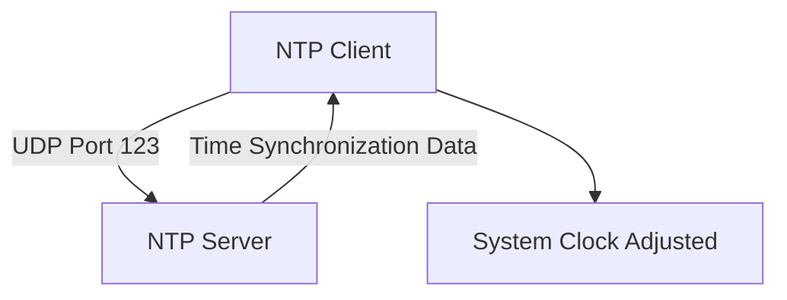
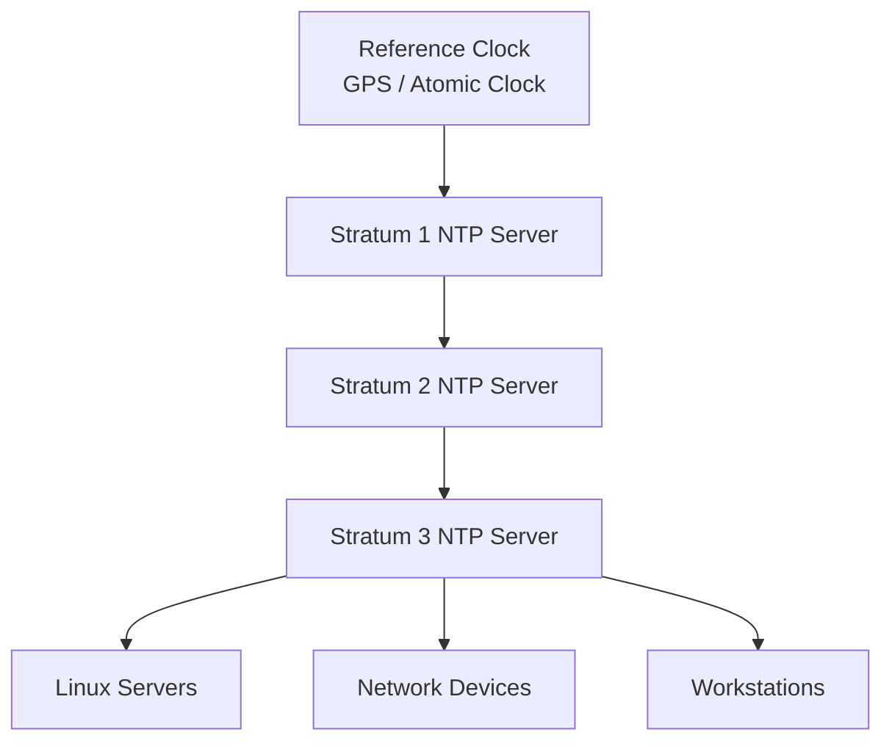
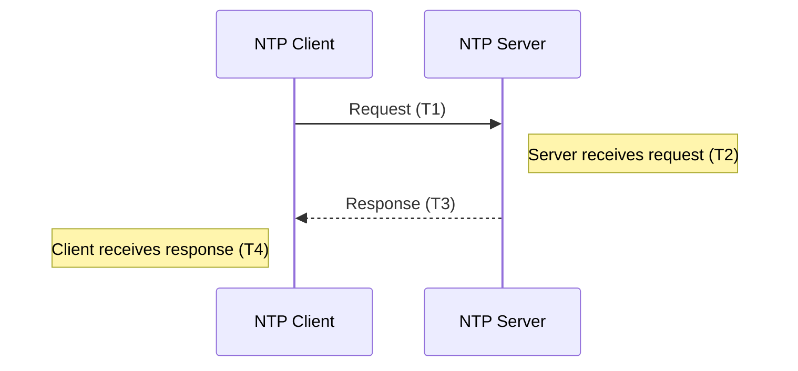
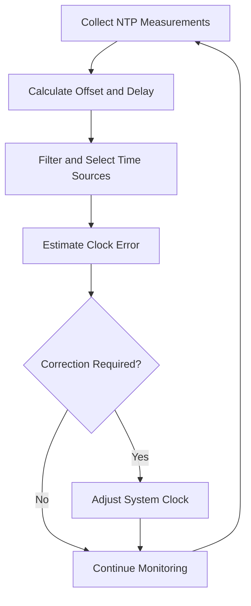

# NTP (Network Time Protocol)

NTP (Network Time Protocol) is an application-layer protocol used to synchronize computer clocks across IP networks.

It allows computers, servers, routers, switches, and other network devices to maintain accurate system time by communicating with time servers.

Accurate time synchronization is essential for:

* Log correlation and troubleshooting.
* Security event analysis.
* Authentication systems.
* Digital certificates.
* Distributed applications.
* Database consistency.
* Network monitoring.
* Financial transactions.

NTP typically uses UDP port 123 and can synchronize clocks over local networks or the public internet.

### 🖆 Key Characteristics

| Feature | Description |
| --- | --- |
| Protocol | Network Time Protocol |
| OSI layer | Application |
| Transport | UDP |
| Default port | 123 |
| Primary purpose | Clock synchronization |
| Time reference | UTC |
| Architecture | Hierarchical, client-server and peer-based |
| Standard | RFC 5905 (NTPv4) |

# 🗁 How NTP Works

Computers use internal hardware clocks to maintain time. However, these clocks can gradually drift because of hardware characteristics, temperature changes, and other factors.

NTP helps correct this drift by comparing a device's clock with a trusted time source.

### 🖆 Basic NTP Workflow



### 🖆 Example

Suppose a Linux server has the following system time:

```text
2026-11-09 10:30:00
```

The actual reference time is:

```text
2026-11-09 10:30:08
```

The server clock is eight seconds behind.

An NTP client exchanges timestamps with an NTP server, estimates the clock offset, and adjusts its local clock.

The adjustment may happen gradually through clock slewing or, depending on the implementation and configuration, through a direct clock step.

# 🗁 Why Time Synchronization Matters

Accurate time is important for almost every modern computing environment.

### 🖆 Log Correlation

Distributed systems generate logs on multiple machines.

If their clocks are inconsistent, determining the order of events becomes difficult.

Example:

```text
Web Server:
10:30:05 - Request received

Application Server:
10:30:02 - Request processed

Database Server:
10:30:08 - Query executed
```

Without synchronized clocks, these timestamps may incorrectly suggest that processing occurred before the request was received.

### 🖆 Authentication

Some authentication systems depend on accurate time.

Examples include:

* Kerberos.
* Time-based one-time passwords (TOTP).
* Time-sensitive authentication tokens.
* Certificate validity checks.

### 🖆 Security Monitoring

Security systems use timestamps to correlate events across:

* Firewalls.
* Routers.
* Servers.
* Intrusion detection systems.
* SIEM platforms.

### 🖆 Distributed Applications

Distributed databases, clustered systems, and monitoring platforms use time information for event ordering, diagnostics, and operational consistency.

NTP provides clock synchronization, but it does not guarantee globally consistent ordering of distributed events. Systems requiring strict event ordering may use logical clocks or other coordination mechanisms.

# 🗁 NTP Architecture

NTP uses a hierarchical architecture where time information is distributed from reference clocks to downstream servers and clients.

### 🖆 Reference Clock

A reference clock is a highly accurate time source.

Examples include:

* GPS receivers.
* Atomic clocks.
* Radio time receivers.
* Other trusted timing systems.

### 🖆 NTP Server

An NTP server obtains time from a reference source or another NTP server and provides time synchronization services to other systems.

### 🖆 NTP Client

An NTP client communicates with one or more NTP servers to synchronize its local system clock.

### 🖆 Architecture Diagram



The architecture allows a relatively small number of accurate time sources to serve large networks.

# 🗁 NTP Stratum Levels

Stratum describes the synchronization hierarchy of an NTP time source.

Lower stratum values generally indicate a source closer to the reference clock.

### 🖆 Stratum 0

Stratum 0 refers to highly accurate reference clocks.

Examples:

* GPS receivers.
* Atomic clocks.
* Radio clocks.

These devices are reference sources rather than ordinary NTP servers.

### 🖆 Stratum 1

A Stratum 1 server synchronizes directly with a Stratum 0 reference clock.

Example:

```text
GPS Receiver
     |
     v
Stratum 1 NTP Server
```

### 🖆 Stratum 2

A Stratum 2 server synchronizes with one or more Stratum 1 servers.

### 🖆 Stratum 3 and Higher

Additional downstream servers synchronize with higher-stratum sources.

```text
Stratum 0: Reference Clock
     |
Stratum 1: Directly Connected NTP Server
     |
Stratum 2: Downstream NTP Server
     |
Stratum 3: Another Downstream Server
     |
Stratum 4: Client or Server
```

### 🖆 Important Stratum Rules

* Lower stratum values generally indicate a closer relationship to a reference clock.
* Stratum 1 is not automatically more accurate than every Stratum 2 server.
* Network delay, jitter, source quality, and clock stability also affect accuracy.
* Stratum is not a direct measurement of time accuracy.
* Stratum 16 indicates an unsynchronized NTP clock.

NTP uses strata to describe synchronization distance, not to provide a universal accuracy ranking.

# 🗁 NTP Communication Process

NTP clients exchange timestamp information with servers to estimate the difference between their clocks.

A standard NTP client-server exchange uses four timestamps.

### 🖆 Four NTP Timestamps

| Timestamp | Meaning |
| --- | --- |
| T1 | Client sends the request |
| T2 | Server receives the request |
| T3 | Server sends the response |
| T4 | Client receives the response |

### 🖆 Communication Diagram



### 🖆 Example

Suppose the following timestamps are recorded:

```text
T1 = 10:00:00.000
T2 = 10:00:00.120
T3 = 10:00:00.125
T4 = 10:00:00.225
```

The client sent the request at T1.

The server received it at T2 and sent its response at T3.

The client received the response at T4.

These timestamps allow the client to estimate clock offset and network round-trip delay.

# 🗁 NTP Timestamps

NTP uses timestamp fields to calculate clock offset and network delay.

### 🖆 Clock Offset

Clock offset estimates the difference between the client clock and the server clock.

The commonly used NTPv4 offset equation is:

\[
\theta = \frac{(T_2-T_1)+(T_3-T_4)}{2}
\]

Where:

* \(T_1\): Client request transmission time.
* \(T_2\): Server request reception time.
* \(T_3\): Server response transmission time.
* \(T_4\): Client response reception time.
* \(\theta\): Estimated server-minus-client clock offset.

### 🖆 Round-Trip Delay

Round-trip delay estimates the total network travel time, excluding the server's processing time.

\[
\delta = (T_4-T_1)-(T_3-T_2)
\]

### 🖆 Calculation Example

Using:

```text
T1 = 10:00:00.000
T2 = 10:00:00.120
T3 = 10:00:00.125
T4 = 10:00:00.225
```

Clock offset:

\[
\theta = \frac{0.120 + (-0.100)}{2}
\]

\[
\theta = 0.010 \text{ seconds}
\]

The server clock is estimated to be 10 milliseconds ahead of the client clock.

Round-trip delay:

\[
\delta = 0.225 - 0.005
\]

\[
\delta = 0.220 \text{ seconds}
\]

The estimated network round-trip delay is 220 milliseconds.

### 🖆 Assumption Behind the Offset Calculation

The offset calculation assumes that the network path delays are sufficiently symmetric.

If the forward and reverse path delays differ significantly, the estimated offset can be inaccurate.

This is why NTP uses multiple measurements, filtering, and clock-selection algorithms rather than trusting a single exchange.

# 🗁 NTP Clock Synchronization

NTP does more than retrieve the current time from a server.

It continuously estimates clock offset, delay, jitter, and clock stability to maintain synchronization.

### 🖆 Clock Offset

Clock offset represents the estimated difference between the local clock and the reference clock.

### 🖆 Delay

Delay represents the estimated network round-trip time for NTP communication.

### 🖆 Jitter

Jitter describes variation in measured timing offsets or delays across synchronization samples.

### 🖆 Clock Drift

Clock drift occurs when a local hardware clock runs slightly faster or slower than the actual reference time.

For example:

```text
Reference Clock: 12:00:00
Local Clock:     11:59:58
Difference:      -2 seconds
```

The local clock is two seconds behind.

### 🖆 Clock Slewing

Clock slewing gradually adjusts the clock's rate to reduce the offset.

This avoids a sudden jump in system time.

### 🖆 Clock Stepping

Clock stepping changes the system clock immediately.

It may be used when the offset is too large for normal gradual correction or when the synchronization implementation is configured to step the clock.

### 🖆 NTP Synchronization Process



# 🗁 NTP Modes of Operation

NTP supports several communication modes.

### 🖆 Client-Server Mode

A client requests time information from an NTP server.

This is the most common mode used by workstations and servers.

```text
NTP Client
    |
    | Request
    v
NTP Server
    |
    | Response
    v
NTP Client
```

### 🖆 Symmetric Active Mode

An NTP peer actively communicates with another peer.

This mode is commonly used between NTP servers that exchange time information.

### 🖆 Symmetric Passive Mode

A server responds to a symmetric active peer and establishes a symmetric association when permitted.

### 🖆 Broadcast Mode

An NTP server periodically broadcasts time information to clients on a network.

Clients can receive these broadcasts and synchronize without sending an individual request for every exchange.

### 🖆 Multicast Mode

NTP can distribute time information using multicast communication.

Clients join or listen to an appropriate multicast group.

### 🖆 Manycast Mode

Manycast allows clients to discover and associate with suitable NTP servers through multicast-based server discovery.

### 🖆 Mode Comparison

| Mode | Purpose |
| --- | --- |
| Client-server | Client requests time from a server |
| Symmetric active | Peer actively exchanges time information |
| Symmetric passive | Peer responds to an active association |
| Broadcast | Server periodically broadcasts time |
| Multicast | Time information is distributed through multicast |
| Manycast | Clients discover suitable servers |

# 🗁 NTP Ports and Transport

NTP uses UDP port 123.

| Protocol | Port | Purpose |
|---|---:|---|
| UDP | 123 | NTP communication |

### 🖆 Why UDP?

NTP uses UDP because time synchronization requires lightweight request-response communication.

UDP avoids the connection establishment overhead of TCP.

NTP can send requests and receive responses without maintaining a TCP connection.

### 🖆 Firewall Configuration

A typical NTP client needs outbound UDP traffic to destination port 123 and the corresponding return traffic.

An NTP server needs to accept inbound UDP traffic on port 123 from authorized clients.

Example using UFW to allow NTP server traffic:

```bash
sudo ufw allow 123/udp
```

A production server should restrict access to trusted networks when possible.

# 🗁 NTP vs SNTP

SNTP stands for Simple Network Time Protocol.

It is a simplified implementation of the NTP protocol.

Both use UDP port 123 and share the same basic packet format.

### 🖆 Main Differences

| Feature | NTP | SNTP |
| --- | --- | --- |
| Full name | Network Time Protocol | Simple Network Time Protocol |
| Complexity | Full synchronization algorithms | Simplified synchronization behavior |
| Clock filtering | Advanced | Limited or implementation-dependent |
| Source selection | Advanced algorithms | Simplified |
| Typical use | Servers and network infrastructure | Simple devices and embedded systems |
| Accuracy | Can provide high accuracy with suitable sources and networks | Depends heavily on implementation and network conditions |

### 🖆 NTP

Full NTP implementations use clock filtering, source selection, and synchronization algorithms to improve accuracy and stability.

### 🖆 SNTP

SNTP uses a simplified subset of NTP functionality.

It is commonly used in embedded devices, small systems, and environments where advanced synchronization algorithms are unnecessary.

SNTP is defined in RFC 4330 for SNTPv4, with later NTP specifications also describing its relationship to NTP.

# 🗁 NTP Security

NTP is an important network service and should be protected against misuse and manipulation.

### 🖆 Time Spoofing

An attacker may attempt to provide false time information to a client.

Incorrect system time can affect:

* Authentication.
* Logging.
* Certificate validation.
* Distributed application behavior.

### 🖆 NTP Amplification Attacks

Misconfigured NTP servers can be abused in distributed denial-of-service attacks.

An attacker sends requests with a spoofed source address and causes the server to send larger responses to a victim.

Restricting unnecessary services and disabling obsolete or risky features reduces exposure.

### 🖆 Unauthorized Access

Publicly exposed NTP servers may receive unwanted traffic or abuse.

Restrict client access to trusted networks where appropriate.

### 🖆 Authentication

NTP supports authentication mechanisms to help clients verify time sources.

Modern deployments may use Network Time Security (NTS).

### 🖆 Network Time Security (NTS)

NTS provides cryptographic authentication for NTP client-server communication.

It uses:

* TLS for the Network Time Security Key Establishment (NTS-KE) process.
* Cryptographic cookies.
* Authenticated NTP extension fields.

NTS helps protect NTP exchanges against certain on-path attacks and unauthorized modification.

### 🖆 Security Best Practices

* Use trusted NTP servers.
* Restrict inbound UDP port 123 to authorized clients.
* Avoid operating unnecessary public NTP services.
* Keep NTP software updated.
* Monitor unexpected time changes.
* Use NTS where supported and appropriate.
* Configure multiple trusted time sources.
* Disable unnecessary legacy control and monitoring features.
* Monitor synchronization status and source changes.

# 🗁 NTP on Ubuntu/Linux

Ubuntu supports several time synchronization services.

Common implementations include:

* `systemd-timesyncd`
* `chrony`
* `ntpd`

For many Ubuntu installations, `systemd-timesyncd` provides basic network time synchronization.

Chrony is commonly used for more advanced server and network environments.

### 🖆 Check Current System Time

```bash
date
```

Display UTC time:

```bash
date -u
```

Display detailed hardware and system clock information:

```bash
timedatectl
```

### 🖆 Check Time Synchronization Status

```bash
timedatectl status
```

Example output:

```text
Local time: Mon 2026-11-09 10:30:00 +06
Universal time: Mon 2026-11-09 04:30:00 UTC
RTC time: Mon 2026-11-09 04:30:00
Time zone: Asia/Dhaka (+06, +0600)
System clock synchronized: yes
NTP service: active
```

The exact output depends on the installed time synchronization service.

### 🖆 Enable NTP Synchronization

```bash
sudo timedatectl set-ntp true
```

Check the status:

```bash
timedatectl status
```

### 🖆 Install Chrony

Install Chrony on Ubuntu:

```bash
sudo apt update
sudo apt install chrony
```

Enable and start the service:

```bash
sudo systemctl enable --now chrony
```

Check service status:

```bash
sudo systemctl status chrony
```

### 🖆 Check Chrony Sources

```bash
chronyc sources -v
```

This displays configured time sources and their synchronization status.

Example:

```text
MS Name/IP address         Stratum Poll Reach LastRx Last sample
===============================================================================
^* time.example.net              2   6   377    35   +120us
^+ backup.example.net            2   6   377    38    -80us
```

Common source indicators:

| Indicator | Meaning |
| --- | --- |
| `^*` | Selected synchronization source |
| `^+` | Acceptable source included in combining |
| `^-` | Acceptable source not currently selected for combining |
| `^?` | Source is unusable or unreachable |
| `^x` | Source considered a falseticker |
| `^~` | Source has excessive variability |

### 🖆 Check Chrony Tracking

```bash
chronyc tracking
```

This provides information such as:

* Reference ID.
* Stratum.
* System time offset.
* Last offset.
* RMS offset.
* Root delay.
* Root dispersion.
* Leap status.

### 🖆 Check Active Time Service

```bash
systemctl status systemd-timesyncd
```

If using Chrony, inspect its service instead:

```bash
systemctl status chrony
```

Avoid running multiple independent time synchronization services that compete to control the system clock.

# 🗁 Testing NTP

Testing NTP involves checking DNS resolution, UDP connectivity, server responses, and synchronization status.

### 🖆 Install NTP Testing Utilities

```bash
sudo apt update
sudo apt install ntpsec-ntpdate
```

Depending on the Ubuntu release and available packages, another suitable package may provide the `ntpdate` compatibility command. For modern Chrony installations, `chronyd` and `chronyc` are generally preferred.

### 🖆 Query an NTP Server

Where `ntpdate` is available:

```bash
ntpdate -q pool.ntp.org
```

This queries the server and reports the estimated offset without setting the system clock.

### 🖆 Check Chrony Sources

```bash
chronyc sources -v
```

### 🖆 Check Synchronization Details

```bash
chronyc tracking
```

### 🖆 Inspect UDP Port 123

Use Netcat for a basic UDP probe:

```bash
nc -vzu time.example.net 123
```

UDP probes cannot reliably prove that a remote application is responding. Use an NTP-aware tool to verify actual NTP responses.

### 🖆 Capture NTP Traffic

```bash
sudo tcpdump -i any -nn udp port 123
```

Wireshark display filter:

```text
ntp
```

This allows you to inspect NTP requests, responses, timestamps, and synchronization-related packet fields.

# 🗁 NTP Troubleshooting

NTP problems can result from DNS resolution failures, firewall restrictions, incorrect configuration, unavailable servers, or system clock issues.

### 🖆 NTP Server Unreachable

Possible causes:

* DNS resolution failure.
* UDP port 123 blocked.
* Incorrect routing.
* Remote NTP server unavailable.
* Firewall restrictions.

Check DNS:

```bash
getent hosts pool.ntp.org
```

Check routing:

```bash
ip route
```

Inspect NTP traffic:

```bash
sudo tcpdump -i any -nn udp port 123
```

### 🖆 Clock Not Synchronized

Possible causes:

* NTP service stopped.
* No reachable time sources.
* Incorrect NTP configuration.
* Excessive clock offset.
* Firewall blocking NTP responses.

Check:

```bash
timedatectl status
```

For Chrony:

```bash
chronyc tracking
chronyc sources -v
```

### 🖆 Incorrect System Time

Possible causes:

* Hardware clock drift.
* Wrong time zone.
* No working synchronization source.
* Incorrect manual time configuration.

Check:

```bash
date
timedatectl
```

Set the correct time zone:

```bash
sudo timedatectl set-timezone Asia/Dhaka
```

### 🖆 High Clock Offset

Possible causes:

* Large initial clock difference.
* Network path asymmetry.
* Unstable time source.
* Incorrect system clock behavior.
* Virtual machine clock issues.

Inspect:

```bash
chronyc tracking
```

Review the reported system time offset, root delay, and root dispersion.

### 🖆 Chrony Service Not Running

Check:

```bash
sudo systemctl status chrony
```

Restart:

```bash
sudo systemctl restart chrony
```

Inspect logs:

```bash
sudo journalctl -u chrony -n 100
```

Follow logs:

```bash
sudo journalctl -u chrony -f
```

### 🖆 Multiple Time Services

If multiple time synchronization services are active, they may conflict.

Inspect:

```bash
systemctl status chrony
systemctl status systemd-timesyncd
systemctl status ntp
```

Use one appropriate time synchronization service to manage the system clock.

# 🗁 Best Practices

* Synchronize systems with reliable and trusted NTP sources.
* Configure multiple independent time sources.
* Use local NTP servers for larger networks.
* Keep system time synchronized across infrastructure.
* Use UTC internally where practical.
* Configure the correct local time zone for display.
* Monitor clock offset, delay, and synchronization status.
* Restrict public NTP server access where appropriate.
* Protect NTP services against abuse and amplification.
* Use NTS when authenticated NTP communication is required and supported.
* Avoid unnecessary manual clock adjustments on synchronized systems.
* Monitor time synchronization on virtual machines and containers.
* Keep time synchronization software updated.

# 🗁 Practical Exercises

### 🖆 Exercise: Inspect System Time

Run:

```bash
date
date -u
timedatectl
```

Identify:

* Local system time.
* UTC time.
* Configured time zone.
* NTP synchronization status.

### 🖆 Exercise: Enable NTP

Enable synchronization:

```bash
sudo timedatectl set-ntp true
```

Verify:

```bash
timedatectl status
```

### 🖆 Exercise: Install and Configure Chrony

Install Chrony:

```bash
sudo apt install chrony
```

Inspect its configured sources:

```bash
chronyc sources -v
```

### 🖆 Exercise: Inspect Synchronization Accuracy

Run:

```bash
chronyc tracking
```

Identify:

* Reference ID.
* Stratum.
* System time offset.
* Root delay.
* Root dispersion.
* Leap status.

### 🖆 Exercise: Capture NTP Packets

Run:

```bash
sudo tcpdump -i any -nn udp port 123
```

Observe NTP requests and responses while the system synchronizes.

### 🖆 Exercise: Understand NTP Stratum

Draw a hierarchy containing:

* One Stratum 0 reference clock.
* One Stratum 1 server.
* Two Stratum 2 servers.
* Several Stratum 3 clients.

Explain how time information flows through the hierarchy.

### 🖆 Exercise: Calculate Clock Offset

Given:

```text
T1 = 10:00:00.000
T2 = 10:00:00.150
T3 = 10:00:00.160
T4 = 10:00:00.210
```

Calculate:

* Clock offset.
* Round-trip delay.
* Whether the server clock is ahead of or behind the client clock.

# 🗁 Interview Questions

### 🖆 Basic Questions

**What is NTP?**

NTP is an application-layer protocol used to synchronize computer clocks over IP networks.

**Which transport protocol does NTP use?**

NTP uses UDP.

**Which port does NTP use?**

NTP uses UDP port 123.

**What is the primary purpose of NTP?**

To maintain accurate and consistent system time across networked devices.

**What is a Stratum 1 NTP server?**

A server that synchronizes directly with a Stratum 0 reference clock.

### 🖆 Intermediate Questions

**What is the difference between Stratum 0 and Stratum 1?**

Stratum 0 refers to highly accurate reference clocks, while Stratum 1 refers to NTP servers directly synchronized with those reference clocks.

**What are the four NTP timestamps?**

T1 represents client transmission, T2 server reception, T3 server transmission, and T4 client reception.

**What is clock offset?**

Clock offset estimates the difference between the local clock and the reference clock.

**What is clock drift?**

Clock drift is the gradual difference between a clock's actual rate and the reference time rate.

**What is the difference between clock slewing and stepping?**

Slewing gradually adjusts clock rate, while stepping immediately changes the system clock.

**What is SNTP?**

SNTP is a simplified form of NTP that uses the same basic protocol packet format but provides less sophisticated synchronization behavior.

### 🖆 Advanced Questions

**Why does NTP use UDP instead of TCP?**

UDP provides lightweight request-response communication without TCP connection establishment overhead.

**How does NTP calculate clock offset?**

It uses four timestamps to estimate the difference between the client and server clocks while accounting for network round-trip delay.

**Why can network asymmetry affect NTP accuracy?**

The standard offset calculation assumes approximately symmetric forward and reverse path delays. Significant asymmetry can introduce offset estimation error.

**What does Stratum 16 mean?**

It indicates that the NTP clock is unsynchronized.

**What is NTS?**

Network Time Security is a mechanism that uses TLS-based key establishment and cryptographic authentication to protect NTP communication.

**What is an NTP amplification attack?**

It is a denial-of-service technique that abuses NTP servers to send larger responses to spoofed source addresses.

**Does a lower Stratum always mean a more accurate clock?**

No. Stratum describes synchronization distance from a reference clock. Actual accuracy also depends on source quality, network delay, jitter, and clock stability.

# 🗁 Summary

NTP is an application-layer protocol used to synchronize clocks across networked systems.

Important concepts:

* NTP synchronizes computer clocks with trusted time sources.
* NTP uses UDP port 123.
* NTP distributes time through a hierarchical architecture.
* Stratum 0 represents reference clocks.
* Stratum 1 servers synchronize directly with reference clocks.
* NTP uses four timestamps to estimate clock offset and network delay.
* Clock slewing gradually corrects time differences.
* Clock stepping immediately changes system time.
* NTP supports client-server, symmetric, broadcast, multicast, and manycast modes.
* SNTP provides simplified time synchronization.
* NTS adds cryptographic protection to NTP communication.
* Chrony and systemd-timesyncd are common Linux time synchronization implementations.

Understanding NTP is essential for maintaining reliable timestamps, troubleshooting distributed systems, and operating network infrastructure.

# 🗁 References

### 🖆 Official Standards and RFCs

* [RFC 5905 — Network Time Protocol Version 4: Protocol and Algorithms Specification](https://www.rfc-editor.org/rfc/rfc5905)
* [RFC 5906 — Network Time Protocol Version 4: Autokey Specification](https://www.rfc-editor.org/rfc/rfc5906)
* [RFC 4330 — Simple Network Time Protocol (SNTP) Version 4](https://www.rfc-editor.org/rfc/rfc4330)
* [RFC 7822 — Network Time Protocol Version 4 (NTPv4) Extension Fields](https://www.rfc-editor.org/rfc/rfc7822)
* [RFC 8915 — Network Time Security for the Network Time Protocol](https://www.rfc-editor.org/rfc/rfc8915)

### 🖆 Official Documentation

* [Chrony Documentation](https://chrony-project.org/documentation.html)
* [Ubuntu Server Documentation](https://documentation.ubuntu.com/server/)
* [systemd-timesyncd Manual](https://www.freedesktop.org/software/systemd/man/latest/systemd-timesyncd.service.html)
* [NTP Pool Project](https://www.ntppool.org/)
