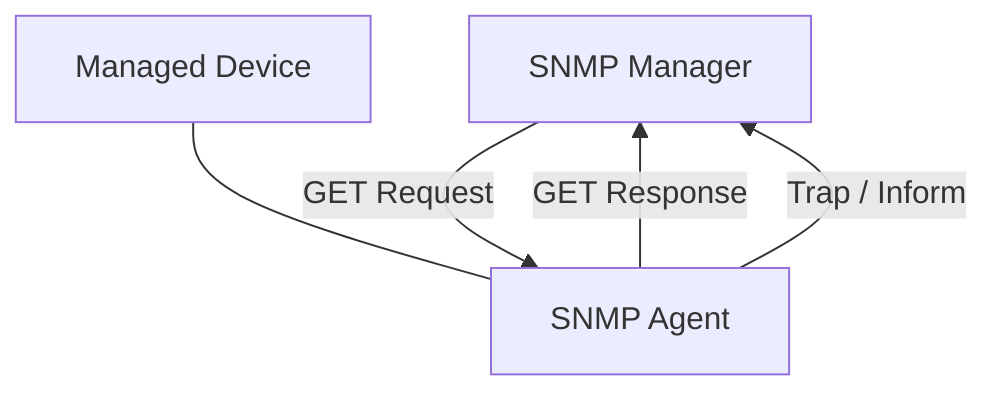
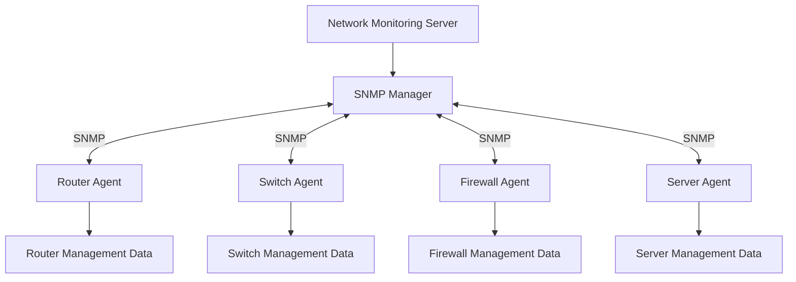
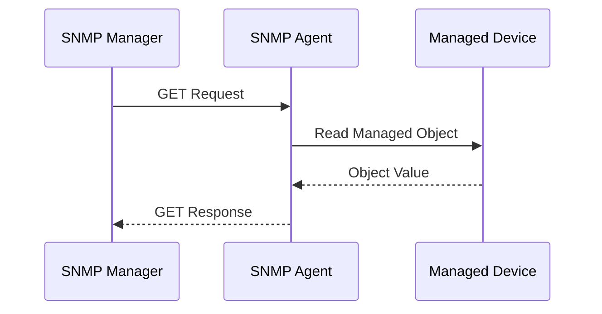
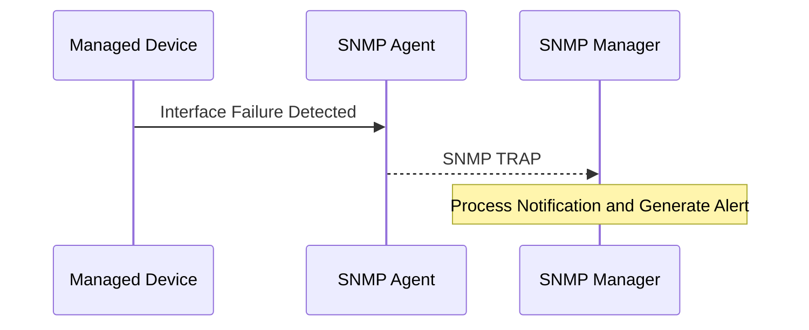
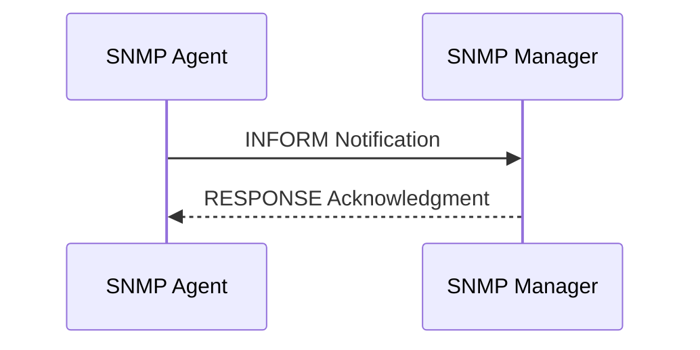
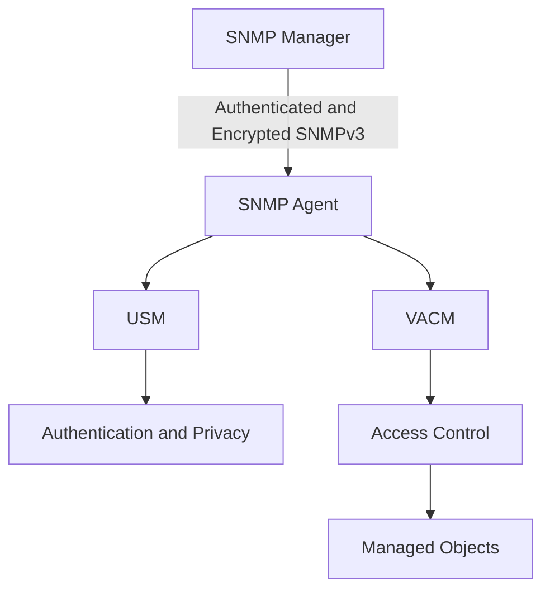

# SNMP (Simple Network Management Protocol)

SNMP (Simple Network Management Protocol) is an application-layer protocol used to monitor, manage, and collect information from network devices.

It allows network administrators and monitoring systems to retrieve operational information and, when authorized, modify device configurations.

SNMP is commonly used to monitor:

* Routers and switches.
* Firewalls.
* Servers.
* Wireless access points.
* Printers.
* Network interfaces.
* UPS systems.
* Storage devices.
* ISP network infrastructure.

SNMP is especially useful in centralized network monitoring systems where administrators need visibility into hundreds or thousands of devices.

### 🖆 Key Characteristics

| Feature | Description |
| --- | --- |
| Full name | Simple Network Management Protocol |
| OSI layer | Application |
| Transport | Primarily UDP |
| Default agent port | UDP 161 |
| Default trap receiver port | UDP 162 |
| Primary purpose | Network monitoring and management |
| Architecture | Manager-agent |
| Data model | Managed objects organized in a MIB |
| Current widely used version | SNMPv3 |

# 🗁 How SNMP Works

SNMP follows a manager-agent architecture.

A monitoring system acts as the SNMP manager and communicates with SNMP agents running on managed devices.

The manager requests information from agents, and agents respond with the requested values.

Agents can also send notifications to managers when important events occur.

### 🖆 Basic SNMP Workflow



### 🖆 Example

Suppose a network administrator wants to monitor a router's CPU utilization.

The workflow:

* The monitoring server sends an SNMP GET request.
* The router's SNMP agent receives the request.
* The agent reads the requested CPU-related management object.
* The agent returns the value to the monitoring server.
* The monitoring system stores and displays the result.

The monitoring system can repeat this process at regular intervals to track performance over time.

# 🗁 Why SNMP Is Important

SNMP provides centralized visibility into network infrastructure.

Without a monitoring protocol, administrators may need to log in to every device individually to inspect its status.

SNMP makes it possible to collect operational information from many devices through a central monitoring platform.

### 🖆 Network Availability Monitoring

SNMP can help determine whether devices and interfaces are operational.

Examples:

* Router availability.
* Switch availability.
* Interface operational status.
* Device uptime.

### 🖆 Bandwidth Monitoring

SNMP can collect interface traffic counters.

Monitoring systems use these counters to calculate:

* Incoming traffic.
* Outgoing traffic.
* Bandwidth utilization.
* Traffic trends.
* Interface errors.

### 🖆 Performance Monitoring

SNMP can expose information such as:

* CPU utilization.
* Memory usage.
* Interface utilization.
* Temperature.
* Fan status.
* Power supply status.

The availability of these metrics depends on the device and its supported MIB objects.

### 🖆 Fault Monitoring

SNMP notifications can report events such as:

* Interface state changes.
* Device restarts.
* Hardware failures.
* Authentication failures.
* Environmental alarms.

### 🖆 Capacity Planning

Historical SNMP data helps administrators identify:

* Increasing bandwidth requirements.
* Overloaded interfaces.
* Memory pressure.
* Device performance limitations.
* Infrastructure upgrade requirements.

# 🗁 SNMP Architecture

SNMP uses a distributed management architecture.

The manager communicates with agents running on managed network devices.

### 🖆 Architecture Diagram



### 🖆 Manager-Agent Model

The manager initiates requests to retrieve or modify management information.

The agent runs on a managed device and provides access to its management information.

### 🖆 Notifications

Agents can send asynchronous notifications to managers.

These notifications are useful for reporting events without waiting for the manager to poll the device.

# 🗁 SNMP Components

SNMP environments contain several important components.

### 🖆 SNMP Manager

The manager is the central system responsible for monitoring and managing network devices.

Responsibilities include:

* Sending SNMP requests.
* Receiving responses.
* Processing notifications.
* Collecting device metrics.
* Displaying monitoring information.
* Generating alerts.

Examples of monitoring platforms include:

* Zabbix.
* LibreNMS.
* PRTG.
* Nagios.
* Observium.

### 🖆 SNMP Agent

The agent is a software component running on a managed device.

Responsibilities include:

* Receiving SNMP requests.
* Accessing management information.
* Returning requested values.
* Processing authorized management operations.
* Sending notifications.

### 🖆 Managed Device

A managed device is any network-connected system that exposes SNMP management information.

Examples:

* Routers.
* Switches.
* Firewalls.
* Servers.
* Printers.
* UPS systems.

### 🖆 MIB

The Management Information Base defines the structure and organization of managed objects that can be accessed through SNMP.

### 🖆 OID

An Object Identifier uniquely identifies a managed object within the MIB object namespace.

# 🗁 SNMP Manager and Agent

The manager and agent perform different responsibilities.

| Feature | SNMP Manager | SNMP Agent |
| --- | --- | --- |
| Location | Monitoring server | Managed device |
| Initiates polling | Yes | No |
| Responds to requests | Receives responses | Yes |
| Sends notifications | Receives notifications | Sends notifications |
| Collects metrics | Aggregates and stores | Exposes local data |
| Management role | Central controller | Device-side interface |

### 🖆 Manager Example

A monitoring server requests interface counters from a switch.

```text
SNMP Manager
    |
    | GET interface counter
    v
SNMP Agent on Switch
    |
    | Response with counter value
    v
SNMP Manager
```

### 🖆 Agent Example

A router detects that an interface has changed state.

The SNMP agent sends a notification to the configured monitoring system.

```text
Router SNMP Agent
    |
    | Interface state notification
    v
SNMP Manager
```

# 🗁 Management Information Base (MIB)

MIB stands for Management Information Base.

It defines a structured collection of managed objects that an SNMP manager can access.

A MIB is not necessarily a physical database stored on the device. It is a conceptual definition of the managed objects and their identifiers, types, and access characteristics.

### 🖆 MIB Structure

MIB objects are organized in a hierarchical tree.

```text
iso
└── org
    └── dod
        └── internet
            ├── directory
            ├── mgmt
            │   └── mib-2
            │       ├── system
            │       ├── interfaces
            │       ├── ip
            │       ├── tcp
            │       └── udp
            ├── experimental
            └── private
                └── enterprises
```

### 🖆 Common MIB Groups

| MIB Group | Purpose |
| --- | --- |
| system | Device identity and uptime |
| interfaces | Network interface information |
| ip | IP-related statistics |
| icmp | ICMP statistics |
| tcp | TCP statistics |
| udp | UDP statistics |
| snmp | SNMP protocol statistics |

### 🖆 Standard MIB-II

MIB-II is defined in RFC 1213.

It provides common management objects for network devices.

Examples include:

* `sysDescr`
* `sysObjectID`
* `sysUpTime`
* `sysName`
* `ifNumber`
* `ifTable`
* `ifInOctets`
* `ifOutOctets`

Modern interface management commonly uses the IF-MIB, defined separately from the original MIB-II specification.

# 🗁 Object Identifier (OID)

An OID is a hierarchical identifier used to identify a specific managed object.

Every OID represents a particular location in the MIB tree.

### 🖆 OID Example

Consider:

```text
1.3.6.1.2.1.1.3.0
```

This identifies `sysUpTime.0`, which represents the time since the network management portion of the system was last reinitialized.

### 🖆 OID Breakdown

```text
1.3.6.1.2.1.1.3.0
│ │ │ │ │ │ │ │
│ │ │ │ │ │ │ └── Scalar instance
│ │ │ │ │ │ └──── System group
│ │ │ │ │ └────── MIB-II
│ │ │ │ └──────── Internet
│ │ │ └────────── DoD
│ │ └──────────── OID registration hierarchy
└─ Root
```

### 🖆 Common OIDs

| Object | OID | Description |
| --- | --- | --- |
| `sysDescr.0` | `1.3.6.1.2.1.1.1.0` | System description |
| `sysObjectID.0` | `1.3.6.1.2.1.1.2.0` | Device object identifier |
| `sysUpTime.0` | `1.3.6.1.2.1.1.3.0` | System uptime |
| `sysContact.0` | `1.3.6.1.2.1.1.4.0` | System contact |
| `sysName.0` | `1.3.6.1.2.1.1.5.0` | Device name |
| `sysLocation.0` | `1.3.6.1.2.1.1.6.0` | Device location |
| `ifNumber.0` | `1.3.6.1.2.1.2.1.0` | Number of network interfaces |

### 🖆 Scalar and Table Objects

SNMP managed objects can represent individual values or collections of values.

**Scalar objects**

Represent a single value.

For example:

```text
sysName.0
sysUpTime.0
```

The `.0` identifies the instance of the scalar object.

**Table objects**

Represent collections of related entries.

For example, the interface table contains information about multiple network interfaces.

Each row can be accessed through an index.

### 🖆 Numeric and Symbolic OIDs

An OID can be represented numerically:

```text
1.3.6.1.2.1.1.5.0
```

Or symbolically:

```text
SNMPv2-MIB::sysName.0
```

Symbolic names require the relevant MIB definitions to be available to the SNMP tools.

# 🗁 SNMP Operations

SNMP defines several operations for retrieving and managing information.

### 🖆 GET

GET retrieves the value of a specific managed object.

Example:

```text
GET sysName.0
```

The agent returns the device's system name.

### 🖆 GETNEXT

GETNEXT retrieves the next available object in the MIB tree.

It is useful for traversing tables and hierarchical object structures.

### 🖆 GETBULK

GETBULK retrieves multiple consecutive objects in a single request.

It was introduced in SNMPv2 to make large-scale data collection more efficient.

### 🖆 SET

SET modifies the value of a writable managed object.

For example, an authorized manager may change a supported device configuration parameter.

Not all objects support SET operations.

### 🖆 RESPONSE

The agent sends a response containing the requested values or an error indication.

### 🖆 TRAP

A TRAP is an asynchronous notification sent by an agent to a manager.

It does not require a response from the manager.

### 🖆 INFORM

An INFORM is a notification that requires an acknowledgment from the receiver.

Unlike a TRAP, an INFORM provides confirmation that the notification was received at the SNMP protocol level.

### 🖆 SNMP Operation Comparison

| Operation | Purpose | Response Required |
| --- | --- | --- |
| GET | Retrieve an object | Yes |
| GETNEXT | Retrieve the next object | Yes |
| GETBULK | Retrieve multiple objects | Yes |
| SET | Modify an object | Yes |
| RESPONSE | Return request results | It is the response |
| TRAP | Send notification | No |
| INFORM | Send acknowledged notification | Yes |

### 🖆 SNMPv1 and SNMPv2c PDU Support

| Operation | SNMPv1 | SNMPv2c |
| --- | --- | --- |
| GET | Supported | Supported |
| GETNEXT | Supported | Supported |
| GETBULK | Not supported | Supported |
| SET | Supported | Supported |
| RESPONSE | Supported | Supported |
| TRAP | Supported | Supported |
| INFORM | Not supported | Supported |

SNMPv3 uses the SNMPv2 protocol operations with its security framework.

# 🗁 SNMP Communication Process

SNMP communication commonly follows a request-response model.

### 🖆 GET Request Workflow



### 🖆 TRAP Workflow



### 🖆 INFORM Workflow



### 🖆 Polling vs Notifications

**Polling**

The manager periodically requests information from agents.

Example:

```text
Monitoring Server
       |
       | GET CPU usage
       v
Network Device
       |
       | RESPONSE
       v
Monitoring Server
```

**Notifications**

The agent sends a notification when an event occurs.

Example:

```text
Network Device
       |
       | Interface Down TRAP
       v
Monitoring Server
```

A monitoring system commonly combines polling and notifications.

# 🗁 SNMP Versions

SNMP has evolved through several versions.

The major versions are:

* SNMPv1.
* SNMPv2c.
* SNMPv3.

Each version introduced improvements in functionality, efficiency, or security.

### 🖆 Version Comparison

| Feature | SNMPv1 | SNMPv2c | SNMPv3 |
| --- | --- | --- | --- |
| Community-based access | Yes | Yes | Optional compatibility is not its security model |
| GETBULK | No | Yes | Yes |
| INFORM | No | Yes | Yes |
| Authentication | Community string | Community string | User-based security |
| Encryption | No | No | Supported |
| Message integrity | No cryptographic protection | No cryptographic protection | Supported |
| Recommended for secure management | No | No | Yes |

# 🗁 SNMPv1

SNMPv1 is the original version of SNMP.

It introduced the basic manager-agent architecture and fundamental operations for network monitoring.

### 🖆 Characteristics

* Uses community strings.
* Supports GET, GETNEXT, SET, and TRAP.
* Uses UDP ports 161 and 162.
* Does not provide cryptographic authentication.
* Does not encrypt management traffic.

### 🖆 Community Strings

A community string acts as a shared credential between the manager and agent.

Common default examples historically include:

```text
public
private
```

These strings are not secure passwords.

Community strings are transmitted without encryption and can be exposed through network traffic.

### 🖆 SNMPv1 Limitations

* Weak access control.
* No message encryption.
* No cryptographic message authentication.
* Limited bulk retrieval capabilities.
* No INFORM operation.

SNMPv1 is considered obsolete for secure network management.

# 🗁 SNMPv2c

SNMPv2c improves SNMP functionality and performance while retaining community-based security.

The `c` stands for community-based.

### 🖆 Key Improvements

* GETBULK operation.
* INFORM notifications.
* Improved error handling.
* Additional protocol operations.
* More efficient retrieval of large data sets.

### 🖆 GETBULK Example

A manager can retrieve multiple consecutive OIDs in one request instead of repeatedly sending GETNEXT requests.

This reduces the number of network exchanges required to retrieve large tables.

### 🖆 SNMPv2c Security Limitations

SNMPv2c still relies on community strings.

It does not provide:

* Cryptographic authentication.
* Message integrity protection.
* Encryption.
* Strong protection against credential interception.

SNMPv2c is still widely encountered in existing infrastructure, but SNMPv3 is preferable when secure management is required.

# 🗁 SNMPv3

SNMPv3 introduces a security framework for SNMP communication.

It supports authentication, message integrity, encryption, and access control.

### 🖆 Main Security Features

* Authentication.
* Message integrity.
* Encryption.
* User-based security.
* Access control.

### 🖆 SNMPv3 Security Levels

SNMPv3 defines three security levels.

| Security Level | Authentication | Encryption | Description |
| --- | --- | --- | --- |
| `noAuthNoPriv` | No | No | No authentication or privacy |
| `authNoPriv` | Yes | No | Authentication and integrity protection |
| `authPriv` | Yes | Yes | Authentication, integrity, and encryption |

### 🖆 noAuthNoPriv

Messages are not authenticated or encrypted.

This provides no cryptographic protection.

### 🖆 authNoPriv

Messages are authenticated and protected against undetected modification, but their contents are not encrypted.

### 🖆 authPriv

Messages are authenticated, protected against undetected modification, and encrypted.

This is generally the preferred SNMPv3 security level for sensitive management traffic.

### 🖆 User-Based Security Model (USM)

USM provides SNMPv3 security mechanisms.

It supports:

* Authentication.
* Message integrity.
* Timeliness and replay protection.
* Privacy through encryption.

Common authentication algorithms include:

* HMAC-SHA-96 with MD5.
* HMAC-SHA-96 with SHA-1.
* HMAC-SHA-2 variants defined in RFC 7860.

Modern deployments should prefer supported SHA-2 authentication algorithms over legacy MD5 or SHA-1 options.

Common privacy algorithms include:

* DES.
* AES-128.
* Other standardized AES variants, depending on implementation support.

Prefer modern AES-based privacy algorithms.

### 🖆 View-Based Access Control Model (VACM)

VACM controls which managed objects an SNMP user can access.

It supports access policies based on:

* Security model.
* Security level.
* User group.
* Context.
* MIB view.
* Access permissions.

For example, a monitoring user may have read-only access to interface counters but no permission to modify device configuration.

### 🖆 SNMPv3 Architecture



### 🖆 SNMPv3 Best Configuration

For production monitoring:

* Use `authPriv`.
* Use strong authentication credentials.
* Use modern supported authentication algorithms.
* Use AES-based privacy.
* Apply read-only access for monitoring users.
* Restrict management access to trusted monitoring systems.

# 🗁 SNMP Ports and Transport

SNMP primarily uses UDP.

| Port | Protocol | Purpose |
| --- | --- | --- |
| 161 | UDP | SNMP requests and responses |
| 162 | UDP | SNMP traps and informs |

### 🖆 UDP Port 161

SNMP managers normally send requests to agents using destination UDP port 161.

Agents send responses back to the manager's request source port.

### 🖆 UDP Port 162

SNMP managers or notification receivers commonly listen on UDP port 162 for traps and informs.

### 🖆 Firewall Considerations

For a typical monitoring deployment:

* Allow the manager to send UDP traffic to agent port 161.
* Allow responses from agents back to the manager.
* Allow agent notifications to the manager's UDP port 162.
* Restrict access to trusted management networks.

SNMPv3 uses the same standard SNMP transport ports as earlier versions.

# 🗁 SNMP Monitoring Metrics

SNMP exposes information that monitoring platforms can collect and analyze.

### 🖆 System Information

Common system objects include:

| Metric | Example OID | Purpose |
| --- | --- | --- |
| System description | `1.3.6.1.2.1.1.1.0` | Device information |
| System uptime | `1.3.6.1.2.1.1.3.0` | Time since management subsystem initialization |
| System name | `1.3.6.1.2.1.1.5.0` | Device hostname |

### 🖆 Interface Monitoring

The IF-MIB provides information about network interfaces.

Common objects include:

| Metric | OID | Purpose |
| --- | --- | --- |
| Interface description | `1.3.6.1.2.1.2.2.1.2` | Interface name or description |
| Interface operational status | `1.3.6.1.2.1.2.2.1.8` | Operational state |
| Incoming octets | `1.3.6.1.2.1.2.2.1.10` | Received traffic counter |
| Outgoing octets | `1.3.6.1.2.1.2.2.1.16` | Transmitted traffic counter |
| Incoming errors | `1.3.6.1.2.1.2.2.1.14` | Receive error counter |
| Outgoing errors | `1.3.6.1.2.1.2.2.1.20` | Transmit error counter |

These objects are table entries and require an interface index to identify a specific interface.

### 🖆 Interface Traffic Calculation

SNMP interface counters are generally cumulative counters.

Monitoring systems calculate traffic rates by comparing two counter readings.

\[
\text{Bandwidth (bits/s)} =
\frac{(C_2-C_1)\times 8}{t_2-t_1}
\]

Where:

* \(C_1\): Previous octet counter.
* \(C_2\): Current octet counter.
* \(t_1\): Previous measurement time.
* \(t_2\): Current measurement time.

### 🖆 Example

Suppose an interface receives:

```text
Previous counter: 100000000 octets
Current counter:  125000000 octets
Time interval:    10 seconds
```

Traffic rate:

\[
\frac{(125000000-100000000)\times 8}{10}
\]

\[
= 20,000,000 \text{ bits/s}
\]

The average incoming traffic rate is 20 Mbps.

### 🖆 Counter Discontinuities

Counter calculations must account for:

* Counter wraparound.
* Interface resets.
* Device reboots.
* Interface reinitialization.
* Counter discontinuities.

For high-speed interfaces, modern monitoring should prefer 64-bit counters such as `ifHCInOctets` and `ifHCOutOctets` when supported.

These are defined in the IF-MIB.

### 🖆 Interface Status

Interface operational state can indicate whether a link is functioning.

Common states include:

* Up.
* Down.
* Testing.
* Unknown.
* Dormant.
* Not present.
* Lower-layer down.

Monitoring systems can generate alerts when important interfaces change state.

# 🗁 SNMP on Ubuntu/Linux

Ubuntu can run SNMP monitoring tools and SNMP agents.

The Net-SNMP project provides common utilities and agent software.

### 🖆 Install SNMP Utilities

```bash
sudo apt update
sudo apt install snmp snmp-mibs-downloader
```

The `snmp` package provides command-line tools such as:

* `snmpget`
* `snmpwalk`
* `snmpbulkwalk`
* `snmpset`
* `snmptranslate`
* `snmptrap`

MIB loading and availability depend on the package configuration.

### 🖆 Install the SNMP Agent

```bash
sudo apt install snmpd
```

Enable and start the service:

```bash
sudo systemctl enable --now snmpd
```

Check service status:

```bash
sudo systemctl status snmpd
```

### 🖆 Check Listening Ports

```bash
sudo ss -ulnp | grep -E ':(161|162)\b'
```

The agent normally listens on UDP port 161.

The monitoring manager may listen on UDP port 162 for notifications.

# 🗁 Configuring an SNMP Agent

The Net-SNMP agent is commonly configured through:

```text
/etc/snmp/snmpd.conf
```

### 🖆 Basic Agent Configuration

A basic read-only SNMPv2c configuration can use a restricted community:

```conf
agentAddress udp:161

rocommunity monitoring-community 192.168.1.10

sysLocation Server Room
sysContact admin@example.com
sysName ubuntu-server
```

This example allows the specified monitoring host to query the agent using the configured community string.

The community string is an example, not a production secret.

SNMPv2c does not encrypt community strings, so use SNMPv3 for sensitive management environments.

### 🖆 Restart the Agent

After changing the configuration:

```bash
sudo systemctl restart snmpd
```

Check logs:

```bash
sudo journalctl -u snmpd -n 100
```

### 🖆 Restrict Network Access

Use a host firewall to restrict UDP port 161 to the monitoring server.

Example with UFW:

```bash
sudo ufw allow from 192.168.1.10 to any port 161 proto udp
```

For production deployments, combine firewall restrictions with agent-side access control.

### 🖆 SNMPv3 Configuration

Net-SNMP supports SNMPv3 users.

A user can be created using:

```bash
sudo net-snmp-create-v3-user \
  -ro \
  -A 'StrongAuthPassword' \
  -a SHA \
  -X 'StrongPrivacyPassword' \
  -x AES \
  monitoring-user
```

The exact supported algorithms depend on the installed Net-SNMP build.

This command creates a read-only SNMPv3 user using authentication and privacy.

The utility typically updates the Net-SNMP persistent configuration.

Restart the agent if required:

```bash
sudo systemctl restart snmpd
```

For production, use securely generated credentials and a modern supported authentication algorithm.

# 🗁 SNMP Monitoring Tools

Several tools can query SNMP agents and collect device information.

### 🖆 snmpget

Retrieves the value of a specific OID.

Example:

```bash
snmpget -v2c \
  -c monitoring-community \
  192.168.1.1 \
  1.3.6.1.2.1.1.5.0
```

This requests the system name of the device.

### 🖆 snmpwalk

Retrieves a subtree of managed objects.

Example:

```bash
snmpwalk -v2c \
  -c monitoring-community \
  192.168.1.1 \
  1.3.6.1.2.1.1
```

This walks the system group.

### 🖆 snmpbulkwalk

Uses GETBULK to retrieve large collections of objects efficiently.

Example:

```bash
snmpbulkwalk -v2c \
  -c monitoring-community \
  192.168.1.1 \
  1.3.6.1.2.1.2
```

### 🖆 SNMPv3 Query

Example using authentication and privacy:

```bash
snmpget -v3 \
  -l authPriv \
  -u monitoring-user \
  -a SHA \
  -A 'StrongAuthPassword' \
  -x AES \
  -X 'StrongPrivacyPassword' \
  192.168.1.1 \
  1.3.6.1.2.1.1.5.0
```

Use the same authentication and privacy algorithms configured on the agent.

### 🖆 snmptranslate

Translates numeric OIDs into symbolic names when the required MIB definitions are available.

Example:

```bash
snmptranslate -On SNMPv2-MIB::sysName.0
```

Translate a numeric OID:

```bash
snmptranslate -Td 1.3.6.1.2.1.1.5
```

### 🖆 snmptrap

Sends an SNMP notification to a configured receiver.

The exact command syntax depends on the notification type and SNMP version.

### 🖆 Monitoring Platforms

| Platform | Purpose |
| --- | --- |
| Zabbix | Infrastructure monitoring and alerting |
| LibreNMS | Network device discovery and monitoring |
| PRTG | Network monitoring |
| Nagios | Infrastructure monitoring |
| Observium | Network monitoring and visualization |
| Prometheus with SNMP Exporter | SNMP metrics collection for Prometheus |

These platforms can collect SNMP metrics, build graphs, and generate alerts.

# 🗁 SNMP Security

SNMP can expose sensitive information about network infrastructure.

Poorly configured SNMP services may allow unauthorized users to inspect or modify device information.

### 🖆 Community String Exposure

SNMPv1 and SNMPv2c use community strings for access control.

These strings are transmitted without encryption.

An attacker monitoring network traffic may capture them.

### 🖆 Unauthorized SET Operations

If write access is enabled without appropriate restrictions, an unauthorized manager may modify supported device settings.

This can affect:

* Network interfaces.
* Device configuration.
* Routing-related settings.
* Management parameters.

### 🖆 SNMP Enumeration

An exposed SNMP service may reveal:

* Device names.
* Network interfaces.
* IP-related information.
* Software versions.
* Hardware information.
* Network topology details.

This information can help attackers understand an environment.

### 🖆 SNMPv3 Protection

SNMPv3 `authPriv` provides authentication, message integrity, and encryption.

It is substantially more secure than community-based SNMPv1 and SNMPv2c.

### 🖆 Security Best Practices

* Prefer SNMPv3 with `authPriv`.
* Use strong authentication and privacy credentials.
* Use modern supported cryptographic algorithms.
* Restrict SNMP access to trusted management networks.
* Configure read-only users for monitoring.
* Avoid default community strings.
* Disable SNMP SET access unless required.
* Restrict UDP ports 161 and 162 through firewalls.
* Monitor authentication failures.
* Keep SNMP agents and monitoring platforms updated.
* Avoid exposing SNMP services directly to the public internet.

# 🗁 Troubleshooting

SNMP problems commonly involve network connectivity, agent configuration, authentication, access control, and MIB interpretation.

### 🖆 SNMP Agent Not Responding

Possible causes:

* SNMP agent is not running.
* UDP port 161 is blocked.
* Agent is listening on the wrong interface.
* Incorrect device IP address.
* Firewall restrictions.

Check service status:

```bash
sudo systemctl status snmpd
```

Check listening sockets:

```bash
sudo ss -ulnp | grep ':161'
```

Test connectivity:

```bash
nc -vzu 192.168.1.1 161
```

A UDP probe does not guarantee that the SNMP application is responding. Use an SNMP query to confirm actual communication.

### 🖆 Timeout Errors

Example:

```text
Timeout: No Response from 192.168.1.1
```

Possible causes:

* Network path failure.
* Firewall dropping UDP packets.
* Incorrect community string.
* SNMP agent disabled.
* Manager address not permitted by agent configuration.

Inspect traffic:

```bash
sudo tcpdump -i any -nn udp port 161
```

### 🖆 Authentication Failure

Possible causes:

* Incorrect SNMPv3 username.
* Incorrect authentication password.
* Incorrect privacy password.
* Unsupported security algorithm.
* Incorrect security level.

Verify the user configuration and ensure the manager uses matching security parameters.

### 🖆 Unknown OID

Example:

```text
Unknown Object Identifier
```

Possible causes:

* Incorrect OID.
* Missing MIB definitions.
* Incorrect symbolic object name.
* Unsupported vendor-specific MIB.

Try the numeric OID:

```bash
snmpget -v2c \
  -c monitoring-community \
  192.168.1.1 \
  1.3.6.1.2.1.1.5.0
```

### 🖆 Permission Denied

Possible causes:

* Read-only access restrictions.
* VACM policy restrictions.
* Incorrect security group.
* Requested OID outside the permitted MIB view.
* SET operation not permitted.

Check the agent's access-control configuration.

### 🖆 Incorrect Bandwidth Graphs

Possible causes:

* Counter wraparound.
* Interface reset.
* Incorrect polling interval.
* Using 32-bit counters on high-speed interfaces.
* Incorrect interface indexing.
* Counter discontinuity.

Prefer 64-bit interface counters where available.

### 🖆 Trap Not Received

Possible causes:

* Notification destination not configured.
* UDP port 162 blocked.
* Manager notification receiver not running.
* Incorrect SNMP version or security configuration.
* Routing problems between agent and manager.

Inspect the manager's listening socket:

```bash
sudo ss -ulnp | grep ':162'
```

Capture notification traffic:

```bash
sudo tcpdump -i any -nn udp port 162
```

# 🗁 Best Practices

* Use SNMPv3 for secure monitoring.
* Prefer `authPriv` where supported.
* Use read-only access for routine monitoring.
* Restrict SNMP communication to management networks.
* Use firewall rules to limit access.
* Monitor interface counters and operational states.
* Use 64-bit counters for high-speed interfaces.
* Configure notifications for important infrastructure events.
* Monitor device uptime, CPU, memory, and environmental metrics where supported.
* Keep MIB definitions organized and version-controlled.
* Document vendor-specific OIDs.
* Monitor SNMP polling failures.
* Protect monitoring servers and notification receivers.
* Regularly review SNMP users and access policies.

# 🗁 Practical Exercises

### 🖆 Exercise: Install SNMP Tools

Install Net-SNMP utilities:

```bash
sudo apt update
sudo apt install snmp
```

Verify the installation:

```bash
snmpget --version
```

### 🖆 Exercise: Query System Information

Query a device's system name:

```bash
snmpget -v2c \
  -c monitoring-community \
  192.168.1.1 \
  1.3.6.1.2.1.1.5.0
```

Identify the returned value.

### 🖆 Exercise: Walk the System MIB

```bash
snmpwalk -v2c \
  -c monitoring-community \
  192.168.1.1 \
  1.3.6.1.2.1.1
```

Identify:

* System description.
* System uptime.
* System name.
* System location.

### 🖆 Exercise: Monitor Network Interfaces

Walk the interface MIB:

```bash
snmpwalk -v2c \
  -c monitoring-community \
  192.168.1.1 \
  1.3.6.1.2.1.2.2
```

Identify:

* Interface names.
* Interface operational states.
* Incoming traffic counters.
* Outgoing traffic counters.
* Interface error counters.

### 🖆 Exercise: Calculate Interface Bandwidth

Collect two readings of `ifInOctets` or `ifHCInOctets`.

Calculate the average incoming bandwidth using:

\[
\text{Bandwidth} =
\frac{\text{Counter Difference}\times 8}{\text{Time Difference}}
\]

Compare the result with the monitoring platform's bandwidth graph.

### 🖆 Exercise: Configure SNMPv3

Create a read-only SNMPv3 user with authentication and privacy.

Test the account using `snmpget`.

Verify that:

* Authentication succeeds.
* Privacy encryption is enabled.
* Unauthorized users cannot access the agent.
* The account has only the required permissions.

### 🖆 Exercise: Build a Monitoring Lab

Create a small network containing:

* One Ubuntu monitoring server.
* One Linux SNMP agent.
* One router or managed switch.

Configure SNMP and collect:

* Device uptime.
* Interface status.
* Incoming traffic.
* Outgoing traffic.
* Interface errors.

Generate an alert when an interface becomes unavailable.

# 🗁 Interview Questions

### 🖆 Basic Questions

**What is SNMP?**

SNMP is an application-layer protocol used to monitor and manage network devices.

**Which ports does SNMP use?**

UDP port 161 is used for requests and responses, while UDP port 162 is commonly used for traps and informs.

**What is an SNMP manager?**

An SNMP manager is a centralized system that sends requests, receives responses, processes notifications, and manages network monitoring.

**What is an SNMP agent?**

An SNMP agent is software running on a managed device that exposes management information and processes SNMP requests.

**What is a MIB?**

A Management Information Base defines the structure and organization of managed objects accessible through SNMP.

**What is an OID?**

An Object Identifier uniquely identifies a managed object within the MIB hierarchy.

### 🖆 Intermediate Questions

**What is the difference between GET and GETNEXT?**

GET retrieves a specific object, while GETNEXT retrieves the next available object in the MIB tree.

**What is GETBULK?**

GETBULK retrieves multiple consecutive objects in one request and is supported by SNMPv2 and SNMPv3.

**What is the difference between TRAP and INFORM?**

A TRAP does not require a protocol-level acknowledgment, while an INFORM requires a response from the receiver.

**What is the difference between SNMPv1 and SNMPv2c?**

SNMPv2c adds operations such as GETBULK and INFORM and improves error handling, but it retains community-based security.

**Why is SNMPv3 preferred?**

SNMPv3 provides authentication, message integrity, encryption, and access-control capabilities.

**What is a community string?**

A community string is a shared value used by SNMPv1 and SNMPv2c for basic access control.

### 🖆 Advanced Questions

**What is the difference between USM and VACM?**

USM provides SNMPv3 message security, including authentication and privacy. VACM controls which managed objects an SNMP user can access.

**What does `authPriv` mean?**

It is an SNMPv3 security level that provides authentication, message integrity, and encryption.

**Why is UDP used by SNMP?**

UDP provides lightweight request-response communication without TCP connection establishment overhead.

**How does SNMP calculate bandwidth utilization?**

It calculates the difference between two cumulative interface counter readings over a known time interval, then converts the result into bits per second.

**Why are 64-bit interface counters important?**

High-speed interfaces can wrap 32-bit counters quickly. 64-bit counters significantly reduce counter-wrap problems.

**What is the difference between an SNMP TRAP and polling?**

Polling is initiated periodically by the manager, while a TRAP is sent asynchronously by an agent when an event occurs.

**What is the purpose of the IF-MIB?**

IF-MIB defines standardized managed objects for monitoring network interfaces, including interface descriptions, operational status, and traffic counters.

# 🗁 Summary

SNMP is an application-layer protocol used to monitor and manage network infrastructure.

Important concepts:

* SNMP follows a manager-agent architecture.
* UDP port 161 is used for requests and responses.
* UDP port 162 is commonly used for notifications.
* MIB defines managed objects.
* OIDs identify individual managed objects.
* GET retrieves values.
* GETNEXT retrieves the next object.
* GETBULK retrieves multiple objects efficiently.
* SET modifies writable objects.
* TRAP sends notifications without requiring acknowledgment.
* INFORM sends notifications that require acknowledgment.
* SNMPv1 and SNMPv2c use community-based security.
* SNMPv3 supports authentication, integrity, encryption, and access control.
* USM provides message security.
* VACM controls access to managed objects.
* SNMP is widely used for bandwidth monitoring, device availability, and infrastructure management.

Understanding SNMP is essential for building centralized monitoring systems and managing routers, switches, servers, and ISP infrastructure.

# 🗁 References

### 🖆 Official Standards and RFCs

* [RFC 1157 — Simple Network Management Protocol (SNMPv1)](https://www.rfc-editor.org/rfc/rfc1157)
* [RFC 1213 — Management Information Base for Network Management of TCP/IP-based Internets: MIB-II](https://www.rfc-editor.org/rfc/rfc1213)
* [RFC 1901 — Introduction to Community-based SNMPv2](https://www.rfc-editor.org/rfc/rfc1901)
* [RFC 3411 — An Architecture for Describing Simple Network Management Protocol Management Frameworks](https://www.rfc-editor.org/rfc/rfc3411)
* [RFC 3412 — Message Processing and Dispatching for the SNMP](https://www.rfc-editor.org/rfc/rfc3412)
* [RFC 3413 — Simple Network Management Protocol Applications](https://www.rfc-editor.org/rfc/rfc3413)
* [RFC 3414 — User-based Security Model (USM) for SNMPv3](https://www.rfc-editor.org/rfc/rfc3414)
* [RFC 3415 — View-based Access Control Model (VACM) for SNMP](https://www.rfc-editor.org/rfc/rfc3415)
* [RFC 3416 — Version 2 of the Protocol Operations for SNMP](https://www.rfc-editor.org/rfc/rfc3416)
* [RFC 3417 — Transport Mappings for SNMP](https://www.rfc-editor.org/rfc/rfc3417)
* [RFC 3418 — Management Information Base (MIB) for SNMP](https://www.rfc-editor.org/rfc/rfc3418)
* [RFC 7860 — HMAC-SHA-2 Authentication Protocols in USM for SNMPv3](https://www.rfc-editor.org/rfc/rfc7860)
* [RFC 2863 — The Interfaces Group MIB](https://www.rfc-editor.org/rfc/rfc2863)

### 🖆 Official Documentation

* [Net-SNMP Documentation](https://www.net-snmp.org/docs/)
* [Zabbix Documentation](https://www.zabbix.com/documentation/current/en/manual)
* [LibreNMS Documentation](https://docs.librenms.org/)
* [Prometheus SNMP Exporter](https://github.com/prometheus/snmp_exporter)
