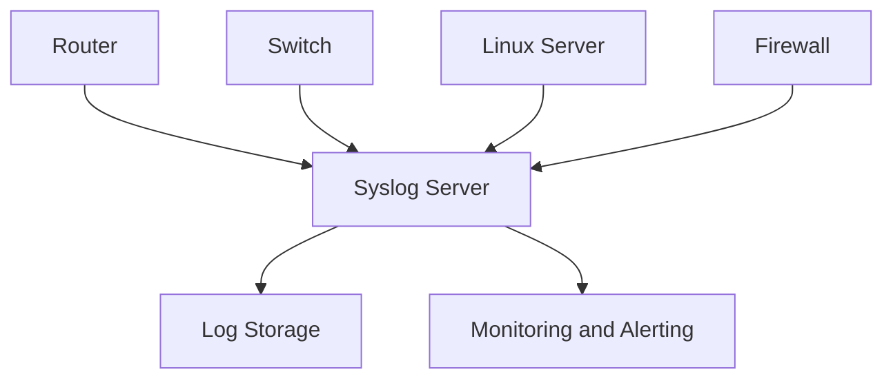
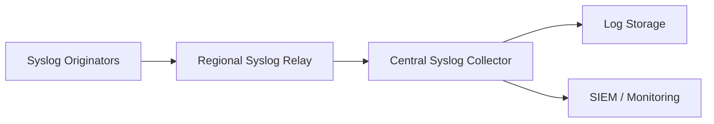

# Syslog

Syslog is a standard protocol and message format used to collect, transmit, and store log messages generated by network devices, servers, applications, and operating systems.

It provides a centralized approach to logging, allowing administrators to monitor events across an entire infrastructure.

Syslog is commonly used with:

* Routers and switches.
* Firewalls.
* Linux and Unix servers.
* Network appliances.
* Applications and services.
* Security monitoring systems.
* ISP infrastructure.

Instead of accessing every device individually to inspect its logs, administrators can forward log messages to a centralized syslog server.

### 🖆 Key Characteristics

| Feature | Description |
| --- | --- |
| Protocol | Syslog |
| OSI layer | Application |
| Common transport | UDP, TCP |
| Traditional UDP port | 514 |
| Common TLS transport port | TCP 6514 |
| Message format | Structured or traditional syslog |
| Primary purpose | Centralized event logging |
| Communication | Sender to receiver |
| Standardization | RFC 5424 and related RFCs |

# 🗁 How Syslog Works

Syslog uses a sender-receiver architecture.

A device or application generates a log message and sends it to a syslog receiver.

The receiver processes and stores the message for monitoring, troubleshooting, auditing, or security analysis.

### 🖆 Basic Syslog Workflow



### 🖆 Example

Suppose a router detects that an interface has gone down.

The router generates a log message:

```text
Interface GigabitEthernet0/1 changed state to down
```

The message is forwarded to a centralized syslog server.

The administrator can then search for the event without logging in to the router.

# 🗁 Why Syslog Is Important

Syslog provides visibility into events occurring across network infrastructure.

### 🖆 Centralized Logging

Collect logs from multiple devices in one location.

### 🖆 Troubleshooting

Investigate problems using historical event records.

Examples:

* Interface failures.
* Routing changes.
* Authentication failures.
* Service crashes.
* Network connectivity problems.

### 🖆 Security Monitoring

Identify suspicious activities and security-related events.

Examples:

* Repeated login failures.
* Unauthorized access attempts.
* Firewall rule violations.
* Configuration changes.
* Unexpected service restarts.

### 🖆 Auditing

Maintain records of important system and network events.

### 🖆 Operational Monitoring

Monitor infrastructure events and identify abnormal behavior.

# 🗁 Syslog Architecture

Syslog architecture consists of three primary roles.

### 🖆 Syslog Originator

The originator generates the log message.

It may be:

* A router.
* A switch.
* A firewall.
* A Linux server.
* An application.

### 🖆 Syslog Relay

A relay receives syslog messages and forwards them to another syslog receiver.

Relays are useful in distributed environments where devices send logs to regional collection servers before forwarding them to centralized storage.

### 🖆 Syslog Collector

A collector receives syslog messages and processes or stores them.

It may provide:

* Log indexing.
* Search.
* Retention.
* Alerting.
* Correlation.
* Visualization.

### 🖆 Architecture Diagram



# 🗁 Syslog Components

### 🖆 Syslog Sender

A sender generates and transmits syslog messages.

The sender may use UDP, TCP, or a supported secure transport.

### 🖆 Syslog Receiver

A receiver accepts incoming syslog messages.

It may validate, parse, filter, forward, or store them.

### 🖆 Syslog Message

A syslog message contains information describing an event.

Depending on the message format, it may include:

* Priority.
* Timestamp.
* Hostname.
* Application name.
* Process identifier.
* Message identifier.
* Structured data.
* Event description.

### 🖆 Log Storage

A syslog server stores messages for later investigation.

Storage systems may use:

* Plain-text files.
* Indexed log databases.
* Centralized logging platforms.
* SIEM systems.

# 🗁 Syslog Message Format

Modern syslog message formats are defined in RFC 5424.

A traditional syslog message generally follows the older BSD-style format described in RFC 3164.

### 🖆 RFC 5424 Message Structure

A simplified RFC 5424 message:

```text
<PRI>VERSION TIMESTAMP HOSTNAME APP-NAME PROCID MSGID STRUCTURED-DATA MSG
```

### 🖆 Example

```text
<134>1 2026-11-09T10:30:00Z router-01 firewall 1234 FW001 - Interface traffic accepted
```

| Field | Example | Description |
| --- | --- | --- |
| PRI | `<134>` | Priority value |
| VERSION | `1` | Syslog format version |
| TIMESTAMP | `2026-11-09T10:30:00Z` | Event timestamp |
| HOSTNAME | `router-01` | Originating device |
| APP-NAME | `firewall` | Application name |
| PROCID | `1234` | Process identifier |
| MSGID | `FW001` | Message identifier |
| STRUCTURED-DATA | `-` | Structured metadata |
| MSG | `Interface traffic accepted` | Event message |

The `-` character represents an unavailable or unspecified field in the relevant RFC 5424 positions.

# 🗁 Syslog Priority

Syslog uses a priority value called PRI.

PRI combines two values:

* Facility.
* Severity.

The calculation is:

\[
PRI = (Facility \times 8) + Severity
\]

### 🖆 Example

Suppose a message has:

```text
Facility = 16
Severity = 6
```

Then:

\[
PRI = (16 \times 8) + 6
\]

\[
PRI = 134
\]

The resulting priority field is:

```text
<134>
```

### 🖆 Syslog Severity Levels

Syslog defines eight severity levels.

| Code | Severity | Description |
| --- | --- | --- |
| 0 | Emergency | System is unusable |
| 1 | Alert | Immediate action required |
| 2 | Critical | Critical condition |
| 3 | Error | Error condition |
| 4 | Warning | Warning condition |
| 5 | Notice | Normal but significant condition |
| 6 | Informational | Informational message |
| 7 | Debug | Debugging information |

Lower numerical values indicate higher severity.

### 🖆 Severity Example

```text
0 = Emergency
1 = Alert
2 = Critical
3 = Error
4 = Warning
5 = Notice
6 = Informational
7 = Debug
```

A monitoring system can filter messages based on severity.

For example, collecting messages with severity `0` through `3` focuses on emergency, alert, critical, and error conditions.

### 🖆 Syslog Facilities

Facilities identify the source category of a message.

Common facility codes include:

| Code | Facility | Description |
| --- | --- | --- |
| 0 | kern | Kernel messages |
| 1 | user | User-level messages |
| 2 | mail | Mail system |
| 3 | daemon | System daemons |
| 4 | auth | Security and authorization |
| 5 | syslog | Syslog service |
| 6 | lpr | Printing subsystem |
| 7 | news | Network news subsystem |
| 8 | uucp | UUCP subsystem |
| 9 | cron | Scheduling services |
| 10 | authpriv | Private authentication messages |
| 11 | ftp | FTP subsystem |
| 16–23 | local0–local7 | Locally assigned facilities |

### 🖆 Priority Filtering

A syslog rule can filter messages by facility and severity.

Example:

```text
*.err
```

This matches messages with severity `error` or higher priority in the traditional syslog selector model.

Another example:

```text
authpriv.warning
```

This matches authentication-related messages with warning severity or higher priority.

The exact configuration syntax depends on the syslog implementation.

# 🗁 Syslog Transport Protocols

Syslog messages can be transmitted using different transport mechanisms.

### 🖆 Syslog over UDP

Traditional syslog commonly uses UDP port 514.

Characteristics:

* Connectionless communication.
* Low transport overhead.
* No delivery acknowledgment.
* No built-in retransmission.
* Messages may be lost during network congestion or failures.

UDP syslog is simple and widely supported, but it does not guarantee delivery.

### 🖆 Syslog over TCP

TCP provides reliable, ordered byte-stream transport.

Characteristics:

* Connection-oriented communication.
* Reliable byte delivery.
* Ordered delivery.
* Retransmission of lost TCP data.
* Higher connection-management overhead than UDP.

TCP reliability does not automatically guarantee that the receiving application has successfully stored or processed every message.

### 🖆 Syslog over TLS

Syslog over TLS provides encrypted transport.

RFC 5425 defines syslog transport over TLS.

The commonly used port is:

```text
TCP 6514
```

Benefits include:

* Confidentiality.
* Server authentication through TLS certificates.
* Optional mutual TLS authentication.
* Protection against undetected message modification in transit.

### 🖆 Transport Comparison

| Feature | UDP Syslog | TCP Syslog | TLS Syslog |
| --- | --- | --- | --- |
| Transport | UDP | TCP | TLS over TCP |
| Common port | 514 | 514 or implementation-specific | 6514 |
| Connection-oriented | No | Yes | Yes |
| Reliable transport | No | Yes | Yes |
| Encryption | No | No | Yes |
| Delivery acknowledgment | No | TCP-level acknowledgment | TCP-level acknowledgment |

# 🗁 Syslog Message Standards

Syslog has several important standards.

### 🖆 RFC 3164

RFC 3164 describes the traditional BSD syslog protocol.

It documents a widely used legacy message format and transport behavior.

It is commonly encountered in older network equipment and existing logging systems.

### 🖆 RFC 5424

RFC 5424 defines the modern syslog message format.

It introduces:

* Explicit version information.
* More structured message fields.
* Better timestamp representation.
* Structured data.
* Improved interoperability.

### 🖆 RFC 5425

RFC 5425 defines syslog transport over TLS.

### 🖆 RFC 5426

RFC 5426 defines syslog transport over UDP.

### 🖆 RFC 6587

RFC 6587 describes transmission of syslog messages over TCP.

It documents message-framing approaches used by TCP-based syslog implementations.

### 🖆 RFC 5427

RFC 5427 provides text describing the transition from the legacy BSD syslog format to the modern syslog protocol.

# 🗁 Syslog on Ubuntu/Linux

Ubuntu uses system logging services to collect messages from the kernel, system services, applications, and other sources.

Common logging components include:

* `systemd-journald`
* `rsyslog`
* `syslog-ng`

### 🖆 systemd-journald

`systemd-journald` collects and stores logs from:

* System services.
* Kernel messages.
* Standard output and standard error of services.
* Systemd units.
* Other configured logging sources.

Use `journalctl` to inspect journal entries.

View all available journal entries:

```bash
journalctl
```

View recent entries:

```bash
journalctl -n 50
```

Follow logs in real time:

```bash
journalctl -f
```

View logs from the current boot:

```bash
journalctl -b
```

View kernel messages:

```bash
journalctl -k
```

View logs for a specific service:

```bash
journalctl -u ssh
```

View errors and more severe messages:

```bash
journalctl -p err
```

### 🖆 rsyslog

`rsyslog` is a widely used logging service that supports local logging, remote log forwarding, filtering, and multiple output destinations.

Install it:

```bash
sudo apt update
sudo apt install rsyslog
```

Enable and start the service:

```bash
sudo systemctl enable --now rsyslog
```

Check service status:

```bash
sudo systemctl status rsyslog
```

### 🖆 Common Log Files

Ubuntu commonly stores logs under:

```text
/var/log/
```

Examples:

| Log File | Purpose |
| --- | --- |
| `/var/log/syslog` | General system messages |
| `/var/log/auth.log` | Authentication-related messages |
| `/var/log/kern.log` | Kernel messages |
| `/var/log/ufw.log` | UFW firewall messages, when configured |
| `/var/log/dpkg.log` | Package management activity |

Log availability and file destinations depend on the logging configuration.

# 🗁 Configuring a Syslog Server

An Ubuntu server can receive remote syslog messages using `rsyslog`.

### 🖆 Install rsyslog

```bash
sudo apt update
sudo apt install rsyslog
```

### 🖆 Configure UDP Reception

Open the main configuration file:

```bash
sudo nano /etc/rsyslog.conf
```

Add or enable:

```conf
module(load="imudp")
input(type="imudp" port="514")
```

This enables the UDP syslog receiver on port 514.

### 🖆 Configure TCP Reception

Add:

```conf
module(load="imtcp")
input(type="imtcp" port="514")
```

This enables TCP reception on port 514.

### 🖆 Create a Remote Log Directory

Create a directory for incoming device logs:

```bash
sudo mkdir -p /var/log/remote
```

Add a rule to store logs separately by hostname:

```conf
template(
    name="RemoteLogs"
    type="string"
    string="/var/log/remote/%HOSTNAME%/%PROGRAMNAME%.log"
)

*.* action(
    type="omfile"
    dynaFile="RemoteLogs"
    createDirs="on"
)
```

This configuration organizes received logs by hostname and application name.

For production environments, consider hostname validation and restrictions on which remote devices can write to the server.

### 🖆 Restart rsyslog

Validate the configuration:

```bash
sudo rsyslogd -N1
```

Restart the service:

```bash
sudo systemctl restart rsyslog
```

Check the service:

```bash
sudo systemctl status rsyslog
```

### 🖆 Configure Firewall

Allow UDP syslog traffic from a trusted network:

```bash
sudo ufw allow from 192.168.1.0/24 to any port 514 proto udp
```

For TCP syslog:

```bash
sudo ufw allow from 192.168.1.0/24 to any port 514 proto tcp
```

For TLS syslog, the commonly used destination port is TCP 6514.

Only enable the transports that are actually required.

# 🗁 Forwarding Logs to a Remote Server

An Ubuntu machine can forward its local logs to a centralized syslog server.

### 🖆 Configure Remote Forwarding

Open the rsyslog configuration:

```bash
sudo nano /etc/rsyslog.conf
```

Add a forwarding rule:

```conf
*.* @192.168.1.100:514
```

The destination notation has specific meanings:

| Syntax | Meaning |
| --- | --- |
| `@host:port` | UDP forwarding |
| `@@host:port` | TCP forwarding |

TCP example:

```conf
*.* @@192.168.1.100:514
```

The `*.*` selector forwards all facilities and severities.

In production, use appropriate filters rather than forwarding every message unnecessarily.

### 🖆 Restart rsyslog

```bash
sudo systemctl restart rsyslog
```

### 🖆 Verify Forwarding

On the remote server:

```bash
sudo tcpdump -ni any udp port 514
```

For TCP:

```bash
sudo tcpdump -ni any tcp port 514
```

You can also inspect the configured destination and rsyslog service logs.

# 🗁 Syslog over TLS

Syslog over TLS protects log messages while they travel across a network.

This is particularly important when logs contain:

* Usernames.
* Authentication events.
* Internal IP addresses.
* Security events.
* Infrastructure details.

### 🖆 TLS Architecture


### 🖆 TLS Requirements

A typical deployment requires:

* A TLS-capable syslog sender.
* A TLS-capable receiver.
* A server certificate.
* A trusted CA certificate.
* Appropriate certificate validation.
* TCP connectivity to the configured TLS port.

### 🖆 Common TLS Port

```text
TCP 6514
```

### 🖆 Mutual TLS

Mutual TLS allows both the sender and receiver to authenticate each other using certificates.

This provides stronger identity verification than relying only on server authentication.

### 🖆 Important Considerations

* Validate certificate chains.
* Validate server names where applicable.
* Protect private keys.
* Use trusted certificate authorities.
* Monitor certificate expiration.
* Restrict access to the TLS listener.

The exact TLS configuration depends on the syslog implementation.

# 🗁 Syslog vs SNMP vs NetFlow

These protocols and technologies serve different network monitoring purposes.

| Feature | Syslog | SNMP | NetFlow / IPFIX |
| --- | --- | --- | --- |
| Primary purpose | Event logging | Device monitoring and management | Network flow visibility |
| Data type | Log messages | Managed objects and metrics | Flow records |
| Typical information | Errors, events, authentication | Uptime, counters, status | Source/destination traffic |
| Communication | Sender to receiver | Manager-agent | Exporter to collector |
| Common use | Troubleshooting and auditing | Infrastructure monitoring | Traffic analysis |
| Typical transport | UDP/TCP/TLS | UDP | UDP or supported transports |

### 🖆 Syslog

Provides event-based information.

Example:

```text
Interface GigabitEthernet0/1 changed state to down
```

### 🖆 SNMP

Provides structured management information.

Example:

```text
Interface received 100000000 octets
```

### 🖆 NetFlow / IPFIX

Provides traffic-flow information.

Example:

```text
Source: 192.168.1.10
Destination: 8.8.8.8
Protocol: UDP
Destination Port: 53
Bytes: 2048
```

These technologies complement one another in a complete monitoring architecture.

# 🗁 Troubleshooting

Syslog problems can occur at the sender, network, receiver, or storage layer.

### 🖆 Syslog Server Not Receiving Messages

Possible causes:

* Receiver service is stopped.
* UDP or TCP port is not listening.
* Firewall blocks incoming traffic.
* Sender is configured with an incorrect destination.
* Routing problems exist between sender and receiver.

Check the service:

```bash
sudo systemctl status rsyslog
```

Check listening ports:

```bash
sudo ss -tulnp | grep -E ':(514|6514)\b'
```

Capture incoming UDP messages:

```bash
sudo tcpdump -ni any udp port 514
```

### 🖆 No Logs in Expected File

Possible causes:

* Incorrect rsyslog filtering rules.
* Incorrect output template.
* Directory permissions.
* Missing directory creation.
* Messages routed to another destination.

Validate configuration:

```bash
sudo rsyslogd -N1
```

Inspect service logs:

```bash
sudo journalctl -u rsyslog -n 100
```

### 🖆 Permission Problems

Check directory permissions:

```bash
ls -ld /var/log/remote
```

Inspect the user and group under which rsyslog runs.

Ensure the logging service has appropriate write permissions.

### 🖆 UDP Message Loss

UDP does not guarantee delivery.

Possible causes:

* Network congestion.
* Packet loss.
* Receiver overload.
* Firewall drops.
* Insufficient processing capacity.

For environments requiring stronger transport reliability, consider TCP or TLS-based syslog.

### 🖆 TCP Connection Failure

Test connectivity:

```bash
nc -vz 192.168.1.100 514
```

Check:

* TCP listener configuration.
* Firewall rules.
* Routing.
* Receiver availability.

### 🖆 TLS Certificate Errors

Possible causes:

* Expired certificate.
* Untrusted CA.
* Hostname mismatch.
* Incorrect certificate chain.
* Incorrect system time.
* Unsupported TLS configuration.

Inspect certificates:

```bash
openssl s_client \
  -connect 192.168.1.100:6514 \
  -showcerts
```

### 🖆 Incorrect Timestamps

Possible causes:

* Incorrect system clock.
* Missing timezone configuration.
* Sender and receiver using different time settings.
* Legacy syslog format lacking timezone information.

Synchronize system clocks using NTP and prefer RFC 5424 timestamps where supported.

# 🗁 Best Practices

* Centralize logs from important network devices and servers.
* Prefer TLS-protected syslog when logs cross untrusted networks.
* Use TCP where reliable transport is required and TLS is unavailable.
* Restrict syslog receiver access to trusted sources.
* Synchronize device clocks using NTP.
* Use consistent hostnames and device identifiers.
* Separate logs by host, application, and severity where practical.
* Define appropriate retention policies.
* Monitor disk usage on log servers.
* Protect log storage against unauthorized modification.
* Use log rotation and archival.
* Forward important security events to a SIEM platform.
* Avoid collecting unnecessary debug-level messages in production.
* Monitor the health of the syslog collection pipeline.
* Preserve sufficient historical logs for troubleshooting and auditing.

# 🗁 Practical Exercises

### 🖆 Exercise: Explore Linux Logs

Inspect recent system logs:

```bash
journalctl -n 50
```

Follow logs in real time:

```bash
journalctl -f
```

Inspect authentication events:

```bash
sudo journalctl -u ssh
```

Explore files under:

```bash
ls -lah /var/log/
```

### 🖆 Exercise: Install rsyslog

Install and enable rsyslog:

```bash
sudo apt update
sudo apt install rsyslog
sudo systemctl enable --now rsyslog
```

Verify its status:

```bash
systemctl status rsyslog
```

### 🖆 Exercise: Configure a Remote Syslog Receiver

Use two Ubuntu machines:

* Machine A: Syslog sender.
* Machine B: Syslog receiver.

Configure Machine B to listen on UDP port 514.

Configure Machine A to forward messages to Machine B.

Verify that messages arrive successfully.

### 🖆 Exercise: Test UDP and TCP

Configure the receiver to support UDP and TCP.

Forward messages using:

```conf
*.* @192.168.1.100:514
```

Then test TCP forwarding:

```conf
*.* @@192.168.1.100:514
```

Compare the behavior and inspect traffic using `tcpdump`.

### 🖆 Exercise: Filter Syslog Messages

Configure rsyslog to store authentication-related messages separately.

Create a dedicated log file and verify that the expected messages are written to it.

### 🖆 Exercise: Build a Centralized Logging Lab

Create a small network containing:

* One Ubuntu syslog server.
* One Ubuntu server.
* One router or virtual network device.
* One monitoring workstation.

Configure centralized logging and collect:

* Authentication events.
* System errors.
* Service failures.
* Interface state changes.
* Firewall events.

Build a basic dashboard or alerting workflow using the collected logs.

# 🗁 Interview Questions

### 🖆 Basic Questions

**What is Syslog?**

Syslog is a standard protocol and message format used to collect and transmit log messages from network devices, operating systems, and applications.

**Which port does Syslog use?**

Traditional syslog commonly uses UDP port 514. TCP port 514 is also used by some implementations, while syslog over TLS commonly uses TCP port 6514.

**What is a Syslog server?**

A syslog server receives, processes, and stores log messages from remote devices and applications.

**What is a Syslog facility?**

A facility identifies the category or source of a syslog message, such as kernel, authentication, mail, or daemon.

**What is Syslog severity?**

Severity indicates the importance of a message, ranging from emergency (0) to debug (7).

### 🖆 Intermediate Questions

**What is the difference between RFC 3164 and RFC 5424?**

RFC 3164 documents the traditional BSD-style syslog format, while RFC 5424 defines a more structured modern message format.

**What is the difference between UDP and TCP Syslog?**

UDP is connectionless and does not guarantee delivery. TCP provides reliable, ordered transport but introduces connection-management overhead.

**What is Syslog over TLS?**

It is syslog transported through a TLS-protected TCP connection, providing confidentiality and message integrity.

**What is a Syslog relay?**

A relay receives syslog messages and forwards them to another syslog receiver or centralized logging system.

**What is the difference between Syslog and SNMP?**

Syslog transports event messages, while SNMP provides structured management information and device monitoring operations.

### 🖆 Advanced Questions

**How is the Syslog PRI value calculated?**

PRI is calculated by multiplying the facility code by eight and adding the severity code.

\[
PRI = (Facility \times 8) + Severity
\]

**What is the difference between Syslog and NetFlow?**

Syslog provides event messages, while NetFlow provides records describing network traffic flows.

**Why is time synchronization important for centralized logging?**

Accurate time synchronization allows administrators to correlate events from multiple devices and reconstruct the sequence of network incidents.

**Does TCP guarantee that every Syslog message is stored?**

No. TCP provides reliable byte-stream delivery between transport endpoints, but it does not guarantee that the receiving application has successfully processed or persisted every message.

**What is mutual TLS in Syslog?**

Mutual TLS allows both the syslog sender and receiver to authenticate each other using certificates.

# 🗁 Summary

Syslog is a standard mechanism for collecting and forwarding log messages across network infrastructure.

Important concepts:

* Syslog uses a sender-receiver architecture.
* Originators generate messages.
* Relays forward messages.
* Collectors receive and process messages.
* Traditional UDP syslog uses port 514.
* Syslog over TLS commonly uses TCP port 6514.
* RFC 5424 defines the modern syslog message format.
* RFC 3164 documents the traditional BSD-style format.
* PRI combines facility and severity.
* Severity ranges from 0 (Emergency) to 7 (Debug).
* Ubuntu commonly uses `systemd-journald` and `rsyslog`.
* Centralized logging improves troubleshooting, security monitoring, and auditing.

Syslog is an essential component of network monitoring, infrastructure operations, and security event management.

# 🗁 References

### 🖆 Official Standards and RFCs

* [RFC 3164 — The BSD Syslog Protocol](https://www.rfc-editor.org/rfc/rfc3164)
* [RFC 5424 — The Syslog Protocol](https://www.rfc-editor.org/rfc/rfc5424)
* [RFC 5425 — Transport Layer Security (TLS) Transport Mapping for Syslog](https://www.rfc-editor.org/rfc/rfc5425)
* [RFC 5426 — Transmission of Syslog Messages over UDP](https://www.rfc-editor.org/rfc/rfc5426)
* [RFC 5427 — Textual Conventions for Syslog Management](https://www.rfc-editor.org/rfc/rfc5427)
* [RFC 6587 — Transmission of Syslog Messages over TCP](https://www.rfc-editor.org/rfc/rfc6587)

### 🖆 Official Documentation

* [rsyslog Documentation](https://www.rsyslog.com/doc/)
* [systemd-journald Documentation](https://www.freedesktop.org/software/systemd/man/latest/systemd-journald.service.html)
* [journalctl Documentation](https://www.freedesktop.org/software/systemd/man/latest/journalctl.html)
* [Ubuntu Server Documentation](https://documentation.ubuntu.com/server/)
