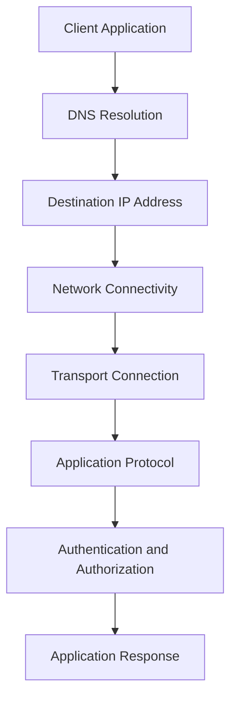
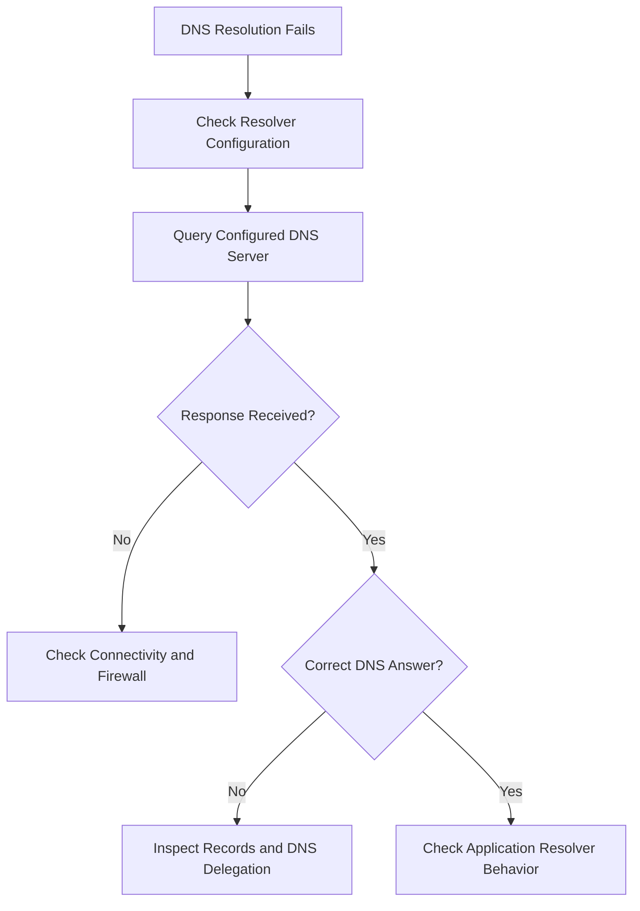
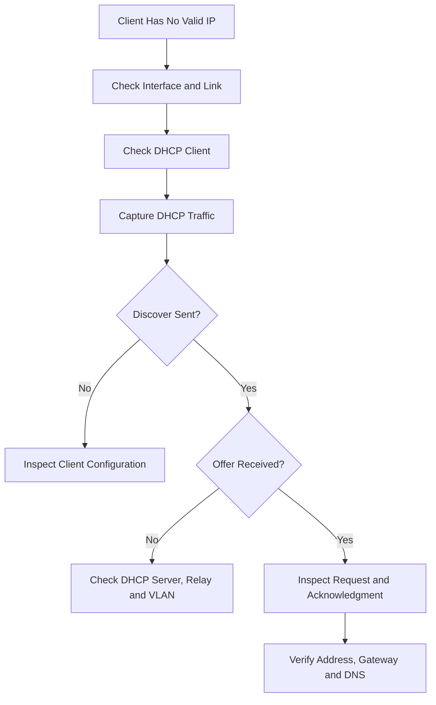
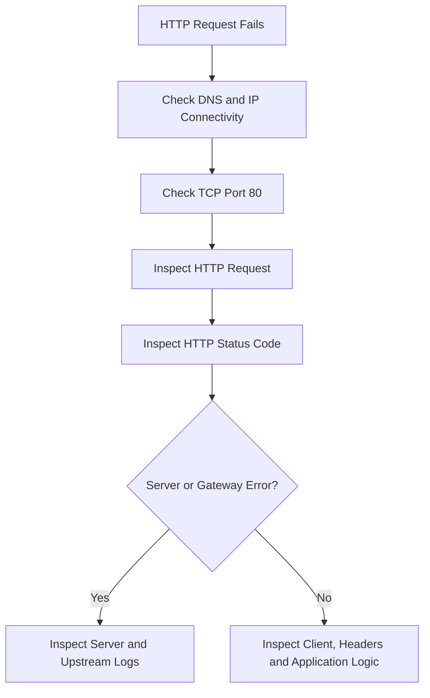
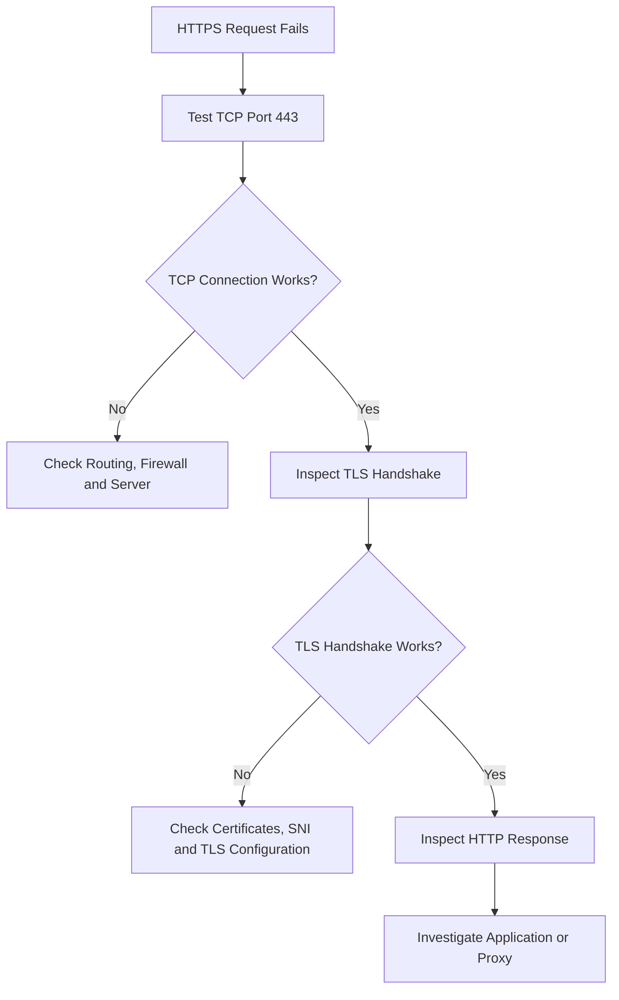
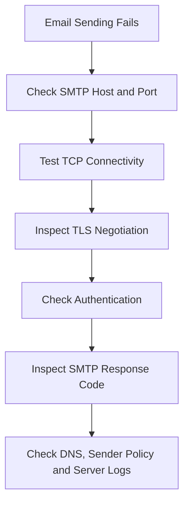
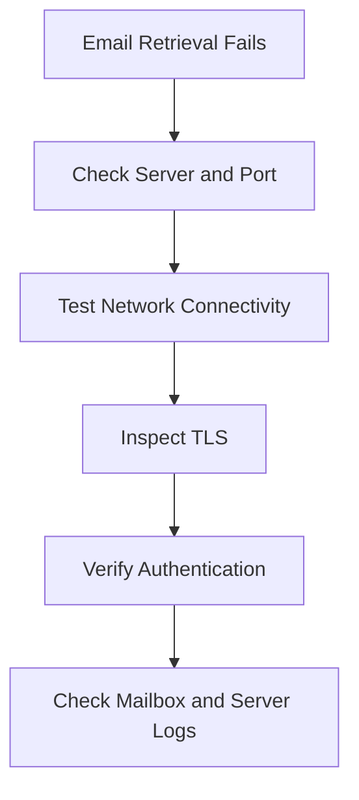
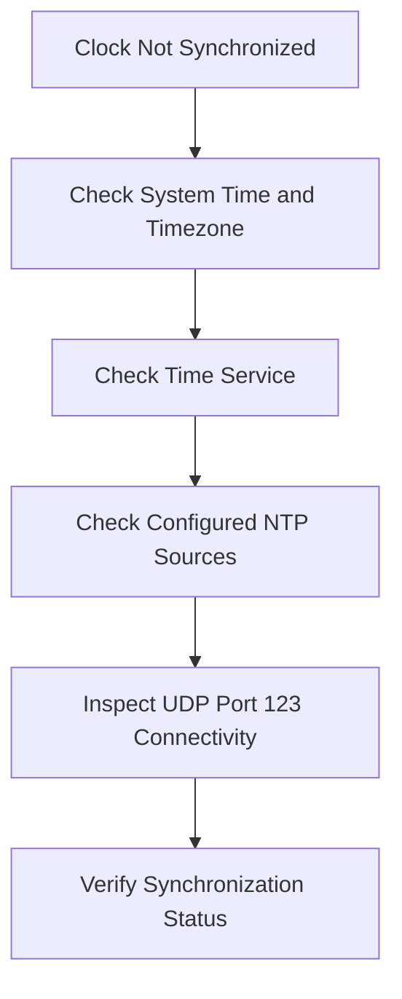

# Application Protocol Troubleshooting

Application protocol troubleshooting is the process of identifying, diagnosing, and resolving communication problems involving network applications and application-layer protocols.

Application protocols define how applications exchange information across a network.

Common examples include:

* DNS — Domain Name System.
* DHCP — Dynamic Host Configuration Protocol.
* HTTP — Hypertext Transfer Protocol.
* HTTPS — HTTP Secure.
* FTP — File Transfer Protocol.
* SFTP — SSH File Transfer Protocol.
* SSH — Secure Shell.
* SMTP — Simple Mail Transfer Protocol.
* POP3 — Post Office Protocol.
* IMAP — Internet Message Access Protocol.
* NTP — Network Time Protocol.
* SNMP — Simple Network Management Protocol.
* Syslog — System logging protocol.

Application communication depends on several lower-layer components, including IP addressing, routing, transport protocols, ports, and firewalls.

A structured troubleshooting approach helps identify the actual failure instead of randomly changing configurations.

### 🖆 Learning Objectives

* Understand common application-layer failures.
* Identify protocol-specific troubleshooting techniques.
* Diagnose DNS resolution problems.
* Troubleshoot HTTP and HTTPS connectivity.
* Investigate TCP and UDP communication failures.
* Inspect network traffic using packet capture tools.
* Analyze application logs and service status.
* Understand common Linux troubleshooting commands.
* Apply a systematic troubleshooting methodology.

# 🗁 Application Protocol Troubleshooting Fundamentals

Application-layer communication depends on multiple networking components.

A successful application connection generally requires:

* A functioning application or service.
* Correct destination hostname or IP address.
* Successful DNS resolution when using hostnames.
* Valid IP connectivity.
* Correct transport protocol.
* Correct destination port.
* Appropriate firewall permissions.
* Successful application-layer communication.
* Valid authentication and authorization when required.

### 🖆 Application Communication Flow



A failure at any stage can prevent the application from working.

### 🖆 Example

Suppose a browser cannot access:

```text
https://example.com
```

Possible causes include:

* DNS cannot resolve `example.com`.
* The destination IP is unreachable.
* TCP port 443 is blocked.
* The web server is unavailable.
* TLS certificate validation fails.
* The server returns an HTTP error.
* A proxy or firewall interferes with the connection.

The first troubleshooting task is to identify which stage is failing.

# 🗁 Troubleshooting Methodology

A structured methodology makes troubleshooting faster and more reliable.

### 🖆 Understand the Problem

Collect the relevant information:

* What application is failing?
* Which protocol is involved?
* What destination hostname or IP address is being used?
* Is the problem affecting one client or multiple clients?
* Does the failure occur consistently?
* Did the problem begin after a configuration change?
* What error message does the application display?

### 🖆 Identify the Failing Layer

Determine whether the issue belongs to:

* Application configuration.
* DNS resolution.
* Transport connectivity.
* IP routing.
* Firewall filtering.
* Authentication.
* TLS encryption.
* Remote service availability.

### 🖆 Reproduce the Problem

Try to reproduce the failure using a controlled test.

For example:

```bash
curl -v https://example.com
```

This provides information about DNS resolution, connection establishment, TLS negotiation, and the HTTP exchange.

### 🖆 Isolate the Cause

Change or test one variable at a time.

Examples:

* Test the hostname and destination IP separately.
* Compare TCP and UDP behavior where relevant.
* Test the service from another machine.
* Inspect firewall rules.
* Check application logs.
* Capture network traffic.

### 🖆 Verify the Solution

After making a correction:

* Repeat the original test.
* Confirm the application works.
* Check logs for recurring errors.
* Verify that the correction did not introduce another problem.
* Document the root cause and resolution.

# 🗁 Essential Troubleshooting Tools

Ubuntu provides several command-line utilities for diagnosing application protocol problems.

### 🖆 ip

Displays and manages network interfaces and IP configuration.

```bash
ip address show
```

Display routing information:

```bash
ip route show
```

Display IPv6 routes:

```bash
ip -6 route show
```

### 🖆 ping

Tests IP reachability using ICMP Echo messages.

```bash
ping -c 4 8.8.8.8
```

Test a hostname:

```bash
ping -c 4 example.com
```

A failed ping does not necessarily mean an application service is unavailable. ICMP may be filtered independently.

### 🖆 traceroute

Displays the network path toward a destination.

Install:

```bash
sudo apt install traceroute
```

Run:

```bash
traceroute example.com
```

### 🖆 tracepath

Displays path information and can help investigate Path MTU Discovery.

```bash
tracepath example.com
```

### 🖆 ss

Displays socket and connection information.

Show listening TCP and UDP sockets:

```bash
sudo ss -tulnp
```

Show TCP connections:

```bash
ss -tn
```

Show established TCP connections:

```bash
ss -tn state established
```

### 🖆 nc

Netcat can test TCP and UDP communication.

TCP example:

```bash
nc -vz example.com 443
```

UDP example:

```bash
nc -vzu 192.0.2.10 161
```

A successful UDP probe does not prove that the remote application received or processed the datagram.

### 🖆 curl

Tests application protocols, especially HTTP and HTTPS.

```bash
curl -v https://example.com
```

Display response headers:

```bash
curl -I https://example.com
```

Display only the HTTP response code:

```bash
curl -sS -o /dev/null -w '%{http_code}\n' https://example.com
```

### 🖆 dig

Performs DNS queries.

```bash
dig example.com
```

Query a specific DNS server:

```bash
dig @8.8.8.8 example.com
```

### 🖆 tcpdump

Captures network packets.

```bash
sudo tcpdump -ni any
```

Capture DNS traffic:

```bash
sudo tcpdump -ni any port 53
```

Capture HTTP and HTTPS traffic:

```bash
sudo tcpdump -ni any 'tcp port 80 or tcp port 443'
```

### 🖆 openssl

Tests TLS connections and certificate information.

```bash
openssl s_client -connect example.com:443 -servername example.com
```

### 🖆 journalctl

Displays system and service logs.

```bash
journalctl -n 100
```

Follow service logs:

```bash
sudo journalctl -u nginx -f
```

# 🗁 DNS Troubleshooting

DNS translates domain names into IP addresses.

A DNS failure can prevent applications from reaching services through their hostnames.

### 🖆 Common DNS Problems

* Domain name does not resolve.
* Incorrect DNS server configured.
* DNS server unavailable.
* Incorrect DNS records.
* Cached outdated DNS information.
* Firewall blocks DNS traffic.
* DNSSEC validation failure.
* Search domain configuration problems.

### 🖆 Check DNS Configuration

Inspect resolver configuration:

```bash
resolvectl status
```

Check the configured DNS servers and search domains.

### 🖆 Test Name Resolution

```bash
dig example.com
```

Query an A record:

```bash
dig example.com A
```

Query an AAAA record:

```bash
dig example.com AAAA
```

Query an MX record:

```bash
dig example.com MX
```

### 🖆 Test a Specific DNS Server

```bash
dig @1.1.1.1 example.com
```

Compare the response with the system's configured resolver.

### 🖆 Check Resolver Functionality

```bash
getent hosts example.com
```

Unlike a direct `dig` query, `getent` uses the system's configured name-resolution mechanisms.

### 🖆 Trace DNS Resolution

```bash
dig +trace example.com
```

This performs iterative DNS queries to investigate the delegation path.

### 🖆 DNS Packet Capture

```bash
sudo tcpdump -ni any 'port 53'
```

DNS normally uses UDP port 53 and can also use TCP port 53.

### 🖆 Common DNS Errors

| Error | Possible Cause |
| --- | --- |
| `NXDOMAIN` | Requested domain name does not exist |
| `SERVFAIL` | DNS server failed to process the query |
| `REFUSED` | DNS server refused the query |
| `NOERROR` with no answer | Name exists, but requested record is unavailable |
| Timeout | DNS server unreachable or not responding |

### 🖆 DNS Troubleshooting Workflow



# 🗁 DHCP Troubleshooting

DHCP automatically provides IP configuration to network clients.

A DHCP failure can prevent a client from obtaining valid network settings.

### 🖆 Common DHCP Problems

* No IP address assigned.
* Incorrect subnet mask.
* Incorrect default gateway.
* Incorrect DNS server.
* DHCP server unavailable.
* DHCP address pool exhausted.
* DHCP relay failure.
* VLAN mismatch.
* DHCP lease renewal failure.

### 🖆 Check IP Configuration

```bash
ip address show
```

Check routes:

```bash
ip route show
```

Check DNS:

```bash
resolvectl status
```

### 🖆 Check DHCP Client Lease Information

On Ubuntu systems using NetworkManager:

```bash
nmcli device show
```

For systems using systemd-networkd:

```bash
networkctl status
```

Inspect DHCP-related journal messages:

```bash
journalctl -u systemd-networkd
```

### 🖆 Renew a DHCP Lease

With NetworkManager, reconnect the affected connection:

```bash
nmcli connection show
```

```bash
sudo nmcli connection down "Wired connection 1"
sudo nmcli connection up "Wired connection 1"
```

The connection name depends on the system configuration.

With a DHCP client such as `dhclient`, when installed and used by the system:

```bash
sudo dhclient -r
sudo dhclient
```

Avoid running multiple DHCP clients against the same interface simultaneously.

### 🖆 Capture DHCP Traffic

```bash
sudo tcpdump -ni any 'udp port 67 or udp port 68'
```

### 🖆 DHCP Troubleshooting Workflow



# 🗁 HTTP Troubleshooting

HTTP is an application-layer protocol used for communication between clients and web servers.

HTTP failures may involve request formatting, server availability, routing, reverse proxies, application logic, or response codes.

### 🖆 Common HTTP Problems

* Server unavailable.
* Connection refused.
* Request timeout.
* Incorrect HTTP method.
* Invalid request headers.
* Authentication failure.
* Reverse proxy failure.
* Application error.
* Incorrect response status.

### 🖆 Test HTTP Connectivity

```bash
curl -v http://example.com
```

Inspect response headers:

```bash
curl -I http://example.com
```

### 🖆 Common HTTP Status Codes

| Status | Meaning | Troubleshooting Direction |
| --- | --- | --- |
| 200 | OK | Request succeeded |
| 301 | Moved Permanently | Inspect redirect destination |
| 302 | Found | Inspect temporary redirect |
| 400 | Bad Request | Inspect request syntax and headers |
| 401 | Unauthorized | Check authentication |
| 403 | Forbidden | Check permissions and access rules |
| 404 | Not Found | Check URL and application routing |
| 405 | Method Not Allowed | Check supported HTTP methods |
| 408 | Request Timeout | Inspect client and server timeouts |
| 429 | Too Many Requests | Check rate limits |
| 500 | Internal Server Error | Inspect application logs |
| 502 | Bad Gateway | Inspect upstream service |
| 503 | Service Unavailable | Check service health and capacity |
| 504 | Gateway Timeout | Inspect upstream response time |

### 🖆 Inspect HTTP Request and Response

```bash
curl -v http://example.com
```

The verbose output helps inspect:

* Resolved destination IP.
* Connection establishment.
* Request headers.
* Response headers.
* HTTP status.

### 🖆 Test a Specific HTTP Method

```bash
curl -X OPTIONS -i http://example.com
```

Test a POST request:

```bash
curl -X POST \
  -H 'Content-Type: application/json' \
  -d '{"name":"test"}' \
  -i http://example.com/api
```

### 🖆 HTTP Troubleshooting Workflow



# 🗁 HTTPS and TLS Troubleshooting

HTTPS uses HTTP over a secure TLS connection.

A successful HTTPS request requires network connectivity and a successful TLS handshake before normal HTTP communication can proceed.

### 🖆 Common HTTPS Problems

* Certificate expired.
* Certificate hostname mismatch.
* Untrusted certificate authority.
* Incomplete certificate chain.
* Incorrect system clock.
* TLS version incompatibility.
* Unsupported cipher suite.
* SNI configuration problems.
* Reverse proxy TLS misconfiguration.
* Incorrect certificate deployment.

### 🖆 Test HTTPS

```bash
curl -v https://example.com
```

### 🖆 Inspect TLS Handshake

```bash
openssl s_client \
  -connect example.com:443 \
  -servername example.com
```

The `-servername` option supplies SNI.

### 🖆 Verify Certificate Information

```bash
openssl s_client \
  -connect example.com:443 \
  -servername example.com \
  </dev/null 2>/dev/null |
openssl x509 -noout -subject -issuer -dates
```

### 🖆 Verify Certificate Chain and Hostname

```bash
openssl s_client \
  -connect example.com:443 \
  -servername example.com \
  -verify_hostname example.com \
  -verify_return_error
```

### 🖆 Inspect HTTP and TLS Separately

Check whether TCP port 443 is reachable:

```bash
nc -vz example.com 443
```

Then inspect TLS:

```bash
openssl s_client -connect example.com:443 -servername example.com
```

Finally, inspect the HTTP response:

```bash
curl -v https://example.com
```

This separation helps identify whether the problem is at the transport, TLS, or HTTP layer.

### 🖆 HTTPS Troubleshooting Workflow



# 🗁 FTP and SFTP Troubleshooting

FTP and SFTP are file transfer protocols, but they use different architectures.

FTP uses separate control and data connections.

SFTP operates over SSH.

### 🖆 FTP Common Problems

* Incorrect credentials.
* TCP port 21 blocked.
* Passive data ports blocked.
* Active FTP connection failure.
* Incorrect server passive-mode configuration.
* File permission problems.
* NAT-related connection issues.

### 🖆 Check FTP Control Connectivity

```bash
nc -vz ftp.example.com 21
```

### 🖆 Inspect FTP Response

```bash
curl -v ftp://ftp.example.com/
```

### 🖆 FTP Passive Mode

In passive FTP, the client establishes the data connection to a server-selected port.

The server's configured passive port range must be allowed through relevant firewalls and NAT devices.

### 🖆 SFTP Common Problems

* SSH service unavailable.
* TCP port 22 blocked.
* Incorrect username or password.
* SSH key authentication failure.
* Incorrect file permissions.
* SFTP subsystem not configured.

### 🖆 Test SFTP Connectivity

```bash
nc -vz sftp.example.com 22
```

Connect with verbose SSH output:

```bash
sftp -v user@sftp.example.com
```

### 🖆 FTP vs SFTP Troubleshooting

| Feature | FTP | SFTP |
| --- | --- | --- |
| Control connection | TCP 21 | SSH connection |
| Data connection | Separate | Same SSH transport |
| Common port | TCP 21 | TCP 22 |
| NAT complexity | Higher | Generally lower |
| Encryption | Not provided by basic FTP | Provided through SSH |

# 🗁 SSH Troubleshooting

SSH provides secure remote access and encrypted communication.

It is commonly used for server administration, file transfer, and network device management.

### 🖆 Common SSH Problems

* SSH server unavailable.
* TCP port 22 blocked.
* Incorrect username.
* Incorrect password.
* Invalid private key.
* Incorrect file permissions.
* Host key verification failure.
* Authentication method mismatch.
* SSH daemon configuration errors.

### 🖆 Test SSH Port

```bash
nc -vz server.example.com 22
```

### 🖆 Connect with Debugging

```bash
ssh -vvv user@server.example.com
```

The verbose output helps identify authentication and connection failures.

### 🖆 Check SSH Service

```bash
sudo systemctl status ssh
```

### 🖆 Inspect SSH Logs

```bash
sudo journalctl -u ssh -n 100
```

On systems where authentication events are written to a dedicated file:

```bash
sudo tail -f /var/log/auth.log
```

### 🖆 Check SSH Configuration

```bash
sudo sshd -t
```

This validates the SSH daemon configuration.

### 🖆 Common SSH Authentication Problems

| Problem | Possible Cause |
| --- | --- |
| Permission denied | Incorrect credentials or key |
| Host key verification failed | Server host key changed |
| Connection refused | SSH service not listening |
| Connection timed out | Firewall or network issue |
| Too many authentication failures | Client offered too many keys |
| No matching host key type | Algorithm compatibility issue |

# 🗁 SMTP Troubleshooting

SMTP is used for sending and relaying email messages.

Email delivery problems can involve client submission, SMTP authentication, DNS records, TLS, or remote mail server policies.

### 🖆 Common SMTP Problems

* SMTP server unavailable.
* Incorrect SMTP hostname.
* Incorrect port.
* Authentication failure.
* STARTTLS negotiation failure.
* TLS certificate error.
* DNS MX resolution problem.
* Message rejected.
* Open relay restrictions.
* Sender reputation or policy rejection.

### 🖆 Common SMTP Ports

| Port | Purpose |
| --- | --- |
| 25 | Server-to-server mail relay |
| 465 | Message submission over implicit TLS |
| 587 | Message submission, commonly with STARTTLS |

### 🖆 Test SMTP Connectivity

```bash
nc -vz mail.example.com 587
```

### 🖆 Inspect SMTP Capabilities

```bash
openssl s_client \
  -starttls smtp \
  -connect mail.example.com:587 \
  -servername mail.example.com
```

For implicit TLS:

```bash
openssl s_client \
  -connect mail.example.com:465 \
  -servername mail.example.com
```

### 🖆 Test DNS MX Records

```bash
dig example.com MX
```

Inspect the mail server hostname:

```bash
dig mail.example.com A
dig mail.example.com AAAA
```

### 🖆 Common SMTP Errors

| SMTP Code | Meaning |
| --- | --- |
| 220 | Service ready |
| 250 | Requested action completed |
| 354 | Start mail input |
| 421 | Service unavailable |
| 450 | Mailbox temporarily unavailable |
| 451 | Local processing error |
| 452 | Insufficient storage |
| 500 | Syntax error |
| 501 | Invalid command parameters |
| 530 | Authentication required |
| 535 | Authentication credentials invalid |
| 550 | Requested action not taken |
| 552 | Storage allocation exceeded |
| 554 | Transaction failed |

### 🖆 SMTP Troubleshooting Workflow



# 🗁 POP3 and IMAP Troubleshooting

POP3 and IMAP are protocols used to retrieve email from mail servers.

### 🖆 Common Problems

* Authentication failure.
* Mailbox unavailable.
* TLS negotiation failure.
* Incorrect server hostname.
* Incorrect port.
* Firewall blocking access.
* Mailbox quota exceeded.
* IMAP synchronization problems.
* POP3 message retrieval failures.

### 🖆 Common Ports

| Protocol | Port | Security |
| --- | ---: | --- |
| POP3 | 110 | STARTTLS/STLS may be available |
| POP3S | 995 | Implicit TLS |
| IMAP | 143 | STARTTLS may be available |
| IMAPS | 993 | Implicit TLS |

### 🖆 Test POP3 Connectivity

```bash
nc -vz mail.example.com 110
```

Test POP3 over implicit TLS:

```bash
openssl s_client -connect mail.example.com:995
```

### 🖆 Test IMAP Connectivity

```bash
nc -vz mail.example.com 143
```

Test IMAP over implicit TLS:

```bash
openssl s_client -connect mail.example.com:993
```

### 🖆 Check Mail Server Logs

For a Dovecot server:

```bash
sudo journalctl -u dovecot -n 100
```

### 🖆 Troubleshooting Workflow



# 🗁 NTP Troubleshooting

NTP synchronizes system clocks across networks.

Incorrect system time can cause problems with:

* TLS certificate validation.
* Authentication.
* Kerberos.
* Log correlation.
* Distributed applications.
* Scheduled tasks.

### 🖆 Common NTP Problems

* NTP server unreachable.
* UDP port 123 blocked.
* Incorrect time source.
* Large clock offset.
* System clock not synchronized.
* Time synchronization service stopped.
* Incorrect time configuration.

### 🖆 Check System Time

```bash
timedatectl status
```

### 🖆 Check Time Synchronization

```bash
timedatectl show-timesync --all
```

On systems using Chrony:

```bash
chronyc tracking
```

Display time sources:

```bash
chronyc sources -v
```

### 🖆 Check NTP Service

```bash
systemctl status systemd-timesyncd
```

Or:

```bash
systemctl status chrony
```

The active time synchronization service depends on the system configuration.

### 🖆 Inspect NTP Traffic

```bash
sudo tcpdump -ni any udp port 123
```

### 🖆 Troubleshooting Workflow



# 🗁 SNMP Troubleshooting

SNMP is used to monitor and manage network devices.

SNMP failures commonly involve agent availability, access control, authentication, and network connectivity.

### 🖆 Common Problems

* SNMP agent not responding.
* Incorrect community string.
* Incorrect SNMPv3 credentials.
* UDP port 161 blocked.
* UDP port 162 blocked.
* Unsupported OID.
* Missing MIB definitions.
* VACM access restrictions.
* Trap receiver unavailable.
* Incorrect interface counter interpretation.

### 🖆 Test SNMP Agent

```bash
snmpget -v2c \
  -c monitoring-community \
  192.168.1.1 \
  1.3.6.1.2.1.1.5.0
```

### 🖆 Test SNMPv3

```bash
snmpget -v3 \
  -l authPriv \
  -u monitoring-user \
  -a SHA \
  -A 'AuthPassword' \
  -x AES \
  -X 'PrivacyPassword' \
  192.168.1.1 \
  1.3.6.1.2.1.1.5.0
```

Use credentials and algorithms matching the agent configuration.

### 🖆 Inspect SNMP Traffic

```bash
sudo tcpdump -ni any 'udp port 161 or udp port 162'
```

### 🖆 Check SNMP Agent Service

```bash
sudo systemctl status snmpd
```

### 🖆 Common SNMP Errors

| Error | Possible Cause |
| --- | --- |
| Timeout | Network, firewall, or agent problem |
| Authentication failure | Incorrect community or SNMPv3 credentials |
| Unknown user name | SNMPv3 user not configured |
| Unsupported security level | Agent and manager security mismatch |
| No Such Object | Requested OID does not exist |
| No Such Instance | Requested object instance is unavailable |
| Authorization error | Access-control restrictions |

# 🗁 Syslog Troubleshooting

Syslog collects and forwards event messages from network devices and systems.

### 🖆 Common Problems

* Syslog server not receiving messages.
* Incorrect destination IP.
* UDP or TCP port blocked.
* Receiver service stopped.
* Incorrect message filtering.
* Log storage permission problems.
* TLS certificate errors.
* Incorrect timestamps.
* UDP message loss.

### 🖆 Check Syslog Service

```bash
sudo systemctl status rsyslog
```

### 🖆 Check Listening Ports

```bash
sudo ss -tulnp | grep -E ':(514|6514)\b'
```

### 🖆 Inspect UDP Syslog Traffic

```bash
sudo tcpdump -ni any udp port 514
```

### 🖆 Inspect TCP Syslog Traffic

```bash
sudo tcpdump -ni any tcp port 514
```

### 🖆 Inspect TLS Syslog Connectivity

```bash
openssl s_client \
  -connect 192.168.1.100:6514 \
  -showcerts
```

### 🖆 Validate rsyslog Configuration

```bash
sudo rsyslogd -N1
```

### 🖆 Inspect rsyslog Logs

```bash
sudo journalctl -u rsyslog -n 100
```

# 🗁 TCP and UDP Troubleshooting

Application protocols depend on transport-layer communication.

Many application failures originate from incorrect transport connectivity rather than the application itself.

### 🖆 TCP Connection Problems

Common TCP failures include:

* Connection refused.
* Connection timeout.
* Connection reset.
* Retransmissions.
* High latency.
* Packet loss.
* Connection establishment failures.

### 🖆 Connection Refused

A TCP connection attempt receives a refusal, commonly through a TCP RST response.

Possible causes:

* No service listening on the destination port.
* Service bound to a different IP address.
* Firewall actively rejecting the connection.
* Incorrect destination port.

Check listening sockets:

```bash
sudo ss -tulnp
```

### 🖆 Connection Timeout

A connection attempt does not receive a successful response within the configured timeout.

Possible causes:

* Firewall silently dropping packets.
* Routing failure.
* Destination host unavailable.
* Network packet loss.
* Service or network device overload.

### 🖆 Connection Reset

An established TCP connection is unexpectedly terminated using a TCP RST.

Possible causes:

* Remote application closed the connection.
* Firewall or intermediary reset the connection.
* Application rejected the request.
* Connection state was lost.

### 🖆 TCP Packet Capture

```bash
sudo tcpdump -ni any tcp
```

Inspect a specific port:

```bash
sudo tcpdump -ni any 'tcp port 443'
```

### 🖆 TCP Handshake

A normal TCP connection establishment follows:

```text
Client                 Server
  |                       |
  |-------- SYN --------->|
  |                       |
  |<----- SYN-ACK --------|
  |                       |
  |-------- ACK --------->|
  |                       |
  |    Connection Open    |
```

If the handshake does not complete, investigate routing, firewall policies, and the destination service.

### 🖆 UDP Troubleshooting

UDP is connectionless and does not establish a TCP-style handshake.

Common UDP problems include:

* Datagram loss.
* Incorrect destination port.
* Firewall filtering.
* Application not listening.
* Missing application responses.
* NAT or connection-tracking issues.

Capture UDP traffic:

```bash
sudo tcpdump -ni any udp
```

Filter a specific service:

```bash
sudo tcpdump -ni any 'udp port 53'
```

A UDP packet appearing in a capture confirms packet visibility at that capture point, not successful application processing.

# 🗁 Firewall and Port Troubleshooting

Firewalls can allow or block application communication based on protocol, address, port, and connection state.

### 🖆 Check UFW Status

```bash
sudo ufw status verbose
```

### 🖆 Check nftables Rules

```bash
sudo nft list ruleset
```

### 🖆 Check iptables Rules

```bash
sudo iptables -L -n -v
```

### 🖆 Check Listening Services

```bash
sudo ss -tulnp
```

### 🖆 Test a TCP Port

```bash
nc -vz 192.168.1.100 443
```

### 🖆 Test Multiple Ports

```bash
for port in 22 53 80 443; do
    nc -zvw2 192.168.1.100 "$port"
done
```

### 🖆 Common Application Ports

| Protocol | Transport | Port |
| --- | --- | ---: |
| FTP control | TCP | 21 |
| SSH | TCP | 22 |
| SMTP relay | TCP | 25 |
| DNS | UDP/TCP | 53 |
| DHCP server | UDP | 67 |
| DHCP client | UDP | 68 |
| HTTP | TCP | 80 |
| POP3 | TCP | 110 |
| NTP | UDP | 123 |
| IMAP | TCP | 143 |
| SNMP | UDP | 161 |
| SNMP Trap/Inform receiver | UDP | 162 |
| HTTPS | TCP | 443 |
| SMTPS submission | TCP | 465 |
| SMTP submission | TCP | 587 |
| IMAPS | TCP | 993 |
| POP3S | TCP | 995 |
| Syslog | UDP/TCP | 514 |
| Syslog over TLS | TCP | 6514 |

Some protocols support additional transports or alternative ports. The table lists common defaults.

# 🗁 Packet Analysis with tcpdump

Packet capture is one of the most useful techniques for investigating application communication.

`tcpdump` captures and displays packets visible to a network interface.

### 🖆 Capture All Traffic

```bash
sudo tcpdump -ni any
```

### 🖆 Capture Traffic to a Host

```bash
sudo tcpdump -ni any host 192.168.1.100
```

### 🖆 Capture Traffic on a Specific Port

```bash
sudo tcpdump -ni any port 443
```

### 🖆 Capture DNS

```bash
sudo tcpdump -ni any 'udp port 53 or tcp port 53'
```

### 🖆 Capture HTTP and HTTPS

```bash
sudo tcpdump -ni any 'tcp port 80 or tcp port 443'
```

### 🖆 Capture SSH

```bash
sudo tcpdump -ni any tcp port 22
```

### 🖆 Save Packets to a File

```bash
sudo tcpdump -ni any -w capture.pcap
```

### 🖆 Read a Capture File

```bash
tcpdump -nn -r capture.pcap
```

### 🖆 Limit Capture by Host and Port

```bash
sudo tcpdump -ni any \
  'host 192.168.1.100 and tcp port 443'
```

### 🖆 Useful Wireshark Display Filters

| Filter | Purpose |
| --- | --- |
| `dns` | DNS traffic |
| `dhcp` | DHCP traffic |
| `http` | HTTP traffic |
| `tls` | TLS traffic |
| `tcp` | TCP traffic |
| `udp` | UDP traffic |
| `ssh` | SSH traffic |
| `smtp` | SMTP traffic |
| `snmp` | SNMP traffic |
| `ntp` | NTP traffic |
| `syslog` | Syslog traffic |
| `tcp.flags.syn == 1` | TCP SYN packets |
| `tcp.flags.reset == 1` | TCP reset packets |
| `tcp.analysis.retransmission` | TCP retransmissions |

Packet captures can reveal communication failures that are difficult to identify through application error messages alone.

# 🗁 Application Logs and Service Diagnostics

Application logs provide information about failures that may not be visible through network packet inspection.

### 🖆 Check Service Status

```bash
sudo systemctl status nginx
```

### 🖆 Inspect Recent Service Logs

```bash
sudo journalctl -u nginx -n 100
```

### 🖆 Follow Logs in Real Time

```bash
sudo journalctl -u nginx -f
```

### 🖆 Inspect General System Logs

```bash
sudo journalctl -n 100
```

### 🖆 Check Application Listening Ports

```bash
sudo ss -tulnp
```

### 🖆 Check Process Information

```bash
ps aux | grep nginx
```

### 🖆 Common Log Locations

| Application | Common Log Location |
| --- | --- |
| Nginx | `/var/log/nginx/` |
| Apache | `/var/log/apache2/` |
| SSH | Journal or `/var/log/auth.log` |
| rsyslog | Journal or `/var/log/syslog` |
| Dovecot | Journal or configured log destination |
| MySQL | Journal or configured MySQL log destination |
| PostgreSQL | Journal or configured PostgreSQL log destination |

Actual paths depend on the installed software and its configuration.

# 🗁 Common Troubleshooting Scenarios

### 🖆 Scenario: Website Is Not Opening

Symptoms:

* Browser cannot load a website.
* DNS resolution may fail.
* Connection times out.

Investigation:

```bash
dig example.com
ping -c 4 example.com
nc -vz example.com 443
curl -v https://example.com
```

Check:

* DNS response.
* Destination IP.
* Network routing.
* TCP port 443.
* TLS handshake.
* HTTP response.

### 🖆 Scenario: Website Works by IP but Not by Domain

Possible causes:

* DNS resolution failure.
* Incorrect DNS records.
* Incorrect virtual host configuration.
* Missing or incorrect SNI handling.
* Hostname-dependent reverse proxy routing.

Test:

```bash
curl -v https://example.com
```

Compare with a specific destination IP while preserving the hostname:

```bash
curl --resolve example.com:443:203.0.113.10 \
  https://example.com
```

This forces the connection to the specified IP while retaining the URL hostname for HTTP and TLS behavior.

### 🖆 Scenario: SSH Connection Times Out

Possible causes:

* Destination host unreachable.
* Firewall drops TCP port 22.
* Incorrect routing.
* SSH service unavailable.

Investigate:

```bash
ip route get 192.168.1.100
nc -vz 192.168.1.100 22
ssh -vvv user@192.168.1.100
```

### 🖆 Scenario: Email Cannot Be Sent

Possible causes:

* SMTP service unavailable.
* Incorrect submission port.
* Authentication failure.
* TLS negotiation problem.
* DNS or mail server configuration issue.

Investigate:

```bash
dig example.com MX
nc -vz mail.example.com 587
openssl s_client -starttls smtp \
  -connect mail.example.com:587
```

### 🖆 Scenario: SNMP Monitoring Shows No Data

Possible causes:

* Agent unavailable.
* Incorrect SNMP credentials.
* Firewall blocking UDP 161.
* Incorrect OID.
* Access-control restrictions.

Investigate:

```bash
snmpget -v2c \
  -c monitoring-community \
  192.168.1.100 \
  1.3.6.1.2.1.1.3.0
```

Capture traffic:

```bash
sudo tcpdump -ni any udp port 161
```

### 🖆 Scenario: Application Works Locally but Not Remotely

Possible causes:

* Service bound only to loopback.
* Host firewall blocks incoming traffic.
* Upstream firewall blocks traffic.
* NAT or port forwarding is incorrect.
* Routing problem exists.

Check listening addresses:

```bash
sudo ss -tulnp
```

Compare:

```text
127.0.0.1:8080
```

With:

```text
0.0.0.0:8080
```

A service listening only on `127.0.0.1` accepts connections through loopback, not through the machine's external network interfaces.

### 🖆 Scenario: Intermittent Application Failures

Possible causes:

* Packet loss.
* DNS instability.
* Resource exhaustion.
* Load balancer problems.
* Connection tracking exhaustion.
* Application overload.
* Unstable upstream dependencies.

Investigate:

```bash
ping -c 20 192.168.1.1
ss -s
ip -s link
journalctl -p warning
```

Capture traffic during the failure and compare successful and unsuccessful sessions.

# 🗁 Layer-by-Layer Troubleshooting Checklist

Use this checklist when investigating application communication failures.

### 🖆 Application Layer

* Is the application service running?
* Is the correct hostname configured?
* Is the correct URL or API endpoint being used?
* Is the application returning an error?
* Are authentication and permissions correct?
* Do application logs show failures?

### 🖆 Transport Layer

* Is the correct TCP or UDP protocol being used?
* Is the destination port correct?
* Is the service listening?
* Is the TCP handshake completing?
* Are there resets, retransmissions, or timeouts?

### 🖆 Network Layer

* Is the destination IP correct?
* Is the destination reachable?
* Is the routing table correct?
* Is the default gateway available?
* Are ICMP or other diagnostic packets filtered?

### 🖆 Data Link Layer

* Is the interface operational?
* Is the device connected to the correct VLAN?
* Is the MAC address learned correctly?
* Are there interface errors or drops?

### 🖆 Physical Layer

* Is the cable connected?
* Is the link negotiated correctly?
* Is the wireless connection stable?
* Are there physical interface errors?

# 🗁 Best Practices

* Follow a structured troubleshooting methodology.
* Identify the failing protocol before changing configurations.
* Test DNS separately from IP connectivity.
* Test transport connectivity separately from application behavior.
* Use `curl` for HTTP and HTTPS diagnostics.
* Use `dig` for DNS investigations.
* Use `ss` to inspect local sockets.
* Use `tcpdump` and Wireshark for packet analysis.
* Check service status and application logs.
* Compare successful and unsuccessful connections.
* Inspect firewall rules and routing paths.
* Synchronize system clocks with NTP.
* Document the root cause and corrective action.
* Avoid making multiple unrelated configuration changes simultaneously.
* Verify the complete application workflow after resolving an issue.

# 🗁 Practical Exercises

### 🖆 Exercise: Diagnose DNS Failure

Configure a test environment with an Ubuntu client and a DNS server.

Investigate:

* Incorrect DNS server configuration.
* Missing A record.
* Missing AAAA record.
* DNS timeout.
* DNS server refusal.

Use:

```bash
resolvectl status
dig example.com
dig @8.8.8.8 example.com
tcpdump -ni any port 53
```

### 🖆 Exercise: Diagnose HTTP Failure

Install Nginx:

```bash
sudo apt update
sudo apt install nginx
```

Check service status:

```bash
sudo systemctl status nginx
```

Test HTTP connectivity:

```bash
curl -v http://127.0.0.1
```

Stop Nginx and observe the connection failure.

Restart it and verify the service.

### 🖆 Exercise: Diagnose HTTPS Failure

Configure HTTPS on a test web server.

Investigate:

* Expired certificates.
* Hostname mismatch.
* Untrusted certificate.
* Incorrect SNI.
* TLS handshake failure.

Use:

```bash
openssl s_client -connect example.com:443 -servername example.com
```

### 🖆 Exercise: Diagnose TCP Port Failure

Start a temporary TCP listener:

```bash
nc -lv 8080
```

From another machine, test:

```bash
nc -vz 192.168.1.100 8080
```

Stop the listener and repeat the test.

Compare the connection results.

### 🖆 Exercise: Analyze Network Traffic

Capture application traffic:

```bash
sudo tcpdump -ni any -w application-test.pcap
```

Generate DNS, HTTP, HTTPS, and SSH traffic.

Open the capture in Wireshark and inspect:

* DNS queries and responses.
* TCP handshake.
* TLS handshake.
* HTTP request and response.
* TCP retransmissions.

### 🖆 Exercise: Build a Troubleshooting Lab

Create a small environment with:

* One Ubuntu client.
* One Ubuntu application server.
* One DNS service.
* One HTTP/HTTPS service.
* One firewall.

Introduce controlled failures:

* Incorrect DNS configuration.
* Blocked TCP port.
* Stopped application service.
* Incorrect TLS certificate.
* Invalid authentication credentials.

Identify and document the root cause of each failure.

# 🗁 Interview Questions

### 🖆 Basic Questions

**What is application protocol troubleshooting?**

It is the process of diagnosing and resolving failures involving application-layer communication and its supporting network services.

**Which command is commonly used to test DNS resolution?**

`dig` is commonly used to query DNS records and inspect DNS responses.

**Which command is useful for testing HTTP and HTTPS?**

`curl` can inspect HTTP requests, response headers, status codes, and TLS connection behavior.

**What is the purpose of tcpdump?**

It captures and analyzes packets visible on network interfaces.

**What does connection refused mean?**

It commonly indicates that a TCP connection attempt received a rejection, often because no service is listening on the destination port or a firewall actively rejected it.

**What does connection timeout mean?**

It means a connection attempt did not receive a successful response within the expected time.

### 🖆 Intermediate Questions

**How would you troubleshoot a website that is not opening?**

Check DNS resolution, IP connectivity, routing, TCP port 443, TLS negotiation, HTTP response codes, and application logs.

**How would you troubleshoot an SSH connection failure?**

Check destination reachability, TCP port 22, SSH service status, firewall rules, and authentication using verbose SSH output.

**What is the difference between a DNS failure and an HTTP failure?**

A DNS failure prevents hostname resolution, while an HTTP failure occurs during or after communication with the web server.

**How can you determine whether a service is listening on a port?**

Use `ss -tulnp` to inspect local listening sockets.

**Why might ping fail while a website still works?**

ICMP traffic may be filtered while TCP traffic to the web server's HTTP or HTTPS port remains permitted.

### 🖆 Advanced Questions

**How would you troubleshoot intermittent packet loss?**

Use packet captures, interface counters, routing analysis, and repeated connectivity tests to identify where packets are being dropped.

**How do you distinguish a TCP connection failure from a TLS failure?**

Test TCP connectivity independently using `nc`, then inspect the TLS handshake using `openssl s_client`.

**What is the purpose of SNI?**

Server Name Indication allows a TLS client to indicate the hostname it is connecting to during the TLS handshake.

**Why is packet capture useful when application logs are insufficient?**

Packet capture reveals actual network exchanges, including retransmissions, connection resets, DNS responses, and protocol negotiation.

**What is the difference between transport-level reliability and application-level success?**

Transport-level reliability concerns delivery of data between transport endpoints. Application-level success requires the receiving application to process the request and produce the expected result.

**How would you troubleshoot a service that works locally but not remotely?**

Check its listening address, local firewall, upstream firewall, routing, NAT configuration, and remote connectivity.

# 🗁 Summary

Application protocol troubleshooting involves diagnosing failures across application services and the networking components supporting them.

Important concepts:

* Application communication depends on DNS, IP, transport, and application services.
* DNS failures can prevent hostname resolution.
* DHCP failures can prevent clients from obtaining valid network configuration.
* HTTP errors can originate from clients, servers, proxies, or applications.
* HTTPS failures can involve TCP connectivity, TLS negotiation, or certificate validation.
* FTP and SFTP have different connection architectures.
* SSH problems commonly involve connectivity and authentication.
* SMTP, POP3, and IMAP require correct server, port, authentication, and TLS configuration.
* NTP problems can affect time-dependent applications and authentication.
* SNMP problems commonly involve agent availability, credentials, and access control.
* Syslog problems can involve transport, receiver configuration, filtering, and storage.
* `dig`, `curl`, `ss`, `nc`, `openssl`, `tcpdump`, and `journalctl` are essential troubleshooting tools.
* A structured, layer-by-layer approach makes troubleshooting more efficient.

Effective application protocol troubleshooting requires understanding both the application protocol and the underlying network infrastructure.

# 🗁 References

### 🖆 Official Standards and RFCs

* [RFC 1034 — Domain Names: Concepts and Facilities](https://www.rfc-editor.org/rfc/rfc1034)
* [RFC 1035 — Domain Names: Implementation and Specification](https://www.rfc-editor.org/rfc/rfc1035)
* [RFC 2131 — Dynamic Host Configuration Protocol](https://www.rfc-editor.org/rfc/rfc2131)
* [RFC 9110 — HTTP Semantics](https://www.rfc-editor.org/rfc/rfc9110)
* [RFC 9112 — HTTP/1.1](https://www.rfc-editor.org/rfc/rfc9112)
* [RFC 8446 — TLS 1.3](https://www.rfc-editor.org/rfc/rfc8446)
* [RFC 9293 — Transmission Control Protocol](https://www.rfc-editor.org/rfc/rfc9293)
* [RFC 768 — User Datagram Protocol](https://www.rfc-editor.org/rfc/rfc768)
* [RFC 4251 — SSH Protocol Architecture](https://www.rfc-editor.org/rfc/rfc4251)
* [RFC 5321 — Simple Mail Transfer Protocol](https://www.rfc-editor.org/rfc/rfc5321)
* [RFC 9051 — Internet Message Access Protocol (IMAP) Version 4rev2](https://www.rfc-editor.org/rfc/rfc9051)
* [RFC 1939 — Post Office Protocol Version 3](https://www.rfc-editor.org/rfc/rfc1939)
* [RFC 5905 — Network Time Protocol Version 4](https://www.rfc-editor.org/rfc/rfc5905)
* [RFC 3411 — SNMP Management Framework](https://www.rfc-editor.org/rfc/rfc3411)
* [RFC 5424 — The Syslog Protocol](https://www.rfc-editor.org/rfc/rfc5424)

### 🖆 Official Linux Documentation

* [Ubuntu Server Documentation](https://documentation.ubuntu.com/server/)
* [Linux Manual Pages](https://man7.org/linux/man-pages/)
* [systemd Documentation](https://systemd.io/)
* [Net-SNMP Documentation](https://www.net-snmp.org/docs/)
* [rsyslog Documentation](https://www.rsyslog.com/doc/)

### 🖆 Troubleshooting Tools

* [curl Documentation](https://curl.se/docs/)
* [Wireshark Documentation](https://www.wireshark.org/docs/)
* [tcpdump Manual](https://www.tcpdump.org/manpages/tcpdump.1.html)
* [OpenSSL Documentation](https://docs.openssl.org/)
* [ISC BIND Documentation](https://bind9.readthedocs.io/)
