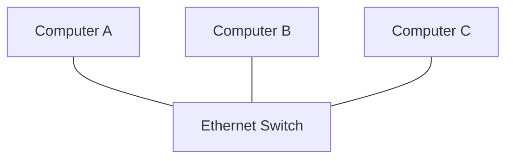
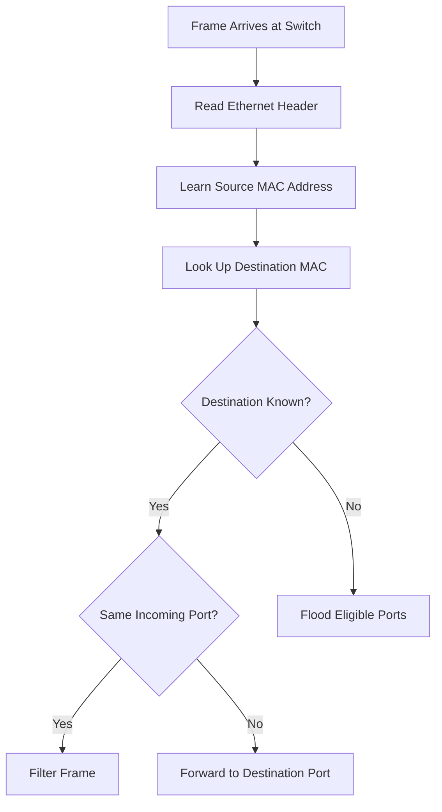
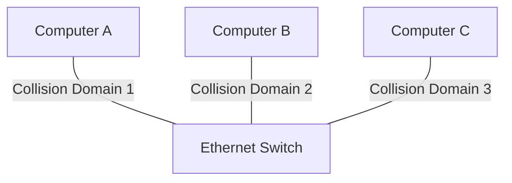
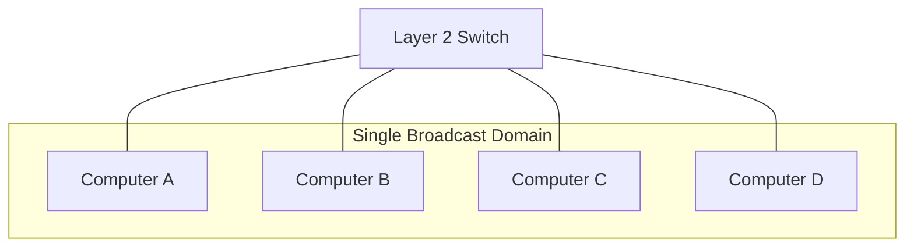

# Switching Fundamentals

Switching is the process of forwarding data frames between devices within a network. Ethernet switches connect computers, servers, routers, access points, and other network devices inside a Local Area Network (LAN).

A traditional Layer 2 Ethernet switch operates at the Data Link layer of the OSI model. It examines Ethernet frame headers, learns source MAC addresses, maintains a MAC address table, and forwards frames toward their intended destinations.

Switching allows multiple devices to communicate efficiently without sending every frame to every connected device.

Modern switches may also provide Layer 3 routing, VLAN segmentation, Power over Ethernet (PoE), link aggregation, Quality of Service (QoS), and network security features.

# 🗁 What Is Network Switching?

Network switching connects multiple devices within a network and forwards traffic between them.

A switch receives an Ethernet frame on one interface, examines its destination MAC address, and determines where the frame should be forwarded.

For example, consider a LAN containing three computers connected to one switch:



When Computer A sends data to Computer B:

* The switch receives the Ethernet frame from Computer A.
* It examines the source and destination MAC addresses.
* It checks its MAC address table.
* It identifies the interface associated with Computer B.
* It forwards the frame through that interface.

Computer C does not receive the unicast frame.

This makes switching more efficient than traditional hub-based communication.

# 🗁 How an Ethernet Switch Works

A Layer 2 Ethernet switch performs three fundamental operations:

### 🖆 MAC Address Learning

The switch examines the source MAC address of every received Ethernet frame.

It records the source MAC address and the interface through which the frame arrived.

This information is stored in the MAC address table, also called the forwarding database (FDB).

Example:

| Source MAC address | Switch interface |
| --- | --- |
| AA:AA:AA:AA:AA:AA | Port 1 |
| BB:BB:BB:BB:BB:BB | Port 2 |
| CC:CC:CC:CC:CC:CC | Port 3 |

### 🖆 Frame Forwarding

When the destination MAC address exists in the MAC address table, the switch forwards the frame through the associated interface.

For example:

```text
Destination MAC: BB:BB:BB:BB:BB:BB

MAC address table:
BB:BB:BB:BB:BB:BB -> Port 2

Forward frame through Port 2.
```

### 🖆 Frame Filtering and Flooding

The switch determines whether a frame should be forwarded, filtered, or flooded.

* **Forwarding:** Sends a frame through the interface associated with the destination MAC address.
* **Filtering:** Does not forward a frame when the destination is reachable through the same receiving interface.
* **Flooding:** Sends a frame through eligible interfaces when the destination is unknown or when the frame is broadcast or certain multicast traffic.

Flooding is constrained by VLAN membership and other forwarding policies. A switch does not normally flood a frame back through its receiving interface.

# 🗁 Ethernet Frame Forwarding Process

Consider two devices connected to the same switch.



The switch performs these operations independently for received frames.

### 🖆 Example: Known Unicast

Suppose Computer A sends a frame to Computer B.

The switch already knows that Computer B is connected to Port 2.

```text
Computer A
    |
  Port 1
    |
  Switch
    |
  Port 2
    |
Computer B
```

The switch forwards the frame only through Port 2.

### 🖆 Example: Unknown Unicast

Suppose the switch does not have the destination MAC address in its forwarding table.

The switch floods the frame through eligible ports within the same VLAN, excluding the receiving port.

If the destination device responds, the switch can learn its source MAC address.

### 🖆 Example: Broadcast

An Ethernet broadcast frame uses this destination MAC address:

```text
FF:FF:FF:FF:FF:FF
```

The switch floods the frame to eligible ports in the same VLAN, excluding the incoming port.

Routers do not normally forward Layer 2 Ethernet broadcasts between networks.

# 🗁 Switching and Collision Domains

A collision domain is a network segment in which simultaneous Ethernet transmissions can collide.

Traditional Ethernet hubs share one collision domain among all connected devices.

A switch separates collision domains by providing independent Ethernet links.

Consider this topology:



Each switch port represents a separate collision domain.

With modern full-duplex Ethernet, collisions do not occur because transmission and reception can happen simultaneously without the traditional shared-medium collision mechanism.

# 🗁 Switching and Broadcast Domains

A broadcast domain is a logical network segment in which Layer 2 broadcast frames can reach participating devices.

By default, all ports in the same VLAN belong to the same broadcast domain.

For example:



A standard Layer 2 switch does not automatically create a separate broadcast domain for every port.

VLANs provide logical broadcast-domain separation.

For example:

* VLAN 10 contains Computer A and Computer B.
* VLAN 20 contains Computer C and Computer D.

Broadcast traffic from VLAN 10 is not forwarded into VLAN 20.

### 🖆 Collision Domain vs Broadcast Domain

| Feature | Collision Domain | Broadcast Domain |
| --- | --- | --- |
| Meaning | Area where Ethernet collisions may occur | Area where Layer 2 broadcasts are delivered |
| Layer | Physical / Data Link | Data Link |
| Switch behavior | Separates domains per port | Separates domains by VLAN |
| Router behavior | Each interface has its own link | Separates broadcast domains |
| Modern Ethernet | Full-duplex eliminates collisions | Broadcasts still exist |

# 🗁 Types of Network Switching Devices

### 🖆 Hub

A hub is a physical-layer device that repeats incoming electrical or optical signals to its other ports.

Characteristics:

* Operates at OSI Layer 1.
* Does not inspect MAC addresses.
* Shares bandwidth among connected devices.
* All ports share one collision domain.
* Typically operates in half-duplex Ethernet environments.

Hubs are largely obsolete in modern networks.

### 🖆 Bridge

A bridge connects multiple LAN segments and forwards Ethernet frames based on MAC addresses.

Characteristics:

* Traditionally operates at OSI Layer 2.
* Learns MAC addresses.
* Filters and forwards frames.
* Separates collision domains.
* Usually connects fewer segments than a modern switch.

### 🖆 Switch

A switch is essentially a high-performance multiport bridge.

Characteristics:

* Primarily operates at OSI Layer 2.
* Learns and maintains MAC address information.
* Forwards frames through appropriate ports.
* Provides independent collision domains per port.
* Supports VLANs and other advanced features depending on its capabilities.

### 🖆 Router

A router forwards packets between different IP networks.

Characteristics:

* Operates primarily at OSI Layer 3.
* Uses IP addresses and routing tables.
* Separates Layer 2 broadcast domains.
* Can perform inter-VLAN routing.
* May provide NAT, firewall, and other network services.

### 🖆 Device Comparison

| Device | OSI Layer | Forwarding basis | Collision domains |
| --- | --- | --- | --- |
| Hub | Layer 1 | Repeats signals | Shared |
| Bridge | Layer 2 | MAC address | Separate per segment |
| Layer 2 Switch | Layer 2 | MAC address | Separate per port |
| Router | Layer 3 | IP address | Separate per interface |

# 🗁 Switching Methods

Ethernet switches can use different methods to process and forward frames.

### 🖆 Store-and-Forward Switching

The switch receives the entire Ethernet frame before forwarding it.

It can check the Frame Check Sequence (FCS) to detect corrupted frames.

Characteristics:

* Receives the complete frame.
* Performs FCS verification.
* Can discard frames with detected FCS errors.
* Supports different ingress and egress speeds through buffering.
* Introduces more forwarding latency than cut-through switching in many implementations.

Store-and-forward is widely used in modern Ethernet switches.

### 🖆 Cut-Through Switching

The switch begins forwarding a frame after reading enough of its header to identify the destination interface.

Characteristics:

* Does not wait for the entire frame.
* Can reduce forwarding latency.
* May forward frames before their FCS has been verified.
* Requires compatible forwarding conditions and hardware support.

### 🖆 Fragment-Free Switching

Fragment-free switching is a variation of cut-through switching.

The switch waits until it has received the first 64 bytes before forwarding the frame.

This was historically intended to reduce forwarding of collision fragments associated with half-duplex Ethernet.

It is less relevant in modern full-duplex networks.

### 🖆 Switching Method Comparison

| Feature | Store-and-Forward | Cut-Through | Fragment-Free |
| --- | --- | --- | --- |
| Receives complete frame | Yes | No | No |
| FCS verification before forwarding | Yes | No | No |
| Forwarding latency | Higher | Lower | Intermediate |
| Error filtering | Stronger | Limited | Limited |
| Historical use | Common | Low-latency switching | Collision-fragment filtering |

# 🗁 Duplex Communication

Duplex describes whether a network interface can transmit and receive data simultaneously.

### 🖆 Half-Duplex

Half-duplex communication allows transmission in only one direction at a time.

A device must wait until the medium is available before transmitting.

Characteristics:

* Cannot transmit and receive simultaneously.
* Historically used with hubs.
* Shared Ethernet media required collision handling.
* CSMA/CD was used in traditional half-duplex Ethernet.

### 🖆 Full-Duplex

Full-duplex communication allows simultaneous transmission and reception.

Characteristics:

* Transmits and receives simultaneously.
* Uses independent transmit and receive paths.
* Eliminates Ethernet collisions on the link.
* Does not use CSMA/CD for normal operation.
* Is standard in modern switched Ethernet networks.

### 🖆 Half-Duplex vs Full-Duplex

| Feature | Half-Duplex | Full-Duplex |
| --- | --- | --- |
| Transmission | One direction at a time | Both directions simultaneously |
| Collisions | Possible on shared media | Not present on the full-duplex link |
| CSMA/CD | Used in traditional half-duplex Ethernet | Not used |
| Performance | Lower under contention | Higher |
| Modern usage | Legacy environments | Standard switched Ethernet |

# 🗁 Switching Performance Concepts

### 🖆 Port Speed

Port speed represents the nominal data rate supported by an Ethernet interface.

Common Ethernet speeds include:

| Ethernet Standard | Nominal Speed |
| --- | ---: |
| Fast Ethernet | 100 Mbps |
| Gigabit Ethernet | 1 Gbps |
| 2.5 Gigabit Ethernet | 2.5 Gbps |
| 5 Gigabit Ethernet | 5 Gbps |
| 10 Gigabit Ethernet | 10 Gbps |
| 25 Gigabit Ethernet | 25 Gbps |
| 40 Gigabit Ethernet | 40 Gbps |
| 100 Gigabit Ethernet | 100 Gbps |
| 400 Gigabit Ethernet | 400 Gbps |

Actual throughput depends on protocol overhead, traffic patterns, hardware capabilities, and link conditions.

### 🖆 Switching Capacity

Switching capacity, also called switching bandwidth or backplane bandwidth, describes the aggregate capacity of a switch's internal forwarding architecture.

A switch with higher switching capacity can potentially handle more simultaneous traffic across its ports.

### 🖆 Forwarding Rate

Forwarding rate measures how many packets or frames a switch can process per second.

It is commonly expressed in packets per second (pps).

A switch may have sufficient bandwidth but still become constrained by packet-processing capacity, particularly with small Ethernet frames.

### 🖆 Buffering

Switch buffers temporarily store frames when incoming traffic arrives faster than outgoing interfaces can transmit it.

Buffers help manage traffic bursts and speed mismatches.

Excessive queueing can increase latency, while insufficient buffering can cause packet drops during congestion.

# 🗁 Layer 2 and Layer 3 Switches

### 🖆 Layer 2 Switch

A Layer 2 switch forwards Ethernet frames using MAC addresses.

Typical capabilities:

* MAC address learning.
* VLAN configuration.
* Access and trunk ports.
* Layer 2 forwarding.
* Spanning Tree Protocol.
* Link aggregation.

It does not normally route traffic between different IP subnets without an additional Layer 3 routing function.

### 🖆 Layer 3 Switch

A Layer 3 switch combines traditional switching with IP routing capabilities.

Typical capabilities:

* Layer 2 Ethernet switching.
* VLAN support.
* Inter-VLAN routing.
* Switched Virtual Interfaces (SVIs).
* Static routing.
* Dynamic routing on supported platforms.
* Access control lists.

Layer 3 switches commonly use hardware-based forwarding to route traffic at high speeds.

### 🖆 Comparison

| Feature | Layer 2 Switch | Layer 3 Switch |
| --- | --- | --- |
| MAC-based forwarding | Yes | Yes |
| IP routing | No, not as a normal Layer 2 function | Yes |
| VLAN support | Yes | Yes |
| Inter-VLAN routing | Requires an external router | Can route internally |
| Routing table | Not normally present | Present |
| Typical role | Access switching | Distribution or core switching |

# 🗁 Practical Linux Commands

Linux networking tools help inspect Ethernet interfaces, link state, MAC addresses, and connectivity.

### 🖆 Display Network Interfaces

```bash
ip link show
```

Displays available network interfaces and their link-layer information.

### 🖆 Display IP Addresses

```bash
ip address show
```

Displays assigned IPv4 and IPv6 addresses.

### 🖆 Display Link Statistics

```bash
ip -s link show
```

Displays packet and byte counters, along with error and drop statistics.

### 🖆 Display Interface Details

```bash
sudo ethtool enp3s0
```

Displays Ethernet interface information, including:

* Supported link modes.
* Negotiated speed.
* Duplex mode.
* Auto-negotiation status.
* Link detection status.

Replace `enp3s0` with the actual interface name.

### 🖆 Display Neighbor Information

```bash
ip neigh show
```

Displays the Linux neighbor table, which contains IP-to-link-layer address mappings.

### 🖆 Capture Ethernet Frames

```bash
sudo tcpdump -i enp3s0 -e
```

The `-e` option displays link-layer headers, including Ethernet source and destination MAC addresses.

### 🖆 Display Listening and Network Connections

```bash
ss -tuln
```

Displays listening TCP and UDP sockets.

This is useful for understanding host-side networking, although it does not directly display switch forwarding information.

# 🗁 Common Switching Problems

### 🖆 Incorrect VLAN Assignment

A switch port may belong to the wrong VLAN.

Symptoms:

* Devices cannot communicate with expected hosts.
* DHCP requests reach the wrong subnet.
* Network segmentation behaves incorrectly.

### 🖆 Duplex Mismatch

One side of an Ethernet link may operate in half-duplex while the other operates in full-duplex.

Symptoms:

* Poor throughput.
* Increased errors.
* Late collisions on half-duplex interfaces.
* Unstable network performance.

Use auto-negotiation consistently where supported and configure both ends appropriately when manual settings are necessary.

### 🖆 MAC Address Flapping

A MAC address may appear to move repeatedly between switch ports.

Possible causes:

* Layer 2 loops.
* Incorrect redundant connections.
* Misconfigured virtual switching.
* Device movement or legitimate topology changes.

### 🖆 Switching Loop

A Layer 2 loop can cause broadcast storms, repeated frame circulation, and MAC address instability.

Spanning Tree Protocol helps prevent such loops by controlling redundant Layer 2 paths.

### 🖆 Interface Errors

Physical or link-level problems may cause:

* CRC/FCS errors.
* Dropped frames.
* Link flapping.
* Packet loss.
* Reduced throughput.

Inspect interface counters, cable quality, transceivers, and negotiated link parameters.

# 🗁 Best Practices

* Use managed switches in networks requiring VLAN segmentation.
* Prefer full-duplex Ethernet links.
* Use appropriate Ethernet cable categories and compatible transceivers.
* Keep firmware and switch operating systems updated.
* Monitor interface errors and utilization.
* Use Spanning Tree Protocol to prevent Layer 2 loops.
* Disable unused switch ports when appropriate.
* Assign ports to explicitly defined VLANs.
* Secure management interfaces and restrict administrative access.
* Document switch ports, VLAN assignments, and physical connections.
* Monitor MAC address changes and unexpected broadcast traffic.
* Use Layer 3 boundaries to control communication between VLANs.

# 🗁 Practical Exercises

### 🖆 Exercise: Understand a Basic Switching Topology

Create a topology with three computers connected to one Ethernet switch.

Tasks:

* Assign an IP address to each computer in the same subnet.
* Test connectivity between the computers.
* Inspect ARP or neighbor tables.
* Observe Ethernet traffic using Wireshark or tcpdump.
* Identify source and destination MAC addresses.

### 🖆 Exercise: Compare Hub and Switch Behavior

Create two separate network topologies:

* Three computers connected to a hub.
* Three computers connected to a switch.

Tasks:

* Generate traffic between two computers.
* Observe which interfaces receive the traffic.
* Compare collision domains.
* Explain the difference between unicast forwarding and signal repetition.

### 🖆 Exercise: Inspect Ethernet Interfaces

On Ubuntu, execute:

```bash
ip link show
ip -s link show
ip address show
sudo ethtool enp3s0
ip neigh show
```

Tasks:

* Identify the active Ethernet interface.
* Record its MAC address.
* Identify its negotiated speed and duplex mode.
* Inspect packet counters and interface errors.
* Explain the difference between an interface's MAC address and its assigned IP address.

### 🖆 Exercise: Analyze Frame Forwarding

Using a network simulator or managed switch:

* Connect three devices to different switch ports.
* Generate traffic between two devices.
* Observe the switch MAC address table.
* Send traffic to an unknown destination MAC address in a controlled lab.
* Observe flooding behavior.
* Explain why the incoming interface is excluded from normal flooding.

# 🗁 Interview Questions

### 🖆 Fundamental Questions

* What is network switching?
* What is an Ethernet switch?
* At which OSI layer does a traditional Layer 2 switch operate?
* How does a switch learn MAC addresses?
* What is a MAC address table?
* What happens when a switch receives a frame with an unknown destination MAC address?
* What is the difference between forwarding, filtering, and flooding?

### 🖆 Intermediate Questions

* What is the difference between a collision domain and a broadcast domain?
* How does a switch differ from a hub?
* Why is a switch considered a multiport bridge?
* What is the difference between store-and-forward and cut-through switching?
* What is full-duplex communication?
* Why do modern switched Ethernet links not experience collisions?
* What is the difference between a Layer 2 and Layer 3 switch?
* What is MAC address flapping?

### 🖆 Advanced Questions

* How does a switch handle broadcast frames?
* Why does a Layer 2 loop create a broadcast storm?
* What is the purpose of switch buffering?
* What is the difference between switching capacity and forwarding rate?
* How does a switch handle traffic between different VLANs?
* Why is hardware-based forwarding important in high-performance switches?

# 🗁 Summary

Network switching enables efficient communication between devices within an Ethernet LAN.

A Layer 2 switch learns source MAC addresses, builds a forwarding table, and uses destination MAC addresses to determine where Ethernet frames should go.

Important concepts include:

* MAC address learning.
* Frame forwarding, filtering, and flooding.
* Collision domains and broadcast domains.
* Hub, bridge, switch, and router differences.
* Store-and-forward and cut-through switching.
* Half-duplex and full-duplex communication.
* Layer 2 and Layer 3 switching.
* Switching capacity, forwarding rate, and buffering.

These concepts provide the foundation for understanding MAC address tables, bridging, VLANs, trunking, and advanced switching technologies.

# 🗁 References

* [IEEE 802.3 — Ethernet Working Group](https://www.ieee802.org/3/)
* [IEEE 802.1 — Bridging and LAN Switching](https://www.ieee802.org/1/)
* [Cisco — LAN Switching](https://www.cisco.com/c/en/us/solutions/enterprise-networks/what-is-lan-switching.html)
* [Linux `ip` Manual](https://man7.org/linux/man-pages/man8/ip.8.html)
* [Linux `ethtool` Manual](https://man7.org/linux/man-pages/man8/ethtool.8.html)
* [tcpdump Manual](https://www.tcpdump.org/manpages/tcpdump.1.html)
