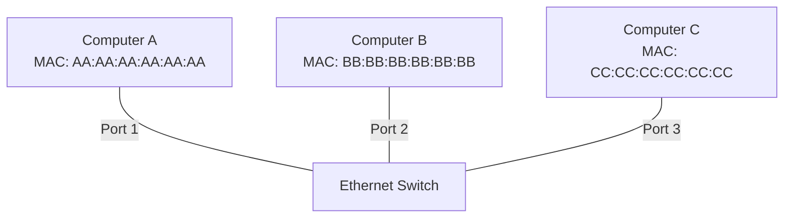
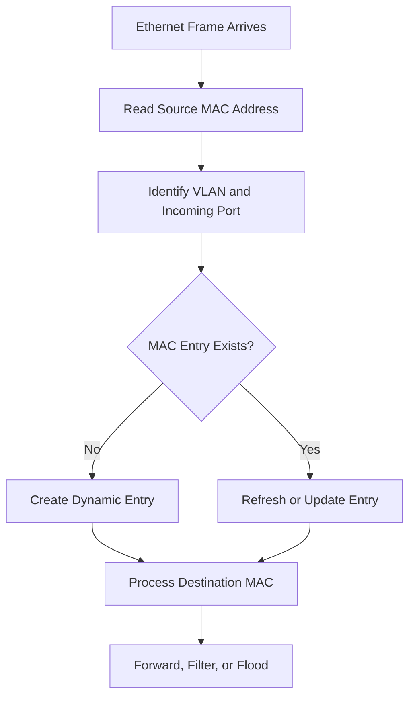
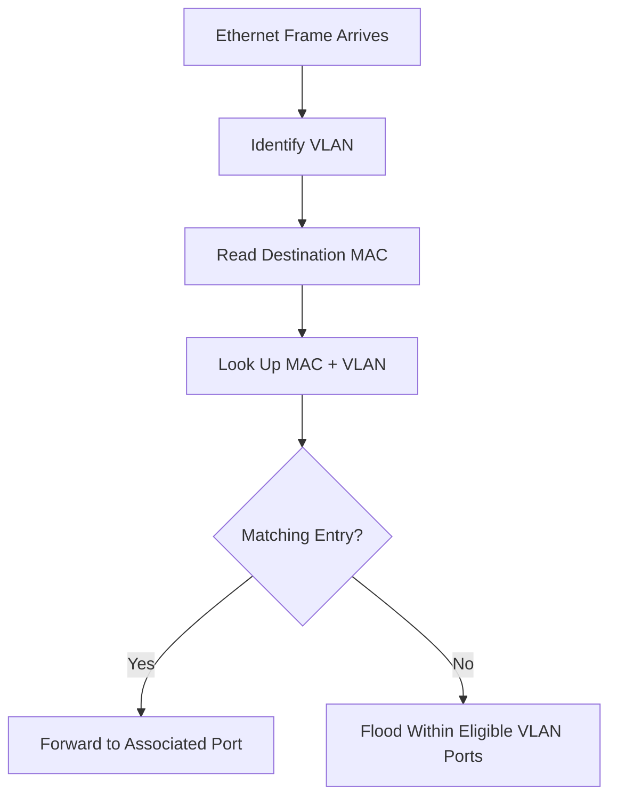

# MAC Address Table

A MAC address table is a data structure maintained by an Ethernet switch to associate MAC addresses with the switch interfaces through which those addresses are reachable.

It is also known as a **forwarding database (FDB)** or **Content Addressable Memory (CAM) table** in traditional switch architectures.

When a switch receives an Ethernet frame, it examines the source MAC address to learn where the sending device is located. It then checks the destination MAC address against its forwarding table to determine where the frame should go.

This process allows switches to forward known unicast traffic efficiently instead of flooding every frame to all connected devices.

# 🗁 What Is a MAC Address Table?

A MAC address table maps a device's MAC address to the switch port through which the device can be reached.

A typical entry contains:

| Field | Description |
| --- | --- |
| VLAN ID | VLAN associated with the MAC entry |
| MAC Address | Learned or configured Layer 2 address |
| Interface | Switch port where the MAC address was learned |
| Entry Type | Dynamic, static, or another implementation-specific type |
| Age | Time since the entry was last refreshed, where supported |

Example:

| VLAN | MAC Address | Interface | Type |
| --- | --- | --- | --- |
| 10 | AA:AA:AA:AA:AA:AA | Port 1 | Dynamic |
| 10 | BB:BB:BB:BB:BB:BB | Port 2 | Dynamic |
| 20 | CC:CC:CC:CC:CC:CC | Port 3 | Dynamic |
| 20 | DD:DD:DD:DD:DD:DD | Port 4 | Dynamic |

The switch uses this information to make Layer 2 forwarding decisions.

# 🗁 How MAC Address Learning Works

Switches learn MAC addresses from the **source MAC address** of incoming Ethernet frames.

Consider three computers connected to a switch:



When Computer A sends an Ethernet frame, the switch reads its source MAC address.

```text
Source MAC:      AA:AA:AA:AA:AA:AA
Destination MAC: BB:BB:BB:BB:BB:BB
Incoming Port:   Port 1
```

The switch creates or refreshes this entry:

```text
VLAN 10
AA:AA:AA:AA:AA:AA -> Port 1
```

When Computer B sends a frame, the switch learns:

```text
VLAN 10
BB:BB:BB:BB:BB:BB -> Port 2
```

The forwarding table now contains:

| MAC Address | Interface |
| --- | --- |
| AA:AA:AA:AA:AA:AA | Port 1 |
| BB:BB:BB:BB:BB:BB | Port 2 |

The switch has learned the location of both devices without requiring manual configuration.

### 🖆 MAC Learning Process



The source MAC learning process is independent of whether the destination MAC is known.

# 🗁 MAC Address Forwarding

After learning the source MAC address, the switch examines the destination MAC address.

Its forwarding decision depends on whether that destination is present in the forwarding table.

### 🖆 Known Unicast

A known unicast frame has a destination MAC address that exists in the switch's forwarding table for the relevant VLAN.

Example:

```text
Destination MAC: BB:BB:BB:BB:BB:BB

MAC Address Table:
BB:BB:BB:BB:BB:BB -> Port 2

Decision:
Forward through Port 2.
```

Only the destination interface receives the unicast frame.

### 🖆 Unknown Unicast

An unknown unicast frame has a destination MAC address that is not present in the relevant forwarding table.

The switch floods the frame through eligible forwarding interfaces in the same VLAN, excluding the incoming interface.

Example:

```text
Destination MAC: EE:EE:EE:EE:EE:EE

MAC Address Table:
AA:AA:AA:AA:AA:AA -> Port 1
BB:BB:BB:BB:BB:BB -> Port 2

Destination not found.

Decision:
Flood eligible ports in the same VLAN.
```

If the destination device responds, the switch can learn its source MAC address from the response.

### 🖆 Broadcast Traffic

An Ethernet broadcast frame uses the destination MAC address:

```text
FF:FF:FF:FF:FF:FF
```

The switch floods broadcast frames through eligible ports belonging to the same VLAN, excluding the receiving interface.

### 🖆 Multicast Traffic

Multicast frames use destination MAC addresses associated with multicast groups.

Depending on switch configuration and capabilities, multicast traffic may be:

* Flooded within the VLAN.
* Forwarded based on multicast group membership.
* Controlled through IGMP snooping for IPv4 multicast.
* Controlled through MLD snooping for IPv6 multicast.

### 🖆 Forwarding Behavior Comparison

| Traffic Type | Destination Known? | Switch Behavior |
| --- | --- | --- |
| Known unicast | Yes | Forward to destination interface |
| Unknown unicast | No | Flood eligible ports in the VLAN |
| Broadcast | Not applicable | Flood eligible ports in the VLAN |
| Multicast | Depends on multicast state | Forward according to multicast handling |

# 🗁 MAC Address Aging

Dynamic MAC address entries are not necessarily permanent.

A switch uses an aging timer to remove entries that have not been refreshed within a configured period.

This prevents forwarding tables from retaining outdated device locations indefinitely.

For example:

```text
MAC Address: AA:AA:AA:AA:AA:AA
Interface:   Port 1
Entry Type:  Dynamic
Age:         240 seconds
```

If the switch does not receive another frame with that source MAC address before the aging timer expires, it may remove the entry.

When the device sends another frame, the switch learns the address again.

### 🖆 Why Aging Is Important

MAC aging helps switches:

* Remove stale forwarding information.
* Adapt when devices move between ports.
* Relearn device locations after topology changes.
* Manage limited forwarding table capacity.

### 🖆 Aging Timer Example

Assume a switch uses a dynamic MAC aging timer of 300 seconds.

```text
Time 0:
Device sends a frame.
MAC address is learned.

Time 100:
Device sends another frame.
Entry is refreshed.

Time 200:
No new frames.

Time 300:
The entry may be removed after its aging timer expires.
```

The exact behavior and timer implementation depend on the switch platform.

# 🗁 Dynamic and Static MAC Entries

MAC address entries can be learned automatically or configured administratively.

### 🖆 Dynamic MAC Entries

Dynamic entries are learned automatically from incoming Ethernet frames.

Characteristics:

* Created through source MAC learning.
* Associated with an incoming interface and VLAN.
* Refreshed when matching source traffic is received.
* Usually removed after the aging timer expires.
* Adapt to device movement.

Example:

```text
VLAN 10
AA:AA:AA:AA:AA:AA -> Port 1
Type: Dynamic
```

### 🖆 Static MAC Entries

Static entries are configured manually by an administrator.

Characteristics:

* Administratively configured.
* Typically do not age out like dynamic entries.
* Can provide predictable forwarding behavior.
* Require manual maintenance when topology changes.

Example:

```text
VLAN 10
AA:AA:AA:AA:AA:AA -> Port 1
Type: Static
```

Static entries can be useful in specialized network designs, but excessive manual entries make network administration more difficult.

### 🖆 Dynamic vs Static Entries

| Feature | Dynamic | Static |
| --- | --- | --- |
| Learning | Automatic | Manual configuration |
| Aging | Usually enabled | Usually disabled |
| Adaptation | Learns changed locations | Requires configuration updates |
| Administration | Lower maintenance | Higher maintenance |
| Typical use | Normal endpoint connectivity | Special forwarding requirements |

# 🗁 MAC Address Table and VLANs

A MAC address table is VLAN-aware.

The same MAC address can have different forwarding entries associated with different VLANs, depending on the switch architecture and configuration.

For example:

| VLAN | MAC Address | Interface |
| --- | --- | --- |
| 10 | AA:AA:AA:AA:AA:AA | Port 1 |
| 20 | AA:AA:AA:AA:AA:AA | Port 5 |
| 10 | BB:BB:BB:BB:BB:BB | Port 2 |
| 20 | CC:CC:CC:CC:CC:CC | Port 6 |

The forwarding lookup considers both the destination MAC address and the VLAN context.

This means a MAC address learned in VLAN 10 does not automatically provide a forwarding path for the same destination in VLAN 20.

### 🖆 VLAN-Aware Forwarding



VLAN-aware MAC learning is essential for maintaining isolation between separate Layer 2 broadcast domains.

# 🗁 MAC Address Movement and Flapping

A switch normally expects a learned MAC address to remain reachable through a particular interface.

If the same MAC address is repeatedly learned on different interfaces, the switch may report MAC address movement or flapping.

Example:

```text
10:00:00
AA:AA:AA:AA:AA:AA -> Port 1

10:00:05
AA:AA:AA:AA:AA:AA -> Port 2

10:00:10
AA:AA:AA:AA:AA:AA -> Port 1
```

The switch keeps updating the MAC address entry as frames arrive from different ports.

### 🖆 Common Causes

* Layer 2 switching loops.
* Incorrect redundant connections.
* Misconfigured link aggregation.
* Virtual machines moving between hosts.
* Network virtualization or bridging.
* Devices connected through multiple paths.
* Incorrect network cabling.

### 🖆 Symptoms

* Intermittent connectivity.
* Unstable MAC address table entries.
* Traffic forwarded through unexpected interfaces.
* Duplicate or repeated packets.
* MAC movement notifications in switch logs.

### 🖆 Troubleshooting

* Inspect MAC address movement logs.
* Identify the interfaces involved.
* Check physical and logical network topology.
* Verify link aggregation configuration.
* Inspect Spanning Tree Protocol state.
* Check virtual switch and bridge configurations.
* Capture traffic when necessary.

# 🗁 MAC Address Table Exhaustion

Switches have finite forwarding table capacity.

If a switch learns more MAC addresses than it can store, it may experience MAC address table exhaustion.

An attacker may attempt to cause this condition through MAC flooding by generating frames with many different source MAC addresses.

When the forwarding table cannot retain additional entries, unknown unicast traffic may be flooded within the affected VLAN, depending on the switch's implementation and security policies.

### 🖆 Potential Impact

* Increased unnecessary traffic.
* Reduced network performance.
* Exposure of traffic to additional devices within the same VLAN.
* Unstable forwarding behavior.

### 🖆 Mitigation Techniques

* Configure port security where supported.
* Limit the number of MAC addresses learned per access port.
* Use 802.1X network access control.
* Monitor MAC address table utilization.
* Restrict access to unused switch ports.
* Apply appropriate VLAN segmentation.
* Use storm control and other platform-specific protections.

Port security behavior differs between vendors, so its exact limits and violation actions should be verified for the target platform.

# 🗁 Inspecting MAC Address Tables

Managed switches provide commands to inspect their forwarding databases.

### 🖆 Cisco IOS / IOS XE

Display the complete MAC address table:

```bash
show mac address-table
```

Display dynamic entries:

```bash
show mac address-table dynamic
```

Display entries for a specific VLAN:

```bash
show mac address-table vlan 10
```

Display entries associated with an interface:

```bash
show mac address-table interface gigabitEthernet 1/0/1
```

Display interface status:

```bash
show interfaces status
```

Display Spanning Tree information:

```bash
show spanning-tree
```

### 🖆 MikroTik RouterOS

Display the bridge host table:

```routeros
/interface bridge host print
```

Display entries with additional details:

```routeros
/interface bridge host print detail
```

Display bridge configuration:

```routeros
/interface bridge print detail
```

Display bridge port configuration:

```routeros
/interface bridge port print detail
```

The bridge host table contains learned and other bridge host entries, including MAC addresses and associated bridge ports. Exact fields depend on RouterOS version and configuration.

### 🖆 Linux Bridge

Linux systems can implement Layer 2 switching through software bridges.

Display bridge information:

```bash
bridge link show
```

Display the forwarding database:

```bash
bridge fdb show
```

Display bridge VLAN configuration:

```bash
bridge vlan show
```

Display detailed link information:

```bash
ip -d link show
```

These commands are useful when Linux is acting as a bridge, virtual switch, or virtualization host.

# 🗁 Practical Linux Lab

You can create a simple software bridge on Ubuntu using two network interfaces or suitable virtual interfaces.

### 🖆 Create a Bridge

```bash
sudo ip link add name br0 type bridge
```

### 🖆 Add Interfaces to the Bridge

Replace the example interface names with suitable interfaces:

```bash
sudo ip link set enp2s0 master br0
sudo ip link set enp3s0 master br0
```

### 🖆 Bring Interfaces and Bridge Up

```bash
sudo ip link set enp2s0 up
sudo ip link set enp3s0 up
sudo ip link set br0 up
```

### 🖆 Inspect the Bridge

```bash
bridge link show
```

### 🖆 Inspect Learned MAC Addresses

```bash
bridge fdb show br br0
```

### 🖆 Remove the Lab Configuration

```bash
sudo ip link set enp2s0 nomaster
sudo ip link set enp3s0 nomaster
sudo ip link delete br0 type bridge
```

This lab demonstrates software bridging and forwarding database behavior. It does not configure a physical managed switch.

# 🗁 Common Mistakes

* Assuming switches learn destination MAC addresses instead of source MAC addresses.
* Assuming unknown unicast traffic is always dropped.
* Assuming every switch port belongs to a separate broadcast domain.
* Forgetting that MAC address forwarding is VLAN-aware.
* Treating dynamic MAC entries as permanent.
* Confusing MAC address aging with IP address lease expiration.
* Assuming MAC address flapping always indicates an attack.
* Confusing a MAC address table with an ARP table.
* Assuming a switch's forwarding database is identical to a router's routing table.

# 🗁 Best Practices

* Monitor MAC address table utilization.
* Investigate unexpected MAC address movement.
* Use VLANs to separate logical broadcast domains.
* Enable Spanning Tree Protocol on appropriate switching infrastructure.
* Configure port security where supported and appropriate.
* Disable unused access ports.
* Use 802.1X for stronger endpoint access control.
* Document static MAC entries.
* Monitor switch logs and interface counters.
* Review forwarding database behavior during network changes.
* Use vendor-specific management tools to verify actual forwarding behavior.

# 🗁 Practical Exercises

### 🖆 Exercise: Observe MAC Learning

Create a topology with three computers connected to a managed switch.

Tasks:

* Record the MAC addresses of all computers.
* Send traffic from each computer.
* Inspect the switch MAC address table.
* Identify the interface associated with each MAC address.
* Explain how the switch learned each entry.

### 🖆 Exercise: Test Unknown Unicast Flooding

In an isolated lab:

* Inspect the current MAC address table.
* Introduce a destination MAC address that the switch has not learned.
* Generate traffic toward that destination.
* Observe forwarding behavior using packet capture or simulator tools.
* Explain why the switch floods the frame.

### 🖆 Exercise: Observe MAC Aging

* Identify the configured dynamic MAC aging timer.
* Generate traffic from a test device.
* Inspect its MAC address entry.
* Stop generating traffic.
* Observe whether the entry disappears after the aging period.
* Generate traffic again and verify that the switch relearns the address.

### 🖆 Exercise: Investigate MAC Address Movement

Using a controlled switching lab:

* Observe the MAC address table.
* Change a test device's connection to another switch port.
* Generate traffic from that device.
* Observe how the switch updates the forwarding entry.
* Distinguish normal device movement from repeated MAC flapping.

### 🖆 Exercise: Compare VLAN Forwarding

* Create VLAN 10 and VLAN 20.
* Connect devices to both VLANs.
* Generate traffic within each VLAN.
* Inspect the MAC address table.
* Verify that learned entries are associated with the correct VLAN.
* Explain why the same forwarding lookup does not cross VLAN boundaries.

# 🗁 Interview Questions

### 🖆 Fundamental Questions

* What is a MAC address table?
* What is a forwarding database?
* How does a switch learn MAC addresses?
* Which MAC address does a switch use for learning?
* What information is stored in a MAC address table?
* What happens when a destination MAC address is unknown?

### 🖆 Intermediate Questions

* What is the difference between dynamic and static MAC entries?
* What is MAC address aging?
* How does VLAN membership affect MAC address learning?
* What is known unicast forwarding?
* What is unknown unicast flooding?
* What is MAC address flapping?
* What is the difference between an ARP table and a MAC address table?

### 🖆 Advanced Questions

* What happens when a switch's MAC address table becomes full?
* What is MAC flooding?
* How can port security help prevent MAC flooding?
* Why can a Layer 2 loop cause MAC address flapping?
* How does a switch handle the same MAC address in different VLANs?
* What is the difference between a forwarding database and a routing table?
* How can MAC address movement be used to troubleshoot a switching loop?

# 🗁 Summary

A MAC address table enables an Ethernet switch to make efficient Layer 2 forwarding decisions.

The switch learns source MAC addresses, associates them with incoming interfaces and VLANs, and uses destination MAC addresses to determine where frames should be forwarded.

Important concepts include:

* Dynamic and static MAC entries.
* Source MAC address learning.
* Known and unknown unicast forwarding.
* Broadcast and multicast handling.
* MAC address aging.
* VLAN-aware forwarding.
* MAC address flapping.
* MAC address table exhaustion.
* Forwarding database inspection and troubleshooting.

Understanding MAC address tables is essential before studying bridging, VLANs, trunking, and advanced switching technologies.

# 🗁 References

* [IEEE 802.1 — Bridging and LAN Switching](https://www.ieee802.org/1/)
* [IEEE 802.3 — Ethernet Working Group](https://www.ieee802.org/3/)
* [Cisco — MAC Address Table](https://www.cisco.com/c/en/us/support/docs/lan-switching/ethernet/10561-1.html)
* [MikroTik RouterOS — Bridge](https://help.mikrotik.com/docs/spaces/ROS/pages/328068/Bridging%2Band%2BSwitching)
* [Linux `bridge` Manual](https://man7.org/linux/man-pages/man8/bridge.8.html)
* [Linux Bridge Documentation](https://docs.kernel.org/networking/bridge.html)
