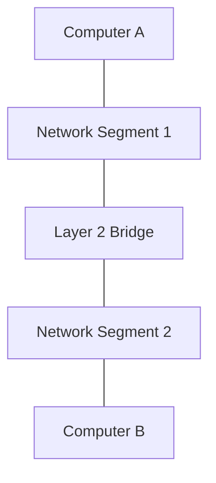
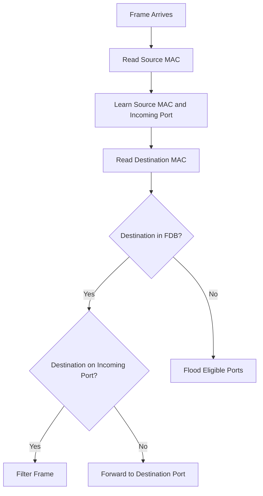
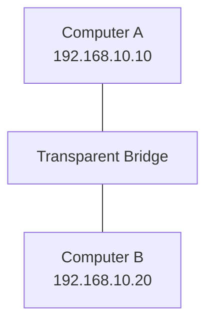
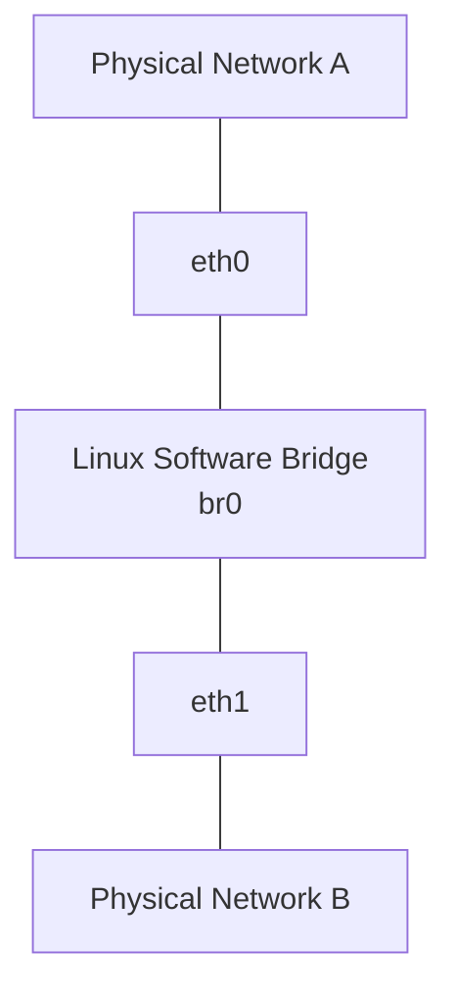
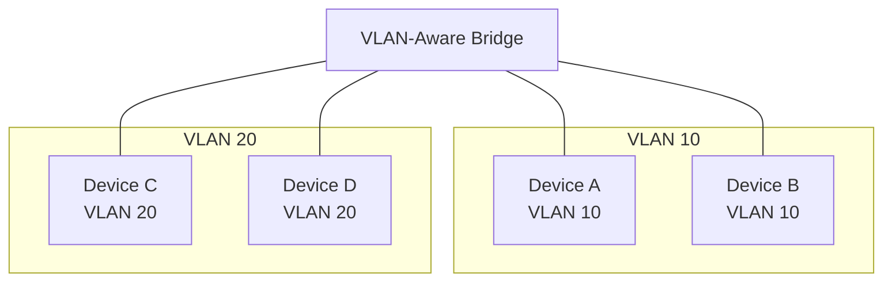

# Bridging

Bridging is a Layer 2 networking technique that connects multiple network segments and allows devices to communicate within the same logical Ethernet network.

A network bridge examines Ethernet frames, learns source MAC addresses, maintains a forwarding database, and decides whether frames should be forwarded, filtered, or flooded.

Modern Ethernet switches are essentially multiport bridges. They perform the same fundamental Layer 2 forwarding operations but support many interfaces and advanced switching capabilities.

Bridging is also commonly implemented in software, particularly in Linux servers, virtualization platforms, containers, and network appliances.

# 🗁 What Is Network Bridging?

A network bridge connects multiple Layer 2 network segments and forwards Ethernet frames between them.

It allows devices connected to different physical segments to communicate as if they belong to the same logical Ethernet network, provided they are in the same VLAN or bridging domain.

Example:



When Computer A sends an Ethernet frame to Computer B, the bridge determines whether the destination is reachable through the other segment.

If the destination MAC address is known, the bridge forwards the frame toward the appropriate segment.

If the destination is unknown, the bridge floods it through eligible forwarding interfaces, excluding the receiving interface.

### 🖆 Purpose of Bridging

Bridging is used to:

* Connect separate Ethernet segments.
* Extend a Layer 2 network.
* Forward frames based on MAC addresses.
* Reduce unnecessary traffic through selective forwarding.
* Connect physical and virtual network interfaces.
* Support VLAN-aware Layer 2 network designs.

# 🗁 How a Bridge Works

A transparent Ethernet bridge performs three fundamental operations.

### 🖆 Learning

The bridge examines the source MAC address of incoming Ethernet frames.

It records the source MAC address and the interface through which the frame arrived.

Example:

```text
Source MAC: AA:AA:AA:AA:AA:AA
Incoming interface: eth0

Learned entry:
AA:AA:AA:AA:AA:AA -> eth0
```

### 🖆 Forwarding

The bridge checks the destination MAC address against its forwarding database.

If a matching entry exists on another interface, the bridge forwards the frame through that interface.

### 🖆 Filtering

If the destination MAC address is associated with the same interface through which the frame arrived, the bridge does not forward the frame back through that interface.

This prevents unnecessary traffic from being sent back into the segment where the destination is already reachable.

### 🖆 Flooding

When the destination is unknown, the bridge floods the frame through eligible forwarding interfaces.

Broadcast frames are also flooded within the applicable bridging domain.

Multicast forwarding depends on bridge multicast configuration and group membership information.

# 🗁 Bridge Forwarding Process

The forwarding process can be represented as follows:



FDB stands for Forwarding Database.

The bridge uses this database to determine the appropriate forwarding interface for each known destination.

# 🗁 Transparent Bridging

Transparent bridging is a forwarding method in which connected devices do not need to know that a bridge exists.

The bridge operates transparently by learning MAC addresses and forwarding Ethernet frames without requiring changes to endpoint IP addressing.

For example:



Both computers can communicate using their existing IP configuration, assuming they belong to the same IP subnet and Layer 2 domain.

The bridge does not normally modify the source or destination MAC addresses of forwarded Ethernet frames.

### 🖆 Characteristics

* Operates at Layer 2.
* Learns source MAC addresses.
* Maintains a forwarding database.
* Forwards frames selectively.
* Floods unknown unicast and broadcast traffic as appropriate.
* Does not normally require endpoint configuration changes.
* Can connect multiple Ethernet segments into one logical network.

# 🗁 Bridge vs Switch vs Router

These devices perform different networking functions.

### 🖆 Bridge

A bridge connects Layer 2 network segments and forwards frames using MAC addresses.

Traditional bridges generally have fewer interfaces than modern switches.

### 🖆 Switch

A switch is a multiport bridge designed to connect many Ethernet devices efficiently.

It typically provides hardware-accelerated Layer 2 forwarding and may support VLANs, STP, link aggregation, and other advanced features.

### 🖆 Router

A router forwards IP packets between different Layer 3 networks.

It examines destination IP addresses and uses a routing table to select the next hop.

### 🖆 Comparison

| Feature | Bridge | Switch | Router |
| --- | --- | --- | --- |
| Primary OSI layer | Layer 2 | Layer 2 | Layer 3 |
| Forwarding basis | MAC address | MAC address | IP address |
| Main purpose | Connect Layer 2 segments | Connect LAN devices | Connect IP networks |
| MAC learning | Yes | Yes | Not used for IP route selection |
| Forwarding database | Yes | Yes | Routing table |
| Broadcast domain | Extends the same domain | Segmented by VLAN | Separates interfaces |
| Typical implementation | Physical or software | Physical or virtual | Physical or software |

A Layer 3 switch combines Layer 2 switching with IP routing capabilities.

# 🗁 Bridge Forwarding Database

A bridge maintains a forwarding database that associates MAC addresses with bridge ports.

This database is commonly called the FDB.

Example:

| MAC Address | Bridge Port | VLAN |
| --- | --- | --- |
| AA:AA:AA:AA:AA:AA | eth0 | 10 |
| BB:BB:BB:BB:BB:BB | eth1 | 10 |
| CC:CC:CC:CC:CC:CC | eth2 | 20 |

The bridge uses this information to forward frames toward known destinations.

### 🖆 Dynamic Entries

Dynamic entries are learned automatically from incoming frames.

They typically have an aging timer and may be removed when they are no longer refreshed.

### 🖆 Static Entries

Static entries are administratively configured and generally remain until explicitly changed or removed.

They can be useful for specialized forwarding requirements.

### 🖆 Inspecting the FDB

On Ubuntu:

```bash
bridge fdb show
```

Display entries associated with a particular bridge:

```bash
bridge fdb show br br0
```

Display detailed bridge information:

```bash
bridge -d link show
```

# 🗁 Software Bridging

Bridging does not require a dedicated physical switch.

Operating systems can implement Layer 2 bridges in software.

A software bridge connects multiple network interfaces and forwards Ethernet frames between them.

Common use cases include:

* Virtual machine networking.
* Container networking.
* Linux-based routers and firewalls.
* Network virtualization.
* Connecting physical and virtual interfaces.
* Building software-defined network topologies.

For example, a Linux server can connect two physical Ethernet interfaces through a software bridge.



The Linux bridge behaves like a virtual Layer 2 switch.

# 🗁 Linux Bridge Architecture

Linux provides a kernel-based Ethernet bridge implementation.

The bridge interface acts as a virtual Layer 2 switching device.

Physical or virtual network interfaces can become bridge ports.

Example:

```text
             Linux Host

      +----------------------+
      |                      |
      |      Bridge br0      |
      |                      |
      +----------+-----------+
                 |
          +------+------+
          |             |
        eth0           eth1
          |             |
      Network A      Network B
```

When an interface becomes a bridge port, its Layer 2 traffic is handled through the bridge.

An IP address used to manage the host through that bridged network is normally assigned to the bridge interface rather than to an enslaved physical port.

### 🖆 Important Linux Bridge Components

| Component | Description |
| --- | --- |
| Bridge interface | Virtual Layer 2 device, such as `br0` |
| Bridge port | Physical or virtual interface attached to the bridge |
| FDB | Maps MAC addresses to bridge ports |
| VLAN filtering | Allows VLAN-aware forwarding |
| STP | Helps prevent Layer 2 forwarding loops |
| Multicast snooping | Controls multicast forwarding based on group membership |

# 🗁 Creating a Linux Bridge on Ubuntu

The following example creates a software bridge using two Ethernet interfaces.

Replace `enp2s0` and `enp3s0` with the actual interface names on your system.

### 🖆 Inspect Existing Interfaces

```bash
ip link show
```

Check assigned IP addresses:

```bash
ip address show
```

### 🖆 Create the Bridge

```bash
sudo ip link add name br0 type bridge
```

This creates a new virtual bridge interface called `br0`.

### 🖆 Attach Physical Interfaces

```bash
sudo ip link set enp2s0 master br0
sudo ip link set enp3s0 master br0
```

Both interfaces are now bridge ports.

### 🖆 Bring Interfaces Up

```bash
sudo ip link set enp2s0 up
sudo ip link set enp3s0 up
sudo ip link set br0 up
```

### 🖆 Assign an IP Address to the Bridge

If the Linux host needs an IP address on this bridged network:

```bash
sudo ip address add 192.168.10.10/24 dev br0
```

The bridge interface acts as the host's Layer 3 attachment to that network.

The physical bridge ports normally remain without separate IP addresses for this arrangement.

### 🖆 Verify the Bridge

```bash
ip link show br0
```

Display bridge ports:

```bash
bridge link show
```

Display the forwarding database:

```bash
bridge fdb show br br0
```

Display bridge VLAN information:

```bash
bridge vlan show
```

# 🗁 Persistent Linux Bridge Configuration

The commands above create a temporary configuration. It does not automatically survive a reboot.

On Ubuntu systems using Netplan, a bridge can be configured persistently.

Example Netplan configuration:

```yaml
network:
  version: 2
  renderer: networkd

  ethernets:
    enp2s0:
      dhcp4: false
    enp3s0:
      dhcp4: false

  bridges:
    br0:
      interfaces:
        - enp2s0
        - enp3s0
      addresses:
        - 192.168.10.10/24
      parameters:
        stp: true
        forward-delay: 15
```

Save the configuration in an appropriate Netplan YAML file under:

```text
/etc/netplan/
```

Validate the configuration:

```bash
sudo netplan generate
```

Apply it:

```bash
sudo netplan apply
```

Inspect the resulting bridge:

```bash
ip address show br0
bridge link show
```

The example enables STP on the Linux bridge. The exact STP behavior depends on the bridge configuration and network topology.

# 🗁 VLAN-Aware Bridging

A bridge can forward traffic for multiple VLANs while maintaining separate Layer 2 forwarding domains.

This is known as VLAN-aware bridging.

Instead of creating a separate physical bridge for every VLAN, a VLAN-aware bridge maintains VLAN membership and forwarding information.

Example:



The bridge maintains forwarding information within each VLAN.

A MAC address learned in VLAN 10 does not automatically create a forwarding path in VLAN 20.

### 🖆 Linux VLAN Filtering

Linux bridge VLAN filtering can be enabled with:

```bash
sudo ip link set dev br0 type bridge vlan_filtering 1
```

Inspect VLAN membership:

```bash
bridge vlan show
```

Add VLAN 10 to a bridge port:

```bash
sudo bridge vlan add dev enp2s0 vid 10 pvid untagged
```

Add VLAN 20 to another bridge port:

```bash
sudo bridge vlan add dev enp3s0 vid 20 pvid untagged
```

These examples configure untagged access-style membership on the respective ports.

VLAN-aware bridge configuration requires careful planning of port membership, PVIDs, tagged VLANs, and the bridge's own VLAN participation.

# 🗁 Spanning Tree and Bridging Loops

Bridging can introduce Layer 2 loops when redundant connections create multiple active paths between network segments.

Ethernet frames do not contain a Layer 2 TTL field that automatically limits their lifetime.

As a result, a Layer 2 loop can cause frames to circulate repeatedly.

Potential consequences include:

* Broadcast storms.
* Duplicate frames.
* MAC address flapping.
* Network congestion.
* Unstable connectivity.

Spanning Tree Protocol (STP) prevents Layer 2 forwarding loops by calculating a loop-free topology and blocking redundant paths where necessary.

Linux bridges support STP and can participate in compatible Layer 2 topologies.

Inspect STP configuration:

```bash
ip -d link show br0
```

Enable STP:

```bash
sudo ip link set dev br0 type bridge stp_state 1
```

STP configuration must be consistent with the surrounding switching topology.

# 🗁 Bridge vs Routing

Bridging and routing are different forwarding mechanisms.

### 🖆 Bridging

Bridging forwards Ethernet frames using destination MAC addresses.

Devices within the same Layer 2 domain can communicate through a bridge without requiring routing between their IP subnets.

### 🖆 Routing

Routing forwards IP packets between different IP networks.

A router examines the destination IP address and selects a next hop using its routing table.

### 🖆 Example

Consider two IP networks:

```text
Network A: 192.168.10.0/24
Network B: 192.168.20.0/24
```

A normal Layer 2 bridge does not automatically route traffic between these subnets.

A Layer 3 router or routing-capable switch is required for communication between them.

| Feature | Bridging | Routing |
| --- | --- | --- |
| Forwarding unit | Ethernet frame | IP packet |
| Address used | MAC address | IP address |
| Primary layer | Layer 2 | Layer 3 |
| Broadcast forwarding | Within bridging domain | Not normally forwarded |
| Main purpose | Connect Layer 2 segments | Connect IP networks |
| Forwarding database | MAC forwarding database | Routing table |

# 🗁 Common Bridging Problems

### 🖆 Bridge Interface Is Down

A bridge may not forward traffic if the bridge interface or its ports are down.

Inspect:

```bash
ip link show
bridge link show
```

### 🖆 Incorrect Bridge Membership

An interface may be attached to the wrong bridge or may not belong to the intended bridge.

Inspect:

```bash
bridge link show
```

### 🖆 Incorrect IP Assignment

When an interface is enslaved to a Linux bridge, assigning the host's management IP to the physical bridge port instead of the bridge interface can cause connectivity problems.

Inspect:

```bash
ip address show
```

### 🖆 VLAN Filtering Issues

Incorrect VLAN membership, PVID configuration, or tagged traffic handling can prevent communication.

Inspect:

```bash
bridge vlan show
```

### 🖆 Layer 2 Loops

Redundant bridge connections without appropriate loop prevention can create broadcast storms.

Inspect STP configuration and topology.

### 🖆 MTU Mismatch

Different MTU configurations across bridge ports can affect traffic forwarding.

Inspect:

```bash
ip link show
```

Ensure the connected interfaces and network path support the intended frame sizes.

# 🗁 Best Practices

* Use bridges only when Layer 2 connectivity is required.
* Use routing when separate IP networks need controlled communication.
* Enable appropriate loop-prevention mechanisms in redundant topologies.
* Use VLAN-aware bridging for multi-VLAN environments.
* Keep bridge port membership documented.
* Assign host management IP addresses to the bridge interface when appropriate.
* Monitor forwarding database entries.
* Verify MTU consistency across connected interfaces.
* Restrict bridge management access.
* Avoid unnecessary Layer 2 extension across large network boundaries.
* Validate persistent configurations before applying them to production systems.

# 🗁 Practical Exercises

### 🖆 Exercise: Create a Software Bridge

On Ubuntu:

* Create a bridge named `br0`.
* Attach two suitable network interfaces.
* Bring the bridge and its ports up.
* Inspect bridge membership.
* Observe the forwarding database.
* Remove the bridge after completing the exercise.

### 🖆 Exercise: Observe MAC Learning

* Connect two devices through a Linux bridge.
* Generate traffic between the devices.
* Run `bridge fdb show`.
* Identify the MAC addresses learned by the bridge.
* Explain how the bridge associates MAC addresses with ports.

### 🖆 Exercise: Configure VLAN-Aware Bridging

* Create a bridge with VLAN filtering enabled.
* Configure two access-style ports for VLAN 10.
* Configure another port for VLAN 20.
* Inspect VLAN membership.
* Test communication between devices in the same VLAN.
* Verify that separate VLANs remain isolated without Layer 3 routing.

### 🖆 Exercise: Understand Bridge Loops

Using a network simulator:

* Create two Layer 2 bridges with redundant connections.
* Observe what happens when loop prevention is disabled.
* Enable STP.
* Inspect the resulting forwarding topology.
* Explain why a redundant physical connection does not necessarily mean every path should forward traffic.

# 🗁 Interview Questions

### 🖆 Fundamental Questions

* What is network bridging?
* At which OSI layer does a bridge operate?
* What is the purpose of a bridge?
* How does a bridge learn MAC addresses?
* What is a forwarding database?
* What is transparent bridging?
* How is a bridge different from a hub?

### 🖆 Intermediate Questions

* What is the difference between a bridge and a switch?
* How does a bridge handle unknown unicast frames?
* What is bridge filtering?
* What is a software bridge?
* What is VLAN-aware bridging?
* Why does a Linux host commonly use a bridge for virtual machine networking?
* What happens when an interface becomes a bridge port?

### 🖆 Advanced Questions

* How does STP prevent Layer 2 forwarding loops?
* Why can a Layer 2 loop cause a broadcast storm?
* What is the difference between bridging and routing?
* How does VLAN filtering work in a Linux bridge?
* Why should a host's management IP normally be assigned to the bridge rather than an enslaved physical port?
* How can MAC address flapping help identify bridging problems?

# 🗁 Summary

Bridging connects Layer 2 network segments and forwards Ethernet frames based on MAC addresses.

A bridge learns source MAC addresses, maintains a forwarding database, and makes forwarding, filtering, or flooding decisions based on destination addresses.

Important concepts include:

* Transparent bridging.
* MAC address learning.
* Bridge forwarding databases.
* Dynamic and static MAC entries.
* Software bridging.
* Linux bridge configuration.
* VLAN-aware bridging.
* Spanning Tree Protocol.
* Bridging versus routing.

Understanding bridging provides the foundation for VLANs, trunking, Layer 2 loop prevention, and modern virtual network architectures.

# 🗁 References

* [IEEE 802.1 — Bridging and LAN Switching](https://www.ieee802.org/1/)
* [Linux Kernel — Bridge Documentation](https://docs.kernel.org/networking/bridge.html)
* [Linux `bridge` Manual](https://man7.org/linux/man-pages/man8/bridge.8.html)
* [Linux `ip-link` Manual](https://man7.org/linux/man-pages/man8/ip-link.8.html)
* [Ubuntu — Netplan Documentation](https://netplan.readthedocs.io/en/stable/)
* [MikroTik — Bridging and Switching](https://help.mikrotik.com/docs/spaces/ROS/pages/328068/Bridging%2Band%2BSwitching)
