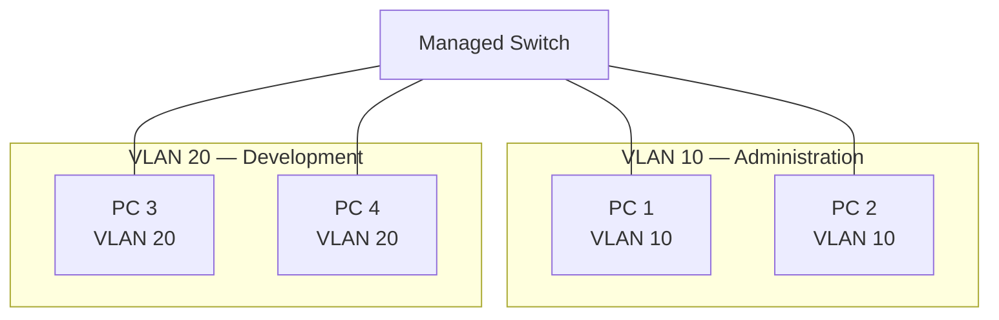
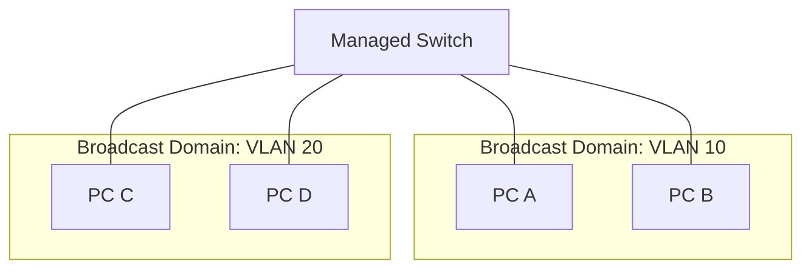
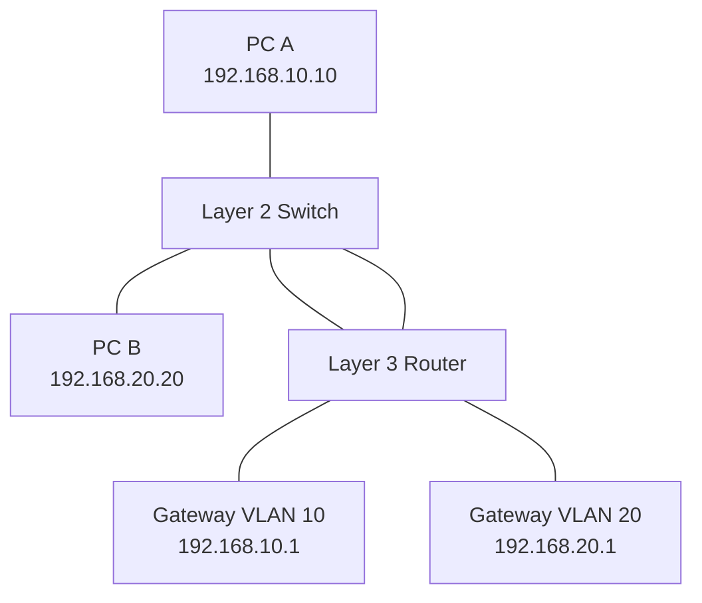

# VLAN Fundamentals

A Virtual Local Area Network (VLAN) is a logical Layer 2 network that divides a physical switched network into multiple isolated broadcast domains.

VLANs allow network administrators to separate devices into logical groups without requiring separate physical switches for every network segment.

For example, an organization can use a single managed switch to create separate networks for:

* Administration
* Development
* Finance
* Human Resources
* Guest devices
* Servers

Each VLAN operates as a separate Layer 2 broadcast domain. Devices in different VLANs cannot communicate directly through ordinary Layer 2 switching. Communication between VLANs requires a Layer 3 routing function.

# 🗁 What Is a VLAN?

A VLAN is a logical grouping of network devices within a switched Ethernet infrastructure.

Devices assigned to the same VLAN can communicate at Layer 2, assuming their connectivity and other forwarding policies permit it.

Devices assigned to different VLANs belong to separate Layer 2 broadcast domains.

Example:



In this example:

* PC 1 and PC 2 belong to VLAN 10.
* PC 3 and PC 4 belong to VLAN 20.
* VLAN 10 and VLAN 20 are separate broadcast domains.
* Communication between the VLANs requires Layer 3 routing.

A VLAN is a logical network boundary, not necessarily a separate physical network device.

# 🗁 Why VLANs Are Used

VLANs provide logical network segmentation and help organize network infrastructure.

### 🖆 Broadcast Domain Separation

Broadcast traffic is normally confined to its VLAN.

For example, an ARP broadcast generated by a device in VLAN 10 is not forwarded into VLAN 20 by ordinary Layer 2 switching.

This limits unnecessary broadcast traffic across unrelated network segments.

### 🖆 Network Security

VLANs can separate devices according to their security requirements.

For example:

```text
VLAN 10: Administration
VLAN 20: Development
VLAN 30: Finance
VLAN 40: Guest
VLAN 50: Servers
```

A firewall or Layer 3 switch can enforce communication policies between these networks.

VLAN separation provides network segmentation, but VLAN membership alone is not a complete security boundary. Appropriate routing policies, firewall rules, and switch security controls are also necessary.

### 🖆 Network Management

VLANs make it easier to organize devices according to:

* Department.
* Business function.
* Security classification.
* Application requirements.
* Physical location.
* Device type.

### 🖆 Flexible Network Design

Devices can belong to the same logical network even when connected to different physical switches.

Trunk links carry multiple VLANs between switches, allowing VLANs to span a switched infrastructure.

### 🖆 Reduced Broadcast Scope

By dividing a large Layer 2 network into smaller broadcast domains, VLANs reduce the scope of broadcast traffic.

This can improve network organization and reduce unnecessary traffic propagation.

# 🗁 VLAN and Broadcast Domains

A broadcast domain is a group of devices that can receive each other's Layer 2 broadcast frames.

Without VLAN segmentation, a switched network generally has one broadcast domain per Layer 2 network.

VLANs divide that switched infrastructure into multiple broadcast domains.

Example:



A broadcast sent by PC A is forwarded to eligible ports in VLAN 10, but not to ports belonging exclusively to VLAN 20.

### 🖆 Important Distinction

* A physical switch can support multiple broadcast domains.
* Each VLAN represents a separate Layer 2 broadcast domain.
* Multiple switches can carry the same VLAN through trunk links.
* Routers normally separate broadcast domains.
* VLANs do not automatically provide communication between IP subnets.

# 🗁 VLAN ID

A VLAN ID identifies a VLAN within an IEEE 802.1Q VLAN-aware network.

The VLAN ID is a 12-bit field in the IEEE 802.1Q tag.

This provides 4096 possible numerical values:

\[
2^{12} = 4096
\]

The values range from 0 through 4095.

However, not every value represents a normal configurable VLAN.

| VLAN ID | Meaning |
| --- | --- |
| 0 | Priority-tagged frame; no VLAN ID is specified |
| 1–4094 | VLAN IDs available for normal VLAN identification, subject to platform restrictions and conventions |
| 4095 | Reserved |

VLAN 1 is commonly the default VLAN on many switches, but its behavior and default membership depend on the vendor.

VLAN 0 is used for priority tagging and does not identify a normal VLAN membership.

VLAN 4095 is reserved.

### 🖆 Example VLAN Plan

| VLAN ID | VLAN Name | Purpose | Example Subnet |
| --- | --- | --- | --- |
| 10 | ADMIN | Administration | 192.168.10.0/24 |
| 20 | DEVELOPMENT | Development | 192.168.20.0/24 |
| 30 | FINANCE | Finance | 192.168.30.0/24 |
| 40 | GUEST | Guest network | 192.168.40.0/24 |
| 50 | SERVERS | Server infrastructure | 192.168.50.0/24 |

These VLAN IDs and IP subnets are an example addressing plan, not a requirement imposed by IEEE 802.1Q.

# 🗁 VLAN Membership

VLAN membership determines which VLANs can use a particular switch port.

A switch port can be configured for different VLAN behaviors depending on the connected device and network design.

Common configurations include:

* Access port: typically carries traffic for one assigned VLAN.
* Trunk port: carries traffic for multiple VLANs.
* Hybrid or general port: may carry both tagged and untagged traffic, depending on vendor implementation.

### 🖆 Access VLAN

An access port normally belongs to one VLAN.

It is commonly used to connect endpoint devices such as:

* Desktop computers.
* Printers.
* IP phones.
* Servers.
* Wireless access points in specific deployment modes.

Example:

```text
Switch Port: ether2
Mode: Access
VLAN ID: 10

Connected Device: Administration PC
```

The endpoint typically sends and receives ordinary untagged Ethernet frames.

The switch associates incoming untagged traffic with the port's configured VLAN.

### 🖆 Trunk VLAN

A trunk port carries traffic for multiple VLANs.

It is commonly used between:

* Switches.
* Routers and switches.
* Firewalls and switches.
* VLAN-aware virtualization hosts.
* Wireless access points supporting multiple SSIDs and VLANs.

Example:

```text
Switch Port: ether24
Mode: Trunk
Allowed VLANs: 10, 20, 30, 40, 50
```

The switch uses VLAN tags to identify the VLAN associated with frames on the trunk.

# 🗁 Tagged and Untagged Traffic

Ethernet frames can carry VLAN identification through IEEE 802.1Q tagging.

### 🖆 Untagged Ethernet Frame

An ordinary Ethernet frame does not contain an IEEE 802.1Q VLAN tag.

Simplified structure:

```text
+------------------+
| Destination MAC  |
+------------------+
| Source MAC       |
+------------------+
| EtherType/Length |
+------------------+
| Payload          |
+------------------+
| FCS              |
+------------------+
```

An access port typically receives untagged frames and associates them with its configured access VLAN.

### 🖆 Tagged Ethernet Frame

A VLAN-tagged Ethernet frame contains an additional four-byte 802.1Q field.

Simplified structure:

```text
+------------------+
| Destination MAC  |
+------------------+
| Source MAC       |
+------------------+
| 802.1Q VLAN Tag  |
+------------------+
| EtherType/Length |
+------------------+
| Payload          |
+------------------+
| FCS              |
+------------------+
```

The 802.1Q tag contains:

* Tag Protocol Identifier (TPID).
* Priority Code Point (PCP).
* Drop Eligible Indicator (DEI).
* VLAN Identifier (VID).

The VLAN ID identifies the VLAN associated with the frame.

The detailed structure and behavior of 802.1Q tagging are covered in `06-802-1q-tagging.md`.

# 🗁 VLAN Communication

Devices in the same VLAN can communicate through Layer 2 switching when their addressing and connectivity are configured correctly.

Devices in different VLANs require Layer 3 routing to communicate.

### 🖆 Same VLAN Communication

Consider:

```text
PC A:
IP Address: 192.168.10.10/24
VLAN: 10

PC B:
IP Address: 192.168.10.20/24
VLAN: 10
```

Both devices belong to VLAN 10 and the same IP subnet.

They can communicate directly through Layer 2 switching.

### 🖆 Different VLAN Communication

Consider:

```text
PC A:
IP Address: 192.168.10.10/24
VLAN: 10

PC B:
IP Address: 192.168.20.20/24
VLAN: 20
```

The devices belong to different VLANs and different IP subnets.

They need a Layer 3 gateway to communicate.



The router or Layer 3 switch routes traffic between the VLAN interfaces.

This process is known as inter-VLAN routing.

# 🗁 VLAN and IP Subnets

VLANs operate at Layer 2, while IP subnets operate at Layer 3.

They are related but represent different networking concepts.

A common enterprise design uses one IP subnet per VLAN.

Example:

| VLAN | Network | Default Gateway |
| --- | --- | --- |
| 10 | 192.168.10.0/24 | 192.168.10.1 |
| 20 | 192.168.20.0/24 | 192.168.20.1 |
| 30 | 192.168.30.0/24 | 192.168.30.1 |

This design makes routing and security policy management easier.

However, VLANs and IP subnets are not inherently the same thing.

A VLAN is a Layer 2 broadcast domain. An IP subnet is a Layer 3 addressing and routing concept.

Network designs generally avoid placing unrelated IP subnets into the same VLAN because it complicates routing, address management, and security policy enforcement.

# 🗁 VLAN-Aware Switches

A VLAN-aware switch understands VLAN membership and processes tagged and untagged Ethernet frames accordingly.

Its responsibilities include:

* Associating access ports with VLANs.
* Processing VLAN-tagged frames on trunk ports.
* Maintaining VLAN-aware MAC forwarding information.
* Flooding broadcasts within the appropriate VLAN.
* Preventing ordinary Layer 2 forwarding between separate VLANs.
* Enforcing configured VLAN membership.

### 🖆 VLAN-Aware MAC Learning

A switch learns MAC addresses within a VLAN context.

Conceptually, the forwarding database uses a combination of VLAN ID and MAC address.

Example:

| VLAN | MAC Address | Port |
| --- | --- | --- |
| 10 | AA:AA:AA:AA:AA:AA | ether2 |
| 10 | BB:BB:BB:BB:BB:BB | ether3 |
| 20 | AA:AA:AA:AA:AA:AA | ether5 |
| 20 | CC:CC:CC:CC:CC:CC | ether6 |

The same MAC address can appear in separate VLAN contexts.

This is important in virtualized environments where the same virtual machine MAC address might appear on different logical networks under different configurations.

# 🗁 VLAN Types

VLANs are often described according to their operational purpose.

### 🖆 Data VLAN

A data VLAN carries ordinary user and application traffic.

Examples include employee computers, application servers, and printers.

### 🖆 Management VLAN

A management VLAN carries administrative traffic used to manage infrastructure devices.

Examples include:

* SSH access.
* SNMP monitoring.
* Web-based switch management.
* Infrastructure administration.

Management traffic should be restricted to authorized systems.

### 🖆 Voice VLAN

A voice VLAN is used for IP telephony traffic.

It can help separate voice traffic from ordinary data traffic and support appropriate QoS policies.

Some switches support automatic voice VLAN assignment for IP phones.

### 🖆 Guest VLAN

A guest VLAN provides network access for visitors and untrusted devices.

It is commonly restricted from accessing internal resources.

### 🖆 Native VLAN

On an IEEE 802.1Q trunk, the native VLAN conventionally identifies the VLAN associated with untagged traffic.

Native VLAN behavior must be configured consistently on both ends of a trunk.

Native VLAN configuration and security are covered in `08-native-vlan.md`.

# 🗁 VLAN Security

VLANs help organize network segmentation, but their security depends on correct configuration.

Common VLAN security concerns include:

* Unauthorized access to sensitive VLANs.
* Incorrect trunk configuration.
* VLAN hopping attacks.
* Native VLAN mismatches.
* Unnecessary VLANs allowed on trunks.
* Misconfigured access ports.
* Insecure management VLAN access.

### 🖆 Security Recommendations

* Disable unused switch ports.
* Assign unused ports to an isolated, unused VLAN.
* Avoid using VLAN 1 as the default for sensitive management traffic.
* Restrict allowed VLANs on trunk ports.
* Configure access ports explicitly.
* Use consistent native VLAN settings.
* Restrict management access using ACLs or firewall policies.
* Use 802.1X where appropriate.
* Monitor unexpected VLAN and MAC address changes.
* Keep switch firmware and software updated.

VLAN separation should be combined with Layer 3 access controls and other security mechanisms.

# 🗁 VLAN Configuration Concepts

VLAN configuration differs between network vendors, but the underlying concepts remain similar.

### 🖆 Cisco IOS Example

Create VLANs:

```bash
configure terminal

vlan 10
 name ADMIN

vlan 20
 name DEVELOPMENT

vlan 30
 name FINANCE

end
```

Assign an access port to VLAN 10:

```bash
configure terminal

interface gigabitEthernet 0/1
 switchport mode access
 switchport access vlan 10

end
```

Verify VLAN configuration:

```bash
show vlan brief
```

This is a conceptual Cisco IOS example. Exact syntax and supported commands vary by platform and software version.

### 🖆 MikroTik RouterOS v7 Concepts

MikroTik RouterOS supports VLAN-aware bridging.

Important concepts include:

* Bridge interface.
* Bridge ports.
* VLAN filtering.
* PVID.
* Tagged VLAN membership.
* Untagged VLAN membership.
* Bridge VLAN table.

Example of creating a bridge:

```routeros
/interface bridge
add name=bridge1 vlan-filtering=no
```

Add ports:

```routeros
/interface bridge port
add bridge=bridge1 interface=ether2 pvid=10
add bridge=bridge1 interface=ether3 pvid=20
```

Configure VLAN membership:

```routeros
/interface bridge vlan
add bridge=bridge1 vlan-ids=10 untagged=ether2
add bridge=bridge1 vlan-ids=20 untagged=ether3
```

Before enabling VLAN filtering, ensure the bridge VLAN table includes the required tagged and untagged membership, including the bridge CPU port where Layer 3 access through the bridge is needed.

RouterOS bridge VLAN configuration is covered in greater detail in the MikroTik section of this knowledge base.

# 🗁 Common VLAN Problems

### 🖆 Devices in the Same VLAN Cannot Communicate

Possible causes:

* Incorrect VLAN assignment.
* Port is administratively down.
* Incorrect IP addressing.
* Incorrect subnet mask.
* Duplicate IP address.
* VLAN not allowed on an intermediate trunk.
* Incorrect bridge VLAN membership.

### 🖆 Devices in Different VLANs Cannot Communicate

Possible causes:

* Inter-VLAN routing is not configured.
* Default gateway is incorrect.
* Routing interface is down.
* Firewall rules block traffic.
* VLAN interfaces are incorrectly configured.

Different VLANs are isolated at Layer 2 by design. Routing must be configured when communication is required.

### 🖆 VLAN Missing on a Trunk

Possible causes:

* VLAN not created on a switch.
* VLAN not included in the trunk's allowed VLAN list.
* Incorrect tagged membership.
* Incorrect bridge VLAN table.
* Configuration mismatch between connected switches.

### 🖆 Native VLAN Mismatch

A native VLAN mismatch can cause untagged traffic to be associated with different VLANs at opposite ends of a trunk.

This can result in unexpected connectivity, traffic leakage, or security issues.

### 🖆 Unexpected Broadcast Traffic

Possible causes:

* Incorrect VLAN membership.
* VLAN-aware forwarding misconfiguration.
* Layer 2 loops.
* Incorrect trunk configuration.
* Unexpected devices connected to access ports.

# 🗁 Best Practices

* Design a clear VLAN numbering scheme.
* Use descriptive VLAN names.
* Maintain a VLAN inventory.
* Separate user, server, guest, and management traffic.
* Use one IP subnet per VLAN as a practical design convention.
* Configure access and trunk ports explicitly.
* Restrict trunk ports to required VLANs.
* Keep native VLAN configuration consistent.
* Avoid unnecessary VLAN extension across the network.
* Use Layer 3 policies to control inter-VLAN communication.
* Monitor VLAN membership and MAC forwarding entries.
* Document VLAN IDs, subnets, gateways, and switch ports.

# 🗁 Practical Exercises

### 🖆 Exercise: Design a VLAN Plan

Design a small office network using these departments:

* Administration.
* Development.
* Finance.
* Guest.
* Servers.

For each VLAN, define:

* VLAN ID.
* VLAN name.
* IP subnet.
* Default gateway.
* DHCP scope.
* Access policy.

### 🖆 Exercise: Create VLANs on a Managed Switch

* Create VLAN 10 and VLAN 20.
* Assign two access ports to VLAN 10.
* Assign two access ports to VLAN 20.
* Connect devices to the respective ports.
* Verify that devices within the same VLAN can communicate.
* Verify that devices in different VLANs cannot communicate without routing.

### 🖆 Exercise: Configure a Trunk

* Connect two managed switches.
* Create VLAN 10 and VLAN 20 on both switches.
* Configure the inter-switch connection as a trunk.
* Allow VLANs 10 and 20.
* Connect endpoint devices to both switches.
* Verify same-VLAN communication across the trunk.

### 🖆 Exercise: Investigate VLAN Isolation

* Generate broadcast traffic from VLAN 10.
* Capture traffic on VLAN 20.
* Verify that ordinary VLAN 10 broadcasts are not forwarded into VLAN 20.
* Explain the role of VLAN-aware forwarding.

# 🗁 Interview Questions

### 🖆 Fundamental Questions

* What is a VLAN?
* Why are VLANs used?
* At which OSI layer does VLAN operate?
* What is a broadcast domain?
* How does a VLAN reduce broadcast traffic?
* What is a VLAN ID?
* What is the difference between a VLAN and a subnet?

### 🖆 Intermediate Questions

* What is the difference between access and trunk ports?
* What is tagged and untagged traffic?
* How many VLAN IDs are available in IEEE 802.1Q?
* What is a management VLAN?
* What is a voice VLAN?
* Can devices in different VLANs communicate directly?
* How does a VLAN-aware switch learn MAC addresses?

### 🖆 Advanced Questions

* How does VLAN isolation work?
* What is VLAN hopping?
* What is a native VLAN?
* Why should trunk VLANs be restricted?
* Can multiple VLANs exist on one physical switch?
* Can the same VLAN span multiple switches?
* Why is one IP subnet per VLAN a common design convention?
* How does a Layer 3 switch provide inter-VLAN routing?

# 🗁 Summary

A VLAN is a logical Layer 2 network that divides a switched infrastructure into separate broadcast domains.

VLANs provide logical segmentation, improve network organization, reduce broadcast scope, and support security-oriented network designs.

Important concepts include:

* VLAN IDs.
* Broadcast domain separation.
* Access and trunk ports.
* Tagged and untagged frames.
* VLAN membership.
* VLAN-aware MAC learning.
* Data, management, voice, and guest VLANs.
* VLAN security.
* Inter-VLAN routing.

Understanding VLAN fundamentals is essential before learning trunking, IEEE 802.1Q tagging, native VLAN configuration, and inter-VLAN routing.

# 🗁 References

* [IEEE 802.1 — LAN/MAN Standards](https://www.ieee802.org/1/)
* [IEEE 802.1Q — Bridges and Bridged Networks](https://standards.ieee.org/ieee/802.1Q/10323/)
* [Cisco — VLAN Configuration Guide](https://www.cisco.com/c/en/us/support/docs/lan-switching/vlans/)
* [MikroTik — Bridging and Switching](https://help.mikrotik.com/docs/spaces/ROS/pages/328068/Bridging%2Band%2BSwitching)
* [Linux Kernel — Bridge Documentation](https://docs.kernel.org/networking/bridge.html)
