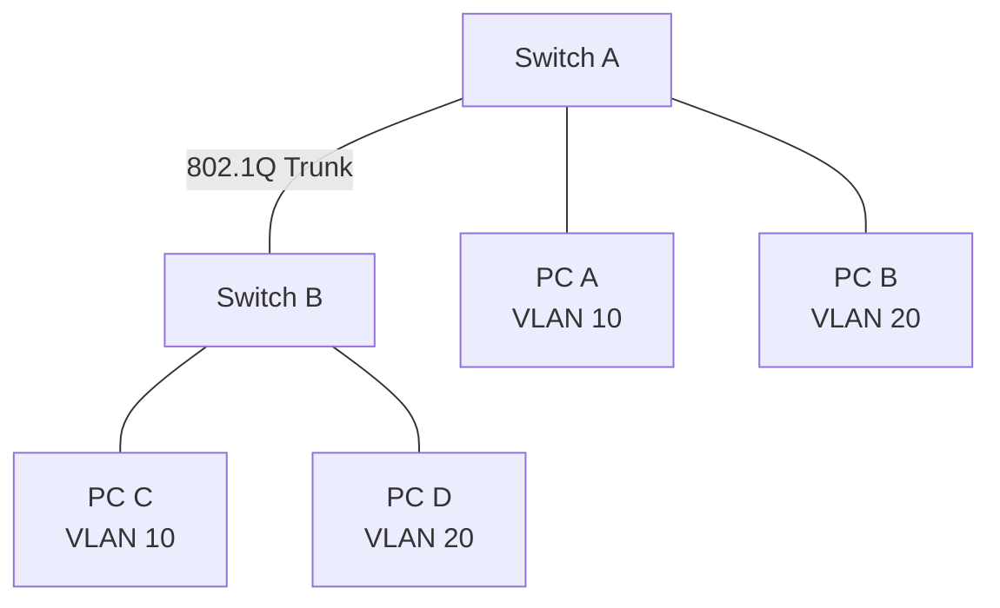
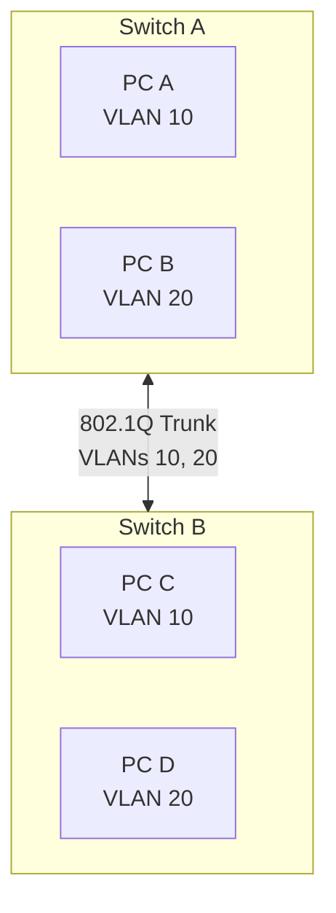

# Access and Trunk Ports

Access ports and trunk ports are two fundamental port configurations used in VLAN-aware Ethernet networks.

An **access port** typically carries traffic for a single VLAN and connects endpoint devices such as computers, printers, and servers.

A **trunk port** carries traffic for multiple VLANs and is commonly used to connect switches, routers, firewalls, and virtualization hosts.

Understanding the difference between access and trunk ports is essential for designing, configuring, and troubleshooting VLAN-based networks.

# 🗁 What Is an Access Port?

An access port is a switch port configured to carry traffic for a single VLAN in a typical access-port configuration.

It is commonly used to connect end-user devices that do not need to understand VLAN tagging.

Examples include:

* Desktop computers.
* Laptop computers.
* Network printers.
* Standard servers.
* IP cameras.
* IoT devices.

An endpoint connected to an access port usually sends and receives ordinary untagged Ethernet frames.

The switch associates incoming untagged frames with the VLAN configured on that port.

### 🖆 Access Port Example

```text
             Managed Switch

       +------------------------+
       |                        |
       |       VLAN 10          |
       |                        |
       |  ether1    ether2      |
       +----+---------+---------+
            |         |
          PC 1      PC 2
        VLAN 10   VLAN 10
```

Both computers belong to VLAN 10.

The switch internally associates their traffic with VLAN 10, even though the computers normally send untagged Ethernet frames.

### 🖆 Access Port Characteristics

* Typically carries one VLAN.
* Usually sends untagged frames to connected endpoints.
* Associates incoming untagged frames with an assigned VLAN.
* Commonly connects end-user devices.
* Does not normally require VLAN configuration on the endpoint.
* Separates endpoint traffic from other VLANs.

# 🗁 What Is a Trunk Port?

A trunk port carries traffic for multiple VLANs over a single physical connection.

It is commonly used between network infrastructure devices.

Examples include:

* Switch-to-switch connections.
* Router-to-switch connections.
* Firewall-to-switch connections.
* Virtualization hosts.
* VLAN-aware wireless access points.

IEEE 802.1Q tagging is commonly used to identify VLANs carried across a trunk.

### 🖆 Trunk Port Example



The trunk connection carries traffic for VLAN 10 and VLAN 20.

Devices in the same VLAN can communicate across both switches through the trunk, assuming VLAN membership and other forwarding conditions are correct.

### 🖆 Trunk Port Characteristics

* Carries multiple VLANs.
* Commonly uses IEEE 802.1Q tags.
* Connects network infrastructure devices.
* Can transport traffic for multiple broadcast domains.
* Supports VLAN extension across switches.
* Can restrict which VLANs are permitted.

# 🗁 Access Port vs Trunk Port

| Feature | Access Port | Trunk Port |
| --- | --- | --- |
| VLANs carried | Typically one | Multiple |
| Common use | Endpoint connection | Infrastructure connection |
| Frame tagging | Usually untagged toward endpoint | Usually tagged |
| VLAN assignment | Access VLAN | VLAN membership and tagging rules |
| Typical connection | PC, printer, camera | Switch, router, firewall |
| Configuration complexity | Lower | Higher |
| VLAN extension | One VLAN | Multiple VLANs |

An access port and a trunk port are not simply different physical port types. They are logical configurations that determine how a switch handles VLAN traffic.

# 🗁 How Access Ports Work

An access port associates incoming untagged Ethernet frames with its configured VLAN.

Consider a switch port configured for VLAN 10.

```text
PC
 |
 | Untagged Ethernet Frame
 |
 v
Switch Port: ether1
 |
 | Assign VLAN 10
 |
 v
VLAN 10 Forwarding Domain
```

When the PC sends an untagged frame:

* The switch receives the frame.
* The switch associates it with VLAN 10.
* The switch performs VLAN-aware MAC learning.
* The switch forwards the frame according to the destination MAC address and VLAN membership.

When the switch sends traffic toward the access port, it normally removes the VLAN tag so the endpoint receives an ordinary untagged Ethernet frame.

### 🖆 Access Port Example

```text
Port: ether1
Mode: Access
Access VLAN: 10

Incoming traffic:
Untagged frame

Internal VLAN:
10

Outgoing traffic:
Untagged frame
```

### 🖆 Important Consideration

An access port is generally intended for untagged endpoint traffic.

However, some devices support VLAN tagging even when connected to an access-configured port. The switch's handling of tagged ingress frames depends on the vendor and configuration.

Do not assume every access port automatically rejects all tagged frames.

# 🗁 How Trunk Ports Work

A trunk port carries traffic associated with multiple VLANs.

The switch uses VLAN tags to identify the VLAN associated with each tagged Ethernet frame.

Example:

```text
             Switch A

        VLAN 10    VLAN 20
           |          |
           +-----+----+
                 |
            Trunk Port
                 |
          802.1Q Ethernet
                 |
            Trunk Port
                 |
             Switch B
```

Suppose the trunk carries VLANs 10, 20, and 30.

The transmitted frames can contain different VLAN identifiers:

| Frame | VLAN ID |
| --- | ---: |
| Frame A | 10 |
| Frame B | 20 |
| Frame C | 30 |

The receiving switch reads the VLAN tag and processes each frame in the corresponding VLAN.

### 🖆 Trunk Configuration Example

```text
Port: ether24
Mode: Trunk

Allowed VLANs:
10, 20, 30

Tagging:
802.1Q
```

The trunk carries only the VLANs permitted by its configuration.

# 🗁 Tagged and Untagged Frames on Ports

Understanding frame tagging is essential for understanding access and trunk behavior.

### 🖆 Untagged Frames

An untagged Ethernet frame does not contain an IEEE 802.1Q VLAN tag.

An ordinary endpoint connected to an access port usually sends untagged frames.

The switch associates the frame with the port's configured VLAN.

### 🖆 Tagged Frames

A tagged Ethernet frame contains an IEEE 802.1Q VLAN header.

The VLAN ID identifies the VLAN associated with the frame.

Example:

```text
+----------------------+
| Destination MAC      |
+----------------------+
| Source MAC           |
+----------------------+
| 802.1Q VLAN Tag      |
| VLAN ID: 20          |
+----------------------+
| EtherType            |
+----------------------+
| Payload              |
+----------------------+
| FCS                  |
+----------------------+
```

Tagged frames are commonly used on trunk links.

### 🖆 Port Behavior Summary

| Port Configuration | Incoming Frame | Typical Processing |
| --- | --- | --- |
| Access VLAN 10 | Untagged | Associate with VLAN 10 |
| Trunk | Tagged VLAN 10 | Associate with VLAN 10 if permitted |
| Trunk | Tagged VLAN 20 | Associate with VLAN 20 if permitted |
| Trunk | Untagged | Associate with native/PVID VLAN, depending on configuration |
| Access VLAN 10 | Tagged VLAN 20 | Vendor-dependent; may be rejected or handled according to configuration |

# 🗁 Allowed VLAN List

A trunk port can be configured to carry only specific VLANs.

This is known as an allowed VLAN list.

For example:

```text
Trunk Port: ether24

Allowed VLANs:
10, 20, 30
```

Traffic belonging to VLANs outside this list is not forwarded through the trunk under normal VLAN filtering behavior.

### 🖆 Why Allowed VLAN Lists Matter

* Reduce unnecessary VLAN propagation.
* Limit the scope of broadcast traffic.
* Improve network organization.
* Reduce exposure to unintended VLAN connectivity.
* Help enforce network segmentation.

### 🖆 Example

Consider two switches:

```text
Switch A                    Switch B

VLAN 10 -------------------- VLAN 10
VLAN 20 -------------------- VLAN 20
VLAN 30 -------------------- VLAN 30

          Trunk Link
       Allowed: 10, 20
```

VLAN 10 and VLAN 20 can cross the trunk.

VLAN 30 is not permitted across that connection.

### 🖆 Best Practice

Allow only the VLANs required on each trunk.

Avoid unnecessarily allowing every configured VLAN across every trunk.

# 🗁 Native VLAN and PVID

A trunk may carry untagged traffic in addition to tagged traffic.

The native VLAN is the VLAN associated with untagged traffic on an IEEE 802.1Q trunk under the common native-VLAN model.

The term **PVID (Port VLAN ID)** is commonly used to describe the VLAN assigned to untagged ingress traffic on a port.

Although related, native VLAN and PVID are not universally interchangeable terms across all vendors and configurations.

### 🖆 Native VLAN Example

```text
Trunk Port:
Allowed VLANs: 10, 20, 30
Native VLAN: 99

Tagged:
VLAN 10
VLAN 20
VLAN 30

Untagged:
VLAN 99
```

In this example, untagged traffic received on the trunk is associated with VLAN 99.

The exact egress behavior depends on the trunk's native VLAN and tagging configuration.

### 🖆 Important Considerations

* Both ends of a trunk should have consistent native VLAN settings.
* Avoid using an ordinary user VLAN as the native VLAN when a dedicated native VLAN is appropriate.
* Ensure untagged traffic is handled intentionally.
* Do not confuse the native VLAN with the complete allowed VLAN list.

Native VLAN configuration is covered in detail in `08-native-vlan.md`.

# 🗁 Connecting Two Switches with a Trunk

Consider an office network with two managed switches.

Both switches have VLAN 10 and VLAN 20.



Expected behavior:

| Source | Destination | Expected Result |
| --- | --- | --- |
| PC A, VLAN 10 | PC C, VLAN 10 | Layer 2 communication |
| PC B, VLAN 20 | PC D, VLAN 20 | Layer 2 communication |
| PC A, VLAN 10 | PC B, VLAN 20 | Requires Layer 3 routing |

The trunk preserves VLAN separation while carrying multiple VLANs across one physical connection.

# 🗁 Cisco Access Port Configuration

The following example uses Cisco IOS-style commands.

### 🖆 Create VLANs

```bash
configure terminal

vlan 10
 name ADMIN

vlan 20
 name DEVELOPMENT

end
```

### 🖆 Configure an Access Port

Assign GigabitEthernet 0/1 to VLAN 10:

```bash
configure terminal

interface gigabitEthernet 0/1
 switchport mode access
 switchport access vlan 10
 no shutdown

end
```

### 🖆 Verify Access Port Configuration

```bash
show vlan brief
```

Inspect the interface:

```bash
show interfaces gigabitEthernet 0/1 switchport
```

# 🗁 Cisco Trunk Port Configuration

Configure GigabitEthernet 0/24 as a trunk.

```bash
configure terminal

interface gigabitEthernet 0/24
 switchport mode trunk
 switchport trunk allowed vlan 10,20
 no shutdown

end
```

On platforms that require an explicit encapsulation command, configure the supported trunk encapsulation before enabling trunk mode. Many modern Cisco switches support only IEEE 802.1Q.

### 🖆 Verify Trunk Configuration

```bash
show interfaces trunk
```

Inspect the interface:

```bash
show interfaces gigabitEthernet 0/24 switchport
```

Check VLAN information:

```bash
show vlan brief
```

Exact commands and trunk negotiation behavior vary across Cisco platforms.

# 🗁 MikroTik RouterOS v7 Access Port Configuration

MikroTik RouterOS v7 commonly implements VLAN-aware switching through bridge VLAN filtering.

The following example creates a bridge and configures two access-style ports.

### 🖆 Create a Bridge

```routeros
/interface bridge
add name=bridge1 vlan-filtering=no
```

### 🖆 Add Access Ports

```routeros
/interface bridge port
add bridge=bridge1 interface=ether2 pvid=10
add bridge=bridge1 interface=ether3 pvid=20
```

The PVID associates untagged ingress traffic with the configured VLAN.

### 🖆 Configure VLAN Membership

```routeros
/interface bridge vlan
add bridge=bridge1 vlan-ids=10 untagged=ether2
add bridge=bridge1 vlan-ids=20 untagged=ether3
```

This establishes untagged egress membership for the respective access ports.

For a complete production configuration, account for the bridge CPU port, management access, and any required tagged VLAN membership before enabling VLAN filtering.

# 🗁 MikroTik RouterOS v7 Trunk Port Configuration

A trunk port carries multiple VLANs using tagged Ethernet frames.

Assume:

```text
Bridge: bridge1
Access Port: ether2
Access Port: ether3
Trunk Port: ether4

VLAN 10:
Access Port ether2

VLAN 20:
Access Port ether3

Trunk:
ether4
```

### 🖆 Configure the Trunk Port

Add the interface to the bridge:

```routeros
/interface bridge port
add bridge=bridge1 interface=ether4
```

### 🖆 Configure VLAN Membership

```routeros
/interface bridge vlan
add bridge=bridge1 vlan-ids=10 tagged=ether4 untagged=ether2
add bridge=bridge1 vlan-ids=20 tagged=ether4 untagged=ether3
```

The trunk port carries VLANs 10 and 20 tagged.

The access ports carry their respective VLANs untagged.

### 🖆 Enable VLAN Filtering

After verifying the bridge VLAN table and required management connectivity:

```routeros
/interface bridge
set bridge1 vlan-filtering=yes
```

### 🖆 Verify Configuration

```routeros
/interface bridge port print
```

```routeros
/interface bridge vlan print
```

```routeros
/interface bridge host print
```

**Important:** On MikroTik, the bridge itself represents the CPU-facing bridge port. If the router needs Layer 3 access to a VLAN, the bridge interface must be included as a tagged member of that VLAN, and an appropriate VLAN interface must be configured. Omitting this can prevent management or routing access through that VLAN.

# 🗁 Linux Bridge Access and Trunk Concepts

Linux supports VLAN-aware bridges through the kernel bridge implementation.

A VLAN-aware bridge can associate untagged ingress traffic with a PVID and forward tagged traffic for configured VLANs.

### 🖆 Create a VLAN-Aware Bridge

```bash
sudo ip link add name br0 type bridge
sudo ip link set dev br0 type bridge vlan_filtering 1
```

### 🖆 Add Interfaces

```bash
sudo ip link set enp2s0 master br0
sudo ip link set enp3s0 master br0
```

Bring the interfaces up:

```bash
sudo ip link set enp2s0 up
sudo ip link set enp3s0 up
sudo ip link set br0 up
```

### 🖆 Configure Access-Style Membership

Assign VLAN 10 to `enp2s0`:

```bash
sudo bridge vlan add dev enp2s0 vid 10 pvid untagged
```

Assign VLAN 20 to `enp3s0`:

```bash
sudo bridge vlan add dev enp3s0 vid 20 pvid untagged
```

### 🖆 Configure a Trunk-Style Port

For a trunk carrying VLANs 10 and 20:

```bash
sudo bridge vlan add dev enp3s0 vid 10
sudo bridge vlan add dev enp3s0 vid 20
```

This example is illustrative: an interface cannot simultaneously be configured as an access port for one VLAN and a trunk for other VLANs without carefully defining the intended membership and PVID behavior.

Inspect the VLAN table:

```bash
bridge vlan show
```

For a complete setup, define the bridge's own VLAN membership when the host needs to participate in the VLANs, and configure any untagged PVID deliberately.

# 🗁 Access and Trunk Port Security

Incorrect port configurations can expose VLANs to unauthorized devices or create unintended network paths.

### 🖆 Access Port Security

* Configure the intended access VLAN explicitly.
* Disable unused ports.
* Use port security where supported.
* Enable 802.1X authentication where appropriate.
* Prevent unauthorized trunk negotiation.
* Restrict access to sensitive endpoint VLANs.

### 🖆 Trunk Port Security

* Allow only required VLANs.
* Configure trunk mode explicitly.
* Disable unnecessary automatic trunk negotiation.
* Use a dedicated native VLAN where appropriate.
* Ensure consistent native VLAN configuration.
* Avoid connecting untrusted endpoint devices directly to unrestricted trunks.
* Monitor unexpected VLAN membership changes.

# 🗁 Common Access and Trunk Port Problems

### 🖆 Incorrect Access VLAN

A device may receive an incorrect IP address or fail to communicate because its switch port belongs to the wrong VLAN.

Inspect the VLAN assignment:

```bash
show vlan brief
```

On MikroTik:

```routeros
/interface bridge port print
```

### 🖆 VLAN Not Allowed on Trunk

A VLAN may work locally on one switch but fail to reach devices connected to another switch.

Check the trunk's allowed VLAN list:

```bash
show interfaces trunk
```

### 🖆 Native VLAN Mismatch

If the two ends of a trunk use different native VLANs, untagged traffic may enter different VLANs on each side.

Verify native VLAN configuration at both ends.

### 🖆 Incorrect PVID

If the PVID is incorrect, untagged ingress traffic may be assigned to an unexpected VLAN.

Inspect:

```routeros
/interface bridge port print detail
```

### 🖆 Tagged Traffic Rejected

A trunk may reject traffic when:

* The VLAN is not allowed.
* The VLAN does not exist in the relevant forwarding domain.
* The bridge VLAN table is incomplete.
* The receiving port has an incorrect tagging configuration.

### 🖆 Incorrect Bridge VLAN Membership

On Linux:

```bash
bridge vlan show
```

On MikroTik:

```routeros
/interface bridge vlan print detail
```

Verify tagged and untagged membership for every relevant port.

# 🗁 Best Practices

* Use access ports for ordinary endpoint connections.
* Use trunk ports for connections that need multiple VLANs.
* Configure VLAN membership explicitly.
* Restrict trunk allowed VLAN lists.
* Use descriptive VLAN names.
* Keep trunk configuration consistent at both ends.
* Configure native VLAN behavior intentionally.
* Avoid unnecessary untagged traffic on infrastructure trunks.
* Disable unused switch ports.
* Monitor MAC address learning and VLAN membership.
* Document access ports, trunk ports, and connected devices.
* Test VLAN connectivity after every configuration change.

# 🗁 Practical Exercises

### 🖆 Exercise: Configure Access Ports

Using a managed switch or network simulator:

* Create VLAN 10 and VLAN 20.
* Assign two ports to VLAN 10.
* Assign two ports to VLAN 20.
* Connect endpoint devices.
* Verify communication between devices in the same VLAN.
* Verify that devices in different VLANs remain isolated.

### 🖆 Exercise: Configure a Trunk

* Connect two managed switches.
* Create VLAN 10 and VLAN 20 on both switches.
* Configure the inter-switch connection as a trunk.
* Allow VLANs 10 and 20.
* Connect one device from each VLAN to both switches.
* Test same-VLAN communication across the trunk.

### 🖆 Exercise: Restrict Allowed VLANs

* Configure a trunk to allow VLANs 10 and 20.
* Create VLAN 30.
* Attempt to carry VLAN 30 across the trunk.
* Verify that VLAN 30 is not forwarded through the restricted trunk.
* Add VLAN 30 to the allowed list.
* Test connectivity again.

### 🖆 Exercise: Inspect Tagged Frames

Using Wireshark or `tcpdump`:

* Capture traffic on a trunk connection.
* Generate traffic for multiple VLANs.
* Identify 802.1Q VLAN tags.
* Inspect the VLAN ID field.
* Compare tagged trunk traffic with untagged access-port traffic.

# 🗁 Interview Questions

### 🖆 Fundamental Questions

* What is an access port?
* What is a trunk port?
* What is the main difference between access and trunk ports?
* Why are access ports commonly used for endpoint devices?
* Why are trunk ports commonly used between switches?
* What is an 802.1Q tag?

### 🖆 Intermediate Questions

* How does a switch identify VLAN traffic on an access port?
* What is an allowed VLAN list?
* What happens when a VLAN is missing from a trunk's allowed list?
* What is the purpose of a PVID?
* What is the native VLAN?
* Can a trunk carry untagged traffic?
* Can an access port receive tagged frames?

### 🖆 Advanced Questions

* How does VLAN tagging work across multiple switches?
* What happens when native VLAN configurations do not match?
* How does a VLAN-aware Linux bridge process tagged and untagged traffic?
* Why must MikroTik bridge VLAN membership include the bridge CPU port when the router needs access to a VLAN?
* Why should trunk VLANs be restricted?
* How can incorrect access-port configuration cause a VLAN security issue?

# 🗁 Summary

Access ports and trunk ports control how Ethernet switches handle VLAN traffic.

An access port typically carries one VLAN and connects endpoint devices using untagged Ethernet frames.

A trunk port carries multiple VLANs and commonly uses IEEE 802.1Q tags to identify the VLAN associated with each frame.

Important concepts include:

* Access VLAN assignment.
* Trunk VLAN membership.
* Tagged and untagged frames.
* Allowed VLAN lists.
* Native VLAN.
* PVID.
* Cisco access and trunk configuration.
* MikroTik bridge VLAN configuration.
* Linux VLAN-aware bridging.
* Port security and troubleshooting.

Understanding access and trunk ports provides the foundation for configuring IEEE 802.1Q VLAN tagging across interconnected switches.

# 🗁 References

* [IEEE 802.1 — LAN/MAN Standards](https://www.ieee802.org/1/)
* [IEEE 802.1Q — Bridges and Bridged Networks](https://standards.ieee.org/ieee/802.1Q/10323/)
* [Cisco — VLAN Configuration Guide](https://www.cisco.com/c/en/us/support/docs/lan-switching/vlans/)
* [MikroTik — Bridging and Switching](https://help.mikrotik.com/docs/spaces/ROS/pages/328068/Bridging%2Band%2BSwitching)
* [Linux Kernel — Bridge Documentation](https://docs.kernel.org/networking/bridge.html)
* [Linux `bridge` Manual](https://man7.org/linux/man-pages/man8/bridge.8.html)
