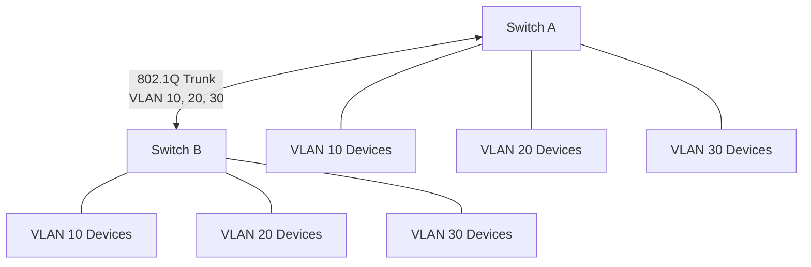
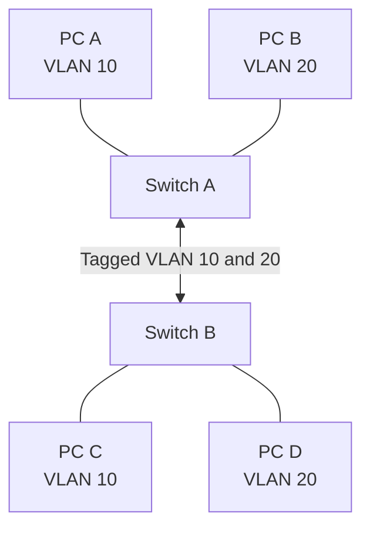
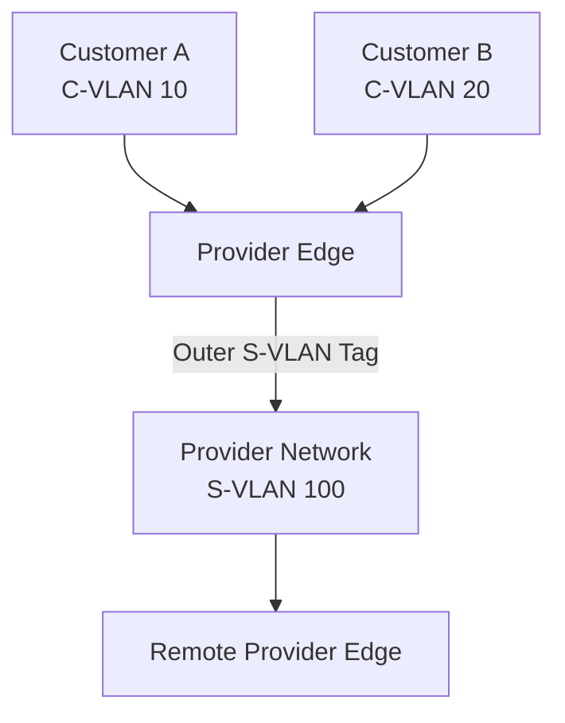

# IEEE 802.1Q Tagging

IEEE 802.1Q is a networking standard that defines how VLAN information is carried in Ethernet frames.

It allows multiple VLANs to share the same physical Ethernet infrastructure while maintaining logical Layer 2 separation.

When an Ethernet frame travels across a VLAN-aware trunk, an IEEE 802.1Q tag identifies the VLAN associated with that frame.

The tag contains VLAN identification and priority information, allowing switches to forward traffic correctly across multiple VLANs.

IEEE 802.1Q is fundamental to modern Ethernet switching, enterprise networks, virtualization, and service-provider Ethernet infrastructures.

# 🗁 What Is IEEE 802.1Q?

IEEE 802.1Q is the standard for bridges and bridged networks, including VLAN identification and related traffic-handling mechanisms.

It defines how VLAN information is represented in Ethernet frames.

Without VLAN tagging, an ordinary Ethernet frame does not explicitly contain a VLAN identifier.

IEEE 802.1Q inserts a four-byte VLAN tag into the Ethernet frame.

This allows a single physical connection to transport frames belonging to multiple VLANs.

### 🖆 Example

Suppose two switches need to transport traffic for VLAN 10, VLAN 20, and VLAN 30.

Instead of using a separate physical cable for each VLAN, they can use one trunk connection.



The VLAN tag identifies the VLAN associated with each frame as it travels across the trunk.

# 🗁 Ethernet Frame Without VLAN Tag

An ordinary Ethernet II frame contains the following fields:

```text
+---------------------------+
| Destination MAC (6 bytes) |
+---------------------------+
| Source MAC (6 bytes)      |
+---------------------------+
| EtherType (2 bytes)       |
+---------------------------+
| Payload (46-1500 bytes)   |
+---------------------------+
| FCS (4 bytes)             |
+---------------------------+
```

The EtherType field identifies the encapsulated protocol.

Common examples include:

| EtherType | Protocol |
| --- | --- |
| `0x0800` | IPv4 |
| `0x0806` | ARP |
| `0x86DD` | IPv6 |

An ordinary untagged Ethernet frame does not contain an explicit VLAN ID.

A switch can still associate an untagged frame with a VLAN using the ingress port's VLAN configuration, such as its PVID.

# 🗁 Ethernet Frame With IEEE 802.1Q Tag

IEEE 802.1Q inserts a four-byte tag between the source MAC address and the original EtherType/Length field.

The tagged Ethernet frame has this structure:

```text
+---------------------------+
| Destination MAC (6 bytes) |
+---------------------------+
| Source MAC (6 bytes)      |
+---------------------------+
| TPID (2 bytes)            |
+---------------------------+
| TCI (2 bytes)             |
|   PCP (3 bits)            |
|   DEI (1 bit)             |
|   VID (12 bits)           |
+---------------------------+
| Original EtherType (2 B)  |
+---------------------------+
| Payload                   |
+---------------------------+
| FCS (4 bytes)             |
+---------------------------+
```

The four-byte tag consists of:

* TPID: Tag Protocol Identifier.
* TCI: Tag Control Information.

The TCI field contains three subfields:

* PCP: Priority Code Point.
* DEI: Drop Eligible Indicator.
* VID: VLAN Identifier.

# 🗁 Tag Protocol Identifier (TPID)

TPID identifies the type of tag inserted into the Ethernet frame.

For the commonly used IEEE 802.1Q customer VLAN tag, the TPID is:

```text
0x8100
```

This value tells the receiving device that the following two bytes contain VLAN tag control information.

### 🖆 Example

```text
Destination MAC: AA:AA:AA:AA:AA:AA
Source MAC:      BB:BB:BB:BB:BB:BB
TPID:            0x8100
TCI:             0xA00A
EtherType:       0x0800
```

The TPID identifies the VLAN tag format, while the TCI contains priority and VLAN identification information.

Other tag protocols and service-provider configurations may use different TPID values, such as `0x88A8` for a service VLAN tag.

# 🗁 Priority Code Point (PCP)

PCP is a three-bit field within the 802.1Q tag.

It provides Layer 2 traffic priority information.

Because PCP has three bits, it supports eight possible values:

\[
2^3 = 8
\]

The values range from 0 through 7.

### 🖆 PCP Values

| PCP | Common Priority Name | Traffic Category |
| ---: | --- | --- |
| 0 | Best Effort | Default traffic |
| 1 | Background | Background traffic |
| 2 | Spare | Low-priority traffic |
| 3 | Excellent Effort | Business-critical traffic |
| 4 | Controlled Load | Streaming applications |
| 5 | Video | Video traffic |
| 6 | Voice | Voice traffic |
| 7 | Network Control | Network control traffic |

These names follow the commonly used IEEE priority mapping.

PCP is used by network devices to classify and prioritize traffic.

For example, an Ethernet switch may give voice traffic higher forwarding priority than ordinary background traffic.

### 🖆 Important Consideration

PCP does not automatically guarantee bandwidth or low latency.

Network devices must be configured to map PCP values into appropriate traffic queues and scheduling policies.

PCP is also a Layer 2 priority mechanism. It is related to, but distinct from, IP-layer Differentiated Services Code Point (DSCP).

# 🗁 Drop Eligible Indicator (DEI)

DEI is a one-bit field within the 802.1Q tag.

It indicates whether a frame is eligible to be dropped during congestion.

It supports congestion-management decisions in Ethernet networks.

### 🖆 DEI Values

| DEI | Meaning |
| ---: | --- |
| 0 | Frame is not marked as drop eligible |
| 1 | Frame is marked as drop eligible |

A network device experiencing congestion may prefer dropping frames marked with DEI 1.

DEI does not itself discard frames. It provides information that network equipment can use when making congestion-related forwarding decisions.

# 🗁 VLAN Identifier (VID)

VID is a 12-bit field used to identify the VLAN associated with a tagged Ethernet frame.

A 12-bit field provides 4096 possible numerical values:

\[
2^{12} = 4096
\]

The values range from 0 to 4095.

| VID | Meaning |
| ---: | --- |
| 0 | Priority-tagged frame; no VLAN membership is specified by the VID |
| 1–4094 | VLAN identification values |
| 4095 | Reserved |

### 🖆 Example

```text
TPID: 0x8100
PCP:  0
DEI:  0
VID:  10
```

The frame belongs to VLAN 10.

The receiving switch uses this information to process the frame within the correct VLAN forwarding domain.

### 🖆 VLAN ID vs VLAN Name

A VLAN ID is a numerical identifier used in frame processing.

A VLAN name is an administrative label used to make network configuration easier to understand.

Example:

```text
VLAN ID:   10
VLAN Name: ADMIN
```

The Ethernet tag carries the numerical VLAN ID, not the descriptive VLAN name.

# 🗁 Understanding the TCI Field

The Tag Control Information field is 16 bits long.

Its structure is:

```text
+----------------+-----------+----------------+
| PCP (3 bits)   | DEI (1)   | VID (12 bits)  |
+----------------+-----------+----------------+
```

Bit allocation:

| Field | Bit Positions | Size |
| --- | --- | ---: |
| PCP | 15–13 | 3 bits |
| DEI | 12 | 1 bit |
| VID | 11–0 | 12 bits |

### 🖆 Example TCI Calculation

Consider:

```text
PCP = 5
DEI = 0
VID = 100
```

Convert each value into its binary representation:

```text
PCP = 101
DEI = 0
VID = 000001100100
```

Combine the fields:

```text
1010 0000 0110 0100
```

The hexadecimal TCI value is:

```text
0xA064
```

This demonstrates how PCP, DEI, and VID are encoded into the 16-bit TCI field.

# 🗁 Tagged and Untagged Frames

IEEE 802.1Q networks commonly use both tagged and untagged Ethernet frames.

### 🖆 Tagged Frame

A tagged frame contains an 802.1Q VLAN tag.

Example:

```text
PC A
 |
 | VLAN 10 Traffic
 |
Switch A
 |
 | 802.1Q Tagged Frame
 | VID = 10
 |
Trunk Link
 |
 | 802.1Q Tagged Frame
 | VID = 10
 |
Switch B
 |
PC B
```

The receiving switch reads VID 10 and processes the frame within VLAN 10.

### 🖆 Untagged Frame

An untagged frame does not contain an 802.1Q VLAN tag.

It is commonly used between switches and ordinary endpoint devices connected through access ports.

Example:

```text
PC
 |
 | Untagged Frame
 |
Access Port
 |
 | Internal VLAN Classification
 |
VLAN 10
```

The switch associates the incoming untagged frame with the configured access VLAN or PVID.

### 🖆 Comparison

| Feature | Tagged Frame | Untagged Frame |
| --- | --- | --- |
| VLAN tag | Present | Absent |
| Explicit VID in frame | Yes | No |
| Common use | Trunk links | Endpoint access links |
| VLAN identification | Frame tag | Port configuration |
| Frame size | Four bytes larger | Standard size |

# 🗁 How 802.1Q Tagging Works Across Switches

Consider two switches connected through a trunk.

Both switches contain VLAN 10 and VLAN 20.



Suppose PC A sends an Ethernet frame to PC C.

The process is:

* PC A sends an untagged Ethernet frame.
* Switch A receives the frame on an access port.
* Switch A associates the frame with VLAN 10.
* Switch A determines that the destination is reachable through the trunk.
* Switch A inserts an 802.1Q tag with VID 10.
* The tagged frame travels across the trunk.
* Switch B reads VID 10.
* Switch B forwards the frame toward PC C's access port.
* Switch B removes the VLAN tag before transmitting the frame to PC C.

The endpoint devices communicate without needing to understand the trunk's VLAN tagging.

# 🗁 Ethernet Frame Size With VLAN Tagging

An IEEE 802.1Q tag adds four bytes to an Ethernet frame.

For standard Ethernet with a 1500-byte payload:

| Frame Component | Untagged | Tagged |
| --- | ---: | ---: |
| Destination MAC | 6 bytes | 6 bytes |
| Source MAC | 6 bytes | 6 bytes |
| 802.1Q tag | 0 bytes | 4 bytes |
| EtherType/Length | 2 bytes | 2 bytes |
| Payload | 1500 bytes | 1500 bytes |
| FCS | 4 bytes | 4 bytes |
| **Total** | **1518 bytes** | **1522 bytes** |

These sizes exclude the preamble, Start Frame Delimiter (SFD), and interpacket gap.

### 🖆 Important MTU Distinction

A standard Ethernet MTU of 1500 bytes generally refers to the maximum IP packet size carried in the Ethernet payload.

Adding an 802.1Q tag does not reduce the IP MTU when the network equipment supports the larger tagged Ethernet frame.

However, the physical interfaces and intermediate devices must support the required frame size.

# 🗁 Priority-Tagged Frames and VLAN 0

A VLAN tag with VID 0 is called a priority-tagged frame.

It carries PCP and DEI information but does not identify an ordinary VLAN through its VID.

The receiving device associates the frame with a VLAN using its ingress port configuration, while retaining the priority information.

Example:

```text
TPID: 0x8100
PCP:  5
DEI:  0
VID:  0
```

This frame carries priority information without specifying a normal VLAN ID.

Priority tagging is useful when traffic needs Layer 2 priority treatment but the VLAN membership is determined by the receiving port.

# 🗁 VLAN Stacking (QinQ)

VLAN stacking, commonly called QinQ, allows one VLAN tag to be carried inside another VLAN tag.

It is particularly useful in service-provider networks.

A service provider can use an outer service VLAN tag to transport customer VLAN-tagged traffic across its infrastructure.

### 🖆 QinQ Structure

```text
+---------------------------+
| Destination MAC           |
+---------------------------+
| Source MAC                |
+---------------------------+
| Outer VLAN Tag            |
| Service VLAN (S-VLAN)     |
+---------------------------+
| Inner VLAN Tag            |
| Customer VLAN (C-VLAN)    |
+---------------------------+
| EtherType                 |
+---------------------------+
| Payload                   |
+---------------------------+
| FCS                       |
+---------------------------+
```

### 🖆 Example

```text
Customer A:
C-VLAN 10

Customer B:
C-VLAN 20

Service Provider:
S-VLAN 100
```

The provider can transport both customers' tagged traffic inside service VLAN 100 while preserving their original customer VLAN tags.



QinQ is useful for:

* ISP Ethernet services.
* Metro Ethernet networks.
* Multi-tenant environments.
* Customer VLAN isolation.
* Large-scale Layer 2 service delivery.

# 🗁 Inspecting VLAN Tags with Wireshark

Wireshark can identify and decode IEEE 802.1Q VLAN tags.

When capturing traffic from a trunk connection, VLAN information may appear in the packet details.

Example packet structure:

```text
Ethernet II
    Destination: AA:AA:AA:AA:AA:AA
    Source: BB:BB:BB:BB:BB:BB
    Type: 802.1Q Virtual LAN
802.1Q Virtual LAN
    Priority: 0
    DEI: 0
    VLAN ID: 10
    Type: IPv4
Internet Protocol Version 4
Transmission Control Protocol
```

### 🖆 Useful Wireshark Filters

Display VLAN-tagged frames:

```text
vlan
```

Display frames belonging to VLAN 10:

```text
vlan.id == 10
```

Display frames belonging to VLAN 20:

```text
vlan.id == 20
```

Display frames with a specific priority:

```text
vlan.priority == 5
```

Display frames marked as drop eligible:

```text
vlan.dei == 1
```

Filter syntax can vary with Wireshark versions and available protocol fields.

# 🗁 Inspecting VLAN Tags on Ubuntu

Linux provides tools for inspecting VLAN interfaces and VLAN-aware bridges.

### 🖆 Display Network Interfaces

```bash
ip link show
```

### 🖆 Display VLAN Interfaces

```bash
ip -d link show type vlan
```

### 🖆 Display Bridge VLAN Membership

```bash
bridge vlan show
```

### 🖆 Inspect Ethernet Traffic

```bash
sudo tcpdump -eni enp2s0
```

The `-e` option displays Ethernet-layer information.

To capture VLAN-tagged traffic, use an appropriate physical interface and verify that the network interface, driver, and capture configuration expose the VLAN headers.

### 🖆 Create a VLAN Interface

A Linux VLAN interface associates traffic with a particular VLAN ID.

Example:

```bash
sudo ip link add link enp2s0 name enp2s0.10 type vlan id 10
```

Bring it up:

```bash
sudo ip link set enp2s0.10 up
```

Assign an IP address:

```bash
sudo ip address add 192.168.10.10/24 dev enp2s0.10
```

Verify:

```bash
ip -d link show enp2s0.10
```

The interface `enp2s0.10` handles VLAN 10 traffic through the underlying interface `enp2s0`.

The connected switch port must be configured to carry VLAN 10 tagged.

# 🗁 Common 802.1Q Problems

### 🖆 VLAN Tag Missing

A switch may transmit traffic untagged when the port's native VLAN or egress tagging configuration is incorrect.

Check:

* Port mode.
* VLAN membership.
* Native VLAN configuration.
* Tagged and untagged egress settings.

### 🖆 Incorrect VLAN ID

If the VLAN ID is incorrect, the receiving switch may associate the frame with an unintended VLAN or discard it.

Inspect VLAN membership on both ends of the trunk.

### 🖆 VLAN Not Allowed

A switch may reject or fail to forward frames belonging to VLANs that are not permitted on the trunk.

Check the allowed VLAN list.

### 🖆 Native VLAN Mismatch

If two connected trunk ports associate untagged traffic with different VLANs, traffic can enter the wrong broadcast domain.

Ensure consistent native VLAN configuration.

### 🖆 MTU or Frame Size Issues

Tagged frames are four bytes larger than equivalent untagged frames.

Network devices must support the required frame size.

### 🖆 VLAN Tag Not Visible in Capture

Possible causes include:

* Capturing on an access port.
* Capturing on a VLAN subinterface instead of the physical interface.
* NIC VLAN offloading.
* Driver behavior.
* Capture location.
* Hardware switching that bypasses the host CPU.

When troubleshooting, capture on the physical trunk interface where possible and account for VLAN offloading.

# 🗁 Best Practices

* Use IEEE 802.1Q consistently across VLAN-aware trunk links.
* Configure VLAN membership explicitly.
* Allow only required VLANs on trunks.
* Keep native VLAN configuration consistent.
* Avoid unnecessary untagged traffic on infrastructure links.
* Verify that network devices support the required tagged frame size.
* Configure PCP mappings only when QoS policies require them.
* Use VLAN stacking when service-provider designs require it.
* Monitor VLAN membership and trunk behavior.
* Document VLAN IDs and tagging requirements.

# 🗁 Practical Exercises

### 🖆 Exercise: Understand the 802.1Q Header

Given the following values:

```text
PCP = 3
DEI = 0
VID = 20
```

Determine:

* PCP binary representation.
* DEI binary representation.
* VID binary representation.
* Combined TCI binary representation.
* TCI hexadecimal representation.

### 🖆 Exercise: Configure a VLAN Trunk

* Create VLAN 10 and VLAN 20 on two managed switches.
* Configure their interconnection as a trunk.
* Allow VLANs 10 and 20.
* Connect devices to access ports in each VLAN.
* Verify same-VLAN communication across the trunk.

### 🖆 Exercise: Capture VLAN-Tagged Frames

* Connect two switches using an 802.1Q trunk.
* Start Wireshark on a suitable capture interface.
* Generate traffic in VLAN 10 and VLAN 20.
* Inspect the 802.1Q header.
* Identify the TPID, PCP, DEI, and VID fields.

### 🖆 Exercise: Configure a Linux VLAN Interface

* Create VLAN interface `enp2s0.10`.
* Assign an IP address.
* Configure the connected switch port to carry VLAN 10 tagged.
* Test connectivity.
* Inspect the interface using `ip -d link show`.

### 🖆 Exercise: Explore VLAN Stacking

Using a network simulator or supported switch platform:

* Configure an outer service VLAN.
* Configure an inner customer VLAN.
* Inspect the resulting double-tagged Ethernet frame.
* Explain how the provider preserves customer VLAN identification.

# 🗁 Interview Questions

### 🖆 Fundamental Questions

* What is IEEE 802.1Q?
* Why is VLAN tagging necessary?
* How many bytes does an 802.1Q tag add?
* Where is the VLAN tag inserted in an Ethernet frame?
* What is the purpose of TPID?
* What is the purpose of VID?

### 🖆 Intermediate Questions

* What is the difference between tagged and untagged frames?
* What is the PCP field?
* What is the DEI field?
* What does VLAN ID 0 represent?
* What is a priority-tagged frame?
* Why does a trunk use VLAN tagging?
* Does VLAN tagging reduce the standard IP MTU?

### 🖆 Advanced Questions

* How is the TCI field structured?
* How do switches process tagged frames?
* What is QinQ?
* What is the difference between C-VLAN and S-VLAN?
* How can VLAN tags be inspected using Wireshark?
* Why might VLAN tags be missing from a packet capture?
* How can NIC VLAN offloading affect packet inspection?

# 🗁 Summary

IEEE 802.1Q defines how VLAN information is carried in Ethernet frames.

It inserts a four-byte tag between the source MAC address and the original EtherType/Length field.

The tag contains:

* TPID: Identifies the tag protocol.
* PCP: Provides Layer 2 traffic priority.
* DEI: Indicates drop eligibility.
* VID: Identifies the VLAN.

IEEE 802.1Q enables multiple VLANs to share physical trunk links while maintaining separate Layer 2 forwarding domains.

Understanding 802.1Q is essential for switch configuration, VLAN troubleshooting, QoS, virtualization, and service-provider Ethernet networks.

# 🗁 References

* [IEEE 802.1 — LAN/MAN Standards](https://www.ieee802.org/1/)
* [IEEE 802.1Q — Bridges and Bridged Networks](https://standards.ieee.org/ieee/802.1Q/10323/)
* [Cisco — VLAN Configuration Guide](https://www.cisco.com/c/en/us/support/docs/lan-switching/vlans/)
* [MikroTik — Bridging and Switching](https://help.mikrotik.com/docs/spaces/ROS/pages/328068/Bridging%2Band%2BSwitching)
* [Linux Kernel — Bridge Documentation](https://docs.kernel.org/networking/bridge.html)
* [Linux `ip-link` Manual](https://man7.org/linux/man-pages/man8/ip-link.8.html)
* [Wireshark — Display Filter Reference](https://www.wireshark.org/docs/dfref/)
