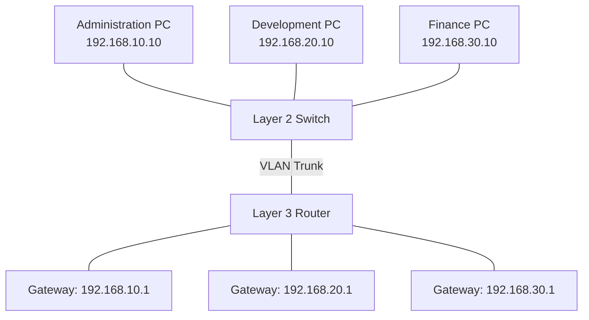
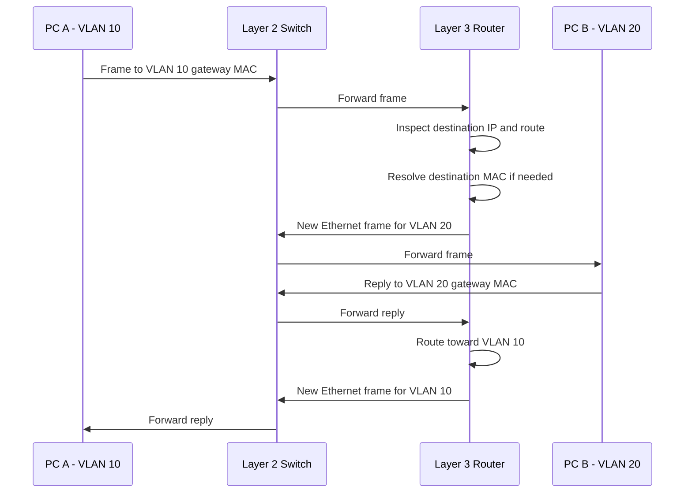
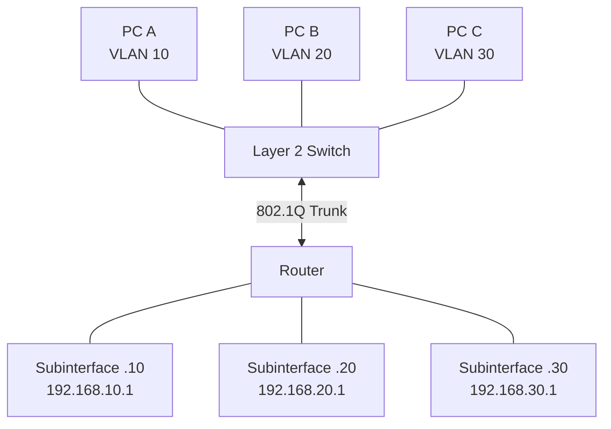
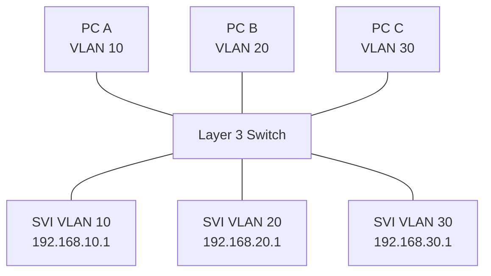
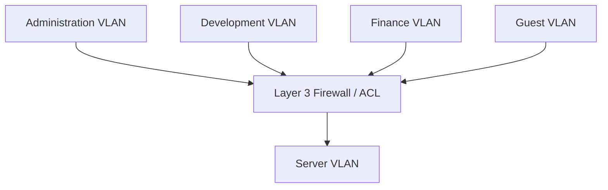

# Inter-VLAN Routing

Inter-VLAN routing is the process of forwarding IP packets between devices that belong to different VLANs.

VLANs create separate Layer 2 broadcast domains. Devices in different VLANs cannot communicate directly through ordinary Layer 2 switching.

A Layer 3 device, such as a router or Layer 3 switch, is required to route traffic between these VLANs.

Inter-VLAN routing allows organizations to maintain logical network segmentation while providing controlled communication between different departments, servers, and services.

For example, an organization may separate Administration, Development, Finance, and Servers into different VLANs while allowing selected communication between them.

# 🗁 What Is Inter-VLAN Routing?

Inter-VLAN routing is the routing of IP traffic between separate VLANs.

Each VLAN represents a distinct Layer 2 broadcast domain. A device communicating with another device in a different IP subnet normally sends its traffic to a default gateway.

The gateway performs Layer 3 routing and forwards the packet toward the destination network.

### 🖆 Example Network

Consider an organization with three VLANs:

| VLAN | Department | Network | Gateway |
| --- | --- | --- | --- |
| 10 | Administration | 192.168.10.0/24 | 192.168.10.1 |
| 20 | Development | 192.168.20.0/24 | 192.168.20.1 |
| 30 | Finance | 192.168.30.0/24 | 192.168.30.1 |

Devices within each VLAN communicate through Layer 2 switching.

Communication between these networks requires a router or Layer 3 switch.



The router provides a gateway for each VLAN and routes traffic between them according to its routing table and security policies.

# 🗁 Why Inter-VLAN Routing Is Required

A Layer 2 switch forwards Ethernet frames based on MAC addresses within a VLAN.

It does not ordinarily route IP packets between separate VLANs.

Consider two devices:

```text
PC A:
IP Address: 192.168.10.10/24
VLAN: 10

PC B:
IP Address: 192.168.20.20/24
VLAN: 20
```

PC A determines that PC B belongs to a different IP subnet.

Therefore, PC A sends the packet to its default gateway rather than attempting direct Layer 2 delivery to PC B.

Without a Layer 3 gateway, communication between the two networks cannot take place through ordinary switching.

### 🖆 Layer 2 vs Layer 3 Responsibilities

| Component | Responsibility |
| --- | --- |
| Layer 2 switch | Forwards Ethernet frames within VLANs |
| VLAN | Defines a Layer 2 broadcast domain |
| Router | Routes packets between IP networks |
| Layer 3 switch | Performs switching and IP routing |
| Default gateway | Provides the next hop for off-subnet traffic |

# 🗁 How Inter-VLAN Routing Works

Consider PC A in VLAN 10 communicating with PC B in VLAN 20.

```text
PC A:
IP: 192.168.10.10/24
Gateway: 192.168.10.1

PC B:
IP: 192.168.20.20/24
Gateway: 192.168.20.1
```

The communication process is:

* PC A creates an IP packet destined for `192.168.20.20`.
* PC A determines that the destination is outside its local subnet.
* PC A resolves the MAC address of its default gateway using ARP for IPv4.
* PC A encapsulates the IP packet in an Ethernet frame addressed to the gateway's MAC address.
* The switch forwards the frame within VLAN 10.
* The router receives the frame through its VLAN 10 interface.
* The router examines the destination IP address.
* The routing table identifies VLAN 20 as the destination network.
* The router resolves PC B's MAC address if necessary.
* The router creates a new Ethernet frame for VLAN 20.
* The switch forwards the frame to PC B.



The IP source and destination addresses normally remain unchanged during ordinary routing.

However, the Ethernet source and destination MAC addresses are replaced for the new Layer 2 segment.

# 🗁 Default Gateway in Each VLAN

Each IP subnet normally has a default gateway address that provides access to destinations outside the local subnet.

In a VLAN-based network, the gateway is associated with the corresponding VLAN.

Example:

| VLAN | Subnet | Gateway Interface |
| --- | --- | --- |
| 10 | 192.168.10.0/24 | 192.168.10.1 |
| 20 | 192.168.20.0/24 | 192.168.20.1 |
| 30 | 192.168.30.0/24 | 192.168.30.1 |

A device in VLAN 10 uses `192.168.10.1` as its default gateway.

A device in VLAN 20 uses `192.168.20.1`.

### 🖆 Example Endpoint Configuration

Administration PC:

```text
IP Address:      192.168.10.10
Subnet Mask:     255.255.255.0
Default Gateway: 192.168.10.1
DNS Server:      192.168.10.1
```

Development PC:

```text
IP Address:      192.168.20.10
Subnet Mask:     255.255.255.0
Default Gateway: 192.168.20.1
DNS Server:      192.168.20.1
```

The DNS server shown here is an example. A network can use a separate DNS server address.

# 🗁 Inter-VLAN Routing Methods

There are several ways to implement inter-VLAN routing.

Common approaches include:

* Router-on-a-stick.
* Layer 3 switch with Switch Virtual Interfaces.
* Dedicated router interfaces for individual VLANs.
* Integrated Layer 3 routing on network appliances.

# 🗁 Router-on-a-Stick

Router-on-a-stick is an inter-VLAN routing design that uses one physical router interface connected to a switch trunk.

The router creates multiple logical VLAN interfaces, commonly called subinterfaces.

Each subinterface is associated with a VLAN ID.

### 🖆 Architecture



### 🖆 How It Works

* The switch connects endpoint devices through access ports.
* The switch connects to the router through a trunk.
* The trunk carries multiple VLANs.
* The router receives tagged Ethernet frames.
* Each subinterface processes traffic for its configured VLAN.
* The router performs IP routing between the VLAN networks.

### 🖆 Advantages

* Requires only one physical router interface.
* Supports multiple VLANs.
* Useful for small and medium-sized networks.
* Relatively straightforward to configure.

### 🖆 Disadvantages

* All VLAN traffic shares one physical router connection.
* The router interface can become a throughput bottleneck.
* Routing performance depends on router capacity.
* The physical interface represents a single point of failure unless redundancy is designed.

# 🗁 Router-on-a-Stick Configuration

The following example uses Cisco IOS-style configuration.

Assume:

```text
Router Interface: GigabitEthernet 0/0

VLAN 10:
192.168.10.0/24
Gateway: 192.168.10.1

VLAN 20:
192.168.20.0/24
Gateway: 192.168.20.1

VLAN 30:
192.168.30.0/24
Gateway: 192.168.30.1
```

### 🖆 Create VLANs on the Switch

```bash
configure terminal

vlan 10
 name ADMIN

vlan 20
 name DEVELOPMENT

vlan 30
 name FINANCE

end
```

### 🖆 Configure the Switch Trunk Port

Assume the router connects to GigabitEthernet 0/24:

```bash
configure terminal

interface gigabitEthernet 0/24
 switchport mode trunk
 switchport trunk allowed vlan 10,20,30
 no shutdown

end
```

### 🖆 Configure the Router Physical Interface

```bash
configure terminal

interface gigabitEthernet 0/0
 no ip address
 no shutdown
```

### 🖆 Create VLAN Subinterfaces

VLAN 10:

```bash
interface gigabitEthernet 0/0.10
 encapsulation dot1Q 10
 ip address 192.168.10.1 255.255.255.0
```

VLAN 20:

```bash
interface gigabitEthernet 0/0.20
 encapsulation dot1Q 20
 ip address 192.168.20.1 255.255.255.0
```

VLAN 30:

```bash
interface gigabitEthernet 0/0.30
 encapsulation dot1Q 30
 ip address 192.168.30.1 255.255.255.0
```

### 🖆 Verify Router Configuration

```bash
show ip interface brief
```

Check the routing table:

```bash
show ip route
```

Verify trunk configuration on the switch:

```bash
show interfaces trunk
```

The router should have connected routes for all three VLAN subnets.

# 🗁 Layer 3 Switch Routing

A Layer 3 switch combines Layer 2 switching with Layer 3 routing capabilities.

It can route traffic between VLANs without sending every packet to an external router.

Layer 3 switches commonly use hardware-based forwarding to provide high-performance inter-VLAN routing.

### 🖆 Architecture



The Layer 3 switch creates a logical gateway interface for each VLAN.

These interfaces are commonly called Switch Virtual Interfaces.

### 🖆 Advantages

* High-performance inter-VLAN routing.
* Reduced dependence on external routers.
* Efficient internal traffic forwarding.
* Centralized VLAN gateway management.
* Supports routing and switching in one device.

### 🖆 Disadvantages

* Layer 3 switching capabilities depend on the switch model.
* Advanced routing features may require specific hardware or licensing.
* Incorrect routing and ACL configuration can affect multiple VLANs.
* Hardware forwarding behavior varies across platforms.

# 🗁 Switch Virtual Interface (SVI)

An SVI is a logical Layer 3 interface associated with a VLAN on a multilayer switch.

It provides an IP address that devices in that VLAN can use as their default gateway.

Example:

```text
VLAN 10:
Interface: VLAN 10
IP: 192.168.10.1/24

VLAN 20:
Interface: VLAN 20
IP: 192.168.20.1/24
```

Unlike a router-on-a-stick design, an SVI does not require a separate router subinterface for every VLAN.

The switch performs routing between its SVIs when Layer 3 routing is enabled.

### 🖆 Cisco Layer 3 Switch Configuration

Create VLANs:

```bash
configure terminal

vlan 10
 name ADMIN

vlan 20
 name DEVELOPMENT

end
```

Create an SVI for VLAN 10:

```bash
configure terminal

interface vlan 10
 ip address 192.168.10.1 255.255.255.0
 no shutdown
```

Create an SVI for VLAN 20:

```bash
interface vlan 20
 ip address 192.168.20.1 255.255.255.0
 no shutdown
```

Enable IP routing:

```bash
ip routing
```

Verify interfaces:

```bash
show ip interface brief
```

Verify routes:

```bash
show ip route
```

An SVI's operational state can depend on whether the VLAN exists and has an active Layer 2 port or other platform-specific conditions.

# 🗁 Router-on-a-Stick vs Layer 3 Switch

| Feature | Router-on-a-Stick | Layer 3 Switch |
| --- | --- | --- |
| Routing device | External router | Multilayer switch |
| VLAN gateway | Router subinterface | SVI |
| Physical connection | Shared trunk to router | Internal switching fabric |
| Performance | Depends on router and link | Commonly hardware-accelerated |
| Scalability | Limited by router interface capacity | Often better for LAN routing |
| Configuration | Subinterfaces | VLAN interfaces and routing |
| Typical use | Small networks and labs | Enterprise LANs |

Both approaches provide inter-VLAN routing.

The appropriate choice depends on network size, traffic volume, equipment capabilities, and security requirements.

# 🗁 Inter-VLAN Routing on MikroTik RouterOS v7

MikroTik RouterOS v7 supports inter-VLAN routing through VLAN interfaces.

A common configuration uses a VLAN-aware bridge with a trunk port and access ports.

Consider:

```text
Bridge: bridge1

Trunk:
ether1

Access VLAN 10:
ether2

Access VLAN 20:
ether3

VLAN 10 Gateway:
192.168.10.1/24

VLAN 20 Gateway:
192.168.20.1/24
```

### 🖆 Create the Bridge

```routeros
/interface bridge
add name=bridge1 vlan-filtering=no
```

### 🖆 Add Bridge Ports

```routeros
/interface bridge port
add bridge=bridge1 interface=ether1
add bridge=bridge1 interface=ether2 pvid=10
add bridge=bridge1 interface=ether3 pvid=20
```

### 🖆 Configure VLAN Membership

```routeros
/interface bridge vlan
add bridge=bridge1 vlan-ids=10 tagged=bridge1,ether1 untagged=ether2
add bridge=bridge1 vlan-ids=20 tagged=bridge1,ether1 untagged=ether3
```

The bridge interface is included as a tagged member because the router CPU needs access to these VLANs for Layer 3 processing.

### 🖆 Create VLAN Interfaces

```routeros
/interface vlan
add name=vlan10 interface=bridge1 vlan-id=10
add name=vlan20 interface=bridge1 vlan-id=20
```

### 🖆 Assign Gateway IP Addresses

```routeros
/ip address
add address=192.168.10.1/24 interface=vlan10
add address=192.168.20.1/24 interface=vlan20
```

### 🖆 Enable VLAN Filtering

After verifying the bridge VLAN table and management connectivity:

```routeros
/interface bridge
set bridge1 vlan-filtering=yes
```

### 🖆 Verify Configuration

Inspect bridge ports:

```routeros
/interface bridge port print
```

Inspect VLAN membership:

```routeros
/interface bridge vlan print
```

Inspect VLAN interfaces:

```routeros
/interface vlan print
```

Inspect IP addresses:

```routeros
/ip address print
```

Inspect routes:

```routeros
/ip route print
```

RouterOS automatically creates connected routes for active directly connected VLAN interfaces.

### 🖆 Important MikroTik Considerations

* Include the bridge CPU port as a tagged member for VLANs that need router-level processing.
* Configure the trunk as a tagged member of every required VLAN.
* Configure access ports with appropriate PVID values.
* Ensure the bridge VLAN table matches the intended topology.
* Apply firewall rules to control communication between VLANs.
* Verify hardware offloading support for the specific router model and configuration.

# 🗁 Inter-VLAN Routing on Linux

Linux can perform inter-VLAN routing using VLAN interfaces and IP forwarding.

A common design uses one physical Ethernet interface connected to a VLAN trunk.

The Linux host creates a VLAN interface for each VLAN and assigns an IP address to each interface.

### 🖆 Example Architecture

```text
Physical Interface: enp2s0

VLAN 10:
Interface: enp2s0.10
IP: 192.168.10.1/24

VLAN 20:
Interface: enp2s0.20
IP: 192.168.20.1/24
```

### 🖆 Create VLAN 10 Interface

```bash
sudo ip link add link enp2s0 name enp2s0.10 type vlan id 10
```

Assign an IP address:

```bash
sudo ip address add 192.168.10.1/24 dev enp2s0.10
```

Bring it up:

```bash
sudo ip link set enp2s0.10 up
```

### 🖆 Create VLAN 20 Interface

```bash
sudo ip link add link enp2s0 name enp2s0.20 type vlan id 20
```

Assign an IP address:

```bash
sudo ip address add 192.168.20.1/24 dev enp2s0.20
```

Bring it up:

```bash
sudo ip link set enp2s0.20 up
```

### 🖆 Enable IPv4 Forwarding

Temporarily enable forwarding:

```bash
sudo sysctl -w net.ipv4.ip_forward=1
```

Check the setting:

```bash
sysctl net.ipv4.ip_forward
```

For persistent configuration, create a file such as `/etc/sysctl.d/99-ip-forwarding.conf`:

```text
net.ipv4.ip_forward=1
```

Apply the configuration:

```bash
sudo sysctl --system
```

Linux can now route packets between its directly connected VLAN networks, subject to firewall and routing policies.

### 🖆 Verify Routing

```bash
ip -br address
```

```bash
ip route show
```

Inspect VLAN interfaces:

```bash
ip -d link show type vlan
```

Test connectivity:

```bash
ping -c 4 192.168.10.10
```

```bash
ping -c 4 192.168.20.10
```

The connected switch port must be configured as a trunk carrying VLANs 10 and 20 tagged.

# 🗁 Inter-VLAN Routing and Firewall Policies

Inter-VLAN routing creates a Layer 3 path between separate networks.

However, routing does not mean every VLAN should have unrestricted access to every other VLAN.

Firewall rules and access control lists (ACLs) determine which communication is permitted.

Example policy:

| Source VLAN | Destination VLAN | Policy |
| --- | --- | --- |
| Administration | Servers | Allow required services |
| Development | Servers | Allow development services |
| Guest | Internal Networks | Deny |
| Finance | Development | Deny |
| Management | Network Devices | Allow authorized administration |

### 🖆 Example Traffic Policy



A properly designed network uses routing and security policies together.

VLANs establish Layer 2 separation, while firewalls and ACLs control permitted Layer 3 communication.

# 🗁 Common Inter-VLAN Routing Problems

### 🖆 Incorrect Default Gateway

If an endpoint uses the wrong gateway, it may not be able to reach other subnets.

Inspect the endpoint configuration:

```bash
ip route
```

Look for the default route.

### 🖆 VLAN Missing from Trunk

The gateway may be correctly configured, but frames may not reach it because the VLAN is not allowed on the trunk.

Inspect the switch trunk configuration:

```bash
show interfaces trunk
```

### 🖆 Incorrect Router Subinterface

The router subinterface may have an incorrect VLAN ID or IP address.

Inspect:

```bash
show ip interface brief
```

Verify the 802.1Q encapsulation configuration.

### 🖆 SVI Down

An SVI may remain down when the VLAN is inactive or lacks an eligible active Layer 2 port.

Inspect:

```bash
show ip interface brief
```

Also verify the VLAN and switch port states.

### 🖆 IP Forwarding Disabled

On Linux, inter-VLAN routing will not work if IPv4 forwarding is disabled.

Check:

```bash
sysctl net.ipv4.ip_forward
```

### 🖆 Firewall Blocking Traffic

The router may have a valid route but block traffic through its firewall.

Inspect firewall rules and connection-tracking state.

On Ubuntu using UFW:

```bash
sudo ufw status verbose
```

### 🖆 Incorrect VLAN Membership

A switch port may be assigned to the wrong VLAN or have incorrect tagged membership.

Inspect:

```bash
show vlan brief
```

On MikroTik:

```routeros
/interface bridge vlan print detail
```

### 🖆 ARP Resolution Failure

The router may not be able to resolve the destination device's MAC address.

Inspect:

```bash
ip neigh show
```

On Linux, capture ARP traffic:

```bash
sudo tcpdump -eni enp2s0 arp
```

# 🗁 Troubleshooting Checklist

When inter-VLAN communication fails, investigate the network in this order:

* Confirm endpoint IP addresses and subnet masks.
* Verify the endpoint's default gateway.
* Confirm the access VLAN assigned to each endpoint.
* Verify trunk configuration and allowed VLANs.
* Confirm VLAN tagging and native VLAN settings.
* Verify router subinterfaces or SVIs.
* Confirm IP forwarding and routing-table entries.
* Check ARP resolution.
* Inspect firewall and ACL policies.
* Test connectivity from each gateway.
* Capture traffic to identify where packets stop.

Useful Linux commands:

```bash
ip address show
ip route show
ip neigh show
ip link show
```

```bash
ping -c 4 192.168.20.10
traceroute 192.168.20.10
```

```bash
sudo tcpdump -eni enp2s0
```

# 🗁 Best Practices

* Use a clear VLAN and IP addressing plan.
* Assign a unique IP subnet to each VLAN as a practical design convention.
* Configure one appropriate default gateway per subnet.
* Use Layer 3 switches for high-throughput internal routing where appropriate.
* Use router-on-a-stick for smaller networks and labs.
* Restrict inter-VLAN communication with firewall rules or ACLs.
* Keep trunk allowed VLAN lists minimal.
* Verify VLAN membership before enabling routing.
* Monitor gateway interfaces and routing tables.
* Document all VLAN gateways and network policies.
* Use redundant gateways for critical infrastructure.
* Test both connectivity and isolation after configuration changes.

# 🗁 Practical Exercises

### 🖆 Exercise: Basic Inter-VLAN Routing

Build a network with:

```text
VLAN 10: 192.168.10.0/24
VLAN 20: 192.168.20.0/24

Gateway VLAN 10: 192.168.10.1
Gateway VLAN 20: 192.168.20.1
```

Tasks:

* Create VLAN 10 and VLAN 20.
* Assign endpoint access ports.
* Configure a trunk connection.
* Configure router subinterfaces or SVIs.
* Assign endpoint IP addresses and gateways.
* Test communication between VLANs.

### 🖆 Exercise: Router-on-a-Stick Lab

Using Cisco Packet Tracer, GNS3, or EVE-NG:

* Connect one router to one Layer 2 switch.
* Configure an 802.1Q trunk.
* Create three VLANs.
* Configure three router subinterfaces.
* Assign one gateway to each VLAN.
* Test inter-VLAN connectivity.

### 🖆 Exercise: Layer 3 Switch Lab

* Create VLAN 10 and VLAN 20.
* Configure an SVI for each VLAN.
* Enable IP routing.
* Connect endpoint devices.
* Verify connected routes.
* Test communication between the VLANs.

### 🖆 Exercise: MikroTik Inter-VLAN Routing

Using MikroTik RouterOS v7 or CHR:

* Create a VLAN-aware bridge.
* Configure one trunk port.
* Configure two access ports.
* Add VLAN interfaces to the bridge.
* Configure gateway IP addresses.
* Add the bridge CPU port to the VLAN table.
* Enable VLAN filtering.
* Verify inter-VLAN connectivity.

### 🖆 Exercise: Inter-VLAN Firewall Policies

* Configure routing between VLAN 10 and VLAN 20.
* Allow selected services from VLAN 10 to VLAN 20.
* Block unnecessary traffic.
* Verify permitted and denied connections.
* Inspect firewall counters and logs.

# 🗁 Interview Questions

### 🖆 Fundamental Questions

* What is inter-VLAN routing?
* Why is routing required between VLANs?
* What is a default gateway?
* Can a Layer 2 switch route between VLANs?
* What happens when a device communicates with another IP subnet?
* What is the difference between a VLAN and an IP subnet?

### 🖆 Intermediate Questions

* What is router-on-a-stick?
* What is a router subinterface?
* What is an SVI?
* What is the difference between router-on-a-stick and Layer 3 switching?
* Why does a router need an 802.1Q trunk?
* What happens when a VLAN is missing from a trunk's allowed list?

### 🖆 Advanced Questions

* How does a Layer 3 switch perform inter-VLAN routing?
* Why does the router replace Ethernet MAC addresses during routing?
* Why can an SVI remain down?
* How does ARP support inter-VLAN communication?
* Why should inter-VLAN routing be combined with firewall policies?
* How does Linux perform inter-VLAN routing using VLAN interfaces?
* Why must the MikroTik bridge CPU port participate in VLAN membership for router-level processing?

# 🗁 Summary

Inter-VLAN routing allows devices in different VLANs to communicate through Layer 3 routing.

VLANs provide separate Layer 2 broadcast domains, while routers and Layer 3 switches forward IP packets between their associated subnets.

The main implementation approaches are:

* Router-on-a-stick using 802.1Q subinterfaces.
* Layer 3 switching using SVIs.
* Dedicated router interfaces.
* Software routing using Linux VLAN interfaces.

Successful inter-VLAN routing requires correct VLAN membership, trunk configuration, gateway addressing, routing, and security policies.

Understanding these concepts is essential for enterprise LAN design, MikroTik routing, network segmentation, and troubleshooting.

# 🗁 References

* [Cisco — Inter-VLAN Routing Configuration](https://www.cisco.com/c/en/us/support/docs/lan-switching/inter-vlan-routing/)
* [Cisco — VLAN Configuration Guide](https://www.cisco.com/c/en/us/support/docs/lan-switching/vlans/)
* [MikroTik — Bridging and Switching](https://help.mikrotik.com/docs/spaces/ROS/pages/328068/Bridging%2Band%2BSwitching)
* [MikroTik — VLAN Interfaces](https://help.mikrotik.com/docs/)
* [Linux Kernel — VLAN Documentation](https://docs.kernel.org/networking/8021q.html)
* [Linux Kernel — IP Sysctl Documentation](https://docs.kernel.org/networking/ip-sysctl.html)
* [Linux `ip-link` Manual](https://man7.org/linux/man-pages/man8/ip-link.8.html)
