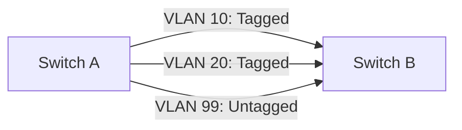
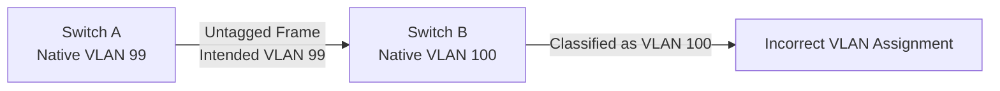

# Native VLAN

A Native VLAN is a VLAN configured on an IEEE 802.1Q trunk to carry untagged Ethernet frames.

On a trunk link, frames belonging to most VLANs are transmitted with an 802.1Q VLAN tag. However, frames associated with the Native VLAN are transmitted without an 802.1Q tag under the conventional Cisco-style native VLAN model.

The receiving switch identifies an untagged frame on that trunk as belonging to its configured Native VLAN.

Native VLAN configuration is important when connecting switches, routers, firewalls, wireless access points, and other VLAN-aware network devices.

# 🗁 What Is a Native VLAN?

A Native VLAN is the VLAN associated with untagged traffic received on an 802.1Q trunk.

In a conventional Cisco-style trunk configuration:

* Tagged frames carry an explicit VLAN ID.
* Untagged frames are associated with the Native VLAN.
* Frames belonging to the Native VLAN are normally transmitted untagged.
* Both ends of a trunk should agree on the Native VLAN configuration.

Example:

```text
Switch A                       Switch B

VLAN 10  ───────────────────── VLAN 10
VLAN 20  ───────────────────── VLAN 20
VLAN 30  ───────────────────── VLAN 30

Native VLAN: 99               Native VLAN: 99
```

VLANs 10, 20, and 30 use tagged frames.

VLAN 99 uses untagged frames across the trunk.

# 🗁 How Native VLAN Works

Consider two switches connected through an 802.1Q trunk.



When Switch A transmits a frame:

* A VLAN 10 frame receives an 802.1Q tag containing VID 10.
* A VLAN 20 frame receives an 802.1Q tag containing VID 20.
* A VLAN 99 frame is transmitted without a VLAN tag.

When Switch B receives the frames:

* It identifies VLAN 10 from the tag.
* It identifies VLAN 20 from the tag.
* It associates the untagged frame with its configured Native VLAN.

The receiving switch must use a compatible Native VLAN configuration for the intended traffic to reach the correct VLAN.

# 🗁 Native VLAN and 802.1Q Tagging

IEEE 802.1Q defines VLAN tagging for Ethernet frames.

A standard VLAN tag contains:

| Field | Size | Description |
| --- | ---: | --- |
| TPID | 16 bits | Identifies the VLAN tag protocol |
| PCP | 3 bits | Priority information |
| DEI | 1 bit | Drop eligibility indicator |
| VID | 12 bits | VLAN identifier |

For a conventional trunk, tagged frames contain an explicit VLAN identifier.

Native VLAN traffic is commonly transmitted without this four-byte tag.

An important distinction is that an untagged frame does not contain a VLAN ID. The receiving port's configuration determines how that frame is classified.

### 🖆 Priority-Tagged Frames

802.1Q also supports priority-tagged frames with VLAN ID 0.

These frames contain a VLAN tag for priority information but do not identify an ordinary VLAN membership through the VID.

They are not equivalent to ordinary untagged Native VLAN frames.

# 🗁 Native VLAN vs Access VLAN vs PVID

These concepts are related but serve different purposes.

| Concept | Meaning |
| --- | --- |
| Native VLAN | VLAN associated with untagged traffic on an 802.1Q trunk |
| Access VLAN | VLAN assigned to an access port |
| PVID | Port VLAN ID used to classify untagged or priority-tagged ingress frames, depending on implementation |

### 🖆 Access VLAN

An access port normally carries traffic for one VLAN.

Endpoint devices usually send and receive untagged Ethernet frames.

The switch associates those frames with the port's configured access VLAN.

### 🖆 Native VLAN

A trunk carries traffic for multiple VLANs.

Under the conventional native VLAN model, untagged traffic belongs to the Native VLAN.

### 🖆 PVID

PVID is a port-level ingress classification setting.

For example, a port configured with PVID 99 may classify incoming untagged frames into VLAN 99.

On many platforms, the PVID is also used when transmitting VLAN 99 traffic untagged.

However, ingress classification and egress tagging are separate configuration decisions. A port's PVID does not universally mean that every frame in that VLAN must be transmitted untagged.

# 🗁 Why Native VLAN Is Used

Native VLAN functionality supports environments where untagged Ethernet traffic must coexist with tagged VLAN traffic on a trunk.

Common scenarios include:

* Compatibility with devices that send untagged traffic.
* Connecting devices with different VLAN-tagging capabilities.
* Carrying management or infrastructure traffic.
* Supporting legacy network designs.
* Integrating devices that expect an untagged VLAN.

A Native VLAN is not inherently required to be VLAN 1.

The Native VLAN can be configured to use another VLAN ID supported by the devices.

# 🗁 Native VLAN Configuration on Cisco Switches

Consider this example:

```text
Switch A <---------- 802.1Q Trunk ----------> Switch B

Allowed VLANs: 10,20,30,99
Native VLAN: 99
```

VLAN 99 is the Native VLAN.

### 🖆 Create VLANs

```bash
configure terminal

vlan 10
 name ADMIN

vlan 20
 name DEVELOPMENT

vlan 30
 name FINANCE

vlan 99
 name NATIVE

end
```

### 🖆 Configure the Trunk Port

Assume the connection between switches uses GigabitEthernet 0/24.

```bash
configure terminal

interface gigabitEthernet 0/24
 switchport mode trunk
 switchport trunk native vlan 99
 switchport trunk allowed vlan 10,20,30,99
 no shutdown

end
```

Apply compatible configuration to the corresponding trunk interface on the other switch.

### 🖆 Verify Native VLAN

```bash
show interfaces trunk
```

Example output:

```text
Port      Mode   Encapsulation  Status     Native vlan
Gi0/24    on     802.1q         trunking   99
```

Inspect VLAN information:

```bash
show vlan brief
```

### 🖆 Verify Interface Configuration

```bash
show running-config interface gigabitEthernet 0/24
```

The Native VLAN and allowed VLAN list should match the intended trunk design.

# 🗁 Native VLAN Configuration on MikroTik RouterOS v7

MikroTik RouterOS uses bridge VLAN filtering to control tagged and untagged traffic.

In this configuration, the Native VLAN is represented by the VLAN membership and PVID configuration of the trunk port.

Consider:

```text
Bridge: bridge1

Trunk Port: ether1

Allowed VLANs:
10, 20, 99

Native VLAN:
99
```

The trunk carries VLANs 10 and 20 tagged, while VLAN 99 is transmitted untagged.

### 🖆 Create the Bridge

```routeros
/interface bridge
add name=bridge1 vlan-filtering=no
```

### 🖆 Configure the Trunk Port

```routeros
/interface bridge port
add bridge=bridge1 interface=ether1 pvid=99
```

### 🖆 Configure VLAN Membership

```routeros
/interface bridge vlan
add bridge=bridge1 vlan-ids=10 tagged=bridge1,ether1
add bridge=bridge1 vlan-ids=20 tagged=bridge1,ether1
add bridge=bridge1 vlan-ids=99 untagged=ether1 tagged=bridge1
```

Here:

* VLAN 10 is tagged on the trunk.
* VLAN 20 is tagged on the trunk.
* VLAN 99 is untagged on the trunk.
* The bridge CPU port is a tagged member of VLAN 99.

The bridge CPU membership is included to allow router-level processing for VLAN 99 when required.

### 🖆 Enable VLAN Filtering

After verifying the configuration and ensuring management connectivity:

```routeros
/interface bridge
set bridge1 vlan-filtering=yes
```

### 🖆 Verify Configuration

Inspect bridge ports:

```routeros
/interface bridge port print detail
```

Inspect VLAN membership:

```routeros
/interface bridge vlan print detail
```

Inspect bridge settings:

```routeros
/interface bridge print detail
```

### 🖆 Important MikroTik Notes

* The PVID classifies incoming untagged frames into the configured VLAN.
* The `untagged` membership controls untagged egress traffic.
* The `tagged` membership controls tagged egress traffic.
* The bridge CPU port must be included when the router itself needs access to the VLAN.
* Configure both ends of a trunk consistently.
* RouterOS bridge VLAN filtering behavior depends on the configured bridge ports and VLAN table.

# 🗁 Native VLAN Configuration on Linux

Linux VLAN-aware bridges support tagged and untagged VLAN membership.

A bridge port can classify untagged ingress frames into a specific VLAN using its PVID.

Consider:

```text
Bridge: br0
Trunk Interface: enp2s0

Tagged VLANs:
10, 20

Untagged VLAN:
99
```

### 🖆 Create a VLAN-Aware Bridge

```bash
sudo ip link add name br0 type bridge vlan_filtering 1
```

Bring up the bridge:

```bash
sudo ip link set br0 up
```

Add the physical interface:

```bash
sudo ip link set enp2s0 master br0
sudo ip link set enp2s0 up
```

### 🖆 Configure VLAN Membership

Remove the default VLAN 1 membership if it is not required:

```bash
sudo bridge vlan del dev enp2s0 vid 1
```

Add VLAN 10 and VLAN 20 as tagged VLANs:

```bash
sudo bridge vlan add dev enp2s0 vid 10
sudo bridge vlan add dev enp2s0 vid 20
```

Configure VLAN 99 as the untagged PVID:

```bash
sudo bridge vlan add dev enp2s0 vid 99 pvid untagged
```

### 🖆 Verify VLAN Configuration

```bash
bridge vlan show
```

Example conceptual output:

```text
port       vlan ids
enp2s0     10
           20
           99 PVID Egress Untagged
```

The PVID causes untagged ingress frames to be classified into VLAN 99.

The `untagged` setting causes VLAN 99 frames to leave the port without an 802.1Q tag.

### 🖆 Important Linux Notes

* PVID controls ingress classification.
* Egress untagged membership controls frame transmission.
* Linux bridge VLAN filtering is configured per bridge and port.
* The bridge's own VLAN membership must also be configured when the Linux host needs Layer 3 access to a VLAN.
* For persistent configuration, use an appropriate network manager such as Netplan or systemd-networkd.

# 🗁 Native VLAN Mismatch

A Native VLAN mismatch occurs when the two ends of an 802.1Q trunk use different Native VLAN IDs.

Example:

```text
Switch A                         Switch B

Native VLAN: 99                 Native VLAN: 100
```

Switch A transmits VLAN 99 traffic untagged.

Switch B receives the untagged frames and associates them with VLAN 100.

This can cause unexpected traffic placement, connectivity problems, and VLAN isolation failures.

### 🖆 Example



### 🖆 Symptoms

* Unexpected communication between devices.
* Traffic appearing in the wrong VLAN.
* Connectivity problems across switches.
* Cisco Native VLAN mismatch messages.
* Inconsistent network behavior.
* Potential VLAN security exposure.

### 🖆 Troubleshooting

On Cisco switches:

```bash
show interfaces trunk
```

Inspect the trunk interface configuration:

```bash
show running-config interface gigabitEthernet 0/24
```

On MikroTik:

```routeros
/interface bridge port print detail
/interface bridge vlan print detail
```

On Linux:

```bash
bridge vlan show
```

Ensure both ends agree on:

* Native VLAN ID.
* Tagged VLAN membership.
* Untagged VLAN membership.
* PVID and ingress classification.
* Allowed VLAN configuration.

# 🗁 Native VLAN Security

Native VLAN configuration can introduce security risks when trunk ports accept unexpected untagged traffic.

Historically, VLAN hopping attacks have included techniques that exploit switch trunk negotiation and Native VLAN behavior.

### 🖆 VLAN Hopping

VLAN hopping refers to attempts to send traffic into a VLAN that the attacker should not normally access.

Two commonly discussed techniques are:

**Switch spoofing**

An attacker attempts to negotiate a trunk connection with a switch and gain access to multiple VLANs.

This is associated with dynamic trunk negotiation protocols and permissive switch configurations.

**Double tagging**

An attacker sends an Ethernet frame containing two VLAN tags.

Under specific conditions involving Native VLAN handling and switch forwarding behavior, the first switch removes or processes the outer tag, allowing the inner tag to be interpreted by another switch.

Double-tagging attacks have significant topology and configuration requirements. They are not universally effective.

### 🖆 Security Best Practices

* Do not use VLAN 1 as the Native VLAN where the platform permits a dedicated alternative.
* Configure an unused VLAN as the Native VLAN when untagged traffic is unnecessary.
* Do not assign endpoint devices to the Native VLAN.
* Restrict allowed VLANs on trunk interfaces.
* Disable dynamic trunk negotiation on ports that should not negotiate trunks.
* Configure access ports explicitly.
* Avoid connecting untrusted devices to trunk ports.
* Keep Native VLAN configuration consistent across both ends.
* Monitor trunk state and VLAN membership.
* Apply ACLs and firewall policies between VLANs.

### 🖆 Example: Dedicated Unused Native VLAN

```text
VLAN 10: Administration
VLAN 20: Development
VLAN 30: Finance
VLAN 99: Unused Native VLAN
```

If untagged traffic is not required, VLAN 99 should not contain normal endpoint devices or production services.

Some platforms support tagging Native VLAN traffic instead of transmitting it untagged. This can further reduce exposure to untagged-frame handling differences, but must be configured consistently on both ends.

# 🗁 Native VLAN vs Tagged Native VLAN

Traditional Native VLAN behavior commonly sends Native VLAN frames untagged.

Some platforms support an option to tag Native VLAN traffic.

For example, Cisco IOS may support:

```bash
vlan dot1q tag native
```

This changes the handling of Native VLAN frames so that they are transmitted with an 802.1Q tag.

The exact command and behavior depend on the device platform and software version.

Do not assume that all switches handle Native VLAN tagging identically.

# 🗁 Common Mistakes

### 🖆 Using Different Native VLAN IDs

Different Native VLAN IDs on the two ends of a trunk can cause untagged traffic to be classified into different VLANs.

### 🖆 Confusing PVID with Native VLAN

PVID is an ingress classification mechanism.

Native VLAN is a trunk-related concept describing the VLAN associated with untagged traffic.

They are closely related in many implementations but are not universally interchangeable terms.

### 🖆 Assuming VLAN 1 Must Be Native

VLAN 1 is a common default on some platforms, but a Native VLAN can be configured to use another VLAN ID.

### 🖆 Forgetting Untagged Egress Configuration

Configuring only a PVID does not necessarily establish the intended untagged egress behavior on every platform.

### 🖆 Allowing Unnecessary VLANs on Trunks

A trunk should carry only the VLANs required for its purpose.

### 🖆 Placing Endpoints in an Unused Native VLAN

An unused Native VLAN should remain unused for normal endpoint connectivity if it is intended as a security measure.

# 🗁 Practical Exercises

### 🖆 Exercise: Basic Native VLAN Configuration

Build a network with two switches connected through an 802.1Q trunk.

Configure:

```text
VLAN 10: Administration
VLAN 20: Development
VLAN 99: Native VLAN
```

Tasks:

* Create the three VLANs.
* Configure the trunk on both switches.
* Set VLAN 99 as the Native VLAN.
* Allow VLANs 10, 20, and 99.
* Verify trunk status.
* Verify connectivity between devices in the same VLAN.

### 🖆 Exercise: Native VLAN Mismatch

Configure:

```text
Switch A Native VLAN: 99
Switch B Native VLAN: 100
```

Tasks:

* Observe the switch's mismatch notifications, if supported.
* Inspect trunk status.
* Identify how untagged traffic is classified.
* Correct the mismatch.
* Verify normal connectivity.

### 🖆 Exercise: MikroTik Native VLAN

Using MikroTik CHR or physical equipment:

* Create a VLAN-aware bridge.
* Configure a trunk port.
* Carry VLANs 10 and 20 tagged.
* Configure VLAN 99 as untagged.
* Set the trunk PVID to 99.
* Verify bridge VLAN membership.
* Test tagged and untagged traffic.

### 🖆 Exercise: Linux Native VLAN

Using Ubuntu:

* Create a VLAN-aware Linux bridge.
* Add a physical or virtual Ethernet interface.
* Configure VLAN 10 and VLAN 20 as tagged.
* Configure VLAN 99 as PVID and untagged.
* Inspect the bridge VLAN table.
* Verify traffic classification using packet capture.

# 🗁 Interview Questions

### 🖆 Fundamental Questions

* What is a Native VLAN?
* Why is a Native VLAN used on an 802.1Q trunk?
* Are Native VLAN frames tagged or untagged in the conventional model?
* Is VLAN 1 always the Native VLAN?
* What is the difference between a Native VLAN and an access VLAN?

### 🖆 Intermediate Questions

* What is a Native VLAN mismatch?
* What happens when an untagged frame arrives on a trunk?
* What is the relationship between PVID and Native VLAN?
* How do you configure a Native VLAN on a Cisco switch?
* How does MikroTik RouterOS handle untagged trunk traffic?

### 🖆 Advanced Questions

* What is VLAN hopping?
* How does double-tagging work?
* Why should the Native VLAN be unused for normal endpoint traffic?
* What is the difference between ingress VLAN classification and egress VLAN tagging?
* How can Native VLAN tagging improve security?
* How do you troubleshoot a Native VLAN mismatch across different vendors?

# 🗁 Summary

A Native VLAN is the VLAN associated with untagged traffic on an IEEE 802.1Q trunk.

In conventional trunk configurations, tagged frames carry explicit VLAN identifiers, while Native VLAN traffic is transmitted without a tag.

Important concepts include:

* Native VLAN identifies the VLAN associated with untagged trunk traffic.
* PVID classifies incoming untagged frames.
* Access VLAN identifies the VLAN assigned to an access port.
* Both ends of a trunk should use compatible Native VLAN settings.
* Native VLAN mismatches can cause incorrect traffic classification.
* Dedicated unused Native VLANs and restricted trunk membership improve security.

Understanding Native VLAN behavior is essential for configuring and troubleshooting multi-switch networks.

# 🗁 References

* [IEEE 802.1Q — Bridges and Bridged Networks](https://standards.ieee.org/standard/802_1Q-2022.html)
* [Cisco — VLAN Configuration and Trunking](https://www.cisco.com/c/en/us/support/docs/lan-switching/vlans/)
* [Cisco — VLAN Security](https://www.cisco.com/c/en/us/support/docs/lan-switching/)
* [MikroTik — Bridging and Switching](https://help.mikrotik.com/docs/spaces/ROS/pages/328068/Bridging%2Band%2BSwitching)
* [Linux Kernel — VLAN Documentation](https://docs.kernel.org/networking/8021q.html)
* [Linux Bridge VLAN Filtering Documentation](https://www.kernel.org/doc/Documentation/networking/switchdev.txt)
