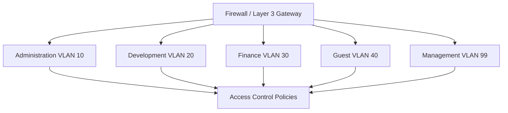
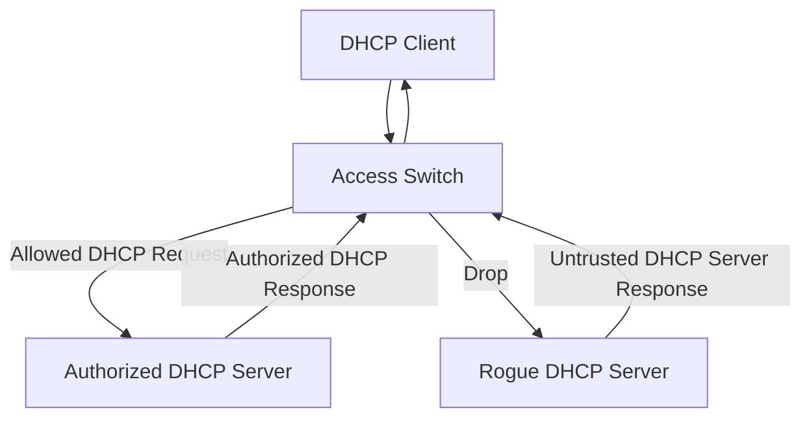
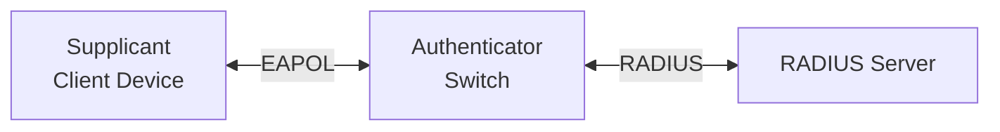

# VLAN Security

VLAN security involves protecting virtual LANs from unauthorized access, VLAN hopping, traffic interception, misconfiguration, and other Layer 2 network attacks.

VLANs provide logical network segmentation by dividing a physical switching infrastructure into separate Layer 2 broadcast domains.

However, VLANs alone do not provide complete network security. Incorrect trunk configurations, permissive switch ports, weak management controls, and inadequate access policies can expose sensitive network traffic.

A secure VLAN implementation combines proper VLAN design, switch-port security, trunk hardening, Layer 3 access controls, authentication, and continuous monitoring.

# 🗁 Why VLAN Security Matters

VLANs separate devices into different Layer 2 broadcast domains.

For example, an organization may use:

| VLAN | Department | Network |
| --- | --- | --- |
| 10 | Administration | 192.168.10.0/24 |
| 20 | Development | 192.168.20.0/24 |
| 30 | Finance | 192.168.30.0/24 |
| 40 | Guest | 192.168.40.0/24 |
| 99 | Management | 192.168.99.0/24 |

This segmentation reduces unnecessary Layer 2 communication and provides a foundation for security policies.

However, security weaknesses can still occur when:

* An unauthorized device accesses a switch port.
* An access port is accidentally configured as a trunk.
* An attacker manipulates VLAN tagging.
* An attacker impersonates another device's MAC address.
* A rogue DHCP server distributes malicious network settings.
* ARP spoofing redirects traffic.
* Management interfaces are exposed to untrusted VLANs.
* Inter-VLAN firewall rules are too permissive.

A secure VLAN design must protect both Layer 2 forwarding and Layer 3 communication.

# 🗁 VLAN Security Threats

### 🖆 VLAN Hopping

VLAN hopping is an attack in which an attacker attempts to send traffic into a VLAN that the attacker should not normally access.

Two commonly discussed techniques are:

* Switch spoofing.
* Double tagging.

### 🖆 Switch Spoofing

Switch spoofing attempts to make a switch treat an unauthorized endpoint as another switch or trunk-capable device.

If trunk negotiation is enabled and permissively configured, an attacker may attempt to negotiate a trunk connection.

A successful attack could expose traffic from multiple VLANs.

**Prevention:**

* Configure endpoint ports explicitly as access ports.
* Disable dynamic trunk negotiation where supported.
* Restrict trunk ports to authorized infrastructure connections.
* Limit allowed VLANs on trunks.

### 🖆 Double-Tagging Attack

A double-tagging attack uses an Ethernet frame containing two VLAN tags.

Under certain conditions, the first switch processes or removes the outer tag, while a downstream switch interprets the remaining tag.

This can allow traffic to reach another VLAN without normal authorization.

The attack depends on specific topology and Native VLAN handling. It is not universally effective.

**Prevention:**

* Use an unused Native VLAN.
* Do not connect endpoint devices to the Native VLAN.
* Avoid unnecessary untagged traffic on trunks.
* Tag Native VLAN traffic where supported and appropriate.
* Restrict VLAN membership and trunk access.

### 🖆 MAC Address Spoofing

An attacker changes a network interface's MAC address to impersonate another device.

Potential consequences include:

* Bypassing weak MAC-based access restrictions.
* Disrupting MAC address learning.
* Causing MAC address movement or flapping.
* Attempting to intercept traffic.

**Prevention:**

* Use 802.1X authentication.
* Apply port security where supported.
* Monitor MAC address movement.
* Use DHCP snooping and IP Source Guard where appropriate.
* Avoid relying on MAC addresses as the only authentication mechanism.

### 🖆 MAC Flooding

MAC flooding attempts to overwhelm a switch's MAC address table with many fabricated source MAC addresses.

Depending on switch implementation and behavior under table exhaustion, unknown unicast traffic may be flooded more broadly than intended.

**Prevention:**

* Configure port security or MAC learning limits.
* Use 802.1X.
* Monitor MAC table utilization.
* Apply storm control where supported.
* Use network access control policies.

### 🖆 Rogue DHCP Server

A rogue DHCP server distributes unauthorized network configuration to clients.

It may provide:

* Incorrect default gateways.
* Malicious DNS server addresses.
* Incorrect IP addressing information.
* Routes that redirect traffic.

**Prevention:**

* Enable DHCP snooping where supported.
* Mark only trusted DHCP-facing ports as trusted.
* Restrict unauthorized DHCP server connections.
* Monitor DHCP activity.

### 🖆 ARP Spoofing

ARP spoofing involves sending forged ARP messages to associate an attacker's MAC address with another device's IP address.

This can enable traffic interception or disruption within a VLAN.

**Prevention:**

* Enable Dynamic ARP Inspection where supported.
* Use DHCP snooping bindings as a validation source.
* Use static ARP entries for selected critical infrastructure where appropriate.
* Segment sensitive systems.
* Monitor unexpected ARP changes.

# 🗁 Secure VLAN Architecture

A secure network should separate systems according to their function and trust level.

Example:



Example security policy:

| Source         | Destination         | Policy                          |
| -------------- | ------------------- | ------------------------------- |
| Administration | Internal servers    | Allow required services         |
| Development    | Development servers | Allow required services         |
| Finance        | Finance servers     | Allow required services         |
| Guest          | Internal networks   | Deny                            |
| Guest          | Internet            | Allow                           |
| Management     | Network devices     | Allow authorized administration |
| User VLANs     | Management VLAN     | Deny by default                 |

The actual rules should reflect business requirements and the principle of least privilege.

# 🗁 Secure Access Ports

An access port normally connects an endpoint device to one VLAN.

Access ports should be explicitly configured rather than relying on automatic trunk negotiation.

### 🖆 Recommended Configuration

* Configure the port as an access port.
* Assign the correct VLAN.
* Disable unused switch ports.
* Disable trunk negotiation where supported.
* Apply MAC address limits where appropriate.
* Enable 802.1X where available.
* Apply storm control where supported.
* Document the connected endpoint.

### 🖆 Cisco Access Port Configuration

Example: Configure GigabitEthernet 0/10 for VLAN 10.

```bash
configure terminal

interface gigabitEthernet 0/10
 switchport mode access
 switchport access vlan 10
 switchport nonegotiate
 spanning-tree portfast
 spanning-tree bpduguard enable
 no shutdown

end
```

`switchport nonegotiate` disables Dynamic Trunking Protocol negotiation on platforms that support it.

`spanning-tree portfast` allows an endpoint-facing port to transition quickly to forwarding.

`spanning-tree bpduguard enable` protects the edge port by disabling it if it receives an unexpected BPDU.

PortFast and BPDU Guard should be used on appropriate endpoint-facing ports, not indiscriminately on switch-to-switch links.

# 🗁 Disable Unused Switch Ports

Unused switch ports should not remain available for unauthorized connections.

A common practice is to place unused ports into a dedicated unused VLAN and administratively shut them down.

### 🖆 Cisco Configuration

```bash
configure terminal

vlan 999
 name UNUSED

interface range gigabitEthernet 0/15-24
 switchport mode access
 switchport access vlan 999
 shutdown

end
```

The unused VLAN should not be routed or used for normal endpoint connectivity.

Administratively disabling the ports provides an additional protection layer.

# 🗁 Secure Trunk Ports

Trunk ports transport traffic for multiple VLANs.

They should only be configured on connections that genuinely require multiple VLANs.

### 🖆 Recommended Practices

* Configure trunk mode explicitly.
* Disable trunk negotiation where supported.
* Restrict the allowed VLAN list.
* Use a dedicated unused Native VLAN when appropriate.
* Keep Native VLAN configuration consistent on both ends.
* Avoid carrying unnecessary VLANs.
* Restrict access to trunk-connected equipment.
* Monitor trunk state changes.

### 🖆 Cisco Trunk Configuration

```bash
configure terminal

interface gigabitEthernet 0/24
 switchport mode trunk
 switchport nonegotiate
 switchport trunk allowed vlan 10,20,30,99
 switchport trunk native vlan 999
 no shutdown

end
```

In this example, VLAN 999 is the dedicated Native VLAN.

If the design does not require untagged traffic, consider configuring Native VLAN tagging where supported.

Verify the trunk:

```bash
show interfaces trunk
```

# 🗁 Port Security

Port security restricts which source MAC addresses can be learned or used on a switch port.

It helps limit unauthorized device connections and reduces some MAC flooding and MAC impersonation risks.

Port security is a Layer 2 control, not strong device authentication.

### 🖆 Common Port Security Modes

| Mode | Description |
| --- | --- |
| Static | Administratively configured secure MAC addresses |
| Dynamic | MAC addresses learned dynamically within configured limits |
| Sticky | Dynamically learned addresses added to the running configuration |

### 🖆 Violation Actions

| Action | Behavior |
| --- | --- |
| Protect | Drops violating traffic, generally without notification |
| Restrict | Drops violating traffic and records or reports violations |
| Shutdown | Places the port into an error-disabled state on supported platforms |

Exact behavior and command availability vary by switch model and software.

### 🖆 Cisco Port Security Configuration

Configure a maximum of two secure MAC addresses on an access port:

```bash
configure terminal

interface gigabitEthernet 0/10
 switchport mode access
 switchport access vlan 10

 switchport port-security
 switchport port-security maximum 2
 switchport port-security mac-address sticky
 switchport port-security violation restrict

end
```

Verify:

```bash
show port-security
```

Inspect an individual interface:

```bash
show port-security interface gigabitEthernet 0/10
```

Inspect secure MAC addresses:

```bash
show port-security address
```

Port security does not replace 802.1X authentication. A determined attacker may spoof an allowed MAC address.

# 🗁 DHCP Snooping

DHCP snooping is a Layer 2 security feature that helps prevent unauthorized DHCP servers from providing configuration to network clients.

It classifies switch ports into trusted and untrusted categories.

**Trusted ports:**

Ports connected to authorized DHCP servers or legitimate DHCP relay paths.

**Untrusted ports:**

Typically endpoint-facing access ports.

DHCP server messages received on untrusted ports are blocked.

### 🖆 DHCP Snooping Operation



DHCP snooping can also build a binding database containing information such as:

* Client MAC address.
* Assigned IP address.
* VLAN.
* Interface.
* Lease duration.

Other security features, such as Dynamic ARP Inspection and IP Source Guard, can use these bindings.

### 🖆 Cisco DHCP Snooping Configuration

```bash
configure terminal

ip dhcp snooping
ip dhcp snooping vlan 10,20,30

interface gigabitEthernet 0/24
 ip dhcp snooping trust

interface range gigabitEthernet 0/1-23
 ip dhcp snooping limit rate 20

end
```

The trusted interface should connect to an authorized DHCP server or an appropriate upstream DHCP path.

Verify:

```bash
show ip dhcp snooping
```

Inspect the binding database:

```bash
show ip dhcp snooping binding
```

Rate limits should be selected according to the network's actual DHCP requirements.

# 🗁 Dynamic ARP Inspection (DAI)

Dynamic ARP Inspection validates ARP packets to help prevent ARP spoofing and poisoning.

It can inspect ARP messages against trusted DHCP snooping bindings.

### 🖆 How DAI Works

* A switch receives an ARP packet.
* The switch examines its ARP information.
* It compares the packet against configured validation information.
* Valid packets are forwarded.
* Invalid packets are dropped.

### 🖆 Cisco DAI Configuration

```bash
configure terminal

ip arp inspection vlan 10,20,30

interface gigabitEthernet 0/24
 ip arp inspection trust

end
```

The trusted interface should be configured carefully.

Verify:

```bash
show ip arp inspection
```

Inspect statistics:

```bash
show ip arp inspection statistics
```

### 🖆 Important Considerations

DAI commonly depends on DHCP snooping bindings.

For statically addressed devices, additional ARP inspection validation mechanisms or static ARP ACLs may be necessary.

A poorly configured DAI policy can block legitimate ARP traffic.

# 🗁 IP Source Guard

IP Source Guard is a Layer 2 security feature that restricts traffic based on permitted IP-to-MAC-to-port bindings.

It helps prevent unauthorized IP address usage and certain IP spoofing attacks.

A switch can validate whether a device is using an IP address assigned to the corresponding switch port.

### 🖆 Cisco Configuration

Assuming DHCP snooping is configured:

```bash
configure terminal

interface gigabitEthernet 0/10
 ip verify source

end
```

Verify interface configuration:

```bash
show ip verify source
```

IP Source Guard depends on platform support and valid binding information.

Static IP devices may require additional static binding configuration.

# 🗁 IEEE 802.1X Port-Based Authentication

IEEE 802.1X provides port-based network access control.

It authenticates a device or user before granting normal network access.

It is commonly used with a RADIUS authentication server.

### 🖆 Main Components

| Component | Responsibility |
| --- | --- |
| Supplicant | Client requesting network access |
| Authenticator | Switch or wireless access point controlling access |
| Authentication Server | Usually a RADIUS server that validates credentials |

### 🖆 802.1X Architecture



The client communicates with the switch using EAP over LAN (EAPOL).

The switch communicates with the authentication server using RADIUS.

### 🖆 Benefits

* Authenticates network users and devices.
* Reduces unauthorized physical network access.
* Supports centralized authentication.
* Can assign VLANs dynamically.
* Integrates with enterprise identity systems.

### 🖆 Cisco Configuration Example

A simplified Cisco IOS-style configuration:

```bash
configure terminal

aaa new-model

radius server RADIUS1
 address ipv4 192.168.99.10 auth-port 1812 acct-port 1813
 key YOUR_RADIUS_SHARED_SECRET

aaa authentication dot1x default group radius

dot1x system-auth-control

interface gigabitEthernet 0/10
 switchport mode access
 switchport access vlan 10
 authentication port-control auto
 dot1x pae authenticator

end
```

The exact syntax and required commands vary across Cisco platforms and software versions.

A production deployment also requires appropriate RADIUS, EAP method, certificate, accounting, and failure-policy configuration.

# 🗁 VLAN Security on MikroTik RouterOS v7

MikroTik RouterOS provides several mechanisms for controlling VLAN access and limiting unwanted traffic.

Important controls include:

* Bridge VLAN filtering.
* Explicit access and trunk port configuration.
* Bridge port isolation and forwarding controls where supported.
* Router firewall filtering.
* Restricted management access.
* DHCP server controls.
* Monitoring and logging.

### 🖆 Example VLAN Architecture

```text
Bridge: bridge1

ether1: Trunk
ether2: Administration VLAN 10
ether3: Development VLAN 20
ether4: Guest VLAN 30
```

### 🖆 Create a VLAN-Aware Bridge

```routeros
/interface bridge
add name=bridge1 vlan-filtering=no
```

### 🖆 Configure Bridge Ports

```routeros
/interface bridge port
add bridge=bridge1 interface=ether1
add bridge=bridge1 interface=ether2 pvid=10
add bridge=bridge1 interface=ether3 pvid=20
add bridge=bridge1 interface=ether4 pvid=30
```

### 🖆 Configure VLAN Membership

```routeros
/interface bridge vlan
add bridge=bridge1 vlan-ids=10 tagged=bridge1,ether1 untagged=ether2
add bridge=bridge1 vlan-ids=20 tagged=bridge1,ether1 untagged=ether3
add bridge=bridge1 vlan-ids=30 tagged=bridge1,ether1 untagged=ether4
```

### 🖆 Enable VLAN Filtering

After verifying the VLAN table and management path:

```routeros
/interface bridge
set bridge1 vlan-filtering=yes
```

### 🖆 Restrict Router Management Access

Router management services should be available only from trusted management networks.

For example:

```routeros
/ip service
set winbox address=192.168.99.0/24
set ssh address=192.168.99.0/24
set www disabled=yes
set telnet disabled=yes
set ftp disabled=yes
```

This restricts the listed services to the management subnet.

### 🖆 Configure Router Firewall Policies

Assume:

```text
VLAN 10: Administration
VLAN 20: Development
VLAN 30: Guest
VLAN 99: Management
```

A simplified forward-chain policy:

```routeros
/ip firewall filter
add chain=forward connection-state=established,related action=accept
add chain=forward connection-state=invalid action=drop

add chain=forward src-address=192.168.30.0/24 dst-address=192.168.0.0/16 action=drop
add chain=forward src-address=192.168.10.0/24 dst-address=192.168.20.0/24 action=accept

add chain=forward action=drop
```

This is an illustrative policy, not a complete Internet-access configuration. Production rules must account for WAN interfaces, DNS, DHCP, management traffic, required services, and rule ordering.

### 🖆 Verify VLAN Security Configuration

```routeros
/interface bridge vlan print detail
/interface bridge port print detail
/ip firewall filter print
/ip service print
```

# 🗁 VLAN Security on Linux

Linux supports VLAN filtering through its bridge subsystem.

A Linux bridge can control VLAN membership and tagged or untagged traffic per port.

Additional security can be enforced using nftables, bridge filtering, and host firewall policies.

### 🖆 Inspect VLAN Membership

```bash
bridge vlan show
```

### 🖆 Inspect Bridge Information

```bash
bridge link show
```

### 🖆 Inspect Network Interfaces

```bash
ip -br link
ip -br address
```

### 🖆 Example: Restrict VLAN Traffic with nftables

Linux nftables can filter bridged traffic using the bridge family.

Example policy:

```nft
table bridge vlan_security {
    chain forward {
        type filter hook forward priority filter;
        policy accept;

        iifname "enp2s0" ether type ip ip saddr 192.168.30.0/24 ip daddr 192.168.10.0/24 drop
        iifname "enp2s0" ether type ip ip saddr 192.168.30.0/24 ip daddr 192.168.20.0/24 drop
    }
}
```

This is an illustrative bridge-family filtering example. The actual rules should match the bridge topology, VLAN interfaces, and desired traffic direction.

For routed traffic handled by the Linux host, use the appropriate `inet` or `ip` firewall forwarding chain.

### 🖆 Inspect nftables Rules

```bash
sudo nft list ruleset
```

### 🖆 Capture VLAN Traffic

```bash
sudo tcpdump -eni enp2s0 vlan
```

Inspect a particular VLAN:

```bash
sudo tcpdump -eni enp2s0 vlan 10
```

# 🗁 VLAN Security Monitoring

Continuous monitoring helps detect unexpected VLAN changes, unauthorized devices, and suspicious Layer 2 behavior.

Important indicators include:

| Indicator | Possible Issue |
| --- | --- |
| Unexpected trunk activation | Unauthorized trunk negotiation |
| MAC address flapping | MAC spoofing, loops, or topology changes |
| Excessive MAC learning | MAC flooding attempt or misconfiguration |
| Unexpected DHCP responses | Rogue DHCP server |
| Frequent ARP changes | ARP spoofing or legitimate address movement |
| Native VLAN mismatch | Incorrect trunk configuration |
| Unexpected VLAN membership | Unauthorized configuration change |
| High broadcast traffic | Broadcast storm or abnormal traffic |

### 🖆 Cisco Monitoring Commands

```bash
show vlan brief
show interfaces trunk
show mac address-table
show port-security
show ip dhcp snooping
show ip arp inspection
show spanning-tree
```

### 🖆 MikroTik Monitoring Commands

```routeros
/interface bridge vlan print detail
/interface bridge host print
/interface bridge port print detail
/interface bridge monitor bridge1
/log print
```

### 🖆 Linux Monitoring Commands

```bash
bridge vlan show
bridge fdb show
ip -s link
sudo nft list ruleset
sudo tcpdump -eni enp2s0
```

# 🗁 VLAN Security Best Practices

### 🖆 Network Segmentation

* Separate users, servers, guests, and management systems.
* Avoid placing unrelated systems in the same VLAN.
* Apply least-privilege access policies.
* Restrict communication between sensitive VLANs.

### 🖆 Switch Port Security

* Configure access ports explicitly.
* Disable unused ports.
* Apply port security where appropriate.
* Use 802.1X for stronger access authentication.
* Enable BPDU Guard on suitable endpoint-facing ports.
* Apply storm control where supported.

### 🖆 Trunk Security

* Configure trunk ports explicitly.
* Disable unnecessary dynamic trunk negotiation.
* Restrict allowed VLANs.
* Use a dedicated Native VLAN.
* Avoid endpoint access to trunk ports.
* Monitor trunk configuration changes.

### 🖆 Layer 2 Protection

* Enable DHCP snooping where supported.
* Enable Dynamic ARP Inspection where supported.
* Use IP Source Guard where supported.
* Monitor MAC address learning and movement.
* Protect against spanning-tree manipulation using appropriate edge-port protections.

### 🖆 Management Security

* Use a dedicated management VLAN.
* Restrict SSH, HTTPS, and management access to trusted sources.
* Disable unused management services.
* Use strong authentication.
* Keep network-device firmware updated.
* Log configuration and authentication events.

# 🗁 Common VLAN Security Mistakes

### 🖆 Treating VLANs as Complete Security Boundaries

VLANs separate Layer 2 broadcast domains, but they do not automatically prevent all communication between IP networks.

Use firewall rules and ACLs to enforce Layer 3 security policies.

### 🖆 Allowing All VLANs on Every Trunk

Unnecessary VLANs increase the potential attack surface.

Configure explicit allowed VLAN lists.

### 🖆 Leaving Unused Ports Active

An unused switch port can become an unauthorized network entry point.

Administratively disable it or apply an appropriate access-control policy.

### 🖆 Using MAC Filtering as the Only Authentication

MAC addresses can be changed or spoofed.

Use 802.1X and centralized authentication for stronger access control.

### 🖆 Trusting Every DHCP-Facing Port

Incorrect DHCP snooping trust settings can allow rogue DHCP servers or block legitimate DHCP responses.

Trust only the correct upstream interfaces.

### 🖆 Applying DAI Without Valid Bindings

DAI can reject legitimate ARP traffic when static IP devices are not represented in the validation configuration.

Plan for both DHCP and static addressing.

### 🖆 Exposing the Management VLAN

Management interfaces should not be reachable from ordinary user or guest networks.

Restrict management access using firewall rules and authentication.

# 🗁 Practical Exercises

### 🖆 Exercise: Secure Access Ports

Using Cisco Packet Tracer or a supported switch:

* Create VLAN 10 and VLAN 20.
* Configure endpoint ports as access ports.
* Disable unused ports.
* Disable trunk negotiation on access ports.
* Enable port security.
* Test the configured MAC address limit.

### 🖆 Exercise: Secure Trunk Ports

* Create VLAN 10, VLAN 20, and VLAN 999.
* Configure an 802.1Q trunk.
* Use VLAN 999 as the Native VLAN.
* Restrict allowed VLANs.
* Disable dynamic trunk negotiation where supported.
* Verify trunk configuration.

### 🖆 Exercise: DHCP Snooping

* Configure DHCP snooping for VLAN 10.
* Mark the authorized DHCP-facing port as trusted.
* Keep endpoint ports untrusted.
* Connect a test rogue DHCP server.
* Verify that unauthorized DHCP responses are blocked.

### 🖆 Exercise: Dynamic ARP Inspection

* Enable DHCP snooping.
* Enable DAI for a test VLAN.
* Verify legitimate ARP traffic.
* Test an invalid ARP binding.
* Inspect DAI statistics and logs.

### 🖆 Exercise: MikroTik VLAN Security

Using MikroTik CHR:

* Create a VLAN-aware bridge.
* Configure access and trunk ports.
* Restrict bridge VLAN membership.
* Create a management VLAN.
* Restrict management services.
* Configure firewall rules between VLANs.
* Verify that guest devices cannot access internal networks.

### 🖆 Exercise: Linux VLAN Filtering

Using Ubuntu:

* Create a VLAN-aware bridge.
* Configure tagged and untagged VLAN membership.
* Inspect VLAN filtering.
* Apply nftables policies.
* Capture VLAN traffic using tcpdump.
* Verify allowed and denied communication.

# 🗁 Interview Questions

### 🖆 Fundamental Questions

* Why is VLAN security important?
* What is VLAN hopping?
* What is switch spoofing?
* What is a double-tagging attack?
* What is MAC flooding?
* Why should unused switch ports be disabled?

### 🖆 Intermediate Questions

* What is port security?
* What is DHCP snooping?
* What is Dynamic ARP Inspection?
* What is IP Source Guard?
* What is a trusted switch port?
* Why should trunk ports have restricted VLAN lists?
* Why is a dedicated management VLAN useful?

### 🖆 Advanced Questions

* How does DHCP snooping help prevent rogue DHCP servers?
* How does DAI use DHCP snooping bindings?
* How does 802.1X authenticate network devices?
* Why is MAC filtering weaker than 802.1X?
* How does double-tagging exploit Native VLAN behavior?
* How can VLAN security be implemented on MikroTik RouterOS?
* How does Linux bridge VLAN filtering work?
* Why are VLANs not sufficient as the only security boundary?

# 🗁 Summary

VLAN security protects segmented networks against unauthorized access, VLAN hopping, MAC spoofing, rogue DHCP servers, ARP poisoning, and other Layer 2 threats.

Important security mechanisms include:

* Secure access and trunk port configuration.
* Port security and MAC learning limits.
* DHCP snooping.
* Dynamic ARP Inspection.
* IP Source Guard.
* IEEE 802.1X authentication.
* Firewall policies and ACLs.
* Dedicated management VLANs.
* Continuous monitoring and logging.

Effective VLAN security requires a combination of Layer 2 protections, Layer 3 access controls, strong authentication, and careful network administration.

# 🗁 References

* [IEEE 802.1Q — Bridges and Bridged Networks](https://standards.ieee.org/standard/802_1Q-2022.html)
* [IEEE 802.1X — Port-Based Network Access Control](https://standards.ieee.org/standard/802_1X-2020.html)
* [Cisco — VLAN Security](https://www.cisco.com/c/en/us/support/docs/lan-switching/vlans/)
* [Cisco — DHCP Snooping](https://www.cisco.com/c/en/us/support/docs/ip/dynamic-address-allocation-resolution/10584-61.html)
* [Cisco — Dynamic ARP Inspection](https://www.cisco.com/c/en/us/support/docs/security/dynamic-arp-inspection/118978-technote-dai-00.html)
* [MikroTik — Bridging and Switching](https://help.mikrotik.com/docs/spaces/ROS/pages/328068/Bridging%2Band%2BSwitching)
* [Linux Kernel — VLAN Documentation](https://docs.kernel.org/networking/8021q.html)
* [Linux nftables Documentation](https://wiki.nftables.org/)
