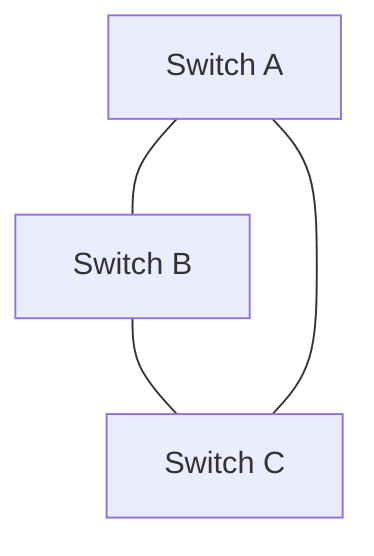
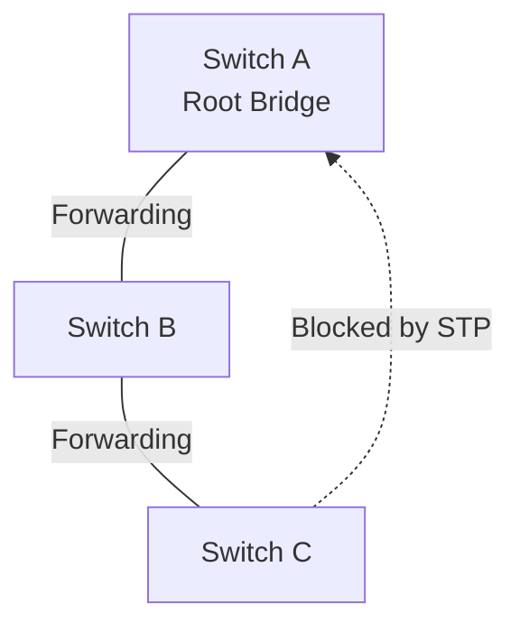
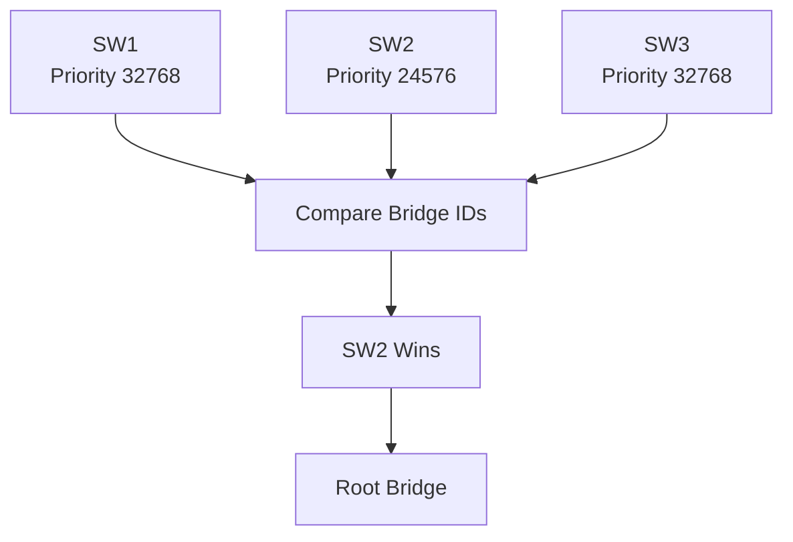
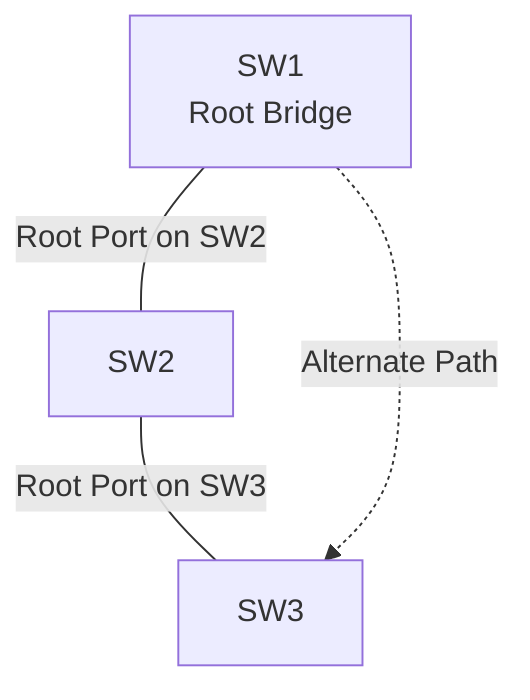
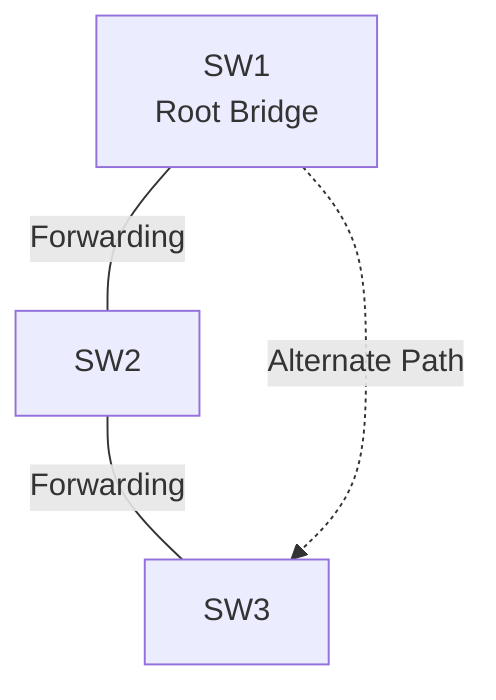
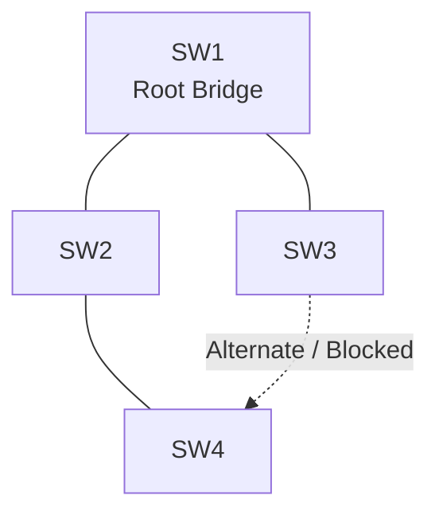

# Spanning Tree Protocol (STP)

Spanning Tree Protocol (STP) is a Layer 2 network protocol that prevents switching loops in Ethernet networks containing redundant links.

Redundant links improve network availability because they provide alternative paths when a connection or switch fails. However, multiple active Layer 2 paths can create switching loops.

Ethernet frames do not contain a Layer 2 hop count that automatically stops them from circulating indefinitely. As a result, switching loops can cause broadcast storms, duplicate frames, and MAC address table instability.

STP solves this problem by identifying redundant paths and logically blocking selected ports while keeping the physical connections available as backup paths.

When the active topology changes, STP can recalculate the network topology and activate an alternative path.

# 🗁 What Is a Switching Loop?

A switching loop occurs when Ethernet frames can circulate indefinitely through interconnected Layer 2 switches.

Consider three switches connected in a triangle:



This topology contains redundant Layer 2 paths.

Without loop prevention, a broadcast frame received by a switch may be forwarded through multiple interfaces and return through another path.

The process can continue indefinitely.

### 🖆 Why Switching Loops Are Dangerous

Switching loops can cause several problems:

**Broadcast storms**

Broadcast frames are repeatedly forwarded around the loop, consuming available bandwidth and switch processing resources.

**Duplicate frames**

A destination device may receive multiple copies of the same Ethernet frame.

**MAC address table instability**

A switch may repeatedly learn the same source MAC address on different ports as frames circulate through the topology.

This behavior is called MAC address flapping or MAC movement.

**Network congestion**

Continuous frame circulation can consume network bandwidth and cause legitimate traffic to be delayed or dropped.

**Network instability**

Excessive Layer 2 traffic can make switches and connected devices unresponsive.

# 🗁 Why STP Is Required

Ethernet switching networks often use redundant links to improve availability.

Redundancy is useful because a single cable or switch failure should not necessarily disconnect the network.

However, redundant Layer 2 paths must be controlled to prevent loops.

STP creates a logical loop-free topology by selecting which ports should forward traffic and which redundant ports should remain blocked or alternate.



The physical connection remains available, but the selected blocked port does not forward ordinary user data frames.

If an active path fails, STP can transition an alternate path into forwarding.

# 🗁 STP Fundamentals

STP is defined by IEEE 802.1D bridging standards.

Its primary purpose is to calculate a loop-free logical topology from a physical network that may contain redundant connections.

### 🖆 Important STP Terms

| Term | Description |
| --- | --- |
| Bridge | A Layer 2 device participating in spanning tree |
| Root Bridge | The elected reference bridge for the spanning-tree topology |
| Bridge ID | Identifier used to elect and distinguish bridges |
| Root Port | A non-root bridge's best path toward the Root Bridge |
| Designated Port | The forwarding port selected for a network segment |
| Alternate Port | A backup path toward the Root Bridge |
| BPDU | Bridge Protocol Data Unit used to exchange spanning-tree information |
| Path Cost | Metric used to select the best path toward the Root Bridge |
| Convergence | Process of reaching a stable spanning-tree topology |

# 🗁 Bridge ID (BID)

Bridge ID is used during Root Bridge election.

A Bridge ID consists of:

* Bridge Priority.
* Extended System ID.
* MAC Address.

Conceptually:

```text id="k9l3y2"
Bridge ID =
Bridge Priority + Extended System ID + MAC Address
```

The Root Bridge is selected based on the lowest Bridge ID.

### 🖆 Bridge Priority

Bridge priority influences Root Bridge election.

A switch with a lower priority value is preferred.

In traditional STP, the default bridge priority is 32768.

Modern implementations commonly use priority values in increments of 4096 because the VLAN identifier or other system information is incorporated into the extended system ID.

### 🖆 MAC Address

If two switches have the same effective priority, the switch with the lower MAC address wins the election.

### 🖆 Example

| Switch | Priority | MAC Address |
| --- | ---: | --- |
| SW1 | 32768 | 00:11:22:33:44:55 |
| SW2 | 24576 | 00:11:22:33:44:66 |
| SW3 | 32768 | 00:11:22:33:44:77 |

SW2 becomes the Root Bridge because it has the lowest Bridge ID.

# 🗁 Root Bridge Election

The Root Bridge is the central reference point for the spanning-tree calculation.

Every participating switch determines its best path toward the Root Bridge.

The switch with the lowest Bridge ID becomes the Root Bridge.

### 🖆 Election Process

* Switches exchange BPDUs.
* Each switch compares the received Root Bridge information.
* A switch with a lower Bridge ID is preferred.
* Switches update their spanning-tree information.
* The election converges on the bridge with the lowest Bridge ID.



### 🖆 Why Root Bridge Placement Matters

The Root Bridge influences the forwarding topology.

Its location can affect:

* Traffic paths.
* Link utilization.
* Network convergence.
* Redundant path selection.
* Traffic distribution.

For predictable network behavior, administrators should deliberately select the Root Bridge rather than relying on automatic MAC-address-based election.

# 🗁 Root Port

A Root Port is the port on a non-root switch that provides the best path toward the Root Bridge.

Every non-root bridge in a single spanning-tree instance has one Root Port.

The Root Bridge itself does not have a Root Port.

### 🖆 Root Port Selection

The switch selects its Root Port using the best received spanning-tree information.

The selection considers, in order:

* Lowest Root Bridge ID.
* Lowest total Root Path Cost.
* Lowest sender Bridge ID.
* Lowest sender Port ID.
* Lowest local Port ID as a final tie-breaker where applicable.

The exact comparison process follows the applicable spanning-tree standard and port-role rules.

### 🖆 Example



SW2 selects its connection toward SW1 as its Root Port.

SW3 selects the connection with the best path toward SW1 as its Root Port.

# 🗁 Designated Port

A Designated Port is the port selected to forward traffic for a particular Layer 2 network segment.

Every connected segment in a spanning-tree topology has one Designated Port.

The Root Bridge's active ports are normally Designated Ports because they advertise the best path to the Root Bridge.

### 🖆 Designated Port Selection

When multiple switches connect to the same segment, the Designated Port is selected using the best spanning-tree information.

The comparison considers:

* Lowest Root Bridge ID.
* Lowest Root Path Cost.
* Lowest Bridge ID.
* Lowest Port ID.

The selected Designated Port forwards traffic for that segment.

# 🗁 Alternate Port

An Alternate Port provides an alternative path toward the Root Bridge.

It does not forward ordinary user traffic in the stable topology.

If the current Root Port or its path becomes unavailable, the Alternate Port can become the Root Port.

RSTP uses the Alternate Port role to provide faster recovery than traditional STP.

### 🖆 Example



The redundant connection remains physically available while its selected port is not forwarding ordinary data traffic.

# 🗁 STP Port Roles

The main port roles are:

| Port Role | Description |
| --- | --- |
| Root Port | Best path toward the Root Bridge |
| Designated Port | Forwarding port for a network segment |
| Alternate Port | Backup path toward the Root Bridge |
| Backup Port | Redundant connection to the same shared segment |
| Disabled Port | Not participating in the spanning-tree topology |

In traditional STP, ports are commonly described using forwarding and blocking states.

RSTP introduces more explicit port roles and states.

# 🗁 STP Port States

Traditional STP uses five port states.

| State | Description |
| --- | --- |
| Disabled | Port does not participate in STP |
| Blocking | Does not forward ordinary user frames or learn MAC addresses |
| Listening | Processes BPDUs and participates in topology calculation |
| Learning | Learns source MAC addresses but does not forward ordinary user frames |
| Forwarding | Forwards and receives normal user traffic |

### 🖆 Blocking

A blocking port prevents loops by not forwarding ordinary user frames.

It continues to process relevant BPDUs.

### 🖆 Listening

A listening port participates in the spanning-tree calculation.

It does not forward user traffic or learn MAC addresses.

### 🖆 Learning

A learning port begins building its MAC address table.

It still does not forward ordinary user frames.

### 🖆 Forwarding

A forwarding port sends and receives normal Ethernet frames.

It also participates in spanning-tree BPDU processing.

### 🖆 Disabled

A disabled port does not participate in the spanning-tree topology.

# 🗁 STP Timers

Traditional STP uses three important timers.

| Timer | Default Value | Purpose |
| --- | ---: | --- |
| Hello Time | 2 seconds | Interval between configuration BPDUs generated by the Root Bridge |
| Forward Delay | 15 seconds | Duration spent in Listening and Learning states |
| Max Age | 20 seconds | Maximum age of received spanning-tree information before it is considered expired |

### 🖆 Hello Time

The Root Bridge generates configuration BPDUs at the configured Hello Time.

The default is commonly two seconds.

### 🖆 Forward Delay

A port transitioning through traditional STP normally spends:

* 15 seconds in Listening.
* 15 seconds in Learning.

This helps prevent temporary loops during topology changes.

### 🖆 Max Age

Max Age determines how long received spanning-tree information can remain valid.

The default is commonly 20 seconds.

### 🖆 Traditional STP Convergence

A simple failure scenario can involve approximately 30 seconds of Listening and Learning transitions.

Actual convergence behavior depends on topology, timers, failure detection, and protocol implementation.

Modern RSTP can converge significantly faster.

# 🗁 Bridge Protocol Data Unit (BPDU)

A Bridge Protocol Data Unit is a control frame exchanged between spanning-tree-enabled bridges.

BPDUs carry information used to calculate and maintain a loop-free topology.

### 🖆 Information in a BPDU

A configuration BPDU includes fields such as:

* Protocol identifier.
* Protocol version.
* BPDU type.
* Root Bridge ID.
* Root Path Cost.
* Sender Bridge ID.
* Sender Port ID.
* Message age.
* Max Age.
* Hello Time.
* Forward Delay.
* Flags.

### 🖆 BPDU Types

Traditional STP primarily uses configuration BPDUs and topology-change notification BPDUs.

RSTP uses BPDU types and flags that support its faster synchronization and topology-change mechanisms.

### 🖆 BPDU Destination MAC Address

The common IEEE bridge-group destination MAC address is:

```text id="g5zkqz"
01:80:C2:00:00:00
```

This is a reserved link-local multicast address used by spanning-tree protocols.

# 🗁 How STP Prevents Loops

STP prevents Layer 2 loops by selecting a loop-free forwarding topology.

Consider four switches connected with redundant links:



The spanning-tree algorithm:

* Elects a Root Bridge.
* Selects one Root Port on each non-root bridge.
* Selects one Designated Port for each segment.
* Places redundant paths into non-forwarding roles.
* Maintains a loop-free forwarding topology.

If an active link fails, the protocol recalculates the topology and may activate a previously blocked path.

# 🗁 Spanning Tree Protocol Versions

Several spanning-tree implementations are commonly used in Ethernet networks.

### 🖆 STP (IEEE 802.1D)

Traditional Spanning Tree Protocol.

Characteristics:

* Uses the Root Bridge election process.
* Prevents Layer 2 switching loops.
* Uses Blocking, Listening, Learning, and Forwarding states.
* Can take longer to converge after topology changes.

### 🖆 RSTP (IEEE 802.1w)

Rapid Spanning Tree Protocol improves convergence time.

Characteristics:

* Faster topology recovery.
* Uses alternate and backup port roles.
* Uses Discarding, Learning, and Forwarding states.
* Supports proposal and agreement mechanisms.
* Commonly replaces traditional STP in modern networks.

RSTP was incorporated into later IEEE bridging standards.

### 🖆 MSTP (IEEE 802.1s)

Multiple Spanning Tree Protocol allows multiple VLANs to be mapped to spanning-tree instances.

Characteristics:

* Supports multiple spanning-tree instances.
* Reduces the number of independent spanning-tree calculations.
* Allows VLANs to share an instance.
* Can distribute traffic across different logical topologies.
* Requires consistent MST region configuration across participating switches.

MSTP is incorporated into IEEE 802.1Q.

### 🖆 Comparison

| Feature | STP | RSTP | MSTP |
| --- | --- | --- | --- |
| Standard | IEEE 802.1D | IEEE 802.1w | IEEE 802.1s |
| Convergence | Slower | Faster | Faster with RSTP mechanisms |
| VLAN handling | Typically one topology per bridge instance | Commonly one topology per instance | Multiple VLANs mapped to instances |
| Port roles | Traditional roles | Explicit rapid roles | Uses RSTP-based behavior |
| Typical use | Legacy networks | Modern Layer 2 networks | Large VLAN-based networks |

# 🗁 RSTP Port Roles and States

RSTP uses more explicit port roles.

| Role | Description |
| --- | --- |
| Root | Best path toward the Root Bridge |
| Designated | Forwarding port for a segment |
| Alternate | Backup path toward the Root Bridge |
| Backup | Backup port for the same shared segment |
| Disabled | Not participating in the topology |

RSTP uses three port states:

| State | Description |
| --- | --- |
| Discarding | Does not forward user traffic or learn MAC addresses |
| Learning | Learns MAC addresses but does not forward user traffic |
| Forwarding | Forwards user traffic and learns MAC addresses |

RSTP's rapid transition mechanisms can activate suitable point-to-point links without waiting for traditional STP timer-based transitions.

# 🗁 STP Path Cost

STP uses path cost to select the best path toward the Root Bridge.

Lower path cost is preferred.

A switch calculates its Root Path Cost using the cost advertised by the upstream bridge plus the cost of the receiving port.

### 🖆 Common Path Cost Values

Common long-method IEEE path costs include:

| Link Speed | Path Cost |
| --- | ---: |
| 10 Mbps | 2,000,000 |
| 100 Mbps | 200,000 |
| 1 Gbps | 20,000 |
| 10 Gbps | 2,000 |

Actual costs depend on the configured cost method and platform.

Older short-method implementations use a different cost table.

### 🖆 Example

Consider two possible paths from SW3 to the Root Bridge.

```text id="1jz4aw"
Path A:
SW3 → SW1
Cost = 20,000

Path B:
SW3 → SW2 → SW1
Cost = 20,000 + 20,000
Cost = 40,000
```

Path A has the lower total path cost and is preferred.

# 🗁 Configure STP on Cisco Switches

Consider a network with three switches.

```text id="2f8y61"
SW1: Root Bridge
SW2: Secondary candidate
SW3: Access switch
```

### 🖆 Check STP Status

```bash id="99c0ng"
show spanning-tree
```

Inspect a specific VLAN:

```bash id="4r7n1z"
show spanning-tree vlan 10
```

### 🖆 Configure Root Bridge Priority

On SW1:

```bash id="6x8f2j"
configure terminal

spanning-tree vlan 10 priority 4096

end
```

A lower Bridge Priority makes the switch more likely to become the Root Bridge.

Alternatively, on supported Cisco platforms:

```bash id="8y2qwb"
spanning-tree vlan 10 root primary
```

This command adjusts the priority to make the switch a preferred Root Bridge candidate.

### 🖆 Configure a Secondary Root Candidate

On SW2:

```bash id="b8d2yz"
configure terminal

spanning-tree vlan 10 root secondary

end
```

### 🖆 Enable Rapid PVST+

On supported Cisco platforms:

```bash id="5a2xzb"
configure terminal

spanning-tree mode rapid-pvst

end
```

Rapid PVST+ provides a separate rapid spanning-tree instance for each VLAN.

### 🖆 Configure PortFast

On an endpoint-facing interface:

```bash id="4n7h0x"
configure terminal

interface gigabitEthernet 0/10
 spanning-tree portfast

end
```

PortFast allows an appropriate edge port to transition rapidly to forwarding.

It should not be used indiscriminately on switch-to-switch links.

### 🖆 Enable BPDU Guard

```bash id="j0m8gr"
configure terminal

interface gigabitEthernet 0/10
 spanning-tree bpduguard enable

end
```

BPDU Guard protects an edge port by placing it into an error-disabled state when it receives an unexpected BPDU.

### 🖆 Verify Configuration

```bash id="9w4kts"
show spanning-tree
show spanning-tree root
show spanning-tree vlan 10
show spanning-tree interface gigabitEthernet 0/10 detail
```

# 🗁 STP on MikroTik RouterOS v7

MikroTik RouterOS supports spanning-tree protocols on bridge interfaces.

The supported modes include:

* STP.
* RSTP.
* MSTP.

The bridge protocol is configured through the bridge interface.

### 🖆 Check Existing Bridge Configuration

```routeros id="5f9n1c"
/interface bridge print detail
```

### 🖆 Configure RSTP

```routeros id="4v9j6a"
/interface bridge
set bridge1 protocol-mode=rstp
```

### 🖆 Configure Bridge Priority

A lower bridge priority makes a bridge more likely to become the Root Bridge.

```routeros id="8r2m5x"
/interface bridge
set bridge1 priority=0x1000
```

Use a suitable priority based on the intended topology.

### 🖆 Configure Port Edge Behavior

For an endpoint-facing bridge port:

```routeros id="2j5c7n"
/interface bridge port
set [find interface=ether2] edge=yes
```

An edge port is expected to connect to an endpoint rather than another bridge.

Do not mark switch-to-switch connections as edge ports.

### 🖆 Configure BPDU Protection

RouterOS supports BPDU Guard behavior through bridge port configuration on supported versions.

Example:

```routeros id="6c4p8b"
/interface bridge port
set [find interface=ether2] bpdu-guard=yes
```

Verify exact property availability on the installed RouterOS release.

### 🖆 Verify STP Configuration

```routeros id="1x7k4q"
/interface bridge print detail
```

Inspect bridge ports:

```routeros id="9n2m5v"
/interface bridge port print detail
```

Inspect bridge monitoring information:

```routeros id="3j6w8p"
/interface bridge monitor bridge1
```

Inspect bridge logs:

```routeros id="7h5q2m"
/log print where topics~"bridge"
```

### 🖆 Important MikroTik Considerations

* Use RSTP for most modern bridged networks unless MSTP or another design is required.
* Configure bridge priorities deliberately.
* Mark only genuine endpoint-facing ports as edge ports.
* Use BPDU Guard on suitable edge ports.
* Keep spanning-tree configuration consistent with connected switches.
* Consider VLAN filtering and bridge topology together.
* Verify hardware offloading behavior for the specific device.

# 🗁 STP on Linux Bridges

Linux supports spanning-tree functionality through the Linux bridge subsystem.

A bridge can participate in STP when spanning tree is enabled.

### 🖆 Create a Bridge with STP Enabled

```bash id="3y6v9k"
sudo ip link add name br0 type bridge stp_state 1
```

Bring up the bridge:

```bash id="4p8x2n"
sudo ip link set br0 up
```

Add physical interfaces:

```bash id="7w3m1q"
sudo ip link set enp2s0 master br0
sudo ip link set enp3s0 master br0
```

Bring up the interfaces:

```bash id="5v9k2r"
sudo ip link set enp2s0 up
sudo ip link set enp3s0 up
```

### 🖆 Inspect STP Configuration

```bash id="6q2w8n"
ip -d link show br0
```

Inspect bridge information:

```bash id="9m3j5v"
bridge link show
```

### 🖆 Configure Bridge Priority

```bash id="2k7x4p"
sudo ip link set dev br0 type bridge priority 4096
```

### 🖆 Configure STP Timers

```bash id="4n8y1s"
sudo ip link set dev br0 type bridge forward_delay 15
sudo ip link set dev br0 type bridge hello_time 2
sudo ip link set dev br0 type bridge max_age 20
```

Timer configuration must comply with spanning-tree protocol constraints.

### 🖆 Important Linux Notes

* Linux bridge STP support is commonly based on traditional STP behavior.
* Linux bridge STP is not automatically equivalent to a complete RSTP or MSTP implementation.
* Advanced rapid spanning-tree functionality can be provided by external components such as `mstpd`, depending on the distribution and deployment.
* Persistent configuration should be managed through Netplan, systemd-networkd, or another network manager.

# 🗁 STP Security

STP protects Layer 2 topology, but it also introduces a control plane that must be protected.

An unauthorized device sending BPDUs may influence the spanning-tree topology.

### 🖆 Root Bridge Manipulation

An attacker may send BPDUs advertising a lower Bridge ID.

If accepted, a switch may elect the unauthorized device as the Root Bridge.

This can change forwarding paths and potentially expose traffic to interception or disruption.

### 🖆 BPDU Protection

BPDU Guard can protect edge ports from unexpected BPDUs.

When an edge port receives a BPDU, the switch disables the port or applies the configured protection behavior.

### 🖆 Root Guard

Root Guard prevents a designated port from accepting superior BPDUs that would cause a downstream switch to become the Root Bridge through that port.

Cisco example:

```bash id="8k3m5q"
configure terminal

interface gigabitEthernet 0/24
 spanning-tree guard root

end
```

Root Guard is appropriate on ports where the connected device should not become the Root Bridge.

### 🖆 Loop Guard

Loop Guard helps prevent certain Layer 2 loops caused by a port unexpectedly stopping the reception of BPDUs.

Cisco example:

```bash id="1r7v9c"
configure terminal

interface gigabitEthernet 0/24
 spanning-tree guard loop

end
```

Its use should be based on the network topology and platform support.

### 🖆 Best Practices

* Configure an intentional Root Bridge.
* Use a secondary Root Bridge.
* Enable BPDU Guard on suitable edge ports.
* Use Root Guard on appropriate designated ports.
* Consider Loop Guard on suitable redundant links.
* Avoid connecting unauthorized switches.
* Monitor spanning-tree topology changes.
* Document switch priorities and port roles.

# 🗁 Common STP Problems

### 🖆 Unexpected Root Bridge

A switch becomes the Root Bridge even though another switch was intended to be the root.

Possible causes:

* Incorrect bridge priority.
* Unexpected switch connection.
* Unauthorized BPDU transmission.
* Configuration changes.

Useful command:

```bash id="6k2w4p"
show spanning-tree root
```

### 🖆 Frequent Topology Changes

Repeated topology changes may cause MAC address relearning and traffic interruptions.

Possible causes:

* Unstable physical links.
* Incorrect edge-port configuration.
* Switch reboots.
* Frequent port state changes.
* Misconfigured redundant links.

Useful command:

```bash id="9v3m7q"
show spanning-tree detail
```

### 🖆 Broadcast Storm

A Layer 2 loop may cause excessive broadcast traffic.

Possible causes:

* STP disabled.
* STP not operating consistently.
* Incorrect bridge configuration.
* Unsupported or improperly configured redundant topology.

Investigate:

```bash id="5q8x2n"
show spanning-tree
show interfaces counters
show mac address-table dynamic
```

### 🖆 Port Unexpectedly Blocked

A port may be blocked because another path is preferred.

Check:

* Root Bridge selection.
* Root Path Cost.
* Port priority.
* Port ID.
* Received BPDUs.
* Link topology.

### 🖆 Slow Convergence

Traditional STP may take longer to recover after a topology change.

Consider RSTP where supported and appropriate.

# 🗁 STP Troubleshooting Checklist

When troubleshooting spanning-tree issues:

* Verify that STP is enabled.
* Identify the current Root Bridge.
* Check bridge priorities.
* Inspect Root Ports and Designated Ports.
* Check Alternate and Backup Ports.
* Verify port states.
* Inspect BPDU counters and topology changes.
* Check physical link stability.
* Verify edge-port configuration.
* Check BPDU Guard, Root Guard, and Loop Guard.
* Confirm that connected switches use compatible spanning-tree modes.
* Inspect logs for topology changes and port protection events.

Useful Cisco commands:

```bash id="8v2k5m"
show spanning-tree
show spanning-tree root
show spanning-tree detail
show spanning-tree vlan 10
show spanning-tree inconsistentports
show interfaces status
```

Useful MikroTik commands:

```routeros id="4m8x2q"
/interface bridge print detail
/interface bridge port print detail
/interface bridge monitor bridge1
/log print
```

Useful Linux commands:

```bash id="2n5w8j"
ip -d link show
bridge link show
bridge fdb show
```

# 🗁 Practical Exercises

### 🖆 Exercise: Understand a Switching Loop

Build a triangular topology with three switches.

Tasks:

* Connect the switches using redundant links.
* Observe the behavior with spanning tree enabled.
* Identify the Root Bridge.
* Identify Root Ports and Designated Ports.
* Identify the blocked or alternate path.
* Disconnect an active link.
* Observe the topology reconvergence.

### 🖆 Exercise: Root Bridge Election

Configure three switches with different priorities.

Example:

```text id="7r4m9x"
SW1: Priority 32768
SW2: Priority 24576
SW3: Priority 4096
```

Tasks:

* Inspect the Bridge IDs.
* Identify the Root Bridge.
* Change the priorities.
* Observe how the Root Bridge changes.
* Configure a secondary Root Bridge candidate.

### 🖆 Exercise: STP vs RSTP

Using a supported simulator or switching platform:

* Configure traditional STP.
* Observe port state transitions.
* Disconnect an active link.
* Measure recovery time.
* Enable RSTP.
* Repeat the test.
* Compare convergence behavior.

### 🖆 Exercise: BPDU Guard

* Configure an endpoint-facing port.
* Enable PortFast and BPDU Guard.
* Connect another switch to the port.
* Observe the protection behavior.
* Inspect the interface state.
* Restore the port after correcting the test condition.

### 🖆 Exercise: MikroTik RSTP

Using MikroTik CHR or supported hardware:

* Create a bridge.
* Connect redundant Layer 2 paths.
* Configure RSTP.
* Set bridge priorities.
* Identify the root bridge and port roles.
* Disconnect a forwarding path.
* Observe the alternate path becoming active.

### 🖆 Exercise: Linux Bridge STP

Using Ubuntu virtual machines:

* Create Linux bridges.
* Connect multiple bridges through redundant virtual links.
* Enable STP.
* Inspect bridge states.
* Observe topology changes.
* Compare behavior with STP disabled.

# 🗁 Interview Questions

### 🖆 Fundamental Questions

* What is Spanning Tree Protocol?
* Why is STP required in Ethernet networks?
* What is a switching loop?
* What is a broadcast storm?
* What is a Root Bridge?
* What is a Bridge ID?
* What is a BPDU?

### 🖆 Intermediate Questions

* How is the Root Bridge elected?
* What is a Root Port?
* What is a Designated Port?
* What is an Alternate Port?
* What is the difference between STP and RSTP?
* What are the five traditional STP port states?
* What are the three STP timers?
* What is STP path cost?

### 🖆 Advanced Questions

* How does RSTP achieve faster convergence?
* What is the difference between an Alternate Port and a Backup Port?
* How does MSTP support multiple VLANs?
* What is Root Guard?
* What is BPDU Guard?
* What is Loop Guard?
* How can an attacker manipulate Root Bridge election?
* Why should PortFast be used only on suitable edge ports?
* How does STP respond when an active forwarding link fails?

# 🗁 Summary

Spanning Tree Protocol prevents Layer 2 switching loops in networks with redundant Ethernet links.

It creates a loop-free logical topology by electing a Root Bridge, selecting Root Ports and Designated Ports, and placing redundant paths into non-forwarding roles.

Important concepts include:

* Bridge ID and Root Bridge election.
* Root Port and Designated Port selection.
* Alternate and Backup Port roles.
* BPDU communication.
* STP port states and timers.
* STP, RSTP, and MSTP.
* Path cost and topology convergence.
* BPDU Guard, Root Guard, and Loop Guard.

RSTP is commonly preferred for modern Ethernet networks because it provides faster topology recovery than traditional STP.

Understanding STP is essential for designing reliable switching networks, preventing broadcast storms, and troubleshooting redundant Layer 2 topologies.

# 🗁 References

* [IEEE 802.1Q — Bridges and Bridged Networks](https://standards.ieee.org/standard/802_1Q-2022.html)
* [IEEE 802.1D — MAC Bridges](https://standards.ieee.org/standard/802_1D-2004.html)
* [Cisco — Spanning Tree Protocol](https://www.cisco.com/c/en/us/support/docs/lan-switching/spanning-tree-protocol/)
* [Cisco — Understanding and Configuring STP](https://www.cisco.com/c/en/us/support/docs/lan-switching/spanning-tree-protocol/)
* [MikroTik — Bridging and Switching](https://help.mikrotik.com/docs/spaces/ROS/pages/328068/Bridging%2Band%2BSwitching)
* [Linux Kernel — Bridge Documentation](https://docs.kernel.org/networking/bridge.html)
* [Linux `ip-link` Manual](https://man7.org/linux/man-pages/man8/ip-link.8.html)
