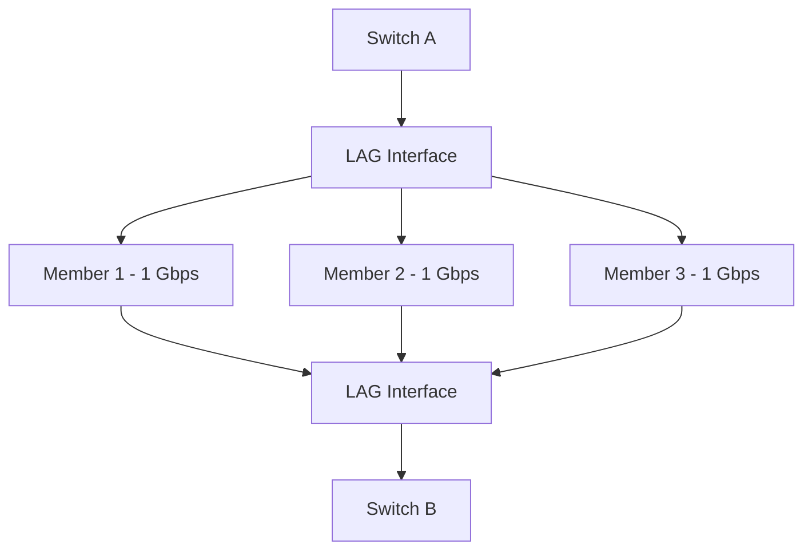

# Link Aggregation

Link Aggrsegation is a networking technique that combines multiple physical network links into one logical link. It increases aggregate bandwidth, provides link redundancy, and improves network availability.

Instead of managing several physical connections independently, switches and network devices treat the aggregated connections as a logical interface.

Link aggregation is commonly used between:

* Switches.
* Switches and routers.
* Servers and switches.
* Storage systems and network devices.
* Virtualization hosts and network infrastructure.

The most widely used standardized link aggregation protocol is **LACP (Link Aggregation Control Protocol)**, defined by IEEE 802.1AX.

# 🗁 Link Aggregation Fundamentals

Link aggregation combines multiple physical Ethernet connections into a single logical connection called a **Link Aggregation Group (LAG)**.

For example, imagine two switches connected using four physical Ethernet cables, each operating at 1 Gbps.

Without link aggregation, these are four independent links. With link aggregation, they can operate as one logical interface with an aggregate capacity of up to 4 Gbps across multiple traffic flows.

### 🖆 Without Link Aggregation

```text
Switch A                     Switch B

Port 1 --------------------- Port 1
Port 2 --------------------- Port 2
Port 3 --------------------- Port 3
Port 4 --------------------- Port 4

Four independent links
```

### 🖆 With Link Aggregation

```text
Switch A                     Switch B

Port 1 ----\
Port 2 -----\
Port 3 ------+==== LAG ======+
Port 4 -----/                |
                            |
                       Logical Link
```

The four physical interfaces become members of one logical interface.

### 🖆 Important Characteristics

* Multiple physical links form one logical link.
* The logical interface has an aggregate bandwidth capacity.
* Traffic can be distributed across member links.
* If a member link fails, traffic can continue over the remaining active links.
* The connected devices must support compatible aggregation configurations.
* Both ends must agree on the aggregation parameters.

# 🗁 Why Link Aggregation Is Used

### 🖆 Increased Aggregate Bandwidth

Multiple physical links provide greater aggregate capacity.

For example:

| Physical Links | Individual Speed | Aggregate Capacity |
| --- | ---: | ---: |
| 2 | 1 Gbps | 2 Gbps |
| 4 | 1 Gbps | 4 Gbps |
| 4 | 10 Gbps | 40 Gbps |
| 8 | 10 Gbps | 80 Gbps |

These figures represent theoretical aggregate capacity, not the guaranteed throughput of a single connection.

### 🖆 Link Redundancy

If one physical link fails, the remaining links can continue forwarding traffic.

For example:

```text
Normal Operation:

Link 1: UP
Link 2: UP
Link 3: UP
Link 4: UP

Aggregate capacity: 4 Gbps


After Link Failure:

Link 1: UP
Link 2: DOWN
Link 3: UP
Link 4: UP

Remaining aggregate capacity: 3 Gbps
```

### 🖆 Improved Network Availability

Link aggregation reduces the impact of individual cable, transceiver, or port failures.

It is particularly useful for critical connections between:

* Core and distribution switches.
* Access and distribution switches.
* Servers and switches.
* Network storage systems and switches.

### 🖆 Simplified Network Management

Instead of managing multiple independent Layer 2 links, administrators can manage a logical interface.

This simplifies VLAN configuration, monitoring, and spanning-tree operation.

# 🗁 Important Terminology

| Term | Description |
| --- | --- |
| LAG | Link Aggregation Group; a collection of physical links operating as one logical link |
| LACP | Protocol used to negotiate and maintain link aggregation |
| EtherChannel | Cisco terminology for link aggregation |
| Port Channel | Cisco logical interface representing an aggregated connection |
| Bonding | Linux mechanism for combining multiple network interfaces |
| Member Interface | Physical interface participating in a LAG |
| Aggregator | Logical group of selected physical links |
| Actor | Local device participating in LACP |
| Partner | Remote device participating in LACP |
| System ID | Identifies an LACP system using system priority and MAC address |
| Port ID | Identifies an individual LACP port |
| Hashing | Algorithm used to select a member link for a traffic flow |

**Important distinction:** LAG is the logical aggregation concept, while LACP is a protocol that dynamically negotiates and manages the aggregation. Static aggregation does not use LACP.

# 🗁 How Link Aggregation Works

When multiple physical interfaces are configured as a LAG, the devices treat the selected interfaces as one logical connection.

The process generally involves:

* Selecting compatible physical interfaces.
* Configuring matching aggregation parameters on both devices.
* Negotiating membership when LACP is used.
* Creating a logical aggregation interface.
* Distributing traffic across active member links.
* Monitoring member-link availability.

### 🖆 Example Network Topology



### 🖆 Logical Interface

Once aggregation is established, the logical interface becomes the primary interface for network configuration.

Depending on the platform, administrators generally configure the following on the logical interface:

* VLAN membership.
* IP addressing, when using Layer 3 aggregation.
* MTU.
* Firewall or routing policies, where supported.
* Monitoring and operational settings.

The physical member interfaces inherit or follow the aggregation configuration and should not be independently configured in conflicting ways.

# 🗁 Static Aggregation vs LACP

There are two common approaches to configuring link aggregation.

### 🖆 Static Link Aggregation

Static aggregation manually configures physical interfaces into a logical group.

There is no negotiation protocol to verify that the remote device has configured the same aggregation.

Characteristics:

* No LACP negotiation.
* Both ends must be configured consistently.
* Simpler configuration.
* Configuration mismatches can create forwarding problems or Layer 2 loops.
* Limited dynamic detection of aggregation misconfiguration.

### 🖆 LACP-Based Aggregation

LACP dynamically negotiates link aggregation between connected devices.

Characteristics:

* Automatically identifies compatible links.
* Exchanges control information between devices.
* Detects certain configuration mismatches.
* Dynamically selects active member links.
* Supports active and passive negotiation modes.

### 🖆 Comparison

| Feature | Static Aggregation | LACP |
| --- | --- | --- |
| Negotiation | No | Yes |
| Protocol | None | IEEE 802.1AX |
| Configuration | Manual | Negotiated |
| Mismatch detection | Limited | Better |
| Dynamic membership | No protocol negotiation | Yes |
| Operational visibility | Platform-dependent | LACP state information |
| Recommendation | Specific controlled environments | General preferred approach |

LACP is generally preferred because it provides negotiation and helps prevent incompatible links from being treated as one aggregation.

# 🗁 LACP Fundamentals

LACP stands for **Link Aggregation Control Protocol**.

It allows two directly connected network devices to exchange information and establish a compatible Link Aggregation Group.

LACP is standardized by IEEE 802.1AX.

### 🖆 LACP Operation

Each device exchanges LACP Data Units (LACPDUs) with its connected peer.

These messages contain information such as:

* System priority.
* System MAC address.
* Port priority.
* Port number.
* Aggregation state.
* Partner information.

Using this information, the devices determine which interfaces can participate in the same aggregation.

### 🖆 LACP Modes

LACP commonly supports two configuration modes.

**Active Mode**

The device actively sends LACPDUs to initiate negotiation.

**Passive Mode**

The device waits for LACPDUs from its peer and responds when negotiation is initiated.

| Local Mode | Remote Mode | Result |
| --- | --- | --- |
| Active | Active | Aggregation established |
| Active | Passive | Aggregation established |
| Passive | Passive | No aggregation initiated |
| Passive | Active | Aggregation established |

At least one side must operate in active mode.

### 🖆 LACP Timers

LACP supports two periodic transmission rates.

| Mode | Transmission Interval | Timeout |
| --- | ---: | ---: |
| Slow | 30 seconds | 90 seconds |
| Fast | 1 second | 3 seconds |

Fast periodic transmission provides quicker detection of a lost LACP peer, subject to implementation and configuration.

### 🖆 LACP State

LACP uses state information to determine whether a port is eligible to participate in an aggregation.

Important state concepts include:

* Activity: Active or passive negotiation.
* Timeout: Short or long periodic timeout.
* Aggregation: Whether the port is configured for aggregation.
* Synchronization: Whether the port is synchronized with its selected aggregator.
* Collecting: Whether the port can receive and process distributed traffic.
* Distributing: Whether the port can transmit distributed traffic.
* Defaulted: Whether partner information has reverted to default values.
* Expired: Whether partner information has timed out.

A port must reach an appropriate synchronized state before it can safely forward traffic as an active member.

# 🗁 Load Distribution

Link aggregation does not normally divide every individual packet evenly across all physical links.

Instead, it uses a hashing algorithm to select a member link for a traffic flow.

This helps preserve packet ordering.

### 🖆 Hashing Inputs

Depending on the platform, the hashing algorithm may use:

* Source MAC address.
* Destination MAC address.
* Source IP address.
* Destination IP address.
* Source TCP or UDP port.
* Destination TCP or UDP port.

For example, a Layer 3 and Layer 4 hash may use:

```text
Source IP
Destination IP
Source Port
Destination Port
```

The selected values are processed by a hashing algorithm to determine the outgoing physical member.

### 🖆 Example

Assume a LAG contains four physical links:

```text
LAG
 |
 +---- Link 1
 +---- Link 2
 +---- Link 3
 +---- Link 4
```

Different traffic flows may be distributed as follows:

| Traffic Flow | Selected Link |
| --- | --- |
| Client A → Server A | Link 1 |
| Client B → Server A | Link 3 |
| Client C → Server B | Link 2 |
| Client D → Server C | Link 4 |

This distribution allows multiple simultaneous flows to use different physical links.

### 🖆 Important Bandwidth Limitation

A single traffic flow is generally limited to the capacity of one selected physical member.

For example, consider a four-member LAG:

```text
4 × 1 Gbps = 4 Gbps aggregate capacity
```

The LAG may provide approximately 4 Gbps of aggregate capacity across multiple flows, but a single conventional TCP connection will generally remain limited to approximately 1 Gbps.

Actual throughput depends on protocol overhead, traffic distribution, device capabilities, and network conditions.

### 🖆 Hash Imbalance

Hashing does not guarantee perfectly equal traffic distribution.

For example:

```text
Link 1: 80% utilization
Link 2: 20% utilization
Link 3: 15% utilization
Link 4: 10% utilization
```

This can happen when a small number of large flows map to the same physical link.

Possible improvements include:

* Selecting a suitable hashing policy.
* Including Layer 3 or Layer 4 information when supported.
* Using multiple independent traffic flows.
* Monitoring individual member utilization.
* Avoiding assumptions that more physical links automatically improve every workload.

# 🗁 Failure Detection and Redundancy

Link aggregation provides resilience against individual member-link failures.

When a member link becomes unavailable, the aggregation can remove it from the active group and redistribute traffic across the remaining members.

### 🖆 Example

```text
Before Failure:

Link 1: UP
Link 2: UP
Link 3: UP
Link 4: UP

Aggregate: 4 Gbps


After Failure:

Link 1: UP
Link 2: DOWN
Link 3: UP
Link 4: UP

Aggregate: 3 Gbps
```

The logical interface can remain operational as long as at least one usable member remains, subject to platform configuration.

### 🖆 Minimum Links

Some platforms allow administrators to configure a minimum number of active member links.

For example:

```text
LAG Members: 4
Minimum Active Links: 2
```

If fewer than two members remain operational, the logical interface may be brought down.

This can be useful when the application requires a minimum bandwidth or redundancy threshold.

### 🖆 Important Limitation

Link aggregation does not automatically protect against every network failure.

It may not protect against:

* Failure of the entire remote switch.
* Failure of the local switch.
* Power loss affecting all member ports.
* Incorrect configuration across all links.
* Failure of a shared cable bundle or physical pathway.
* Upstream routing failures.

For device-level redundancy, technologies such as MLAG, stacking, chassis clustering, or redundant Layer 3 routing may be required.

# 🗁 Link Aggregation and STP

Link aggregation and Spanning Tree Protocol solve different problems.

* Link aggregation combines multiple physical links into one logical connection.
* STP prevents Layer 2 switching loops.

When multiple physical links are correctly configured as one LAG, STP generally sees the logical aggregation as a single connection rather than independent physical paths.

### 🖆 Without Aggregation

```text
Switch A -------- Switch B
     \              /
      \------------/

Potential Layer 2 loop
```

### 🖆 With Aggregation

```text
Switch A
    |
    | Logical LAG
    |
Switch B
```

The physical links inside the aggregation are treated as members of one logical connection.

### 🖆 Important Considerations

* STP should remain enabled in redundant Layer 2 topologies.
* Both ends must agree on the aggregation configuration.
* Never independently connect multiple parallel Layer 2 links without an appropriate loop-prevention design.
* Incorrect static aggregation can cause serious Layer 2 forwarding problems.
* LACP does not replace STP.

# 🗁 Linux Bonding Configuration

Linux supports link aggregation through the **bonding driver**.

The bonding interface combines multiple physical network interfaces into one logical network interface.

Common bonding modes include:

| Mode | Name | Description |
| --- | --- | --- |
| 0 | balance-rr | Transmits packets sequentially across interfaces |
| 1 | active-backup | Uses one active interface and keeps others as backups |
| 2 | balance-xor | Selects an interface using an XOR-based hash |
| 3 | broadcast | Sends traffic through all member interfaces |
| 4 | 802.3ad | IEEE 802.1AX LACP aggregation |
| 5 | balance-tlb | Adaptive transmit load balancing |
| 6 | balance-alb | Adaptive load balancing for transmit and receive |

For interoperable switch-based aggregation, mode 4 is commonly used.

Modes 5 and 6 have different operational requirements and do not use LACP.

### 🖆 Check Network Interfaces

```bash
ip link show
```

Example:

```text
2: enp0s3: <BROADCAST,MULTICAST,UP,LOWER_UP>
3: enp0s8: <BROADCAST,MULTICAST,UP,LOWER_UP>
```

Assume the interfaces are:

* `enp0s3`
* `enp0s8`

### 🖆 Install Bonding Support

On Ubuntu, install the bonding package:

```bash
sudo apt update
sudo apt install ifenslave
```

Load the bonding module:

```bash
sudo modprobe bonding
```

Check whether the module is loaded:

```bash
lsmod | grep bonding
```

### 🖆 Create a Bonding Interface

A temporary configuration can be created using:

```bash
sudo ip link add bond0 type bond mode 802.3ad
```

Configure the LACP rate:

```bash
sudo ip link set bond0 type bond lacp_rate fast
```

Add physical interfaces:

```bash
sudo ip link set enp0s3 down
sudo ip link set enp0s8 down

sudo ip link set enp0s3 master bond0
sudo ip link set enp0s8 master bond0
```

Bring up the member interfaces:

```bash
sudo ip link set enp0s3 up
sudo ip link set enp0s8 up
```

Bring up the logical interface:

```bash
sudo ip link set bond0 up
```

Assign an IP address:

```bash
sudo ip addr add 192.168.10.10/24 dev bond0
```

The IP address belongs to `bond0`, not to the individual member interfaces.

### 🖆 Verify Bonding Status

```bash
cat /proc/net/bonding/bond0
```

This file displays:

* Bonding mode.
* LACP status.
* Active aggregator information.
* Member interfaces.
* Link failure count.
* Actor and partner information.

Additional commands:

```bash
ip -br link
```

```bash
ip -br addr
```

```bash
ip -s link show bond0
```

### 🖆 Persistent Configuration with Netplan

For a persistent Ubuntu server configuration, use Netplan.

Example file:

`/etc/netplan/01-bond.yaml`

```yaml
network:
  version: 2
  renderer: networkd

  ethernets:
    enp0s3:
      dhcp4: false

    enp0s8:
      dhcp4: false

  bonds:
    bond0:
      interfaces:
        - enp0s3
        - enp0s8

      addresses:
        - 192.168.10.10/24

      routes:
        - to: default
          via: 192.168.10.1

      nameservers:
        addresses:
          - 1.1.1.1
          - 8.8.8.8

      parameters:
        mode: 802.3ad
        lacp-rate: fast
        mii-monitor-interval: 100
        transmit-hash-policy: layer3+4
```

Validate the configuration:

```bash
sudo netplan generate
```

Apply it:

```bash
sudo netplan apply
```

Inspect the resulting bond:

```bash
cat /proc/net/bonding/bond0
```

**Important:** The switch ports connected to `enp0s3` and `enp0s8` must belong to the same compatible LACP aggregation. The example assumes the connected switch supports LACP and is configured accordingly.

For remote systems, plan network changes carefully because an incorrect bonding configuration can disconnect the server.

# 🗁 MikroTik RouterOS Configuration

MikroTik RouterOS supports link aggregation using bonding interfaces.

RouterOS v7 supports several bonding modes, including 802.3ad LACP.

### 🖆 Example Topology

```text
MikroTik Router
    |
    +---- ether1
    |
    +---- ether2
           |
           |
       LACP Bond
           |
        Switch
```

Assume:

* `ether1` and `ether2` are connected to the same switch.
* Both switch ports belong to the same LACP group.
* The bonding interface will be named `bond1`.

### 🖆 Create an LACP Bond

```routeros
/interface bonding
add name=bond1 mode=802.3ad slaves=ether1,ether2
```

Set the LACP rate:

```routeros
/interface bonding
set bond1 lacp-rate=1sec
```

### 🖆 Assign an IP Address

```routeros
/ip address
add address=192.168.10.1/24 interface=bond1
```

### 🖆 Verify Bonding Status

```routeros
/interface bonding print
```

Check detailed information:

```routeros
/interface bonding monitor bond1
```

Check interface status:

```routeros
/interface print
```

### 🖆 Configure VLANs on a Bond

A bonding interface can serve as a VLAN trunk.

Create VLAN interfaces:

```routeros
/interface vlan
add name=vlan10 interface=bond1 vlan-id=10

add name=vlan20 interface=bond1 vlan-id=20
```

Assign IP addresses:

```routeros
/ip address
add address=192.168.10.1/24 interface=vlan10

add address=192.168.20.1/24 interface=vlan20
```

The switch must also be configured to carry VLAN 10 and VLAN 20 over its corresponding LACP aggregation.

**Important:** The VLAN configuration shown is a Layer 3 VLAN-interface example. If the bonding interface is used as a member of a RouterOS bridge, configure VLAN filtering and bridge VLAN membership consistently with the bridge design. Avoid assigning conflicting Layer 3 configurations to the same traffic path.

# 🗁 Monitoring and Troubleshooting

Link aggregation problems can arise from mismatched configurations, physical failures, incompatible LACP settings, or traffic distribution issues.

### 🖆 Check Physical Link Status

Linux:

```bash
ip link show
```

```bash
ethtool enp0s3
```

MikroTik:

```routeros
/interface ethernet print
```

### 🖆 Check LACP Status

Linux:

```bash
cat /proc/net/bonding/bond0
```

MikroTik:

```routeros
/interface bonding monitor bond1
```

### 🖆 Check Interface Counters

Linux:

```bash
ip -s link show bond0
```

```bash
ip -s link show enp0s3
```

```bash
ip -s link show enp0s8
```

These commands help identify errors, dropped packets, and traffic imbalance.

### 🖆 Capture LACP Packets

LACP uses the Slow Protocols Ethernet destination MAC address `01:80:C2:00:00:02` and EtherType `0x8809`.

Capture LACP traffic:

```bash
sudo tcpdump -i enp0s3 -nn -e ether proto 0x8809
```

This can help verify whether LACP frames are being exchanged.

### 🖆 Common Problems

| Problem | Possible Cause | Solution |
| --- | --- | --- |
| LAG does not establish | Both sides use passive LACP | Set at least one side to active |
| Only one link is active | Other links have incompatible settings | Check speed, duplex, and aggregation membership |
| Member links remain individual | Incorrect switch configuration | Verify both ends use the same LAG |
| Intermittent connectivity | Physical errors or unstable links | Inspect cables, optics, and interface counters |
| Uneven utilization | Hash distribution imbalance | Review hashing policy and traffic patterns |
| Logical interface goes down | No usable members remain | Inspect member links and minimum-links settings |
| LACP packets are missing | Filtering or incompatible connection | Verify LACP support and Layer 2 connectivity |

### 🖆 Troubleshooting Checklist

* Confirm every physical member link is operational.
* Verify speed and duplex compatibility.
* Confirm both devices use the same aggregation group.
* Verify that LACP is enabled on both ends when using LACP.
* Ensure at least one side uses active mode.
* Check LACP partner and synchronization states.
* Verify VLAN configuration on the logical interface.
* Inspect individual member traffic and error counters.
* Check MTU consistency.
* Verify that the aggregation does not span independent switches unless they support an appropriate multi-chassis aggregation technology.

# 🗁 Best Practices

* Prefer LACP over static aggregation for most switch-to-switch and server-to-switch deployments.
* Use compatible physical interfaces with matching speed and duplex settings.
* Configure both sides consistently.
* Use appropriate Layer 3 or Layer 4 hashing when supported.
* Monitor individual member interfaces, not just the logical interface.
* Keep VLAN configuration consistent across all aggregation members.
* Use STP for redundant Layer 2 network designs.
* Avoid connecting a LAG across independent switches unless they support stacking, MLAG, or another compatible multi-chassis solution.
* Use appropriate minimum-links settings when required by the application.
* Document physical ports, logical LAG names, VLANs, and peer devices.
* Test member-link failure behavior before deploying critical infrastructure.
* Remember that aggregate bandwidth does not necessarily increase the throughput of a single traffic flow.

# 🗁 Common Mistakes

### 🖆 Assuming One Connection Gets the Entire LAG Bandwidth

A four-member 1 Gbps LAG does not normally provide 4 Gbps to a single conventional TCP flow.

Traffic distribution is generally flow-based.

### 🖆 Configuring Only One Side

A LAG requires compatible configurations at both ends.

An incorrectly configured peer can prevent aggregation or cause forwarding problems.

### 🖆 Using Passive Mode on Both Devices

Two passive LACP devices do not initiate negotiation.

Configure at least one side in active mode.

### 🖆 Aggregating Ports Connected to Independent Switches

A standard LAG expects its members to terminate on the same logical aggregation system.

Connecting members to independent switches without multi-chassis aggregation support can result in incorrect forwarding behavior.

### 🖆 Ignoring Hashing Behavior

Adding more physical links does not guarantee balanced traffic.

A poor hashing policy or a small number of large flows can cause uneven utilization.

### 🖆 Treating LACP as a Routing Protocol

LACP manages Layer 2 link aggregation. It does not exchange IP routes or replace routing protocols such as OSPF or BGP.

# 🗁 Practical Exercises

### 🖆 Exercise: Understand Link Aggregation

* Draw a topology with two switches connected using four physical links.
* Compare the topology with and without a LAG.
* Calculate the theoretical aggregate bandwidth.
* Explain what happens when one member link fails.

### 🖆 Exercise: Configure Linux LACP Bonding

* Create two Linux network interfaces in a virtual machine or physical server.
* Configure a bonding interface using mode `802.3ad`.
* Connect the interfaces to an LACP-capable switch or compatible virtual switching environment.
* Verify the bond using `/proc/net/bonding/bond0`.
* Observe the LACP partner and member states.

### 🖆 Exercise: Configure MikroTik Bonding

* Create a bonding interface using `ether1` and `ether2`.
* Configure the corresponding switch ports as an LACP group.
* Assign an IP address to the bonding interface.
* Verify the bonding status.
* Test connectivity between the devices.

### 🖆 Exercise: Test Link Failure

* Establish an operational LAG with multiple member links.
* Disconnect one physical member.
* Observe the logical interface.
* Verify that communication continues.
* Reconnect the member and inspect its return to the aggregation.

### 🖆 Exercise: Analyze Traffic Distribution

* Generate multiple simultaneous network traffic flows.
* Monitor the utilization of each physical member.
* Compare different hashing policies where supported.
* Explain why a single flow may not use all member links.

# 🗁 Interview Questions

**What is link aggregation?**

Link aggregation combines multiple physical network links into one logical connection to provide increased aggregate bandwidth and redundancy.

**What is LAG?**

A Link Aggregation Group is a collection of physical interfaces operating as one logical interface.

**What is LACP?**

LACP is a standardized protocol defined by IEEE 802.1AX that dynamically negotiates and maintains link aggregation between network devices.

**What is the difference between static aggregation and LACP?**

Static aggregation is manually configured without negotiation. LACP dynamically exchanges control information to establish and maintain compatible aggregation membership.

**What are the LACP active and passive modes?**

Active mode initiates LACP negotiation. Passive mode responds to received LACPDUs without initiating negotiation.

**Can two passive LACP devices establish a LAG?**

No. At least one side must operate in active mode to initiate negotiation.

**Does a four-member 1 Gbps LAG provide 4 Gbps to one TCP connection?**

Generally, no. Traffic is distributed across member links using hashing, and a single flow is normally limited to one member's capacity.

**What happens when one physical link fails?**

The failed member is removed from active forwarding, and traffic is redistributed across the remaining operational members.

**Does LACP replace STP?**

No. LACP manages link aggregation, while STP prevents Layer 2 switching loops.

**What is the difference between LACP and EtherChannel?**

LACP is an IEEE-standard negotiation protocol. EtherChannel is Cisco terminology for link aggregation, which can use LACP, PAgP, or static configuration depending on the platform.

**What is Linux bonding?**

Linux bonding is a kernel feature that combines multiple network interfaces into one logical network interface.

**What is the purpose of hashing in link aggregation?**

Hashing selects a physical member link for each traffic flow, allowing multiple flows to use different links while helping preserve packet ordering.

# 🗁 Summary

Link aggregation combines multiple physical Ethernet connections into one logical interface.

Key concepts:

* LAG represents the logical group of aggregated links.
* LACP dynamically negotiates aggregation between devices.
* Static aggregation requires manual configuration.
* Active and passive are LACP negotiation modes.
* At least one LACP peer must operate in active mode.
* Hashing distributes traffic across physical member links.
* A single traffic flow is generally limited to one member link.
* Failed member links can be removed while the remaining links continue forwarding.
* STP and LACP solve different networking problems.
* Linux bonding and MikroTik bonding provide practical link aggregation implementations.

Link aggregation is an important technology for building scalable, resilient Ethernet networks.

# 🗁 References

* [IEEE 802.1AX — Link Aggregation](https://standards.ieee.org/standard/802_1AX-2020.html)
* [IEEE 802.1Q — Bridges and Bridged Networks](https://standards.ieee.org/standard/802_1Q-2022.html)
* [Linux Kernel — Ethernet Bonding Driver](https://docs.kernel.org/networking/bonding.html)
* [Ubuntu Server — Network Configuration](https://documentation.ubuntu.com/server/explanation/networking/)
* [Netplan Documentation](https://netplan.readthedocs.io/)
* [MikroTik — Bonding](https://help.mikrotik.com/docs/)
