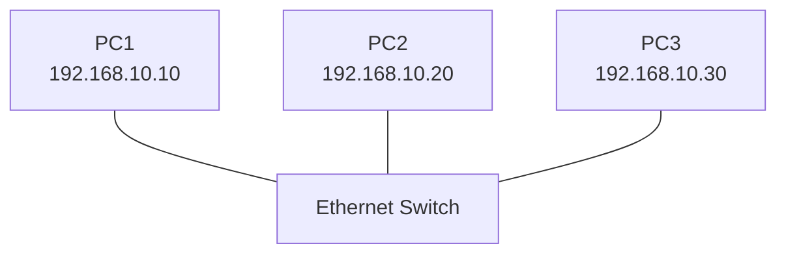
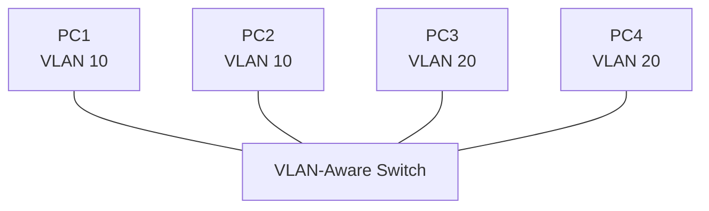
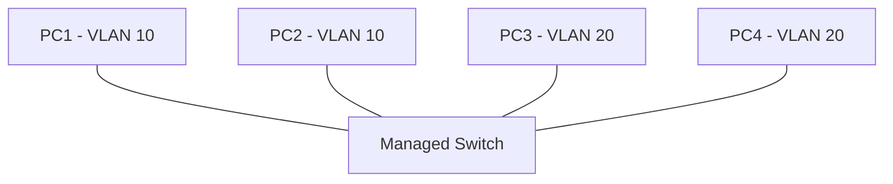
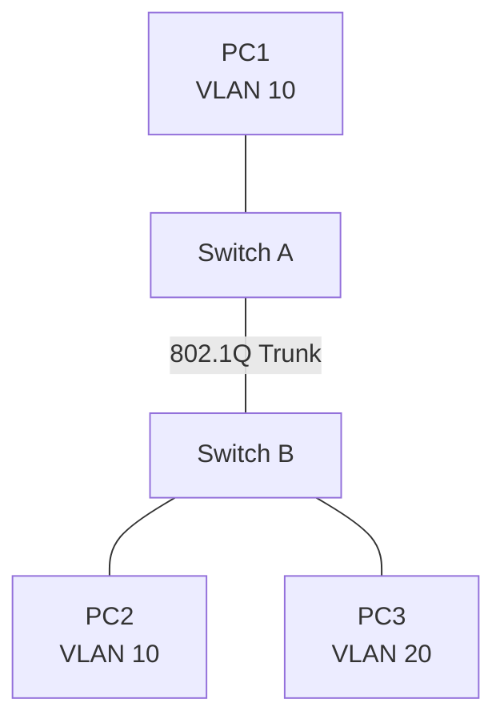
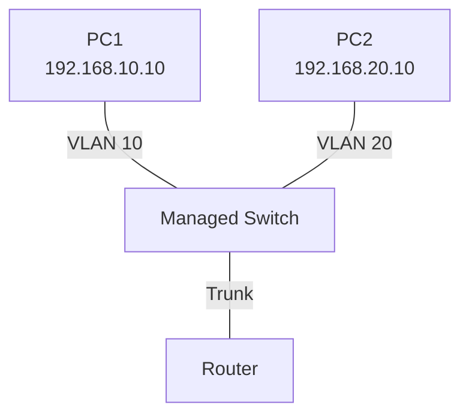
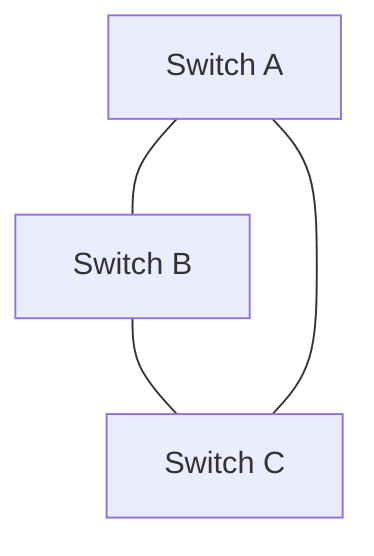
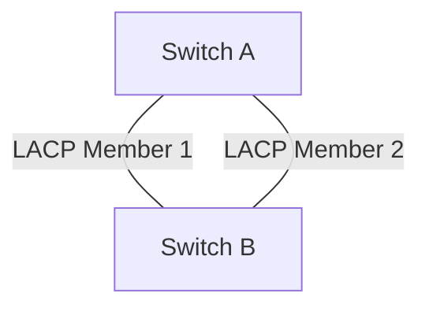
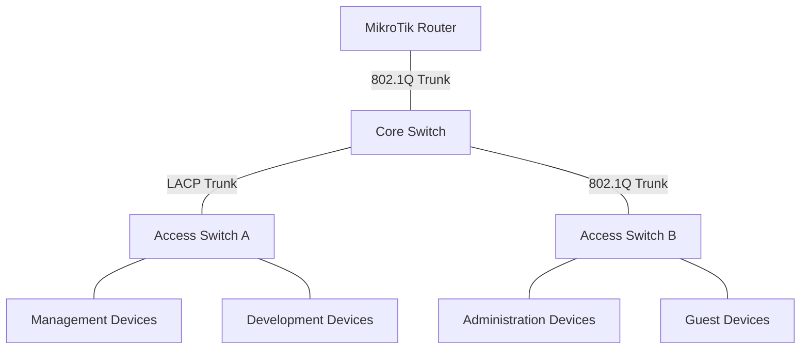

# Switching Labs and Practical Exercises

Practical labs are essential for understanding how Ethernet switching works in real network environments.

This document provides hands-on exercises covering:

* Ethernet switching fundamentals.
* MAC address learning and forwarding.
* Linux bridging.
* VLAN creation and segmentation.
* Access and trunk ports.
* IEEE 802.1Q tagging.
* Inter-VLAN routing.
* Native VLAN configuration.
* VLAN security.
* Spanning Tree Protocol.
* Link aggregation using LACP.
* Network monitoring and troubleshooting.

The exercises use Ubuntu/Linux, MikroTik RouterOS v7, and network simulation environments such as GNS3 and EVE-NG.

# 🗁 Lab Environment

You can perform these exercises using physical networking equipment or virtual network environments.

### 🖆 Required Software

| Software | Purpose |
| --- | --- |
| Ubuntu Server | Linux networking and bridge configuration |
| MikroTik CHR | RouterOS switching and routing labs |
| GNS3 | Network topology simulation |
| EVE-NG | Network emulation |
| Wireshark | Packet analysis |
| tcpdump | Command-line packet capture |
| iproute2 | Linux network configuration |
| Netplan | Persistent Ubuntu network configuration |

### 🖆 Recommended Environment

For a beginner-friendly environment, use:

* One Ubuntu Server virtual machine.
* One MikroTik CHR router.
* Two or more virtual Ethernet switches.
* Three or more client machines.

You can expand the environment as you progress.

### 🖆 Linux Networking Tools

Install the required tools:

```bash
sudo apt update

sudo apt install -y \
    iproute2 \
    bridge-utils \
    ethtool \
    tcpdump \
    wireshark \
    vlan \
    iperf3
```

Check installed versions:

```bash
ip -Version
```

```bash
bridge -V
```

```bash
tcpdump --version
```

```bash
iperf3 --version
```

### 🖆 Useful Commands

| Command | Purpose |
| --- | --- |
| `ip link` | Display network interfaces |
| `ip addr` | Display IP addresses |
| `ip neigh` | Display neighbor entries |
| `bridge link` | Display bridge ports |
| `bridge vlan` | Display bridge VLAN configuration |
| `bridge fdb` | Display forwarding database |
| `ethtool` | Inspect physical interface properties |
| `tcpdump` | Capture network packets |
| `ping` | Test IP connectivity |
| `tracepath` | Investigate network paths and MTU |
| `iperf3` | Measure network throughput |

# 🗁 Network Topology

The following topology will be used as a reference throughout the labs.

### 🖆 Basic Switching Topology



All three devices belong to the same Layer 2 network.

### 🖆 VLAN Topology



VLAN 10 and VLAN 20 represent separate Layer 2 broadcast domains.

### 🖆 IP Addressing Plan

| Device | VLAN | IP Address | Subnet Mask |
| --- | ---: | --- | --- |
| PC1 | 10 | 192.168.10.10 | /24 |
| PC2 | 10 | 192.168.10.20 | /24 |
| PC3 | 20 | 192.168.20.10 | /24 |
| PC4 | 20 | 192.168.20.20 | /24 |
| Router VLAN 10 | 10 | 192.168.10.1 | /24 |
| Router VLAN 20 | 20 | 192.168.20.1 | /24 |

# 🗁 Lab: Basic Ethernet Switching

### 🖆 Objective

Understand how Ethernet switches forward frames using destination MAC addresses.

### 🖆 Topology

Connect three Linux machines to the same Layer 2 switch or virtual switch.

Assign IP addresses:

| Device | IP Address |
| --- | --- |
| PC1 | 192.168.10.10/24 |
| PC2 | 192.168.10.20/24 |
| PC3 | 192.168.10.30/24 |

### 🖆 Configure IP Addresses

On PC1:

```bash
sudo ip addr add 192.168.10.10/24 dev eth0
sudo ip link set eth0 up
```

On PC2:

```bash
sudo ip addr add 192.168.10.20/24 dev eth0
sudo ip link set eth0 up
```

On PC3:

```bash
sudo ip addr add 192.168.10.30/24 dev eth0
sudo ip link set eth0 up
```

Replace `eth0` with the actual interface name on each machine.

### 🖆 Test Connectivity

From PC1:

```bash
ping 192.168.10.20
```

```bash
ping 192.168.10.30
```

### 🖆 Observe ARP and Neighbor Discovery

```bash
ip neigh show
```

Generate traffic and inspect the neighbor table again.

### 🖆 Expected Results

* All devices should communicate within the same Layer 2 network.
* The switch should learn source MAC addresses.
* Unknown destination unicast frames may initially be flooded within the VLAN.
* Subsequent known unicast traffic should be forwarded toward the learned destination port.

### 🖆 Questions

* How does a switch learn MAC addresses?
* What happens when the destination MAC address is unknown?
* Why can devices communicate without a router when they are in the same IP subnet and VLAN?

# 🗁 Lab: MAC Address Learning

### 🖆 Objective

Inspect the MAC address table and understand dynamic MAC learning.

### 🖆 MikroTik RouterOS

Display the bridge host table:

```routeros
/interface bridge host print
```

This displays learned MAC addresses and their associated bridge ports.

### 🖆 Linux Bridge

Display the forwarding database:

```bash
bridge fdb show
```

Display bridge details:

```bash
bridge link show
```

### 🖆 Generate Traffic

From PC1:

```bash
ping 192.168.10.20
```

Inspect the forwarding database again:

```bash
bridge fdb show
```

### 🖆 Observe MAC Learning

Generate traffic between different devices and identify:

* Source MAC addresses.
* Associated switch ports.
* VLAN identifiers, where applicable.
* Dynamic and static entries.
* Entry aging behavior.

### 🖆 Expected Results

The switch should learn the source MAC address of each communicating device.

The forwarding database should associate learned addresses with their corresponding interfaces and VLAN contexts.

### 🖆 Questions

* Does a switch learn destination MAC addresses?
* What is the difference between an ARP table and a MAC address table?
* Why can the same MAC address have separate forwarding contexts in different VLANs?

# 🗁 Lab: Linux Software Bridge

### 🖆 Objective

Create a software bridge on Ubuntu and connect multiple virtual network interfaces.

A Linux bridge operates at Layer 2 and forwards Ethernet frames between its member interfaces.

### 🖆 Create a Bridge

```bash
sudo ip link add name br0 type bridge
```

Create two virtual Ethernet pairs:

```bash
sudo ip link add veth0 type veth peer name veth0-peer

sudo ip link add veth1 type veth peer name veth1-peer
```

Add the interfaces to the bridge:

```bash
sudo ip link set veth0 master br0

sudo ip link set veth1 master br0
```

Bring the interfaces up:

```bash
sudo ip link set br0 up

sudo ip link set veth0 up
sudo ip link set veth0-peer up

sudo ip link set veth1 up
sudo ip link set veth1-peer up
```

### 🖆 Assign IP Addresses

Assign addresses to the peer interfaces:

```bash
sudo ip addr add 192.168.10.10/24 dev veth0-peer

sudo ip addr add 192.168.10.20/24 dev veth1-peer
```

### 🖆 Test Connectivity

```bash
ping 192.168.10.20
```

The interfaces should communicate through the Linux bridge.

### 🖆 Inspect the Bridge

```bash
bridge link show
```

```bash
bridge fdb show
```

```bash
ip -br addr
```

### 🖆 Remove the Lab Configuration

```bash
sudo ip link del br0

sudo ip link del veth0

sudo ip link del veth1
```

Deleting a veth interface pair removes both ends.

### 🖆 Expected Results

* `br0` should operate as a Layer 2 bridge.
* Both virtual interfaces should appear as bridge ports.
* The forwarding database should learn source MAC addresses.
* The peer interfaces should communicate through the bridge.

# 🗁 Lab: Create VLAN Interfaces

### 🖆 Objective

Create VLAN interfaces on Ubuntu and inspect IEEE 802.1Q tagging.

This lab requires a VLAN-capable network path or a local environment in which tagged frames can be observed.

### 🖆 Create a VLAN Interface

Assume the physical interface is `eth0`.

Create VLAN 10:

```bash
sudo ip link add link eth0 name eth0.10 type vlan id 10
```

Create VLAN 20:

```bash
sudo ip link add link eth0 name eth0.20 type vlan id 20
```

Bring the interfaces up:

```bash
sudo ip link set eth0 up

sudo ip link set eth0.10 up

sudo ip link set eth0.20 up
```

Assign IP addresses:

```bash
sudo ip addr add 192.168.10.10/24 dev eth0.10

sudo ip addr add 192.168.20.10/24 dev eth0.20
```

### 🖆 Verify VLAN Interfaces

```bash
ip -d link show eth0.10
```

```bash
ip -d link show eth0.20
```

### 🖆 Inspect VLAN Traffic

```bash
sudo tcpdump -eni eth0 vlan
```

You can also use Wireshark to inspect the 802.1Q VLAN header.

### 🖆 Expected Results

* Two VLAN interfaces should be created.
* VLAN 10 traffic should use the VLAN 10 tag.
* VLAN 20 traffic should use the VLAN 20 tag.
* The upstream switch must allow both VLANs on the connected port.

# 🗁 Lab: VLAN Segmentation

### 🖆 Objective

Create separate broadcast domains using VLANs.

### 🖆 Topology



### 🖆 VLAN Configuration

Create two VLANs:

| VLAN ID | VLAN Name | Network |
| ---: | --- | --- |
| 10 | MANAGEMENT | 192.168.10.0/24 |
| 20 | USERS | 192.168.20.0/24 |

### 🖆 MikroTik RouterOS v7 Configuration

Create a bridge:

```routeros
/interface bridge
add name=br-lan vlan-filtering=no
```

Add physical ports:

```routeros
/interface bridge port
add bridge=br-lan interface=ether2 pvid=10
add bridge=br-lan interface=ether3 pvid=10
add bridge=br-lan interface=ether4 pvid=20
add bridge=br-lan interface=ether5 pvid=20
```

Configure VLAN membership:

```routeros
/interface bridge vlan
add bridge=br-lan vlan-ids=10 untagged=ether2,ether3

add bridge=br-lan vlan-ids=20 untagged=ether4,ether5
```

Enable VLAN filtering:

```routeros
/interface bridge
set br-lan vlan-filtering=yes
```

The example assumes that the ports are dedicated access ports and the router does not need Layer 3 access to these VLANs through the bridge CPU port.

### 🖆 Test VLAN Isolation

Connect PC1 and PC2 to VLAN 10.

Connect PC3 and PC4 to VLAN 20.

Test:

```bash
ping 192.168.10.20
```

```bash
ping 192.168.20.20
```

Then test communication between VLANs.

### 🖆 Expected Results

* Devices in VLAN 10 should communicate with other VLAN 10 devices.
* Devices in VLAN 20 should communicate with other VLAN 20 devices.
* VLAN 10 and VLAN 20 should remain isolated at Layer 2.
* Inter-VLAN communication requires a Layer 3 routing configuration.

# 🗁 Lab: Access and Trunk Ports

### 🖆 Objective

Understand how access and trunk ports transport VLAN traffic.

### 🖆 Topology



### 🖆 MikroTik Configuration

Assume:

* `ether2` connects to PC1.
* `ether3` connects to the second switch.
* VLAN 10 and VLAN 20 must cross the trunk.

Create the bridge:

```routeros
/interface bridge
add name=br1 vlan-filtering=no
```

Add bridge ports:

```routeros
/interface bridge port
add bridge=br1 interface=ether2 pvid=10

add bridge=br1 interface=ether3
```

Configure VLAN membership:

```routeros
/interface bridge vlan
add bridge=br1 vlan-ids=10 untagged=ether2 tagged=ether3

add bridge=br1 vlan-ids=20 tagged=ether3
```

Enable VLAN filtering:

```routeros
/interface bridge
set br1 vlan-filtering=yes
```

Configure the corresponding switch on the remote side with matching VLAN membership.

### 🖆 Verify

```routeros
/interface bridge port print
```

```routeros
/interface bridge vlan print
```

### 🖆 Expected Results

* PC1 sends untagged Ethernet frames.
* The switch associates incoming untagged traffic with VLAN 10 using the PVID.
* VLAN 10 traffic crosses the trunk using an 802.1Q tag.
* VLAN 20 traffic can also cross the trunk.
* The receiving switch maps the traffic to the correct VLAN.

# 🗁 Lab: Inter-VLAN Routing

### 🖆 Objective

Allow communication between separate VLANs using Layer 3 routing.

### 🖆 Topology



### 🖆 IP Addressing

| VLAN | Network | Gateway |
| --- | --- | --- |
| 10 | 192.168.10.0/24 | 192.168.10.1 |
| 20 | 192.168.20.0/24 | 192.168.20.1 |

### 🖆 MikroTik RouterOS Configuration

Create a bridge:

```routeros
/interface bridge
add name=br-lan vlan-filtering=no
```

Add the trunk interface:

```routeros
/interface bridge port
add bridge=br-lan interface=ether2
```

Create VLAN interfaces:

```routeros
/interface vlan
add name=vlan10 interface=br-lan vlan-id=10

add name=vlan20 interface=br-lan vlan-id=20
```

Configure bridge VLAN membership:

```routeros
/interface bridge vlan
add bridge=br-lan vlan-ids=10 tagged=br-lan,ether2

add bridge=br-lan vlan-ids=20 tagged=br-lan,ether2
```

Enable VLAN filtering:

```routeros
/interface bridge
set br-lan vlan-filtering=yes
```

Assign gateway addresses:

```routeros
/ip address
add address=192.168.10.1/24 interface=vlan10

add address=192.168.20.1/24 interface=vlan20
```

The bridge interface is included as a tagged member because the router's CPU must receive the tagged frames to perform Layer 3 routing.

### 🖆 Configure Client Gateways

PC1:

```text
IP Address:      192.168.10.10
Subnet Mask:     255.255.255.0
Default Gateway: 192.168.10.1
```

PC2:

```text
IP Address:      192.168.20.10
Subnet Mask:     255.255.255.0
Default Gateway: 192.168.20.1
```

### 🖆 Test Connectivity

From PC1:

```bash
ping 192.168.10.1
```

```bash
ping 192.168.20.10
```

### 🖆 Expected Results

* Each VLAN has its own IP subnet.
* The router receives traffic through the appropriate VLAN interface.
* The router routes packets between the two networks.
* Firewall policies can control whether inter-VLAN communication is permitted.

# 🗁 Lab: Native VLAN

### 🖆 Objective

Understand how untagged frames are handled on an 802.1Q trunk.

### 🖆 Topology

Connect two managed switches using an 802.1Q trunk.

Configure:

* VLAN 10 as the native VLAN on both switches.
* VLAN 20 as a tagged VLAN.
* Matching native VLAN and PVID settings on both ends.

### 🖆 Example

```text
Switch A                       Switch B

VLAN 10 ---------------------- VLAN 10
       Native / Untagged

VLAN 20 ====================== VLAN 20
       Tagged with 802.1Q
```

### 🖆 Verification

Inspect the VLAN configuration on both switches.

For MikroTik:

```routeros
/interface bridge vlan print
```

```routeros
/interface bridge port print
```

### 🖆 Expected Results

* Untagged frames entering the trunk are associated with the configured native VLAN or PVID according to platform behavior.
* VLAN 20 frames retain their VLAN tag.
* Both switches must use compatible native VLAN configuration.

### 🖆 Questions

* What happens when native VLAN settings do not match?
* Why is a dedicated unused native VLAN often recommended?
* Does every trunk necessarily carry untagged traffic?

# 🗁 Lab: VLAN Security

### 🖆 Objective

Apply basic VLAN security controls to reduce Layer 2 attack risks.

### 🖆 Security Controls

Configure the following controls where supported:

* Disable unused switch ports.
* Assign unused ports to an isolated VLAN.
* Restrict allowed VLANs on trunks.
* Use a dedicated management VLAN.
* Enable BPDU Guard on suitable edge ports.
* Enable DHCP snooping and Dynamic ARP Inspection where supported.
* Restrict switch management access.
* Use port security or 802.1X for endpoint authentication.

### 🖆 MikroTik Example

Disable an unused port:

```routeros
/interface disable ether10
```

Restrict management access:

```routeros
/ip service
set winbox address=192.168.10.0/24

set ssh address=192.168.10.0/24
```

Create a firewall rule to restrict management access:

```routeros
/ip firewall filter
add chain=input action=accept \
    src-address=192.168.10.0/24 \
    protocol=tcp dst-port=22,8291
```

A production firewall must also include appropriate established/related handling and default-deny policy rules, ordered correctly for the intended management design.

### 🖆 Expected Results

* Unused ports should not provide unrestricted network access.
* Management services should be accessible only from authorized networks.
* Trunks should carry only required VLANs.
* Edge-port protections should reduce the risk of unauthorized Layer 2 topology changes.

# 🗁 Lab: Spanning Tree Protocol

### 🖆 Objective

Understand how STP prevents switching loops.

### 🖆 Topology



This topology contains a Layer 2 loop.

### 🖆 MikroTik RouterOS Configuration

Create bridges with RSTP enabled on the participating switches.

Example:

```routeros
/interface bridge
add name=br-lan protocol-mode=rstp
```

Add physical interfaces:

```routeros
/interface bridge port
add bridge=br-lan interface=ether2

add bridge=br-lan interface=ether3
```

Inspect bridge status:

```routeros
/interface bridge monitor br-lan
```

Inspect port information:

```routeros
/interface bridge port print detail
```

### 🖆 Observe STP Behavior

Inspect:

* Root Bridge identity.
* Root Port selection.
* Designated Ports.
* Alternate Ports.
* Port forwarding states.

### 🖆 Expected Results

STP should prevent a persistent Layer 2 forwarding loop by placing redundant paths into an appropriate non-forwarding state.

### 🖆 Important Safety Note for the Lab

Perform loop experiments only in an isolated simulator or controlled lab. Do not create unmanaged switching loops on a production network.

# 🗁 Lab: Link Aggregation

### 🖆 Objective

Configure multiple physical Ethernet links as one logical connection using LACP.

### 🖆 Topology



### 🖆 Linux Configuration

Assume the interfaces are `eth0` and `eth1`.

Create the bonding interface:

```bash
sudo ip link add bond0 type bond mode 802.3ad
```

Set LACP rate:

```bash
sudo ip link set bond0 type bond lacp_rate fast
```

Add member interfaces:

```bash
sudo ip link set eth0 down
sudo ip link set eth1 down

sudo ip link set eth0 master bond0
sudo ip link set eth1 master bond0
```

Bring up the interfaces:

```bash
sudo ip link set eth0 up
sudo ip link set eth1 up

sudo ip link set bond0 up
```

Assign an IP address:

```bash
sudo ip addr add 192.168.10.10/24 dev bond0
```

### 🖆 Verify Bonding

```bash
cat /proc/net/bonding/bond0
```

### 🖆 Test Failure Recovery

* Establish the LACP aggregation.
* Verify both physical members are active.
* Disconnect one physical cable.
* Inspect the bonding status.
* Test whether traffic continues.
* Reconnect the cable.
* Verify that the member rejoins the aggregation.

### 🖆 Expected Results

* Both physical interfaces should join the LACP group.
* The logical interface should remain operational after one member fails.
* Remaining links should continue forwarding traffic.

The connected switch must also be configured for a compatible LACP group.

# 🗁 Lab: Packet Capture and Analysis

### 🖆 Objective

Capture Ethernet frames and inspect switching-related protocols.

### 🖆 Capture Ethernet Traffic

```bash
sudo tcpdump -i eth0 -nn -e
```

The `-e` option displays Ethernet headers, including source and destination MAC addresses.

### 🖆 Capture VLAN Traffic

```bash
sudo tcpdump -i eth0 -nn -e vlan
```

### 🖆 Capture STP BPDUs

```bash
sudo tcpdump -i eth0 -nn -e 'ether dst 01:80:c2:00:00:00'
```

### 🖆 Capture LACP Traffic

```bash
sudo tcpdump -i eth0 -nn -e 'ether proto 0x8809'
```

### 🖆 Capture ARP Traffic

```bash
sudo tcpdump -i eth0 -nn arp
```

### 🖆 Wireshark Filters

| Protocol or Traffic | Display Filter |
| --- | --- |
| ARP | `arp` |
| VLAN-tagged traffic | `vlan` |
| STP | `stp` |
| LACP | `slow` |
| IPv4 | `ip` |
| ICMP | `icmp` |
| Ethernet broadcast | `eth.dst == ff:ff:ff:ff:ff:ff` |

### 🖆 Expected Results

You should be able to identify:

* Source and destination MAC addresses.
* VLAN identifiers.
* Ethernet frame types.
* ARP requests and replies.
* STP BPDUs.
* LACP control frames.

**Note:** Hardware VLAN offloading and NIC features can affect what packet captures show. A capture may display packets without an apparent VLAN tag even when the tag is handled by the NIC or switch hardware.

# 🗁 Troubleshooting Scenarios

Use these scenarios to practice identifying and resolving Layer 2 problems.

### 🖆 Scenario: Devices in the Same VLAN Cannot Communicate

Possible causes:

* Incorrect VLAN assignment.
* Interface down.
* Incorrect access-port configuration.
* Wrong IP subnet.
* Cable or physical-layer failure.
* Port security restrictions.

Useful commands:

```bash
ip link show
```

```bash
ip addr show
```

```bash
ip neigh show
```

```bash
ping <destination-ip>
```

### 🖆 Scenario: VLAN Traffic Does Not Cross a Trunk

Possible causes:

* VLAN missing from the allowed VLAN list.
* Incorrect tagging configuration.
* Native VLAN mismatch.
* Incorrect PVID.
* VLAN not present in the bridge VLAN table.

Useful MikroTik commands:

```routeros
/interface bridge vlan print
```

```routeros
/interface bridge port print detail
```

### 🖆 Scenario: Inter-VLAN Routing Fails

Possible causes:

* Missing VLAN interface.
* Incorrect gateway address.
* VLAN not tagged toward the router CPU.
* Missing IP route.
* Firewall blocking traffic.
* Incorrect client subnet configuration.

Useful commands:

```routeros
/ip address print
```

```routeros
/ip route print
```

```routeros
/ip firewall filter print
```

### 🖆 Scenario: Switching Loop

Possible symptoms:

* Broadcast storms.
* High CPU usage.
* MAC address flapping.
* Intermittent connectivity.
* Unstable switch operation.

Possible solutions:

* Inspect the physical topology.
* Verify STP or RSTP operation.
* Identify unintended parallel connections.
* Check BPDU handling.
* Correct aggregation configuration if multiple links are intended to form one LAG.

### 🖆 Scenario: LACP Does Not Establish

Possible causes:

* Passive mode configured on both ends.
* Incorrect aggregation group.
* Incompatible member speeds.
* Incorrect physical connections.
* LACP disabled on one side.
* Unsupported aggregation configuration.

Useful Linux command:

```bash
cat /proc/net/bonding/bond0
```

Useful MikroTik command:

```routeros
/interface bonding monitor bond1
```

# 🗁 Final Switching Project

## Project: Build a Small Enterprise Network

### 🖆 Objective

Build a small enterprise network using VLANs, trunk links, inter-VLAN routing, STP, and link aggregation.

### 🖆 Network Requirements

Create the following departments:

| Department | VLAN | Network |
| --- | ---: | --- |
| Management | 10 | 192.168.10.0/24 |
| Development | 20 | 192.168.20.0/24 |
| Administration | 30 | 192.168.30.0/24 |
| Guest | 40 | 192.168.40.0/24 |

### 🖆 Required Topology



### 🖆 Project Requirements

**VLAN Configuration**

* Create VLANs 10, 20, 30, and 40.
* Assign access ports to the correct VLANs.
* Configure trunk links between switches.
* Restrict trunk links to required VLANs.

**IP Addressing**

* Assign a separate IPv4 subnet to each VLAN.
* Configure the router as the default gateway for each VLAN.
* Configure client IP addresses using DHCP or static addressing.

**Inter-VLAN Routing**

* Configure Layer 3 routing between VLANs.
* Verify that routing works.
* Apply firewall policies to control interdepartmental communication.

**STP**

* Enable RSTP or an appropriate STP implementation.
* Select the intended root bridge.
* Verify redundant-path behavior.

**Link Aggregation**

* Configure an LACP group between compatible switches.
* Verify all intended member interfaces.
* Test member-link failure.

**Security**

* Disable unused ports.
* Restrict management access.
* Isolate the guest VLAN.
* Use appropriate edge-port protection.
* Avoid unnecessary VLAN exposure on trunks.

**Monitoring**

* Inspect MAC address tables.
* Monitor interface counters.
* Capture VLAN and STP traffic.
* Document the network topology.

### 🖆 Project Acceptance Criteria

The project is complete when:

* All VLANs are correctly created.
* Devices can communicate within their assigned VLANs.
* Inter-VLAN communication follows the intended firewall policy.
* Trunk links carry only the required VLANs.
* STP prevents Layer 2 loops.
* LACP operates correctly.
* A member-link failure does not unnecessarily interrupt the logical connection.
* Network configuration and troubleshooting steps are documented.

# 🗁 Knowledge Check

### 🖆 Conceptual Questions

* What is the difference between a Layer 2 switch and a router?
* How does a switch learn MAC addresses?
* What is the difference between known and unknown unicast forwarding?
* Why does each VLAN create a separate broadcast domain?
* What is the purpose of an 802.1Q tag?
* What is the difference between an access port and a trunk port?
* What is a PVID?
* What is a native VLAN?
* Why is inter-VLAN routing necessary?
* What problem does STP solve?
* What is the difference between STP and RSTP?
* What is LACP?
* Why does link aggregation use hashing?
* Why does a single traffic flow generally not use the full aggregate LAG bandwidth?

### 🖆 Practical Tasks

* Create a Linux bridge.
* Create VLAN 10 and VLAN 20.
* Configure a trunk carrying both VLANs.
* Verify VLAN tagging with tcpdump.
* Configure inter-VLAN routing.
* Inspect the MAC address forwarding database.
* Configure RSTP.
* Configure an LACP bond.
* Simulate a physical link failure.
* Troubleshoot an intentionally misconfigured VLAN.

# 🗁 References

* [IEEE 802.1Q — Bridges and Bridged Networks](https://standards.ieee.org/standard/802_1Q-2022.html)
* [IEEE 802.1AX — Link Aggregation](https://standards.ieee.org/standard/802_1AX-2020.html)
* [Linux Bridge Documentation](https://docs.kernel.org/networking/bridge.html)
* [Linux Bonding Driver Documentation](https://docs.kernel.org/networking/bonding.html)
* [Ubuntu Server Networking Documentation](https://documentation.ubuntu.com/server/explanation/networking/)
* [Netplan Documentation](https://netplan.readthedocs.io/)
* [MikroTik Bridge Documentation](https://help.mikrotik.com/docs/spaces/ROS/pages/328068/Bridging+and+Switching)
* [MikroTik Bonding Documentation](https://help.mikrotik.com/docs/)
* [Wireshark Documentation](https://www.wireshark.org/docs/)
* [GNS3 Documentation](https://docs.gns3.com/)
* [EVE-NG Documentation](https://www.eve-ng.net/)
