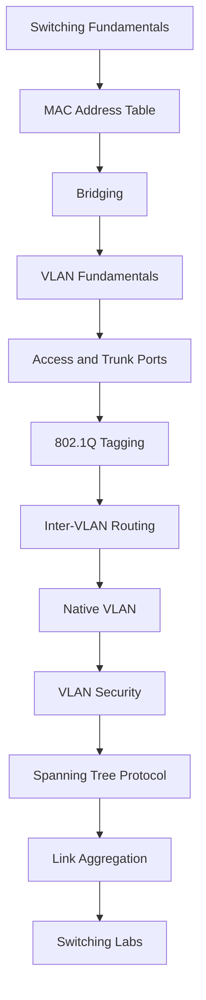
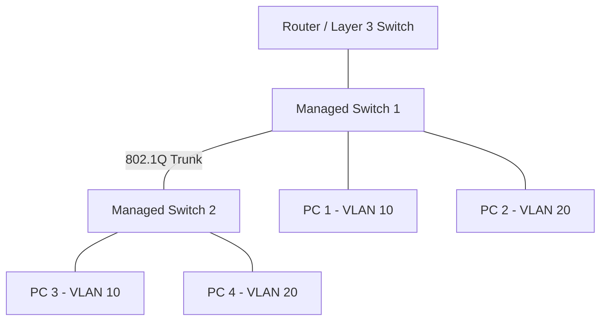

# Switching and VLANs

Switching and VLANs are fundamental concepts in modern Ethernet networks. They enable devices to communicate within local area networks (LANs), organize network segments, and control how traffic moves between connected devices.

A network switch primarily operates at the Data Link layer (Layer 2) of the OSI model. It forwards Ethernet frames based on destination MAC addresses and maintains a MAC address table to make forwarding decisions.

Virtual Local Area Networks (VLANs) logically divide a physical switching infrastructure into multiple isolated Layer 2 broadcast domains.

This section covers Ethernet switching, MAC address learning, bridging, VLAN configuration, trunking, IEEE 802.1Q tagging, inter-VLAN routing, spanning tree, and link aggregation.

# 🗁 Learning Objectives

* Understand Ethernet switching fundamentals.
* Explain how switches learn and forward MAC addresses.
* Understand bridging and Layer 2 forwarding.
* Understand VLANs and broadcast domain segmentation.
* Configure access and trunk ports.
* Explain IEEE 802.1Q VLAN tagging.
* Understand inter-VLAN routing.
* Configure and troubleshoot native VLANs.
* Understand VLAN security and isolation.
* Explain Spanning Tree Protocol (STP).
* Understand link aggregation and redundancy.
* Practice switching and VLAN concepts through network labs.

# 🗁 Prerequisites

Before studying this section, you should understand:

* Basic networking concepts.
* OSI and TCP/IP models.
* Ethernet frames.
* MAC addresses.
* IPv4 and IPv6 addressing.
* Basic network devices.
* Basic Linux networking commands.

Recommended preparation:

* [Networking Fundamentals](../01-fundamentals/README.md)
* [Network Models](../02-network-models/README.md)
* [IP Addressing](../03-ip-addressing/README.md)

# 🗁 Learning Path

Follow the topics in the listed order. Each topic builds on the previous concepts.

# 🗁 Lab Environment

You can practice switching and VLAN concepts using:

* Cisco Packet Tracer.
* GNS3.
* EVE-NG.
* VirtualBox with virtual network interfaces.
* MikroTik RouterOS CHR.
* Managed physical Ethernet switches.

Recommended lab topology:

The topology can be extended to practice:

* Multiple VLANs.
* Access and trunk ports.
* Inter-VLAN routing.
* Redundant switching links.
* Spanning Tree Protocol.
* Link aggregation.

# 🗁 Expected Outcome

By completing this section, you will understand how Ethernet switches build Layer 2 forwarding paths, how VLANs separate broadcast domains, and how multiple VLANs communicate through Layer 3 routing.

You will also gain practical experience designing, configuring, securing, and troubleshooting switched networks.
