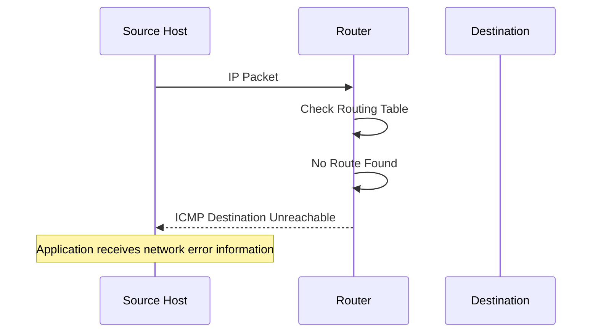

# Internet Control Message Protocol (ICMP)

The Internet Control Message Protocol (ICMP) is a network-layer control protocol used by devices to communicate network errors, operational information, and diagnostic results.

ICMP works alongside IP. While IP delivers packets between hosts, ICMP helps devices report problems encountered during packet delivery and provides information useful for network diagnostics.

Common examples include:

* `ping` — tests reachability using ICMP Echo Request and Echo Reply.
* `traceroute` — discovers network paths using TTL or Hop Limit expiration.
* Destination Unreachable — reports that a packet cannot reach its destination.
* Time Exceeded — reports that a packet's TTL or Hop Limit has expired.
* Packet Too Big — informs an IPv6 sender that a packet exceeds the path's supported MTU.

ICMP has two primary versions:

| Protocol | IP version | Specification |
| --- | --- | --- |
| ICMPv4 | IPv4 | RFC 792 |
| ICMPv6 | IPv6 | RFC 4443 |

ICMPv6 also supports essential IPv6 operations, including Neighbor Discovery and Router Discovery.

# 🗁 ICMP Fundamentals

### 🖆 What Is ICMP?

ICMP is a protocol used by network devices to exchange control messages related to IP communication.

It does not transport application data like TCP or UDP. Instead, it provides information about network conditions and packet-delivery problems.

For example, suppose a computer sends an IP packet to a destination network, but a router has no valid route to that network.

The router may discard the packet and generate an ICMP Destination Unreachable message to inform the original sender.

ICMP is particularly useful for:

* Reporting network and host reachability problems.
* Identifying unreachable destinations and ports.
* Reporting packet expiration.
* Supporting Path MTU Discovery.
* Discovering network paths.
* Diagnosing network connectivity.

### 🖆 ICMP Is Not a Transport Protocol

ICMP is associated directly with IP rather than TCP or UDP.

| Feature | TCP | UDP | ICMP |
| --- | --- | --- | --- |
| Protocol layer | Transport | Transport | Network-layer control |
| IP encapsulation | Yes | Yes | Yes |
| Port numbers | Yes | Yes | No |
| Connection-oriented | Yes | No | No |
| Built-in reliability | Yes | No | No |
| Primary purpose | Reliable data delivery | Datagram delivery | Network control and diagnostics |

ICMP does not use TCP or UDP port numbers.

Its message type and code fields identify the kind of message being transmitted.

### 🖆 ICMP Protocol Numbers

IP identifies the protocol carried inside its payload using a protocol identifier.

| Protocol | IP protocol identifier |
| --- | ---: |
| ICMPv4 | 1 |
| ICMPv6 | 58 |
| TCP | 6 |
| UDP | 17 |

For IPv4, ICMP is identified by the Protocol field.

For IPv6, ICMPv6 is identified by the Next Header field.

# 🗁 How ICMP Works

### 🖆 Basic Communication Flow

Consider a computer attempting to communicate with a destination that cannot be reached.

The communication process may look like this:



The router generates an ICMP error message and sends it back toward the original packet's source.

ICMP does not guarantee that the sender will receive this notification. The message may be filtered, rate-limited, or lost.

### 🖆 ICMP Encapsulation

ICMP messages are encapsulated directly inside IP packets.

**ICMPv4:**

```text
+----------------------------------+
| IPv4 Header                      |
| Protocol = 1                     |
+----------------------------------+
| ICMP Message                     |
| Type | Code | Checksum | Data    |
+----------------------------------+
```

**ICMPv6:**

```text
+----------------------------------+
| IPv6 Header                      |
| Next Header = 58                 |
+----------------------------------+
| ICMPv6 Message                   |
| Type | Code | Checksum | Data    |
+----------------------------------+
```

The ICMP message is part of the IP packet payload. It is not encapsulated inside a TCP or UDP segment.

# 🗁 ICMP Message Structure

### 🖆 General Message Format

An ICMP message contains several fields that identify its purpose and provide additional information.

```text
+-------------------+-------------------+
| Type              | Code              |
+-------------------+-------------------+
| Checksum                              |
+---------------------------------------+
| Message-Specific Fields               |
+---------------------------------------+
| Additional Data                       |
+---------------------------------------+
```

| Field | Description |
| --- | --- |
| Type | Identifies the ICMP message category. |
| Code | Provides additional information about the message type. |
| Checksum | Detects corruption in the ICMP message. |
| Message-specific fields | Contain information relevant to the message type. |
| Data | May include the original packet or other diagnostic information. |

The exact layout of the message-specific fields depends on the ICMP type.

For example, an Echo Request includes an identifier and sequence number, while a Destination Unreachable message includes information about the original packet.

### 🖆 Type and Code

The Type field identifies the general message.

The Code field provides more specific information.

For example:

```text
Type: 3
Code: 3
```

For ICMPv4, this means:

```text
Type 3 = Destination Unreachable
Code 3 = Port Unreachable
```

This distinction helps network administrators identify the specific reason for a communication failure.

# 🗁 ICMPv4 Message Types

ICMPv4 defines several message types for IPv4 networks.

### 🖆 Common ICMPv4 Types

| Type | Name | Description |
| ---: | --- | --- |
| 0 | Echo Reply | Responds to an Echo Request. |
| 3 | Destination Unreachable | Indicates that a destination or service cannot be reached. |
| 4 | Source Quench | Obsolete congestion notification; must not be used. |
| 5 | Redirect | Suggests a better next-hop router. |
| 8 | Echo Request | Requests a response from another host. |
| 9 | Router Advertisement | Advertises available routers using the historical IPv4 Router Discovery mechanism. |
| 10 | Router Solicitation | Requests router advertisements using the historical IPv4 Router Discovery mechanism. |
| 11 | Time Exceeded | Indicates TTL expiration or fragment reassembly timeout. |
| 12 | Parameter Problem | Reports an invalid or problematic IPv4 header field. |
| 13 | Timestamp Request | Requests a timestamp from another host. |
| 14 | Timestamp Reply | Returns a timestamp response. |

Some message types are rarely used today.

For example, Source Quench was deprecated because it was an unsuitable congestion-control mechanism. Timestamp messages are also uncommon in modern network diagnostics.

### 🖆 Destination Unreachable

ICMPv4 Type 3 indicates that an IP packet could not be delivered.

Important codes include:

| Code | Meaning |
| ---: | --- |
| 0 | Network Unreachable |
| 1 | Host Unreachable |
| 2 | Protocol Unreachable |
| 3 | Port Unreachable |
| 4 | Fragmentation Needed and DF Set |
| 9 | Network Administratively Prohibited |
| 10 | Host Administratively Prohibited |
| 13 | Communication Administratively Prohibited |

Examples:

* Network Unreachable: no route to the destination network.
* Host Unreachable: the destination host cannot be reached.
* Port Unreachable: the destination host indicates that the requested UDP port is unavailable.
* Fragmentation Needed: the packet exceeds the outgoing link MTU, and IPv4 fragmentation is prohibited by the Don't Fragment flag.

### 🖆 Time Exceeded

ICMPv4 Type 11 reports that a packet exceeded its allowed lifetime.

Common codes:

| Code | Meaning |
| ---: | --- |
| 0 | TTL exceeded in transit |
| 1 | Fragment reassembly time exceeded |

The first code is particularly important for traceroute.

When a router decreases a packet's TTL to zero, it discards the packet and normally sends an ICMP Time Exceeded message to the source.

### 🖆 Redirect

ICMPv4 Type 5 informs a host that a better next-hop router may exist for a particular destination.

For example, a host may send traffic through Router A even though Router B is a more appropriate gateway.

Router A may send an ICMP Redirect suggesting Router B.

Redirect messages require careful security handling because accepting malicious redirects could alter a host's routing behavior.

# 🗁 ICMPv6 Message Types

ICMPv6 is a fundamental part of IPv6 networking.

It provides error reporting, diagnostics, Neighbor Discovery, Router Discovery, and other control functions.

### 🖆 Common ICMPv6 Types

| Type | Name                                | Description                                                      |
| ---: | ----------------------------------- | ---------------------------------------------------------------- |
|    1 | Destination Unreachable             | Indicates that an IPv6 packet cannot reach its destination.      |
|    2 | Packet Too Big                      | Reports that a packet exceeds the outgoing link MTU.             |
|    3 | Time Exceeded                       | Indicates Hop Limit expiration or fragment reassembly timeout.   |
|    4 | Parameter Problem                   | Reports an error in an IPv6 packet or extension header.          |
|  128 | Echo Request                        | Requests an Echo Reply.                                          |
|  129 | Echo Reply                          | Responds to an Echo Request.                                     |
|  130 | Multicast Listener Query            | Queries multicast listener membership.                           |
|  131 | Multicast Listener Report           | Reports multicast listener membership.                           |
|  132 | Multicast Listener Done             | Indicates that a listener is leaving a multicast group in MLDv1. |
|  133 | Router Solicitation                 | Requests router advertisements.                                  |
|  134 | Router Advertisement                | Advertises IPv6 router and network configuration information.    |
|  135 | Neighbor Solicitation               | Discovers neighbors and performs address resolution.             |
|  136 | Neighbor Advertisement              | Advertises neighbor information.                                 |
|  137 | Redirect                            | Suggests a better next-hop destination.                          |
|  143 | Version 2 Multicast Listener Report | Reports multicast membership using MLDv2.                        |

Types 130–132 and 143 are associated with Multicast Listener Discovery (MLD), which is defined in separate specifications.

### 🖆 Destination Unreachable

ICMPv6 Type 1 reports that an IPv6 packet could not reach its destination.

| Code | Meaning |
| ---: | --- |
| 0 | No route to destination |
| 1 | Communication administratively prohibited |
| 2 | Beyond scope of source address |
| 3 | Address unreachable |
| 4 | Port unreachable |
| 5 | Source address failed ingress/egress policy |
| 6 | Reject route to destination |

For example, when a UDP packet reaches a destination host but no application is listening on the requested port, the host may return ICMPv6 Destination Unreachable, Code 4.

### 🖆 Packet Too Big

ICMPv6 Type 2 is especially important for IPv6 Path MTU Discovery.

IPv6 routers do not fragment packets while forwarding them.

If a packet is larger than the next link's MTU, the router drops it and sends an ICMPv6 Packet Too Big message to the source.

The message includes the MTU of the next-hop link.

The source can then reduce the packet size and retransmit appropriately.

### 🖆 Neighbor Discovery Messages

ICMPv6 supports Neighbor Discovery Protocol (NDP).

Important messages include:

* Router Solicitation (RS).
* Router Advertisement (RA).
* Neighbor Solicitation (NS).
* Neighbor Advertisement (NA).
* Redirect.

These messages help IPv6 devices discover routers, resolve link-layer addresses, and maintain neighbor information.

NDP is covered in detail in `03-ndp.md`.

# 🗁 ICMP Error Messages

### 🖆 Why Error Messages Are Needed

IP provides best-effort packet delivery. It does not guarantee that packets will reach their destinations.

When an IP device encounters certain forwarding or delivery problems, ICMP may provide an explanation to the original sender.

Typical situations include:

| Situation | Possible ICMP response |
| --- | --- |
| No route to destination | Destination Unreachable |
| Destination host unreachable | Destination Unreachable |
| UDP port unavailable | Port Unreachable |
| IPv4 packet too large with DF set | Fragmentation Needed |
| IPv6 packet too large | Packet Too Big |
| TTL or Hop Limit expires | Time Exceeded |
| Invalid IP header field | Parameter Problem |

ICMP error reporting is not guaranteed. Network devices may suppress, filter, or rate-limit error messages.

### 🖆 Original Packet Information

An ICMP error message generally includes part of the original packet that caused the error.

This information allows the original sender to identify which communication encountered a problem.

For example, an ICMPv4 Destination Unreachable message includes the original IPv4 header and at least the first eight bytes of the original payload under the classic specification.

ICMPv6 error messages include as much of the invoking packet as possible without making the resulting ICMPv6 packet exceed the IPv6 minimum MTU.

### 🖆 When ICMP Errors Are Not Generated

ICMP error messages are subject to restrictions.

Generally, an ICMP error message must not be generated in response to:

* Another ICMP error message.
* A packet sent to an IPv4 broadcast or multicast destination.
* A packet sent as an IPv4 link-layer broadcast or multicast.
* A non-initial IPv4 fragment.
* A packet whose source address does not identify a valid individual host.

ICMPv6 has corresponding restrictions, with rules specific to IPv6 addressing and multicast behavior.

These restrictions help prevent error-message loops, unnecessary traffic, and amplification problems.

# 🗁 ICMP Echo and Ping

### 🖆 What Is Ping?

`ping` is a network diagnostic utility that uses ICMP Echo Request and Echo Reply messages.

It helps determine whether a destination responds to ICMP Echo messages and measures approximate round-trip time.

For IPv4:

```text
Source Host                         Destination
    |                                    |
    |------- ICMP Echo Request --------->|
    |                                    |
    |<------- ICMP Echo Reply -----------|
    |                                    |
```

For IPv4:

* Echo Request: Type 8.
* Echo Reply: Type 0.

For IPv6:

* Echo Request: Type 128.
* Echo Reply: Type 129.

### 🖆 How Ping Works

A typical ping operation follows these steps:

* The source creates an ICMP Echo Request.
* The request is encapsulated inside an IP packet.
* The destination receives and processes the request.
* If permitted, the destination generates an ICMP Echo Reply.
* The source receives the reply and calculates the round-trip time.

Ping commonly reports:

* Packet transmission count.
* Packet reception count.
* Packet loss percentage.
* Minimum round-trip time.
* Average round-trip time.
* Maximum round-trip time.

### 🖆 Basic Ping Commands

Test IPv4 connectivity:

```bash
ping -4 1.1.1.1
```

Test IPv6 connectivity:

```bash
ping -6 2606:4700:4700::1111
```

Send four packets:

```bash
ping -c 4 1.1.1.1
```

Ping a hostname:

```bash
ping -c 4 google.com
```

Specify the packet payload size:

```bash
ping -s 1200 1.1.1.1
```

Stop continuous ping manually:

```bash
ping 1.1.1.1
```

Press `Ctrl + C` to stop it.

### 🖆 Understanding Ping Results

Example:

```text
PING 1.1.1.1 (1.1.1.1) 56(84) bytes of data.

64 bytes from 1.1.1.1: icmp_seq=1 ttl=57 time=12.4 ms
64 bytes from 1.1.1.1: icmp_seq=2 ttl=57 time=11.9 ms
64 bytes from 1.1.1.1: icmp_seq=3 ttl=57 time=12.1 ms
64 bytes from 1.1.1.1: icmp_seq=4 ttl=57 time=12.0 ms

--- 1.1.1.1 ping statistics ---
4 packets transmitted, 4 received, 0% packet loss
rtt min/avg/max/mdev = 11.9/12.1/12.4/0.2 ms
```

| Field | Description |
| --- | --- |
| `64 bytes` | Size of the returned ICMP message, including its ICMP header. |
| `icmp_seq` | Echo sequence number. |
| `ttl` | IPv4 TTL observed in the reply. |
| `time` | Measured round-trip time. |
| `packet loss` | Percentage of probes without a received reply. |
| `rtt avg` | Average round-trip time. |

The TTL shown in an IPv4 ping reply is the remaining TTL in the received reply packet, not a direct hop-count measurement.

A successful ping confirms that the selected ICMP exchange worked. It does not prove that every application or TCP/UDP service on the destination is reachable.

Similarly, a failed ping does not necessarily mean the destination is offline. Firewalls and network policies may block or rate-limit Echo messages.

# 🗁 ICMP and Traceroute

### 🖆 What Is Traceroute?

Traceroute is a network diagnostic technique used to identify intermediate routers along a path toward a destination.

It works by manipulating the packet's TTL in IPv4 or Hop Limit in IPv6.

When the value reaches zero, a router discards the packet and generally sends an ICMP Time Exceeded message to the source.

### 🖆 How Traceroute Works

Suppose a packet travels through three routers before reaching its destination.


Traceroute sends probes with increasing TTL values.

| Probe | Initial TTL | Expected response |
| --- | ---: | --- |
| First probe | 1 | Router 1 returns Time Exceeded. |
| Second probe | 2 | Router 2 returns Time Exceeded. |
| Third probe | 3 | Router 3 returns Time Exceeded. |
| Fourth probe | 4 | Destination may respond. |

The process continues until the destination is reached or the probe limit is exhausted.

### 🖆 Different Traceroute Probe Methods

Traceroute implementations can use different probe types.

| Method | Probe type | Typical response |
| --- | --- | --- |
| Traditional UDP traceroute | UDP | Intermediate ICMP Time Exceeded; destination may return Port Unreachable. |
| ICMP traceroute | ICMP Echo Request | Intermediate ICMP Time Exceeded; destination may return Echo Reply. |
| TCP traceroute | TCP SYN | Intermediate ICMP Time Exceeded; destination may return TCP SYN-ACK or RST. |

Different methods can produce different paths because firewalls, routers, and routing policies may handle each protocol differently.

### 🖆 Traceroute Commands on Ubuntu

Traditional UDP traceroute:

```bash
traceroute 1.1.1.1
```

ICMP-based traceroute:

```bash
traceroute -I 1.1.1.1
```

TCP-based traceroute using port 443:

```bash
traceroute -T -p 443 google.com
```

IPv6 traceroute:

```bash
traceroute -6 2606:4700:4700::1111
```

Alternative path diagnostic utility:

```bash
tracepath -4 1.1.1.1
```

```bash
tracepath -6 2606:4700:4700::1111
```

Install traceroute if it is unavailable:

```bash
sudo apt update
sudo apt install traceroute
```

### 🖆 Understanding Traceroute Output

Example:

```text
traceroute to 1.1.1.1 (1.1.1.1), 30 hops max

1  192.168.1.1       1.2 ms  1.1 ms  1.3 ms
2  10.10.0.1         5.4 ms  5.2 ms  5.5 ms
3  203.0.113.1      12.1 ms 12.0 ms 12.2 ms
4  1.1.1.1          15.3 ms 15.1 ms 15.4 ms
```

| Output | Meaning |
| --- | --- |
| Hop number | Position of the responding router in the observed path. |
| IP address | Address of the responding network device. |
| Time values | Round-trip times for individual probes. |
| `*` | No response received before the probe timeout. |

An asterisk does not automatically indicate packet loss or a broken route. A router may forward traffic normally while filtering or rate-limiting diagnostic responses.

# 🗁 ICMP and Path MTU Discovery

### 🖆 What Is Path MTU?

Maximum Transmission Unit (MTU) defines the maximum packet size supported by a network link.

A path between two hosts may contain multiple links with different MTU values.

The Path MTU is the smallest relevant MTU along the path.

For example:

```text
Source
  |
  | MTU 1500
  |
Router A
  |
  | MTU 1400
  |
Router B
  |
  | MTU 1500
  |
Destination
```

The Path MTU is 1400 bytes.

### 🖆 ICMPv4 and Fragmentation Needed

IPv4 routers may fragment packets when necessary, provided fragmentation is permitted.

However, if the IPv4 Don't Fragment (DF) flag is set and the packet is too large for the next link, the router drops it.

The router may then send:

```text
ICMPv4 Type: 3
Code: 4
Meaning: Fragmentation Needed and DF Set
```

The sender can reduce its packet size and retry.

### 🖆 ICMPv6 Packet Too Big

IPv6 routers do not fragment packets during forwarding.

If an IPv6 packet exceeds the outgoing link MTU, the router discards it and sends:

```text
ICMPv6 Type: 2
Meaning: Packet Too Big
```

The source uses the advertised MTU to adjust packet size.

This behavior is essential to IPv6 Path MTU Discovery.

### 🖆 Testing MTU with Ping

For a typical IPv4 path using a 1500-byte MTU, an ICMP Echo Request with a 1472-byte payload produces:

```text
1472 bytes ICMP payload
   8 bytes ICMP header
  20 bytes IPv4 header
--------------------------------
1500 bytes total IPv4 packet
```

Test with the Don't Fragment flag:

```bash
ping -4 -M do -s 1472 1.1.1.1
```

If the path cannot support this packet size and the relevant error message reaches the sender, the test may fail with a fragmentation-needed message.

For IPv6, use tools such as:

```bash
tracepath -6 2606:4700:4700::1111
```

IPv6 routers do not fragment forwarded packets, so source-side packet sizing and ICMPv6 Packet Too Big delivery are important.

Path MTU Discovery is covered in greater detail in `07-path-mtu-discovery.md`.

# 🗁 ICMPv4 vs ICMPv6

### 🖆 Key Differences

| Feature | ICMPv4 | ICMPv6 |
| --- | --- | --- |
| IP version | IPv4 | IPv6 |
| IP protocol identifier | 1 | 58 |
| Specification | RFC 792 | RFC 4443 |
| Echo Request | Type 8 | Type 128 |
| Echo Reply | Type 0 | Type 129 |
| Destination Unreachable | Type 3 | Type 1 |
| Time Exceeded | Type 11 | Type 3 |
| Packet Too Big | Fragmentation Needed message under Type 3, Code 4 | Dedicated Type 2 |
| Router Discovery | Historical ICMP Router Discovery messages | Integrated into Neighbor Discovery |
| Address resolution | ARP | ICMPv6 Neighbor Discovery |
| Checksum | ICMP message checksum | ICMPv6 checksum includes an IPv6 pseudo-header |

### 🖆 Why ICMPv6 Is Essential

ICMPv6 is not simply an optional diagnostic protocol.

IPv6 depends on ICMPv6 for several core network operations:

* Neighbor Discovery.
* Router Discovery.
* Address resolution.
* Duplicate Address Detection.
* Path MTU Discovery.
* Multicast Listener Discovery.

Blocking all ICMPv6 traffic can break normal IPv6 communication.

# 🗁 ICMP Security Considerations

### 🖆 Common Security Concerns

ICMP can be abused if network devices accept or generate inappropriate messages.

Common concerns include:

| Threat | Description |
| --- | --- |
| ICMP Flood | Large volumes of ICMP traffic consume network or device resources. |
| Ping Flood | Excessive Echo Requests overwhelm a target. |
| Smurf Attack | Historically abused broadcast-address ICMP Echo amplification. |
| ICMP Redirect Abuse | Malicious redirects attempt to change host routing behavior. |
| Information Disclosure | Diagnostic responses may reveal network topology or device behavior. |
| Packet Too Big Filtering | Blocking required messages can cause Path MTU Discovery failures. |

### 🖆 Firewall Policy

A good firewall policy should control unnecessary ICMP traffic without breaking essential network functions.

For IPv4, consider permitting appropriate messages such as:

* Destination Unreachable.
* Fragmentation Needed.
* Time Exceeded.
* Parameter Problem.
* Echo Request and Echo Reply where required.

For IPv6, allow required ICMPv6 messages, including:

* Destination Unreachable.
* Packet Too Big.
* Time Exceeded.
* Parameter Problem.
* Router Solicitation and Router Advertisement where applicable.
* Neighbor Solicitation and Neighbor Advertisement.
* Multicast Listener Discovery messages where required.

The exact policy depends on whether the firewall protects an endpoint, router, server, or transit network.

### 🖆 Rate Limiting

ICMP rate limiting helps prevent excessive control-message traffic.

For example, a router may limit how frequently it generates ICMP Time Exceeded messages.

Rate limiting should preserve the ability to exchange essential network-control messages.

# 🗁 ICMP on Ubuntu Linux

### 🖆 Useful Diagnostic Commands

| Command | Purpose |
| --- | --- |
| `ping` | Test ICMP Echo connectivity. |
| `traceroute` | Discover the network path. |
| `tracepath` | Discover path information and investigate MTU. |
| `tcpdump` | Capture ICMP packets. |
| `ip route` | Inspect IPv4 and IPv6 routing information. |
| `ip neigh` | Inspect the neighbor cache. |
| `nft` | Inspect Linux firewall rules. |
| `sysctl` | Inspect kernel network parameters. |

### 🖆 Inspect ICMP Echo Configuration

Check whether the Linux kernel ignores incoming IPv4 Echo Requests:

```bash
sysctl net.ipv4.icmp_echo_ignore_all
```

Typical values:

| Value | Meaning |
| ---: | --- |
| `0` | Do not globally ignore incoming IPv4 Echo Requests. |
| `1` | Ignore incoming IPv4 Echo Requests. |

Inspect the current setting for IPv4 ICMP broadcast Echo handling:

```bash
sysctl net.ipv4.icmp_echo_ignore_broadcasts
```

### 🖆 Inspect Firewall Rules

Using nftables:

```bash
sudo nft list ruleset
```

Using UFW:

```bash
sudo ufw status verbose
```

Remember that firewall behavior may be controlled by nftables rules even when UFW is not managing the ruleset.

### 🖆 Install Network Diagnostic Tools

```bash
sudo apt update
sudo apt install iputils-ping traceroute iputils-tracepath tcpdump
```

# 🗁 Packet Analysis

### 🖆 Capture ICMPv4 Traffic

Capture IPv4 ICMP packets:

```bash
sudo tcpdump -ni any icmp
```

Capture with detailed packet information:

```bash
sudo tcpdump -vv -ni any icmp
```

### 🖆 Capture ICMPv6 Traffic

```bash
sudo tcpdump -ni any icmp6
```

### 🖆 Capture Both Versions

```bash
sudo tcpdump -vv -ni any 'icmp or icmp6'
```

### 🖆 Generate Test Traffic

Open one terminal and start a packet capture:

```bash
sudo tcpdump -ni any 'icmp or icmp6'
```

Open another terminal and send IPv4 Echo Requests:

```bash
ping -4 -c 4 1.1.1.1
```

Then send IPv6 Echo Requests:

```bash
ping -6 -c 4 2606:4700:4700::1111
```

Observe the corresponding request and reply packets.

### 🖆 Wireshark Display Filters

| Filter | Purpose |
| --- | --- |
| `icmp` | Display ICMPv4 packets. |
| `icmpv6` | Display ICMPv6 packets. |
| `icmp.type == 3` | Display ICMPv4 Destination Unreachable messages. |
| `icmp.type == 11` | Display ICMPv4 Time Exceeded messages. |
| `icmpv6.type == 1` | Display ICMPv6 Destination Unreachable messages. |
| `icmpv6.type == 2` | Display ICMPv6 Packet Too Big messages. |
| `icmpv6.type == 135` | Display Neighbor Solicitation messages. |
| `icmpv6.type == 136` | Display Neighbor Advertisement messages. |

Packet analysis helps distinguish between a destination that is unreachable, a filtered Echo Request, a routing problem, and a Path MTU issue.

# 🗁 Common Troubleshooting Scenarios

### 🖆 Ping Fails but the Server Is Online

Possible causes:

* The destination firewall blocks ICMP Echo Requests.
* An intermediate firewall filters ICMP.
* The server rate-limits Echo responses.
* The return route is unavailable.
* The destination is configured not to respond to Echo Requests.

Useful tests:

```bash
ping -c 4 1.1.1.1
```

```bash
traceroute -T -p 443 1.1.1.1
```

```bash
nc -vz 1.1.1.1 443
```

The TCP test checks a service port rather than ICMP Echo behavior.

### 🖆 Destination Unreachable

Possible causes:

* Missing routing information.
* Incorrect default gateway.
* Firewall rejection.
* Unavailable destination host.
* Unavailable UDP destination port.

Inspect routes:

```bash
ip route
```

Inspect the IPv6 routing table:

```bash
ip -6 route
```

### 🖆 Traceroute Shows Asterisks

Possible causes:

* Intermediate routers filter diagnostic messages.
* ICMP responses are rate-limited.
* A firewall blocks the selected probe protocol.
* The response is delayed beyond the timeout.

Try another probe method:

```bash
traceroute -I 1.1.1.1
```

```bash
traceroute -T -p 443 1.1.1.1
```

### 🖆 Some Websites Work but Others Hang

A possible cause is a Path MTU Discovery problem.

For IPv4, fragmentation-needed messages may be filtered.

For IPv6, Packet Too Big messages may be filtered.

This can create a situation where small packets work but larger packets fail.

Investigate with:

```bash
tracepath -4 example.com
```

```bash
tracepath -6 example.com
```

Capture relevant control messages:

```bash
sudo tcpdump -ni any 'icmp or icmp6'
```

# 🗁 Best Practices

* Allow necessary ICMP and ICMPv6 control messages through firewalls.
* Do not treat ICMP Echo failure as definitive proof that a host is offline.
* Avoid blocking IPv4 Fragmentation Needed messages.
* Do not block ICMPv6 Packet Too Big messages.
* Protect routers against excessive ICMP traffic using appropriate rate limits.
* Apply firewall policies according to the network device's role.
* Use TCP-based and application-level tests when diagnosing service availability.
* Use packet captures to identify the actual ICMP message type and code.
* Monitor unexpected ICMP traffic for possible misconfiguration or abuse.
* Avoid accepting untrusted ICMP Redirect messages without a clear network requirement.

# 🗁 Common Mistakes

| Mistake | Correct Understanding |
| --- | --- |
| ICMP is a TCP or UDP protocol. | ICMP is carried directly inside IP packets. |
| ICMP uses port numbers. | ICMP uses Type and Code fields. |
| Ping guarantees that a server is working. | Ping tests ICMP Echo communication, not application health. |
| Every router responds to traceroute. | Routers may filter or rate-limit diagnostic responses. |
| ICMP always reports packet-delivery failures. | ICMP error messages may be suppressed, filtered, or lost. |
| IPv6 does not need ICMP. | ICMPv6 is fundamental to IPv6 operation. |
| Blocking all ICMP improves security. | Blocking essential ICMP messages can break network functions. |
| IPv6 routers fragment oversized packets. | IPv6 routers discard oversized packets and send Packet Too Big messages. |
| ICMP Echo Reply proves a TCP port is open. | TCP service availability must be tested separately. |

# 🗁 Practical Exercises

### 🖆 Exercise: Test IPv4 Connectivity

Send four Echo Requests to a public IPv4 address:

```bash
ping -4 -c 4 1.1.1.1
```

Record:

* Number of transmitted packets.
* Number of received packets.
* Packet loss percentage.
* Average round-trip time.

### 🖆 Exercise: Test IPv6 Connectivity

```bash
ping -6 -c 4 2606:4700:4700::1111
```

Compare IPv4 and IPv6 results.

### 🖆 Exercise: Discover the Network Path

```bash
traceroute 1.1.1.1
```

Then compare the result with:

```bash
traceroute -I 1.1.1.1
```

Identify differences between the two probe methods.

### 🖆 Exercise: Capture ICMP Packets

Start a capture:

```bash
sudo tcpdump -vv -ni any 'icmp or icmp6'
```

Generate test traffic using ping.

Identify:

* ICMP request messages.
* ICMP reply messages.
* Source and destination IP addresses.
* ICMP Type and Code fields.

### 🖆 Exercise: Investigate Path MTU

Test an IPv4 packet with the Don't Fragment flag:

```bash
ping -4 -M do -s 1472 1.1.1.1
```

Then investigate the path:

```bash
tracepath -4 1.1.1.1
```

Compare the results and explain how ICMP supports Path MTU Discovery.

# 🗁 Interview Questions

### 🖆 Fundamental Questions

**What is ICMP?**

ICMP is a control protocol associated with IP. It reports network errors and provides diagnostic information.

**Does ICMP use TCP or UDP ports?**

No. ICMP uses Type and Code fields to identify its messages.

**What is the difference between ICMPv4 and ICMPv6?**

ICMPv4 supports IPv4 control and diagnostic messages. ICMPv6 provides equivalent functions for IPv6 and additionally supports essential mechanisms such as Neighbor Discovery and Router Discovery.

**What is the purpose of ICMP Echo Request and Echo Reply?**

They are used by ping to test ICMP reachability and measure round-trip time.

### 🖆 Intermediate Questions

**What happens when a packet's TTL reaches zero?**

A router discards the IPv4 packet and generally sends an ICMP Time Exceeded message to the source.

**Why does traceroute use ICMP?**

It relies on Time Exceeded responses from intermediate routers to identify hops along a network path. Its probe packets may use UDP, ICMP, or TCP.

**What is Destination Unreachable?**

It is an ICMP error message indicating that a packet could not reach its intended destination or service.

**Why is ICMP Packet Too Big important in IPv6?**

IPv6 routers do not fragment forwarded packets. Packet Too Big messages inform the source that it must reduce the packet size.

### 🖆 Advanced Questions

**Why should firewalls not block all ICMPv6 traffic?**

IPv6 relies on ICMPv6 for Neighbor Discovery, Router Discovery, address resolution, and Path MTU Discovery. Blocking essential messages can break IPv6 connectivity.

**Can ping fail even when a server is online?**

Yes. Firewalls, rate limits, and network policies may block ICMP Echo messages while allowing application traffic.

**What is the difference between Time Exceeded and Destination Unreachable?**

Time Exceeded indicates that a packet's TTL or Hop Limit expired, or that fragment reassembly timed out. Destination Unreachable indicates that delivery cannot proceed for a reported reason.

**What is the relationship between ICMP and Path MTU Discovery?**

ICMP communicates when a packet exceeds the path's supported MTU. The source uses this information to adjust packet size.

# 🗁 Summary

ICMP is an essential control protocol used alongside IP for network diagnostics and error reporting.

Key concepts:

* ICMPv4 uses IPv4 Protocol number 1.
* ICMPv6 uses IPv6 Next Header value 58.
* ICMP does not use TCP or UDP port numbers.
* Ping uses Echo Request and Echo Reply.
* Traceroute uses TTL or Hop Limit expiration to discover network paths.
* Destination Unreachable reports delivery problems.
* Time Exceeded reports TTL or Hop Limit expiration.
* ICMPv4 supports IPv4 Path MTU Discovery through Fragmentation Needed messages.
* ICMPv6 supports IPv6 Path MTU Discovery through Packet Too Big messages.
* ICMPv6 is essential for IPv6 Neighbor Discovery and Router Discovery.
* Firewalls should permit necessary ICMP control messages.

Understanding ICMP is important for diagnosing routing failures, connectivity problems, packet-size issues, and firewall behavior.

# 🗁 References

### 🖆 Official RFC Documents

* [RFC 792 — Internet Control Message Protocol](https://www.rfc-editor.org/rfc/rfc792)
* [RFC 4443 — Internet Control Message Protocol (ICMPv6)](https://www.rfc-editor.org/rfc/rfc4443)
* [RFC 1122 — Requirements for Internet Hosts](https://www.rfc-editor.org/rfc/rfc1122)
* [RFC 1812 — Requirements for IPv4 Routers](https://www.rfc-editor.org/rfc/rfc1812)
* [RFC 8200 — Internet Protocol, Version 6 (IPv6) Specification](https://www.rfc-editor.org/rfc/rfc8200)
* [RFC 8201 — Path MTU Discovery for IP version 6](https://www.rfc-editor.org/rfc/rfc8201)
* [RFC 4861 — Neighbor Discovery for IP version 6](https://www.rfc-editor.org/rfc/rfc4861)

### 🖆 Linux Documentation

* [Linux iputils](https://github.com/iputils/iputils)
* [tcpdump Documentation](https://www.tcpdump.org/manpages/tcpdump.1.html)
* [Wireshark Display Filter Reference — ICMP](https://www.wireshark.org/docs/dfref/i/icmp.html)
* [Wireshark Display Filter Reference — ICMPv6](https://www.wireshark.org/docs/dfref/i/icmpv6.html)
