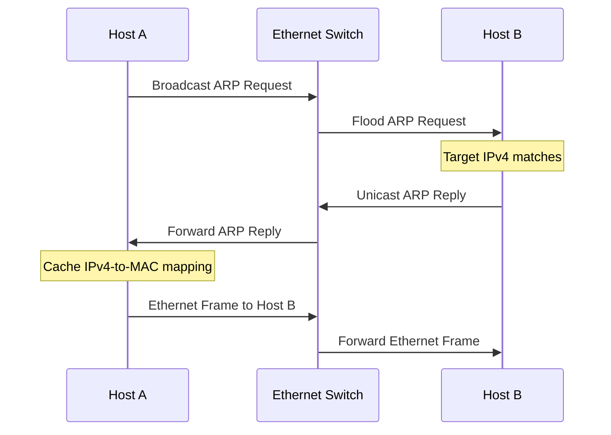
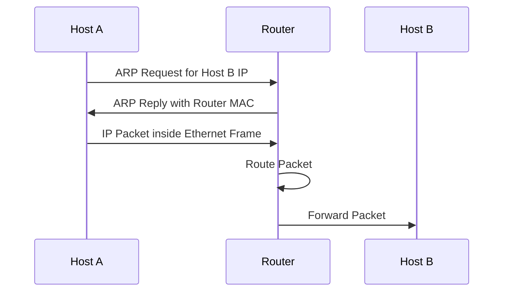

# Address Resolution Protocol (ARP)

The Address Resolution Protocol (ARP) is a network protocol used in IPv4 networks to map an IPv4 address to a link-layer address, typically a MAC address on Ethernet networks.

Devices use IP addresses to identify endpoints at the network layer, while Ethernet uses MAC addresses to deliver frames across a local network segment.

ARP connects these two addressing systems.

For example, suppose a Linux computer wants to send an IPv4 packet to another device on the same Ethernet network:

```text
Destination IPv4: 192.168.1.20
Destination MAC:  Unknown
```

The computer broadcasts an ARP Request asking which device owns `192.168.1.20`.

The device with that IPv4 address responds with its MAC address. The sender can then construct an Ethernet frame and transmit the IP packet.

ARP is defined in RFC 826.

# 🗁 ARP Fundamentals

### 🖆 What Is ARP?

ARP stands for Address Resolution Protocol.

It is used to discover the link-layer address associated with an IPv4 address on a local network.

On Ethernet networks, ARP resolves:

```text
IPv4 Address → MAC Address
```

Example:

```text
IPv4 Address: 192.168.1.20
MAC Address:  00:1A:2B:3C:4D:5E
```

After resolving the address, the sender can transmit Ethernet frames to the destination MAC address.

### 🖆 ARP Operates Between Network and Data Link Functions

ARP supports IPv4 communication over link-layer technologies such as Ethernet.

It is commonly described as operating between the Network and Data Link layers of the OSI model.

| Layer | Address | Example |
| --- | --- | --- |
| Network | IPv4 address | `192.168.1.20` |
| Data Link | Ethernet MAC address | `00:1A:2B:3C:4D:5E` |

ARP is not a routing protocol. It does not determine the path to a remote network.

Its responsibility is to resolve the next-hop IPv4 address into a link-layer address on the local link.

### 🖆 ARP Protocol Identification

On Ethernet, ARP is identified by EtherType:

| Protocol | EtherType |
| --- | --- |
| IPv4 | `0x0800` |
| ARP | `0x0806` |
| IPv6 | `0x86DD` |

ARP messages are carried directly inside Ethernet frames rather than inside IPv4 packets.

# 🗁 Why ARP Is Needed

### 🖆 IP Addresses and MAC Addresses

IP and MAC addresses serve different purposes.

| Characteristic | IP Address | MAC Address |
| --- | --- | --- |
| Layer | Network | Data Link |
| Purpose | Logical network addressing | Local link-layer delivery |
| Assignment | Static or dynamic | Usually assigned to a network interface |
| Scope | Can identify remote network endpoints | Used within a local link |
| Example | `192.168.1.10` | `AA:BB:CC:DD:EE:FF` |

An application communicates using IP addresses, but an Ethernet interface needs a destination MAC address to transmit a frame.

ARP provides the mapping required for IPv4 communication over Ethernet.

### 🖆 Example Network

Consider three devices connected to the same LAN:

```text
                 Ethernet Switch
                       |
          +------------+------------+
          |            |            |
       Host A        Host B       Host C
       |              |            |
   192.168.1.10   192.168.1.20  192.168.1.30
   AA:AA:AA:AA:AA  BB:BB:BB:BB:BB  CC:CC:CC:CC:CC
```

Host A wants to communicate with Host B.

Host A knows Host B's IPv4 address but does not know its MAC address.

It must resolve the address before sending the Ethernet frame.

# 🗁 How ARP Works

### 🖆 ARP Request

An ARP Request asks:

"Who has this IPv4 address? Tell the sender."

Suppose Host A wants to discover the MAC address of `192.168.1.20`.

It broadcasts an ARP Request:

```text
Sender IP:  192.168.1.10
Sender MAC: AA:AA:AA:AA:AA:AA

Target IP:  192.168.1.20
Target MAC: 00:00:00:00:00:00
```

The target MAC is unknown and is represented by zeros in this example.

The Ethernet destination address is:

```text
FF:FF:FF:FF:FF:FF
```

This is the Ethernet broadcast address.

All devices in the same broadcast domain receive the frame, but only the device configured with the requested IPv4 address should normally respond.

### 🖆 ARP Reply

Host B recognizes its own IPv4 address and responds with an ARP Reply.

```text
Sender IP:  192.168.1.20
Sender MAC: BB:BB:BB:BB:BB:BB

Target IP:  192.168.1.10
Target MAC: AA:AA:AA:AA:AA:AA
```

The reply is normally sent as a unicast Ethernet frame to Host A.

Host A learns the mapping:

```text
192.168.1.20 → BB:BB:BB:BB:BB:BB
```

It can now send Ethernet frames directly to Host B.

### 🖆 Complete ARP Resolution Process



### 🖆 ARP Resolution Steps

* Host A determines that the destination IPv4 address is on the local subnet.
* Host A checks its ARP cache.
* If no valid entry exists, Host A broadcasts an ARP Request.
* The switch floods the broadcast within the same VLAN.
* Host B receives the request and recognizes its IPv4 address.
* Host B sends an ARP Reply containing its MAC address.
* Host A stores the mapping in its ARP cache.
* Host A sends the original IP packet inside an Ethernet frame addressed to Host B.

# 🗁 ARP Packet Structure

### 🖆 ARP Header Format

An Ethernet ARP packet contains the following fields:

```text
+-------------------------------+
| Hardware Type                 |
+-------------------------------+
| Protocol Type                 |
+-------------------------------+
| Hardware Address Length       |
+-------------------------------+
| Protocol Address Length       |
+-------------------------------+
| Operation                     |
+-------------------------------+
| Sender Hardware Address       |
+-------------------------------+
| Sender Protocol Address       |
+-------------------------------+
| Target Hardware Address       |
+-------------------------------+
| Target Protocol Address       |
+-------------------------------+
```

### 🖆 ARP Header Fields

| Field | Size | Description |
| --- | ---: | --- |
| Hardware Type (HTYPE) | 16 bits | Identifies the link-layer technology. |
| Protocol Type (PTYPE) | 16 bits | Identifies the network-layer protocol. |
| Hardware Length (HLEN) | 8 bits | Length of the hardware address. |
| Protocol Length (PLEN) | 8 bits | Length of the protocol address. |
| Operation (OPER) | 16 bits | Identifies the ARP operation. |
| Sender Hardware Address (SHA) | Variable | Sender's link-layer address. |
| Sender Protocol Address (SPA) | Variable | Sender's protocol address. |
| Target Hardware Address (THA) | Variable | Target's link-layer address. |
| Target Protocol Address (TPA) | Variable | Target's protocol address. |

### 🖆 Common Ethernet ARP Values

| Field | Value | Meaning |
| --- | --- | --- |
| Hardware Type | `1` | Ethernet |
| Protocol Type | `0x0800` | IPv4 |
| Hardware Length | `6` | Six-byte MAC address |
| Protocol Length | `4` | Four-byte IPv4 address |
| Operation | `1` | ARP Request |
| Operation | `2` | ARP Reply |

For Ethernet and IPv4, the ARP header is 28 bytes long.

A standard Ethernet ARP frame is padded to satisfy Ethernet's minimum frame size when necessary.

# 🗁 ARP Message Types

### 🖆 ARP Request

An ARP Request asks for the MAC address associated with a target IPv4 address.

Characteristics:

* Usually transmitted as an Ethernet broadcast.
* Uses operation code `1`.
* Contains the sender's IP and MAC addresses.
* Identifies the target IPv4 address.
* Usually has an unknown target MAC address.

Example:

```text
Who has 192.168.1.20?
Tell 192.168.1.10
```

### 🖆 ARP Reply

An ARP Reply provides the requested address mapping.

Characteristics:

* Uses operation code `2`.
* Contains the sender's IPv4 and MAC addresses.
* Normally transmitted as a unicast Ethernet frame.
* Allows the requester to update its ARP cache.

Example:

```text
192.168.1.20 is at BB:BB:BB:BB:BB:BB
```

### 🖆 ARP Request vs ARP Reply

| Feature | ARP Request | ARP Reply |
| --- | --- | --- |
| Operation code | 1 | 2 |
| Typical Ethernet destination | Broadcast | Unicast |
| Purpose | Ask for an address mapping | Provide an address mapping |
| Sender MAC | Known | Known |
| Target MAC | Usually unknown | Usually known |

# 🗁 ARP Cache

### 🖆 What Is an ARP Cache?

An ARP cache is a temporary table containing IPv4-to-MAC address mappings.

Without caching, a device might need to broadcast an ARP Request before sending every packet to another local destination.

The cache reduces unnecessary ARP traffic.

Example:

| IPv4 Address | MAC Address | Interface |
| --- | --- | --- |
| `192.168.1.1` | `11:22:33:44:55:66` | `eth0` |
| `192.168.1.20` | `BB:BB:BB:BB:BB:BB` | `eth0` |
| `192.168.1.30` | `CC:CC:CC:CC:CC:CC` | `eth0` |

### 🖆 ARP Cache Entry States

Linux maintains neighbor entries with states such as:

| State | Description |
| --- | --- |
| `INCOMPLETE` | Address resolution is in progress. |
| `REACHABLE` | The neighbor is considered reachable based on recent confirmation. |
| `STALE` | The mapping exists, but reachability has not been recently confirmed. |
| `DELAY` | The system is waiting before actively probing a stale entry. |
| `PROBE` | The system is actively probing the neighbor. |
| `FAILED` | Address resolution or reachability probing failed. |
| `PERMANENT` | A manually configured permanent entry. |
| `NOARP` | The entry does not require normal ARP resolution. |

These states are part of the Linux neighbor subsystem.

### 🖆 Why ARP Cache Entries Expire

Dynamic ARP entries are not intended to remain valid forever.

A device may change its network interface, IP configuration, or MAC address.

Expiration and revalidation help prevent stale mappings from being used indefinitely.

The exact timing and behavior depend on the operating system and network configuration.

# 🗁 ARP in Different Network Scenarios

### 🖆 Communication Within the Same Subnet

Suppose Host A and Host B belong to the same IPv4 subnet.

```text
Host A
IP: 192.168.1.10/24
       |
       | Ethernet Switch
       |
Host B
IP: 192.168.1.20/24
```

Host A determines that `192.168.1.20` belongs to its local subnet.

It resolves Host B's IPv4 address using ARP.

The Ethernet frame is sent directly to Host B's MAC address.

```text
IP Source:       192.168.1.10
IP Destination:  192.168.1.20

MAC Source:      AA:AA:AA:AA:AA:AA
MAC Destination: BB:BB:BB:BB:BB:BB
```

### 🖆 Communication With a Remote Network

ARP does not resolve the remote destination's MAC address.

Instead, the sender resolves the MAC address of its next-hop router.

Example:

```text
Host A
IP: 192.168.1.10/24
       |
       |
Gateway
IP: 192.168.1.1
       |
       |
Remote Network
IP: 8.8.8.8
```

Host A wants to send a packet to `8.8.8.8`.

Its routing table indicates that the default gateway is `192.168.1.1`.

Host A therefore resolves:

```text
192.168.1.1 → Gateway MAC Address
```

It does not ARP for `8.8.8.8`, because that destination is outside its local subnet.

The resulting packet has:

```text
IP Source:       192.168.1.10
IP Destination:  8.8.8.8

MAC Source:      Host A MAC
MAC Destination: Gateway MAC
```

The router removes the incoming Ethernet encapsulation, makes a routing decision, and creates a new link-layer frame for the next hop.

The source and destination IP addresses generally remain unchanged unless a mechanism such as NAT modifies them.

### 🖆 ARP and VLANs

ARP broadcasts are normally confined to their VLAN or Layer 2 broadcast domain.

For example:

```text
VLAN 10
  Host A
  Host B

VLAN 20
  Host C
  Host D
```

An ARP Request generated by Host A in VLAN 10 is not normally forwarded into VLAN 20.

Communication between devices in different VLANs requires routing.

The router or Layer 3 switch resolves the next-hop MAC address on the appropriate outgoing VLAN.

# 🗁 Gratuitous ARP

### 🖆 What Is Gratuitous ARP?

Gratuitous ARP is an ARP message sent by a device to announce or check the use of its own IPv4 address.

It commonly uses an ARP Request in which the sender and target protocol addresses contain the same IPv4 address.

Example:

```text
Sender IP:  192.168.1.10
Sender MAC: AA:AA:AA:AA:AA:AA

Target IP:  192.168.1.10
```

A gratuitous ARP can serve several purposes:

* Detect duplicate IPv4 address usage.
* Announce a new MAC-to-IP mapping.
* Refresh neighbor caches on other devices.
* Help update network devices after a failover.

### 🖆 Duplicate Address Detection

Suppose two devices are configured with the same IPv4 address.

```text
Device A: 192.168.1.10
Device B: 192.168.1.10
```

A gratuitous ARP announcement can reveal the conflict if another device responds or if conflicting ARP traffic is observed.

However, duplicate address detection behavior depends on the implementation and network environment.

### 🖆 High Availability and Failover

In a high-availability setup, a virtual IP address may move from one server to another.

The new active server may send gratuitous ARP messages to announce that the IPv4 address is now associated with a different MAC address.

This helps neighboring devices update their ARP caches.

# 🗁 Proxy ARP

### 🖆 What Is Proxy ARP?

Proxy ARP allows a router to answer an ARP Request on behalf of another IPv4 destination.

Instead of the destination device responding directly, the router returns its own MAC address.

The sender then forwards the packet to the router, which routes it toward the actual destination.

Example:

```text
Host A
192.168.1.10
     |
     |
   Router
     |
     |
Host B
192.168.2.20
```

If Proxy ARP is enabled and the router considers the destination reachable through another interface, it may answer an ARP Request for `192.168.2.20` using its own MAC address.

Host A then sends the Ethernet frame to the router.

### 🖆 Proxy ARP Communication Flow



### 🖆 Proxy ARP Use Cases

Proxy ARP has historically been used for:

* Connecting networks without changing host configurations.
* Supporting certain legacy network designs.
* Providing connectivity between hosts with unusual subnet configurations.

It should be used carefully because it can obscure network boundaries and make troubleshooting more difficult.

# 🗁 ARP and Network Devices

### 🖆 How Switches Handle ARP

A Layer 2 switch does not normally resolve IPv4 addresses using ARP to forward ordinary Ethernet frames.

It uses its MAC address table to determine where frames should be forwarded.

When an ARP Request arrives as a broadcast, the switch floods it within the relevant VLAN.

The switch may also learn the source MAC address from the incoming Ethernet frame.

ARP resolution and MAC address learning are separate processes.

| Function | Mechanism |
| --- | --- |
| IPv4-to-MAC resolution | ARP |
| MAC-to-switch-port learning | MAC address table |
| Network-to-next-hop selection | Routing table |

### 🖆 How Routers Handle ARP

A router uses its routing table to select the next hop.

For Ethernet-based outgoing interfaces, it may need to resolve the next-hop IPv4 address through ARP.

For a directly connected destination, the destination itself is the next hop.

For a remote destination, the next hop is usually another router.

### 🖆 ARP and Default Gateway

A host normally resolves its default gateway's MAC address when sending traffic to remote IPv4 networks.

Example:

```bash
ip route
```

Output:

```text
default via 192.168.1.1 dev eth0
192.168.1.0/24 dev eth0 proto kernel scope link
```

The gateway is `192.168.1.1`.

The host needs the gateway's MAC address to transmit frames toward remote destinations.

# 🗁 ARP Security

### 🖆 ARP Spoofing

ARP does not provide built-in authentication.

A malicious device may send forged ARP messages claiming that an IPv4 address belongs to its MAC address.

This is called ARP spoofing or ARP poisoning.

Example:

```text
Legitimate Gateway:
192.168.1.1 → 11:11:11:11:11:11

Attacker:
192.168.1.1 → AA:AA:AA:AA:AA:AA
```

If a victim accepts the forged mapping, it may send traffic intended for the gateway to the attacker's device.

### 🖆 Man-in-the-Middle Attack

An attacker may poison the ARP caches of both a victim and the gateway.

```text
Victim
  |
  | Believes attacker is gateway
  |
Attacker
  |
  | Believes attacker is victim
  |
Gateway
```

The attacker can potentially intercept and forward traffic between the two devices.

This creates a Man-in-the-Middle (MITM) position.

Depending on the attack and encryption protections, the attacker may observe metadata, disrupt communication, or attempt to manipulate unencrypted traffic.

### 🖆 ARP Security Mechanisms

| Mechanism | Purpose |
| --- | --- |
| Dynamic ARP Inspection (DAI) | Validates ARP messages against trusted IP-to-MAC bindings. |
| DHCP Snooping | Builds trusted IP-to-MAC and switch-port binding information. |
| Port Security | Restricts permitted MAC addresses on switch ports. |
| Static ARP Entries | Defines fixed mappings for selected devices. |
| VLAN Segmentation | Limits the broadcast domain and attack scope. |
| Network Monitoring | Detects unexpected IP-to-MAC mapping changes. |

Dynamic ARP Inspection commonly uses DHCP Snooping bindings as its source of validation information. Static and non-DHCP environments require appropriate additional configuration.

### 🖆 Static ARP Entries

A static ARP entry can prevent a device from dynamically replacing a particular mapping.

However, static entries do not provide a complete security solution.

Managing static mappings across large networks is difficult, and they do not prevent every form of Layer 2 attack.

# 🗁 ARP on Ubuntu Linux

### 🖆 View the Neighbor Table

Linux uses the neighbor subsystem to maintain ARP and IPv6 Neighbor Discovery information.

Display the neighbor table:

```bash
ip neigh show
```

Example:

```text
192.168.1.1 dev eth0 lladdr 11:22:33:44:55:66 REACHABLE
192.168.1.20 dev eth0 lladdr BB:BB:BB:BB:BB:BB STALE
```

The output includes:

* Neighbor IPv4 address.
* Network interface.
* Link-layer address.
* Neighbor state.

### 🖆 View Neighbors for a Specific Interface

```bash
ip neigh show dev eth0
```

Replace `eth0` with the actual interface name.

### 🖆 View the ARP Cache Using arp

The legacy `arp` utility may be available through the `net-tools` package.

```bash
arp -n
```

Install it if necessary:

```bash
sudo apt update
sudo apt install net-tools
```

The modern preferred command is:

```bash
ip neigh
```

### 🖆 Add a Permanent Neighbor Entry

Add a permanent IPv4-to-MAC mapping:

```bash
sudo ip neigh add 192.168.1.20 lladdr BB:BB:BB:BB:BB:BB dev eth0 nud permanent
```

This creates a permanent neighbor entry.

### 🖆 Replace a Neighbor Entry

```bash
sudo ip neigh replace 192.168.1.20 lladdr BB:BB:BB:BB:BB:BB dev eth0 nud permanent
```

### 🖆 Delete a Neighbor Entry

```bash
sudo ip neigh del 192.168.1.20 dev eth0
```

### 🖆 Flush Neighbor Entries

Flush dynamic neighbor entries on a specific interface:

```bash
sudo ip neigh flush dev eth0
```

Use this carefully because active communication may trigger new ARP resolution.

### 🖆 Generate ARP Traffic

Ping a device on the local subnet:

```bash
ping -c 1 192.168.1.20
```

Then inspect the neighbor table:

```bash
ip neigh show
```

If a valid entry was already cached, a new ARP Request may not be generated.

To observe a fresh resolution, remove the relevant dynamic entry before testing:

```bash
sudo ip neigh del 192.168.1.20 dev eth0
ping -c 1 192.168.1.20
```

# 🗁 Packet Analysis

### 🖆 Capture ARP Traffic

Use tcpdump to capture ARP frames:

```bash
sudo tcpdump -ni eth0 arp
```

Capture ARP traffic on all supported interfaces:

```bash
sudo tcpdump -ni any arp
```

Display detailed packet information:

```bash
sudo tcpdump -vv -ni eth0 arp
```

### 🖆 Example ARP Capture

```text
ARP, Request who-has 192.168.1.20 tell 192.168.1.10
ARP, Reply 192.168.1.20 is-at bb:bb:bb:bb:bb:bb
```

The first message is the ARP Request.

The second message is the ARP Reply.

### 🖆 Wireshark Display Filters

| Filter | Purpose |
| --- | --- |
| `arp` | Display all ARP packets. |
| `arp.opcode == 1` | Display ARP Requests. |
| `arp.opcode == 2` | Display ARP Replies. |
| `arp.src.proto_ipv4 == 192.168.1.20` | Display packets with a specific sender IPv4 address. |
| `arp.dst.proto_ipv4 == 192.168.1.20` | Display packets targeting a specific IPv4 address. |

### 🖆 Inspect an ARP Packet

When analyzing an ARP Request, identify:

* Sender MAC address.
* Sender IPv4 address.
* Target IPv4 address.
* Target MAC address.
* Ethernet destination broadcast address.
* ARP operation code.

For an ARP Reply, verify that the sender hardware address matches the expected device.

# 🗁 Common Troubleshooting Scenarios

### 🖆 ARP Request Receives No Reply

Possible causes:

* The target device is offline.
* The target IPv4 address is incorrect.
* The devices belong to different VLANs.
* The target device uses a different subnet.
* The target interface is disconnected.
* Layer 2 connectivity is broken.
* The target device is not configured with the requested IPv4 address.

Useful commands:

```bash
ip addr show
```

```bash
ip route
```

```bash
ip neigh show
```

```bash
sudo tcpdump -ni eth0 arp
```

### 🖆 Incorrect MAC Address in the ARP Cache

Possible causes:

* ARP spoofing.
* Duplicate IPv4 addresses.
* A device changed its network interface.
* A high-availability failover occurred.
* A stale or incorrect static entry exists.

Inspect the mapping:

```bash
ip neigh show
```

Capture ARP messages:

```bash
sudo tcpdump -e -ni eth0 arp
```

Investigate unexpected mapping changes before modifying the cache.

### 🖆 Host Can Reach the Gateway but Not Remote Networks

Possible causes:

* Missing default route.
* Router forwarding problem.
* Incorrect gateway configuration.
* Upstream routing failure.
* Firewall or NAT issue.

Inspect the routing table:

```bash
ip route
```

Test the gateway:

```bash
ping -c 4 192.168.1.1
```

Test a remote IPv4 address:

```bash
ping -c 4 1.1.1.1
```

Remember that successful gateway ARP resolution proves local next-hop address resolution, not successful Internet connectivity.

### 🖆 Duplicate IP Address Detection

If two devices use the same IPv4 address, ARP mappings may change unexpectedly.

Symptoms include:

* Intermittent connectivity.
* Connections reaching the wrong device.
* Repeated ARP announcements.
* Unexpected changes in the neighbor table.

Capture traffic:

```bash
sudo tcpdump -e -ni eth0 arp
```

Look for different sender MAC addresses claiming the same sender IPv4 address.

# 🗁 Best Practices

* Use proper IPv4 subnet and VLAN design.
* Avoid duplicate IPv4 address assignments.
* Monitor unexpected IP-to-MAC mapping changes.
* Enable Dynamic ARP Inspection where supported and appropriate.
* Use DHCP Snooping to provide trusted address-binding information.
* Restrict unnecessary access to network infrastructure.
* Keep switch firmware and network operating systems updated.
* Use static neighbor entries selectively rather than as a general network-wide solution.
* Investigate unexpected gratuitous ARP announcements.
* Capture ARP traffic when diagnosing local network problems.
* Remember that ARP operates within a Layer 2 broadcast domain.

# 🗁 Common Mistakes

| Mistake | Correct Understanding |
| --- | --- |
| ARP resolves MAC addresses into IP addresses. | ARP resolves IPv4 addresses into link-layer addresses. |
| ARP discovers the route to a remote network. | Routing tables determine the next hop; ARP resolves its local link-layer address. |
| A router forwards ARP broadcasts between all networks. | ARP broadcasts are normally confined to their Layer 2 broadcast domain. |
| A switch uses ARP as its MAC address table. | ARP cache and switch MAC address table are separate mechanisms. |
| A host ARPs for the remote server's MAC address. | It normally ARPs for the local next-hop router's MAC address. |
| ARP is used by IPv6. | IPv6 uses Neighbor Discovery Protocol through ICMPv6. |
| Every ARP Reply must be preceded by an ARP Request. | ARP announcements and other unsolicited ARP messages can occur. |
| ARP has built-in authentication. | Traditional ARP does not authenticate address claims. |

# 🗁 Practical Exercises

### 🖆 Exercise: Inspect Your Neighbor Table

Display current neighbor entries:

```bash
ip neigh show
```

Identify:

* IPv4 addresses.
* MAC addresses.
* Interfaces.
* Neighbor states.

### 🖆 Exercise: Generate an ARP Request

Identify your default gateway:

```bash
ip route
```

Remove its existing neighbor entry:

```bash
sudo ip neigh del 192.168.1.1 dev eth0
```

Replace the example gateway and interface with your actual values.

Capture ARP traffic:

```bash
sudo tcpdump -e -ni eth0 arp
```

In another terminal, ping the gateway:

```bash
ping -c 1 192.168.1.1
```

Observe the ARP Request and Reply.

### 🖆 Exercise: Analyze an ARP Packet in Wireshark

Capture ARP traffic and apply:

```text
arp
```

Identify the sender and target addresses.

Determine which packet is the Request and which is the Reply.

### 🖆 Exercise: Understand Remote Network Resolution

Inspect your routing table:

```bash
ip route
```

Ping a remote IPv4 address:

```bash
ping -c 1 1.1.1.1
```

Inspect the neighbor table:

```bash
ip neigh show
```

Identify the next-hop gateway mapping.

Explain why the remote destination's MAC address does not appear in the local ARP cache.

### 🖆 Exercise: Observe Gratuitous ARP

Capture ARP traffic:

```bash
sudo tcpdump -e -ni eth0 arp
```

On a test network, observe ARP announcements generated when an interface or virtual IP becomes active.

Identify messages where the sender and target protocol addresses match.

# 🗁 Interview Questions

### 🖆 Fundamental Questions

**What is ARP?**

ARP is a protocol that resolves an IPv4 address into a link-layer address on a local network.

**Why is ARP required?**

Ethernet transmission requires a destination MAC address. ARP discovers that address when it is not already known.

**What is the difference between an ARP Request and an ARP Reply?**

An ARP Request asks for an address mapping and is normally broadcast. An ARP Reply provides the mapping and is normally unicast.

**Does ARP use TCP or UDP?**

No. ARP is carried directly inside Ethernet frames.

### 🖆 Intermediate Questions

**What is an ARP cache?**

It is a table containing recently learned IPv4-to-MAC address mappings.

**Why does a host ARP for its gateway?**

When communicating with remote networks, the gateway is the local next hop. The host needs its MAC address to transmit the Ethernet frame.

**What is Gratuitous ARP?**

It is an ARP announcement or probe involving a device's own IPv4 address, commonly used for address-conflict detection and updating neighbor caches.

**What is Proxy ARP?**

It allows a router to answer an ARP Request on behalf of another destination, using the router's own MAC address.

### 🖆 Advanced Questions

**Can ARP operate across routers?**

Normal ARP broadcasts do not cross routers. Each routed Ethernet link performs its own next-hop address resolution.

**What is ARP spoofing?**

It is an attack in which a device sends forged ARP messages to associate an IPv4 address with an incorrect MAC address.

**How does Dynamic ARP Inspection work?**

It validates ARP messages against trusted IP-to-MAC bindings, commonly learned through DHCP Snooping.

**What is the difference between ARP and NDP?**

ARP resolves IPv4 addresses to link-layer addresses. IPv6 NDP provides address resolution and other neighbor and router discovery functions using ICMPv6.

# 🗁 Summary

ARP is an essential protocol for IPv4 communication over Ethernet and other supported link-layer networks.

Key concepts:

* ARP resolves IPv4 addresses into MAC addresses.
* ARP Requests are normally broadcast.
* ARP Replies are normally unicast.
* ARP messages are carried directly inside Ethernet frames.
* The ARP cache stores recently learned address mappings.
* Hosts resolve the MAC address of their next-hop router when communicating with remote networks.
* ARP broadcasts are normally restricted to a Layer 2 broadcast domain.
* Gratuitous ARP announces or checks an IPv4 address.
* Proxy ARP allows routers to answer ARP requests on behalf of other destinations.
* ARP spoofing can enable Man-in-the-Middle attacks.
* Dynamic ARP Inspection helps protect supported switched networks.
* IPv6 uses NDP rather than ARP.

Understanding ARP is essential for troubleshooting local network connectivity, gateway resolution, duplicate IP addresses, and Layer 2 security.

# 🗁 References

### 🖆 Official RFC Documents

* [RFC 826 — An Ethernet Address Resolution Protocol](https://www.rfc-editor.org/rfc/rfc826)
* [RFC 5227 — IPv4 Address Conflict Detection](https://www.rfc-editor.org/rfc/rfc5227)
* [RFC 1122 — Requirements for Internet Hosts](https://www.rfc-editor.org/rfc/rfc1122)
* [RFC 1812 — Requirements for IPv4 Routers](https://www.rfc-editor.org/rfc/rfc1812)
* [RFC 1027 — Using ARP to Implement Transparent Subnet Gateways](https://www.rfc-editor.org/rfc/rfc1027)

### 🖆 Linux Documentation

* [Linux ip-neighbour Manual](https://man7.org/linux/man-pages/man8/ip-neighbour.8.html)
* [Linux ip Manual](https://man7.org/linux/man-pages/man8/ip.8.html)
* [tcpdump Manual](https://www.tcpdump.org/manpages/tcpdump.1.html)
* [Wireshark ARP Display Filter Reference](https://www.wireshark.org/docs/dfref/a/arp.html)
