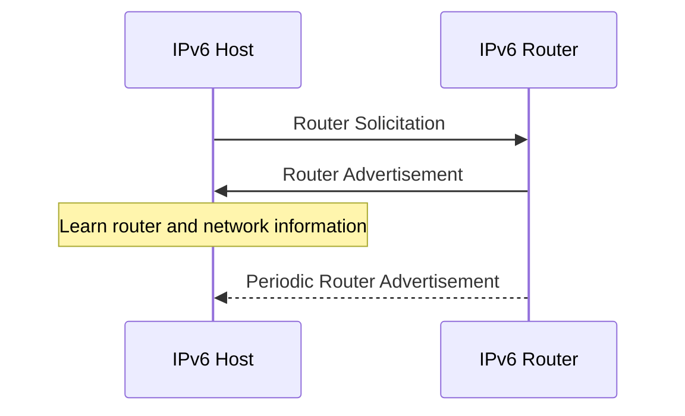
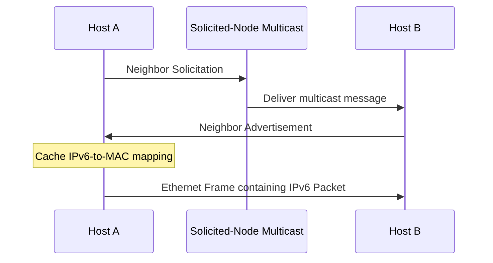
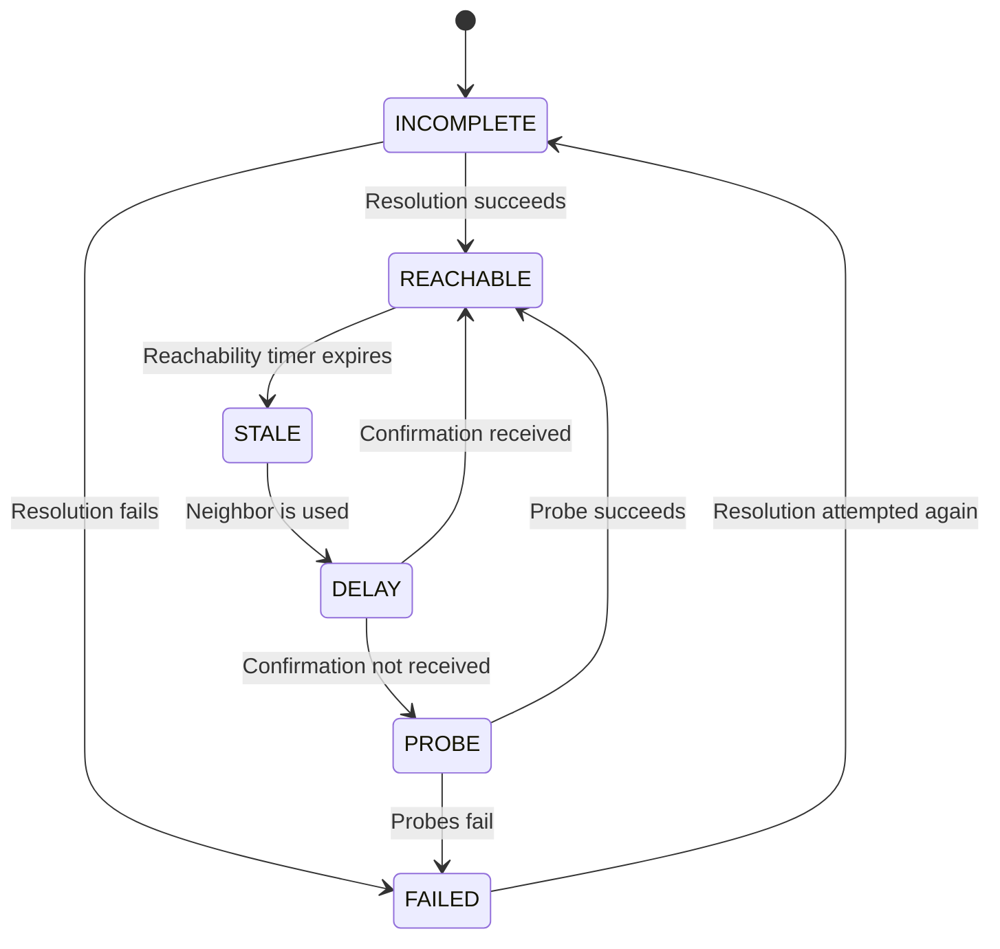
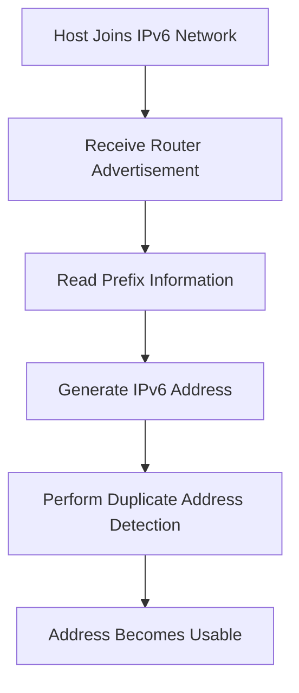

# Neighbor Discovery Protocol (NDP)

Neighbor Discovery Protocol (NDP) is an essential IPv6 protocol used by devices to discover routers, identify neighboring devices, resolve IPv6 addresses into link-layer addresses, and maintain information about neighboring nodes.

NDP performs several functions that IPv4 networks handle through separate mechanisms, including ARP and aspects of router discovery.

NDP operates through ICMPv6 messages and is defined primarily in RFC 4861.

It supports:

* Router Discovery.
* Prefix Discovery.
* IPv6 Address Resolution.
* Neighbor Unreachability Detection.
* Duplicate Address Detection.
* Redirect messages.
* Neighbor cache maintenance.

Unlike IPv4 ARP, which primarily resolves IPv4 addresses into MAC addresses, NDP provides a broader set of IPv6 network-discovery and communication functions.

# 🗁 NDP Fundamentals

### 🖆 What Is NDP?

Neighbor Discovery Protocol is an IPv6 control protocol that allows devices on the same link to discover and communicate with neighboring nodes.

It uses ICMPv6 messages rather than a separate protocol like IPv4 ARP.

For example, suppose a Linux computer wants to communicate with another device on the same IPv6 network.

```text
Source IPv6:      2001:db8:10::10
Destination IPv6: 2001:db8:10::20
Destination MAC:  Unknown
```

The source sends an ICMPv6 Neighbor Solicitation to discover the destination's link-layer address.

The destination responds with a Neighbor Advertisement containing its MAC address.

The sender can then transmit Ethernet frames to the destination.

### 🖆 Main Functions of NDP

| Function | Description |
| --- | --- |
| Router Discovery | Discovers routers available on the local link. |
| Prefix Discovery | Learns IPv6 prefixes used on the local link. |
| Address Resolution | Resolves IPv6 addresses into link-layer addresses. |
| Neighbor Unreachability Detection | Determines whether a neighbor is still reachable. |
| Duplicate Address Detection | Checks whether an IPv6 address is already in use. |
| Redirect | Informs a host about a potentially better next hop. |
| Parameter Discovery | Learns network parameters such as the link MTU. |

### 🖆 NDP and the OSI Model

NDP is implemented using ICMPv6 and supports IPv6 network-layer operations.

It is commonly associated with Layer 3 because it helps IPv6 devices discover and communicate with neighboring network nodes.

Its messages are carried directly inside IPv6 packets.

# 🗁 Why NDP Is Needed

### 🖆 IPv4 ARP vs IPv6 NDP

IPv4 uses ARP to resolve an IPv4 address into a MAC address.

IPv6 uses Neighbor Discovery through ICMPv6.

However, NDP does much more than address resolution.

| Function | IPv4 | IPv6 |
| --- | --- | --- |
| Address resolution | ARP | Neighbor Solicitation and Advertisement |
| Router discovery | DHCP configuration or historical ICMP Router Discovery | Router Solicitation and Advertisement |
| Duplicate address detection | ARP-based mechanisms such as RFC 5227 | NDP-based DAD |
| Neighbor reachability detection | ARP cache and operating-system mechanisms | Neighbor Unreachability Detection |
| Redirect | ICMPv4 Redirect | ICMPv6 Redirect |
| Prefix discovery | Configuration and DHCP | Router Advertisement |

### 🖆 Why IPv6 Does Not Use ARP

IPv6 was designed with a different address-resolution and discovery architecture.

Instead of using ARP broadcasts, IPv6 uses multicast-based Neighbor Discovery.

This provides more targeted communication.

For example, an IPv6 Neighbor Solicitation normally targets a solicited-node multicast address associated with the target IPv6 address rather than broadcasting to every device on the link.

# 🗁 NDP and ICMPv6

### 🖆 NDP Uses ICMPv6

NDP is not a standalone transport protocol.

It uses ICMPv6 messages carried inside IPv6 packets.

Important ICMPv6 message types include:

| Type | Name | Purpose |
| ---: | --- | --- |
| 133 | Router Solicitation (RS) | Requests Router Advertisements. |
| 134 | Router Advertisement (RA) | Advertises router and network information. |
| 135 | Neighbor Solicitation (NS) | Discovers neighbors and performs address resolution. |
| 136 | Neighbor Advertisement (NA) | Provides neighbor information. |
| 137 | Redirect | Suggests a better next hop. |

These messages are defined in RFC 4861.

### 🖆 NDP Message Encapsulation

```text
+--------------------------------------+
| Ethernet Header                      |
+--------------------------------------+
| IPv6 Header                          |
| Next Header = 58 (ICMPv6)            |
+--------------------------------------+
| ICMPv6 Header                        |
| Type | Code | Checksum               |
+--------------------------------------+
| NDP Message Fields                   |
+--------------------------------------+
| NDP Options                          |
+--------------------------------------+
```

The IPv6 Next Header value `58` identifies ICMPv6.

NDP messages also contain specific fields and optional information depending on their message type.

### 🖆 Important NDP Requirements

NDP messages have specific rules for their IPv6 source addresses, destination addresses, hop limits, and options.

A particularly important requirement is:

* NDP messages must be sent with an IPv6 Hop Limit of 255.
* Receivers verify that the Hop Limit is 255.
* A packet forwarded by an IPv6 router would have its Hop Limit reduced, so this check helps ensure the message originated on the local link.

This is a protocol-level protection against certain off-link attacks, not a complete authentication mechanism.

# 🗁 NDP Message Types

### 🖆 Router Solicitation

Router Solicitation (RS) is an ICMPv6 message used by a host to request Router Advertisements.

Type:

```text
133
```

A host can send an RS when it joins a network instead of waiting for the next periodic Router Advertisement.

Example:

```text
Host → Router: Router Solicitation
```

The router may then respond with a Router Advertisement.

### 🖆 Router Advertisement

Router Advertisement (RA) is an ICMPv6 message sent by routers to advertise IPv6 network information.

Type:

```text
134
```

An RA can communicate:

* Router availability.
* IPv6 network prefixes.
* Prefix lifetimes.
* Default-router lifetime.
* Link MTU.
* Address autoconfiguration information.
* Other configuration parameters.

A Router Advertisement may be sent periodically or in response to a Router Solicitation.

### 🖆 Neighbor Solicitation

Neighbor Solicitation (NS) is used for:

* IPv6 address resolution.
* Duplicate Address Detection.
* Neighbor reachability confirmation.

Type:

```text
135
```

For ordinary address resolution, the sender asks which device owns a particular IPv6 address.

The message is normally sent to the target address's solicited-node multicast group.

### 🖆 Neighbor Advertisement

Neighbor Advertisement (NA) provides information about a neighboring IPv6 device.

Type:

```text
136
```

It can be sent in response to a Neighbor Solicitation or as an unsolicited announcement in certain circumstances.

Neighbor Advertisements contain flags that provide additional information.

| Flag | Name | Description |
| --- | --- | --- |
| R | Router | Indicates that the sender is a router. |
| S | Solicited | Indicates that the advertisement is a response to a solicitation. |
| O | Override | Controls whether an existing neighbor-cache entry may be replaced. |

### 🖆 Redirect

ICMPv6 Redirect is used by a router to inform a host that a better next hop may exist for a destination.

Type:

```text
137
```

For example, a host may send traffic through a router even though another router on the same link is a more appropriate next hop.

The original router can send a Redirect message suggesting the better next hop.

# 🗁 Router Discovery

### 🖆 What Is Router Discovery?

Router Discovery allows IPv6 hosts to discover routers on their local network.

Unlike traditional IPv4 host configuration, IPv6 supports discovering default routers through ICMPv6 Router Advertisements.

A host does not need to know its default gateway in advance.

It can learn router information dynamically.

### 🖆 Router Discovery Process

A typical Router Discovery process looks like this:



The host may also receive Router Advertisements without first sending a Router Solicitation.

### 🖆 Router Advertisement Information

An RA contains several important fields.

| Field | Description |
| --- | --- |
| Current Hop Limit | Suggested default IPv6 Hop Limit. |
| Managed Flag (M) | Indicates that addresses are available through stateful DHCPv6. |
| Other Configuration Flag (O) | Indicates that other configuration information may be available through DHCPv6. |
| Router Lifetime | Indicates how long the advertising router may be considered a default router. |
| Reachable Time | Suggested neighbor reachability timing parameter. |
| Retrans Timer | Suggested retransmission timing parameter. |

An RA may also contain options such as:

* Prefix Information.
* MTU.
* Source Link-Layer Address.
* Route Information.
* Recursive DNS Server information, when supported.

### 🖆 Managed and Other Configuration Flags

The M and O flags help hosts understand the intended configuration approach.

| M flag | O flag | General interpretation |
| ---: | ---: | --- |
| 0 | 0 | SLAAC may be used without indicating DHCPv6 configuration. |
| 0 | 1 | SLAAC may be used with additional DHCPv6 configuration. |
| 1 | 0 | Stateful DHCPv6 address configuration is indicated. |
| 1 | 1 | Stateful DHCPv6 and additional configuration are indicated. |

These flags are indicators, not absolute guarantees of what services are available.

IPv6 default-router discovery is performed through Router Advertisements, not DHCPv6.

DHCPv6 does not provide the default gateway in the same way IPv4 DHCP commonly does.

# 🗁 Address Resolution

### 🖆 What Is IPv6 Address Resolution?

Address resolution maps an IPv6 address to a link-layer address.

For Ethernet, this means discovering the destination MAC address.

Example:

```text
IPv6 Address:
2001:db8:10::20

MAC Address:
BB:BB:BB:BB:BB:BB
```

The sender uses Neighbor Solicitation and Neighbor Advertisement messages to discover the mapping.

### 🖆 Solicited-Node Multicast Address

Instead of broadcasting an ARP Request to every device, IPv6 uses a solicited-node multicast address.

A solicited-node multicast address is constructed using:

```text
ff02::1:ff00:0/104
```

The lower 24 bits of the target IPv6 address are appended to this prefix.

Example target:

```text
2001:db8:10::1234:5678
```

The corresponding solicited-node multicast address is:

```text
ff02::1:ff34:5678
```

Devices whose addresses map to that multicast group receive the Neighbor Solicitation.

The mapping is not necessarily unique: different IPv6 addresses can share the same solicited-node multicast group because only the lower 24 bits are used.

### 🖆 IPv6 Address Resolution Process

Suppose Host A wants to communicate with Host B.

```text
Host A:
IPv6: 2001:db8:10::10
MAC:  AA:AA:AA:AA:AA:AA

Host B:
IPv6: 2001:db8:10::20
MAC:  BB:BB:BB:BB:BB:BB
```

Host A sends a Neighbor Solicitation to the solicited-node multicast address associated with Host B's IPv6 address.

Host B responds with a Neighbor Advertisement containing its MAC address.



### 🖆 Address Resolution for Remote Destinations

As with IPv4, a host does not resolve the MAC address of a remote IPv6 destination.

It resolves the MAC address of the next-hop router.

Example:

```text
Host A:
2001:db8:10::10/64

Default Router:
2001:db8:10::1

Remote Destination:
2606:4700:4700::1111
```

Host A checks its routing table.

If the remote destination is reached through the default router, it resolves:

```text
2001:db8:10::1 → Router MAC Address
```

The IPv6 packet retains the remote destination address, while the Ethernet frame is addressed to the router.

# 🗁 Neighbor Unreachability Detection

### 🖆 What Is Neighbor Unreachability Detection?

Neighbor Unreachability Detection (NUD) determines whether a neighboring IPv6 device is still reachable.

A cached MAC address does not necessarily mean the device is currently available.

For example, a device may disconnect from the network or change its interface.

NUD helps IPv6 hosts detect these conditions.

### 🖆 NUD States

The IPv6 Neighbor Cache uses several states.

| State | Description |
| --- | --- |
| INCOMPLETE | Address resolution is in progress. |
| REACHABLE | The neighbor is considered reachable based on recent confirmation. |
| STALE | The mapping exists, but reachability has not been recently confirmed. |
| DELAY | The system waits before actively probing a stale neighbor. |
| PROBE | The system sends probes to verify reachability. |
| PERMANENT | A manually configured permanent entry. |
| NOARP | The entry does not require normal neighbor resolution. |
| FAILED | Resolution or reachability probing failed. |

### 🖆 NUD State Transitions

A simplified neighbor-state lifecycle:



Actual transitions depend on the neighbor-discovery events and operating-system implementation.

### 🖆 How Reachability Is Confirmed

Reachability can be confirmed through:

* Positive upper-layer protocol indications.
* Neighbor Solicitation and Advertisement exchanges.
* Other protocol-specific confirmation mechanisms.

For example, successful TCP communication may provide positive confirmation that a neighbor is reachable without requiring a separate NDP probe for every packet.

# 🗁 Duplicate Address Detection

### 🖆 What Is Duplicate Address Detection?

Duplicate Address Detection (DAD) checks whether an IPv6 address is already in use on the local link before an interface begins using that address.

It helps prevent multiple devices from unintentionally using the same IPv6 address.

DAD is defined in RFC 4862 as part of IPv6 Stateless Address Autoconfiguration.

### 🖆 How DAD Works

When an interface wants to configure a tentative IPv6 address, it sends a Neighbor Solicitation message.

The message uses:

* Source IPv6 address: `::` (unspecified address).
* Destination: the tentative address's solicited-node multicast address.
* Target address: the tentative IPv6 address.

If another device is already using the address, a Neighbor Advertisement or another conflicting Neighbor Solicitation may indicate a duplicate.

If no conflict is detected during the required procedure, the address can become preferred.

### 🖆 DAD Example

Suppose a device wants to configure:

```text
2001:db8:10::20
```

It sends a Neighbor Solicitation to:

```text
ff02::1:ff00:20
```

The source address is:

```text
::
```

The device waits for a conflict indication.

If another node already owns the address, the duplicate can be detected.

### 🖆 DAD and SLAAC

DAD is normally performed for addresses created through Stateless Address Autoconfiguration (SLAAC).

It can also apply to manually configured or DHCPv6-assigned addresses, depending on configuration and implementation.

# 🗁 Neighbor Cache

### 🖆 What Is the Neighbor Cache?

The Neighbor Cache stores information about neighboring IPv6 devices.

It is conceptually similar to the IPv4 ARP cache, but it contains additional state information for Neighbor Unreachability Detection.

Example:

| IPv6 Address | MAC Address | State |
| --- | --- | --- |
| `fe80::1` | `11:22:33:44:55:66` | REACHABLE |
| `2001:db8:10::20` | `BB:BB:BB:BB:BB:BB` | STALE |
| `2001:db8:10::30` | `CC:CC:CC:CC:CC:CC` | DELAY |

### 🖆 Neighbor Cache vs Destination Cache

These caches have different purposes.

| Cache | Purpose |
| --- | --- |
| Neighbor Cache | Stores information about directly reachable IPv6 neighbors and their link-layer addresses. |
| Destination Cache | Stores destination-related information used when selecting a next hop and processing outgoing traffic. |
| Prefix List | Tracks prefixes considered on-link. |
| Default Router List | Tracks routers learned through Router Advertisements. |

These structures are part of IPv6 host networking behavior.

# 🗁 Prefix and Parameter Discovery

### 🖆 Prefix Discovery

Router Advertisements can include Prefix Information options.

These options tell hosts which IPv6 prefixes are available on the local link.

Example:

```text
Prefix:
2001:db8:10::/64
```

The Prefix Information option includes:

* Prefix.
* Prefix length.
* On-link flag (L).
* Autonomous address-configuration flag (A).
* Valid lifetime.
* Preferred lifetime.

### 🖆 On-Link Flag

The L flag indicates whether the advertised prefix should be considered on-link.

When a prefix is on-link, a host can treat destinations within that prefix as directly reachable over the local link.

### 🖆 Autonomous Flag

The A flag indicates whether the prefix can be used for Stateless Address Autoconfiguration.

When appropriate, a host can use the advertised prefix to generate its own IPv6 address.

### 🖆 SLAAC Overview

Stateless Address Autoconfiguration allows IPv6 hosts to configure addresses using information from Router Advertisements.

A simplified process:



SLAAC may use different interface identifier generation methods, including stable privacy-oriented methods and temporary addresses.

The exact method depends on the operating system and configuration.

### 🖆 MTU Discovery Through Router Advertisements

An RA may include an MTU option.

This informs hosts of the link MTU for the local network.

For IPv6, the minimum link MTU is 1280 bytes.

Path MTU Discovery remains necessary because the end-to-end path may contain links with different MTUs.

# 🗁 Redirect Messages

### 🖆 What Is an ICMPv6 Redirect?

An IPv6 router can send a Redirect message when it determines that a better next hop is available for a destination.

Example:

```text
Host A
  |
  |
Router A
  |
  +-------- Router B
```

If Router A receives traffic from Host A that would be better delivered directly to Router B on the same link, Router A may send an ICMPv6 Redirect.

The host can then update its destination-related information.

### 🖆 Redirect Information

A Redirect message can include:

* Target address.
* Destination address.
* Target Link-Layer Address option, when applicable.
* Redirected Header option, when applicable.

Redirect messages must be validated according to the NDP security rules.

# 🗁 NDP Multicast Addresses

### 🖆 Important IPv6 Multicast Addresses

NDP uses IPv6 multicast to communicate with selected groups of devices.

| Multicast Address | Purpose |
| --- | --- |
| `ff02::1` | All nodes on the local link. |
| `ff02::2` | All routers on the local link. |
| `ff02::1:ff00:0/104` | Solicited-node multicast address prefix. |

### 🖆 Scope Identifier

The `ff02` prefix indicates link-local multicast scope.

NDP messages are intended for the local link and are not routed across IPv6 routers.

On Linux, link-local addresses and multicast destinations often require an interface scope identifier when used in commands.

Example:

```bash
ping -6 fe80::1%eth0
```

The `%eth0` portion identifies the interface used to reach the link-local address.

# 🗁 NDP Security

### 🖆 NDP Security Risks

NDP relies on ICMPv6 messages that are not inherently authenticated in ordinary deployments.

An attacker with access to the local link may attempt to send forged NDP messages.

Common attack categories include:

| Attack | Description |
| --- | --- |
| Rogue Router Advertisement | A malicious device advertises itself as a router. |
| Neighbor Advertisement Spoofing | A malicious device advertises an incorrect IPv6-to-MAC mapping. |
| Neighbor Solicitation Flood | Excessive solicitation messages consume network resources. |
| Duplicate Address Attack | An attacker interferes with IPv6 address configuration. |
| Redirect Abuse | A malicious or unauthorized redirect attempts to alter next-hop behavior. |
| Neighbor Cache Exhaustion | Excessive neighbor entries or resolution requests consume resources. |

### 🖆 Rogue Router Advertisement

A rogue router can advertise incorrect network information.

For example, it may announce itself as the default router.

Victims may then send traffic through the attacker's device.

Possible consequences include:

* Traffic interception.
* Traffic disruption.
* Incorrect IPv6 addressing.
* DNS configuration manipulation through advertised options.

### 🖆 Router Advertisement Guard

Router Advertisement Guard (RA Guard) is a Layer 2 security mechanism designed to restrict unauthorized Router Advertisement messages.

It allows network administrators to define which switch ports are permitted to send Router Advertisements.

RA Guard is specified in RFC 6105, with updates and clarifications in later specifications.

### 🖆 Secure Neighbor Discovery

Secure Neighbor Discovery (SEND) adds cryptographic mechanisms to protect certain Neighbor Discovery operations.

It is specified in RFC 3971.

SEND is distinct from ordinary NDP and is not universally deployed.

### 🖆 Practical Security Controls

* Use RA Guard on managed switches where supported.
* Restrict which devices may send Router Advertisements.
* Use appropriate Layer 2 access controls.
* Monitor unexpected Router Advertisements.
* Apply ICMPv6 firewall rules that preserve required NDP traffic.
* Protect network infrastructure management interfaces.
* Use SEND where its requirements and deployment model are appropriate.
* Monitor neighbor-cache anomalies and unusual multicast activity.

Do not block all ICMPv6 traffic as a security shortcut. Doing so can break address resolution, router discovery, and Path MTU Discovery.

# 🗁 NDP on Ubuntu Linux

### 🖆 Display IPv6 Neighbor Entries

Use:

```bash
ip -6 neigh show
```

Example:

```text
fe80::1 dev eth0 lladdr 11:22:33:44:55:66 router REACHABLE
2001:db8:10::20 dev eth0 lladdr BB:BB:BB:BB:BB:BB STALE
```

### 🖆 Display Neighbor Entries for an Interface

```bash
ip -6 neigh show dev eth0
```

### 🖆 Inspect IPv6 Addresses

```bash
ip -6 addr show
```

### 🖆 Inspect IPv6 Routes

```bash
ip -6 route show
```

### 🖆 Inspect the Default Router

```bash
ip -6 route show default
```

### 🖆 Ping a Link-Local IPv6 Address

```bash
ping -6 fe80::1%eth0
```

Replace the address and interface with the actual values.

### 🖆 Add a Permanent IPv6 Neighbor Entry

```bash
sudo ip -6 neigh add 2001:db8:10::20 lladdr BB:BB:BB:BB:BB:BB dev eth0 nud permanent
```

### 🖆 Delete an IPv6 Neighbor Entry

```bash
sudo ip -6 neigh del 2001:db8:10::20 dev eth0
```

### 🖆 Flush Neighbor Entries

```bash
sudo ip -6 neigh flush dev eth0
```

Use this carefully because active communication may trigger new address resolution.

### 🖆 Inspect Router Advertisement Settings

On Linux, inspect relevant IPv6 interface settings:

```bash
sysctl net.ipv6.conf.all.accept_ra
```

```bash
sysctl net.ipv6.conf.default.accept_ra
```

Inspect a specific interface:

```bash
sysctl net.ipv6.conf.eth0.accept_ra
```

These parameters influence whether Linux accepts Router Advertisements.

The exact behavior depends on interface settings, forwarding configuration, and kernel version.

# 🗁 Packet Analysis

### 🖆 Capture ICMPv6 Traffic

Capture all ICMPv6 packets:

```bash
sudo tcpdump -ni eth0 icmp6
```

Display detailed information:

```bash
sudo tcpdump -vv -ni eth0 icmp6
```

Capture Neighbor Discovery messages:

```bash
sudo tcpdump -ni eth0 'icmp6 and (ip6[40] >= 133 and ip6[40] <= 137)'
```

This basic filter assumes the ICMPv6 header immediately follows the IPv6 base header. Extension headers can affect the offset, so use a more general capture when analyzing traffic that may include them.

### 🖆 Wireshark Display Filters

| Filter | Purpose |
| --- | --- |
| `icmpv6` | Display ICMPv6 traffic. |
| `icmpv6.type == 133` | Router Solicitation. |
| `icmpv6.type == 134` | Router Advertisement. |
| `icmpv6.type == 135` | Neighbor Solicitation. |
| `icmpv6.type == 136` | Neighbor Advertisement. |
| `icmpv6.type == 137` | Redirect. |

### 🖆 Observe Neighbor Discovery

Start a capture:

```bash
sudo tcpdump -e -vv -ni eth0 icmp6
```

In another terminal, remove a dynamic neighbor entry:

```bash
sudo ip -6 neigh del 2001:db8:10::20 dev eth0
```

Then attempt to reach the neighbor:

```bash
ping -6 -c 1 2001:db8:10::20
```

Observe the Neighbor Solicitation and Neighbor Advertisement messages.

A new solicitation may not occur if the operating system already has a valid neighbor entry.

# 🗁 Common Troubleshooting Scenarios

### 🖆 IPv6 Host Cannot Reach the Gateway

Possible causes:

* Router Advertisement is not received.
* The router is not advertising a usable prefix.
* The host has an incorrect IPv6 configuration.
* The router is unavailable.
* Neighbor Discovery is blocked.
* A VLAN or Layer 2 connectivity problem exists.

Inspect addresses:

```bash
ip -6 addr show
```

Inspect routes:

```bash
ip -6 route show
```

Inspect neighbors:

```bash
ip -6 neigh show
```

Capture Router Advertisements:

```bash
sudo tcpdump -ni eth0 'icmp6 and ip6[40] == 134'
```

### 🖆 Neighbor Entry Remains INCOMPLETE

Possible causes:

* Target device is offline.
* Incorrect IPv6 destination address.
* Layer 2 connectivity failure.
* Multicast traffic is filtered.
* NDP firewall rules are incorrect.
* The target does not own the requested address.

Capture traffic:

```bash
sudo tcpdump -e -ni eth0 icmp6
```

Check whether Neighbor Solicitations are transmitted and whether Neighbor Advertisements return.

### 🖆 IPv6 Address Is Not Configured

Possible causes:

* No Router Advertisement is received.
* The advertised prefix is not suitable for SLAAC.
* The Autonomous flag is not set.
* Duplicate Address Detection fails.
* The interface is configured not to accept Router Advertisements.
* Network management software overrides interface configuration.

Inspect the interface:

```bash
ip -6 addr show dev eth0
```

Inspect the route:

```bash
ip -6 route show
```

Inspect Router Advertisement settings:

```bash
sysctl net.ipv6.conf.eth0.accept_ra
```

### 🖆 Duplicate IPv6 Address Detected

Possible causes:

* Two devices use the same manually configured address.
* A duplicate address exists in a DHCPv6 or SLAAC deployment.
* A malicious device is interfering with address configuration.

Capture NDP traffic:

```bash
sudo tcpdump -e -vv -ni eth0 icmp6
```

Look for Neighbor Solicitations and Neighbor Advertisements targeting the conflicting address.

### 🖆 IPv6 Works Intermittently

Possible causes:

* Neighbor cache entries become stale.
* Router Advertisements are inconsistent.
* Duplicate IPv6 addresses exist.
* A device changes its MAC address.
* Multicast or NDP filtering is misconfigured.
* Network devices have inconsistent VLAN configurations.

Inspect the neighbor table repeatedly:

```bash
ip -6 neigh show
```

Investigate unexpected changes in MAC mappings and neighbor states.

# 🗁 Best Practices

* Allow required ICMPv6 Neighbor Discovery messages.
* Use RA Guard on managed Layer 2 networks where supported.
* Monitor unexpected Router Advertisements.
* Avoid blocking IPv6 multicast indiscriminately.
* Keep IPv6 prefix and router configurations consistent.
* Investigate duplicate-address notifications.
* Use appropriate VLAN segmentation.
* Monitor neighbor-cache entries and failures.
* Use link-local addresses with the correct interface scope.
* Protect network infrastructure against unauthorized NDP messages.
* Remember that IPv6 default-router discovery depends on Router Advertisements.

# 🗁 Common Mistakes

| Mistake | Correct Understanding |
| --- | --- |
| IPv6 uses ARP. | IPv6 uses NDP through ICMPv6. |
| NDP only resolves MAC addresses. | NDP also supports router discovery, DAD, NUD, and redirects. |
| NDP uses Ethernet broadcasts. | NDP generally uses IPv6 multicast for discovery. |
| DHCPv6 provides the IPv6 default gateway. | Default-router discovery is performed through Router Advertisements. |
| Neighbor Solicitation and Router Solicitation are identical. | They are different ICMPv6 messages with different purposes. |
| A cached neighbor entry always means the device is reachable. | NUD helps verify neighbor reachability. |
| Blocking all ICMPv6 improves security. | Essential NDP and other ICMPv6 functions may stop working. |
| NDP messages can be forwarded across routers. | NDP is designed for communication on the local link. |
| A solicited-node multicast address uniquely identifies one IPv6 address. | Multiple IPv6 addresses can share the same solicited-node multicast group. |

# 🗁 Practical Exercises

### 🖆 Exercise: Inspect Your IPv6 Neighbor Table

Run:

```bash
ip -6 neigh show
```

Identify:

* IPv6 neighbor addresses.
* MAC addresses.
* Network interfaces.
* Neighbor states.

### 🖆 Exercise: Inspect Router Discovery

Display the IPv6 default route:

```bash
ip -6 route show default
```

Capture Router Advertisements:

```bash
sudo tcpdump -vv -ni eth0 'icmp6 and ip6[40] == 134'
```

Identify the router's advertised information.

### 🖆 Exercise: Observe Neighbor Solicitation

Start a packet capture:

```bash
sudo tcpdump -e -vv -ni eth0 icmp6
```

Remove a dynamic neighbor entry:

```bash
sudo ip -6 neigh del 2001:db8:10::20 dev eth0
```

Generate traffic:

```bash
ping -6 -c 1 2001:db8:10::20
```

Observe the Neighbor Solicitation and Advertisement exchange.

Use an IPv6 address that exists on your local network.

### 🖆 Exercise: Inspect NDP with Wireshark

Capture ICMPv6 traffic and apply:

```text
icmpv6
```

Then investigate:

```text
icmpv6.type == 135
```

```text
icmpv6.type == 136
```

Identify the target IPv6 address and link-layer address information.

### 🖆 Exercise: Compare ARP and NDP

Create a comparison table containing:

* Protocol architecture.
* Address-resolution mechanism.
* Discovery messages.
* Neighbor cache.
* Duplicate address detection.
* Router discovery.
* Security mechanisms.

Explain why NDP provides more functionality than IPv4 ARP.

# 🗁 Interview Questions

### 🖆 Fundamental Questions

**What is NDP?**

NDP is an IPv6 protocol that discovers routers and neighboring devices, resolves IPv6 addresses into link-layer addresses, and maintains neighbor information.

**Which protocol does NDP use?**

NDP uses ICMPv6.

**What are the main NDP message types?**

Router Solicitation, Router Advertisement, Neighbor Solicitation, Neighbor Advertisement, and Redirect.

**What is the difference between ARP and NDP?**

ARP resolves IPv4 addresses into MAC addresses. NDP provides IPv6 address resolution and additional functions such as Router Discovery and Neighbor Unreachability Detection.

### 🖆 Intermediate Questions

**What is Router Advertisement?**

It is an ICMPv6 message used by routers to advertise network prefixes, router information, and other IPv6 configuration parameters.

**What is Neighbor Solicitation?**

It is an ICMPv6 message used for address resolution, Duplicate Address Detection, and neighbor reachability confirmation.

**What is Neighbor Unreachability Detection?**

It is a mechanism that determines whether a neighboring IPv6 device remains reachable.

**What is Duplicate Address Detection?**

It is a mechanism used to check whether an IPv6 address is already in use on the local link before the address becomes usable.

**What is a solicited-node multicast address?**

It is a special IPv6 multicast address used by Neighbor Discovery to deliver messages to devices associated with a particular IPv6 address.

### 🖆 Advanced Questions

**Why does NDP use multicast instead of broadcast?**

IPv6 does not use broadcast addressing. NDP uses multicast to target relevant groups of neighboring devices rather than sending every discovery message to all nodes on the link.

**What is the purpose of the NDP Hop Limit requirement?**

NDP messages use a Hop Limit of 255, and receivers verify this value. A packet forwarded by a router would have a smaller value, helping reject off-link messages.

**What is a Rogue Router Advertisement?**

It is an unauthorized Router Advertisement that attempts to provide incorrect IPv6 network or router configuration information.

**How does RA Guard protect an IPv6 network?**

RA Guard restricts which Layer 2 ports are allowed to send Router Advertisement messages.

**What happens if ICMPv6 is blocked?**

IPv6 functionality such as Neighbor Discovery, Router Discovery, and Path MTU Discovery may fail.

# 🗁 Summary

Neighbor Discovery Protocol is a fundamental part of IPv6 networking.

Key concepts:

* NDP uses ICMPv6 rather than a separate ARP protocol.
* Router Solicitation requests Router Advertisements.
* Router Advertisement provides IPv6 router and network information.
* Neighbor Solicitation discovers neighboring devices and performs address resolution.
* Neighbor Advertisement provides neighbor information.
* Neighbor Unreachability Detection monitors neighbor reachability.
* Duplicate Address Detection checks whether an IPv6 address is already in use.
* Prefix Information options support on-link determination and SLAAC.
* Redirect messages can suggest a better next hop.
* NDP uses multicast instead of IPv4-style broadcast.
* RA Guard helps protect networks against unauthorized Router Advertisements.
* Blocking essential ICMPv6 messages can break IPv6 communication.

Understanding NDP is essential for configuring IPv6 networks, troubleshooting address resolution, investigating Router Advertisements, and securing Layer 2 infrastructure.

# 🗁 References

### 🖆 Official RFC Documents

* [RFC 4861 — Neighbor Discovery for IP version 6 (IPv6)](https://www.rfc-editor.org/rfc/rfc4861)
* [RFC 4862 — IPv6 Stateless Address Autoconfiguration](https://www.rfc-editor.org/rfc/rfc4862)
* [RFC 4443 — Internet Control Message Protocol (ICMPv6)](https://www.rfc-editor.org/rfc/rfc4443)
* [RFC 3971 — SEcure Neighbor Discovery (SEND)](https://www.rfc-editor.org/rfc/rfc3971)
* [RFC 6105 — IPv6 Router Advertisement Guard](https://www.rfc-editor.org/rfc/rfc6105)
* [RFC 6980 — Security Implications of IPv6 Fragmentation with Neighbor Discovery](https://www.rfc-editor.org/rfc/rfc6980)
* [RFC 9099 — Operational Security Considerations for IPv6 Networks](https://www.rfc-editor.org/rfc/rfc9099)

### 🖆 Linux Documentation

* [Linux ip-neighbour Manual](https://man7.org/linux/man-pages/man8/ip-neighbour.8.html)
* [Linux ip Manual](https://man7.org/linux/man-pages/man8/ip.8.html)
* [Linux IPv6 Documentation](https://docs.kernel.org/networking/ipv6.html)
* [tcpdump Manual](https://www.tcpdump.org/manpages/tcpdump.1.html)
* [Wireshark ICMPv6 Display Filter Reference](https://www.wireshark.org/docs/dfref/i/icmpv6.html)
