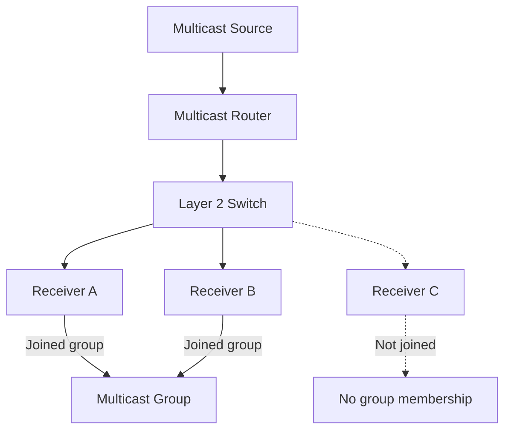
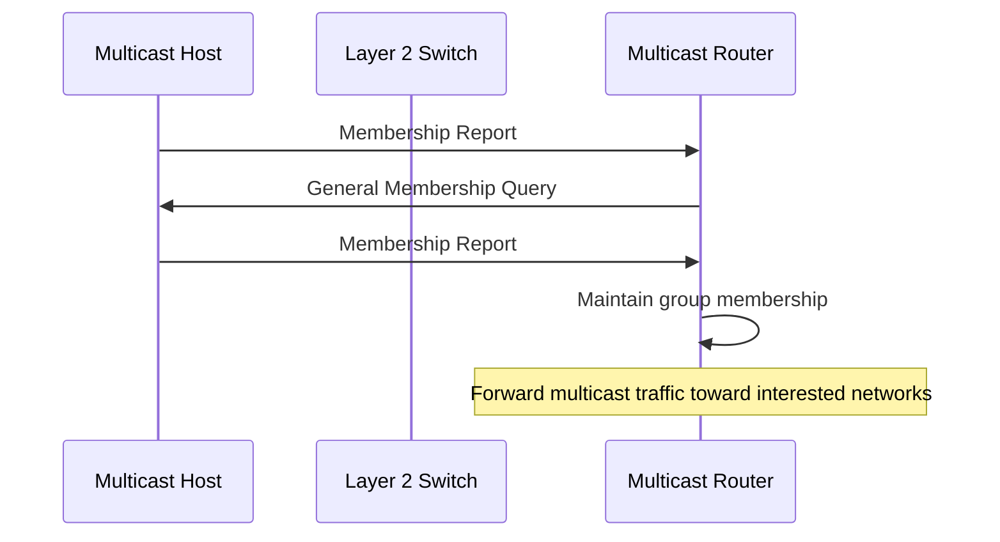
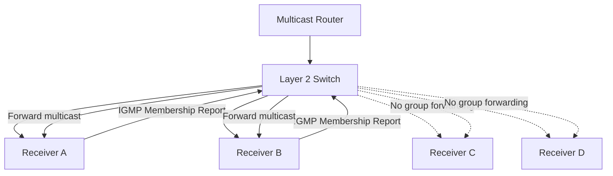

# IGMP and MLD

Internet Group Management Protocol (IGMP) and Multicast Listener Discovery (MLD) are protocols used to manage multicast group membership on local networks.

* **IGMP** manages IPv4 multicast group membership.
* **MLD** manages IPv6 multicast group membership.

They allow hosts to inform multicast routers about the multicast groups they want to receive traffic from. Routers use this membership information to determine where multicast traffic should be forwarded.

Both protocols operate on the local link. They do not perform multicast routing between different networks.

# 🗁 Multicast Fundamentals

IP multicast is a communication method that allows one sender to deliver traffic to multiple receivers that have joined a multicast group.

Instead of sending separate copies of the same data to every receiver, the sender transmits traffic to a multicast destination address.

The network can replicate packets at appropriate forwarding points.

### 🖆 Unicast vs Broadcast vs Multicast

| Communication | Description | Example |
| --- | --- | --- |
| Unicast | One sender to one receiver | Web browsing |
| Broadcast | One sender to all devices in a broadcast domain | ARP request in IPv4 |
| Multicast | One sender to multiple group members | IPTV streaming |

### 🖆 How Multicast Works

Consider an IPTV network:

* A streaming server sends video to a multicast group.
* Multiple clients join that group.
* The network forwards multicast traffic toward networks with interested receivers.
* Clients that have not joined the group do not normally receive the multicast stream through correctly configured multicast forwarding.



### 🖆 IPv4 Multicast Address Range

IPv4 multicast addresses belong to:

```text
224.0.0.0/4
```

This range covers:

```text
224.0.0.0 - 239.255.255.255
```

Some important multicast ranges:

| Address Range | Purpose |
| --- | --- |
| `224.0.0.0/24` | Local network control block |
| `224.0.1.0/24` | Internetwork control block |
| `232.0.0.0/8` | Source-Specific Multicast (SSM) |
| `239.0.0.0/8` | Administratively scoped multicast |

The `224.0.0.0/24` range is reserved for link-local control traffic. Routers do not forward these packets beyond the local link.

### 🖆 IPv6 Multicast Address Range

IPv6 multicast addresses belong to:

```text
ff00::/8
```

IPv6 does not use broadcast. Multicast provides many of the group-delivery functions that broadcast provides in IPv4.

IPv6 multicast addresses include a scope field that determines the intended reach of the multicast group.

Examples:

| Address | Purpose |
| --- | --- |
| `ff02::1` | All IPv6 nodes on the local link |
| `ff02::2` | All IPv6 routers on the local link |
| `ff02::16` | All MLDv2-capable routers on the local link |
| `ff02::1:ff00:0/104` | Solicited-node multicast address range |

---

# 🗁 IGMP Fundamentals

IGMP stands for **Internet Group Management Protocol**.

It manages IPv4 multicast group membership between hosts and multicast routers on a directly connected network.

A host uses IGMP to inform local multicast routers that it wants to receive traffic for a particular multicast group.

### 🖆 IGMP Characteristics

* Operates with IPv4.
* Uses IP Protocol number `2`.
* Does not use TCP or UDP.
* Does not use TCP/UDP port numbers.
* Manages multicast membership on a local IPv4 network.
* Supports membership queries and reports.
* Uses multicast group addresses from `224.0.0.0/4`.

### 🖆 IGMP in the IPv4 Packet

IGMP messages are encapsulated directly inside IPv4 packets.

```text
Ethernet Frame
└── IPv4 Packet
    ├── Source IP
    ├── Destination IP
    ├── Protocol: 2
    └── IGMP Message
        ├── Type
        ├── Max Response Time
        ├── Checksum
        └── Group Address / Additional Fields
```

IGMP messages are sent with IPv4 TTL `1`, keeping them on the local network.

### 🖆 How IGMP Membership Works

A simplified membership process:



The router periodically sends membership queries to discover active listeners.

Hosts respond with membership reports to indicate which multicast groups they want to receive.

Membership information is maintained using timers. If membership is no longer refreshed, the router can eventually remove the group from its membership state.

### 🖆 IGMP Does Not Perform Multicast Routing

IGMP and multicast routing solve different problems.

| Protocol / Feature | Responsibility |
| --- | --- |
| IGMP | Manages IPv4 multicast listener membership |
| IGMP Snooping | Controls Layer 2 multicast forwarding |
| PIM | Supports IPv4 multicast routing |
| MLD | Manages IPv6 multicast listener membership |
| PIM6 | Supports IPv6 multicast routing |

IGMP tells a local multicast router which groups have interested receivers.

A multicast routing protocol such as PIM determines how multicast traffic travels between networks.

---

# 🗁 IGMP Versions

There are three commonly referenced IGMP versions:

* IGMPv1
* IGMPv2
* IGMPv3

Each version introduces improvements to multicast membership management.

### 🖆 IGMPv1

IGMPv1 is defined in RFC 1112.

It provides basic multicast membership management.

Main characteristics:

* Membership Query messages.
* Membership Report messages.
* No explicit Leave Group message.
* Routers periodically query hosts to determine whether group members remain active.
* Hosts use report suppression to reduce unnecessary responses.

In IGMPv1, when a host leaves a multicast group, it does not send an explicit leave message. The router eventually discovers that membership has ended through its query and membership timeout process.

### 🖆 IGMPv2

IGMPv2 is defined in RFC 2236.

It improves membership management by introducing explicit leave notifications.

Main characteristics:

* General Membership Queries.
* Group-Specific Queries.
* Membership Reports.
* Leave Group messages.
* Querier election.
* Faster detection of group membership changes.

When a host leaves a group, it can send a Leave Group message to the local multicast routers.

The router can then send a group-specific query to determine whether other hosts still want the group.

### 🖆 IGMP Querier Election

When multiple multicast routers exist on the same IPv4 subnet, they need to determine which router sends the periodic IGMP queries.

In IGMPv2, the router with the lowest IPv4 address among the participating IGMP routers becomes the elected querier.

The querier periodically sends General Membership Queries.

Other routers can monitor these queries and take over if the active querier disappears.

### 🖆 IGMPv3

IGMPv3 is defined in RFC 3376.

It introduces source filtering, allowing receivers to specify which multicast sources they want to receive from.

Main characteristics:

* Source-specific membership filtering.
* INCLUDE and EXCLUDE filter modes.
* Support for Source-Specific Multicast.
* More detailed membership reports.

IGMPv3 is particularly useful for networks that need precise control over multicast sources.

### 🖆 IGMP Version Comparison

| Feature | IGMPv1 | IGMPv2 | IGMPv3 |
| --- | --- | --- | --- |
| Membership Query | Yes | Yes | Yes |
| Membership Report | Yes | Yes | Yes |
| Explicit Leave | No | Yes | Yes |
| Group-Specific Query | No | Yes | Yes |
| Querier Election | Basic querier operation | Yes | Yes |
| Source Filtering | No | No | Yes |
| INCLUDE / EXCLUDE | No | No | Yes |
| SSM Support | No | No | Yes |

---

# 🗁 IGMP Message Types

IGMP uses different message types to manage multicast membership.

### 🖆 Common IGMP Message Types

| Message | Type | Hexadecimal | Description |
| --- | ---: | --- | --- |
| Membership Query | 17 | `0x11` | Queries multicast membership |
| IGMPv1 Membership Report | 18 | `0x12` | Reports membership in a group |
| IGMPv2 Membership Report | 22 | `0x16` | Reports membership in a group |
| Leave Group | 23 | `0x17` | Notifies routers that a host is leaving |
| IGMPv3 Membership Report | 34 | `0x22` | Reports group and source-filter information |

### 🖆 Membership Query

A multicast router sends a Membership Query to discover active multicast listeners.

There are different query types:

**General Query**

* Queries all multicast groups on the local network.
* Typically sent to `224.0.0.1`.
* Used for periodic membership discovery.

**Group-Specific Query**

* Queries membership for one particular multicast group.
* Used when a router needs to determine whether a group still has listeners.

**Group-and-Source-Specific Query**

* Used by IGMPv3.
* Checks whether receivers still want traffic from specified sources for a group.

### 🖆 Membership Report

A host sends a Membership Report to indicate its multicast membership.

For example:

```text
Multicast Group: 239.1.1.10
Host: 192.168.1.20
Action: Join multicast group
```

IGMPv2 reports are typically sent to the multicast group being joined.

IGMPv3 reports are sent to:

```text
224.0.0.22
```

This address represents all IGMPv3-capable multicast routers on the local network.

### 🖆 Leave Group

IGMPv2 and IGMPv3 support explicit leave notifications.

In IGMPv2, a host can send a Leave Group message to:

```text
224.0.0.2
```

This address represents all routers on the local subnet.

The router can then perform a group-specific query to check whether other listeners remain.

---

# 🗁 IGMPv3 Source Filtering

IGMPv3 provides source filtering.

This allows a receiver to control which multicast sources it wants to receive traffic from.

Consider the following multicast sources:

```text
Source A: 192.168.1.10
Source B: 192.168.1.20
Source C: 192.168.1.30

Multicast Group: 239.1.1.100
```

A receiver can request traffic from selected sources instead of accepting traffic from every source transmitting to the group.

### 🖆 INCLUDE Mode

In INCLUDE mode, the receiver accepts traffic only from the specified sources.

Example:

```text
Group: 239.1.1.100

Filter Mode: INCLUDE

Sources:
- 192.168.1.10
- 192.168.1.20
```

The receiver accepts traffic from:

* `192.168.1.10`
* `192.168.1.20`

Traffic from other sources is excluded.

### 🖆 EXCLUDE Mode

In EXCLUDE mode, the receiver accepts traffic from all sources except the specified sources.

Example:

```text
Group: 239.1.1.100

Filter Mode: EXCLUDE

Sources:
- 192.168.1.30
```

The receiver accepts traffic from all sources except:

* `192.168.1.30`

### 🖆 ASM vs SSM

Two important multicast models are Any-Source Multicast and Source-Specific Multicast.

**Any-Source Multicast (ASM)**

A receiver joins a multicast group without specifying a particular source.

The receiver can receive traffic from any source sending to that group, subject to the multicast routing and membership model.

**Source-Specific Multicast (SSM)**

A receiver specifies both the multicast group and the desired source.

The receiver requests traffic from a specific source rather than accepting traffic from arbitrary sources.

| Feature | ASM | SSM |
| --- | --- | --- |
| Source selection | Any source | Specific source |
| Membership | Group | Source and group |
| Source filtering | Not required by the basic model | Required |
| IPv4 address range | Depends on multicast allocation | Commonly `232.0.0.0/8` |
| IGMP support | IGMPv1/v2 and IGMPv3 | Commonly IGMPv3 |

SSM is useful for IPTV, live media distribution, and other applications where receivers know the expected multicast source.

---

# 🗁 IGMP Snooping

IGMP Snooping is a Layer 2 switch feature that monitors IGMP messages to determine which switch ports have interested multicast receivers.

Without IGMP snooping, a switch may flood multicast traffic to multiple ports within a VLAN.

With IGMP snooping, the switch builds a multicast forwarding database and forwards multicast traffic only to relevant ports, subject to its multicast forwarding and control-plane configuration.

### 🖆 How IGMP Snooping Works

Consider a switch with four connected devices.

Only two devices join a multicast group.



The switch learns that Receiver A and Receiver B are interested in the multicast group.

It can then forward matching multicast traffic to those ports instead of flooding it to every port.

### 🖆 IGMP Snooping vs IGMP

| Feature | IGMP | IGMP Snooping |
| --- | --- | --- |
| Layer | IP control protocol | Layer 2 switch feature |
| Main purpose | Manage multicast membership | Control multicast forwarding |
| Used by | Hosts and multicast routers | Ethernet switches |
| Protocol | IPv4 Protocol 2 | Inspects IGMP messages |
| Performs multicast routing | No | No |

### 🖆 IGMP Querier and Snooping

IGMP snooping switches need membership information to maintain accurate multicast forwarding entries.

An IGMP querier periodically sends queries so that listeners can refresh their memberships.

If no multicast router is present on a VLAN, some switches support an IGMP snooping querier function.

This allows the switch to generate queries and maintain membership information without a separate multicast router.

The exact behavior depends on the switch platform and configuration.

### 🖆 Benefits of IGMP Snooping

* Reduces unnecessary multicast flooding.
* Saves network bandwidth.
* Improves multicast traffic distribution.
* Helps manage IPTV and video streaming networks.
* Limits multicast traffic to interested switch ports.

---

# 🗁 MLD Fundamentals

MLD stands for **Multicast Listener Discovery**.

It is the IPv6 counterpart to IGMP.

MLD allows IPv6 hosts to inform local multicast routers about the multicast groups they want to receive.

Unlike IGMP, MLD is implemented using ICMPv6.

### 🖆 MLD Characteristics

* Used with IPv6.
* Implemented through ICMPv6.
* Does not use TCP or UDP.
* Does not use TCP/UDP port numbers.
* Manages multicast listener membership on a local IPv6 link.
* Supports multicast membership queries and reports.
* Uses IPv6 multicast addresses.

### 🖆 MLD and ICMPv6

MLD messages are carried inside IPv6 packets using ICMPv6.

The ICMPv6 message types are:

```text
MLD Query       = 130
MLDv1 Report    = 131
MLDv1 Done      = 132
MLDv2 Report    = 143
```

MLD messages are sent with IPv6 Hop Limit `1`.

They also use the IPv6 Router Alert option so that routers processing the traffic can recognize the control messages.

### 🖆 MLD Message Encapsulation

```text
Ethernet Frame
└── IPv6 Packet
    ├── Source IPv6
    ├── Destination IPv6
    ├── Hop Limit: 1
    ├── Router Alert Option
    └── ICMPv6
        ├── Type
        ├── Code
        ├── Checksum
        └── MLD Message
```

### 🖆 MLD and NDP

MLD and NDP both use ICMPv6, but they perform different functions.

| Feature | MLD | NDP |
| --- | --- | --- |
| Main purpose | Multicast listener membership | IPv6 neighbor and router discovery |
| Protocol | ICMPv6 | ICMPv6 |
| Membership management | Yes | No |
| Address resolution | No | Yes |
| Router discovery | No | Yes |
| Neighbor reachability | No | Yes |

MLD manages multicast listener membership.

NDP handles IPv6 neighbor discovery, address resolution, router discovery, and neighbor reachability detection.

---

# 🗁 MLD Versions

MLD has two major versions:

* MLDv1
* MLDv2

### 🖆 MLDv1

MLDv1 is defined in RFC 2710.

It provides basic IPv6 multicast membership management.

Main characteristics:

* Multicast Listener Query.
* Multicast Listener Report.
* Multicast Listener Done.
* Basic group membership management.
* No source-specific filtering.

A host uses an MLD Report to indicate that it wants to receive traffic for an IPv6 multicast group.

When a host leaves a group, it can send an MLD Done message.

The multicast router can then query the group to determine whether other listeners remain.

### 🖆 MLDv2

MLDv2 is defined in RFC 3810.

It extends MLDv1 by supporting source filtering.

Main characteristics:

* Source-specific membership information.
* INCLUDE and EXCLUDE filter modes.
* Group-and-source-specific queries.
* Support for IPv6 Source-Specific Multicast.

MLDv2 provides functionality similar to IGMPv3.

### 🖆 MLD Version Comparison

| Feature | MLDv1 | MLDv2 |
| --- | --- | --- |
| Membership Query | Yes | Yes |
| Membership Report | Yes | Yes |
| Listener Done | Yes | Compatibility behavior differs |
| Source Filtering | No | Yes |
| INCLUDE / EXCLUDE | No | Yes |
| Source-Specific Multicast | No | Yes |

---

# 🗁 MLD Message Types

MLD uses ICMPv6 message types to manage multicast membership.

### 🖆 Common MLD Message Types

| Message | ICMPv6 Type | Description |
| --- | ---: | --- |
| Multicast Listener Query | 130 | Queries multicast listener membership |
| MLDv1 Report | 131 | Reports membership in a multicast group |
| MLDv1 Done | 132 | Indicates that a listener is leaving |
| MLDv2 Report | 143 | Reports group and source-filter information |

### 🖆 MLD Query

An IPv6 multicast router sends an MLD Query to discover active listeners.

A General Query is typically sent to:

```text
ff02::1
```

This is the all-nodes multicast address on the local link.

Queries can also target a specific multicast group or group-and-source combination.

### 🖆 MLDv1 Report

A host sends an MLDv1 Report to indicate that it wants to receive traffic for a multicast group.

The report is typically sent to the multicast group address itself.

### 🖆 MLDv1 Done

A host can send an MLDv1 Done message when it leaves a multicast group.

The message is typically sent to:

```text
ff02::2
```

This is the all-routers multicast address on the local link.

### 🖆 MLDv2 Report

MLDv2 reports contain group records and source-filter information.

They are sent to:

```text
ff02::16
```

This address represents all MLDv2-capable routers on the local link.

---

# 🗁 MLD Snooping

MLD Snooping is a Layer 2 switch feature that monitors MLD messages to learn which ports have interested IPv6 multicast listeners.

It performs a similar function to IGMP snooping, but for IPv6 multicast.

### 🖆 How MLD Snooping Works

* An IPv6 host joins a multicast group.
* The host sends an MLD Report.
* The switch inspects the report.
* The switch updates its multicast forwarding database.
* Multicast traffic is forwarded toward ports with interested listeners.

### 🖆 IGMP Snooping vs MLD Snooping

| Feature | IGMP Snooping | MLD Snooping |
| --- | --- | --- |
| IP version | IPv4 | IPv6 |
| Protocol | IGMP | MLD |
| Underlying IP protocol | IPv4 Protocol 2 | ICMPv6 |
| Membership information | IPv4 multicast groups | IPv6 multicast groups |
| Switch function | Multicast forwarding control | Multicast forwarding control |

Both features reduce unnecessary multicast traffic within Layer 2 networks.

---

# 🗁 Multicast Ethernet Address Mapping

IP multicast packets are carried over Layer 2 networks using multicast MAC addresses.

IPv4 and IPv6 use different Ethernet multicast address mappings.

### 🖆 IPv4 Multicast MAC Mapping

IPv4 multicast addresses map to Ethernet MAC addresses beginning with:

```text
01:00:5e
```

The mapping uses the lower 23 bits of the IPv4 multicast address.

Example:

```text
IPv4 Multicast:
239.1.1.10

Ethernet Multicast MAC:
01:00:5e:01:01:0a
```

Because only 23 bits are used for the mapping while IPv4 multicast addresses contain 28 variable group bits, multiple IPv4 multicast groups can map to the same Ethernet MAC address.

This creates possible Layer 2 multicast address collisions.

The switch may forward frames to ports based on the mapped MAC address, while the IP layer determines whether the multicast group is relevant to the receiver.

### 🖆 IPv6 Multicast MAC Mapping

IPv6 multicast addresses map to Ethernet multicast MAC addresses beginning with:

```text
33:33
```

The lower 32 bits of the IPv6 multicast address are copied into the final four bytes of the MAC address.

Example:

```text
IPv6 Multicast:
ff02::1:ff00:1234

Ethernet Multicast MAC:
33:33:ff:00:12:34
```

Multiple IPv6 multicast addresses can map to the same Ethernet MAC address because only the lower 32 bits are used.

---

# 🗁 Linux Multicast Commands

Linux provides several commands for inspecting multicast memberships and network interfaces.

### 🖆 Display IPv4 Multicast Memberships

```bash
ip maddr show
```

Display multicast memberships for a specific interface:

```bash
ip maddr show dev eth0
```

### 🖆 Display IPv6 Multicast Memberships

```bash
ip -6 maddr show
```

For a specific interface:

```bash
ip -6 maddr show dev eth0
```

### 🖆 Display Network Interfaces

```bash
ip link show
```

Display IPv4 addresses:

```bash
ip -4 addr show
```

Display IPv6 addresses:

```bash
ip -6 addr show
```

### 🖆 Display Routing Information

IPv4 routes:

```bash
ip route show
```

IPv6 routes:

```bash
ip -6 route show
```

These commands display the normal routing tables. They do not necessarily show multicast routing state.

On Linux systems with multicast routing support and configuration, you can inspect multicast routing entries with:

```bash
ip mroute show
```

### 🖆 Capture IGMP Traffic

Use `tcpdump` to capture IGMP messages:

```bash
sudo tcpdump -ni eth0 igmp
```

Capture IGMP traffic with detailed packet information:

```bash
sudo tcpdump -vv -ni eth0 igmp
```

### 🖆 Capture MLD and ICMPv6 Traffic

Capture ICMPv6 traffic:

```bash
sudo tcpdump -ni eth0 icmp6
```

Capture MLD-related ICMPv6 traffic:

```bash
sudo tcpdump -vv -ni eth0 'icmp6'
```

This captures all ICMPv6 messages, not only MLD.

### 🖆 Inspect Linux Bridge Multicast Database

For Linux bridges that support multicast snooping:

```bash
bridge mdb show
```

This displays multicast database entries maintained by the bridge.

Inspect bridge information:

```bash
bridge link show
```

### 🖆 Inspect Firewall Rules

For nftables:

```bash
sudo nft list ruleset
```

Check whether firewall policies are affecting IGMP or required ICMPv6 multicast control traffic.

---

# 🗁 Packet Analysis with Wireshark

Wireshark can inspect IGMP and MLD messages and help diagnose multicast problems.

### 🖆 IGMP Display Filters

Display all IGMP packets:

```text
igmp
```

Display IGMP Membership Queries:

```text
igmp.type == 0x11
```

Display IGMPv2 Membership Reports:

```text
igmp.type == 0x16
```

Display IGMP Leave Group messages:

```text
igmp.type == 0x17
```

Display IGMPv3 Membership Reports:

```text
igmp.type == 0x22
```

### 🖆 MLD Display Filters

Display MLD-related packets:

```text
mld
```

Display MLD Queries:

```text
icmpv6.type == 130
```

Display MLDv1 Reports:

```text
icmpv6.type == 131
```

Display MLDv1 Done messages:

```text
icmpv6.type == 132
```

Display MLDv2 Reports:

```text
icmpv6.type == 143
```

### 🖆 What to Inspect in Captures

When analyzing multicast traffic, inspect:

* Source and destination IP addresses.
* Multicast group address.
* IGMP or ICMPv6 message type.
* IGMP version or MLD version.
* Query intervals and response timers.
* Source-filter records in IGMPv3 or MLDv2.
* IPv4 TTL or IPv6 Hop Limit.
* Whether expected membership reports are present.
* Whether multicast data packets reach the correct interface.

---

# 🗁 Common Multicast Problems

Multicast problems can occur at the host, switch, router, or firewall level.

### 🖆 Missing IGMP Querier

**Symptoms:**

* Multicast traffic works temporarily and then stops.
* Membership entries disappear from the switch.
* Receivers stop receiving multicast streams.

**Possible causes:**

* No multicast router is present.
* IGMP querier is disabled.
* Querier configuration is incorrect.

**Troubleshooting:**

* Verify whether an IGMP querier exists on the VLAN.
* Inspect IGMP queries with `tcpdump`.
* Check switch multicast configuration.
* Configure an appropriate querier if required.

### 🖆 IGMP Snooping Problems

**Symptoms:**

* Some receivers get multicast traffic while others do not.
* Multicast traffic is flooded unexpectedly.
* IPTV streams stop working after a period of time.

**Possible causes:**

* Incorrect snooping configuration.
* Missing querier.
* Incorrect VLAN membership.
* Stale multicast forwarding entries.

**Troubleshooting:**

* Inspect the switch multicast database.
* Verify IGMP reports are reaching the switch.
* Confirm the correct VLAN is being used.
* Check snooping and querier configuration.

### 🖆 Incorrect VLAN Configuration

Multicast membership is maintained within the relevant local network.

If a receiver is connected to the wrong VLAN, its membership report may not reach the expected multicast router or switch forwarding context.

Verify:

* Access VLAN configuration.
* Trunk allowed VLANs.
* VLAN tagging.
* Router interface configuration.
* Multicast querier placement.

### 🖆 Multicast Routing Not Configured

IGMP does not route multicast traffic between subnets.

If receivers are located on different networks, multicast routing must be configured.

A multicast routing protocol such as PIM may be required.

Check:

* Multicast routing configuration.
* Rendezvous Point configuration when using PIM-SM.
* Multicast route state.
* Reverse Path Forwarding (RPF) checks.
* Source and group addresses.

### 🖆 Firewall Blocking IGMP or MLD

Firewall rules can prevent multicast membership messages from reaching routers.

For IPv4, check whether IGMP traffic is permitted.

For IPv6, check whether the necessary ICMPv6 MLD messages are permitted.

Do not treat all ICMPv6 traffic as optional; IPv6 network operation depends on several ICMPv6 functions.

### 🖆 Source and Group Mismatch

A receiver may join a different multicast group from the one used by the sender.

With source-specific multicast, the receiver may also specify the wrong source address.

Verify:

* Multicast destination address.
* Sender source address.
* Receiver membership.
* INCLUDE or EXCLUDE filter mode.
* Source-specific membership information.

---

# 🗁 Best Practices

* Enable IGMP snooping on Layer 2 networks carrying IPv4 multicast traffic when appropriate.
* Enable MLD snooping on networks carrying IPv6 multicast traffic when appropriate.
* Ensure a suitable querier is available on snooping-enabled VLANs.
* Verify multicast group membership before troubleshooting multicast routing.
* Use IGMPv3 or MLDv2 when source filtering is required.
* Use SSM when receivers need streams from known sources.
* Keep multicast routing configuration separate from membership management.
* Monitor multicast forwarding database entries.
* Verify VLAN tagging and trunk configuration.
* Apply firewall policies that permit necessary multicast control traffic.
* Avoid unnecessary multicast flooding in large Layer 2 networks.
* Monitor multicast traffic volume and group membership changes.

---

# 🗁 Practical Exercises

### 🖆 Exercise: Inspect IPv4 Multicast Membership

Display multicast memberships:

```bash
ip maddr show
```

Identify the multicast addresses associated with your network interfaces.

### 🖆 Exercise: Inspect IPv6 Multicast Membership

Run:

```bash
ip -6 maddr show
```

Identify common IPv6 multicast groups, including:

```text
ff02::1
ff02::1:ff00:0/104
```

Understand why IPv6 interfaces join multicast groups automatically.

### 🖆 Exercise: Capture IGMP Messages

Start a packet capture:

```bash
sudo tcpdump -ni eth0 igmp
```

Observe whether IGMP queries or membership reports appear on your network.

If no IGMP traffic appears, your network may simply have no active IPv4 multicast membership activity during the capture.

### 🖆 Exercise: Capture MLD Messages

Run:

```bash
sudo tcpdump -ni eth0 icmp6
```

Inspect the ICMPv6 traffic and identify MLD messages by their ICMPv6 types.

### 🖆 Exercise: Inspect Bridge Multicast Entries

If you have a Linux bridge configured:

```bash
bridge mdb show
```

Observe multicast group entries and associated bridge ports.

### 🖆 Exercise: Analyze Multicast Traffic

Capture traffic in Wireshark and answer:

* Which multicast group is being queried?
* Which host sends the membership report?
* Which IGMP or MLD version is being used?
* What is the destination address of the report?
* Is source filtering being used?
* Does the traffic remain on the local link?

---

# 🗁 Interview Questions

### 🖆 Basic Questions

**What is IGMP?**

IGMP is an IPv4 protocol used by hosts and multicast routers to manage multicast group membership on a local network.

**What is MLD?**

MLD is the IPv6 counterpart to IGMP. It uses ICMPv6 to manage multicast listener membership.

**Does IGMP use TCP or UDP?**

No. IGMP is carried directly inside IPv4 packets using IP Protocol number 2.

**Does MLD use a separate IP protocol number?**

No. MLD messages are carried inside ICMPv6.

**What is the difference between unicast and multicast?**

Unicast delivers traffic to one destination, while multicast delivers traffic to members of a multicast group.

### 🖆 Intermediate Questions

**What is the difference between IGMPv2 and IGMPv3?**

IGMPv2 introduces explicit leave notifications and group-specific queries. IGMPv3 adds source filtering through INCLUDE and EXCLUDE modes.

**What is IGMP snooping?**

IGMP snooping is a Layer 2 switch feature that inspects IGMP messages to determine which ports should receive multicast traffic.

**What is an IGMP querier?**

An IGMP querier periodically sends membership queries to discover and maintain multicast listener information.

**What is Source-Specific Multicast?**

SSM is a multicast model in which receivers request traffic from a specific source and multicast group.

**What is the difference between IGMP and PIM?**

IGMP manages local IPv4 multicast membership, while PIM handles multicast routing between networks.

### 🖆 Advanced Questions

**What is the difference between INCLUDE and EXCLUDE modes?**

INCLUDE accepts traffic only from specified sources. EXCLUDE accepts traffic from all sources except those specified.

**Why is IGMP snooping important for IPTV networks?**

It prevents unnecessary multicast traffic from being flooded to every switch port, reducing bandwidth consumption.

**Why does MLD use ICMPv6?**

MLD is designed as an IPv6 control protocol and is implemented using ICMPv6 message types.

**What is the purpose of `ff02::16`?**

It is the IPv6 link-local multicast address used by MLDv2-capable routers.

**Can IGMP route multicast traffic between subnets?**

No. IGMP manages local membership. Multicast routing requires a multicast routing mechanism such as PIM.

---

# 🗁 Summary

IGMP and MLD manage multicast listener membership in IPv4 and IPv6 networks.

Key concepts:

* IGMP manages IPv4 multicast membership.
* MLD manages IPv6 multicast membership.
* IGMP uses IPv4 Protocol number `2`.
* MLD uses ICMPv6.
* IGMPv1 and IGMPv2 provide basic membership management.
* IGMPv3 introduces source filtering.
* MLDv1 provides basic IPv6 multicast membership management.
* MLDv2 introduces source filtering.
* INCLUDE mode accepts traffic from specified sources.
* EXCLUDE mode accepts traffic from all sources except specified sources.
* IGMP snooping and MLD snooping control Layer 2 multicast forwarding.
* A querier maintains multicast membership information.
* IGMP and MLD do not perform multicast routing.
* PIM and other multicast routing mechanisms handle multicast forwarding between networks.

Understanding these protocols is important when designing and troubleshooting IPTV, video distribution, multicast applications, and enterprise networks.

---

# 🗁 References

### 🖆 Official RFCs

* [RFC 1112 — Host Extensions for IP Multicasting](https://www.rfc-editor.org/rfc/rfc1112)
* [RFC 2236 — Internet Group Management Protocol, Version 2](https://www.rfc-editor.org/rfc/rfc2236)
* [RFC 3376 — Internet Group Management Protocol, Version 3](https://www.rfc-editor.org/rfc/rfc3376)
* [RFC 2710 — Multicast Listener Discovery (MLD) for IPv6](https://www.rfc-editor.org/rfc/rfc2710)
* [RFC 3810 — Multicast Listener Discovery Version 2 (MLDv2)](https://www.rfc-editor.org/rfc/rfc3810)
* [RFC 3590 — Source Address Selection for the Multicast Listener Discovery Protocol](https://www.rfc-editor.org/rfc/rfc3590)
* [RFC 4604 — Using Internet Group Management Protocol Version 3 and Multicast Listener Discovery Version 2 for Source-Specific Multicast](https://www.rfc-editor.org/rfc/rfc4604)

### 🖆 Linux Documentation

* [Linux IP Multicast Documentation](https://www.kernel.org/doc/html/latest/networking/ip-sysctl.html)
* [iproute2 Documentation](https://man7.org/linux/man-pages/man8/ip.8.html)
* [tcpdump Manual](https://www.tcpdump.org/manpages/tcpdump.1.html)
* [Wireshark Documentation](https://www.wireshark.org/docs/)
