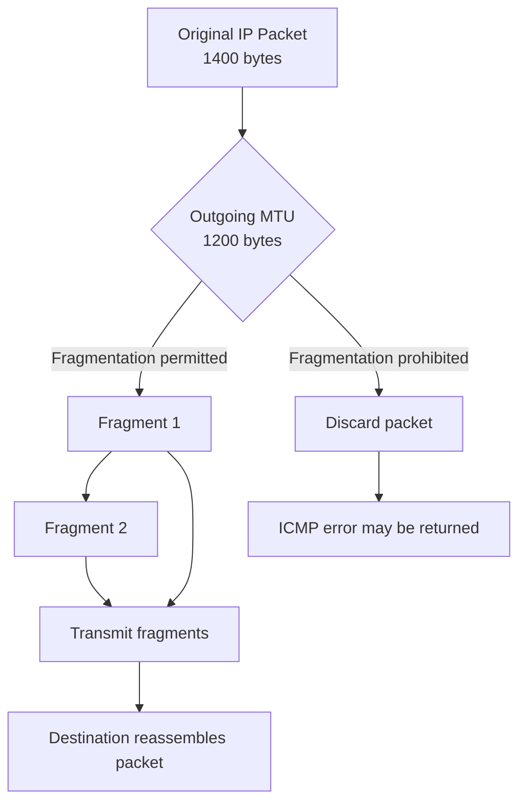
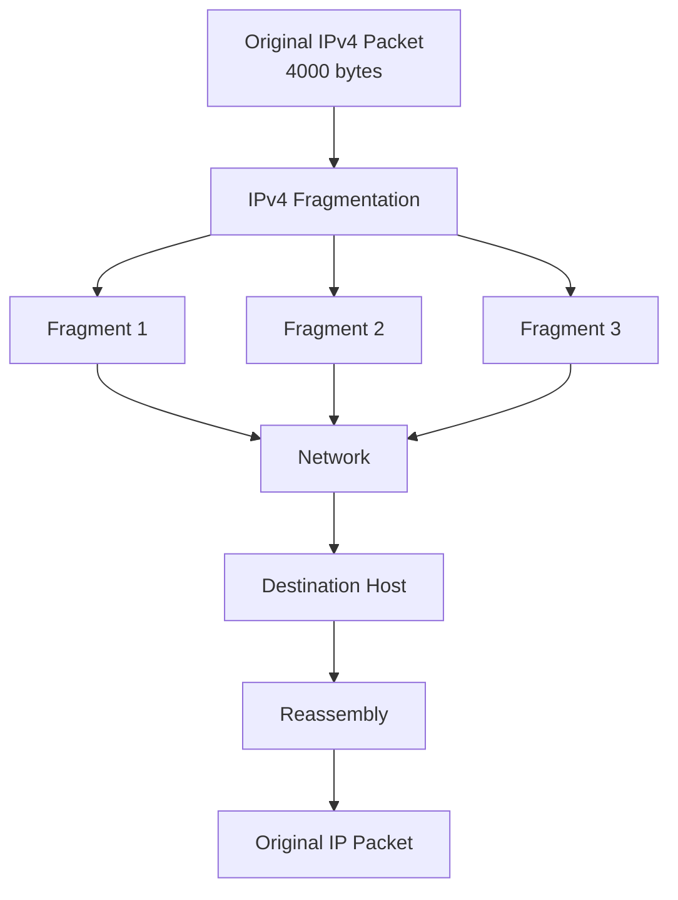
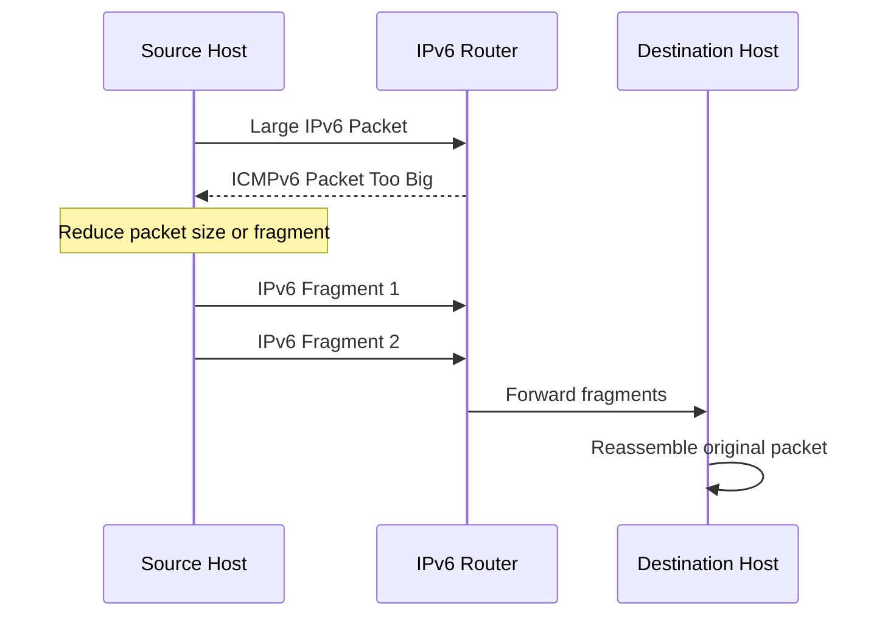
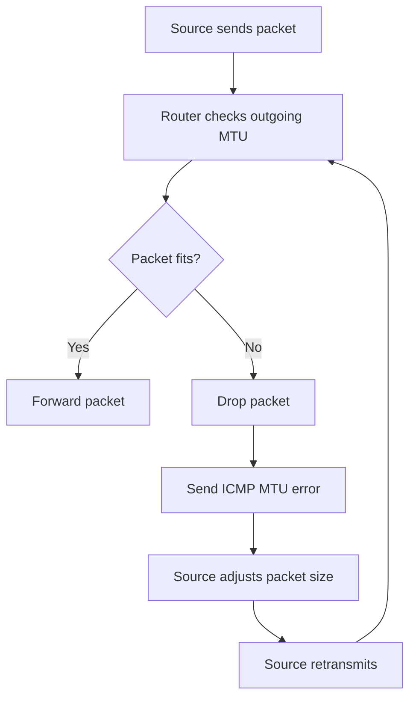

# Fragmentation and MTU

Fragmentation and Maximum Transmission Unit (MTU) are important concepts in IP networking. They determine how large a packet can be when transmitted across a network.

Different network technologies support different frame sizes. When an IP packet is larger than the supported MTU of an outgoing link, the network must handle the size limitation.

The behavior differs between IPv4 and IPv6:

* **IPv4:** Routers may fragment packets when fragmentation is permitted.
* **IPv6:** Routers never fragment packets. The source host must perform fragmentation when necessary.

Understanding fragmentation and MTU is essential for troubleshooting connectivity problems, VPNs, tunnels, performance issues, and Path MTU Discovery (PMTUD).

# 🗁 MTU Fundamentals

MTU stands for **Maximum Transmission Unit**.

It represents the maximum size of a network-layer packet that can be transmitted over a particular link without being fragmented at that layer.

For common Ethernet networks, the default IP MTU is:

```text
1500 bytes
```

This means an Ethernet interface with an MTU of 1500 can normally carry an IP packet of up to 1500 bytes.

The IP packet includes:

* IP header.
* Transport-layer header.
* Application data.

The Ethernet header and Frame Check Sequence (FCS) are not included in the IP MTU.

### 🖆 Example

Consider an IPv4 packet:

```text
IPv4 Header:       20 bytes
TCP Header:        20 bytes
Application Data: 1460 bytes
--------------------------
Total IP Packet:  1500 bytes
```

This packet fits within a standard Ethernet MTU of 1500 bytes.

However, if the IP packet grows to 1600 bytes, it exceeds the MTU and requires an appropriate mechanism to handle the size limitation.

### 🖆 MTU Is Link-Specific

Different network technologies can support different MTU values.

| Network Technology | Common MTU |
| --- | ---: |
| Standard Ethernet | 1500 bytes |
| PPPoE over Ethernet | Commonly 1492 bytes |
| Typical WireGuard interface | Often configured below 1500 |
| Jumbo-frame Ethernet | Commonly 9000 bytes |
| Loopback interface | Often much larger |

These are common configurations, not universal limits. Actual values depend on the network and device configuration.

---

# 🗁 MTU vs Frame Size vs MSS

MTU, Ethernet frame size, and Maximum Segment Size (MSS) are related but describe different things.

### 🖆 MTU

MTU describes the maximum network-layer packet size supported by a link.

For standard Ethernet:

```text
IP MTU = 1500 bytes
```

### 🖆 Ethernet Frame Size

An Ethernet frame contains Layer 2 information and the encapsulated payload.

A standard untagged Ethernet frame carrying a maximum-sized IP packet typically has:

```text
Ethernet Header: 14 bytes
IP Packet:       1500 bytes
Ethernet FCS:       4 bytes
--------------------------
Total:           1518 bytes
```

This excludes the preamble, Start Frame Delimiter (SFD), and interpacket gap.

An IEEE 802.1Q VLAN tag adds another 4 bytes to the frame:

```text
Untagged Ethernet Frame: 1518 bytes
802.1Q Tagged Frame:    1522 bytes
```

The IP MTU can remain 1500 bytes when the underlying network supports the larger tagged frame.

### 🖆 Maximum Segment Size (MSS)

MSS is the maximum amount of TCP application data that a TCP endpoint is willing to receive in a single TCP segment.

For a typical IPv4 connection over a 1500-byte MTU:

```text
IP MTU:          1500 bytes
IPv4 Header:       20 bytes
TCP Header:        20 bytes
--------------------------
TCP MSS:         1460 bytes
```

For typical IPv6 with a 40-byte base header and a 20-byte TCP header:

```text
IP MTU:          1500 bytes
IPv6 Header:       40 bytes
TCP Header:        20 bytes
--------------------------
TCP MSS:         1440 bytes
```

These examples assume no additional IP or TCP header options.

### 🖆 Comparison

| Term | Meaning | Layer |
| --- | --- | --- |
| MTU | Maximum network-layer packet size | Network |
| Frame Size | Complete Layer 2 frame size | Data Link |
| MSS | Maximum TCP payload size | Transport |

Remember:

* MTU describes IP packet size.
* Frame size includes Layer 2 encapsulation.
* MSS describes TCP data size.

---

# 🗁 Why Fragmentation Is Needed

Fragmentation is the process of dividing an IP packet into smaller pieces so that they can be transmitted over a link with a smaller MTU.

Consider two networks:

```text
Network A MTU: 1500 bytes
Network B MTU: 1200 bytes
```

A packet of 1400 bytes leaves Network A and needs to cross Network B.

The packet exceeds the outgoing link's MTU.

The network must handle this situation according to the IP version and fragmentation rules.

### 🖆 Without Fragmentation

If the packet cannot be transmitted and fragmentation is not permitted, it must be discarded.

The sender may receive an ICMP message indicating that the packet is too large for the outgoing link.

### 🖆 With Fragmentation

When fragmentation is permitted, a packet can be divided into smaller fragments.

Each fragment contains the information needed for the destination to identify and reassemble the original packet.



---

# 🗁 IPv4 Fragmentation

IPv4 supports fragmentation.

When an IPv4 packet is larger than the outgoing interface MTU, a router may fragment it if the Don't Fragment (DF) flag is not set.

The source host can also fragment packets before transmission.

### 🖆 Where IPv4 Fragmentation Happens

IPv4 fragmentation can occur:

* At the source host.
* At an intermediate router, if fragmentation is permitted.

Reassembly is performed by the final destination host, not by intermediate routers.

### 🖆 IPv4 Fragmentation Process

Suppose a sender transmits a 4000-byte IPv4 packet through a network with a 1500-byte MTU.

The packet may be divided into multiple fragments.

Each fragment receives its own IPv4 header.

The destination uses fragmentation information in those headers to reconstruct the original packet.



### 🖆 IPv4 Don't Fragment Flag

The IPv4 header contains a Flags field.

One of its bits is the Don't Fragment flag.

| DF Value | Meaning |
| --- | --- |
| 0 | Fragmentation is permitted |
| 1 | Fragmentation is prohibited |

When DF is set and a router cannot forward the packet because it exceeds the outgoing MTU:

* The router drops the packet.
* It normally sends an ICMP Destination Unreachable message.
* The relevant IPv4 code is Fragmentation Needed and DF Set.

This ICMP message helps the sender discover the path's MTU.

### 🖆 IPv4 More Fragments Flag

IPv4 also contains the More Fragments (MF) flag.

| MF Value | Meaning |
| --- | --- |
| 0 | No more fragments follow this fragment |
| 1 | More fragments follow |

The final fragment has MF set to `0`.

A packet that has not been fragmented normally has MF set to `0` and Fragment Offset set to `0`.

---

# 🗁 IPv4 Fragmentation Fields

IPv4 uses three important header fields to support fragmentation and reassembly.

### 🖆 Identification

The Identification field is a 16-bit value.

All fragments belonging to the same original IPv4 datagram use the same Identification value.

The destination uses it, along with other packet information, to identify fragments belonging to the same datagram.

### 🖆 Flags

The IPv4 Flags field contains three bits:

| Bit | Name | Purpose |
| --- | --- | --- |
| Reserved | Reserved | Must remain zero |
| DF | Don't Fragment | Controls fragmentation |
| MF | More Fragments | Indicates whether more fragments follow |

### 🖆 Fragment Offset

The Fragment Offset identifies the position of a fragment's data within the original IPv4 payload.

Important characteristics:

* It is a 13-bit field.
* Its unit is 8 bytes.
* It identifies where the fragment data belongs in the original packet.
* The first fragment has an offset of `0`.

The offset is not measured in individual bytes.

For example:

```text
Fragment Offset = 185

Actual Byte Position = 185 × 8
                    = 1480 bytes
```

### 🖆 IPv4 Fragmentation Header Fields

| Field | Size | Purpose |
| --- | ---: | --- |
| Identification | 16 bits | Associates fragments |
| Flags | 3 bits | Controls fragmentation and indicates remaining fragments |
| Fragment Offset | 13 bits | Identifies fragment position |

---

# 🗁 IPv4 Fragmentation Example

Assume an IPv4 packet has:

```text
Total IP Packet Size: 4000 bytes
IPv4 Header:            20 bytes
Original Payload:     3980 bytes
Outgoing MTU:         1500 bytes
```

Each fragment needs its own 20-byte IPv4 header.

The maximum fragment payload is:

```text
1500 - 20 = 1480 bytes
```

The fragment payload must be a multiple of 8 bytes, except that the final fragment may contain a non-multiple-of-8 payload.

In this example, 1480 is already divisible by 8.

### 🖆 Resulting Fragments

| Fragment | Payload Size | Header Size | Total Size | Offset | MF |
| --- | ---: | ---: | ---: | ---: | ---: |
| Fragment 1 | 1480 | 20 | 1500 | 0 | 1 |
| Fragment 2 | 1480 | 20 | 1500 | 185 | 1 |
| Fragment 3 | 1020 | 20 | 1040 | 370 | 0 |

The total original payload is:

```text
1480 + 1480 + 1020 = 3980 bytes
```

The fragment offsets are:

```text
Fragment 1: 0 / 8 = 0

Fragment 2: 1480 / 8 = 185

Fragment 3: 2960 / 8 = 370
```

The destination reassembles the fragments using their Identification, Fragment Offset, and MF information.

### 🖆 Important Reassembly Behavior

If one fragment is missing or arrives too late, the destination may be unable to reconstruct the original datagram.

The reassembly process eventually times out and discards the incomplete datagram.

This is one reason fragmentation can reduce network reliability and efficiency.

---

# 🗁 IPv6 Fragmentation

IPv6 handles fragmentation differently from IPv4.

**IPv6 routers do not fragment packets.**

If an IPv6 packet is too large for the next link, the router drops it and sends an ICMPv6 Packet Too Big message back toward the source.

The source host can then reduce the packet size or fragment it using an IPv6 Fragment extension header.

### 🖆 IPv6 Fragmentation Rules

* Intermediate routers never fragment IPv6 packets.
* Only the source host performs IPv6 fragmentation.
* IPv6 uses a Fragment extension header.
* The destination performs reassembly.
* The minimum IPv6 link MTU is 1280 bytes.

### 🖆 IPv6 Fragment Extension Header

The IPv6 Fragment header contains:

| Field | Purpose |
| --- | --- |
| Next Header | Identifies the header following the Fragment header |
| Reserved | Reserved bits |
| Fragment Offset | Identifies the fragment position |
| M Flag | Indicates whether more fragments follow |
| Identification | Associates fragments from the same original packet |

Each fragment contains an IPv6 base header and a Fragment extension header.

### 🖆 IPv6 Fragmentation Process



### 🖆 IPv6 Packet Too Big

ICMPv6 Packet Too Big is message type:

```text
ICMPv6 Type: 2
```

The message includes the MTU supported by the link that could not carry the packet.

The source uses this information to adjust packet sizes.

This mechanism is essential to IPv6 Path MTU Discovery.

---

# 🗁 IPv4 vs IPv6 Fragmentation

IPv4 and IPv6 have different fragmentation behavior.

| Feature | IPv4 | IPv6 |
| --- | --- | --- |
| Router fragmentation | Permitted when DF is clear | Not permitted |
| Source fragmentation | Supported | Supported |
| Fragmentation header | IPv4 base header fields | Fragment extension header |
| Reassembly | Destination host | Destination host |
| MTU error notification | ICMP Fragmentation Needed | ICMPv6 Packet Too Big |
| Minimum link MTU | No equivalent universal 1280-byte rule | 1280 bytes |

### 🖆 Important Differences

**IPv4**

A router can fragment a packet when fragmentation is allowed.

**IPv6**

A router never fragments a packet. The source must adapt its packet size or generate fragments.

IPv6 was designed to make intermediate packet forwarding simpler and to encourage source-driven packet-size management.

---

# 🗁 Path MTU

Path MTU (PMTU) is the smallest MTU among all links along a network path between a source and destination.

Consider this path:

```text
Host A
  |
  | MTU 1500
  |
Router 1
  |
  | MTU 1400
  |
Router 2
  |
  | MTU 1300
  |
Router 3
  |
  | MTU 1500
  |
Host B
```

The Path MTU is:

```text
PMTU = 1300 bytes
```

Even though the source and destination interfaces support an MTU of 1500, the complete path supports only 1300 bytes without fragmentation.

### 🖆 Why Path MTU Matters

The source needs to know the maximum packet size supported across the entire path.

If the source sends packets larger than the Path MTU:

* IPv4 packets may be fragmented when permitted.
* IPv4 packets with DF set may be dropped.
* IPv6 routers drop oversized packets and send Packet Too Big messages.
* TCP connections may experience retransmissions or stalls if PMTU signaling fails.

---

# 🗁 Path MTU Discovery

Path MTU Discovery (PMTUD) is a mechanism used to discover the maximum packet size that can travel across a network path without fragmentation.

It helps hosts avoid sending packets that exceed the path's MTU.

### 🖆 IPv4 Path MTU Discovery

Traditional IPv4 PMTUD is described in RFC 1191.

The sender sets the Don't Fragment flag.

If a router encounters an outgoing link with a smaller MTU:

* It drops the packet.
* It sends ICMP Destination Unreachable.
* The code indicates Fragmentation Needed and DF Set.
* The sender reduces its packet size.

The sender can then retransmit using a smaller packet size.

### 🖆 IPv6 Path MTU Discovery

IPv6 PMTUD is described in RFC 8201.

The process works differently because routers cannot fragment IPv6 packets.

When a router receives a packet larger than the outgoing link MTU:

* It drops the packet.
* It sends ICMPv6 Packet Too Big.
* The source receives the reported MTU.
* The source reduces its packet size or fragments when appropriate.

### 🖆 PMTUD Process



### 🖆 Path MTU Discovery Black Holes

A PMTUD black hole occurs when oversized packets are dropped and the necessary ICMP error messages do not reach the sender.

For example:

* A router drops an oversized packet.
* It sends ICMP Packet Too Big.
* A firewall blocks that ICMP message.
* The source never learns that the packet is too large.
* Communication may stall.

This can produce confusing behavior.

A website may partially load, a TCP connection may establish but stop transferring data, or small requests may work while larger responses fail.

### 🖆 Packetization Layer Path MTU Discovery

Packetization Layer Path MTU Discovery (PLPMTUD) is described in RFC 8899.

Instead of depending exclusively on ICMP messages, PLPMTUD uses packetization-layer feedback to determine a suitable packet size.

It can probe larger packet sizes and use successful delivery or transport-level feedback to estimate the path's usable packet size.

This approach helps mitigate problems caused by missing or filtered ICMP messages.

---

# 🗁 MTU and TCP MSS

MTU and MSS are closely related.

TCP uses MSS to limit the amount of TCP data sent in a segment.

A suitable MSS helps prevent TCP segments from creating IP packets larger than the path can carry.

### 🖆 MSS Calculation

For a typical IPv4 Ethernet connection:

```text
MTU:             1500 bytes
IPv4 Header:       20 bytes
TCP Header:        20 bytes
--------------------------
MSS:             1460 bytes
```

For typical IPv6:

```text
MTU:             1500 bytes
IPv6 Header:       40 bytes
TCP Header:        20 bytes
--------------------------
MSS:             1440 bytes
```

These calculations assume base IP headers and a standard TCP header without additional options.

TCP options consume additional space within the IP packet. TCP endpoints account for the available packet size when transmitting data.

### 🖆 MSS Clamping

MSS clamping is a technique used by routers and firewalls to adjust the MSS advertised in TCP SYN packets.

It is commonly used in networks with reduced MTUs, including:

* PPPoE connections.
* VPN tunnels.
* GRE tunnels.
* IPsec tunnels.
* Other encapsulated networks.

For example:

```text
Original MSS: 1460 bytes
Adjusted MSS: 1452 bytes
```

The adjusted MSS can help prevent TCP packets from exceeding the effective path MTU.

MSS clamping applies to TCP. It does not solve MTU problems for UDP or other protocols.

---

# 🗁 MTU in VPNs and Tunnels

VPNs and tunnels add encapsulation headers to packets.

These additional headers consume space within the underlying network MTU.

As a result, the inner packet must often be smaller than the outer network's MTU.

### 🖆 Why Tunnels Reduce Effective MTU

Consider an Ethernet path with:

```text
Underlay MTU: 1500 bytes
```

A tunnel adds encapsulation overhead:

```text
Outer IP Header:       20 bytes
UDP Header:             8 bytes
Tunnel Overhead:       32 bytes
-------------------------------
Total Overhead:        60 bytes
```

The remaining space for the inner packet is:

```text
1500 - 60 = 1440 bytes
```

This is an illustrative calculation. Actual tunnel overhead depends on the encapsulation, IP version, security options, and other headers.

### 🖆 Common Tunneling Technologies

| Technology | Typical Overhead Considerations |
| --- | --- |
| GRE | Adds GRE and outer IP headers |
| IPsec | Adds security, integrity, and encapsulation overhead |
| WireGuard | Adds UDP and WireGuard transport overhead |
| OpenVPN | Adds transport, encryption, and tunnel framing overhead |
| VXLAN | Adds outer Ethernet, IP, UDP, and VXLAN headers |
| PPPoE | Adds PPPoE and PPP headers to Ethernet payload |

### 🖆 VPN MTU Problems

Incorrect MTU configuration can cause:

* Slow file transfers.
* Websites loading partially.
* SSH sessions freezing during larger transfers.
* Large packets being dropped.
* TCP retransmissions.
* Fragmentation.
* Poor VPN performance.

### 🖆 Practical Recommendations

* Determine the effective underlay MTU.
* Account for tunnel encapsulation overhead.
* Configure an appropriate tunnel interface MTU.
* Verify Path MTU Discovery.
* Consider TCP MSS clamping when appropriate.
* Test both IPv4 and IPv6 paths.

---

# 🗁 Fragmentation Problems

Fragmentation can introduce operational and performance problems.

### 🖆 Increased Processing Overhead

Each fragment requires additional IP header information.

Routers and endpoints must process more packets than they would for an unfragmented datagram.

This increases processing overhead.

### 🖆 Packet Loss Impact

If one fragment of a fragmented datagram is lost, the destination may be unable to reassemble the original datagram.

The entire datagram may eventually be discarded.

For TCP, this can cause retransmission of data when recovery mechanisms detect the loss.

### 🖆 Firewall and NAT Problems

Some firewalls and NAT devices have difficulty handling fragmented traffic, particularly non-initial fragments.

The transport-layer header is generally present only in the first fragment.

A device that depends on TCP or UDP port information may not have enough information in later fragments to apply the same filtering logic.

### 🖆 Fragmentation Attacks

Attackers may abuse fragmentation behavior to exploit weaknesses in packet reassembly or security inspection.

Examples include:

* Overlapping fragment attacks.
* Tiny fragment attacks.
* Fragment reassembly resource exhaustion.
* Malformed fragment attacks.

Modern network stacks and security devices implement validation and defensive handling to reduce these risks.

### 🖆 Fragmentation vs Segmentation

Fragmentation and segmentation are different operations.

| Feature | Fragmentation | TCP Segmentation |
| --- | --- | --- |
| Layer | Network | Transport |
| Protocol | IP | TCP |
| Unit | IP fragments | TCP segments |
| Reassembly | Destination IP layer | TCP receiving stack |
| Main purpose | Fit packet into MTU | Divide byte stream into segments |

TCP segmentation is normally preferable to relying on IP fragmentation for ordinary TCP data transfer.

---

# 🗁 Linux MTU Commands

Linux provides commands for inspecting and modifying interface MTU values.

### 🖆 Display Interface MTU

```bash
ip link show
```

Example output:

```text
2: eth0: <BROADCAST,MULTICAST,UP,LOWER_UP>
    mtu 1500 qdisc fq_codel state UP
    mode DEFAULT group default qlen 1000
```

The interface MTU is:

```text
1500
```

### 🖆 Display a Specific Interface

```bash
ip link show dev eth0
```

### 🖆 Change MTU Temporarily

Set an interface MTU to 1400:

```bash
sudo ip link set dev eth0 mtu 1400
```

Verify:

```bash
ip link show dev eth0
```

This change is generally temporary and may be overwritten by network management services or system configuration after reboot.

### 🖆 Restore Standard Ethernet MTU

```bash
sudo ip link set dev eth0 mtu 1500
```

### 🖆 Inspect Interface Details

```bash
ip -details link show dev eth0
```

### 🖆 Inspect TCP Connections

```bash
ss -ti
```

This displays TCP connection information, including various TCP metrics depending on the connection and kernel.

### 🖆 Inspect Network Configuration

```bash
ip addr show
ip route show
ip -6 route show
```

These commands help identify interface configuration and the route used to reach a destination.

---

# 🗁 Practical MTU Testing

Ping can be used to test whether packets of particular sizes can travel across a network path.

The `-M do` option in Linux `ping` requests that IPv4 packets not be fragmented.

### 🖆 Test IPv4 MTU

For a typical 1500-byte IPv4 MTU:

```bash
ping -4 -M do -s 1472 1.1.1.1
```

Why use `1472`?

```text
ICMP Payload: 1472 bytes
ICMP Header:     8 bytes
IPv4 Header:    20 bytes
------------------------
Total:         1500 bytes
```

The total IPv4 packet size is 1500 bytes.

### 🖆 Test a Smaller Packet

```bash
ping -4 -M do -s 1400 1.1.1.1
```

This creates an IPv4 packet of:

```text
1400 + 8 + 20 = 1428 bytes
```

### 🖆 Test IPv6 MTU

For a typical 1500-byte IPv6 MTU:

```bash
ping -6 -s 1452 2606:4700:4700::1111
```

Calculation:

```text
ICMPv6 Payload: 1452 bytes
ICMPv6 Header:     8 bytes
IPv6 Header:      40 bytes
-------------------------
Total:           1500 bytes
```

IPv6 does not have a Don't Fragment flag. Linux IPv6 ping behavior and fragmentation handling depend on the socket and kernel implementation.

### 🖆 Find a Working Packet Size

You can test several packet sizes:

```bash
ping -4 -M do -s 1472 1.1.1.1
ping -4 -M do -s 1450 1.1.1.1
ping -4 -M do -s 1400 1.1.1.1
ping -4 -M do -s 1300 1.1.1.1
```

Compare the results.

A failed test does not automatically prove that the packet exceeds the path MTU. ICMP echo traffic may be filtered or rate-limited.

### 🖆 Use tracepath

`tracepath` can help discover path MTU information:

```bash
tracepath -4 1.1.1.1
```

For IPv6:

```bash
tracepath -6 2606:4700:4700::1111
```

The exact information available depends on the path and whether intermediate devices return the required ICMP messages.

### 🖆 Capture Fragmented IPv4 Packets

Use:

```bash
sudo tcpdump -ni eth0 'ip[6:2] & 0x3fff != 0'
```

This filter matches IPv4 packets with the More Fragments flag or a nonzero fragment offset.

### 🖆 Capture IPv6 Fragment Headers

Use:

```bash
sudo tcpdump -ni eth0 'ip6 protochain 44'
```

This attempts to match IPv6 packets containing a Fragment extension header.

---

# 🗁 Packet Analysis with Wireshark

Wireshark can identify IP fragmentation, packet sizes, and MTU-related ICMP messages.

### 🖆 IPv4 Fragmentation Filters

Display IPv4 fragments:

```text
ip.flags.mf == 1 || ip.frag_offset > 0
```

Display packets with the Don't Fragment flag:

```text
ip.flags.df == 1
```

Display the More Fragments flag:

```text
ip.flags.mf == 1
```

Display non-initial fragments:

```text
ip.frag_offset > 0
```

### 🖆 IPv6 Fragmentation Filters

Display IPv6 Fragment headers:

```text
ipv6.fragment
```

### 🖆 MTU-Related ICMP Filters

Display IPv4 Destination Unreachable messages:

```text
icmp.type == 3
```

Display IPv4 Fragmentation Needed messages:

```text
icmp.type == 3 && icmp.code == 4
```

Display IPv6 Packet Too Big messages:

```text
icmpv6.type == 2
```

### 🖆 What to Inspect

When investigating fragmentation or MTU issues, inspect:

* IP packet length.
* Interface MTU.
* IPv4 DF and MF flags.
* IPv4 Fragment Offset.
* IPv4 Identification.
* IPv6 Fragment extension header.
* ICMP Fragmentation Needed messages.
* ICMPv6 Packet Too Big messages.
* Retransmissions and packet loss.
* Whether packets are fragmented before or
